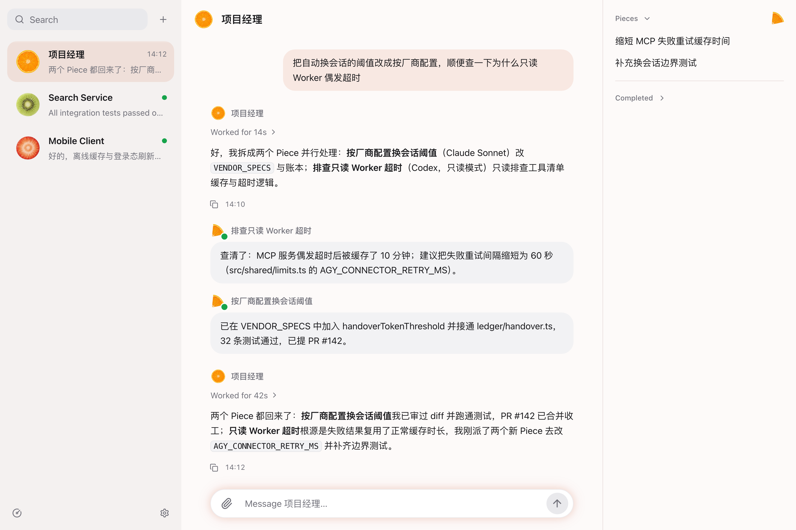

# Agent Hub

**English** | [中文](#中文)

**Manage an entire project through a single conversation.**

Agent Hub is a self-hosted web app built around one idea: **for each project, you only talk to one Project Manager (PM) agent.** You tell the PM what you want; the PM breaks down the work, dispatches **Worker** agents (called **Pieces** in the UI) into isolated git worktrees, reviews their diffs and test results, and merges their PRs. Every role—PM or Worker—can independently run a different vendor's official command-line agent (`claude`, `agy`, or `codex`, defined in [`src/shared/vendors.ts`](src/shared/vendors.ts) as `AGENT_VENDORS`) under your own account.



### Why a single conversation per project?

When you work with multiple coding agents at once, the bottleneck quickly shifts from writing code to **managing agent sessions**: creating git worktrees, picking models, copying context between threads, watching terminals, checking whether an agent stalled, and reviewing diffs across half a dozen tabs.

Existing multi-agent tools such as [Orca](https://github.com/stablyai/orca) ([docs](https://www.onorca.dev/docs)) and [T3 Code](https://github.com/pingdotgg/t3code) ([outside-agents docs](https://github.com/pingdotgg/t3code/blob/main/docs/user/outside-agents.md)) are primarily designed around **giving you a workspace to open and watch multiple agent sessions and worktrees yourself**:
- **[Orca](https://github.com/stablyai/orca)** is a desktop IDE for running multiple AI coding agents side by side, where each task gets its own git worktree, split-pane agent terminal, diff viewer, and browser tab (along with an `orca` CLI and experimental [orchestration commands](https://www.onorca.dev/docs/cli/orchestration) for spawning workers).
- **[T3 Code](https://github.com/pingdotgg/t3code)** is a desktop, web, and mobile control surface for starting and managing agent threads across projects and optional git worktrees (along with [`t3 thread` CLI commands and an MCP server](https://github.com/pingdotgg/t3code/blob/main/docs/user/outside-agents.md) for outside agents).

While you can also use those tools to have one agent spawn others, Agent Hub is designed from the ground up specifically for **"one conversation manages the whole project"**—the shape it has had since day one. You do not open or babysit individual worktree sessions yourself; the UI, context lifecycle, and sub-agent orchestration are all built to keep you in a single continuous conversation with your project's PM.

It is built for **one person across multiple devices** (your Mac, a Linux server, your phone)—not a multi-user shared server.

## How it works

### 1. A UI built around the PM conversation

- **One project, one main chat:** The left sidebar ([`src/web/components/Sidebar.tsx`](src/web/components/Sidebar.tsx), `listConversations` in [`src/web/selectors.ts`](src/web/selectors.ts)) only lists Project Managers (`1 PM = 1 project`, [`src/daemon/ledger/projects.ts`](src/daemon/ledger/projects.ts)). Worker conversations never clutter the sidebar.
- **Process collapsed by default, conclusions up front:** In the PM chat ([`src/web/components/Messages.tsx`](src/web/components/Messages.tsx)), the PM's intermediate tool calls and Worker dispatch/close events within a turn are folded into a single `Worked for Xs ›` line (`WorkLine` / `groupMessages` in [`src/web/selectors.ts`](src/web/selectors.ts)). When a Piece finishes a round, only a compact status dot and summary bubble (`WorkerSpeech`, capped at `WORKER_LINE_SUMMARY_CHARS = 120` characters in [`src/shared/limits.ts`](src/shared/limits.ts) and [`src/shared/worker.ts`](src/shared/worker.ts)) appear in the main conversation.
- **On-demand drill-down:** Active Pieces, pending questions (`Needs You` from `hub ask`), and a collapsed-by-default `Completed` list live in the right rail ([`src/web/components/RightRail.tsx`](src/web/components/RightRail.tsx), or the bottom drawer [`src/web/mobile/PiecesDrawer.tsx`](src/web/mobile/PiecesDrawer.tsx) on mobile). You only click a summary bubble or Piece row to open its full execution log ([`src/web/components/WorkerConversation.tsx`](src/web/components/WorkerConversation.tsx)) when you want to look inside.

### 2. Seamless context compaction & session renewal

- **Automatic handover at `200,000` context tokens:** Because you stay in one conversation per project indefinitely, the PM's underlying CLI session will eventually fill up. When a PM session's context reaches **`200,000` tokens** (`HANDOVER_TOKEN_THRESHOLD = 200_000` / `AUTO_RENEW_CONTEXT_TOKENS` in [`src/shared/limits.ts`](src/shared/limits.ts), per-vendor `handoverTokenThreshold` in [`src/shared/vendors.ts`](src/shared/vendors.ts)), the ledger automatically queues a handover ([`src/daemon/ledger/handover.ts`](src/daemon/ledger/handover.ts), [docs/background-handover-design.md](docs/background-handover-design.md)).
- **Non-blocking background fork:** A background runner ([`src/daemon/handover/runner.ts`](src/daemon/handover/runner.ts), `HANDOVER_CONCURRENCY = 2`) forks the PM session in the background ([`src/daemon/handover/claude.ts`](src/daemon/handover/claude.ts), [`codex.ts`](src/daemon/handover/codex.ts), [`agy.ts`](src/daemon/handover/agy.ts)) without `HUB_*` credentials and with writes blocked, generating a ~2,000-character structured handover while you continue chatting with the PM without interruption (if a vendor does not support session forking, it waits for `AUTO_RENEW_IDLE_MS = 20_000` ms of idle time and immediately yields if you send a message).
- **Zero-interruption switch:** Between turns, the ledger switches to `generation + 1`, pre-warms the new CLI process, and prepends `sessionPreambleText` ([`src/daemon/ledger/handover.ts`](src/daemon/ledger/handover.ts)) to the next turn: the latest system prompt and persona memory (`PM_MEMORY_PROMPT` in [`src/daemon/prompt.ts`](src/daemon/prompt.ts)), the structured handover, up to **`30,000` characters** of verbatim user/PM messages before the fork point (`HANDOVER_RECENT_CHARS = 30_000` in [`src/shared/limits.ts`](src/shared/limits.ts), [`src/daemon/ledger/handover-recent.ts`](src/daemon/ledger/handover-recent.ts)) plus all verbatim messages after the fork point (up to `HANDOVER_POST_CUT_MAX_CHARS = 60_000`), a directory of Worker reports that arrived after the fork point, ledger search commands (`hub worker search`, `hub worker show`), and the previous session's raw transcript file path ([`src/daemon/driver/transcript.ts`](src/daemon/driver/transcript.ts)). In the UI, it remains the exact same conversation (`SessionRenewed` divider in [`src/web/components/Messages.tsx`](src/web/components/Messages.tsx)). Switching a PM's vendor on its profile page uses the same handover + verbatim-history transition (`switchVendorIn`).

### 3. Sub-agent (Worker / Piece) orchestration & direct control

- **`hub worker start` with isolated worktrees:** Vendor built-in sub-agent tools (`Agent`, `Task`, `invoke_subagent`, `spawn_agent`) are disabled in [`src/daemon/prompt.ts`](src/daemon/prompt.ts) (`buildPmWorkerPrompt`) so all sub-agents go through Agent Hub's ledger ([`src/daemon/ledger/workers.ts`](src/daemon/ledger/workers.ts)). Each Worker gets its own git worktree (`~/.agent-hub/worktrees/<project>/<worker>`) and branch `hub/<id>-<slug>` ([`src/shared/worker.ts`](src/shared/worker.ts), [`src/daemon/git/worktree.ts`](src/daemon/git/worktree.ts)), optional automatic worktree setup via `hub project setup` (`SETUP_TIMEOUT_MS = 10` minutes in [`src/shared/limits.ts`](src/shared/limits.ts), [`src/daemon/setup/setup.ts`](src/daemon/setup/setup.ts)), and per-worker selection of `--vendor`, `--model`, `--effort`, per-turn `--max-time` (default `DEFAULT_WORKER_MAX_TIME_MS = 30` minutes, range `10s`–`24h`, notifying the PM via `worker.max_time_exceeded` without killing the Worker), and `--readonly` sandbox mode ([`src/shared/readonly-policy.ts`](src/shared/readonly-policy.ts), [docs/readonly-worker-design.md](docs/readonly-worker-design.md)). The PM process mounts `worktrees/<project>/` via `--add-dir` to inspect Worker diffs directly.
- **Talk directly to a Worker or pick who the PM dispatches:** You can open any Piece and send a message directly to that Worker—the Worker receives it tagged with `【用户直接对你说】` and the PM simultaneously receives a copy (`【用户直接对 Worker #N · … 说的话（Worker 已收到）】`, [`src/shared/worker.ts`](src/shared/worker.ts)) so the PM never loses track. In the PM composer, you can also type `/hub:worker` ([`src/web/worker-pick.ts`](src/web/worker-pick.ts), [docs/worker-pick-command.md](docs/worker-pick-command.md)) to specify the vendor, model, and thinking effort for Workers dispatched from that message (`【用户指定：这条消息里派的 Worker 用 --vendor …】`).

### 4. Token saving & efficiency

- **Keep heavy reads and tool noise out of the PM's context:** Quick questions and small edits are answered directly, while reading thousands of lines, investigating logs (`--readonly`), and multi-file edits are offloaded to Workers (`buildPmModePrompt` and `buildPmWorkerPrompt` in [`src/daemon/prompt.ts`](src/daemon/prompt.ts)). Bulky intermediate tool outputs stay inside short-lived Worker sessions instead of inflating the PM's context on every subsequent turn.
- **Pick model and thinking effort by task difficulty:** Each PM and Worker independently sets `--vendor`, `--model`, and `--effort` (`low` / `medium` / `high` / `xhigh` / `max` in [`src/shared/vendors.ts`](src/shared/vendors.ts)). Routine edits or read-only checks can use faster/cheaper models and lower effort while reserving top reasoning models for planning and tricky debugging.
- **Fixed Worker report format & layered on-demand inspection:** Every Worker turn ends with a structured `=== 汇报 ===` block (`状态 / 摘要 / 提交 / 测试 / 问题`, `WORKER_REPORT_FORMAT` in [`src/shared/worker.ts`](src/shared/worker.ts)), and only that block is delivered to the PM. To inspect a Worker without dumping its raw transcript into context, the PM queries layer by layer ([`src/daemon/ledger/worker-view.ts`](src/daemon/ledger/worker-view.ts), [`src/daemon/ledger/worker-stats.ts`](src/daemon/ledger/worker-stats.ts), [`src/shared/limits.ts`](src/shared/limits.ts)):
  - `hub worker show <id>`: status, step count, stall warning after `WORKER_STALL_HINT_MS = 5` minutes without output, branch, and PR info.
  - `hub worker log <id> [--last N | --stats]`: defaults to the last `WORKER_LOG_DEFAULT_STEPS = 20` steps (max `200`), clipping each step to `WORKER_VIEW_TEXT_MAX_CHARS = 100` characters; `--stats` summarizes step counts, elapsed time, and the top `WORKER_STATS_TOP = 3` most-read files and repeated commands.
  - `hub worker list` & `hub worker search`: `hub worker list` caps ended Workers to the most recent `WORKER_LIST_RECENT_ENDED = 20`; older Workers are searched on demand via `hub worker search` (default `20` hits with `WORKER_SEARCH_CONTEXT_CHARS = 80` characters of context).
- **`200,000`-token cap on Worker back-and-forth:** Once a Worker's context exceeds `WORKER_SEND_MAX_TOKENS = 200_000` tokens ([`src/shared/limits.ts`](src/shared/limits.ts), [`src/daemon/prompt.ts`](src/daemon/prompt.ts)) or requires multiple rounds of rework, the PM ends it (`hub worker end`) and starts a fresh Worker on the branch rather than paying to re-read a 200K+ context on every follow-up turn.
- **~97% prompt cache reuse during background handover & tool-stripped preamble:** When Claude Code forks a PM session in the background ([`src/daemon/handover/claude.ts`](src/daemon/handover/claude.ts), `buildForkSettings` in [`src/shared/policy.ts`](src/shared/policy.ts)), it keeps the identical model, system prompt, and tool list (blocking writes via a `PreToolUse` hook and `dontAsk` rather than removing tools), reusing ~97% of the parent session's prompt cache ([docs/background-handover-design.md](docs/background-handover-design.md)). When the new session starts, `recentRows` ([`src/daemon/ledger/handover.ts`](src/daemon/ledger/handover.ts)) strips out all `kind = 'tool'` messages and full Worker reports, carrying over only the ~2,000-character handover, up to `30,000` characters of user/PM dialogue, and a 1-line index of recent Worker reports.
- **Busy-turn message batching & mid-turn delivery:** Consecutive messages sent while an agent is busy are either streamed into the running turn (`msg_lifecycle_v1` in [`src/daemon/driver/base-driver.ts`](src/daemon/driver/base-driver.ts), [docs/mid-turn-messages.md](docs/mid-turn-messages.md)) or batched into a single `【用户连发了 N 条】` turn (`mergeUserTexts` in [`src/daemon/driver/protocol.ts`](src/daemon/driver/protocol.ts)), avoiding N separate full-context turns.
- **Bounded initial state, lazy history loading, and idle process reaping:** `/api/state` returns at most `MESSAGE_PAGE_SIZE = 100` recent messages per active conversation and **`0` messages (`messages: []`, `hasMore: true`) for ended Worker conversations** (`snapshot` in [`src/daemon/ledger/ledger.ts`](src/daemon/ledger/ledger.ts), [`src/shared/limits.ts`](src/shared/limits.ts)), fetching history only when opened. Idle CLI processes are closed after `IDLE_CLOSE_MS = 10` minutes ([`src/shared/limits.ts`](src/shared/limits.ts), held up to `BACKGROUND_TASKS_HOLD_MAX_MS = 4h` for PM / `150m` for Worker when background commands are running) and resumed via `--resume` on the next message, while CLI model/command probes pass `--no-session-persistence --settings '{"disableAllHooks":true}' --strict-mcp-config` (`INITIALIZE_QUERY_ARGS` in [`src/daemon/driver/protocol.ts`](src/daemon/driver/protocol.ts)) and cache results (`MODEL_CATALOG_FRESH_MS = 6h`, `COMMANDS_FRESH_MS = 10m`, `FETCHED_QUOTA_FRESH_MS = 5m`).

## Other features

- **Currently supported agent CLIs:** Claude Code (`claude`), Antigravity (`agy`), and Codex (`codex`) (list defined in [`src/shared/vendors.ts`](src/shared/vendors.ts) as `AGENT_VENDORS`).
- **Rich web UI:** works on desktop and mobile, installable as a PWA with optional Web Push notifications, Markdown rendering, syntax highlighting, Mermaid and Vega-Lite charts, and file uploads.
- **Quota tracking:** displays usage quota windows for the supported vendors.
- **Optional macOS desktop shell & multi-device view:** manage agents across your Mac and Linux machines from a single web page (see below).

## Requirements

- **Node.js >= 24.12** (runs `.ts` natively and uses the built-in `node:sqlite`; see `package.json` `engines`) and **pnpm** (`pnpm@10.x`). `git` is required for worktrees.
- At least one supported agent CLI **installed and logged in in your terminal** (the UI shows the login command if signed out):
  - Claude Code: `claude auth login`
  - Antigravity: `agy`
  - Codex: `codex login`
- macOS or Linux (Ubuntu; see [docs/linux.md](docs/linux.md)). Windows is not covered.

## Install and run

```bash
git clone https://github.com/maodesikeng-boop/agent-hub.git
cd agent-hub
pnpm install
pnpm build
pnpm start
```

- `pnpm build` builds the frontend web assets into `dist/web`.
- `pnpm start` runs `prestart` (`vite build`) and starts the daemon (`node src/daemon/main.ts`).
- On startup, the daemon prints a login link such as `http://127.0.0.1:4317/auth?token=…`. Open it once in your browser to set a session cookie. The link contains your local master token—do not share it. The first start automatically creates a default project manager.
- Stop the daemon with `Ctrl+C`.

To use a custom port or data directory:

```bash
AGENT_HUB_PORT=4400 AGENT_HUB_HOME=~/my-hub pnpm start
```

## macOS app

```bash
pnpm app:mac                              # builds build/Agent Hub.app
bash scripts/build-mac-app.sh --install   # builds and copies to /Applications/Agent Hub.app
```

The macOS app (`apps/macos/`) is a lightweight native WebKit shell that supervises the local daemon. Building requires Xcode Command Line Tools (`swiftc`) and built web assets (`pnpm build`, or pass `--build-web` to `scripts/build-mac-app.sh`).

**You must compile the app yourself for your own machine:** `scripts/build-mac-app.sh` writes your repository's absolute path (`AgentHubRepoDir`) and your Node.js binary path (`AgentHubNodePath`) directly into `Contents/Info.plist`, and signs the bundle ad-hoc (`codesign -s -`). **If you move the repository or change your Node installation path, you must recompile** (or override them at runtime via `AGENT_HUB_REPO_DIR` and `AGENT_HUB_NODE`). Do not distribute the compiled `.app` bundle.

## Multiple devices

Each machine runs its own daemon, and a single web page can view and operate all of them. Devices connect through a central Linux server over SSH tunnels (or optionally Tailscale); a phone can reach the central server over HTTPS (for example via Tailscale Funnel) and sign in by scanning a one-time QR code and approving the new browser session on an already signed-in device.

Multi-device and public access are completely optional: by default the daemon listens only on `127.0.0.1`, and nothing is exposed externally unless you explicitly configure SSH tunnels, run `tailscale serve`, or enable the public entry in settings. For architecture and setup details, see:
- [docs/multi-device-design.md](docs/multi-device-design.md)
- [docs/hub-tunnel-design.md](docs/hub-tunnel-design.md)
- [docs/linux.md](docs/linux.md)

## Configuration

All environment variables are optional.

| Variable | Default | Description |
|---|---|---|
| `AGENT_HUB_HOME` | `~/.agent-hub` | Data directory (SQLite database, tokens, worktrees, uploads, logs). Keep the path short: Unix sockets inside `run/` must fit within 103 bytes (`MAX_UNIX_SOCKET_PATH_BYTES`). |
| `AGENT_HUB_PORT` | `4317` | Web UI port (listens on `127.0.0.1` only). Set to `0` to let the OS pick a free port. |
| `AGENT_HUB_CLAUDE` | `claude` | Command name or path to the Claude Code CLI (`~/` is expanded; searched in `PATH` and standard fallback directories). |
| `AGENT_HUB_AGY` | `agy` | Command name or path to the Antigravity CLI (`~/` is expanded; searched in `PATH` and standard fallback directories). |
| `AGENT_HUB_CODEX` | `codex` | Command name or path to the Codex CLI (`~/` is expanded; searched in `PATH`, `ChatGPT.app` on macOS, and standard fallback directories). |
| `AGENT_HUB_DEFAULT_MODEL` | unset | Model ID for the default project manager created on first start; when unset, uses the vendor CLI's own default. |
| `AGENT_HUB_TAILSCALE` | `/Applications/Tailscale.app/Contents/MacOS/Tailscale` on macOS (if present), else `tailscale` | Path or command name for the `tailscale` CLI. |
| `AGENT_HUB_TAILNET_NAME` | detected via `tailscale status --json` | Override the machine's tailnet DNS name (`<machine>.<tailnet>.ts.net`). |
| `AGENT_HUB_TAILNET_OWNER` | detected via `tailscale status --json` | Override the device owner's Tailscale login name (required on tagged Tailscale devices, where `tailscale status` has no owner). |
| `AGENT_HUB_SERVE_TARGET` | `unix` on Linux, `tcp` on macOS | How `tailscale serve` forwards to the daemon (`unix` for `run/ui.sock`, or `tcp` for `127.0.0.1:<port>`). |
| `AGENT_HUB_REPO_DIR` | `AgentHubRepoDir` in `Info.plist` | macOS app only: override the repository directory path at runtime. |
| `AGENT_HUB_NODE` | `AgentHubNodePath` in `Info.plist` | macOS app only: override the Node.js executable path at runtime. |
| `AGENT_HUB_DAEMON_PORT` | unset | Development only (`pnpm dev`): daemon port that Vite proxies `/api`, `/auth`, and `/d` requests to. |
| `CODEX_HOME`, `CLAUDE_CONFIG_DIR` | `~/.codex`, `~/.claude` | Vendor CLI configuration directories read by the daemon for auth status, model catalog cache fingerprints, and session transcripts. |

*(Note: when a project's worktree setup command runs via `hub project setup`, the daemon also provides `AGENT_HUB_ROOT_PATH` and `AGENT_HUB_WORKTREE_PATH` to the setup script.)*

## Vendor terms & account risks

Agent Hub does not call model provider APIs directly. Instead, it launches each vendor's **official command-line agent** on your machine, under **your own account**, in non-interactive/headless mode, and drives it automatically. Whether using an external orchestrator to drive the official CLI is permitted under your subscription or terms of service is for you to review and decide; this project does not grant permission or guarantee that your account will remain in good standing.

- **Google Antigravity:** Section 6 of the [Google Antigravity Additional Terms](https://antigravity.google/terms/) states:
  > "Using third party software, tools, or services to access the Service (e.g. using OpenClaw with Antigravity OAuth) is a breach of this Agreement. Such actions may be grounds for suspension or termination of your Antigravity and/or Gemini CLI accounts."

  Google has not explicitly clarified whether driving the official `agy` CLI in headless mode from a local tool like Agent Hub falls under this prohibition. Treat it as a **risk of account suspension or termination** and decide for yourself.
- **Claude Code:** Review and comply with Anthropic's terms and compliance docs: <https://code.claude.com/docs/en/legal-and-compliance>.
- **Codex:** Review and comply with OpenAI's terms of use: <https://openai.com/policies/row-terms-of-use/>.

Vendor terms change over time; always check the latest official documents yourself.

## Security notes

Workers edit files and execute shell commands on your machine with your OS user's permissions. Understand the actual boundaries before running agents on important repositories or machines:

- **Worker write scope (`src/shared/write-scope.ts`, `src/daemon/driver/write-scope.ts`):** Inside the Agent Hub data directory (`~/.agent-hub`), a normal worker is only allowed to write to its own git worktree (`worktrees/<project>/<worker>`); `state/` (SQLite database, tokens, personas) and other workers' worktrees are write-protected. This is enforced by wrapping the worker process in an OS sandbox (`sandbox-exec` on macOS; `bubblewrap` / `bwrap` on Linux after running the one-time `sudo scripts/linux-sandbox-setup.sh` setup—see [docs/write-scope.md](docs/write-scope.md)). If the OS sandbox is unavailable, workers refuse to start. **Outside the data directory (`~/.agent-hub`), there are no write restrictions:** a worker can modify your project folder and any other user-writable files, run arbitrary commands, and access the network just like any program you run.
- **Read-only workers (`src/shared/readonly-policy.ts`):** Read-only workers can read files and run commands, and can only call read-only MCP connector tools (`readOnlyHint: true`). Sensitive paths are blocked from reading (`state/ui-token`, vendor credential files, `~/.ssh`, `~/.aws`, `~/.gnupg`, `~/.config/gh`, etc., plus globs like `**/.env`, `**/.env.*`, `**/*.pem`, `**/*.key`, `**/id_rsa*`, `**/id_ed25519*`), and writes are blocked everywhere except a per-session private temporary directory (and required runtime/cache directories). Claude Code and Codex use their native read-only sandboxes; Antigravity is wrapped in the outer read-only OS sandbox. See [docs/readonly-worker-design.md](docs/readonly-worker-design.md).
- **Project managers are not sandboxed.**
- Do not expose the local daemon port (`4317`) to untrusted networks. To report a security vulnerability privately, see [SECURITY.md](SECURITY.md).

## Third-party assets and licenses

- The 16 fruit avatar images in `src/web/assets/avatars/` are AI-generated.
- Third-party npm dependencies are distributed under their respective licenses (see `pnpm-lock.yaml`). In particular, `mermaid` pulls in transitive dependencies `elkjs` (licensed under `EPL-2.0 OR GPL-3.0-or-later`) and `khroma` (no `license` field published in the npm package metadata; upstream repository is MIT). Please verify transitive licenses if you redistribute bundled builds.

## License

[MIT](LICENSE)

---

# 中文

[English](#agent-hub) | **中文**

**通过一个会话管理整个项目。**

Agent Hub 是一个自托管的个人多 Agent 协作网页应用，核心设计只有一件事：**每个项目你只需要跟一个项目经理（PM）聊。** 你把需求告诉项目经理，拆任务、派 **Worker**（界面里叫 **Pieces**）到各自独立的 git worktree 里并行干活、审代码跑测试、合 PR，都由项目经理去做。项目经理和每个 Worker 都可以各自任选不同厂商的官方命令行 Agent（`claude`、`agy`、`codex`，名单见 [`src/shared/vendors.ts`](src/shared/vendors.ts) 的 `AGENT_VENDORS`），使用你自己的账号。

### 为什么要“一个会话管住整个项目”？

同时用多个编程 Agent 干活时，瓶颈很快就会从“写代码”变成**“管会话”**：建 git worktree、选模型、在不同会话之间来回贴背景、盯一堆终端看谁卡住了、在十几个标签页里挨个审 diff。

市面上常见的多 Agent 工具（如 [Orca](https://github.com/stablyai/orca)（[文档](https://www.onorca.dev/docs)）、[T3 Code](https://github.com/pingdotgg/t3code)（[外部 Agent 文档](https://github.com/pingdotgg/t3code/blob/main/docs/user/outside-agents.md)））主要是围绕**“让你自己开、自己盯每个 Agent 会话和 worktree”**设计的：
- **[Orca](https://github.com/stablyai/orca)** 是并排运行多个 AI 编程 Agent 的桌面 IDE，每个任务有自己的 git worktree、分屏终端、diff 查看器和浏览器标签页（也提供 `orca` CLI 和实验性的[编排命令](https://www.onorca.dev/docs/cli/orchestration)来派子任务）。
- **[T3 Code](https://github.com/pingdotgg/t3code)** 是跨桌面、网页和手机的 Agent 控制面板，用来在多个项目和可选的 git worktree 中启动、管理多条 Agent 线程（同时提供 [`t3 thread` CLI 与 MCP 服务](https://github.com/pingdotgg/t3code/blob/main/docs/user/outside-agents.md)供外部 Agent 调用）。

这些工具虽然也能拿来“让一个 Agent 派别的 Agent”，但 Agent Hub 从最早开始开发时就是专门按**“一个会话管住一个项目”**设计的：你不用自己去开、去盯每个 worktree 和终端，界面布局、上下文生命周期、子 Agent 编排和省 Token 机制全都是为了让你始终留在这一个项目经理对话里。

它是为**一个人、多台设备**（你自己的 Mac、Linux 服务器、手机）设计的自用工具，不是多人共用的服务端。

## 怎么做到的

### 1. 围绕“和项目经理聊天”设计的界面

- **一个项目只有一条主线对话**：左侧栏（[`src/web/components/Sidebar.tsx`](src/web/components/Sidebar.tsx)、[`src/web/selectors.ts`](src/web/selectors.ts) 的 `listConversations`）只列项目经理（一个项目经理对应一个项目，见 [`src/daemon/ledger/projects.ts`](src/daemon/ledger/projects.ts)），Worker 的会话不会混进左侧列表。
- **过程默认收起，主对话只看结论和状态**：在项目经理聊天流（[`src/web/components/Messages.tsx`](src/web/components/Messages.tsx)）里，项目经理每一轮的中间工具调用和派发/收工事件默认折成一行 `Worked for Xs ›`（`WorkLine` / [`src/web/selectors.ts`](src/web/selectors.ts) 的 `groupMessages`）。Piece 每做完一轮，主对话里只出现一个带状态圆点的简短汇报气泡（`WorkerSpeech`，摘要截断上限 `WORKER_LINE_SUMMARY_CHARS = 120` 字，见 [`src/shared/limits.ts`](src/shared/limits.ts)、[`src/shared/worker.ts`](src/shared/worker.ts)）。
- **需要时再点开看过程**：正在干活的 `Pieces`、需要你拍板的问题（`Needs You`，来自 `hub ask`）和默认收起的 `Completed` 放在右侧栏（[`src/web/components/RightRail.tsx`](src/web/components/RightRail.tsx)，手机端为底部抽屉 [`src/web/mobile/PiecesDrawer.tsx`](src/web/mobile/PiecesDrawer.tsx)）。平时只看结论，想看某个 Piece 的具体步骤或直接插话时，点汇报气泡或右侧条目即可打开它的完整会话（[`src/web/components/WorkerConversation.tsx`](src/web/components/WorkerConversation.tsx)）。

### 2. 无感的上下文压缩与自动换会话

- **满 `200,000` Token 自动触发交接**：一个会话一直聊下去，底层 CLI 会话迟早会满。当项目经理会话的上下文达到 **`200,000` Token**（[`src/shared/limits.ts`](src/shared/limits.ts) 的 `HANDOVER_TOKEN_THRESHOLD = 200_000` / `AUTO_RENEW_CONTEXT_TOKENS`，各厂商阈值见 [`src/shared/vendors.ts`](src/shared/vendors.ts) 的 `handoverTokenThreshold`）时，账本会自动排入交接任务（[`src/daemon/ledger/handover.ts`](src/daemon/ledger/handover.ts)，详见 [docs/background-handover-design.md](docs/background-handover-design.md)）。
- **后台复制会话写交接，前台聊天不卡顿**：后台执行器（[`src/daemon/handover/runner.ts`](src/daemon/handover/runner.ts)，并发上限 `HANDOVER_CONCURRENCY = 2`）在后台复制当前项目经理会话（[`src/daemon/handover/claude.ts`](src/daemon/handover/claude.ts)、[`codex.ts`](src/daemon/handover/codex.ts)、[`agy.ts`](src/daemon/handover/agy.ts)），卸掉 `HUB_*` 凭据并拦截写入，在后台生成约 2,000 字的结构化交接文档；你这边继续跟项目经理聊天，完全不阻塞（若某厂商不支持复制会话，则等空闲满 `AUTO_RENEW_IDLE_MS = 20_000` 毫秒才在原会话写交接，期间你一发消息立即让路）。
- **轮次间隙无缝切换**：在两轮对话之间，账本自动切到新一代会话（`generation + 1`）、预热新进程，并在新会话首轮自动拼入 `sessionPreambleText`（[`src/daemon/ledger/handover.ts`](src/daemon/ledger/handover.ts)）：最新系统提示词与性格记忆（[`src/daemon/prompt.ts`](src/daemon/prompt.ts) 的 `PM_MEMORY_PROMPT`）、结构化交接文档、切点前最多 **`30,000` 字**的双方对话原文（[`src/shared/limits.ts`](src/shared/limits.ts) 的 `HANDOVER_RECENT_CHARS = 30_000`、[`src/daemon/ledger/handover-recent.ts`](src/daemon/ledger/handover-recent.ts)）加切点后全部对话原文（上限 `HANDOVER_POST_CUT_MAX_CHARS = 60_000` 字）、切点后收到的 Worker 汇报目录、账本检索命令（`hub worker search`、`hub worker show`）以及上一代会话的原始记录文件路径（[`src/daemon/driver/transcript.ts`](src/daemon/driver/transcript.ts)）。网页上始终是同一个对话，只留一条可点开的 `Handed off to a new session ›` 分隔线（[`src/web/components/Messages.tsx`](src/web/components/Messages.tsx) 的 `SessionRenewed`）。在项目经理资料页中途切换厂商（`switchVendorIn`）也直接复用这套交接与最近对话衔接机制。

### 3. 方便的子 Agent（Worker / Piece）管理

- **`hub worker start` 与独立 git worktree**：项目经理提示词（[`src/daemon/prompt.ts`](src/daemon/prompt.ts) 的 `buildPmWorkerPrompt`）明确禁用厂商内置子代理工具（`Agent`、`Task`、`invoke_subagent`、`spawn_agent`），统一用 `hub worker start` 派活（[`src/daemon/ledger/workers.ts`](src/daemon/ledger/workers.ts)）。每个 Worker 拥有独立的 git worktree（`~/.agent-hub/worktrees/<项目>/<Worker>`）和分支 `hub/<id>-<slug>`（[`src/shared/worker.ts`](src/shared/worker.ts)、[`src/daemon/git/worktree.ts`](src/daemon/git/worktree.ts)），支持通过 `hub project setup` 配置建好 worktree 后自动跑准备脚本（超时 `SETUP_TIMEOUT_MS = 10` 分钟，见 [`src/shared/limits.ts`](src/shared/limits.ts)、[`src/daemon/setup/setup.ts`](src/daemon/setup/setup.ts)），并可按任务独立指定 `--vendor`、`--model`、`--effort`、单轮时限 `--max-time`（默认 `DEFAULT_WORKER_MAX_TIME_MS = 30` 分钟，范围 `10s`～`24h`，超时只发 `worker.max_time_exceeded` 唤醒项目经理，不强杀 Worker）和 `--readonly` 只读沙箱模式（[`src/shared/readonly-policy.ts`](src/shared/readonly-policy.ts)，详见 [docs/readonly-worker-design.md](docs/readonly-worker-design.md)）。项目经理会话自动通过 `--add-dir` 挂载整个项目的 `worktrees/<项目>/` 目录，直接审阅各 Worker 的代码改动。
- **用户可随时直接对 Worker 说话，或用 `/hub:worker` 指定派谁**：你可以随时点开任意 Piece 直接给该 Worker 发消息——Worker 收到带 `【用户直接对你说】` 标签的消息，项目经理也会同步收到副本（`【用户直接对 Worker #N · … 说的话（Worker 已收到）】`，见 [`src/shared/worker.ts`](src/shared/worker.ts)），两边信息不脱节。你也可以在项目经理输入框里用 `/hub:worker`（[`src/web/worker-pick.ts`](src/web/worker-pick.ts)，详见 [docs/worker-pick-command.md](docs/worker-pick-command.md)）直接选定这条消息派出的 Worker 用哪家厂商、哪个模型和思考档位（`【用户指定：这条消息里派的 Worker 用 --vendor …】`）。

### 4. 省 Token 与提效率

- **重活与大上下文外包给 Worker**：耗时短、花 Token 少的问题项目经理直接回，需要读几千行代码、查大日志（`--readonly`）或改多处文件的活交给 Worker（[`src/daemon/prompt.ts`](src/daemon/prompt.ts) 的 `buildPmModePrompt`、`buildPmWorkerPrompt`），大段中间工具输出留在用完即关的 Worker 会话里，不污染项目经理的上下文。
- **按任务难度选模型与思考档位**：项目经理和每个 Worker 都可独立指定 `--vendor`、`--model` 和 `--effort`（`low` / `medium` / `high` / `xhigh` / `max`，见 [`src/shared/vendors.ts`](src/shared/vendors.ts)），简单机械活或只读排查用轻量模型和低档思考，复杂规划与疑难排查再用高档模型。
- **固定汇报格式与分层按需查看**：Worker 每轮结尾固定输出 `=== 汇报 ===`（`状态 / 摘要 / 提交 / 测试 / 问题`，见 [`src/shared/worker.ts`](src/shared/worker.ts) 的 `WORKER_REPORT_FORMAT`），项目经理默认只收这段汇报。需要了解进展或排查卡住原因时，项目经理分层按需查看，不用把整份原始记录塞进上下文（[`src/daemon/ledger/worker-view.ts`](src/daemon/ledger/worker-view.ts)、[`src/daemon/ledger/worker-stats.ts`](src/daemon/ledger/worker-stats.ts)、[`src/shared/limits.ts`](src/shared/limits.ts)）：
  - `hub worker show <id>`：看状态、步数、超过 `WORKER_STALL_HINT_MS = 5` 分钟无输出的卡住提示、分支与 PR。
  - `hub worker log <id> [--last N | --stats]`：默认只看最近 `WORKER_LOG_DEFAULT_STEPS = 20` 步（上限 `200` 步），每步文本截断到 `WORKER_VIEW_TEXT_MAX_CHARS = 100` 字；`--stats` 汇总步数、耗时及读得最多的前 `WORKER_STATS_TOP = 3` 个文件与重复执行的命令。
  - `hub worker list` 与 `hub worker search`：`hub worker list` 已收工的只列最近 `WORKER_LIST_RECENT_ENDED = 20` 个，更早的用 `hub worker search` 按关键词检索（默认返回 `20` 条，每条带 `WORKER_SEARCH_CONTEXT_CHARS = 80` 字上下文）。
- **Worker 上下文超 `200,000` Token 不再反复追问**：当 Worker 上下文超过 `WORKER_SEND_MAX_TOKENS = 200_000` Token（[`src/shared/limits.ts`](src/shared/limits.ts)、[`src/daemon/prompt.ts`](src/daemon/prompt.ts)）或需要多轮大改时，项目经理直接 `hub worker end` 收工并另派新 Worker 接力，避免带着 20 万以上上下文每轮重复计费。
- **后台交接复用约 97% 提示词缓存，新会话只带干货**：Claude Code 后台复制会话写交接时，保持模型、系统提示词和工具定义完全不变（通过 `PreToolUse` hook + `dontAsk` 拦截写操作，不增删工具，见 [`src/daemon/handover/claude.ts`](src/daemon/handover/claude.ts)、[`src/shared/policy.ts`](src/shared/policy.ts) 的 `buildForkSettings`），约 97% 输入直接命中原会话的 Prompt Cache（详见 [docs/background-handover-design.md](docs/background-handover-design.md)）。切到新会话时，`recentRows`（[`src/daemon/ledger/handover.ts`](src/daemon/ledger/handover.ts)）自动剔除所有 `kind = 'tool'` 工具记录和完整 Worker 汇报，只带约 2,000 字交接、最多 `30,000` 字双方对话原文和 1 行一条的近期 Worker 汇报目录。
- **忙时连发自动合并与轮中插话**：Agent 忙时你连发的多条消息，支持轮中流式送达的直接塞进当前轮（[`src/daemon/driver/base-driver.ts`](src/daemon/driver/base-driver.ts) 的 `msg_lifecycle_v1`，见 [docs/mid-turn-messages.md](docs/mid-turn-messages.md)），其余合并成一条 `【用户连发了 N 条】` 一次性送达（[`src/daemon/driver/protocol.ts`](src/daemon/driver/protocol.ts) 的 `mergeUserTexts`），不拆成 N 轮重复跑完整上下文。
- **初始快照裁剪、历史按需拉取与空闲进程回收**：`/api/state` 初始快照对活跃会话最多带最近 `MESSAGE_PAGE_SIZE = 100` 条消息，**已收工的 Worker 会话初始带 `0` 条消息**（`messages: []`、`hasMore: true`，点开时再分页拉取，见 [`src/daemon/ledger/ledger.ts`](src/daemon/ledger/ledger.ts) 的 `snapshot`、[`src/shared/limits.ts`](src/shared/limits.ts)）。空闲满 `IDLE_CLOSE_MS = 10` 分钟的 Agent 进程自动关闭回收（有后台任务时最多保活 `BACKGROUND_TASKS_HOLD_MAX_MS = 4` 小时 / Worker `150` 分钟），有新消息时按需 `--resume`；查询模型名单与斜杠命令的轻量探测带 `--no-session-persistence --settings '{"disableAllHooks":true}' --strict-mcp-config`（[`src/daemon/driver/protocol.ts`](src/daemon/driver/protocol.ts) 的 `INITIALIZE_QUERY_ARGS`）并缓存结果（模型 `MODEL_CATALOG_FRESH_MS = 6` 小时、命令 `COMMANDS_FRESH_MS = 10` 分钟、额度 `FETCHED_QUOTA_FRESH_MS = 5` 分钟）。

## 其他特性

- **目前支持的 Agent 命令行**（名单以 [`src/shared/vendors.ts`](src/shared/vendors.ts) 的 `AGENT_VENDORS` 为准）：Claude Code（`claude`）、Antigravity（`agy`）、Codex（`codex`）。
- **网页界面**：适配桌面与手机（可安装为手机主屏幕 PWA，支持可选的 Web Push 锁屏通知），支持 Markdown、代码高亮、Mermaid 与 Vega-Lite 图表、文件上传与预览。
- **额度面板**：显示各支持厂商的用量窗口剩余比例与重置时间。
- **可选的 macOS 原生应用外壳与多设备联机**：一个网页同时查看和操作多台设备（见下）。

## 环境要求

- **Node.js >= 24.12**（原生运行 `.ts` 并使用内置 `node:sqlite`，见 `package.json` 的 `engines`）与 **pnpm**（`pnpm@10.x`）；管理 worktree 需要 `git`。
- 至少在终端里安装并登录一家支持的 Agent 命令行（未登录时界面会提示对应登录命令）：
  - Claude Code：`claude auth login`
  - Antigravity：`agy`
  - Codex：`codex login`
- macOS 或 Linux（Ubuntu 部署说明见 [docs/linux.md](docs/linux.md)）。不包含 Windows 支持。

## 安装和启动

```bash
git clone https://github.com/maodesikeng-boop/agent-hub.git
cd agent-hub
pnpm install
pnpm build
pnpm start
```

- `pnpm build` 构建前端网页到 `dist/web`。
- `pnpm start`（含 `prestart` 自动构建网页）启动守护进程（`node src/daemon/main.ts`）。
- 启动后终端会打印形如 `http://127.0.0.1:4317/auth?token=…` 的登录链接。在浏览器中打开一次即可种下登录 Cookie。链接里包含本机主令牌，请勿分享给他人。首次启动会自动创建一个默认项目经理。
- 按 `Ctrl+C` 停止守护进程。

如需更换端口或数据目录：

```bash
AGENT_HUB_PORT=4400 AGENT_HUB_HOME=~/my-hub pnpm start
```

## Mac 应用

```bash
pnpm app:mac                              # 在 build/Agent Hub.app 生成应用
bash scripts/build-mac-app.sh --install   # 同上，并复制到 /Applications/Agent Hub.app
```

Mac 应用（`apps/macos/`）是包在守护进程外的一层轻量原生外壳，需要 Xcode 命令行工具（`swiftc`）以及构建好的前端网页（先跑 `pnpm build`，或加 `--build-web` 参数）。

**只能自己本机编译、自己用：** `scripts/build-mac-app.sh` 编译时会把当前仓库的绝对路径（`AgentHubRepoDir`）和本机 Node 路径（`AgentHubNodePath`）写进应用包内的 `Contents/Info.plist`，且仅做本机临时签名（`codesign -s -`）。**挪动仓库目录或更换 Node 路径后，必须重新编译**（或者在运行时通过环境变量 `AGENT_HUB_REPO_DIR`、`AGENT_HUB_NODE` 覆盖）。请勿分发编译好的 `.app`。

## 多设备简介

每台设备各跑一个守护进程，在一个网页里即可查看并操作所有设备。各设备可通过中心服务器建立 SSH 隧道连接（也可选用 Tailscale）；手机可通过公网 HTTPS（如 Tailscale Funnel）访问中心服务器，由已登录设备生成一次性二维码、手机扫码后在已登录设备上点击“允许”完成登录批准。

多设备与公网入口均为可选功能：默认守护进程只监听本机 `127.0.0.1`，除非你主动配置隧道、执行 `tailscale serve` 或在设置中开启公网入口，否则不会对外暴露任何端口。详细设计见：
- [docs/multi-device-design.md](docs/multi-device-design.md)
- [docs/hub-tunnel-design.md](docs/hub-tunnel-design.md)
- [docs/linux.md](docs/linux.md)

## 配置（环境变量）

所有环境变量均为可选：

| 变量名 | 默认值 | 说明 |
|---|---|---|
| `AGENT_HUB_HOME` | `~/.agent-hub` | 数据目录（数据库、令牌、worktrees、上传文件、日志）。macOS/Linux 上 Unix socket 路径上限为 103 字节（`MAX_UNIX_SOCKET_PATH_BYTES`），请保持路径简短。 |
| `AGENT_HUB_PORT` | `4317` | 网页服务端口，只监听 `127.0.0.1`。设为 `0` 时由系统分配空闲端口。 |
| `AGENT_HUB_CLAUDE` | `claude` | Claude Code CLI 的命令名或可执行文件路径（支持 `~/` 展开；先找 `PATH` 再找常见安装路径）。 |
| `AGENT_HUB_AGY` | `agy` | Antigravity CLI 的命令名或可执行文件路径（支持 `~/` 展开；先找 `PATH` 再找常见安装路径）。 |
| `AGENT_HUB_CODEX` | `codex` | Codex CLI 的命令名或可执行文件路径（支持 `~/` 展开；先找 `PATH`、macOS 上的 `ChatGPT.app` 及常见安装路径）。 |
| `AGENT_HUB_DEFAULT_MODEL` | 未设置 | 首次启动自动创建默认项目经理时使用的模型；未设置时使用厂商 CLI 自身的默认模型。 |
| `AGENT_HUB_TAILSCALE` | macOS 优先用 `/Applications/Tailscale.app/Contents/MacOS/Tailscale`，其余用 `tailscale` | `tailscale` 命令路径。 |
| `AGENT_HUB_TAILNET_NAME` | 由 `tailscale status --json` 自动探测 | 手动指定本机 tailnet 域名（`<机器>.<tailnet>.ts.net`）。 |
| `AGENT_HUB_TAILNET_OWNER` | 由 `tailscale status --json` 自动探测 | 手动指定设备主人的 Tailscale 登录名（打了 tag 的设备查不到主人，必须设置此项，否则经 tailnet 访问会回 403）。 |
| `AGENT_HUB_SERVE_TARGET` | Linux 为 `unix`，macOS 为 `tcp` | `tailscale serve` 的转发目标类型（`unix` 转发至 `run/ui.sock`，`tcp` 转发至 `127.0.0.1:<端口>`）。 |
| `AGENT_HUB_REPO_DIR` | 编译进 `Info.plist` 的 `AgentHubRepoDir` | 仅 Mac 应用：运行时覆盖仓库目录路径。 |
| `AGENT_HUB_NODE` | 编译进 `Info.plist` 的 `AgentHubNodePath` | 仅 Mac 应用：运行时覆盖 Node.js 可执行文件路径。 |
| `AGENT_HUB_DAEMON_PORT` | 未设置 | 仅开发时（`pnpm dev`）使用：Vite 将 `/api`、`/auth`、`/d` 代理到该端口上的守护进程。 |
| `CODEX_HOME`、`CLAUDE_CONFIG_DIR` | `~/.codex`、`~/.claude` | 各厂商 CLI 自身的配置目录，守护进程读取它们以检查登录状态、模型缓存指纹与会话记录。 |

（注：当项目配置了 worktree 准备命令 `hub project setup` 时，守护进程会在执行准备脚本时自动注入 `AGENT_HUB_ROOT_PATH` 与 `AGENT_HUB_WORKTREE_PATH`。）

## 厂商条款风险（使用前必读）

Agent Hub 本身不直接请求任何模型 API，而是在你的电脑上、使用**你自己的账号**，以无头（非交互）模式调用各厂商的**官方命令行工具**并自动驱动它。这种用法是否符合你所用订阅套餐及各厂商的服务条款，需要你自行查阅并判断；本项目不替任何厂商下“允许”的结论，也不保证你的账号不会受到影响。

- **Google Antigravity**：[Google Antigravity 附加条款](https://antigravity.google/terms/)第 6 条写明：
  > "Using third party software, tools, or services to access the Service (e.g. using OpenClaw with Antigravity OAuth) is a breach of this Agreement. Such actions may be grounds for suspension or termination of your Antigravity and/or Gemini CLI accounts."
  > （使用第三方软件、工具或服务访问本服务属于违约，可能导致暂停或终止你的 Antigravity 和/或 Gemini CLI 账号。）

  用本工具在本地调用官方 `agy` 命令行的无头模式是否属于这一条，官方没有明确说法。请将其视为**可能导致账号被暂停或终止的真实风险**，由你自己判断和承担。
- **Claude Code**：请自行查阅并遵守 Anthropic 的条款与合规说明：<https://code.claude.com/docs/en/legal-and-compliance>
- **Codex**：请自行查阅并遵守 OpenAI 的使用条款：<https://openai.com/policies/row-terms-of-use/>

各厂商条款可能随时变更，请以官方最新文本为准。

## 安全提示

Worker 会在你的电脑上以当前系统用户的权限修改文件、执行任意终端命令。在重要机器或仓库上使用前，请先了解实际的安全机制与边界：

- **写入范围限制（`src/shared/write-scope.ts`、`src/daemon/driver/write-scope.ts`）**：在数据目录（`~/.agent-hub`）内部，普通 Worker 只能写自己的 worktree，数据库、令牌（`state/`）和其他 Worker 的目录均受保护。这一限制由包在 Agent 进程外层的操作系统沙箱强制执行（macOS 使用 `sandbox-exec`，Linux 使用 `bubblewrap` `bwrap`，Linux 首次使用需跑一次 `sudo scripts/linux-sandbox-setup.sh`，详见 [docs/write-scope.md](docs/write-scope.md)）；若系统沙箱不可用，Worker 会拒绝启动。**但数据目录之外没有任何写入限制**：Worker 可以修改你的项目文件夹及当前用户可写的其他路径，也可以像普通程序一样跑命令、联网和读取文件。
- **只读模式（`src/shared/readonly-policy.ts`）**：只读 Worker 可以读文件、跑命令，连接器（MCP）只能调用标有 `readOnlyHint: true` 的只读工具；禁读本机界面令牌（`state/ui-token`）、各厂商令牌凭据文件、`~/.ssh`、`~/.aws`、`~/.gnupg`、`~/.config/gh` 等敏感目录以及 `**/.env`、`**/.env.*`、`**/*.pem`、`**/*.key`、`**/id_rsa*`、`**/id_ed25519*` 等密钥文件；除会话私有临时目录（及必要的运行时/缓存目录）外禁止写入任何位置（Claude Code 与 Codex 使用各自原生只读沙箱，Antigravity 使用外层只读系统沙箱）。详见 [docs/readonly-worker-design.md](docs/readonly-worker-design.md)。
- **项目经理不受沙箱限制。**
- 请勿将本机端口直接暴露到公网。安全漏洞报告方式见 [SECURITY.md](SECURITY.md)。

## 第三方素材与许可

- `src/web/assets/avatars/` 中的 16 张水果头像为 AI 生成。
- 第三方依赖遵循各自的许可证（见 `pnpm-lock.yaml`）。其中 `mermaid` 引入的传递依赖 `elkjs` 许可证为 `EPL-2.0 OR GPL-3.0-or-later`，`khroma` 在 npm 包中未标注 `license` 字段（其上游仓库为 MIT）。如需打包再分发，请自行核对相关许可要求。

## License

[MIT](LICENSE)
