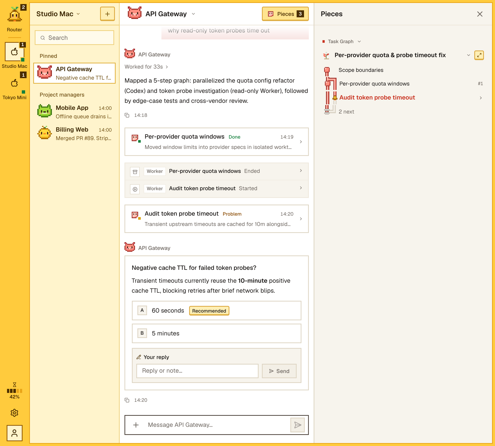
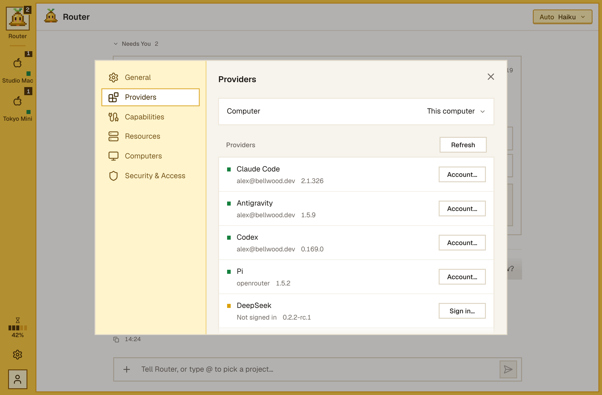
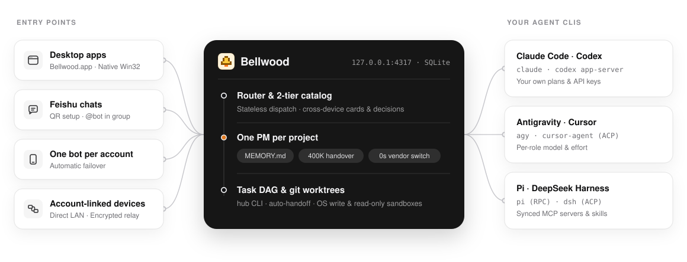
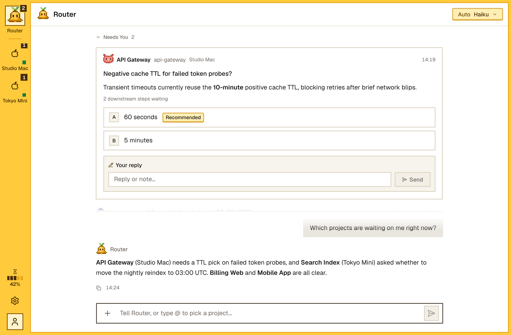
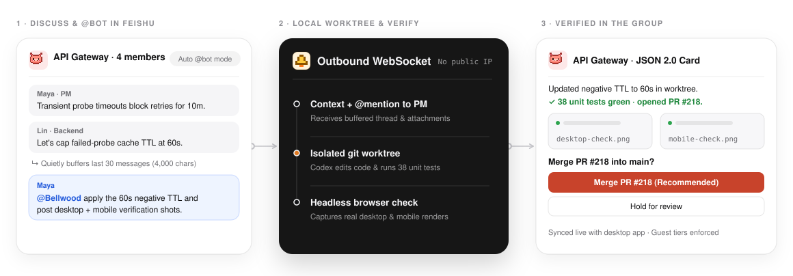

<div align="center">


# Bellwood

### One conversation per project. Every coding agent CLI you already use.

Bellwood puts one local **Project Manager (PM)** in front of each repository, dispatches sandboxed **Workers** into isolated git worktrees, aggregates pending decisions across computers through **Router**, and connects to **Feishu** without a public server.

**[Quick start](#quick-start)** &nbsp;·&nbsp; **[How it works](#how-it-works)** &nbsp;·&nbsp; **[Router](#router-across-projects-and-computers)** &nbsp;·&nbsp; **[Feishu](#feishu-on-mobile-and-in-team-groups)** &nbsp;·&nbsp; **[Security](#security-and-vendor-terms)** &nbsp;·&nbsp; **English** · [简体中文](README.zh-CN.md)

<br>



</div>

<br>

When you run several coding agents at once, coordination takes more time than coding: creating git worktrees by hand, copying context between terminals, tracking which session stalled, and re-explaining project conventions whenever a quota runs out and you switch CLIs.

Bellwood runs as a local daemon with a native desktop shell on **macOS 13+ on Apple silicon** (`Bellwood.app`), **Windows x64** (Tauri 2 with bundled Node 24 LTS, no WSL 2, and no admin rights), and **Linux** (`systemd` daemon), plus **Feishu** on mobile and desktop.

- **One thread per project.** Discuss goals and answer decision cards with the Project Manager. The PM splits multi-step work, launches short-lived Workers in isolated git worktrees, and collects test results and deliverables.
- **Any mix of eight agent CLIs with shared project memory.** Each PM and Worker independently runs `claude`, `agy`, `codex`, `pi`, `dsh`, `cursor-agent`, `opencode`, or `kimi` under your own subscription or API key. Bellwood stores long-term memory in its local ledger and Markdown files, so switching vendors keeps your conventions intact.
- **One control surface across machines and team chat.** **Router** collects pending decisions and dispatches tasks across your Mac, Windows PC, and Linux server. **Feishu** connects outward over WebSocket so you or your teammates can review work from a phone or `@`-mention the bot in a project group.

If you run one agent in one terminal on one repository and that covers your day, you do not need Bellwood.

## Quick start

### 1. Download the desktop app (unsigned preview)

Download the prebuilt installer from **[GitHub Releases](https://github.com/maodesikeng-boop/agent-hub/releases/latest)**:

| Platform | Installer | Checksum |
| :-- | :-- | :-- |
| **macOS 13+** (Apple silicon, bundles Node 24 LTS and daemon) | [`Bellwood-macos-arm64.dmg`](https://github.com/maodesikeng-boop/agent-hub/releases/latest/download/Bellwood-macos-arm64.dmg) | [`.sha256`](https://github.com/maodesikeng-boop/agent-hub/releases/latest/download/Bellwood-macos-arm64.dmg.sha256) |
| **Windows x64** (Windows 11 recommended, no admin rights, no WSL 2, bundles Node 24 LTS) | [`Bellwood-windows-x64-setup.exe`](https://github.com/maodesikeng-boop/agent-hub/releases/latest/download/Bellwood-windows-x64-setup.exe) | [`.sha256`](https://github.com/maodesikeng-boop/agent-hub/releases/latest/download/Bellwood-windows-x64-setup.exe.sha256) |

Verify both integrity and build provenance before opening an installer:

```sh
# macOS checksum and GitHub provenance attestation
shasum -a 256 -c Bellwood-macos-arm64.dmg.sha256
gh attestation verify Bellwood-macos-arm64.dmg -R maodesikeng-boop/agent-hub
```

```powershell
# Windows checksum and GitHub provenance attestation
Get-FileHash Bellwood-windows-x64-setup.exe -Algorithm SHA256
gh attestation verify Bellwood-windows-x64-setup.exe -R maodesikeng-boop/agent-hub
```

Both builds are unsigned previews, so the OS asks for confirmation on first launch. On **macOS**, drag **Bellwood** to **Applications**, open it once, click **Done** on the warning, then open **System Settings → Privacy & Security** and click **Open Anyway**. On **Windows**, click **More info → Run anyway** on SmartScreen. Closing the window hides Bellwood to the system tray; right-click the tray icon and choose **Quit Bellwood** to stop the daemon cleanly. For parallel git worktrees on Windows, install Git for Windows from **Settings → Providers** or run `winget install --id Git.Git -e --source winget`.

### 2. Connect an agent CLI

Bellwood supports **Claude Code** (`claude`), **Antigravity** (`agy`), **Codex** (`codex`), **Pi** (`pi`), **DeepSeek Harness** (`dsh`), **Cursor** (`cursor-agent`), **OpenCode** (`opencode`), and **Kimi Code** (`kimi`).

Launch **Bellwood** and open **Settings → Providers** (it opens automatically if no CLI is ready yet). Click **Install** beside any supported CLI, then click **Sign in...** to authenticate with browser OAuth, device code, loopback callback paste for headless servers, or an API key. When you create a PM or use Router **Auto** without naming a vendor, Bellwood selects the first usable CLI on that computer automatically.

<div align="center">

</div>

<br>

<details>
<summary><b>Install agent CLIs manually from a terminal</b></summary>

<br>

- **Claude Code (`claude`).** On macOS and Linux, run `curl -fsSL https://claude.ai/install.sh | bash`. On Windows PowerShell, run `irm https://claude.ai/install.ps1 | iex`. Sign in with `claude auth login`.
- **Antigravity (`agy`).** On macOS and Linux, run `curl -fsSL https://antigravity.google/cli/install.sh | bash`. On Windows PowerShell, run `irm https://antigravity.google/cli/install.ps1 | iex`. Run `agy` to sign in, or set `GEMINI_API_KEY`.
- **Codex (`codex`).** On macOS and Linux, run `curl -fsSL https://chatgpt.com/codex/install.sh | sh`. On Windows, run `npm install -g @openai/codex`. Sign in with `codex login`, or `codex login --device-auth` on headless servers.
- **Pi (`pi`).** On macOS and Linux, run `curl -fsSL https://pi.dev/install.sh | sh`. On Windows PowerShell, run `irm https://pi.dev/install.ps1 | iex` (or `npm install -g --ignore-scripts @earendil-works/pi-coding-agent`). Run `pi` and type `/login`.
- **DeepSeek Harness (`dsh`).** Run `npm install -g @deepseek-ai/dsh@0.2.2-rc.1`, then run `dsh` or write `DEEPSEEK_API_KEY=<key>` to `~/.dsh/.env`.
- **Cursor (`cursor-agent`).** On macOS and Linux, run `curl https://cursor.com/install -fsS | bash`. On Windows PowerShell, run `irm 'https://cursor.com/install?win32=true' | iex`. Sign in with `cursor-agent login`.
- **OpenCode (`opencode`).** On macOS and Linux, run `curl -fsSL https://opencode.ai/v2/install | bash`. On Windows, run `npm install -g @opencode/cli`. Sign in with `opencode auth login`, or paste an OpenCode Zen key (`OPENCODE_API_KEY`) in **Settings → Providers**.
- **Kimi Code (`kimi`).** On macOS and Linux, run `curl -fsSL https://code.kimi.com/kimi-code/install.sh | bash`. On Windows PowerShell, run `irm https://code.kimi.com/kimi-code/install.ps1 | iex` (or `npm install -g @moonshot-ai/kimi-code` with Node.js 22.19+). Sign in with `kimi login`, or paste a Kimi Platform API key in **Settings → Providers**.

</details>

### 3. Connect Feishu, Linux, or other computers (optional)

- **Feishu bot and project groups.** While the daemon is running, run `node src/feishu/main.ts connect` and scan the QR code in Feishu. Run `node src/feishu/main.ts status` to inspect bindings.
- **Multiple computers.** Bellwood includes an official public blind relay and GitHub Device Flow client ID. Open **Settings → Computers**, sign in with the same GitHub account on each computer, and compare the six-digit code on both screens to trust the device. To use a self-hosted relay, set `FUSA_RELAY_URL` and `FUSA_GITHUB_CLIENT_ID`.
- **Always-on Linux daemon.** Run Bellwood as a `systemd --user` service and run `sudo scripts/linux-sandbox-setup.sh` once to enable `bubblewrap`. See the [Linux setup guide](docs/linux.md).

<details>
<summary><b>Build from source or run the daemon directly</b></summary>

<br>

Requires **Node.js >= 24.12** (native `.ts` execution and `node:sqlite`), **pnpm 10**, and **git**. Internal package names, `~/.agent-hub`, and `fusa-*` crates keep their historical names for zero-migration upgrades; see [docs/README.md](docs/README.md#naming-lineage).

```sh
git clone https://github.com/maodesikeng-boop/agent-hub.git
cd agent-hub
pnpm install --frozen-lockfile
pnpm start                          # builds dist/web and starts daemon on 127.0.0.1:4317
```

`pnpm start` prints a local login link such as `http://127.0.0.1:4317/auth?token=...`. Open that URL in your browser to sign in.

- **Build `/Applications/Bellwood.app` on macOS** (requires Xcode Command Line Tools `swiftc`):
  ```sh
  pnpm build
  bash scripts/build-mac-app.sh --install   # or pnpm app:mac for build/Bellwood.app only
  ```
  Source-mode bundles record `AgentHubRepoDir` and `AgentHubNodePath` in `Info.plist`. Re-run the script if you move either, or pass `--dist` to stage a standalone bundle ([docs/mac-distribution-design.md](docs/mac-distribution-design.md)).
- **Build the Windows x64 NSIS installer from source** (requires Rust `x86_64-pc-windows-msvc` and VS C++ Build Tools):
  ```powershell
  pnpm install --frozen-lockfile
  pnpm build
  cargo build --release --manifest-path apps/windows/Cargo.toml --workspace --bins --locked
  node scripts/stage-win-runtime.ts --out-dir apps/windows/crates/fusa-desktop/staged-runtime --helpers-dir apps/windows/target/release --target-os win32
  cd apps/windows/crates/fusa-desktop
  ..\..\..\..\node_modules\.bin\tauri build --bundles nsis --config tauri.bundle.conf.json -- --locked
  ```

</details>

<details>
<summary><b>Environment variables</b> (all optional)</summary>

<br>

| Variable | Default | Description |
| :-- | :-- | :-- |
| `AGENT_HUB_HOME` | `~/.agent-hub` | Data directory for SQLite ledger, tokens, worktrees, uploads, logs, and PM memory. Keep under 103 bytes on macOS and Linux for Unix socket limits. Windows uses named pipes. |
| `AGENT_HUB_PORT` | `4317` | Loopback web UI port (`127.0.0.1` only). Set `0` for an OS-assigned port. |
| `FUSA_MESH_PORT` | `4320` | LAN mutual-TLS listen port for account mesh peers. Set `0` for an OS-assigned port. |
| `AGENT_HUB_CLAUDE`, `AGENT_HUB_AGY`, `AGENT_HUB_CODEX`, `AGENT_HUB_PI`, `AGENT_HUB_DEEPSEEK`, `AGENT_HUB_CURSOR`, `AGENT_HUB_OPENCODE`, `AGENT_HUB_KIMI` | `claude`, `agy`, `codex`, `pi`, `dsh`, `cursor-agent`, `opencode`, `kimi` | Override the executable name or path for each agent CLI (`~/` expansion supported). |
| `AGENT_HUB_DEFAULT_MODEL` | unset | Default model for the initial PM created on first launch. |
| `FUSA_RELAY_URL` | official public relay | Override the relay URL for account mesh connections. Use the same relay on every device in the account. |
| `FUSA_GITHUB_CLIENT_ID` | official public client ID | Override with the Client ID of your own GitHub OAuth App with Device Flow enabled. |
| `AGENT_HUB_REPO_DIR`, `AGENT_HUB_NODE` | `Info.plist` values | Override repository or Node executable path at runtime for source-built `Bellwood.app`. |

When a project defines a `hub project setup` command, the daemon also injects `AGENT_HUB_ROOT_PATH` and `AGENT_HUB_WORKTREE_PATH` into each new worktree setup run.

</details>

## How it works

A local daemon stores the SQLite conversation ledger, task graphs, project memory, and deliverables, runs your installed agent CLIs inside OS sandboxes, and syncs state across desktop windows, mobile web layouts, and Feishu chats.

<div align="center">
<picture>
  <source media="(prefers-color-scheme: dark)" srcset="docs/screenshots/readme/architecture-dark.svg">
  
</picture>
</div>

<br>

<table>
<tr>
<td width="50%">

</td>
<td width="50%">

</td>
</tr>
</table>

### Project Managers and the Work panel

Bellwood keeps the workbench split into four clear areas so long-running projects stay readable:

| Area | What it shows |
| :-- | :-- |
| **Top bar** | A centered quick **Router** input inside the desktop wood bar that opens a non-modal reply popover, with an **Expand** action to jump into the full Router workbench. |
| **Workspace rail** | **Router** with a waiting-decision badge, each paired computer with its online status dot, and bottom controls for live quota windows, **Settings** (with a dot when **Resources** flags items to review), and account status. |
| **Project list** | Resizable column showing your **Pinned** and active Project Managers (one pixel fruit slime per project) without filling the sidebar with finished sub-tasks. |
| **Chat and Work panel** | One continuous PM thread with folded routine tool calls, live in-chat progress checklists, and decision cards beside the wide **Work panel** with **Active**, **Completed**, and **Info** tabs. |

Every multi-step turn renders a live progress checklist in the chat stream so you can see which step is running and how long it has taken. On narrow windows and phones, the same surfaces adapt into a single-column layout without losing your draft.

### Persistent memory, background renewal, and instant vendor switching

- **Cross-vendor project memory.** Bellwood stores project conventions, preferences, and lessons in `MEMORY.md` and topic Markdown files under each PM's memory folder. Inspect, edit, or delete files directly in the Work panel **Info** tab, and sync configured MCP servers and skills across installed CLIs from **Settings → Providers**.
- **Automatic background session renewal.** When a long PM thread approaches its context threshold (400K tokens by default), the daemon forks the session in the background to prepare a handover while you keep working, then rotates into a fresh session between turns with recent dialogue intact and bulky tool output dropped.
- **Instant vendor and model switching.** When a quota runs out or you want another model, switch vendor, model, or effort on the **Info** tab and continue immediately. The new model receives recent dialogue, attachments, Worker reports, and active Task Graph state on the next turn.

### Task Graphs, isolated worktrees, and the `hub` CLI

Project Managers coordinate Workers, decision cards, scheduled tasks, external waits, and capabilities through the built-in `hub` CLI:

```sh
hub graph create --stdin                             # declare a multi-step Task Graph with automatic handoff
hub worker start --title "..." --stdin               # dispatch one Worker into an isolated git worktree
hub ask --option "A" --option "B" --stdin            # post a decision card with a recommended choice
hub watch add --until "..." --every 30s --stdin      # wait in the background for an external check
hub schedule add --name "..." --daily 09:00 --stdin  # run a recurring PM prompt on a schedule
hub caps                                             # list skills, MCP servers, and connectors on this project
hub persona edit --stdin                             # update the PM's mode or persona instructions
```

- **Automatic step progression.** Once a Task Graph starts, the daemon passes the overall goal, branch state, and handoff notes to each downstream Worker automatically. It wakes the PM or posts a card only when a step fails, deviates from scope, reaches a checkpoint, or completes the graph.
- **Workflow-neutral defaults.** Bellwood does not force a fixed engineering workflow. Planning steps, independent read-only reviews on a second model vendor (`"review": true`), and pull request merges are strictly opt-in: Bellwood runs them when you ask or when your project rules specify them.
- **Isolated git worktrees and setup scripts.** Each code-writing Worker runs in its own git worktree so parallel tasks never collide on your main branch. Configure `hub project setup` once to install dependencies before each Worker starts, and type `/hub:worker` in the chat composer whenever you want to override the vendor, model, or effort for Workers launched from that message.

### Settings for Providers, Capabilities, and Resources

Open **Settings** from the left rail to manage six focused pages: **General**, **Providers**, **Capabilities**, **Resources**, **Computers**, and **Security & Access**.

- **Capabilities.** Toggle skills, MCP servers, and connectors for Router, project defaults, or individual projects, and control Worker access with `inherit`, `none`, or `custom` allowlists.
- **Resources.** Inspect database growth, disk directories, leftover worktrees, unmerged branches, orphaned temp folders, and lingering processes, then keep or clean them with confirmation dialogs.

## Router across projects and computers

When your repositories span a laptop, a desktop workstation, and a Linux server, **Router** gives you one entry point in both the top-bar quick input and the full Router workbench.

<div align="center">

</div>

<br>

- **One tray for every pending decision and delivery.** When any project on any computer finishes a graph or pauses for your decision, its card appears in Router. Your answer syncs back to the owning PM immediately.
- **Natural-language dispatch.** Ask about a project by its everyday name without remembering hostnames or folder paths. Router matches the computer and PM, forwards the request, and displays the reply under your message.
- **Two-tier catalog and stateless dispatch.** The daemon maintains a short one-line card per project plus an on-demand detailed brief. Each Router turn runs in a clean single-turn session without carrying a growing chat history, so response latency stays steady as project count grows and model switches take effect on the next turn.
- **Private account mesh.** Sign in with the same GitHub account on macOS, Windows, and Linux, confirm the six-digit code once, and your devices connect directly over LAN or fall back to an end-to-end encrypted relay over mutual TLS 1.3. Source code and logs stay on each computer with no public IP, SSH tunnel, or port forwarding.

## Feishu on mobile and in team groups

Connect **Feishu** (or **Lark**) over an outbound WebSocket with no public server, domain name, or reverse proxy.

<div align="center">
<picture>
  <source media="(prefers-color-scheme: dark)" srcset="docs/screenshots/readme/feishu-group-dark.svg">
  
</picture>
</div>

<br>

- **One shared bot per account.** Run `node src/feishu/main.ts connect` and scan the QR code to create your bot. All devices on your account share that single bot in priority order, with automatic lease failover when a laptop sleeps or a server restarts and catch-up sync after brief disconnects.
- **Direct chat for Router, dedicated groups for projects.** Message the bot 1-on-1 to talk to Router from your phone. Each project gets its own Feishu group with its pixel fruit slime avatar, live streaming replies with a **Stop** button, and inline screenshots, recordings, and decision cards synced with your desktop app.
- **Automatic `@bot` mode in team groups.** When you are alone in a project group, every message goes straight to the PM. Once you add teammates, the group switches to `@bot` trigger mode: teammates discuss freely while Bellwood buffers recent messages in the background, and `@`-mentioning the bot hands the discussion context to the PM to implement and verify.
- **Model switching from your phone.** Send `/settings` (or `/model`, `/policy`) in direct chat or a project group to switch vendor, model, and effort from an interactive card.
- **Three guest tiers per group.** Set guest permissions to **Observer** (read-only background context), **Chat only** (default: guests can `@`-mention the bot, while decision cards, **Stop**, and attachments stay owner-only), or **Collaborator** (guests can also answer decision cards, stop work, and send attachments). On guest-triggered turns, the ledger blocks owner-only commands such as creating projects, attaching folders, or editing setup scripts and personas. Because the PM runs as your OS user without an outer sandbox, grant **Chat only** or **Collaborator** only to people you trust.

## Security and vendor terms

### Sandbox boundaries

Workers edit code and run commands as your current OS user. Review the actual isolation boundaries before running on sensitive computers:

- **Regular Workers.** Inside native OS sandboxes (`sandbox-exec` on macOS, `bubblewrap` on Linux, and `fusa-run.exe` Job Object + restricted token + NTFS ACLs on Windows), each regular Worker writes only to its own worktree inside protected roots, cannot read Bellwood's `state/` or `backups/` directories (SQLite ledger, UI and provider tokens, Feishu and mesh keys, PM memory, or other launch directories), and connects only to `run/hub.sock` rather than `run/admin.sock` ([docs/write-scope.md](docs/write-scope.md)). Outside protected roots, it keeps your user permissions for the project folder, tests, and network.
- **Read-only Workers.** Block writes everywhere except a private temp directory and required vendor runtime paths, restrict tools to read-only operations, enforce the same data-directory boundary, and block reads of SSH, cloud, vendor CLI, and `.env` credential files ([docs/readonly-worker-design.md](docs/readonly-worker-design.md)).
- **User-confirmed Computer Use exceptions (macOS only).** On macOS, a Worker that explicitly mounts a Computer Use capability can request `--no-outer-sandbox` so the vendor's built-in sandbox runs without nested `sandbox-exec` conflicts. The Worker stays paused until you click **Approve this run** in the Web workbench (Feishu shows a read-only notice), and each desktop app Computer Use tries to control requires a separate per-app confirmation card (**Allow for this run** or **Deny**). While running without the outer sandbox, the Worker can read files across the disk under the vendor's built-in sandbox, including Bellwood's data directory. Both approvals expire automatically when that Worker ends.
- **Project Managers and local network.** Project Managers run as your OS user without an outer sandbox, and the local web UI listens on `127.0.0.1` only by default. See [SECURITY.md](SECURITY.md) for the full threat model and private vulnerability reporting.

### Vendor terms of service

Bellwood does not proxy or resell model APIs. It runs official agent CLIs locally under **your own account or API key** in headless, RPC, or ACP mode. Review each provider's terms before use; this project cannot grant permission on a vendor's behalf or guarantee account standing:

- **Google Antigravity (`agy`).** Section 6 of the [Google Antigravity Additional Terms](https://antigravity.google/terms/) prohibits using third-party software, tools, or services to access the service and warns that violations may result in suspension or termination of your Antigravity or Gemini CLI account. Google has not clarified whether driving the official `agy` CLI locally in headless mode falls under this clause. Treat it as a real risk of account suspension or termination and decide for yourself.
- **Claude Code (`claude`):** [Anthropic Legal and Compliance](https://code.claude.com/docs/en/legal-and-compliance) · **Codex (`codex`):** [OpenAI Terms of Use](https://openai.com/policies/row-terms-of-use/) · **Pi (`pi`, MIT):** [pi.dev](https://pi.dev) (also review your connected model provider's terms) · **DeepSeek Harness (`dsh`, MIT preview):** [DeepSeek Open Platform Terms](https://cdn.deepseek.com/policies/en-US/deepseek-open-platform-terms-of-service.html) · **Cursor (`cursor-agent`):** [Cursor Terms of Service](https://cursor.com/terms-of-service) · **OpenCode (`opencode`, MIT):** [opencode.ai](https://opencode.ai) (also review your connected model provider's terms) · **Kimi Code (`kimi`):** [Kimi Code docs](https://www.kimi.com/code/docs/en/) (also review the Kimi Platform terms for API keys).

## Contributing

See [CONTRIBUTING.md](CONTRIBUTING.md) for bug reports, local checks, and pull request rules, and [docs/README.md](docs/README.md) for user guides and architecture documentation.

## Credits and license

- Pixel fruit slimes, Router sprout bell, and decision bell icons are rendered from [`src/shared/slimes.ts`](src/shared/slimes.ts).
- Third-party dependencies follow their respective licenses in `pnpm-lock.yaml` (`mermaid` pulls in transitive `elkjs` under `EPL-2.0 OR GPL-3.0-or-later`, and `khroma`'s upstream repository is MIT).
- Licensed under [MIT](LICENSE).
