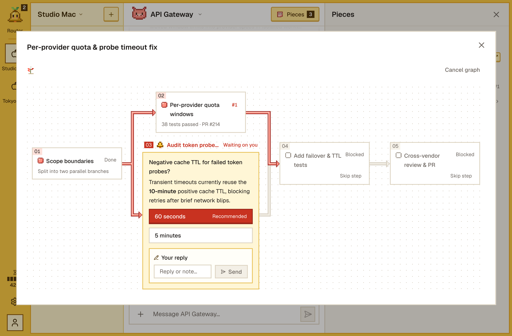

<div align="center">


# Bellwood

### One conversation per project. Every coding agent you already use.

**Claude Code as PM. Codex in parallel git worktrees. Antigravity on cross-vendor review.**<br>
Keep every project in one continuous thread with persistent memory that survives tool switches,<br>
manage every repository and machine through Router, and ship or verify work by `@`-mentioning your bot in Feishu.

**[Download](#quick-start)** &nbsp;·&nbsp; **[How it fits together](#how-it-fits-together)** &nbsp;·&nbsp; **[One project, one conversation](#one-project-one-conversation)** &nbsp;·&nbsp; **[Router](#router-one-entry-point-across-projects-and-machines)** &nbsp;·&nbsp; **[Feishu](#feishu-chat-in-the-group-mention-the-bot-to-verify)** &nbsp;·&nbsp; **[Security](#security-and-vendor-terms)** &nbsp;·&nbsp; **English** · [简体中文](README.zh-CN.md)

<br>


</div>

<br>

## Is Bellwood for you?

When you run several coding agents in parallel, the bottleneck shifts from writing code to babysitting sessions: creating git worktrees by hand, pasting context between terminals, checking which tab stalled, and starting from zero whenever a quota runs out and you switch to another CLI.

Bellwood puts one **Project Manager (PM)** agent in front of each project and handles the plumbing underneath:

- **Stay in one thread per project.** You discuss goals and approve decisions with the PM. The PM breaks work into steps, dispatches short-lived **Worker** agents (shown as **Pieces** in the UI) into isolated git worktrees, checks their test evidence, and merges their PRs.
- **Mix vendors and keep your memory.** Every PM and every Worker independently runs `claude`, `codex`, `agy`, `pi`, `dsh`, or `cursor-agent` under your own subscription or API key. Long-term memory lives in Bellwood's local ledger and Markdown files, so switching a project from Claude Code to Codex keeps every convention and past lesson intact.
- **Coordinate across machines and team chats.** **Router** aggregates pending decisions and dispatches work across your Mac, Windows desktop, and Linux server without blowing up its context window. Connect **Feishu** over an outbound WebSocket so you or your teammates can discuss a change in a group chat and `@`-mention the bot to implement and verify it.

Bellwood is for you if you juggle multiple tasks or repositories, combine more than one agent CLI or subscription, or want to review and trigger work from your phone or Feishu group. If you run one agent in one terminal on one repository and that already covers your day, you do not need it.

Runs natively on **macOS 13+** (`Bellwood.app`), **Windows x64** (native Tauri 2 desktop app with bundled Node 24 LTS, no WSL 2, and no admin rights), **Linux** (`systemd` daemon), and **Feishu** on mobile and desktop.

## How it fits together

A local daemon at `127.0.0.1:4317` stores conversations, task graphs, persistent memory, and deliverables in `node:sqlite` (`~/.agent-hub`), exposes a single `hub` CLI over a local Unix socket or Windows named pipe, and drives your installed agent CLIs inside OS-enforced write sandboxes.

<div align="center">
<picture>
  <source media="(prefers-color-scheme: dark)" srcset="docs/screenshots/readme/architecture-dark.svg">
  
</picture>
</div>

## One project, one conversation

Long-running agent threads bog down when context fills up, branches collide, or quotas force a tool switch. Bellwood solves those failure modes with seven mechanisms underneath.

<table>
<tr>
<td width="50%">

</td>
<td width="50%">

</td>
</tr>
</table>

### 1. Vendor-independent persistent memory

Built-in agent memory is locked inside each vendor's private directory. When you change tools, that history stays behind.

Bellwood stores each PM's memory in `~/.agent-hub/state/pm-memory/<pmId>/` (`MEMORY.md` index up to 200 lines or 25 KB in the system prompt, plus up to 50 `<topic>.md` files up to 1 MB total) alongside versioned persona history in SQLite. Every session mounts this directory automatically, and edits via `hub persona edit` or the profile editor take effect on the next turn with one-click undo. In **Settings → Providers**, **Vendor sync** also merges your MCP servers and `.agents/skills` across installed CLIs atomically. You can run Claude Code in the morning, switch to Codex in the afternoon, and keep the exact same project memory and tools.

### 2. Background compaction and zero-handover vendor switching

Context renewal and vendor switching solve different problems, so Bellwood separates them cleanly:

- **Background handover at 400,000 tokens.** When a PM session reaches `400,000` context tokens, the daemon forks the session in the background to write a structured handover while you keep chatting without pause. Because the fork shares the parent's model, system prompt, and tools, it reuses roughly 97% of the prompt cache. Between turns, the PM switches to a fresh session preloaded with its persistent memory, the handover, up to `30,000` characters of recent verbatim dialogue before the cut point, all messages after it, and up to `80,000` characters of loaded skill bodies, while stripping bulky historical tool outputs.
- **0-second vendor and model switch.** Changing a PM's provider on its profile page (for example `Claude Code → Codex`) does not run a handover summary or dig up stale messages from an earlier generation. Within the same SQLite transaction, Bellwood starts the new vendor with the current generation's base summary (if renewed earlier) plus every user message, attachment path, system event, and full Worker report from the current generation in chronological order (up to `240,000` characters), followed by live Task Graph state. Switching back and forth (`Claude → Codex → Antigravity → Claude`) rebuilds from the same generation anchor with zero nesting.

### 3. Isolated git worktrees and OS sandboxes

Every code-writing Worker starts in its own git worktree (`~/.agent-hub/worktrees/<project>/<worker>`, branch `hub/<id>-<slug>`) so parallel tasks never step on your main checkout or on each other. Configure `hub project setup` once to run dependency setup or code generation before a Worker begins. On Windows, if a repository lives on another drive such as `D:\` or a Dev Drive, Bellwood places worktrees on that same volume under `<drive>:\.fusa-wt\` to preserve `pnpm` hardlinks and disk speed. Worktrees clean up automatically once merged into `main` or 3 days after completion.

Every Worker runs inside an outer OS sandbox (`sandbox-exec` on macOS, `bubblewrap` on Linux, and a `KILL_ON_JOB_CLOSE` Job Object + write-restricted token + NTFS ACLs on Windows, plus native Windows 11 24H2+ MXC containers for read-only Workers) that blocks writes to Bellwood's database, credentials, and sibling worktrees.

### 4. One `hub` command for sub-agents

Project Managers and Workers coordinate through one local CLI named `hub`, authenticated by a per-session in-memory token over a Unix domain socket or a Windows named pipe:

```sh
hub status                                                     # role, project paths, setup command, active graphs
hub graph create --stdin                                       # declare a sequential or parallel DAG of steps
hub worker start --title "…" --vendor codex --stdin            # dispatch a Worker into an isolated worktree
hub worker log 818 --stats                                     # inspect step counts and top files without raw logs
hub ask --node probe --option "60s" --option "5m" --recommended "60s" --stdin
hub persona edit --reason "…" --stdin                          # update persistent cross-vendor PM memory
```

In the chat input box, type `/hub:worker` to pick the exact vendor, model, and thinking effort for Workers dispatched from that message.

### 5. Automatic DAG progression

Once the PM creates a Task Graph, the daemon drives execution forward on its own. Each Worker ends its turn with a structured 9-field report (`=== 汇报 ===`). When a step reports `done` with no scope deviation, the daemon automatically passes the graph goal, branch state, and the Worker's handoff notes to the next step's Worker and starts it immediately.

The daemon wakes the PM only when judgment is needed: a Worker reports an error or scope deviation, a turn passes its 30-minute reminder (which alerts the PM without killing the process), a node reaches a `confirm` checkpoint, or all steps finish and await final review (`hub graph finish`). On a clean multi-step run, the PM acts twice: once to plan the graph and once to verify the deliverables.

### 6. Acceptance-first deliverables

Heavy file searches, test runs, and multi-file edits stay inside disposable Worker contexts (capped at `200,000` tokens before rotating to a fresh Worker). For high-impact changes, the PM adds a read-only review step on a second vendor rather than re-reading raw diffs itself.

Workers attach plans, verification notes, screenshots, and H.264 screen recordings (up to `50 MB` each) directly to their reports. Bellwood renders Markdown, Mermaid diagrams, Vega-Lite charts, inline media previews, and structured decision cards with a recommended option right in the thread so you focus on final sign-off.

### 7. A calm three-pane view

| Pane | What lives there |
| :-- | :-- |
| **Left sidebar** | Pinned **Router** plus one row per Project Manager (20 pixel fruit slimes × 24 jelly accents), grouped by machine when paired. Hundreds of finished Workers never clutter this list. |
| **Center chat** | One continuous PM thread. Intermediate tool calls fold into `Worked for 39s ›`, and each Worker round surfaces as a status dot and a 120-character summary bubble. |
| **Right rail** | Live **Task Graph** jelly track (zoomable to the full DAG dialog), active **Pieces**, **Needs You** decision bells, and collapsed **Completed** history (bottom drawer on mobile). Click any Piece to inspect its transcript or message it directly. The PM receives a copy automatically so context never forks. |

## Router: one entry point across projects and machines

When you manage a dozen repositories across a MacBook, a Windows workstation, and a Linux build server, **Router** sits at the top of the sidebar as one entry point across all of them. Every pending decision card and completion brief across all projects and paired machines streams into one tray. Clicking an option resolves it on the owning machine immediately. You can also tell Router what to do in plain language, even with casual project nicknames, and it routes the task to the right PM or answers cross-project status questions.

<div align="center">

</div>

<br>

Three mechanisms let Router cover every project and machine without overflowing its context window:

| Mechanism | How it bounds context |
| :-- | :-- |
| **Stateless single-turn dispatch** | Router never keeps a long-lived chat session. Each command spawns a one-shot read-only session in an isolated empty directory, feeds it compact PM cards (capped at `24 KB`) and the last 5 cross-vendor command receipts (`600 B`), and exits right after dispatching. Switching Router's model takes 0 seconds. |
| **Background two-tier project catalog** | Whenever a project accumulates `20,000` weighted dialogue characters (user characters × 4 + PM characters, at least 2 hours apart) or finishes a Task Graph, the daemon runs a lightweight background turn over the ledger and latest handover to refresh a structured catalog entry without touching the PM session. Router sees **Tier 1** (one-liner, casual aliases, current focus) on every turn and calls `hub dispatch project-show` for **Tier 2** (modules, decisions, open items, capped at `4,000` chars) only when needed, never raw transcripts. |
| **Local ledgers, card-only peering** | Each machine owns its SQLite ledger and refreshes its own project cards locally. Devices on the same account connect directly over the local network when possible and fall back to an end-to-end encrypted relay. Router exchanges compact project digests, forwarded prompts, and decisions. Repositories and tool logs stay on their original machines. |

## Feishu: chat in the group, mention the bot to verify

You can also run Bellwood from native **Feishu** or **Lark** on your phone and desktop, either on your own or with teammates in the same group.

<div align="center">
<picture>
  <source media="(prefers-color-scheme: dark)" srcset="docs/screenshots/readme/feishu-group-dark.svg">
  
</picture>
</div>

<br>

- **No public IP, QR-code app creation.** The daemon connects outward over Feishu's official WebSocket client (`@larksuiteoapi/node-sdk`), so you need no public server, domain, or reverse proxy. Run `node src/feishu/main.ts connect` and scan the terminal QR code with Feishu on your phone. Feishu creates your private bot app and binds you as the owner in one step. After sleep or network drops, an inbound catch-up cursor fetches missed messages from the last 15 minutes with idempotent deduplication.
- **Direct chat for Router, auto-managed groups per PM.** Messaging the bot 1-on-1 talks to **Router**. For each Project Manager, Bellwood automatically creates a private Feishu chat group named after the PM and renders its pixel fruit slime as the group avatar (archiving a PM dissolves its group cleanly). Replies stream live into Feishu JSON 2.0 cards with a **Stop** button, inline screenshots (bitmaps over `2400px` or `2 MB` are downscaled in a temp copy for fast mobile delivery without touching originals), MP4 walkthroughs, and interactive decision cards that stay in sync with the desktop app.
- **Team workflow: discuss freely, `@bot` to build and verify.** When you are alone in a project group, every message goes straight to the PM. The moment you invite teammates into the group, it **automatically switches to `@bot` trigger mode**:
  1. Product, design, and engineering teammates discuss an issue or paste bug screenshots in the group as usual. Bellwood quietly buffers the last `30` non-mention messages (up to `4,000` characters) and up to `20` file references without interrupting.
  2. Once the group agrees on a plan, anyone `@`-mentions the bot (for example, `@Bellwood implement the agreed TTL change and post desktop + mobile screenshots`).
  3. The PM receives the buffered discussion alongside the `@`-mention, dispatches Workers into isolated git worktrees to write code, run tests, and capture Playwright verification screenshots, and posts the rendered images and decision cards right back into the group chat.
- **Per-group guest tiers and in-chat model switching.** Send `/settings` (or `/群设置`) in any project group to pin an interactive settings card where the owner can switch the PM's vendor, model, and effort on the spot, or set guest permissions to **Observer** (messages buffered as context only), **Chat only** (default: guests can `@`-mention the bot to run tasks, while decisions, stop, and uploads require the owner), or **Collaborator** (guests can also resolve cards, stop turns, and send files). Regardless of tier, the ledger hard-blocks guest-triggered turns from creating projects, altering mounted folders, editing setup scripts, or modifying PM memory.

## Supported agents

<table>
<tr><td>

**Claude Code** (`claude`) · **Codex** (`codex`) · **Antigravity** (`agy`) · **Pi** (`pi`) · **DeepSeek Harness** (`dsh`) · **Cursor** (`cursor-agent`)

</td></tr>
</table>

Open **Settings → Providers** on macOS, Windows, or Linux to install any supported CLI with one click, sign in directly inside Bellwood (browser OAuth, device code, loopback callback paste for headless servers, or API key), check live usage quota windows (`claude`, `agy`, `codex`), and scan or sync MCP servers and skills across installed tools. If no CLI is ready on first launch, this view opens automatically.

<div align="center">

</div>

## Quick start

### 1. Download desktop app (unsigned preview)

Download the latest prebuilt installer from **[GitHub Releases](https://github.com/maodesikeng-boop/agent-hub/releases/latest)**:

| Platform | Installer | Checksum |
| :-- | :-- | :-- |
| **macOS 13+** (Apple silicon, bundles Node 24 LTS & daemon) | [`Bellwood-macos-arm64.dmg`](https://github.com/maodesikeng-boop/agent-hub/releases/latest/download/Bellwood-macos-arm64.dmg) | [`.sha256`](https://github.com/maodesikeng-boop/agent-hub/releases/latest/download/Bellwood-macos-arm64.dmg.sha256) |
| **Windows x64** (Windows 11 recommended, no admin rights, no WSL 2, bundles Node 24 LTS) | [`Bellwood-windows-x64-setup.exe`](https://github.com/maodesikeng-boop/agent-hub/releases/latest/download/Bellwood-windows-x64-setup.exe) | [`.sha256`](https://github.com/maodesikeng-boop/agent-hub/releases/latest/download/Bellwood-windows-x64-setup.exe.sha256) |

<sub>Both builds are unsigned previews, so the OS asks for confirmation on first launch. **On Mac.** Drag **Bellwood** to **Applications**, double-click it, click **Done** when macOS warns about an unverified developer, then open **System Settings → Privacy & Security** and click **Open Anyway** next to Bellwood. Verify with `shasum -a 256 -c Bellwood-macos-arm64.dmg.sha256`. **On Windows.** Click **More info → Run anyway** on the SmartScreen prompt. Closing the window hides Bellwood to the system tray. Right-click the tray icon and choose **彻底退出 Bellwood** to stop the background daemon and its child process tree. For Git worktrees on Windows, install Git for Windows from **Settings → Providers** or run `winget install --id Git.Git -e --source winget`.</sub>

### 2. Connect an agent CLI

Launch **Bellwood**. When **Settings → Providers** opens, click **Install** next to any agent CLI you use and click **Sign in…** to authenticate with your subscription or API key.

<details>
<summary><b>Install agent CLIs manually from a terminal</b></summary>

<br>

- **Claude Code (`claude`).** On macOS and Linux, run `curl -fsSL https://claude.ai/install.sh | bash`. On Windows PowerShell, run `irm https://claude.ai/install.ps1 | iex`. Sign in with `claude auth login`.
- **Codex (`codex`).** On macOS and Linux, run `curl -fsSL https://chatgpt.com/codex/install.sh | sh`, or run `npm install -g @openai/codex` on any platform. Sign in with `codex login` (or `codex login --device-auth` on headless servers).
- **Antigravity (`agy`).** On macOS and Linux, run `curl -fsSL https://antigravity.google/cli/install.sh | bash`. On Windows PowerShell, run `irm https://antigravity.google/cli/install.ps1 | iex`. Run `agy` to sign in, or set `GEMINI_API_KEY`.
- **Pi (`pi`, [docs/vendors/pi.md](docs/vendors/pi.md)).** On macOS and Linux, run `curl -fsSL https://pi.dev/install.sh | sh`. On Windows PowerShell, run `irm https://pi.dev/install.ps1 | iex` (or `npm install -g --ignore-scripts @earendil-works/pi-coding-agent`). Run `pi` and type `/login`.
- **DeepSeek Harness (`dsh`, [docs/vendors/deepseek.md](docs/vendors/deepseek.md)).** Run `npm install -g @deepseek-ai/dsh@0.2.2-rc.1`, then run `dsh` or write `DEEPSEEK_API_KEY=<key>` to `~/.dsh/.env`.
- **Cursor (`cursor-agent`, [docs/vendors/cursor.md](docs/vendors/cursor.md)).** On macOS and Linux, run `curl https://cursor.com/install -fsS | bash`. On Windows PowerShell, run `irm 'https://cursor.com/install?win32=true' | iex`. Sign in with `cursor-agent login`.

</details>

### 3. Connect Feishu and other computers (optional)

- **Feishu bot and project groups.** With the daemon running, execute `node src/feishu/main.ts connect` and scan the QR code in Feishu. Run `node src/feishu/main.ts status` to inspect active bindings. Devices in the same account share one bot. If the active device goes offline, another takes over automatically.
- **Multiple computers.** Set a relay URL and a GitHub OAuth App client ID. In **Settings → Computers**, sign in to the same GitHub account on each computer. Compare the six-digit code when you approve a new device. Use Feishu to reach these devices from your phone.
- **Always-on Linux daemon.** Deploy as a `systemd` user service on Ubuntu and run `sudo scripts/linux-sandbox-setup.sh` once to set up `bubblewrap`. See the [Linux setup guide](docs/linux.md) and [account mesh design](docs/account-mesh-design.md).

<details>
<summary><b>Build from source or run the daemon directly</b></summary>

<br>

Requires **Node.js >= 24.12** (native `.ts` execution and built-in `node:sqlite`), **pnpm 10**, and **git**.

```sh
git clone https://github.com/maodesikeng-boop/agent-hub.git
cd agent-hub
pnpm install --frozen-lockfile
pnpm start                          # builds dist/web and starts daemon on 127.0.0.1:4317
```

- **Build `/Applications/Bellwood.app` on macOS** (requires Xcode Command Line Tools `swiftc`):
  ```sh
  pnpm build
  bash scripts/build-mac-app.sh --install   # or pnpm app:mac for build/Bellwood.app only
  ```
  Source-mode `.app` bundles embed your checkout path (`AgentHubRepoDir`) and local `node` path (`AgentHubNodePath`). Re-run the script if you move either, or pass `--dist` to stage a standalone bundle ([docs/mac-distribution-design.md](docs/mac-distribution-design.md)).
- **Build the Windows x64 NSIS installer from source** (requires Rust `x86_64-pc-windows-msvc` and VS C++ Build Tools, or download unreleased CI builds from the `windows-desktop` GitHub Actions artifact `fusa-windows-x64-nsis-unsigned-preview` containing `Bellwood_0.1.0_x64-setup-unsigned-preview.exe`):
  ```powershell
  pnpm install --frozen-lockfile
  pnpm build
  cargo build --release --manifest-path apps/windows/Cargo.toml --workspace --bins --locked
  node scripts/stage-win-runtime.ts --out-dir apps/windows/crates/fusa-desktop/staged-runtime --helpers-dir apps/windows/target/release --target-os win32
  cd apps/windows/crates/fusa-desktop
  pnpm dlx @tauri-apps/cli@^2 build --bundles nsis --config tauri.bundle.conf.json
  ```

</details>

<details>
<summary><b>Environment variables</b> (all optional, internal paths keep <code>~/.agent-hub</code> for zero-migration upgrades)</summary>

<br>

| Variable | Default | Description |
| :-- | :-- | :-- |
| `AGENT_HUB_HOME` | `~/.agent-hub` | Data directory (SQLite ledger, tokens, worktrees, uploads, logs, PM memory). Keep under 103 bytes on macOS and Linux for Unix socket limits. Windows uses named pipes. |
| `AGENT_HUB_PORT` | `4317` | Loopback web UI port (`127.0.0.1` only). Set `0` for an OS-assigned port. |
| `AGENT_HUB_CLAUDE` / `AGY` / `CODEX` / `PI` / `DEEPSEEK` / `CURSOR` | `claude` / `agy` / `codex` / `pi` / `dsh` / `cursor-agent` | Override executable name or path for each supported agent CLI (`~/` supported). |
| `AGENT_HUB_DEFAULT_MODEL` | unset | Default model for the initial PM created on first launch. |
| `FUSA_RELAY_URL` | unset | Relay URL for account networking. Use the same relay on all devices in the account. |
| `FUSA_GITHUB_CLIENT_ID` | unset | Client ID of the GitHub OAuth App with Device Flow enabled. |
| `AGENT_HUB_REPO_DIR` / `AGENT_HUB_NODE` | `Info.plist` values | Override repository or Node executable path at runtime for source-built `Bellwood.app`. |

When `hub project setup` runs in a new worktree, the daemon also injects `AGENT_HUB_ROOT_PATH` and `AGENT_HUB_WORKTREE_PATH`.

</details>

## Security and vendor terms

### Sandbox boundaries

Workers modify files and execute shell commands on your machine as your current OS user. Review the actual enforcement boundaries before running on sensitive systems:

- **Worker write scope (`src/shared/write-scope.ts`, `src/daemon/driver/write-scope.ts`).** Inside protected roots (`~/.agent-hub` and cross-volume `<drive>:\.fusa-wt` roots on Windows), a normal Worker can write only to its own worktree. Both `state/` and other Workers' worktrees are blocked by an outer OS sandbox (`sandbox-exec` on macOS, `bubblewrap` on Linux, and `fusa-run.exe` Job Object + write-restricted token + deny-write NTFS ACLs on Windows, documented in [docs/write-scope.md](docs/write-scope.md)). If the OS sandbox is unavailable, Workers refuse to start. Outside protected roots, normal Workers have no write restrictions and can edit your project folders and other user-writable paths, run commands, and access the network.
- **Read-only Workers (`src/shared/readonly-policy.ts`).** Block writes everywhere except a private temp directory, restrict MCP connectors to `readOnlyHint: true` tools, and block reads of `state/ui-token`, `state/feishu-secrets.json`, vendor credentials, `~/.ssh`, `~/.aws`, `~/.gnupg`, `~/.config/gh`, `.env*`, and private key files ([docs/readonly-worker-design.md](docs/readonly-worker-design.md)). On Windows, Codex uses its native read-only sandbox. Other vendors use the Windows 11 24H2+ MXC container (`@microsoft/mxc-sdk`) when available, and fall back with a session warning to a write-restricted token plus vendor tool-layer read-only rules on older Windows builds.
- **Project Managers are not sandboxed**, and the web port listens on `127.0.0.1` only by default. To report a security issue privately, see [SECURITY.md](SECURITY.md).

### Vendor terms of service

Bellwood does not proxy or resell model APIs. It invokes official agent CLIs on your computer under **your own account or API key** in headless, RPC, or ACP mode. Review each provider's terms before use. This project cannot grant permission on a vendor's behalf or guarantee account standing:

- **Google Antigravity (`agy`).** Section 6 of the [Google Antigravity Additional Terms](https://antigravity.google/terms/) states: *"Using third party software, tools, or services to access the Service (e.g. using OpenClaw with Antigravity OAuth) is a breach of this Agreement. Such actions may be grounds for suspension or termination of your Antigravity and/or Gemini CLI accounts."* Google has not clarified whether driving the official `agy` CLI locally in headless mode falls under this clause. Treat it as a real risk of account suspension or termination and decide for yourself.
- **Claude Code (`claude`):** [Anthropic Legal and Compliance](https://code.claude.com/docs/en/legal-and-compliance) · **Codex (`codex`):** [OpenAI Terms of Use](https://openai.com/policies/row-terms-of-use/) · **Pi (`pi`, MIT):** [pi.dev](https://pi.dev) (also review your connected model provider's terms) · **DeepSeek Harness (`dsh`, MIT preview):** [DeepSeek Open Platform Terms](https://cdn.deepseek.com/policies/en-US/deepseek-open-platform-terms-of-service.html) · **Cursor (`cursor-agent`):** [Cursor Terms of Service](https://cursor.com/terms-of-service).

## Credits and license

- Pixel fruit slimes, Router sprout bell, and decision bell icons are rendered from shared pixel art in [`src/shared/slimes.ts`](src/shared/slimes.ts).
- Third-party dependencies follow their respective licenses in `pnpm-lock.yaml` (note that `mermaid` pulls in transitive `elkjs` under `EPL-2.0 OR GPL-3.0-or-later`, and `khroma`'s upstream repository is MIT).
- Licensed under [MIT](LICENSE).
