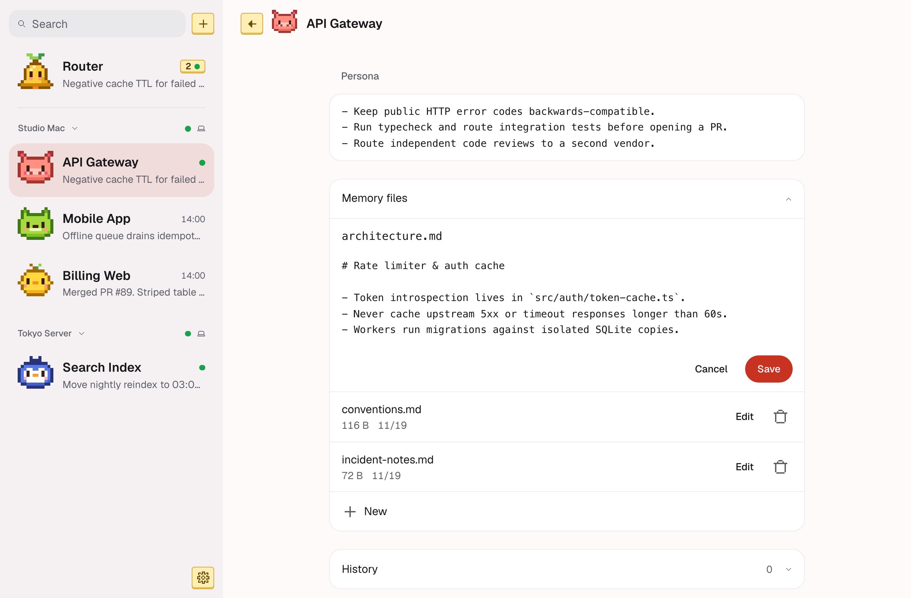

<div align="center">


# Bellwood

### One conversation per project. Every coding agent you already use.

**Claude Code as PM. Codex in parallel git worktrees. Antigravity on cross-vendor review.**<br>
Keep every project in one continuous thread with persistent memory that survives tool switches,<br>
manage every repository and machine through Router, and ship or verify work by `@`-mentioning your bot in Feishu.

**[Download](#quick-start)** &nbsp;·&nbsp; **[How it fits together](#how-it-fits-together)** &nbsp;·&nbsp; **[One project, one conversation](#one-project-one-conversation)** &nbsp;·&nbsp; **[Router](#router-one-entry-point-across-projects-and-machines)** &nbsp;·&nbsp; **[Feishu](#feishu-step-away-from-your-desk-and-bring-the-team-in)** &nbsp;·&nbsp; **[Security](#security-and-vendor-terms)** &nbsp;·&nbsp; **English** · [简体中文](README.zh-CN.md)

<br>


</div>

<br>

## Is Bellwood for you?

When you run several coding agents in parallel, the bottleneck shifts from writing code to babysitting sessions: creating git worktrees by hand, pasting context between terminals, checking which tab stalled, and starting from zero whenever a quota runs out and you switch to another CLI.

Bellwood puts one **Project Manager (PM)** agent in front of each project and handles the plumbing underneath:

- **Stay in one thread per project.** You discuss goals and approve decisions with the PM. The PM breaks work into steps, dispatches short-lived **Worker** agents (shown as **Pieces** in the UI) into isolated git worktrees, checks their test evidence, and merges their PRs.
- **Mix vendors and keep your memory.** Every PM and every Worker independently runs `claude`, `codex`, `agy`, `pi`, `dsh`, `cursor-agent`, `opencode`, or `kimi` under your own subscription or API key. Long-term memory lives in Bellwood's local ledger and Markdown files, so switching a project from Claude Code to Codex keeps every convention and past lesson intact.
- **Coordinate across machines and team chats.** **Router** aggregates pending decisions and dispatches work across your Mac, Windows desktop, and Linux server without blowing up its context window. Connect **Feishu** over an outbound WebSocket so you or your teammates can discuss a change in a group chat and `@`-mention the bot to implement and verify it.

Bellwood is for you if you juggle multiple tasks or repositories, combine more than one agent CLI or subscription, or want to review and trigger work from your phone or Feishu group. If you run one agent in one terminal on one repository and that already covers your day, you do not need it.

Runs natively on **macOS 13+ on Apple silicon** (`Bellwood.app`), **Windows x64** (native Tauri 2 desktop app with bundled Node 24 LTS, no WSL 2, and no admin rights), **Linux** (`systemd` daemon), and **Feishu** on mobile and desktop.

## How it fits together

A local daemon manages your conversation ledger, task graphs, project memory, and deliverables in the background, runs your installed agent CLIs inside OS-level sandboxes, and keeps your desktop window and Feishu chats in sync.

<div align="center">
<picture>
  <source media="(prefers-color-scheme: dark)" srcset="docs/screenshots/readme/architecture-dark.svg">
  
</picture>
</div>

## One project, one conversation

Long-running agent threads bog down when context fills up, branches collide, or quotas force a tool switch. Bellwood solves those failure modes with seven mechanisms underneath.

<table>
<tr>
<td width="50%">

</td>
<td width="50%">

</td>
</tr>
</table>

### 1. Dedicated project memory and synced tools across vendors

Built-in agent memory stays locked inside each CLI's own folder, and every tool uses its own config format for MCP servers and skills. Switching providers usually means losing every project convention you taught the previous tool and reconfiguring your setup from scratch.

Bellwood keeps dedicated, vendor-independent memory for each project. As you work, the PM automatically records your preferences, architecture rules, and hard-won lessons, and you can inspect, edit, or roll back any change from the profile page. In **Settings → Providers**, one click syncs your configured MCP servers, tools, and skills across every installed CLI on your machine. Run Claude Code in the morning, switch to Codex in the afternoon, and move to Antigravity at night with the exact same project memory and toolset.

### 2. Seamless background renewal and instant vendor switching

Long sessions get sluggish when context fills up, and mid-task provider switches risk losing momentum. Bellwood handles both underneath without interrupting your flow:

- **Automatic background session renewal.** As a long thread approaches its context ceiling, the daemon quietly forks the session in the background to prepare a structured handover while you keep talking. Between turns, it steps into a fresh session with your key context and recent verbatim dialogue intact while dropping bulky historical tool outputs, so one thread stays responsive for weeks.
- **Zero-wait provider and model switches.** When a quota runs out or you want a second opinion from another model, switch providers on the profile page and continue immediately without waiting for a summary pass. The new model receives your recent dialogue, attachments, Worker reports, and active Task Graph state right away, staying coherent even if you switch back and forth across several tools.

### 3. Isolated git worktrees and OS sandboxes

Every code-writing Worker runs in its own isolated `git worktree`, so parallel tasks never collide or dirty your main branch. Configure a setup script once to install dependencies automatically before each Worker starts, and let Bellwood clean up merged worktrees afterward. Every Worker runs inside a native OS sandbox that prevents out-of-bounds writes, and read-only review Workers have write access blocked at the OS level.

### 4. One `hub` command for sub-agents

The Project Manager coordinates everything through the built-in `hub` CLI without custom glue scripts:

```sh
hub graph create --stdin        # declare a multi-step Task Graph with automatic handoff
hub worker start --stdin        # dispatch a single Worker into an isolated worktree
hub ask --option "..." --stdin  # post a decision card with a recommended choice
hub persona edit --stdin        # update cross-vendor project memory
```

Type `/hub:worker` in the chat box whenever you want to specify the exact vendor, model, and thinking effort for the Workers dispatched from that message.

### 5. Hands-off background progression

Once a Task Graph is created, the daemon advances each step on its own. When a step finishes cleanly, the daemon passes the overall goal, branch state, and handoff notes straight to the next Worker and starts it immediately without waking the PM to copy instructions around. The system wakes the PM or posts a card only when a step hits an error, deviates from scope, reaches a user checkpoint, or finishes the entire graph for final sign-off.

### 6. Focus only on decisions and acceptance

Code searches, test runs, and noisy logs stay inside short-lived Workers, and critical changes run through an independent read-only review on a second model vendor so you never have to wade through thousand-line diffs in the main chat. What reaches you are clear decision cards with a recommended option alongside inline screenshots, screen recordings, diagrams, and verification summaries.

### 7. A calm four-pane view

| Pane | What lives there |
| :-- | :-- |
| **Workspace rail** | Pinned **Router** at the top alongside your paired computers with status dots and attention badges, plus usage, settings, and account actions at the bottom. |
| **Project list** | Resizable column showing your **Pinned** and active Project Managers—one pixel fruit slime per project—while keeping hundreds of historical sub-tasks out of your sidebar. |
| **Center chat** | One continuous PM conversation. Routine tool calls stay folded by default so the thread reads like a clean chat. |
| **Side panel** | Live **Task Graph** pipeline, active **Pieces**, inline **Worker** threads, and PM settings pages open beside the chat without losing your place. |

## Router: one entry point across projects and machines

When your projects span a laptop, a desktop workstation, and a remote Linux server, **Router** sits at the top of the workspace rail as your single control center. How does one entry point coordinate everything without bogging down?

<div align="center">

</div>

<br>

### 1. Every pending decision and delivery in one tray

Whenever any project on any computer finishes a task or pauses at a fork for your input, its decision card or completion summary lands directly in Router. Pick an option or inspect a screenshot in one place, and your choice syncs straight back to the owning PM.

### 2. Natural-language dispatch across computers

You never need to remember hostnames or full directory paths. Refer to a project by its everyday nickname (for example, "check if the payment gateway fix is live yet"), and Router matches the right computer and PM, forwards the request, and posts the PM's reply right underneath your original message.

### 3. Two-tier project catalog without context bloat

Router knows what every project is doing because the daemon quietly maintains a two-tier catalog in the background: a compact one-line card with current focus, and an on-demand detailed brief. Router scans compact cards on normal turns and opens a detailed brief only when a question needs deeper context, never loading megabytes of raw chat logs.

### 4. Stateless single-turn dispatch that stays fast

Router carries no growing chat history of its own. Every prompt runs in a clean, isolated one-shot environment that identifies the target, dispatches the work, and exits. Whether you manage five projects or twenty over months of daily use, response speed stays crisp, and switching Router's own provider or model takes effect immediately.

### 5. Sign in once to link every computer

Sign in with the same GitHub account on your Mac, Windows PC, and Linux server, verify a six-digit code once, and your computers form a private mesh. Devices talk directly on the same local network and fall back to an end-to-end encrypted relay across networks. Code and logs stay on each machine while compact project cards and decisions flow seamlessly, with no public IP, SSH tunnel, or port forwarding to maintain.

## Feishu: step away from your desk and bring the team in

With no public server, domain name, or reverse proxy required, open **Feishu** (or **Lark**) on your phone or desktop to run every computer on the go, or invite product, design, and engineering teammates into a project group to ship and verify changes right inside daily chat.

<div align="center">
<picture>
  <source media="(prefers-color-scheme: dark)" srcset="docs/screenshots/readme/feishu-group-dark.svg">
  
</picture>
</div>

<br>

### 1. Zero public IP setup, one shared bot per account

The daemon connects outward over Feishu's official persistent WebSocket. Run one command, scan the QR code in Feishu on your phone, and your private bot is ready in a minute. All computers signed into your account share that single bot in your chosen priority order: if your primary laptop sleeps or a server restarts, the next online computer takes over automatically, and reconnect catch-up pulls in any messages sent during a brief network drop.

### 2. Direct chat for Router, dedicated slime groups for projects

Message the bot 1-on-1 to talk to **Router** and handle cross-machine dispatch or pending cards from your phone. Each project gets its own Feishu group with its pixel fruit slime as the group avatar. Replies stream live with a **Stop** button, and screenshots, screen recordings, plans, and decision cards appear directly in the main chat in real-time sync with your desktop app.

### 3. Discuss naturally as a team, `@`-mention to build and verify

When you are alone in a project group, every message goes straight to the PM. As soon as you invite teammates into the group, it **automatically switches to `@bot` trigger mode**:

- Teammates discuss ideas, paste bug screenshots, or send raw phone videos as usual while the bot quietly keeps recent context in the background without interrupting.
- Once the team settles on what to build, anyone `@`-mentions the bot in chat (for example, `@Bellwood ship the fix we just agreed on and post desktop and mobile screenshots here`).
- The PM receives the full group discussion, dispatches Workers into isolated git worktrees to write code, run tests, and capture real browser screenshots, and posts the verification visuals and decision card right back to the group.

### 4. Switch models and thinking effort from your phone

Send `/settings` (or `/policy`) in direct chat or a project group to open an interactive settings card. When a provider hits a rate limit or a tough problem calls for a stronger reasoning model while you are away from your desk, pick a new vendor, model, and effort level right from the Feishu dropdowns with zero downtime.

### 5. Three-tier guest permissions per project group

You set guest access for each project group to **Observer**, **Chat only**, or **Collaborator**. **Observer** is read-only, so guest messages never wake the PM and serve only as background context when you start a turn. **Chat only** is the default tier. Guests can `@`-mention the bot to talk to the PM, while decision cards, **Stop**, and attachments stay with the owner. **Collaborator** also lets guests answer decision cards, stop work, and send attachments. On guest-triggered turns, the ledger blocks owner-only commands that create projects, attach or detach workspace folders, or edit setup scripts and personas.

Because the PM runs as your current OS user without an outer sandbox, every member in a Feishu project group whose tier is not **Observer** must be someone you trust. Both the default **Chat only** tier and **Collaborator** let members message the unsandboxed PM, and ledger checks do not restrict shell commands that the PM runs.

## Supported agents

<table>
<tr><td>

**Claude Code** (`claude`) · **Codex** (`codex`) · **Antigravity** (`agy`) · **Pi** (`pi`) · **DeepSeek Harness** (`dsh`) · **Cursor** (`cursor-agent`) · **OpenCode** (`opencode`) · **Kimi Code** (`kimi`)

</td></tr>
</table>

Open **Settings → Providers** on macOS, Windows, or Linux to install any supported CLI with one click, sign in directly inside Bellwood (browser OAuth, device code, loopback callback paste for headless servers, or API key), check live usage quota windows (`claude`, `agy`, `codex`), and scan or sync MCP servers and skills across installed tools. If no CLI is ready on first launch, this view opens automatically.

<div align="center">

</div>

## Quick start

### 1. Download desktop app (unsigned preview)

Download the latest prebuilt installer from **[GitHub Releases](https://github.com/maodesikeng-boop/agent-hub/releases/latest)**:

| Platform | Installer | Checksum |
| :-- | :-- | :-- |
| **macOS 13+** (Apple silicon, bundles Node 24 LTS & daemon) | [`Bellwood-macos-arm64.dmg`](https://github.com/maodesikeng-boop/agent-hub/releases/latest/download/Bellwood-macos-arm64.dmg) | [`.sha256`](https://github.com/maodesikeng-boop/agent-hub/releases/latest/download/Bellwood-macos-arm64.dmg.sha256) |
| **Windows x64** (Windows 11 recommended, no admin rights, no WSL 2, bundles Node 24 LTS) | [`Bellwood-windows-x64-setup.exe`](https://github.com/maodesikeng-boop/agent-hub/releases/latest/download/Bellwood-windows-x64-setup.exe) | [`.sha256`](https://github.com/maodesikeng-boop/agent-hub/releases/latest/download/Bellwood-windows-x64-setup.exe.sha256) |

<sub>Both builds are unsigned previews, so the OS asks for confirmation on first launch. **On Mac.** Drag **Bellwood** to **Applications**, double-click it, click **Done** when macOS warns about an unverified developer, then open **System Settings → Privacy & Security** and click **Open Anyway** next to Bellwood. Verify with `shasum -a 256 -c Bellwood-macos-arm64.dmg.sha256`. **On Windows.** Click **More info → Run anyway** on the SmartScreen prompt. Closing the window hides Bellwood to the system tray. Right-click the tray icon and choose `Quit Bellwood` to stop the background daemon and its child process tree. For Git worktrees on Windows, install Git for Windows from **Settings → Providers** or run `winget install --id Git.Git -e --source winget`.</sub>

### 2. Connect an agent CLI

Launch **Bellwood**. When **Settings → Providers** opens, click **Install** next to any agent CLI you use and click **Sign in…** to authenticate with your subscription or API key.

<details>
<summary><b>Install agent CLIs manually from a terminal</b></summary>

<br>

- **Claude Code (`claude`).** On macOS and Linux, run `curl -fsSL https://claude.ai/install.sh | bash`. On Windows PowerShell, run `irm https://claude.ai/install.ps1 | iex`. Sign in with `claude auth login`.
- **Codex (`codex`).** On macOS and Linux, run `curl -fsSL https://chatgpt.com/codex/install.sh | sh`, or run `npm install -g @openai/codex` on any platform. Sign in with `codex login` (or `codex login --device-auth` on headless servers).
- **Antigravity (`agy`).** On macOS and Linux, run `curl -fsSL https://antigravity.google/cli/install.sh | bash`. On Windows PowerShell, run `irm https://antigravity.google/cli/install.ps1 | iex`. Run `agy` to sign in, or set `GEMINI_API_KEY`.
- **Pi (`pi`, [docs/vendor-plugin-design.md](docs/vendor-plugin-design.md)).** On macOS and Linux, run `curl -fsSL https://pi.dev/install.sh | sh`. On Windows PowerShell, run `irm https://pi.dev/install.ps1 | iex` (or `npm install -g --ignore-scripts @earendil-works/pi-coding-agent`). Run `pi` and type `/login`.
- **DeepSeek Harness (`dsh`, [docs/vendor-plugin-design.md](docs/vendor-plugin-design.md)).** Run `npm install -g @deepseek-ai/dsh@0.2.2-rc.1`, then run `dsh` or write `DEEPSEEK_API_KEY=<key>` to `~/.dsh/.env`.
- **Cursor (`cursor-agent`, [docs/vendor-plugin-design.md](docs/vendor-plugin-design.md)).** On macOS and Linux, run `curl https://cursor.com/install -fsS | bash`. On Windows PowerShell, run `irm 'https://cursor.com/install?win32=true' | iex`. Sign in with `cursor-agent login`.
- **OpenCode (`opencode`, [docs/vendor-plugin-design.md](docs/vendor-plugin-design.md)).** On macOS and Linux, run `curl -fsSL https://opencode.ai/v2/install | bash`. On Windows, run `npm install -g @opencode/cli`. Sign in with `opencode auth login`, or paste an OpenCode Zen key (`OPENCODE_API_KEY`) in **Settings → Providers**.
- **Kimi Code (`kimi`, [docs/vendor-plugin-design.md](docs/vendor-plugin-design.md)).** On macOS and Linux, run `curl -fsSL https://code.kimi.com/kimi-code/install.sh | bash`. On Windows PowerShell, run `irm https://code.kimi.com/kimi-code/install.ps1 | iex` (or `npm install -g @moonshot-ai/kimi-code` with Node.js 22.19+). Sign in with `kimi login`, or paste a Kimi Platform API key in **Settings → Providers**.

</details>

### 3. Connect Feishu and other computers (optional)

- **Feishu bot and project groups.** With the daemon running, execute `node src/feishu/main.ts connect` and scan the QR code in Feishu. Run `node src/feishu/main.ts status` to inspect active bindings. Devices in the same account share one bot. If the active device goes offline, another takes over automatically.
- **Multiple computers.** Bellwood ships with an official public blind relay and a public GitHub Device Flow client ID, so no setup is needed. In **Settings → Computers**, sign in to the same GitHub account on each computer. Compare the six-digit code when you approve a new device. To use a self-hosted relay, set `FUSA_RELAY_URL` and `FUSA_GITHUB_CLIENT_ID`. Use Feishu to reach these devices from your phone.
- **Always-on Linux daemon.** Deploy as a `systemd` user service on Ubuntu and run `sudo scripts/linux-sandbox-setup.sh` once to set up `bubblewrap`. See the [Linux setup guide](docs/linux.md) and [account mesh design](docs/account-mesh-design.md).

<details>
<summary><b>Build from source or run the daemon directly</b></summary>

<br>

Requires **Node.js >= 24.12** (native `.ts` execution and built-in `node:sqlite`), **pnpm 10**, and **git**.
Internal package names, `~/.agent-hub`, and `fusa-*` crates keep their historical names so existing setups upgrade without migrating data; see [docs/README.md](docs/README.md#naming-lineage) for the naming map and architecture index.

```sh
git clone https://github.com/maodesikeng-boop/agent-hub.git
cd agent-hub
pnpm install --frozen-lockfile
pnpm start                          # builds dist/web and starts daemon on 127.0.0.1:4317
```

`pnpm start` prints a local login URL such as `http://127.0.0.1:4317/auth?token=...` in the terminal. Open that URL in your browser to sign in.

- **Build `/Applications/Bellwood.app` on macOS** (requires Xcode Command Line Tools `swiftc`):
  ```sh
  pnpm build
  bash scripts/build-mac-app.sh --install   # or pnpm app:mac for build/Bellwood.app only
  ```
  Source-mode `.app` bundles embed your checkout path (`AgentHubRepoDir`) and local `node` path (`AgentHubNodePath`). Re-run the script if you move either, or pass `--dist` to stage a standalone bundle ([docs/mac-distribution-design.md](docs/mac-distribution-design.md)).
- **Build the Windows x64 NSIS installer from source** (requires Rust `x86_64-pc-windows-msvc` and VS C++ Build Tools, or download unreleased CI builds from the `windows-desktop` GitHub Actions artifact `fusa-windows-x64-nsis-unsigned-preview` containing `Bellwood_<version>_x64-setup-unsigned-preview.exe`):
  ```powershell
  pnpm install --frozen-lockfile
  pnpm build
  cargo build --release --manifest-path apps/windows/Cargo.toml --workspace --bins --locked
  node scripts/stage-win-runtime.ts --out-dir apps/windows/crates/fusa-desktop/staged-runtime --helpers-dir apps/windows/target/release --target-os win32
  cd apps/windows/crates/fusa-desktop
  ..\..\..\..\node_modules\.bin\tauri build --bundles nsis --config tauri.bundle.conf.json
  ```

</details>

<details>
<summary><b>Environment variables</b> (all optional, internal paths keep <code>~/.agent-hub</code> for zero-migration upgrades)</summary>

<br>

| Variable | Default | Description |
| :-- | :-- | :-- |
| `AGENT_HUB_HOME` | `~/.agent-hub` | Data directory (SQLite ledger, tokens, worktrees, uploads, logs, PM memory). Keep under 103 bytes on macOS and Linux for Unix socket limits. Windows uses named pipes. |
| `AGENT_HUB_PORT` | `4317` | Loopback web UI port (`127.0.0.1` only). Set `0` for an OS-assigned port. |
| `AGENT_HUB_CLAUDE` / `AGY` / `CODEX` / `PI` / `DEEPSEEK` / `CURSOR` / `OPENCODE` / `KIMI` | `claude` / `agy` / `codex` / `pi` / `dsh` / `cursor-agent` / `opencode` / `kimi` | Override executable name or path for each supported agent CLI (`~/` supported). |
| `AGENT_HUB_DEFAULT_MODEL` | unset | Default model for the initial PM created on first launch. |
| `FUSA_RELAY_URL` | official public relay | Override the relay URL for account networking. Use the same relay on all devices in the account. |
| `FUSA_GITHUB_CLIENT_ID` | official public client ID | Override with the Client ID of your own GitHub OAuth App with Device Flow enabled. |
| `AGENT_HUB_REPO_DIR` / `AGENT_HUB_NODE` | `Info.plist` values | Override repository or Node executable path at runtime for source-built `Bellwood.app`. |

When `hub project setup` runs in a new worktree, the daemon also injects `AGENT_HUB_ROOT_PATH` and `AGENT_HUB_WORKTREE_PATH`.
See [docs/README.md](docs/README.md#naming-lineage) for how `Bellwood`, `~/.agent-hub`, and `fusa-*` map across the codebase.

</details>

## Security and vendor terms

### Sandbox boundaries

Workers edit code and run commands as your current OS user. Keep the actual boundaries in mind before running on sensitive machines:

- **Normal Worker write and data-directory isolation.** Inside its OS sandbox on macOS, Linux, and Windows, each normal Worker can write only to its own isolated worktree within protected roots, cannot read Bellwood's `state/` or `backups/` directories (SQLite ledger, UI and provider tokens, Feishu and mesh keys, PM memory, or other sessions' launch files), and can connect only to `run/hub.sock` rather than `run/admin.sock` ([docs/write-scope.md](docs/write-scope.md)). Outside protected directories, it can read and write your project folder, run tests, and use the network as usual.
- **Read-only review Workers.** Block writes everywhere except a private temp folder, allow read-only tools only, enforce the same Bellwood data-directory read and socket boundary, and block reads of SSH, cloud, vendor CLI, and `.env` private credentials ([docs/readonly-worker-design.md](docs/readonly-worker-design.md)).
- **Project Manager and network scope.** Project Managers run as your current OS user without an outer sandbox, and the local web UI listens on `127.0.0.1` only by default. In Feishu project groups, any member in **Chat only** or **Collaborator** can message the unsandboxed PM. Grant those tiers only to people you trust, and keep everyone else in read-only **Observer**. See [SECURITY.md](SECURITY.md) for details and private vulnerability reporting.

### Vendor terms of service

Bellwood does not proxy or resell model APIs. It invokes official agent CLIs on your computer under **your own account or API key** in headless, RPC, or ACP mode. Review each provider's terms before use. This project cannot grant permission on a vendor's behalf or guarantee account standing:

- **Google Antigravity (`agy`).** Section 6 of the [Google Antigravity Additional Terms](https://antigravity.google/terms/) states: *"Using third party software, tools, or services to access the Service (e.g. using OpenClaw with Antigravity OAuth) is a breach of this Agreement. Such actions may be grounds for suspension or termination of your Antigravity and/or Gemini CLI accounts."* Google has not clarified whether driving the official `agy` CLI locally in headless mode falls under this clause. Treat it as a real risk of account suspension or termination and decide for yourself.
- **Claude Code (`claude`):** [Anthropic Legal and Compliance](https://code.claude.com/docs/en/legal-and-compliance) · **Codex (`codex`):** [OpenAI Terms of Use](https://openai.com/policies/row-terms-of-use/) · **Pi (`pi`, MIT):** [pi.dev](https://pi.dev) (also review your connected model provider's terms) · **DeepSeek Harness (`dsh`, MIT preview):** [DeepSeek Open Platform Terms](https://cdn.deepseek.com/policies/en-US/deepseek-open-platform-terms-of-service.html) · **Cursor (`cursor-agent`):** [Cursor Terms of Service](https://cursor.com/terms-of-service) · **OpenCode (`opencode`, MIT):** [opencode.ai](https://opencode.ai) (also review your connected model provider's terms) · **Kimi Code (`kimi`):** [Kimi Code docs](https://www.kimi.com/code/docs/en/) (also review the Kimi Platform terms for API keys).

## Contributing

See [CONTRIBUTING.md](CONTRIBUTING.md) for bug reports, local checks, and pull request rules.

## Credits and license

- Pixel fruit slimes, Router sprout bell, and decision bell icons are rendered from shared pixel art in [`src/shared/slimes.ts`](src/shared/slimes.ts).
- Third-party dependencies follow their respective licenses in `pnpm-lock.yaml` (note that `mermaid` pulls in transitive `elkjs` under `EPL-2.0 OR GPL-3.0-or-later`, and `khroma`'s upstream repository is MIT).
- Licensed under [MIT](LICENSE).
