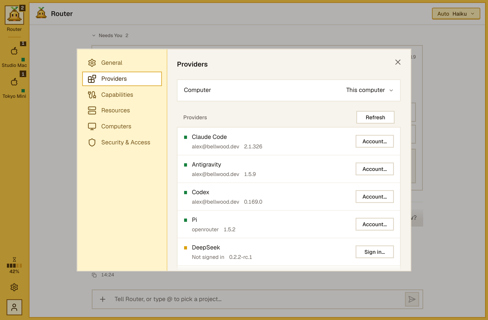
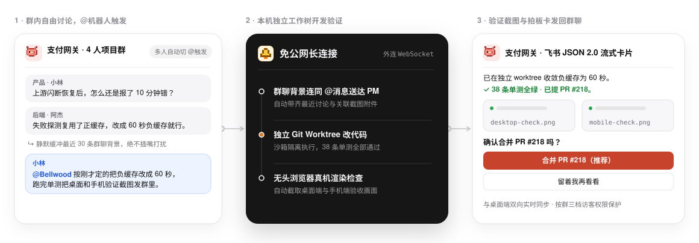

<div align="center">


# Bellwood

### 一个项目一个会话，统管你手头所有的编码 Agent CLI。

Bellwood 在本机为每个仓库配一位**项目经理（PM）**，把短命 **Worker** 派进操作系统沙箱与独立 git worktree 并行干活，用 **总助（Router）**汇总多台电脑的待拍板事项，并免公网服务器接入**飞书**。

**[快速开始](#快速开始)** &nbsp;·&nbsp; **[工作原理](#工作原理)** &nbsp;·&nbsp; **[总助 Router](#总助-router)** &nbsp;·&nbsp; **[飞书入口](#飞书入口)** &nbsp;·&nbsp; **[安全与条款](#安全边界与厂商条款)** &nbsp;·&nbsp; [English](README.md) · **简体中文**

<br>


</div>

<br>

同时开多个编码 Agent 并行开发时，瓶颈很快会从写代码变成管会话：手动建 git worktree、在终端间复制上下文、盯着哪个窗口卡住，或者某家额度用完换工具后从头交代项目约定。

Bellwood 以本地守护进程运行，提供 **macOS 13+（Apple 芯片）** 原生应用（`Bellwood.app`）、**Windows x64** 原生 Tauri 2 应用（内置 Node 24 LTS，免管理员权限、免 WSL 2）、**Linux** `systemd` 常驻守护进程，以及手机和电脑上的**飞书**入口。

- **一个项目只留一条主对话**。你在一个连续线程里和项目经理对齐目标、处理拍板卡；拆步骤、派 Worker 进独立 git worktree 并行干活、汇总测试结果与交付文件，全由项目经理协调。
- **自由混用 8 家 Agent CLI，项目记忆跟着项目走**。项目经理和每个 Worker 都可以独立选用 `claude`、`agy`、`codex`、`pi`、`dsh`、`cursor-agent`、`opencode` 或 `kimi`，用你自己的订阅或 API Key 运行。长期记忆保存在 Bellwood 本地账本与 Markdown 文件里，换工具不丢约定。
- **多台电脑与团队群聊统一收口**。**总助（Router）**把 Mac、Windows 与 Linux 服务器上的待拍板卡片和进度汇成一处；接上**飞书**后无需公网 IP，出门用手机批示，团队在群里讨论后 `@` 机器人即可开工并回传验证结果。

如果你平时只在一个仓库里开一个终端跑单个 Agent 且够用，就不需要 Bellwood。

## 快速开始

### 1. 下载桌面安装包（未签名预览版）

从 **[GitHub Releases](https://github.com/maodesikeng-boop/agent-hub/releases/latest)** 下载预编译安装包：

| 平台 | 安装包 | 校验文件 |
| :-- | :-- | :-- |
| **macOS 13+**（Apple 芯片，内置 Node 24 LTS 与守护进程） | [`Bellwood-macos-arm64.dmg`](https://github.com/maodesikeng-boop/agent-hub/releases/latest/download/Bellwood-macos-arm64.dmg) | [`.sha256`](https://github.com/maodesikeng-boop/agent-hub/releases/latest/download/Bellwood-macos-arm64.dmg.sha256) |
| **Windows x64**（推荐 Windows 11；免管理员、免 WSL 2，内置 Node 24 LTS） | [`Bellwood-windows-x64-setup.exe`](https://github.com/maodesikeng-boop/agent-hub/releases/latest/download/Bellwood-windows-x64-setup.exe) | [`.sha256`](https://github.com/maodesikeng-boop/agent-hub/releases/latest/download/Bellwood-windows-x64-setup.exe.sha256) |

打开前可先核对 SHA-256 校验值与 GitHub 构建溯源证明：

```sh
# macOS 校验文件与溯源证明
shasum -a 256 -c Bellwood-macos-arm64.dmg.sha256
gh attestation verify Bellwood-macos-arm64.dmg -R maodesikeng-boop/agent-hub
```

```powershell
# Windows 校验文件与溯源证明
Get-FileHash Bellwood-windows-x64-setup.exe -Algorithm SHA256
gh attestation verify Bellwood-windows-x64-setup.exe -R maodesikeng-boop/agent-hub
```

两个安装包目前为未签名预览版，首次打开需要系统放行。**macOS**：把 **Bellwood** 拖入「应用程序」，双击遇到提示时点「完成」，再到「系统设置 → 隐私与安全性」底部点「仍要打开」。**Windows**：在 SmartScreen 提示中点「更多信息 → 仍要运行」；关闭窗口会收进系统托盘，右键托盘选 **Quit Bellwood** 可优雅停掉守护进程。如需在 Windows 上派发并行 git worktree，可在 **Settings → Providers** 安装 Git for Windows 或执行 `winget install --id Git.Git -e --source winget`。

### 2. 安装并登录至少一家 Agent CLI

Bellwood 支持 **Claude Code** (`claude`)、**Antigravity** (`agy`)、**Codex** (`codex`)、**Pi** (`pi`)、**DeepSeek Harness** (`dsh`)、**Cursor** (`cursor-agent`)、**OpenCode** (`opencode`) 和 **Kimi Code** (`kimi`)。

打开 **Bellwood** 并进入 **Settings → Providers**（首次启动如无可用 CLI 会自动打开）。点击对应厂商右侧的 **Install** 安装，再点击 **Sign in...** 完成登录（支持浏览器 OAuth、设备码、无头服务器粘贴回环回调地址或填写 API Key）。新建项目经理或使用总助 **Auto** 模式且未指定厂商时，Bellwood 会自动选择这台电脑上第一个可用的 CLI。

<div align="center">

</div>

<br>

<details>
<summary><b>在终端手动安装与登录各家 CLI</b></summary>

<br>

- **Claude Code (`claude`)**：macOS/Linux 运行 `curl -fsSL https://claude.ai/install.sh | bash`，Windows PowerShell 运行 `irm https://claude.ai/install.ps1 | iex`；登录运行 `claude auth login`。
- **Antigravity (`agy`)**：macOS/Linux 运行 `curl -fsSL https://antigravity.google/cli/install.sh | bash`，Windows PowerShell 运行 `irm https://antigravity.google/cli/install.ps1 | iex`；运行 `agy` 登录或配置 `GEMINI_API_KEY`。
- **Codex (`codex`)**：macOS/Linux 运行 `curl -fsSL https://chatgpt.com/codex/install.sh | sh`，Windows 运行 `npm install -g @openai/codex`；登录运行 `codex login`（无浏览器服务器用 `codex login --device-auth`）。
- **Pi (`pi`)**：macOS/Linux 运行 `curl -fsSL https://pi.dev/install.sh | sh`，Windows PowerShell 运行 `irm https://pi.dev/install.ps1 | iex`（或 `npm install -g --ignore-scripts @earendil-works/pi-coding-agent`）；运行 `pi` 后输入 `/login`。
- **DeepSeek Harness (`dsh`)**：运行 `npm install -g @deepseek-ai/dsh@0.2.2-rc.1`，运行 `dsh` 或向 `~/.dsh/.env` 写入 `DEEPSEEK_API_KEY=<key>`。
- **Cursor (`cursor-agent`)**：macOS/Linux 运行 `curl https://cursor.com/install -fsS | bash`，Windows PowerShell 运行 `irm 'https://cursor.com/install?win32=true' | iex`；登录运行 `cursor-agent login`。
- **OpenCode (`opencode`)**：macOS/Linux 运行 `curl -fsSL https://opencode.ai/v2/install | bash`，Windows 运行 `npm install -g @opencode/cli`；登录运行 `opencode auth login`，或在 **Settings → Providers** 填入 OpenCode Zen Key（`OPENCODE_API_KEY`）。
- **Kimi Code (`kimi`)**：macOS/Linux 运行 `curl -fsSL https://code.kimi.com/kimi-code/install.sh | bash`，Windows PowerShell 运行 `irm https://code.kimi.com/kimi-code/install.ps1 | iex`（或在 Node.js 22.19+ 下运行 `npm install -g @moonshot-ai/kimi-code`）；登录运行 `kimi login`，或在 **Settings → Providers** 填入 Kimi 开放平台 API Key。

</details>

### 3. 接入飞书、Linux 或其他电脑（可选）

- **飞书机器人与项目群**：守护进程运行时执行 `node src/feishu/main.ts connect` 并用飞书扫码；执行 `node src/feishu/main.ts status` 查看绑定状态。
- **多台电脑组网**：内置官方公共盲中继与 GitHub Device Flow Client ID，无需额外配置。在每台电脑的 **Settings → Computers** 登录同一个 GitHub 账号，核对两端显示的六位数字码即可互信。自建中继时通过 `FUSA_RELAY_URL` 和 `FUSA_GITHUB_CLIENT_ID` 覆盖。
- **Linux 常驻守护进程**：以 `systemd --user` 服务运行，并执行一次 `sudo scripts/linux-sandbox-setup.sh` 配置 `bubblewrap`。详见 [Linux 部署指南](docs/linux.md)。

<details>
<summary><b>从源码构建或直接启动守护进程</b></summary>

<br>

需要 **Node.js >= 24.12**（原生执行 `.ts` 并内置 `node:sqlite`）、**pnpm 10** 与 **git**。仓库包名、`~/.agent-hub` 默认目录与 `fusa-*` crate 保留兼容命名以支持零迁移升级，详见 [docs/README.md](docs/README.md#naming-lineage)。

```sh
git clone https://github.com/maodesikeng-boop/agent-hub.git
cd agent-hub
pnpm install --frozen-lockfile
pnpm start                          # 构建 dist/web 并在 127.0.0.1:4317 启动守护进程
```

`pnpm start` 会在终端打印带令牌的本机登录链接（`http://127.0.0.1:4317/auth?token=...`），在浏览器打开即可登录。

- **在 macOS 上编译安装 `/Applications/Bellwood.app`**（需 Xcode Command Line Tools `swiftc`）：
  ```sh
  pnpm build
  bash scripts/build-mac-app.sh --install   # 仅构建 build/Bellwood.app 可用 pnpm app:mac
  ```
  源码模式打包会在 `Info.plist` 中写入仓库路径（`AgentHubRepoDir`）与 Node 路径（`AgentHubNodePath`），移动目录后请重跑；打独立自包含安装包请加 `--dist`（详见 [docs/mac-distribution-design.md](docs/mac-distribution-design.md)）。
- **在 Windows 上从源码构建 NSIS 安装包**（需 Rust `x86_64-pc-windows-msvc` 与 VS C++ Build Tools）：
  ```powershell
  pnpm install --frozen-lockfile
  pnpm build
  cargo build --release --manifest-path apps/windows/Cargo.toml --workspace --bins --locked
  node scripts/stage-win-runtime.ts --out-dir apps/windows/crates/fusa-desktop/staged-runtime --helpers-dir apps/windows/target/release --target-os win32
  cd apps/windows/crates/fusa-desktop
  ..\..\..\..\node_modules\.bin\tauri build --bundles nsis --config tauri.bundle.conf.json -- --locked
  ```

</details>

<details>
<summary><b>环境变量配置</b>（全部可选）</summary>

<br>

| 变量名 | 默认值 | 说明 |
| :-- | :-- | :-- |
| `AGENT_HUB_HOME` | `~/.agent-hub` | 数据目录（SQLite 账本、令牌、worktrees、上传附件、日志、PM 记忆）。macOS/Linux 受 Unix Socket 长度限制需控制在 103 字节内；Windows 使用命名管道。 |
| `AGENT_HUB_PORT` | `4317` | 本机网页端口，仅监听 `127.0.0.1`。设为 `0` 由系统分配空闲端口。 |
| `FUSA_MESH_PORT` | `4320` | 账号组网的局域网双向 TLS 监听端口。设为 `0` 由系统分配空闲端口。 |
| `AGENT_HUB_CLAUDE`、`AGENT_HUB_AGY`、`AGENT_HUB_CODEX`、`AGENT_HUB_PI`、`AGENT_HUB_DEEPSEEK`、`AGENT_HUB_CURSOR`、`AGENT_HUB_OPENCODE`、`AGENT_HUB_KIMI` | `claude`、`agy`、`codex`、`pi`、`dsh`、`cursor-agent`、`opencode`、`kimi` | 覆盖各家 CLI 的命令名或可执行文件路径（支持 `~/` 展开）。 |
| `AGENT_HUB_DEFAULT_MODEL` | 未设置 | 首次启动自动创建初始项目经理时使用的默认模型。 |
| `FUSA_RELAY_URL` | 官方公共中继 | 覆盖账号组网中继地址。同一账号下所有设备须使用同一个中继。 |
| `FUSA_GITHUB_CLIENT_ID` | 官方公开 Client ID | 覆盖为自建、已开启 Device Flow 的 GitHub OAuth App Client ID。 |
| `AGENT_HUB_REPO_DIR`、`AGENT_HUB_NODE` | `Info.plist` 内置值 | 仅源码编译的 `Bellwood.app`：运行时覆盖仓库目录或 Node 路径。 |

当项目设置了 `hub project setup` 准备命令时，守护进程在新建 worktree 执行脚本时会自动注入 `AGENT_HUB_ROOT_PATH` 和 `AGENT_HUB_WORKTREE_PATH`。

</details>

## 工作原理

本地守护进程统一维护 SQLite 对话账本、任务图、项目记忆与交付产物，在系统级沙箱中调度已安装的各家 CLI，并将状态实时同步到桌面端、移动端网页与飞书。

<div align="center">
<picture>
  <source media="(prefers-color-scheme: dark)" srcset="docs/screenshots/readme/architecture-zh-dark.svg">
  
</picture>
</div>

<br>

<table>
<tr>
<td width="50%">

</td>
<td width="50%">

</td>
</tr>
</table>

### 项目经理与工作面板

工作台把长期对话与执行细节分成四个固定区域：

| 区域 | 内容 |
| :-- | :-- |
| **顶部栏** | 桌面端木纹顶栏居中内置快速 **Router** 输入框，回车直接在非模态浮层里收发跨项目指令，点 **Expand** 可展开到完整总助页。 |
| **最左栏** | 置顶 **Router**（带待处理数字角标），下方列出每台已配对电脑及其在线状态点，底部常驻实时额度、**Settings**（当 **Resources** 有待清理项时显示提示点）与账号入口。 |
| **项目列表** | 可调宽列表，展示 **Pinned** 与活跃项目经理（每个项目一只像素水果史莱姆），历史子任务不会挤占主列表。 |
| **主对话与工作面板** | 中间是连续的项目经理对话，默认折叠日常工具调用，并内置多步骤实时进度清单与拍板卡；右侧宽幅工作面板提供 **Active**、**Completed** 和 **Info** 三个标签页。 |

每轮多步骤操作都会在对话流内渲染实时进度清单，展示当前步骤与耗时；窄屏与手机端自动切为单栏视图，切换窗口宽度不丢草稿。

### 跨厂商记忆、后台换代与即时切换

- **项目级持久记忆**：每个项目的架构约束、习惯与踩坑记录存在独立的 `MEMORY.md` 与专题 Markdown 文件中，可在工作面板 **Info** 标签页直接查看、编辑或删除。在 **Settings → Providers** 中可扫描并同步各家 CLI 的 MCP 服务器与技能配置。
- **后台自动会话换代**：长会话接近上下文上限（默认 400K token）时，后台在不打断当前对话的情况下分叉整理交接内容，于两轮间隙切入干净新会话，保留最近原话与核心背景，丢弃冗长的历史工具输出。
- **即时切换厂商与模型**：遇到限额或想换模型时，在 **Info** 标签页直接切换厂商、模型或思考档位即可继续。下一轮会自动带上最近对话、附件、Worker 汇报与当前任务图状态。

### 任务流图、独立工作树与 `hub` 命令

项目经理通过内置 `hub` CLI 调度 Worker、挂拍板卡、建定时任务、盯外部条件与查询能力：

```sh
hub graph create --stdin                             # 声明自动交棒的多步任务流图
hub worker start --title "..." --stdin               # 派单个 Worker 进入独立 git worktree
hub ask --option "A" --option "B" --stdin            # 挂出带推荐项的拍板卡
hub watch add --until "..." --every 30s --stdin      # 让后台盯外部检查条件，满足或超时后叫醒
hub schedule add --name "..." --daily 09:00 --stdin  # 建立周期性定时提醒或巡检任务
hub caps                                             # 查看当前项目可用的 skill、MCP 与连接器
hub persona edit --stdin                             # 修改项目经理的工作模式或性格设定
```

- **后台自动递进**：任务图启动后，上一步顺利完成时守护进程会自动把总目标、分支状态和交接说明传给下游 Worker 并立即开工；只有报错、偏离范围、到达检查点或整张图完成时才唤醒项目经理或弹卡。
- **工作流保持中立**：Bellwood 不强行绑定某一套研发流程。先写方案、派另一家模型做只读独立审查（`"review": true`）或合并 PR 均按需启用，只有你明确要求或项目约定写了才会执行。
- **独立 git worktree 与准备脚本**：每个改代码的 Worker 都在独立工作树里运行，并行开发互不干扰。用 `hub project setup` 配好一次依赖安装命令后，每次新建 worktree 会自动执行；在输入框输入 `/hub:worker` 可为本轮派出的 Worker 指定厂商、模型与思考档位。

### 设置页：Providers、Capabilities 与 Resources

从最左栏打开 **Settings** 可管理六个页面：**General**、**Providers**、**Capabilities**、**Resources**、**Computers** 与 **Security & Access**。

- **Capabilities**：分别为总助、项目默认配置或单个项目开关技能、MCP 服务器与连接器，并为 Worker 配置 `inherit`、`none` 或 `custom` 能力白名单。
- **Resources**：自检数据库体量、磁盘目录、未回收的 worktree、未合并分支、遗留临时目录和后台进程，确认后再清理或保留。

## 总助 Router

当项目分散在笔记本、台式机和 Linux 服务器上时，**总助（Router）**既是顶部栏里的快捷入口，也是最左栏置顶的全局工作台。

<div align="center">

</div>

<br>

- **跨机待办一处收齐**：任意电脑上的项目完成任务图或停在分岔口等你确认时，拍板卡和交付摘要都会汇入总助托盘，点选后实时同步回对应项目经理。
- **自然语言跨机分派**：直接喊项目简称即可查询进度或派活，无需记主机名和仓库路径。总助匹配对应电脑与项目经理，转发请求并把答复贴在原问题下方。
- **两层项目档案与无状态单轮分派**：后台静默维护「一句话摘要卡片」与按需展开的「详细近况」。总助每轮都在干净的无状态单轮会话里完成识别与分派，不累积历史包袱，切换总助模型立即生效。
- **私有账号组网**：在 Mac、Windows 和 Linux 上登录同一个 GitHub 账号并核对一次六位数字码，设备即通过双向 TLS 1.3 自动组网：同局域网直连，跨网走端到端加密盲中继。代码与日志留在各自本机，无需公网 IP、SSH 隧道或端口映射。

## 飞书入口

无需公网服务器、域名或反向代理，通过出站 WebSocket 连接**飞书**（或 **Lark**），手机随时跟进，或拉团队进群协作。

<div align="center">
<picture>
  <source media="(prefers-color-scheme: dark)" srcset="docs/screenshots/readme/feishu-group-zh-dark.svg">
  
</picture>
</div>

<br>

- **全账号共用一个机器人**：执行 `node src/feishu/main.ts connect` 扫码即可创建。同一账号下多台电脑按优先级共享该机器人，主力机离线时下一台在线设备自动接管，断网重连后自动补拉漏收消息。
- **单聊找总助，项目建专属群**：与机器人单聊直达总助 Router；每个项目自动拥有带像素水果史莱姆头像的专属群，支持流式输出与**停止**按钮，截图、录屏和拍板卡与桌面端实时同步。
- **团队群自动切换 `@机器人` 模式**：群里只有你一人时每条消息直达项目经理；拉入同事后自动切换为 `@机器人` 触发，平时讨论只在后台缓冲近期上下文，需要落实时 `@` 机器人即可带上下文开工并把结果发回群里。
- **手机端切换模型与思考档位**：在单聊或项目群发送 `/settings`（或 `/设置`、`/群设置`、`/model`、`/policy`）即可打开交互设置卡，直接切换厂商、模型与思考档位。
- **按群三档访客权限**：可为每个项目群设置**只读**（仅作主人发言的背景参考，不唤醒 PM）、**仅对话**（默认：允许 `@` 机器人对话，拍板卡、停止与附件仍仅限主人）或**协作者**（还可操作拍板卡、停止与发送附件）。访客触发轮次中，账本会拦截建项目、挂卸目录、改准备脚本和改性格等主人专属命令。因为项目经理以当前系统用户运行且不受外层沙箱限制，**仅对话**与**协作者**仅应授予你信任的成员。

## 安全边界与厂商条款

### 沙箱与权限边界

Worker 以你当前系统用户身份改代码和运行命令，在敏感机器上使用前请了解实际边界：

- **普通 Worker**：在原生系统沙箱内（macOS 为 `sandbox-exec`，Linux 为 `bubblewrap`，Windows 为 `fusa-run.exe` Job Object、受限令牌与 NTFS ACL），每个普通 Worker 在受保护根目录下只能写入自己的 worktree，禁止读取 `state/` 与 `backups/`（SQLite 账本、界面与厂商令牌、飞书与组网私钥、PM 记忆或其他会话启动目录），且只能连接 `run/hub.sock`、禁连 `run/admin.sock`（详见 [docs/write-scope.md](docs/write-scope.md)）。受保护目录之外保留你的常规读写与联网权限。
- **只读 Worker**：除私有临时目录和必要厂商运行路径外全盘禁写，仅放行只读工具，执行同等的数据目录边界，并拦截读取 SSH、云厂商、各家 CLI 凭据与 `.env` 文件（详见 [docs/readonly-worker-design.md](docs/readonly-worker-design.md)）。
- **需人工确认的 Computer Use 例外（仅 macOS）**：在 macOS 上，明确挂载 Computer Use 能力的 Worker 可申请 `--no-outer-sandbox`，以避开嵌套 `sandbox-exec` 冲突并改由厂商内置沙箱接管。Worker 必须等待你在网页工作台点击**批准本次运行**后才开工（飞书仅发送只读提示），且每次尝试控制新的桌面应用都需逐应用弹出确认卡（允许本次运行或拒绝）。退出外层沙箱期间，Worker 在厂商内置沙箱下可读取全盘文件（含 Bellwood 数据目录），两类授权均在该 Worker 结束时立即失效。
- **项目经理与本机网络**：项目经理以当前系统用户身份运行，不进外层沙箱；本机网页界面默认仅监听 `127.0.0.1`。完整威胁模型与私密漏洞报告渠道见 [SECURITY.md](SECURITY.md)。

### 厂商服务条款风险

Bellwood 不中转或售卖任何模型 API，仅在你的本机用**你自己的账号或 API Key**，通过无头、RPC 或 ACP 模式调用各家官方命令行 Agent。请在使用前自行确认所用订阅和条款，本项目无法替任何厂商背书或保证账号状态：

- **Google Antigravity (`agy`)**：[Google Antigravity 附加条款](https://antigravity.google/terms/)第 6 条禁止使用第三方软件、工具或服务访问该服务，并提示违规可能导致 Antigravity 或 Gemini CLI 账号被暂停或终止。Google 尚未明确在本地无头调用官方 `agy` CLI 是否适用此条，请将其视为**可能导致账号被暂停或终止的真实风险**自行决定。
- **Claude Code (`claude`)**：[Anthropic 合规说明](https://code.claude.com/docs/en/legal-and-compliance) · **Codex (`codex`)**：[OpenAI 使用条款](https://openai.com/policies/row-terms-of-use/) · **Pi (`pi`，MIT 开源)**：[pi.dev](https://pi.dev)（同时遵守所连模型商条款） · **DeepSeek Harness (`dsh`，MIT 预览版)**：[DeepSeek 开放平台条款](https://cdn.deepseek.com/policies/en-US/deepseek-open-platform-terms-of-service.html) · **Cursor (`cursor-agent`)**：[Cursor 服务条款](https://cursor.com/terms-of-service) · **OpenCode (`opencode`，MIT 开源)**：[opencode.ai](https://opencode.ai)（同时遵守所连模型商条款） · **Kimi Code (`kimi`)**：[Kimi Code 文档](https://www.kimi.com/code/docs/)（使用 API Key 时同时遵守 Kimi 开放平台条款）。

## 参与贡献

报告问题、本地检查命令与 PR 规范见 [CONTRIBUTING.md](CONTRIBUTING.md)，用户指南与架构文档索引见 [docs/README.md](docs/README.md)。

## 致谢与许可证

- 项目经理像素水果史莱姆、总助嫩芽铃与拍板小铃均由 [`src/shared/slimes.ts`](src/shared/slimes.ts) 中的像素稿渲染生成。
- 第三方依赖遵循 `pnpm-lock.yaml` 中的各自许可证（`mermaid` 传递引入的 `elkjs` 为 `EPL-2.0 OR GPL-3.0-or-later`，`khroma` 上游仓库为 MIT）。
- 本项目以 [MIT](LICENSE) 许可证发布。
