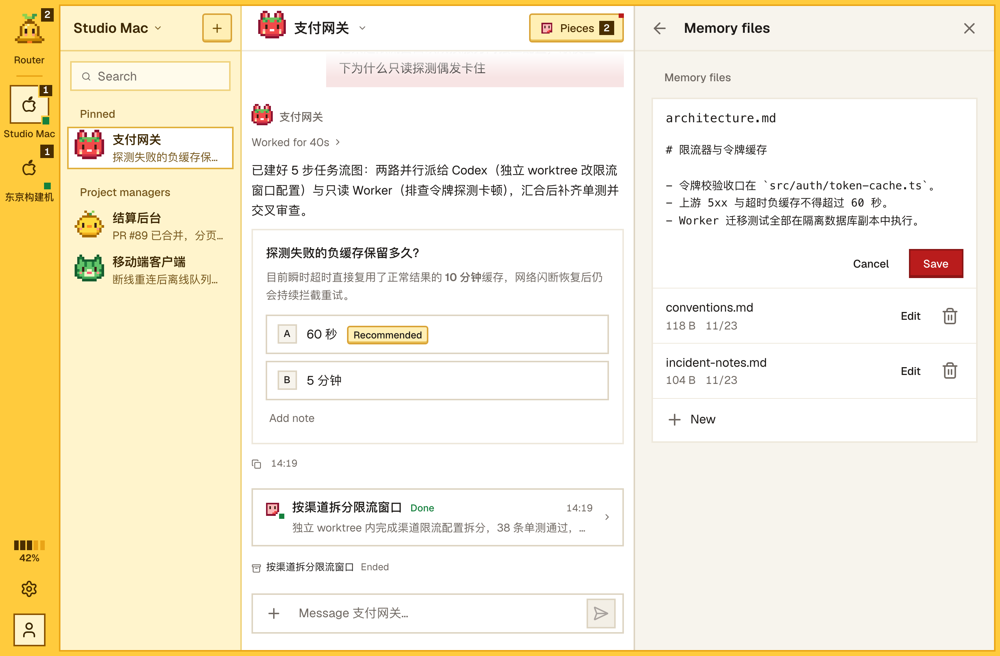

<div align="center">


# Bellwood

### 一个项目一个会话，统管你手头所有的编码 Agent。

**Claude Code 当项目经理，Codex 在独立工作树并行写代码，Antigravity 做异构审查。**<br>
跨厂商持久记忆跟着项目走，换了工具记忆还在；<br>
总助 Router 一个入口管住所有仓库与多台电脑，拉进飞书群里 `@` 机器人就能自动完成开发和验证。

**[下载安装](#快速开始)** &nbsp;·&nbsp; **[整体结构](#整体结构)** &nbsp;·&nbsp; **[一个项目一个会话](#一个项目一个会话)** &nbsp;·&nbsp; **[总助 Router](#总助-router一个入口管住所有项目与多台电脑)** &nbsp;·&nbsp; **[飞书入口](#飞书入口走出电脑桌把整个团队拉进闭环)** &nbsp;·&nbsp; **[安全与条款](#安全边界与厂商条款)** &nbsp;·&nbsp; [English](README.md) · **简体中文**

<br>


</div>

<br>

## Bellwood 适合你吗？

同时开好几个编码 Agent 并行干活时，真正的瓶颈很快就会从写代码变成**管会话**：手动建 git worktree、在不同终端之间来回复制背景、盯着屏幕看哪个窗口卡住了，某家额度用完换个工具又要从头交代一遍项目规矩。

Bellwood 给每个项目配一位专属的**项目经理（PM）**，把繁琐的编排和状态收进一个本地应用里：

- **一个项目只留一个主对话**。你只在一个连续会话里和项目经理对齐目标、点选拍板卡；拆步骤、派 **Worker**（界面里叫 **Pieces**）去各自的独立 git worktree 并行写代码、看测试结果、合 PR，都交给项目经理处理。
- **自由混用各家工具，换了工具记忆还在**。项目经理和每个 Worker 都可以独立选 `claude`、`codex`、`agy`、`pi`、`dsh` 或 `cursor-agent`，用你自己的订阅或 API Key 跑。长期记忆存在 Bellwood 自己的本地账本与 Markdown 文件里，哪怕中途换了厂商，项目攒下的架构约束、踩坑记录和你的个人习惯照样都在。
- **跨项目、跨设备与团队群聊一个入口打通**。**总助（Router）**把你名下所有项目、多台电脑上的待拍板事项和进展汇成一处，还不会撑爆上下文；接上**飞书**后不用公网 IP，一个人手机随时遥控，团队拉群正常聊天、需要落实时 `@` 一下机器人就能自动改完代码并把验证截图发回群里。

如果你同时推进不止一个需求或仓库、混用不止一家命令行 Agent，或者希望在手机和飞书群里随时拍板验收，它就适合你。如果你平时只在一个仓库里开一个终端跑单个 Agent 而且够用，那就不需要它。

支持 **macOS 13+**（`Bellwood.app` 原生窗口）、**Windows x64**（Tauri 2 原生桌面应用，随包自带官方 Node 24 LTS，无需管理员权限、无需 WSL 2）、**Linux**（`systemd` 常驻守护进程），以及手机和电脑上的**飞书**。

## 整体结构

本地守护进程在后台统一管理对话账本、任务流图、项目记忆与交付文件，在操作系统级沙箱里调度你电脑上装好的各家命令行 Agent，并通过桌面窗口与飞书向你汇总进展。

<div align="center">
<picture>
  <source media="(prefers-color-scheme: dark)" srcset="docs/screenshots/readme/architecture-zh-dark.svg">
  
</picture>
</div>

## 一个项目一个会话

一个会话跑上几周，往往会撞上上下文膨胀、分支冲突和换工具失忆这几道坎。Bellwood 在底层做了七件事，让单会话长期顺畅运转：

<table>
<tr>
<td width="50%">

</td>
<td width="50%">

</td>
</tr>
</table>

### 1. 专属记忆与工具同步，换家也不重来

各家命令行自带的记忆锁在各自目录里，MCP、工具和 Skill 的配置格式也互不相通。平时换一家工具，之前教过的项目规矩全丢了，连顺手的工具链也得按新格式重配一遍。

Bellwood 为每个项目保存一份独立于厂商之外的专属记忆，项目经理会在日常协作中自动记下你的偏好、架构约定和踩过的坑，资料页里随时可查、可改、可回退。同时，在 **Settings → Providers** 点一下同步，就能把已配好的 MCP 服务器、工具与 Skill 一键对齐到本机所有 CLI。上午用 Claude Code，下午切 Codex，晚上换 Antigravity，项目的记忆和工具箱始终一致。

### 2. 无感后台换代，秒切厂商与模型

会话聊长了容易变笨卡顿，中途换家又怕丢掉聊了一半的进度，Bellwood 在底层把这两件事都抹平了：

- **长会话自动后台换代**：上下文快满时，后台会悄悄复制当前会话整理好交接单，不打断你正在进行的对话。两轮之间的空隙里自动切入干净的新会话，保留关键上下文与最近原话，顺手甩掉臃肿的历史工具输出，一个窗口连聊几周依然轻快。
- **零等待切换厂商与模型**：某家额度用完，或者想换个模型拿主意时，在资料页点一下就能当场切过去，不用等它写交接。新模型会直接拿到你最近聊过的原话、附件、Worker 汇报和正在跑的任务图状态，就算在几家工具之间连续来回切，上下文也始终完整连贯。

### 3. 独立工作树与系统级沙箱

每个改代码的 Worker 都会自动进入独立的 `git worktree` 并行开发，互不踩脚，也不污染你的主分支；配好一次准备脚本后，新建工作树时还会自动装好依赖再开工，合入主干后自动回收。所有 Worker 全程跑在操作系统原生沙箱里，严格限制越界读写；负责独立审查的只读 Worker 从系统层直接封死写权限。

### 4. 一个 `hub` 命令统管子 Worker

项目经理通过内置的 `hub` 命令就能完成建任务图、派 Worker、查进度、挂拍板卡和更新记忆，不用拼凑复杂的脚本：

```sh
hub graph create --stdin        # 声明自动交棒的多步任务流图
hub worker start --stdin        # 派单个 Worker 进独立工作树干活
hub ask --option "…" --stdin    # 向你挂出带推荐项的拍板卡
hub persona edit --stdin        # 更新跨厂商项目记忆
```

平时在聊天框输入 `/hub:worker`，你也可以直接指定这一轮派出去的 Worker 用哪家厂商、哪个模型和哪档思考程度。

### 5. 后台自动递进，顺利时不打扰

任务图一建好，后续推进全由后台接管。上一步顺利做完，守护进程会自动把总目标、分支进展和交接要点传给下一步并拉起新 Worker，项目经理不用在中间反复传话。只有遇到方案偏离、运行报错、需要你确认的检查点，或者整张图全部做完待验收时，系统才会叫醒项目经理或给你弹卡。

### 6. 只需关注拍板与验收

翻代码、跑测试、看长日志这些消耗注意力和上下文的体力活，全留在用完即走的短命 Worker 里；碰到关键改动，还会自动排入另一家模型的独立只读审查，不用你在主对话里硬啃几千行 diff。交到你面前的只有带推荐项的拍板卡，以及直接在对话里渲染好的截图、录屏、流程图与验收结论，你只管看证据做决定。

### 7. 清爽的三栏视图

| 区域 | 放什么 |
| :-- | :-- |
| **左栏** | 置顶 **Router（总助）**，下面每个项目对应一只专属像素水果史莱姆，多台电脑按设备分组，成百上千个历史子任务绝不挤占会话列表。 |
| **中栏** | 单一连续的项目经理主对话。繁琐的工具调用默认折叠收起，界面干净得像普通聊天。 |
| **右栏** | 实时展示 **Task Graph** 任务管道、正在跑的 **Pieces** 和等你拍板的事项。点开任意 Piece 既能看完整执行步骤，也能直接插话，系统会自动同步给项目经理避免两边脱节。 |

## 总助 Router：一个入口管住所有项目与多台电脑

当你手头有十几个项目散落在笔记本、台式机和远端服务器上时，置顶的 **Router（总助）**就是你的全局控制台。不用在十几行列表和几台电脑之间来回找，为什么一个入口就能稳稳管住全局？

<div align="center">

</div>

<br>

### 1. 所有待办与验收一处收齐

不管哪个项目、哪台电脑上的任务跑完了，或者卡在某个分岔口等你拿主意，拍板卡和完工简报都会自动汇进总助托盘。你在一个界面里点选选项、点开截图验收，决定会实时同步回对应的项目经理推进下一步。

### 2. 说人话就能跨机派活、追进度

不用记机器名和完整仓库路径，哪怕直接喊项目的日常简称或口头代号（比如“帮我看看支付网关刚合进去的改动上线没”），总助也能自动对上号，把指令精准转交给对应电脑上的项目经理，并在你原问题下面直接把项目经理的答复带回来。

### 3. 两层项目档案，懂全局又不爆上下文

总助之所以认识你所有项目的来龙去脉，是因为后台会在项目推进时静默提炼出两层档案：一层是极轻量的「一句话名片与近期主线」，另一层是按需展开的「阶段详细近况」。总助平时只扫一眼名片就能精准分派，遇到复杂追问才翻开详细近况，根本不用去硬啃百万字的原始聊天记录。

### 4. 单轮轻量分派，长年使用零卡顿

总助本身不背负冗长的历史包袱。你每问一句话，后台都在干净的独立环境里完成识别与分派，干完即走；不管你接了二十个项目还是连用几个月，响应速度始终像刚装好第一天一样快，随时切换总助自己的厂商和模型也是当场生效。

### 5. 登录同一账号，多台电脑自动组网

在你的 Mac、Windows 和 Linux 服务器上登录同一个 GitHub 账号，核对一次六位数字码就能把所有设备安全连成一张网：在同一局域网时自动直连，异地时通过端到端加密中继互通。各台电脑代码与日志留在本地各管各账，只向总助同步轻量名片与指令，彻底告别手工配公网 IP、SSH 隧道或内网穿透。

## 飞书入口：走出电脑桌，把整个团队拉进闭环

不用公网服务器、不用申请域名或配反向代理，只要在手机或电脑上打开飞书，既能一个人随时随地遥控手头所有电脑，也能把产品、设计和研发同事拉进群里，在日常聊天中直接完成开发与验证。

<div align="center">
<picture>
  <source media="(prefers-color-scheme: dark)" srcset="docs/screenshots/readme/feishu-group-zh-dark.svg">
  
</picture>
</div>

<br>

### 1. 免公网扫码即用，全账号共用一个机器人

后台通过飞书官方长连接主动向外连接，在终端跑一行命令、拿手机飞书扫个码，一分钟就自动建好你的专属机器人。多台电脑登录同一账号后共用这唯一一个机器人：你可以排好主力电脑顺序，平时由排第一的设备挂载；一旦笔记本合盖或服务器维护掉线，下一台在线电脑会自动无缝接管，网络闪断恢复后还会主动补拉断网期间漏掉的消息。

### 2. 单聊管全局，每个项目自动建专属群

点开机器人单聊就是找**总助 Router**，跨机派活、收全局拍板卡在手机单聊里就能全办完；而你手头的每一个项目，都会自动拉起一个带专属像素史莱姆头像的独立项目群。回复在群里实时流式滚动并自带停止按钮，高清截图、录屏视频、方案文档和拍板卡直接铺在主聊天流里，手机点一下或电脑点一下，两边状态实时同步。

### 3. 团队群里照常聊，`@` 一下自动改码交截图

项目群里只有你一个人时，发每句话都直达项目经理；一旦你把团队同事拉进群，这个群就会**自动切换为 `@机器人` 触发模式**：

- 同事们平时在群里自由讨论需求、发报错截图或手机直拍长视频，机器人只在后台静默记下最近的讨论脉络，绝不插嘴刷屏。
- 大家聊出结论后，直接在群里 `@机器人` 交代一句（比如“按上面聊定的改好，跑完测试把桌面和手机真机图发群里”）。
- 项目经理直接带着刚才整段群聊前因后果拉起独立工作树改代码、跑测试、用浏览器截好真机验证画面，把结果连同拍板卡直接发回群里让大家当场验看。

### 4. 手机上随时切模型、调思考档位

在单聊或项目群发 `/settings`（或 `/设置`、`/群设置`），就能随时呼出交互设置卡。出门在外遇到某家模型限额，或者碰到硬骨头想临时换个顶配推理模型，不用回电脑开网页，在飞书卡片下拉框里直接就能零等待切好厂商、模型与思考程度。

### 5. 按群设置的三档访客权限

你可以在每个项目群的设置卡里将访客权限设为**只读**、**仅对话**或**协作者**。**只读**档成员的发言不会唤醒项目经理，仅在你发起对话时作为背景参考。默认的**仅对话**档允许成员 `@` 机器人与项目经理对话，拍板卡、停止和发送附件仍仅限主人。**协作者**档还可回答拍板卡、点停止和发送附件。在访客触发的轮次中，账本层会拦截新建项目、挂卸目录、修改准备脚本与性格设定等主人专属命令。

由于项目经理以当前系统用户身份运行且不受外层沙箱限制，凡是加入飞书项目群且权限不是**只读**的成员，包括默认的**仅对话**与**协作者**两档，都必须是你信任的人。这两档成员都可以向未受沙箱限制的项目经理发消息，而账本层的命令拦截无法限制项目经理执行的 shell 命令。

## 支持的 Agent

<table>
<tr><td>

**Claude Code** (`claude`) · **Codex** (`codex`) · **Antigravity** (`agy`) · **Pi** (`pi`) · **DeepSeek Harness** (`dsh`) · **Cursor** (`cursor-agent`)

</td></tr>
</table>

在 macOS、Windows 或 Linux 上打开 **Settings → Providers**，即可一键安装任意支持的命令行 Agent，并直接在界面内登录（支持浏览器 OAuth、设备码、无头服务器粘贴回环地址或填写 API Key），查看实时额度窗口（`claude`、`agy`、`codex`），以及一键扫描合并各家已配的 MCP 服务器与技能。首次打开还没有就绪厂商时，这个面板会自动弹出。

<div align="center">

</div>

## 快速开始

### 1. 下载桌面安装包（未签名预览版）

直接从 **[GitHub Releases](https://github.com/maodesikeng-boop/agent-hub/releases/latest)** 下载预编译安装包（无需预先安装 Node 或拉取源码）：

| 平台 | 安装包 | 校验文件 |
| :-- | :-- | :-- |
| **macOS 13+**（Apple 芯片，内置官方 Node 24 LTS 与后台） | [`Bellwood-macos-arm64.dmg`](https://github.com/maodesikeng-boop/agent-hub/releases/latest/download/Bellwood-macos-arm64.dmg) | [`.sha256`](https://github.com/maodesikeng-boop/agent-hub/releases/latest/download/Bellwood-macos-arm64.dmg.sha256) |
| **Windows x64**（推荐 Windows 11；免管理员、免 WSL 2，内置官方 Node 24 LTS） | [`Bellwood-windows-x64-setup.exe`](https://github.com/maodesikeng-boop/agent-hub/releases/latest/download/Bellwood-windows-x64-setup.exe) | [`.sha256`](https://github.com/maodesikeng-boop/agent-hub/releases/latest/download/Bellwood-windows-x64-setup.exe.sha256) |

<sub>两个安装包目前均为未签名预览版，首次打开需系统放行一次。**Mac 首次打开：** 打开 DMG 把 **Bellwood** 拖进「应用程序」，双击遇到“无法验证开发者”时点「完成」，随后到「系统设置 → 隐私与安全性」底部点 Bellwood 旁边的「仍要打开」（可用 `shasum -a 256 -c Bellwood-macos-arm64.dmg.sha256` 校验）。**Windows 首次运行：** SmartScreen 提示时点「更多信息 → 仍要运行」；关闭窗口会隐藏到系统托盘，右键托盘图标选 `Quit Bellwood` 可优雅关停守护进程及其全部子进程树；如需派发并行 Git worktree，可在 **Settings → Providers** 一键安装 Git for Windows 或执行 `winget install --id Git.Git -e --source winget`。</sub>

### 2. 安装并登录至少一家 Agent CLI

打开 **Bellwood**，在弹出的 **Settings → Providers** 页面点对应厂商右侧的 **Install** 一键安装，再点 **Sign in…** 登录你的订阅账号或填入 API Key 即可开聊。

<details>
<summary><b>在终端手动安装与登录各家 CLI</b></summary>

<br>

- **Claude Code (`claude`)**：macOS/Linux `curl -fsSL https://claude.ai/install.sh | bash`，Windows PowerShell `irm https://claude.ai/install.ps1 | iex`；登录运行 `claude auth login`。
- **Codex (`codex`)**：macOS/Linux `curl -fsSL https://chatgpt.com/codex/install.sh | sh` 或 `npm install -g @openai/codex`；登录运行 `codex login`（远端无浏览器终端用 `codex login --device-auth`）。
- **Antigravity (`agy`)**：macOS/Linux `curl -fsSL https://antigravity.google/cli/install.sh | bash`，Windows PowerShell `irm https://antigravity.google/cli/install.ps1 | iex`；运行 `agy` 登录或配置 `GEMINI_API_KEY`。
- **Pi (`pi`，见 [docs/vendor-plugin-design.md](docs/vendor-plugin-design.md))**：macOS/Linux `curl -fsSL https://pi.dev/install.sh | sh`，Windows PowerShell `irm https://pi.dev/install.ps1 | iex`（或 `npm install -g --ignore-scripts @earendil-works/pi-coding-agent`）；运行 `pi` 后输入 `/login`。
- **DeepSeek Harness (`dsh`，见 [docs/vendor-plugin-design.md](docs/vendor-plugin-design.md))**：运行 `npm install -g @deepseek-ai/dsh@0.2.2-rc.1`，执行 `dsh` 登录或向 `~/.dsh/.env` 写入 `DEEPSEEK_API_KEY=<key>`。
- **Cursor (`cursor-agent`，见 [docs/vendor-plugin-design.md](docs/vendor-plugin-design.md))**：macOS/Linux `curl https://cursor.com/install -fsS | bash`，Windows PowerShell `irm 'https://cursor.com/install?win32=true' | iex`；运行 `cursor-agent login` 登录。

</details>

### 3. 接入飞书与其他电脑（可选）

- **接入飞书机器人与项目群**：守护进程运行期间，在终端执行 `node src/feishu/main.ts connect` 并用手机飞书扫码即可。运行 `node src/feishu/main.ts status` 查看绑定状态。同一账号的设备共用一个机器人，当前设备离线后由另一台自动接管。
- **多台电脑组网**：内置官方公共盲中继和公开的 GitHub Device Flow Client ID，无需额外配置；在每台电脑的 **Settings → Computers** 登录同一个 GitHub 账号。批准新设备时核对两台电脑显示的六位数字码。如需自建中继，设置 `FUSA_RELAY_URL` 和 `FUSA_GITHUB_CLIENT_ID` 覆盖。手机通过飞书操作这些设备。
- **Linux 常驻后台**：在 Ubuntu 上部署 `systemd` 用户服务，运行一次 `sudo scripts/linux-sandbox-setup.sh` 配置 `bubblewrap` 沙箱。详见 [Linux 部署指南](docs/linux.md)与[账号组网设计](docs/account-mesh-design.md)。

<details>
<summary><b>从源码构建或直接在终端启动守护进程</b></summary>

<br>

需要 **Node.js >= 24.12**（原生执行 `.ts` 并使用内置 `node:sqlite`）、**pnpm 10** 与 **git**。
仓库包名、默认数据目录 `~/.agent-hub` 与 Windows 原生 crate `fusa-*` 保留历史兼容命名，以便老用户升级免迁移；完整命名映射与架构文档索引见 [docs/README.md](docs/README.md#naming-lineage)。

```sh
git clone https://github.com/maodesikeng-boop/agent-hub.git
cd agent-hub
pnpm install --frozen-lockfile
pnpm start                          # 构建 dist/web 并在 127.0.0.1:4317 启动守护进程
```

- **在 macOS 上编译安装 `/Applications/Bellwood.app`**（需 Xcode 命令行工具 `swiftc`）：
  ```sh
  pnpm build
  bash scripts/build-mac-app.sh --install   # 仅生成 build/Bellwood.app 可用 `pnpm app:mac`
  ```
  开发模式打出的 `.app` 会在 `Info.plist` 里记录当前仓库路径（`AgentHubRepoDir`）与 Node 路径（`AgentHubNodePath`），挪动目录后请重跑脚本；独立自包含 DMG 用 `--dist` 模式打包（见 [docs/mac-distribution-design.md](docs/mac-distribution-design.md)）。
- **在 Windows 上从源码编译 NSIS 安装包**（需 Rust `x86_64-pc-windows-msvc` 与 VS C++ Build Tools；未发版提交也可在 GitHub Actions `windows-desktop` 工作流底部下载 `fusa-windows-x64-nsis-unsigned-preview` 产物，解压运行 `Bellwood_<version>_x64-setup-unsigned-preview.exe`）：
  ```powershell
  pnpm install --frozen-lockfile
  pnpm build
  cargo build --release --manifest-path apps/windows/Cargo.toml --workspace --bins --locked
  node scripts/stage-win-runtime.ts --out-dir apps/windows/crates/fusa-desktop/staged-runtime --helpers-dir apps/windows/target/release --target-os win32
  cd apps/windows/crates/fusa-desktop
  pnpm dlx @tauri-apps/cli@^2 build --bundles nsis --config tauri.bundle.conf.json
  ```

</details>

<details>
<summary><b>环境变量配置</b>（全部可选；底层默认保持 <code>~/.agent-hub</code>，老用户升级零迁移）</summary>

<br>

| 变量名 | 默认值 | 说明 |
| :-- | :-- | :-- |
| `AGENT_HUB_HOME` | `~/.agent-hub` | 数据目录（SQLite 账本、令牌、worktrees、上传附件、日志、PM 持久记忆）。macOS/Linux 受 Unix Socket 长度限制请保持在 103 字节内；Windows 使用命名管道。 |
| `AGENT_HUB_PORT` | `4317` | 本机网页服务端口，只监听 `127.0.0.1`。设为 `0` 由系统分配空闲端口。 |
| `AGENT_HUB_CLAUDE` / `AGY` / `CODEX` / `PI` / `DEEPSEEK` / `CURSOR` | `claude` / `agy` / `codex` / `pi` / `dsh` / `cursor-agent` | 覆盖各家 CLI 的命令名或可执行文件路径（支持 `~/` 展开）。 |
| `AGENT_HUB_DEFAULT_MODEL` | 未设置 | 首次启动自动创建默认项目经理时使用的模型。 |
| `FUSA_RELAY_URL` | 官方公共中继 | 覆盖账号组网的中继地址。同一账号下的设备使用同一个中继。 |
| `FUSA_GITHUB_CLIENT_ID` | 官方公开 Client ID | 覆盖为自建的、已启用 Device Flow 的 GitHub OAuth App Client ID。 |
| `AGENT_HUB_REPO_DIR` / `AGENT_HUB_NODE` | `Info.plist` 内置值 | 仅源码编译的 `Bellwood.app`：运行时覆盖仓库目录或 Node 可执行文件路径。 |

当项目配置了 `hub project setup` 准备脚本时，守护进程在新建 worktree 执行脚本时会自动注入 `AGENT_HUB_ROOT_PATH` 与 `AGENT_HUB_WORKTREE_PATH`。
`Bellwood`、`~/.agent-hub` 与 `fusa-*` 的兼容命名映射见 [docs/README.md](docs/README.md#naming-lineage)。

</details>

## 安全边界与厂商条款

### 沙箱与权限边界

Worker 以你当前系统用户的身份改代码、跑命令，使用前请留意实际边界：

- **普通 Worker 写隔离与数据目录读隔离**：在 macOS、Linux 与 Windows 原生系统沙箱内，每个普通 Worker 在受保护根目录下只能写自己的独立工作树，同时禁止读取 `state/` 与 `backups/`（账本数据库、界面与厂商令牌、飞书与组网私钥、项目经理记忆及其他会话启动目录），且只能连接 `run/hub.sock`、禁连 `run/admin.sock`（详见 [docs/write-scope.md](docs/write-scope.md)）；受保护目录之外允许正常读写你的项目目录、运行测试和联网。
- **只读审查 Worker**：除私有临时目录外全盘禁写，仅放行只读工具，执行同样的数据目录读与连接边界，并禁止读取 SSH、云厂商、各家 CLI 凭据与 `.env` 私钥文件（详见 [docs/readonly-worker-design.md](docs/readonly-worker-design.md)）。
- **项目经理与网络边界**：项目经理以当前系统用户身份运行且不受外层沙箱限制，本地网页服务默认仅监听本机回环地址 `127.0.0.1`。在飞书项目群中，处于**仅对话**或**协作者**这两个非只读档位的成员都可以向未受沙箱限制的项目经理发消息，因此非只读档权限仅限可信人员，其余成员请设为**只读**。详细说明与安全漏洞私密报告方式见 [SECURITY.md](SECURITY.md)。

### 厂商服务条款风险

Bellwood 在你的电脑上、用**你自己的账号或 API Key**，以无头、RPC 或 ACP 模式调用各家官方命令行 Agent，本身不中转或售卖任何模型 API。这种自动化调用方式是否符合你所用订阅套餐及服务商条款，请在使用前自行查阅判断，本项目不替任何厂商作“允许”承诺：

- **Google Antigravity (`agy`)**：[Google Antigravity 附加条款](https://antigravity.google/terms/)第 6 条写明：*“Using third party software, tools, or services to access the Service (e.g. using OpenClaw with Antigravity OAuth) is a breach of this Agreement. Such actions may be grounds for suspension or termination of your Antigravity and/or Gemini CLI accounts.”* 官方未明确说明在本地调用官方 `agy` 无头模式是否属于此条，请将其视为**可能导致账号被暂停或终止的真实风险**自行决定。
- **Claude Code (`claude`)**：[Anthropic 合规说明](https://code.claude.com/docs/en/legal-and-compliance) · **Codex (`codex`)**：[OpenAI 使用条款](https://openai.com/policies/row-terms-of-use/) · **Pi (`pi`，MIT 开源)**：[pi.dev](https://pi.dev)（请同时遵守所连模型商条款） · **DeepSeek Harness (`dsh`，MIT 预览版)**：[DeepSeek 开放平台条款](https://cdn.deepseek.com/policies/en-US/deepseek-open-platform-terms-of-service.html) · **Cursor (`cursor-agent`)**：[Cursor 服务条款](https://cursor.com/terms-of-service)。

## 致谢与许可证

- 项目经理像素水果史莱姆、总助嫩芽铃与拍板小铃均由 [`src/shared/slimes.ts`](src/shared/slimes.ts) 中的共享像素稿渲染生成。
- 第三方依赖遵循各自许可证（见 `pnpm-lock.yaml`；其中 `mermaid` 传递引入的 `elkjs` 为 `EPL-2.0 OR GPL-3.0-or-later`，`khroma` 上游仓库为 MIT）。
- 本项目采用 [MIT](LICENSE) 许可证发布。
