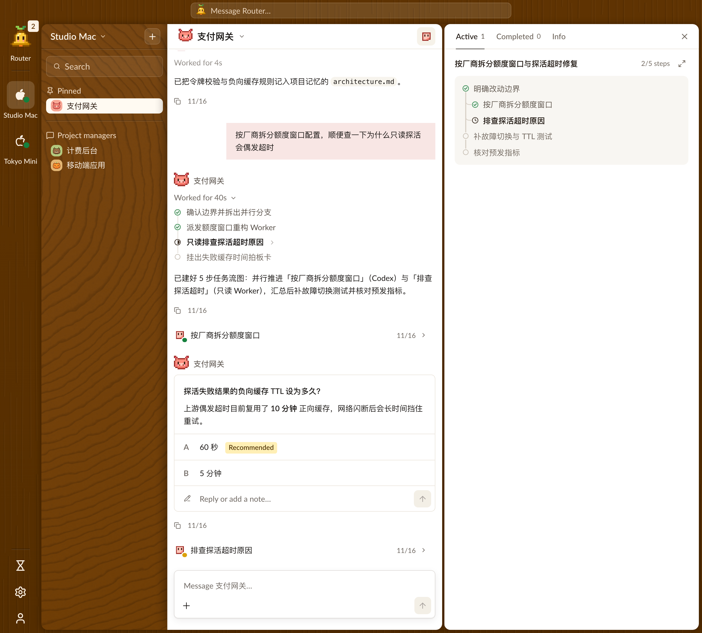
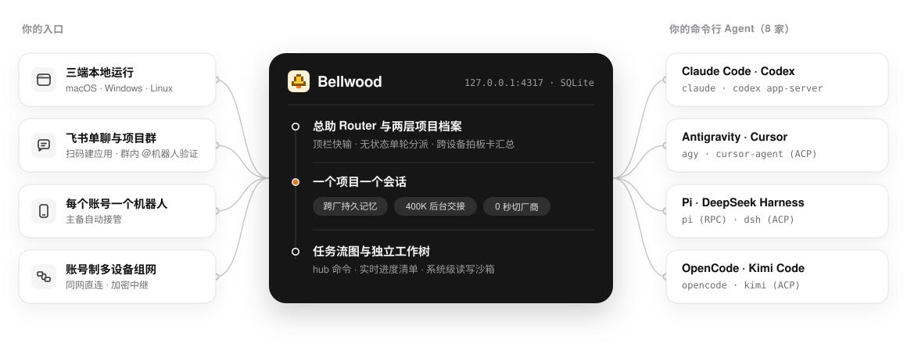
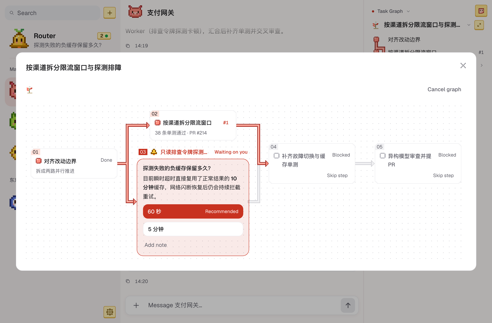
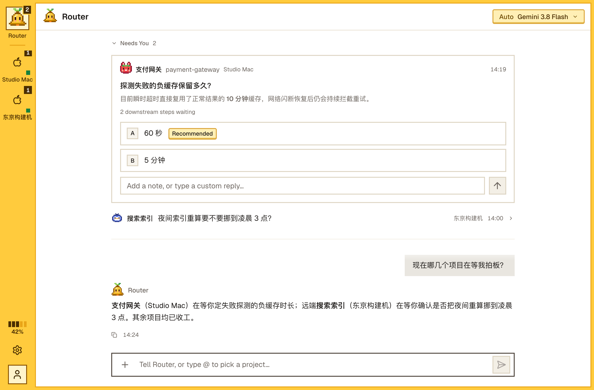

<div align="center">


# Bellwood

### 一个项目一个会话，统管你手头所有的编码 Agent。

**Claude Code 当项目经理，Codex 在独立工作树并行写代码，Antigravity 做异构审查。**<br>
跨厂商持久记忆跟着项目走，换了工具记忆还在；<br>
总助 Router 一个入口管住所有仓库与多台电脑，拉进飞书群里 `@` 机器人就能自动完成开发和验证。

**[下载安装](#快速开始)** &nbsp;·&nbsp; **[整体结构](#整体结构)** &nbsp;·&nbsp; **[一个项目一个会话](#一个项目一个会话)** &nbsp;·&nbsp; **[总助 Router](#总助-router一个入口管住所有项目与多台电脑)** &nbsp;·&nbsp; **[飞书入口](#飞书入口在群里讨论机器人自动完成验证)** &nbsp;·&nbsp; **[安全与条款](#安全边界与厂商条款)** &nbsp;·&nbsp; [English](README.md) · **简体中文**

<br>



</div>

<br>

## Bellwood 适合你吗？

同时开好几个编码 Agent 并行干活时，真正的瓶颈很快就会从写代码变成**管会话**：手动建 git worktree、在不同终端之间来回复制背景、盯着屏幕看哪个窗口卡住了，某家额度用完换个工具又要从头交代一遍项目规矩。

Bellwood 给每个项目配一位专属的**项目经理（PM）**，把繁琐的编排和状态收进一个本地应用里：

- **一个项目只留一个主对话**。你只在一个连续会话里和项目经理对齐目标、点选拍板卡；拆步骤、派 **Worker**（界面里叫 **Pieces**）去各自的独立 git worktree 并行写代码、看测试结果、合 PR，都交给项目经理处理。
- **自由混用各家工具，换了工具记忆还在**。项目经理和每个 Worker 都可以独立选 `claude`、`codex`、`agy`、`pi`、`dsh` 或 `cursor-agent`，用你自己的订阅或 API Key 跑。长期记忆存在 Bellwood 自己的本地账本与 Markdown 文件里，哪怕中途换了厂商，项目攒下的架构约束、踩坑记录和你的个人习惯照样都在。
- **跨项目、跨设备与团队群聊一个入口打通**。**总助（Router）**把你名下所有项目、多台电脑上的待拍板事项和进展汇成一处，还不会撑爆上下文；接上**飞书**后不用公网 IP，一个人手机随时遥控，团队拉群正常聊天、需要落实时 `@` 一下机器人就能自动改完代码并把验证截图发回群里。

如果你同时推进不止一个需求或仓库、混用不止一家命令行 Agent，或者希望在手机和飞书群里随时拍板验收，它就适合你。如果你平时只在一个仓库里开一个终端跑单个 Agent 而且够用，那就不需要它。

支持 **macOS 13+**（`Bellwood.app` 原生窗口）、**Windows x64**（Tauri 2 原生桌面应用，随包自带官方 Node 24 LTS，无需管理员权限、无需 WSL 2）、**Linux**（`systemd` 常驻守护进程），以及手机和电脑上的**飞书**。

## 整体结构

运行在 `127.0.0.1:4317` 的本地守护进程用 Node 内置 `node:sqlite`（`~/.agent-hub`）统一存对话、任务流图、持久记忆与交付文件，经本机 Unix Socket 或 Windows 命名管道向 Agent 暴露单一的 `hub` 命令，并在操作系统级写沙箱里驱动你本机装好的各家命令行 Agent。

<div align="center">
<picture>
  <source media="(prefers-color-scheme: dark)" srcset="docs/screenshots/readme/architecture-zh-dark.svg">
  
</picture>
</div>

## 一个项目一个会话

一个会话跑上几周，往往会撞上上下文膨胀、分支冲突和换工具失忆这几道坎。Bellwood 在底层做了七件事，让单会话长期顺畅运转：

<table>
<tr>
<td width="50%">

</td>
<td width="50%">

</td>
</tr>
</table>

### 1. 自动持久记忆，换了工具记忆还在

各家命令行自带的记忆都锁在自家私有目录里，一旦换个工具，之前教过的规矩就全丢了。

Bellwood 把每个项目经理的长期记忆独立存放在 `~/.agent-hub/state/pm-memory/<pmId>/`（系统提示词自动加载顶层 `MEMORY.md` 索引，上限 200 行或 25 KB；外加最多 50 个 `<topic>.md` 专题文件，合计上限 1 MB）和 SQLite 的版本历史表里。每次会话启动自动挂载，项目经理通过 `hub persona edit` 或直接读写记忆目录自动沉淀你的偏好与项目约束，资料页支持随时手改与一键撤销。同时，**Settings → Providers** 里的 **Vendor sync** 还能把你的 MCP 服务器和 `.agents/skills` 技能库一键原子同步到本机所有已安装的 CLI。上午用 Claude Code、下午切 Codex、晚上换 Antigravity，项目记忆和工具链始终都在。

### 2. 后台压缩交接，与零交接秒切厂商

长对话换代和中途切厂商解决的是两件不同的事，Bellwood 把它们彻底拆开：

- **满 40 万 token 自动后台换代**：当项目经理上下文达到 `400,000` token 时，守护进程在后台复制（fork）会话生成结构化交接单，前台对话零停顿。复制进程沿用原模型、系统提示词和工具定义，直接命中约 97% 的提示词缓存。两轮之间的空当里，项目经理切入新会话，自动带齐持久记忆、交接单、切点前最多 `30,000` 字原话、切点后的全部新消息以及最多 `80,000` 字已加载技能正文，同时剥离历史工具长输出。
- **0 秒同事务切换厂商与模型**：某家额度见底，或者想换个模型拿主意时，去资料页改一下厂商（比如 `Claude Code → Codex`），后台在同一数据库事务内 0 秒完成切换：直接按时间原序把本代起点摘要（若换过代）及**当前这一代的全部用户原话、附件本机路径、系统通知和每一份 Worker 汇报完整原文**（保底上限 `240,000` 字），连同未完结任务图的实时状态原样喂给新厂商。就算连续来回切 `Claude → Codex → Antigravity → Claude`，每次都从同一个本代起点干净重建，零套娃、不丢汇报细节。

### 3. 独立 Git 工作树与系统级沙箱

每个改代码的 Worker 都在各自独立的 git worktree（`~/.agent-hub/worktrees/<项目>/<Worker>`，分支 `hub/<编号>-<短名>`）里并行干活，不碰你的主工作区，彼此也不打架。配好一次 `hub project setup` 后，新建 worktree 时会先自动跑完依赖安装或代码生成再让 Worker 开工。在 Windows 上，如果项目放在 `D:\` 或 Dev Drive 等跨卷盘符，Bellwood 会自动在同卷建 `<盘符>:\.fusa-wt\` 目录来保留 `pnpm` 硬链接与磁盘性能。分支合入 `main` 或收工满 3 天后自动清理。

所有 Worker 都强制包在操作系统沙箱里运行（macOS 用 `sandbox-exec`，Linux 用 `bubblewrap`，Windows 用 `KILL_ON_JOB_CLOSE` Job Object + 写受限令牌 + NTFS ACL，只读 Worker 在 Windows 11 24H2+ 上优先跑微软官方 MXC 只读容器），严禁改写数据库、凭据文件和其他 Worker 的工作树。

### 4. 一个 `hub` 命令统管子 Worker

项目经理和 Worker 在标准终端里共用一个本地命令 `hub`，经本机 Unix Socket 或 Windows 命名管道通信，按每会话独立内存令牌鉴权：

```sh
hub status                                                     # 查看当前身份、项目目录、准备命令与活跃任务图
hub graph create --stdin                                       # 声明串行或多路并行的任务流图（DAG）
hub worker start --title "…" --vendor codex --stdin            # 派单个 Worker 进独立 worktree 干活
hub worker log 818 --stats                                     # 按需看步骤统计和读写最多的文件，不灌原始长日志
hub ask --node probe --option "60秒" --option "5分钟" --recommended "60秒" --stdin
hub persona edit --reason "…" --stdin                          # 更新跨厂商持久记忆
```

在对话框输入 `/hub:worker`，还可以直接指定这一轮派出的 Worker 用哪家厂商、哪个模型和哪档思考程度。

### 5. 后台自动递进，顺利时不打扰项目经理

任务流图建好之后，守护进程自己负责往下推。每个 Worker 回合结束时按固定九栏格式写汇报（`=== 汇报 ===`）：只要状态是“做完了”且“偏离: 无”，后台自动把整张图的目标、分支状态和上一步写的“交棒”原样转交给下一步 Worker 并立即拉起开工，项目经理全程不用起来手抄任务说明。

只有遇到偏离、报错、单轮超时（默认 `30m` 静默唤醒项目经理检查，不强杀进程）、标了 `confirm` 检查点，或者整张图全部做完等最终交付（`hub graph finish`）时，后台才会叫醒项目经理或挂出拍板卡。一条顺利跑完的多步任务链，项目经理只在开头建图和结尾验收出场两次。

### 6. 只需关注拍板与验收

耗上下文的多文件搜索、跑测试、改代码全留在用完即走的短命 Worker 会话里（Worker 超过 `200,000` token 就收工换新会话，不为重读旧账买单）。碰到核心改动，项目经理会在图里挂一个另一家模型的只读审查步骤，避免在主会话里重读几千行 diff。

Worker 交活时把方案文档、验收结论、真机截图和 H.264 录屏（单个最高 `50 MB`）写进汇报，聊天流与交付单直接内嵌渲染 Markdown、Mermaid 流程图、Vega-Lite 图表、图片与视频预览。需要你拿主意的地方一律挂出带推荐项的拍板卡，你只管看证据、点选项。

### 7. 清爽的三栏视图

| 区域 | 放什么 |
| :-- | :-- |
| **左栏** | 置顶**总助 Router**，下面每个项目一行项目经理（20 款像素水果史莱姆 × 24 种果冻色），联机时按电脑分组。成百上千个历史 Worker 绝不塞进会话列表。 |
| **中栏** | 单一连续的项目经理对话。中间工具调用默认收成一行 `Worked for 39s ›`，Worker 回合结束只冒出带状态点的 120 字摘要气泡。 |
| **右栏** | 实时画出 **Task Graph** 果冻管道（可放大看完整 DAG 弹窗）、进行中的 **Pieces**、等你定的 **Needs You** 小铃与默认收起的 **Completed** 历史（手机端为底部抽屉）。点开任意 Piece 既能看完整过程，也能直接插话，系统自动抄送项目经理防上下文分叉。 |

## 总助 Router：一个入口管住所有项目与多台电脑

当你手头有十几个项目散落在 MacBook、Windows 台式机和远端 Linux 服务器上时，置顶的 **Router（总助）**就是你的全局入口。所有项目、所有配对电脑上待你拍板的卡片与完工简报都会汇进同一个托盘，点一下选项就实时写回对应机器；你也可以直接用自然语言跟总助说话（哪怕喊的是项目的口头简称或代号），它会自动找准机器和项目把活派下去，或者汇总跨机进展。

<div align="center">

</div>

<br>

总助能用一个入口管住所有项目与多台电脑而不撑爆上下文，靠的是三层机制：

| 机制 | 怎么控住上下文与延迟 |
| :-- | :-- |
| **无状态单轮分派** | 总助不维护长对话会话。你每发一句话，后台在隔离的只读空目录里起一个一次性单轮会话，只喂跨设备 PM 名片（上限 `24 KB`）和最近 5 条跨厂商通用的指令回执（上限 `600 B`），分派完当场销毁。切换总助自己的厂商和模型也是 0 秒生效。 |
| **后台增量维护的两层项目档案** | 每当某个项目切点后的加权对话字数满 `20,000`（用户字数 × 4 + PM 字数，间隔至少 2 小时）或任务图完结时，守护进程在后台单独跑一轮轻量模型读账本与最新交接单，自动刷新结构化项目档案，不打扰项目经理会话。总助每轮默认只读**第一层名片**（一句话定位、口头别名、近期主线）；拿不准细节时才调 `hub dispatch project-show` 按需展开**第二层完整档案**（上限 `4,000` 字），绝不碰百万字原始记录。 |
| **各管各账、名片互联** | 每台电脑各跑自己的守护进程和本地 SQLite 账本，各自维护本机项目档案。同一账号下的设备优先走局域网直连，跨网通过端到端加密中继通信。总助跨设备交换项目名片摘要、转发指令和拍板结果，仓库代码和工具日志留在原机。 |

## 飞书入口：在群里讨论，@机器人自动完成验证

在手机或电脑上打开飞书（或 Lark），可以直接操作 Bellwood，也可以和团队在群里协作。

<div align="center">
<picture>
  <source media="(prefers-color-scheme: dark)" srcset="docs/screenshots/readme/feishu-group-zh-dark.svg">
  
</picture>
</div>

<br>

- **免公网 IP，扫码一键建应用**。守护进程通过飞书官方 WebSocket 长连接（`@larksuiteoapi/node-sdk`）主动向外连出，不需要公网服务器、域名或反向代理。在终端跑一行 `node src/feishu/main.ts connect`，用手机飞书扫一下二维码就自动建好自建机器人应用并认你为主人。电脑合盖唤醒或网络闪断重连后，还会按游标自动补拉最近 15 分钟内的漏信并幂等去重。
- **单聊找总助，自动建群找项目经理**。和机器人单聊就是**总助 Router**；每个项目经理自动建一个同名私有群，群头像直接渲染成它那只像素水果史莱姆（项目经理归档时群自动解散）。不用点进折叠的话题串（Thread），回复直接用飞书 JSON 2.0 卡片边写边打字机输出，旁带**停止**按钮；截图（超过 `2400px` 或 `2 MB` 的位图在临时副本自动缩略提速，原图不动）、H.264 录屏视频、文档和拍板卡直接发在群主界面里，飞书与桌面端点击拍板双向实时同步。
- **团队群聊闭环：平时自由讨论，`@` 机器人自动改代码做验证**。项目群里只有你一个人时，发每句话都直达项目经理；一旦你把产品、设计或研发同事拉进群，该群**自动切换为 `@机器人` 才触发**：
  1. 团队成员平时在群里照常聊方案、贴报错截图，Bellwood 静默把最近 `30` 条未 `@` 消息（`4,000` 字内）和最多 `20` 个附件引用记进缓冲区，绝不插嘴打扰。
  2. 聊出结论后，群里直接 `@机器人` 说一句（比如“按刚才定的把失败缓存改成 60 秒，跑完把桌面和手机截图发群里”）。
  3. 项目经理连同刚才整段群聊上下文一起收到需求，自动建图派 Worker 在独立 worktree 里改代码、跑单测、用无头浏览器渲染真机截图，最后把验收截图、录屏和拍板卡直接发回群里。
- **按群三档访客权限与群内切模型**。在群里发 `/群设置`（或 `/settings`）即可呼出置顶设置卡，主人可以直接在飞书下拉框里零交接切换项目经理的厂商、模型与思考档位，并按群设置访客权限：**只读**（访客讨论仅记作背景）、**仅对话**（默认，访客可 `@` 机器人触发开发验证，但拍板、停止、发附件只认主人）或**协作者**（放开拍板、停止与发附件）。不管设哪一档，访客触发的轮次一律由账本硬拦截新建项目、改挂载目录、改准备脚本与改性格设定。

## 支持的 Agent

<table>
<tr><td>

**Claude Code** (`claude`) · **Codex** (`codex`) · **Antigravity** (`agy`) · **Pi** (`pi`) · **DeepSeek Harness** (`dsh`) · **Cursor** (`cursor-agent`)

</td></tr>
</table>

在 macOS、Windows 或 Linux 上打开 **Settings → Providers**，即可一键安装任意支持的命令行 Agent，并直接在界面内登录（支持浏览器 OAuth、设备码、无头服务器粘贴回环地址或填写 API Key），查看实时额度窗口（`claude`、`agy`、`codex`），以及一键扫描合并各家已配的 MCP 服务器与技能。首次打开还没有就绪厂商时，这个面板会自动弹出。

<div align="center">

</div>

## 快速开始

### 1. 下载桌面安装包（未签名预览版）

直接从 **[GitHub Releases](https://github.com/maodesikeng-boop/agent-hub/releases/latest)** 下载预编译安装包（无需预先安装 Node 或拉取源码）：

| 平台 | 安装包 | 校验文件 |
| :-- | :-- | :-- |
| **macOS 13+**（Apple 芯片，内置官方 Node 24 LTS 与后台） | [`Bellwood-macos-arm64.dmg`](https://github.com/maodesikeng-boop/agent-hub/releases/latest/download/Bellwood-macos-arm64.dmg) | [`.sha256`](https://github.com/maodesikeng-boop/agent-hub/releases/latest/download/Bellwood-macos-arm64.dmg.sha256) |
| **Windows x64**（推荐 Windows 11；免管理员、免 WSL 2，内置官方 Node 24 LTS） | [`Bellwood-windows-x64-setup.exe`](https://github.com/maodesikeng-boop/agent-hub/releases/latest/download/Bellwood-windows-x64-setup.exe) | [`.sha256`](https://github.com/maodesikeng-boop/agent-hub/releases/latest/download/Bellwood-windows-x64-setup.exe.sha256) |

<sub>两个安装包目前均为未签名预览版，首次打开需系统放行一次。**Mac 首次打开：** 打开 DMG 把 **Bellwood** 拖进「应用程序」，双击遇到“无法验证开发者”时点「完成」，随后到「系统设置 → 隐私与安全性」底部点 Bellwood 旁边的「仍要打开」（可用 `shasum -a 256 -c Bellwood-macos-arm64.dmg.sha256` 校验）。**Windows 首次运行：** SmartScreen 提示时点「更多信息 → 仍要运行」；关闭窗口会隐藏到系统托盘，右键托盘图标选**彻底退出 Bellwood** 可优雅关停守护进程及其全部子进程树；如需派发并行 Git worktree，可在 **Settings → Providers** 一键安装 Git for Windows 或执行 `winget install --id Git.Git -e --source winget`。</sub>

### 2. 安装并登录至少一家 Agent CLI

打开 **Bellwood**，在弹出的 **Settings → Providers** 页面点对应厂商右侧的 **Install** 一键安装，再点 **Sign in…** 登录你的订阅账号或填入 API Key 即可开聊。

<details>
<summary><b>在终端手动安装与登录各家 CLI</b></summary>

<br>

- **Claude Code (`claude`)**：macOS/Linux `curl -fsSL https://claude.ai/install.sh | bash`，Windows PowerShell `irm https://claude.ai/install.ps1 | iex`；登录运行 `claude auth login`。
- **Codex (`codex`)**：macOS/Linux `curl -fsSL https://chatgpt.com/codex/install.sh | sh` 或 `npm install -g @openai/codex`；登录运行 `codex login`（远端无浏览器终端用 `codex login --device-auth`）。
- **Antigravity (`agy`)**：macOS/Linux `curl -fsSL https://antigravity.google/cli/install.sh | bash`，Windows PowerShell `irm https://antigravity.google/cli/install.ps1 | iex`；运行 `agy` 登录或配置 `GEMINI_API_KEY`。
- **Pi (`pi`，见 [docs/vendors/pi.md](docs/vendors/pi.md))**：macOS/Linux `curl -fsSL https://pi.dev/install.sh | sh`，Windows PowerShell `irm https://pi.dev/install.ps1 | iex`（或 `npm install -g --ignore-scripts @earendil-works/pi-coding-agent`）；运行 `pi` 后输入 `/login`。
- **DeepSeek Harness (`dsh`，见 [docs/vendors/deepseek.md](docs/vendors/deepseek.md))**：运行 `npm install -g @deepseek-ai/dsh@0.2.2-rc.1`，执行 `dsh` 登录或向 `~/.dsh/.env` 写入 `DEEPSEEK_API_KEY=<key>`。
- **Cursor (`cursor-agent`，见 [docs/vendors/cursor.md](docs/vendors/cursor.md))**：macOS/Linux `curl https://cursor.com/install -fsS | bash`，Windows PowerShell `irm 'https://cursor.com/install?win32=true' | iex`；运行 `cursor-agent login` 登录。

</details>

### 3. 接入飞书与其他电脑（可选）

- **接入飞书机器人与项目群**：守护进程运行期间，在终端执行 `node src/feishu/main.ts connect` 并用手机飞书扫码即可。运行 `node src/feishu/main.ts status` 查看绑定状态。同一账号的设备共用一个机器人，当前设备离线后由另一台自动接管。
- **多台电脑组网**：配置中继地址和 GitHub OAuth App Client ID，在每台电脑的 **Settings → Computers** 登录同一个 GitHub 账号。批准新设备时核对两台电脑显示的六位数字码。手机通过飞书操作这些设备。
- **Linux 常驻后台**：在 Ubuntu 上部署 `systemd` 用户服务，运行一次 `sudo scripts/linux-sandbox-setup.sh` 配置 `bubblewrap` 沙箱。详见 [Linux 部署指南](docs/linux.md)与[账号组网设计](docs/account-mesh-design.md)。

<details>
<summary><b>从源码构建或直接在终端启动守护进程</b></summary>

<br>

需要 **Node.js >= 24.12**（原生执行 `.ts` 并使用内置 `node:sqlite`）、**pnpm 10** 与 **git**。

```sh
git clone https://github.com/maodesikeng-boop/agent-hub.git
cd agent-hub
pnpm install --frozen-lockfile
pnpm start                          # 构建 dist/web 并在 127.0.0.1:4317 启动守护进程
```

- **在 macOS 上编译安装 `/Applications/Bellwood.app`**（需 Xcode 命令行工具 `swiftc`）：
  ```sh
  pnpm build
  bash scripts/build-mac-app.sh --install   # 仅生成 build/Bellwood.app 可用 `pnpm app:mac`
  ```
  开发模式打出的 `.app` 会在 `Info.plist` 里记录当前仓库路径（`AgentHubRepoDir`）与 Node 路径（`AgentHubNodePath`），挪动目录后请重跑脚本；独立自包含 DMG 用 `--dist` 模式打包（见 [docs/mac-distribution-design.md](docs/mac-distribution-design.md)）。
- **在 Windows 上从源码编译 NSIS 安装包**（需 Rust `x86_64-pc-windows-msvc` 与 VS C++ Build Tools；未发版提交也可在 GitHub Actions `windows-desktop` 工作流底部下载 `fusa-windows-x64-nsis-unsigned-preview` 产物，解压运行 `Bellwood_0.1.0_x64-setup-unsigned-preview.exe`）：
  ```powershell
  pnpm install --frozen-lockfile
  pnpm build
  cargo build --release --manifest-path apps/windows/Cargo.toml --workspace --bins --locked
  node scripts/stage-win-runtime.ts --out-dir apps/windows/crates/fusa-desktop/staged-runtime --helpers-dir apps/windows/target/release --target-os win32
  cd apps/windows/crates/fusa-desktop
  pnpm dlx @tauri-apps/cli@^2 build --bundles nsis --config tauri.bundle.conf.json
  ```

</details>

<details>
<summary><b>环境变量配置</b>（全部可选；底层默认保持 <code>~/.agent-hub</code>，老用户升级零迁移）</summary>

<br>

| 变量名 | 默认值 | 说明 |
| :-- | :-- | :-- |
| `AGENT_HUB_HOME` | `~/.agent-hub` | 数据目录（SQLite 账本、令牌、worktrees、上传附件、日志、PM 持久记忆）。macOS/Linux 受 Unix Socket 长度限制请保持在 103 字节内；Windows 使用命名管道。 |
| `AGENT_HUB_PORT` | `4317` | 本机网页服务端口，只监听 `127.0.0.1`。设为 `0` 由系统分配空闲端口。 |
| `AGENT_HUB_CLAUDE` / `AGY` / `CODEX` / `PI` / `DEEPSEEK` / `CURSOR` | `claude` / `agy` / `codex` / `pi` / `dsh` / `cursor-agent` | 覆盖各家 CLI 的命令名或可执行文件路径（支持 `~/` 展开）。 |
| `AGENT_HUB_DEFAULT_MODEL` | 未设置 | 首次启动自动创建默认项目经理时使用的模型。 |
| `FUSA_RELAY_URL` | 未设置 | 账号组网的中继地址。同一账号下的设备使用同一个中继。 |
| `FUSA_GITHUB_CLIENT_ID` | 未设置 | 已启用 Device Flow 的 GitHub OAuth App Client ID。 |
| `AGENT_HUB_REPO_DIR` / `AGENT_HUB_NODE` | `Info.plist` 内置值 | 仅源码编译的 `Bellwood.app`：运行时覆盖仓库目录或 Node 可执行文件路径。 |

当项目配置了 `hub project setup` 准备脚本时，守护进程在新建 worktree 执行脚本时会自动注入 `AGENT_HUB_ROOT_PATH` 与 `AGENT_HUB_WORKTREE_PATH`。

</details>

## 安全边界与厂商条款

### 沙箱与权限边界

Worker 会以你当前系统用户的身份在电脑上修改文件、执行终端命令。在重要机器上运行前请先了解实际边界：

- **普通 Worker 写隔离（`src/shared/write-scope.ts`、`src/daemon/driver/write-scope.ts`）**：在受保护根（`~/.agent-hub` 以及 Windows 跨盘同卷 `<盘符>:\.fusa-wt` 根）内部，普通 Worker 只能写自己的 worktree，`state/`（账本、令牌、记忆）和其他 Worker 目录均由外层操作系统沙箱强制禁写（macOS 用 `sandbox-exec`，Linux 用 `bubblewrap`，Windows 用 `fusa-run.exe` 的 Job Object + 写受限令牌 + 拒写 NTFS ACL，详见 [docs/write-scope.md](docs/write-scope.md)）；系统沙箱不可用时直接拒绝启动。**受保护根之外没有写入限制**：普通 Worker 可以修改你的项目文件夹与当前用户可写的其他路径，也可以照常跑命令和联网。
- **只读 Worker（`src/shared/readonly-policy.ts`）**：除会话私有临时目录外全盘禁写，MCP 连接器只放行标有 `readOnlyHint: true` 的只读工具，并禁读 `state/ui-token`、`state/feishu-secrets.json`、各厂商凭据文件、`~/.ssh`、`~/.aws`、`~/.gnupg`、`~/.config/gh`、`.env*` 与各类私钥文件（见 [docs/readonly-worker-design.md](docs/readonly-worker-design.md)）。Windows 上 Codex 用自带只读沙箱，其余厂商在 Windows 11 24H2+ 优先启用微软官方 MXC 只读容器（`@microsoft/mxc-sdk`），低版本系统自动平滑回退为“写受限令牌 + 厂商工具层只读拦截规则”并在会话中给出提示。
- **项目经理不受沙箱限制**，本机端口默认只监听 `127.0.0.1`。私密报告安全漏洞的方式见 [SECURITY.md](SECURITY.md)。

### 厂商服务条款风险

Bellwood 在你的电脑上、用**你自己的账号或 API Key**，以无头、RPC 或 ACP 模式调用各家官方命令行 Agent，本身不中转或售卖任何模型 API。这种自动化调用方式是否符合你所用订阅套餐及服务商条款，请在使用前自行查阅判断，本项目不替任何厂商作“允许”承诺：

- **Google Antigravity (`agy`)**：[Google Antigravity 附加条款](https://antigravity.google/terms/)第 6 条写明：*“Using third party software, tools, or services to access the Service (e.g. using OpenClaw with Antigravity OAuth) is a breach of this Agreement. Such actions may be grounds for suspension or termination of your Antigravity and/or Gemini CLI accounts.”* 官方未明确说明在本地调用官方 `agy` 无头模式是否属于此条，请将其视为**可能导致账号被暂停或终止的真实风险**自行决定。
- **Claude Code (`claude`)**：[Anthropic 合规说明](https://code.claude.com/docs/en/legal-and-compliance) · **Codex (`codex`)**：[OpenAI 使用条款](https://openai.com/policies/row-terms-of-use/) · **Pi (`pi`，MIT 开源)**：[pi.dev](https://pi.dev)（请同时遵守所连模型商条款） · **DeepSeek Harness (`dsh`，MIT 预览版)**：[DeepSeek 开放平台条款](https://cdn.deepseek.com/policies/en-US/deepseek-open-platform-terms-of-service.html) · **Cursor (`cursor-agent`)**：[Cursor 服务条款](https://cursor.com/terms-of-service)。

## 致谢与许可证

- 项目经理像素水果史莱姆、总助嫩芽铃与拍板小铃均由 [`src/shared/slimes.ts`](src/shared/slimes.ts) 中的共享像素稿渲染生成。
- 第三方依赖遵循各自许可证（见 `pnpm-lock.yaml`；其中 `mermaid` 传递引入的 `elkjs` 为 `EPL-2.0 OR GPL-3.0-or-later`，`khroma` 上游仓库为 MIT）。
- 本项目采用 [MIT](LICENSE) 许可证发布。
