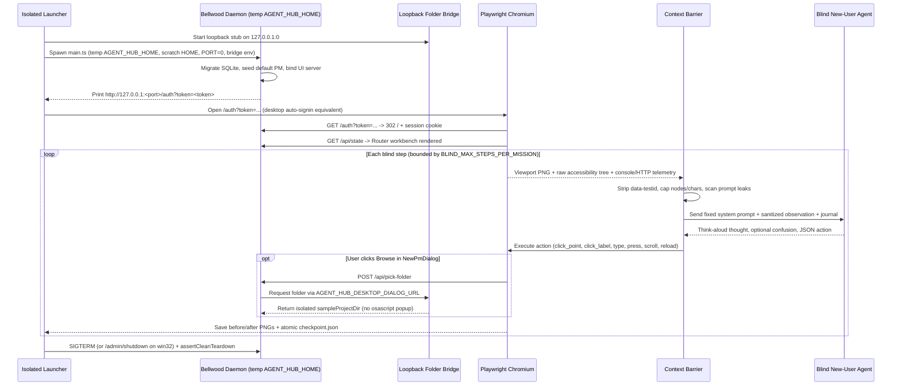

# Blind new-user walkthrough design

> Snapshot: 2026-11-28 (commit `59358e6e`)

## Plan review and decisions

### Files to review

- [docs/blind-new-user-walkthrough-design.md](blind-new-user-walkthrough-design.md): design plan incorporating the `/how` subsystem architecture walkthrough (Overview, Key Concepts, How It Works, Where Things Live, Gotchas), reference evaluations, three structurally distinct candidate architectures, zero-context isolation rules, noise filtering, cross-vendor coverage, bounds, and acceptance scenarios.
- [docs/README.md](README.md): adds this design document to the Testing index.
- [package.json](../package.json): adds the `blind-walkthrough` npm script pointing at `test/blind-walkthrough/cli.ts`.
- [test/blind-walkthrough/limits.ts](../test/blind-walkthrough/limits.ts): numeric caps, budgets, and retention limits for walkthrough runs and evidence artifacts.
- [test/blind-walkthrough/types.ts](../test/blind-walkthrough/types.ts): domain types for runs, missions, sanitized observations, actions, traces, pain points, and desktop Computer Use handoffs.
- [test/blind-walkthrough/context-barrier.ts](../test/blind-walkthrough/context-barrier.ts): zero-context leak scanner, accessibility snapshot sanitizer, scrubbed environment builder, and data-directory isolation guard.
- [test/blind-walkthrough/missions.ts](../test/blind-walkthrough/missions.ts): cold-start user mission catalog and prompt builder.
- [test/blind-walkthrough/vendors.ts](../test/blind-walkthrough/vendors.ts): cross-vendor matrix typed over `AgentVendor`, adapter resolver, and strict action response parser.
- [test/blind-walkthrough/isolated-app.ts](../test/blind-walkthrough/isolated-app.ts): isolated real Bellwood daemon launcher (including loopback folder-picker bridge to avoid unattended macOS `osascript` popups), sample user workspace generator, and clean shutdown verifier.
- [test/blind-walkthrough/recorder.ts](../test/blind-walkthrough/recorder.ts): per-step screenshot recorder, H.264 MP4 transcoder, and bounded run retention pruner.
- [test/blind-walkthrough/runner.ts](../test/blind-walkthrough/runner.ts): unattended browser walkthrough loop and checkpoint resume entry points.
- [test/blind-walkthrough/cua-track.ts](../test/blind-walkthrough/cua-track.ts): prepared native macOS desktop Computer Use handoff generator and trace importer.
- [test/blind-walkthrough/report.ts](../test/blind-walkthrough/report.ts): noise filter, deterministic severity classifier, multi-run pain-point merger, and Markdown report renderer.
- [test/blind-walkthrough/cli.ts](../test/blind-walkthrough/cli.ts): command-line entry point wiring all subcommands (`run`, `resume`, `list-missions`, `prepare-cua`, `ingest-cua`, `report`).
- Acceptance tests: `test/blind-walkthrough/context-barrier.test.ts`, `test/blind-walkthrough/missions.test.ts`, `test/blind-walkthrough/vendors.test.ts`, `test/blind-walkthrough/isolated-app.test.ts`, `test/blind-walkthrough/runner.test.ts`, `test/blind-walkthrough/cua-track.test.ts`, and `test/blind-walkthrough/report.test.ts`.

### Project Manager plan review

Before implementation begins, check three criteria:

1. Every quoted user sentence in Section 1 maps to at least one acceptance scenario in Section 8.
2. Every applicable verification category in Section 8 has a concrete scenario, and each omitted category explains in one sentence why it cannot apply.
3. Section 3 compares three structurally distinct architectures grounded in the real subsystem findings from Section 2.

### Decisions needed

None. The user delegated routine product and technical decisions to the Project Manager for unattended execution, and this design introduces no user-visible product UI changes, no foundation rebuild, and no irreversible or external-facing operations.

One runtime boundary remains human-gated by design: executing Track 2 (native macOS `Bellwood.app` desktop Computer Use) requires manual macOS Accessibility and Screen Recording permissions plus user confirmation outside unattended runs. Track 1 runs completely unattended overnight without crossing that boundary, while Track 2 ships as a prepared handoff package ready for human confirmation.

## For Workers and reviewers

### 1. User goal

Original user requests (verbatim):

> 「让一个 agent 无上下文的就给他这个 app，通过 computer use 不管什么的，让他去跑通，就像一个新用户一样，然后记录这个过程，然后看看有什么痛点，先出方案」
>
> 「走流程解决问题，之后我们的做什么都先走完整流程」
>
> 「现在所有的需求你来拍板，直到一切都完成，检查，不满意的话重新来，明天我要看到所有的都完美」

Outcome: build a repeatable blind-walkthrough tool that drops a zero-context agent into an isolated, freshly started Bellwood instance, records every step with screenshots and an H.264 MP4 video, and synthesizes a severity-ranked list of real first-time user pain points without leaking source code or touching `~/.agent-hub/state/`.

### 2. Current state and history

This section synthesizes four independent `/how` source explorations (first-run boot and web shell, sandbox and Computer Use approval gates, existing isolated test runners, and vendor CLI launch and config isolation) before making any design choice.

#### Architectural walkthrough (`/how` synthesis)

##### Overview

Bellwood splits into a Node daemon (`src/daemon/entry.ts` and `src/daemon/daemon.ts`), a React web workbench (`src/web/App.tsx` and `src/web/shell-model.ts`), an optional native macOS `WKWebView` supervisor (`apps/macos/DaemonSupervisor.swift`), and eight vendor CLI plugins (`src/vendors/registry.ts`). When a brand-new user starts Bellwood on an empty `AGENT_HUB_HOME`, the daemon opens a new SQLite ledger, auto-creates one default Project Manager, binds a loopback HTTP UI server, and prints a one-time `/auth?token=...` sign-in link. The browser authenticates via that link and lands on the Router workbench, not on the auto-created Project Manager conversation.

Existing automated tests (`scripts/verify-smoke.ts`, `test/ui-polish/`, `test/eval/`, `test/tester/`) cover deterministic smoke checks, static visual scoring, PM orchestration replay, and insider regression flows. None of them run a zero-context agent through the real first-time user experience.

##### Key concepts

- **Data directory and process boundary**: `resolveHubPaths` (`src/shared/paths.ts`) derives `state/`, `logs/`, `run/`, `worktrees/`, and `child-processes.json` from `AGENT_HUB_HOME` (default `~/.agent-hub`). `DaemonSupervisor.swift:379-392` and `src/daemon/entry.ts:94` both honor `AGENT_HUB_HOME` and `AGENT_HUB_PORT`.
- **Auth gate and landing route**: `src/daemon/ui-server/entry.ts:62` enforces loopback DNS-rebinding checks on all paths including `/auth`. Without a session cookie, `gatePage` (`src/web/App.tsx:42-67`) renders a full-page `"Not signed in"` blocker (`testId="unauthenticated"`). After `/auth?token=<uiToken>` sets the session cookie and redirects to `/`, `useShellModel` (`src/web/shell-model.ts:195`) computes `routerActive = route?.view === "router" || (route === null && pickedDevice === null)`, landing the user on Router.
- **Desktop folder-picker bridge**: `src/daemon/entry.ts:110-129` reads `AGENT_HUB_DESKTOP_DIALOG_URL` and `AGENT_HUB_DESKTOP_DIALOG_TOKEN` to wire `createDesktopBridgeFolderPicker` (`src/daemon/pick-folder.ts:8-9,87-90`) into `/api/pick-folder`. Without those environment variables on macOS, `createFolderPicker` (`src/daemon/pick-folder.ts:14-31,151`) falls back to spawning `/usr/bin/osascript` with `choose folder`.
- **Two-layer Computer Use security gate**: Layer 1 (`src/shared/sandbox-approval.ts:28,147-160`, `src/daemon/launch.ts:225-245`) restricts `--no-outer-sandbox` to macOS (`NO_OUTER_SANDBOX_SUPPORTED_PLATFORMS = ["darwin"]`) and requires explicit `--caps custom` mounting a declared Computer Use capability plus human Web UI approval. Layer 2 (`src/shared/app-approval.ts:132-135`, `src/daemon/app-approvals/broker.ts:56-125`) requires a second human Web UI click per target app and permanently refuses `com.agenthub.desktop` and any path containing `bellwood.app` via `appIdAlwaysDenied`.
- **Vendor config home ownership**: each vendor spec (`src/vendors/claude/spec.ts:18-23`, `src/vendors/codex/spec.ts:20-26`, `src/vendors/agy/spec.ts:25-29`) declares the `HOME`-relative directories and credentials it reads and watches. The daemon syncs vendor configs into its own `HOME`, so isolated test daemons must run with a scratch `HOME` (`scripts/verify-smoke.ts:55-72`, `test/tester/local-instance.ts:141-153`).

##### How it works

##### Where things live

- Daemon startup, default PM seed, and folder bridge wiring: `src/daemon/entry.ts`, `src/daemon/daemon.ts:545-554`, `src/daemon/pick-folder.ts`
- First-run web gating, Router landing, and `NewPmDialog`: `src/web/App.tsx`, `src/web/shell-model.ts`, `src/web/components/NewPmDialog.tsx`
- Outer-sandbox and per-app Computer Use gates: `src/shared/sandbox-approval.ts`, `src/shared/app-approval.ts`, `src/daemon/launch.ts`, `src/daemon/app-approvals/broker.ts`
- Existing isolated test tools: `scripts/verify-smoke.ts`, `test/ui-polish/isolation.ts`, `test/ui-polish/capture.ts`, `test/ui-polish/seed.ts`, `test/eval/isolation.ts`, `test/tester/local-instance.ts`
- Vendor registry and plugin specs: `src/vendors/registry.ts`, `src/vendors/*/spec.ts`, `src/vendors/*/paths.ts`
- macOS native shell supervisor and bundle ID: `apps/macos/DaemonSupervisor.swift:379-392`, `scripts/build-mac-app.sh:107-108`

##### Gotchas

1. **`FirstRunProviderCheck` does not run on a real fresh daemon boot.** `src/daemon/daemon.ts:545-554` inserts a default PM whenever the `pms` table is empty, so `/api/state` returns `pms.length === 1` on first launch. `src/web/shell-model.ts:270-271` requires `startedInColumns && shellReady && local.state.pms.length === 0 && !providersGuided`, so `FirstRunProviderCheck` (`src/web/App.tsx:327-334`) does not auto-open Settings -> Providers on a normal fresh boot (nor on any narrow/mobile viewport where `startedInColumns` is `false`). A brand-new user with zero signed-in providers instead lands on Router with a hidden default PM behind the computer rail icon.
2. **Clicking Browse in `NewPmDialog` triggers a real macOS Finder popup via `osascript`.** `src/daemon/ui-server/context.ts:71` defaults to `createFolderPicker({ available: serverInfo.folderPicker })`, and `serverInfoFor("darwin").folderPicker` is `true` even outside `Bellwood.app`. Calling `POST /api/pick-folder` runs `/usr/bin/osascript` (`src/daemon/pick-folder.ts:14-31`), which pops a live OS modal on the host Mac and hangs unattended runs until `PICK_FOLDER_TIMEOUT_MS`. Passing a loopback `AGENT_HUB_DESKTOP_DIALOG_URL` and `AGENT_HUB_DESKTOP_DIALOG_TOKEN` (`src/daemon/entry.ts:110-129`) cleanly intercepts `/api/pick-folder` through Bellwood's own production bridge contract without spawning `osascript`.
3. **Bellwood's own Computer Use Workers are permanently blocked from controlling `Bellwood.app`.** `src/shared/app-approval.ts:132-135` (`appIdAlwaysDenied`) rejects `com.agenthub.desktop` (`scripts/build-mac-app.sh:107-108`) and any path containing `bellwood.app`. In addition, only `codex` declares `computerUseCapabilities: ["mcp:cua_repl"]` (`src/vendors/codex/spec.ts:100-104`); all other seven vendors declare none. Driving `Bellwood.app` natively therefore requires an external human-approved desktop CUA session rather than a Bellwood Worker, while a Bellwood CUA Worker can only target an external browser window after two manual Web UI clicks.
4. **Blind-agent credentials vs isolated daemon `HOME` have opposite isolation needs.** The isolated Bellwood daemon MUST receive an empty scratch `HOME` so vendor config sync never mutates developer configs (`~/.claude`, `~/.codex`, `~/.gemini`). In contrast, a real vendor CLI acting as the *blind new-user agent* running outside Bellwood needs either explicit credential environment passthrough (such as `CLAUDE_CODE_OAUTH_TOKEN`) or an explicit isolated auth home while still scrubbing `HUB_TOKEN`, `HUB_SOCK`, `AGENT_HUB_*`, `GH_TOKEN`, and `SSH_AUTH_SOCK` (`test/eval/isolation.ts:31-34`) and executing inside an empty non-repo `cwd`.

#### Design history

Bellwood's verification stack evolved in four stages: `scripts/verify-smoke.ts` (hardcoded Playwright smoke check), `test/eval/` (PM orchestration replay, whose earlier `docs/orchestration-eval-design.md` was pruned in commit `3437df1f`), `test/ui-polish/` (deterministic screenshot rubric over seeded SQLite states in `test/ui-polish/seed.ts`), and `test/tester/` (resident bench regression flows with an insider handbook in `docs/ai-tester-design.md`). None of these four tools isolates an exploring agent from Bellwood's repository, selectors, and mental model. This design adds the missing concept directly instead of patching an insider test script.

#### Verified evidence

- `[Measured, read src/daemon/daemon.ts:545-554]` Fresh daemon boot seeds `DEFAULT_PM_NAME` whenever `SELECT 1 FROM pms LIMIT 1` is empty.
- `[Measured, read src/web/shell-model.ts:195,270-279 and src/web/App.tsx:42-67,327-334]` Unauthenticated requests hit `gatePage` (`"Not signed in"`); authenticated root requests land on Router (`routerActive === true`); `FirstRunProviderCheck` runs only when `startedInColumns && local.state.pms.length === 0`.
- `[Measured, read src/daemon/entry.ts:110-129 and src/daemon/pick-folder.ts:8-31,87-90,151]` `AGENT_HUB_DESKTOP_DIALOG_URL` and `AGENT_HUB_DESKTOP_DIALOG_TOKEN` override macOS `osascript` folder picking with a loopback HTTP bridge.
- `[Measured, read src/shared/app-approval.ts:132-135, src/shared/sandbox-approval.ts:28,147-160, src/daemon/launch.ts:225-245, and src/vendors/codex/spec.ts:100-104]` No-outer-sandbox is macOS-only, only `codex` declares `mcp:cua_repl`, and `appIdAlwaysDenied` blocks `com.agenthub.desktop` and `bellwood.app`.
- `[Measured, read scripts/verify-smoke.ts:55-72,103-150, test/ui-polish/isolation.ts:14-63, and test/tester/local-instance.ts:126-154]` Established repo patterns verify symlink-resolved `~/.agent-hub` non-overlap, scratch `HOME` daemon launch on ephemeral ports, and zero-leftover-child checks via `readLedgerFile`.
- `[Measured, read apps/macos/DaemonSupervisor.swift:379-392 and scripts/build-mac-app.sh:107-108]` `Bellwood.app` reads `AGENT_HUB_HOME` and `AGENT_HUB_PORT` from environment and ships bundle ID `com.agenthub.desktop`.
- `[Measured, read src/vendors/registry.ts:11]` Eight vendors are registered: `claude`, `agy`, `codex`, `pi`, `deepseek`, `cursor`, `opencode`, and `kimi`.
- `[Measured, ran command -v in worktree]` Local host has `/opt/homebrew/bin/ffmpeg` plus `claude`, `codex`, and `agy` binaries on `PATH`.

### 3. Reference designs and approach comparison

#### Reference systems

1. **UXAgent (Amazon and Northeastern University, 2025)** ([Amazon Science](https://www.amazon.science/publications/uxagent-an-llm-agent-based-usability-testing-framework-for-web-design), [GitHub](https://github.com/neuhai/UXAgent)): separates usability simulation into a Persona Generator, a think-aloud LLM agent loop, a Universal Browser Connector, and a post-session qualitative and quantitative friction report. We adopt the persona-vs-driver separation and think-aloud per-step logs, adding deterministic telemetry correlation and `harness_noise` filtering so single-run LLM hiccups never masquerade as UI defects.
2. **OSWorld (XLang Lab, NeurIPS 2024)** ([project site](https://os-world.github.io/), [GitHub](https://github.com/xlang-ai/OSWorld)): evaluates desktop agents across Ubuntu, Windows, and macOS using disposable environment state, screenshot grounding, strict step caps to limit long-horizon context decay, and separation of environment faults from task failures. We adopt disposable app state, fixed per-mission step budgets, and explicit environment-fault classification.
3. **WebArena (CMU, ICLR 2024)** ([project site](https://webarena.dev/), [GitHub](https://github.com/web-arena-x/webarena)): runs agents against real self-hosted web backends and databases using screenshots plus accessibility trees. We adopt a real isolated Bellwood backend with both viewport screenshots and sanitized accessibility snapshots (with `data-testid` and internal attributes removed).

#### Candidate architectures

| Dimension | Approach A (Recommended, day-one design): Two-track layered runner (Track 1: unattended isolated daemon + loopback folder bridge + Playwright blind-agent loop; Track 2: prepared native macOS CUA handoff + trace importer) | Approach B: Native macOS desktop Computer Use only (`Bellwood.app` via OS GUI automation) | Approach C: Scripted Playwright walkthrough + static UX heuristics (no blind agent) |
| --- | --- | --- | --- |
| Unattended overnight execution | Track 1 runs fully unattended in an isolated temp directory with zero OS permission prompts, zero `osascript` popups, and full H.264 MP4 video. | Blocked. Requires human approval clicks and macOS TCC grants; `appIdAlwaysDenied` blocks Bellwood Workers from controlling `com.agenthub.desktop`. | Runs unattended, fast, and deterministic. |
| Genuine zero-context discovery | High. Blind agent runs in an empty working directory with scrubbed environment, seeing only screenshots, sanitized visible labels, and a plain user goal. | High for native desktop chrome, but fragile to window focus, notifications, and pixel drift. | None. Scripts encode insider selectors and author assumptions, missing cognitive confusion and discoverability dead ends. |
| Native desktop shell coverage (menu bar, `NSOpenPanel`, window drag) | Covered by Track 2 prepared handoff package and trace importer when a human confirms native CUA. | Covered directly on macOS only. | Not covered. |
| Cross-platform portability | Track 1 works on macOS, Linux, and Windows; Track 2 returns `unsupported_platform` off macOS. | macOS only. | Cross-platform. |
| False-positive control | High. Correlates every agent complaint with before/after screenshot diffs, console errors, failed HTTP requests, and `harness_noise` filtering. | Low. OS focus steals and coordinate misses look identical to UI bugs. | High for scripted assertions, zero for usability friction. |
| Security boundary | Preserves `~/.agent-hub` isolation, outer Worker sandboxes, and `appIdAlwaysDenied("com.agenthub.desktop")`. | Either weakens `appIdAlwaysDenied` (unacceptable) or requires an external unsandboxed OS driver. | Preserves all boundaries. |

Recommendation: **Approach A**. It fits Bellwood's real architecture from Section 2: Track 1 runs completely unattended overnight using Bellwood's existing `AGENT_HUB_HOME`, `/auth?token=...`, and `AGENT_HUB_DESKTOP_DIALOG_URL` contracts, while Track 2 prepares a clean human-confirmed native `Bellwood.app` CUA handoff without touching `appIdAlwaysDenied`.

#### Design red flags check

Screened against `.agents/skills/architect/references/design-red-flags.md`:

- **Shallow module**: `runner.ts` owns the step loop, telemetry correlation, stuck-loop detection, and checkpoint persistence behind two entry points (`runBlindWalkthrough`, `resumeBlindWalkthrough`).
- **Information leakage**: Playwright `Page` objects, vendor CLI wire formats, loopback folder-bridge HTTP details, and raw accessibility nodes stay private behind `runner.ts`, `vendors.ts`, `isolated-app.ts`, and `context-barrier.ts`.
- **Temporal decomposition**: `context-barrier.ts` owns all isolation and zero-context invariants in one module instead of scattering leak checks across callers.
- **Pass-through method**: `cli.ts` parses arguments and returns exit codes; domain modules own all logic directly.
- **Split ownership**: `types.ts` defines one canonical `WalkthroughTrace` schema written by both Track 1 (`runner.ts`) and Track 2 (`cua-track.ts`) and read by `report.ts`.
- **Two ways to do one task**: one `extractPainPoints` pipeline scores and deduplicates findings for both tracks.
- **Importable internals**: internal helpers stay unexported; callers import only documented contract functions.
- **Hand-synced list**: `BlindVendorMatrix` is typed as `Readonly<Record<AgentVendor, BlindVendorSupport>>` from `src/shared/vendors.ts`, so adding a vendor to `VENDOR_LIST` fails typecheck until `test/blind-walkthrough/vendors.ts` adds its entry.

#### Patch rationale

None. This introduces the missing standalone tool under `test/blind-walkthrough/` rather than patching an existing test script.

#### Synthesis record

None. Single-agent planning step.

### 4. Performance and bounds

`src/shared/limits.ts`: **None**. No product cache, snapshot, SQLite table, or shipped runtime code changes. Following `test/tester/limits.ts` and `test/eval/limits.ts`, all caps for the non-shipped walkthrough tool live in `test/blind-walkthrough/limits.ts`.

Four bounds rules applied to `test/blind-walkthrough/`:

1. **Invalidation**: every run starts a fresh disposable `AGENT_HUB_HOME` and removes the temp app directory immediately after `stopIsolatedBellwood` verifies zero surviving child processes and closes the loopback folder-picker bridge. Transient blind-agent model timeouts are recorded as `harness_noise` with a bounded retry count (`BLIND_ACTION_RETRY_MAX`) and short cancellable backoff (`BLIND_ACTION_RETRY_BACKOFF_MS`), never cached as product state.
2. **Upper bounds**: disk artifacts, trace arrays, and MP4 files are bounded by constants in `test/blind-walkthrough/limits.ts`:

| Constant (`test/blind-walkthrough/limits.ts`) | Value | Sizing rationale |
| --- | --- | --- |
| `BLIND_MAX_STEPS_PER_MISSION` | `20` | Caps long-horizon context decay while giving a cold-start user room to explore and backtrack. |
| `BLIND_MAX_TOTAL_STEPS_PER_RUN` | `60` | Four missions times 15 average steps; prevents runaway token spend or unbounded screenshot folders. |
| `BLIND_STEP_TIMEOUT_MS` | `60_000` | Maximum wait for one blind-agent model turn plus browser action settlement. |
| `BLIND_RUN_BUDGET_MS` | `25 * 60_000` | Whole-run wall-clock budget for an unattended overnight walkthrough. |
| `BLIND_DAEMON_START_TIMEOUT_MS` | `45_000` | Startup budget for isolated daemon boot and login URL announcement. |
| `BLIND_DAEMON_STOP_TIMEOUT_MS` | `20_000` | Graceful shutdown wait before failing clean teardown. |
| `BLIND_ACTION_RETRY_MAX` | `2` | Retries only malformed model JSON or transient transport errors before marking a step `harness_noise`. |
| `BLIND_ACTION_RETRY_BACKOFF_MS` | `1_500` | Short retry wait (cancellable via `AbortSignal`). |
| `BLIND_A11Y_SNAPSHOT_MAX_CHARS` | `16_000` | Caps sanitized accessibility text per step so context windows stay bounded over 60 steps (~1 MB worst case). |
| `BLIND_A11Y_MAX_NODES` | `400` | Caps serialized visible UI nodes per turn even on a 30,000-message or 300-Worker virtualized screen. |
| `BLIND_VIDEO_MAX_BYTES` | `45 * 1024 * 1024` | Keeps H.264 MP4 deliverables strictly under Bellwood's 50 MB upload cap with a 5 MB safety margin. |
| `BLIND_REPORT_MAX_BYTES` | `2 * 1024 * 1024` | Caps generated JSON and Markdown report payloads. |
| `BLIND_HISTORY_MAX_RUNS` | `60` | Keeps two months of daily walkthrough metadata records (under 3 MB total). |
| `BLIND_EVIDENCE_KEEP_RUNS` | `10` | Retains full screenshots and videos for the 10 most recent runs (at most ~500 MB) and prunes older media directories. |
| `BLIND_STUCK_REPEAT_THRESHOLD` | `3` | Consecutive identical actions with zero visual diff trigger a deterministic stuck-loop friction event and force recovery or mission end. |

3. **Stable front-end references**: not applicable because `src/web/` is unchanged.
4. **Measured verification**: the implementation step records actual run duration, MP4 file size, step count, and zero-leftover-process verification from a real local run.

### 5. Cross-vendor and cross-platform unification

#### Cross-vendor unification

The tool touches vendors in two distinct roles:

1. **Blind user agent (the simulated new user)**: `test/blind-walkthrough/vendors.ts` defines `BlindVendorMatrix = Readonly<Record<AgentVendor, BlindVendorSupport>>`, importing `AgentVendor` from `src/shared/vendors.ts`. Every registered vendor (`claude`, `agy`, `codex`, `pi`, `deepseek`, `cursor`, `opencode`, `kimi`) declares its mode (`"vision_cli"`, `"a11y_cli"`, or `"unsupported"`), reason, image-input capability, and headless invocation inside an empty non-repo `cwd` with scrubbed Bellwood/GitHub/SSH variables (passing only explicit caller-supplied model credentials when needed). A future vendor adds one entry to `test/blind-walkthrough/vendors.ts`; TypeScript fails compilation until it exists.
2. **Inner app vendor (inside the isolated Bellwood daemon under test)**: `IsolatedAppOptions.appVendorMode` supports `"fake"` (default deterministic fake Claude via `wrapScriptAsPlatformCli` so UX runs do not depend on outer model latency) and `{ kind: "real", vendor: AgentVendor, isolatedHomeDir: string }` (using isolated vendor paths patterned on `test/tester/local-instance.ts`).

**Prompt-cache preservation**: this design makes zero edits to `src/daemon/prompt.ts`, vendor drivers, session messages, tools, or MCP definitions, so product prompt caching (`TokenUsage.cacheRead`) is completely unchanged across all eight vendors. For the blind agent itself, the fixed persona system prompt is sent once and each turn appends the new observation without rewriting earlier turns.

#### Cross-platform unification

- **Track 1 (macOS, Linux, Windows)**: uses Node APIs, `resolveHubPaths` (`src/shared/paths.ts`), `isPathInsideOrEqual` and `normalizePathForComparison` (`src/daemon/platform/index.ts`), `wrapScriptAsPlatformCli` (`test/fake-cli-shim.ts`), the loopback desktop dialog bridge (`AGENT_HUB_DESKTOP_DIALOG_URL` and `AGENT_HUB_DESKTOP_DIALOG_TOKEN`), and Playwright Chromium without raw shell strings. Graceful daemon shutdown follows `scripts/verify-smoke.ts:74-83` (SIGTERM on POSIX, `/admin/shutdown` over named pipe on Windows).
- **Track 2 (macOS only)**: `prepareCuaHandoff` validates `platform === "darwin"` (matching `NO_OUTER_SANDBOX_SUPPORTED_PLATFORMS` in `src/shared/sandbox-approval.ts`) and returns `{ ok: false, reason: "unsupported_platform" }` on Linux and Windows.

### 6. Deletions

None. `scripts/verify-smoke.ts`, `test/ui-polish/`, `test/eval/`, and `test/tester/` remain intact because each serves a distinct testing purpose. No superseded code, docs, or prompts exist for blind new-user walkthroughs.

### 7. Skeleton files

- `docs/blind-new-user-walkthrough-design.md`: this design document.
- `docs/README.md`: links this design document under Testing so `src/docs-guard.test.ts` stays green.
- `package.json`: registers the `blind-walkthrough` script pointing to `test/blind-walkthrough/cli.ts`.
- `test/blind-walkthrough/limits.ts`: exports all bounded caps, timeouts, and retention limits for the walkthrough runner.
- `test/blind-walkthrough/types.ts`: exports domain interfaces and discriminated unions for configs, missions, observations, actions, traces, pain points, and Track 2 handoff packages.
- `test/blind-walkthrough/context-barrier.ts`: exports `assertIsolatedWorkspace`, `scanBlindPromptLeaks`, `assertBlindPromptClean`, `sanitizeAccessibilitySnapshot`, and `buildBlindAgentEnv` with contract doc comments.
- `test/blind-walkthrough/missions.ts`: exports `listMissions`, `selectMissions`, `buildMissionPrompt`, and `isBlindMissionId` for the four cold-start user journeys.
- `test/blind-walkthrough/vendors.ts`: exports `listBlindVendorSupport`, `resolveBlindVendorAdapter`, and `parseBlindActionResponse` covering all eight `AgentVendor` values.
- `test/blind-walkthrough/isolated-app.ts`: exports `createSampleUserProject`, `launchIsolatedBellwood`, `stopIsolatedBellwood`, and `assertCleanTeardown` (with loopback folder-picker bridge support).
- `test/blind-walkthrough/recorder.ts`: exports `createWalkthroughRecorder`, `transcodeVideoToMp4`, and `pruneOldRuns`.
- `test/blind-walkthrough/runner.ts`: exports `runBlindWalkthrough` and `resumeBlindWalkthrough`.
- `test/blind-walkthrough/cua-track.ts`: exports `prepareCuaHandoff` and `ingestCuaRecording`.
- `test/blind-walkthrough/report.ts`: exports `extractPainPoints`, `mergePainPointReports`, and `renderPainPointReportMarkdown`.
- `test/blind-walkthrough/cli.ts`: exports `main` and runs the CLI when invoked directly.
- `test/blind-walkthrough/context-barrier.test.ts`: executable acceptance tests for zero-context leakage blocking, accessibility sanitization, environment scrubbing, and `~/.agent-hub` isolation.
- `test/blind-walkthrough/missions.test.ts`: executable acceptance tests verifying mission selection and zero-leakage compliance on every built mission prompt.
- `test/blind-walkthrough/vendors.test.ts`: executable acceptance tests verifying eight-vendor exhaustiveness, adapter resolution, and malformed vendor CLI response handling.
- `test/blind-walkthrough/isolated-app.test.ts`: executable acceptance tests verifying isolated launch, loopback folder-picker bridge (no `osascript` popup), sample project setup, clean teardown, and rejection of production data paths.
- `test/blind-walkthrough/runner.test.ts`: executable acceptance tests for multi-turn blind exploration, stuck-loop detection, mid-run checkpoint restart recovery, queued state-change noise handling, and wide plus narrow viewport coverage.
- `test/blind-walkthrough/cua-track.test.ts`: executable acceptance tests for Track 2 macOS handoff generation, `appIdAlwaysDenied("com.agenthub.desktop")` preservation, cross-platform rejection off macOS, and CUA trace ingestion.
- `test/blind-walkthrough/report.test.ts`: executable acceptance tests for noise filtering, deterministic severity grading, deduplication, multi-run corroboration, large-volume retention bounds, and corrupt trace handling.

### 8. Verification plan

#### Acceptance scenarios

Every quoted user sentence and settled rule maps to explicit scenarios below:

- User quote 1 ("让一个 agent 无上下文的就给他这个 app，通过 computer use 不管什么的，让他去跑通，就像一个新用户一样，然后记录这个过程，然后看看有什么痛点，先出方案"): mapped to S1, S2, S8, S9, S10, S11, S16, and real-environment runs R1 and R2.
- User quote 2 ("走流程解决问题，之后我们的做什么都先走完整流程"): mapped to S6, S7, and the plan-skeleton-failing-baseline workflow verified before implementation.
- User quote 3 ("现在所有的需求你来拍板，直到一切都完成，检查，不满意的话重新来，明天我要看到所有的都完美"): mapped to S3, S4, S5, S12, S13, S14, S15, and unattended overnight Track 1 execution R1.

Category-by-category scenarios:

1. **Two consecutive turns in the same conversation (S1, S2).**
   - **S1 (Consecutive blind-agent turns)**: First, the runner starts a mission with a scripted blind adapter and sends turn 1 observation (initial screenshot and sanitized accessibility tree). Next, turn 1 acts on the page and turn 2 receives the updated observation plus turn 1's journal while the system prompt stays byte-identical. The user sees a two-step trace with distinct before/after screenshots, non-empty think-aloud logs, and appended conversation history.
   - **S2 (Consecutive chat turns inside the isolated app)**: First, during the `create-first-project` mission, the blind agent creates a workspace pointing at the sample project and sends a first task message. Next, after the reply appears, the agent sends a follow-up message in the same conversation. The user sees both user messages and replies recorded in the walkthrough trace and video without losing conversation state.
2. **A restart in the middle of the operation (S3, S4).**
   - **S3 (Runner interruption and checkpoint resume)**: First, a walkthrough writes a durable checkpoint after completing mission 1 and exits abruptly before mission 2. Next, `resumeBlindWalkthrough` loads the run directory and continues from mission 2. The user sees earlier steps preserved without duplicate execution, remaining steps appended cleanly, and one complete pain-point report covering all steps.
   - **S4 (Isolated daemon clean teardown and unattended folder-picker bridge)**: First, `launchIsolatedBellwood` starts a real isolated daemon in a temp directory with the loopback folder-picker bridge active so `POST /api/pick-folder` returns `sampleProjectDir` without spawning `osascript`. Next, the runner stops via `stopIsolatedBellwood`. The user sees exit code 0, zero live child PIDs in the isolated process ledger, the loopback bridge closed, and the temporary `AGENT_HUB_HOME` removed cleanly.
3. **A state or configuration change while work or a notice waits in a queue (S5).**
   - **S5 (Mid-run environment or config change)**: First, a blind run is queued to execute a step. Next, before the step finishes, the isolated daemon exits unexpectedly or the blind-agent adapter aborts or times out. The user sees the runner detect the boundary fault before misattributing it to UI brokenness, classify the event as `harness_noise`, keep product `P0` count at 0, and surface the outage under Environment Notes in the report.
4. **Existing rules or boundaries that the change touches or uncovers (S6, S7, S8, S9, S10).**
   - Matching rules from `git show origin/main:REVIEW.md`:
     - **`Tests wait for events, not for time`** (`Trigger: **/*.test.ts, test/**`) **-> S6**: Every test in `test/blind-walkthrough/*.test.ts` awaits explicit promises, abort signals, or process exit events instead of sleeping a fixed duration, pins dates with `vi.setSystemTime`, and passes `src/wall-clock-guard.test.ts`.
     - **`Planned acceptance scenarios cover every requirement and pass real tests`** (`Trigger: **`) **-> S7**: Every scenario in this section maps to executable assertions (no `it.todo`), pre-implementation runs record every new-behavior test failing and every unchanged-rule regression test passing, and implementation preserves every planning test intact.
   - Security boundaries uncovered during `/how` exploration:
     - **S8 (Production data-directory isolation)**: First, a caller passes `~/.agent-hub`, a symlink pointing into `~/.agent-hub`, or the caller's active `AGENT_HUB_HOME` to `assertIsolatedWorkspace` or `launchIsolatedBellwood`. Next, the guard resolves real paths before creating or touching any directory. The user sees an immediate refusal error with zero files created or modified.
     - **S9 (Zero-context barrier)**: First, a mission prompt, environment map, or accessibility snapshot contains a forbidden leak (repository root path, `src/`, `AGENTS.md`, `data-testid`, `AGENT_HUB_HOME`, or `ui-token`). Next, `assertBlindPromptClean`, `buildBlindAgentEnv`, and `sanitizeAccessibilitySnapshot` run before any blind-agent invocation. The user sees leaked prompts rejected with an explicit violation list, scrubbed environment variables omitted, and `data-testid` attributes stripped from the accessibility tree.
     - **S10 (Computer Use `appIdAlwaysDenied` invariant unchanged)**: First, Track 2 calls `prepareCuaHandoff` on macOS. Next, the regression check verifies `appIdAlwaysDenied("com.agenthub.desktop")` still returns `true` and the handoff package documents the manual confirmation and external-CUA boundary without altering any Bellwood sandbox rule. The user sees Track 2 generate a valid handoff package while Bellwood's self-control block stays intact.
5. **Reopening a closed view after cached data becomes stale (S11).**
   - This tool makes no edits to `src/web/` React Query caches or UI components, so no new product cache invalidation path exists to stall and reopen; however, mission `recover-and-configure` (S11) exercises reloading the workbench and reopening Settings and the project conversation in a real browser so stale-view friction experienced by a new user is still caught during blind runs.
6. **Large data volume sized for one month of continuous use (S12).**
   - **S12 (Bounded history, evidence pruning, and report size)**: First, a test seeds 120 historical run metadata entries, 25 evidence directories on disk, and a trace with 500 raw friction observations. Next, `pruneOldRuns` and `extractPainPoints` execute. The user sees history capped at `BLIND_HISTORY_MAX_RUNS` (60), only the newest `BLIND_EVIDENCE_KEEP_RUNS` (10) media directories retained, sanitized accessibility snapshots capped at `BLIND_A11Y_MAX_NODES` (400) and `BLIND_A11Y_SNAPSHOT_MAX_CHARS` (16,000), and the rendered report under `BLIND_REPORT_MAX_BYTES` (2 MB).
7. **Malformed or dirty data (S13).**
   - **S13 (Corrupt checkpoints, legacy records, and abnormal vendor CLI output)**: First, tests feed a half-written checkpoint JSON file, a trace with `schemaVersion: 0`, non-JSON or truncated stdout from a blind-agent vendor CLI, and an invalid action payload missing coordinates and target label. Next, `resumeBlindWalkthrough`, `ingestCuaRecording`, `parseBlindActionResponse`, and `extractPainPoints` process each input. The user sees explicit structured validation errors or `harness_noise` records rather than unhandled crashes or fabricated product pain points.
8. **Cross-vendor coverage across all eight registered vendors and prompt-cache preservation (S14).**
   - **S14 (Eight-vendor exhaustiveness and blind prompt stability)**: First, `listBlindVendorSupport()` is queried and compared against `VENDOR_LIST` in `src/shared/vendors.ts`. Next, `resolveBlindVendorAdapter` resolves supported vendors and keeps the blind system prompt fixed across turns. The user sees all eight vendors (`claude`, `agy`, `codex`, `pi`, `deepseek`, `cursor`, `opencode`, `kimi`) explicitly mapped with zero silent omissions, and zero edits to product prompts or MCP definitions.
9. **Cross-platform coverage across macOS, Windows, and Linux (S15).**
   - **S15 (Three-platform path and Track 2 platform gating)**: First, unit tests invoke `assertIsolatedWorkspace`, `buildBlindAgentEnv`, and `prepareCuaHandoff` with simulated `"darwin"`, `"linux"`, and `"win32"` platforms. Next, Track 1 guards accept isolated temp directories and reject overlapping real homes across all three platforms (case-insensitive on macOS and Windows), while Track 2 returns a prepared handoff on `"darwin"` and `{ ok: false, reason: "unsupported_platform" }` on `"linux"` and `"win32"`. The user sees consistent cross-platform behavior with zero raw OS crashes.
10. **Cross-entry-point and layout coverage (S16).**
    - **S16 (Wide desktop and narrow mobile-width web viewports)**: First, Track 1 runs missions at both wide desktop (`1280x800`) and narrow (`480x844`) Playwright viewports. Next, the runner records viewport dimensions on every step and tags layout-specific pain points with the viewport class (`desktop` or `narrow`). Feishu, `hub` CLI, and multi-computer mesh entry points do not apply to cold-start new-user onboarding because a brand-new user opens the local web or desktop app before configuring a Feishu bot, running internal `hub` commands, or pairing a second computer.

#### Real-environment and real-CLI verification

- **R1 (Track 1 real isolated Bellwood + Playwright browser + real blind-agent CLI)**: Run `pnpm blind-walkthrough run --vendor <installed-vendor> --app-vendor fake --viewports desktop,narrow` locally in an isolated temp directory (at most one real-environment run active at a time). Captures a complete start-to-finish PNG screenshot sequence, an H.264 MP4 recording under 45 MB (`ffmpeg` transcode from Playwright video), the raw `trace.json`, and the severity-ranked `pain-points.md` report. Cannot claim `not verified` because all dependencies run locally.
- **R2 (Track 1 with real inner app vendor CLI, optional when isolated credentials exist)**: When a real isolated vendor CLI login is verified locally or on the bench, run one mission with `--app-vendor <vendor>` to observe real first-turn latency and streaming UX. If safe isolated credentials are unavailable locally, run R1 for the complete web portion and record only the real inner-CLI turn portion with scenario, reason, and `not verified`.
- **R3 (Track 2 native macOS `Bellwood.app` Computer Use handoff)**: Run `pnpm blind-walkthrough prepare-cua` locally to verify the generated isolated `Bellwood.app` launch script and zero-context brief, and run `ingest-cua` on a recorded trace fixture. Live OS-level clicking on `Bellwood.app` requires human Accessibility and Screen Recording confirmation (and stays outside `appIdAlwaysDenied`), so unattended overnight runs record live native desktop clicking as `not verified` (listed desktop-app and Computer Use exception) until confirmed interactively by the user.
- **Prompt-cache hard gate**: Does not trigger because this change touches no product session prompts, messages, tools, or MCP definitions.

#### Commands and visual checks

- Typecheck: `pnpm typecheck`
- Lint and unused-export check: `pnpm lint`
- Targeted acceptance tests (pre-implementation baseline and post-implementation gate): `pnpm exec vitest run test/blind-walkthrough/context-barrier.test.ts test/blind-walkthrough/missions.test.ts test/blind-walkthrough/vendors.test.ts test/blind-walkthrough/isolated-app.test.ts test/blind-walkthrough/runner.test.ts test/blind-walkthrough/cua-track.test.ts test/blind-walkthrough/report.test.ts`
- Unchanged-rule regression checks: `pnpm exec vitest run src/docs-guard.test.ts src/code-hygiene.test.ts src/wall-clock-guard.test.ts src/shared/app-approval.test.ts`
- Final local gate before push (implementation steps): `pnpm lint && pnpm typecheck && pnpm test:related && pnpm verify`
- Real blind walkthrough run (implementation and review steps): `pnpm blind-walkthrough run --out <dir>` producing `<dir>/walkthrough.mp4`, `<dir>/steps/*.png`, `<dir>/trace.json`, and `<dir>/pain-points.md`.
