# Daily product feature mining from operational data

> Snapshot: 2026-11-28 (commit `59358e6e`)

This plan adds a read-only daily telemetry collection base and a dedicated product-feature mining pipeline so a Project Manager (PM) can turn daily operational friction into graded, evidence-backed feature candidates without breaking live SQLite locking, Worker sandboxes, or vendor prompt caches.

## Plan review and decisions

### Files to review

- [This design document](daily-feature-mining-design.md): raw data source audit, architectural comparison (shared read-only collection base versus standalone pipelines), anti-spam deduplication, frequency and pain grading, limits, and acceptance plan.
- [`src/shared/limits.ts`](../src/shared/limits.ts): one-month sizing caps for daily telemetry bundles, friction signals, observation retention, cooldown windows, and bounded mining state.
- [`src/shared/daily-telemetry.ts`](../src/shared/daily-telemetry.ts): shared read-only telemetry schema, window resolution, secret redaction, self-referential schedule filtering, and bundle byte bounding.
- [`src/daemon/ledger/daily-telemetry.ts`](../src/daemon/ledger/daily-telemetry.ts): daemon-side synchronous read-only SQLite queries and bounded async log-tail reader shared by both feature mining and bug hunting.
- [`src/shared/feature-mining.ts`](../src/shared/feature-mining.ts): pure deterministic friction extraction, bug-versus-feature separation, backlog markdown reconciliation, rolling multi-day frequency and pain grading, cooldown suppression, and Markdown digest rendering.
- [`src/daemon/ledger/feature-mining.ts`](../src/daemon/ledger/feature-mining.ts): safe no-symlink reader for backlog and state files plus atomic bounded state writer outside SQLite transactions.
- [`src/shared/hub.ts`](../src/shared/hub.ts), [`src/shared/ledger.ts`](../src/shared/ledger.ts), [`src/hub/args.ts`](../src/hub/args.ts), [`src/hub/parse-core.ts`](../src/hub/parse-core.ts), [`src/hub/usage.ts`](../src/hub/usage.ts), [`src/daemon/agent-api/telemetry.ts`](../src/daemon/agent-api/telemetry.ts), [`src/daemon/agent-api/server.ts`](../src/daemon/agent-api/server.ts), [`src/daemon/ledger/hub-commands.ts`](../src/daemon/ledger/hub-commands.ts), [`src/daemon/daemon.ts`](../src/daemon/daemon.ts): help-only `hub telemetry export` and `hub telemetry mine` commands with zero system-prompt change.
- Acceptance tests in [`src/shared/daily-telemetry.test.ts`](../src/shared/daily-telemetry.test.ts), [`src/daemon/ledger/daily-telemetry.test.ts`](../src/daemon/ledger/daily-telemetry.test.ts), [`src/shared/feature-mining.test.ts`](../src/shared/feature-mining.test.ts), and [`src/daemon/ledger/feature-mining.test.ts`](../src/daemon/ledger/feature-mining.test.ts).

### Project Manager plan review

- **User sentences to scenarios.** Every quoted user sentence in Section 1 maps to concrete acceptance scenarios S1 through S12 in Section 8.
- **Verification categories.** Section 8 covers all nine required categories from `docs/plan-standard.md` and explains in one sentence each category that does not apply.
- **Structurally distinct designs.** Section 3 compares three distinct architectures: Candidate A (chosen day-one architecture with a shared read-only daemon telemetry base and pure feature-mining pipeline), Candidate B (standalone per-PM external scripts reading `hub.sqlite` directly), and Candidate C (daemon-managed background LLM engine with dedicated SQLite tables and a new Web UI tab).

### Decisions needed

The Project Manager can settle routine defaults or escalate any of the four user-visible choices below.

#### D1. Daily trigger time and stagger schedule

| Option | What the user sees |
|---|---|
| **1. Daily at `00:30` local time (Recommended)** | Runs 30 minutes after `#6` (`00:00`) and 15 minutes after the sibling raw-data bug hunt (`00:15`). Analyzes the prior 24 hours against a 7-day rolling observation window. On days with zero net-new candidates, only a one-line completion note appears in the PM chat (`今日需求挖掘：0 条新候选，2 条已有队列项新增证据`), with no decision card. |
| 2. Morning at `08:30` local time | The daily digest arrives at the start of the workday. If the user is already chatting with the PM at `08:30`, the scheduled turn queues behind or interleaves with interactive replies. |
| 3. Weekly on Monday at `00:30` | Produces one larger weekly batch instead of daily runs. Does not match the user request for a daily job. |

#### D2. Default disposition when candidates pass the grading bar

| Option | What the user sees |
|---|---|
| **1. Tiered disposition (Recommended)** | `P0` and `P1` candidates (high pain or repeated across multiple days) append to the backlog file and trigger at most one consolidated decision card per day (for example: `今日抓到 2 个高痛感产品需求：1. [P0 | 4次/3天] 审批卡支持按应用记住本次会话策略（证据：app_approval#19, message#812）；2. [P1 | 3次/2天] hub worker log 支持按错误过滤（证据：hub_call#401, message#845）。选要立项走完整流程的项：1. 全部立项 / 2. 仅立项 #1 / 3. 暂存队列`). `P2` items update the backlog silently without a card. Single low-pain items stay hidden in the observation buffer until they recur. |
| 2. Report and backlog only | Appends candidates to the backlog file and posts one summary card to Router (`hub router report`). Never posts a decision card; the user promotes items manually later. |
| 3. Auto-create draft Task Graphs for `P0` | Immediately starts a planning Task Graph for every `P0` item without confirmation. Faster, but risks unwanted worktrees and branches when a signal is noisy. |

#### D3. Shared read-only collection base versus standalone pipeline

| Option | What the user sees |
|---|---|
| **1. Shared read-only daemon telemetry base plus separate analyzers (Recommended)** | Both daily feature mining and daily raw-data bug hunting call `hub telemetry export` for one redacted, bounded, read-only snapshot, then run independent domain logic (feature friction grading versus bug detection). No duplicate SQL, no SQLite lock errors, and bug signals stay cross-referenced rather than misclassified as features. |
| 2. Separate standalone collector for feature mining | Feature mining maintains its own queries, log readers, and redaction rules independent of bug hunting. Higher maintenance cost and drift between the two daily jobs. |

#### D4. Daily output format and anti-spam cap

| Option | What the user sees |
|---|---|
| **1. Evidence-backed Markdown digest capped at 5 net-new items per day (Recommended)** | Every candidate shows priority, composite score, 7-day recurrence count, distinct active days, and explicit evidence citations (`source#id`). Already-queued backlog items never re-surface as new proposals unless recurrence spikes at least 2x; instead they appear in a one-line `Backlog evidence bumps` section. |
| 2. Full unfiltered signal dump | Prints every detected friction signal each day regardless of frequency or prior reporting. High recall, high banner blindness. |

## 1. User goal

> 「新增每日任务，从每天的数据去抓产品的新需求，新功能」
>
> 「走流程解决问题，之后我们的做什么都先走完整流程」
>
> 「现在所有的需求你来拍板，直到一切都完成，检查，不满意的话重新来，明天我要看到所有的都完美」

Bellwood needs a daily, strictly read-only analysis capability that inspects each day's real usage data, separates genuine recurring product friction and unmet user intent from noise or runtime bugs, deduplicates against the existing backlog, grades candidates by real frequency and pain, and feeds approved items into the full design-first Task Graph workflow.

## 2. Current state and history

### Design history

- **Original premise.** Bellwood's scheduled jobs (`src/daemon/ledger/schedules.ts`) were built in M6 (`4e956ff1`) as PM-owned recurring prompts backed by `schedules` rows and `schedule.run` system messages. Operational introspection was added piece by piece: `hub worker log --stats` (`src/daemon/ledger/worker-stats.ts`), `hub worker search` (`src/daemon/ledger/worker-search.ts`), and the help-only PM read commands `hub ask list`, `hub ask show`, and `hub schedule show` (`docs/pm-friction-design.md`).
- **What changed that premise.** Two later changes made external shell scripts unsuitable for live daily telemetry:
  1. `openStore()` (`src/daemon/store/open.ts:34`, `src/daemon/store/db.ts:36`) locks `state/hub.sqlite` with `PRAGMA locking_mode = EXCLUSIVE` for the entire daemon lifetime so foreign writers cannot stall the Node event loop (`docs/ledger-database.md:9-16`). External scripts cannot open the live database while the daemon runs.
  2. Worker OS sandboxes (`src/shared/write-scope.ts:32-54`, `REVIEW.md:54-59`) block Workers from reading `state/` (`hub.sqlite`, `state/logs/`, `state/pm-memory/`) on macOS, Linux `bwrap`, and Windows alike.
- **Patch stack assessment.** Current retrospective scripts (`#6 每日审查复盘与抓抖动`) live outside the repository in one PM's memory directory (`retro/dump-findings.sh`, `retro/collect-flaky.sh`) and only inspect finished review reports and GitHub Actions logs. There is no shared read-only operational telemetry layer and no product-feature mining pipeline in Bellwood.

### Core concepts

| Concept | Stored in | Written by | Retention bound (`src/shared/limits.ts`) |
|---|---|---|---|
| User, PM, and Worker conversations | SQLite `messages` | `src/daemon/ledger/messages.ts` | PM text retained indefinitely; PM tool messages 7d / 500 per conv; ended Worker convs 14d / 300 Workers |
| Model turns, interruptions, background waits | SQLite `turns`, `turn_inputs`, `turn_tools`, `turn_background_waits` | `src/daemon/ledger/turns.ts`, `turn-tools.ts`, `turn-background-waits.ts` | 30d / 5,000 turns per conv; 2,000 tools per session |
| Decision cards and Router deliveries | SQLite `router_items`, `router_item_deliverables` | `src/daemon/ledger/router.ts` | 30d / 2,000 terminal items |
| Sandbox, app approvals, and user blockers | SQLite `worker_sandbox_approvals`, `worker_app_approvals`, `user_blockers` | `sandbox-approvals.ts`, `app-approvals.ts`, `user-blockers.ts` | 30d / 500 sandbox; 30d / 2,000 app; 50 resolved blockers |
| Task Graphs, retakes, skips, slot waits | SQLite `task_graphs`, `task_graph_steps`, `task_graph_step_slots` | `src/daemon/ledger/task-graphs.ts`, `task-graphs/slots.ts` | 90d / 300 completed graphs |
| Worker 9-field reports | SQLite `messages` (`kind = 'worker'`, `meta.event = 'report'`) | `src/daemon/ledger/workers.ts`, parsed by `src/shared/worker.ts:102` | Survives ended-Worker conversation purge in PM conversation |
| `hub` CLI invocations and errors | SQLite `hub_calls` | `src/daemon/ledger/hub-commands.ts:426-438` | 14d / 2,000 rows; `result` capped at 256 bytes |
| Router commands and audit log | SQLite `router_commands`, `router_audit_log` | `src/daemon/ledger/router.ts` | 30d / 500 rows each |
| Operational failures and persona edits | SQLite `actions`, `handovers`, `schedules`, `persona_changes`, `health` | `actions/store.ts`, `handover.ts`, `schedules.ts`, `persona.ts`, `context.ts` | 14d–30d / 50–5,000 rows |
| Daemon crash and setup logs | `state/logs/daemon.log`, `state/logs/setup/worker-*.log` | `src/daemon/entry.ts:44`, `src/daemon/setup/setup.ts` | 2 MB + `.1` rotation; 7d / 200 setup logs / 5 MB each |
| Feature backlog and PM notes | PM memory directory or project Markdown files | PM and user | `PM_MEMORY_MAX_SUBFILE_BYTES` (64 KB), `PM_MEMORY_MAX_TOTAL_BYTES` (1 MB) |

Facts stored in more than one place:

- **Worker reports** exist both as raw agent text in the Worker conversation (purged after 14 days / 300 Workers) and as wrapped `kind = 'worker'` report messages in the PM conversation (retained). Feature mining reads the PM-conversation report messages so recent history stays complete even after Worker purges.
- **Decision outcomes** exist both on `router_items.resolution_json` and on ask message `meta` (`src/daemon/ledger/pending-asks.ts:90-129`). Telemetry reads `router_items` plus `task_graph_steps.decision_json` for one consistent view.

Missing concepts:

1. **A shared read-only daily telemetry exporter inside the daemon** that reads the locked live SQLite ledger plus bounded log tails, redacts secrets, excludes self-referential schedule turns, and returns a byte-bounded snapshot.
2. **A deterministic friction-to-feature mining pipeline** that separates product friction from runtime bugs, buffers single occurrences before surfacing, deduplicates against existing backlogs and cooldown history, and enforces evidence-grounded frequency and pain scoring.

### Subsystem architecture walkthrough (`how`)

Before designing the mining pipeline, we traced four slices of Bellwood directly from source: scheduled execution and background runners (`daemon.ts`, `schedules.ts`, `actions/executor.ts`, `handlers.ts`, `project-catalog/runner.ts`), operational storage and retention (`messages.ts`, `turns.ts`, `task-graphs/turn-report.ts`, `completed-work.ts`, `db-table-retention.ts`, `worker-retention.ts`), access and locking boundaries (`store/open.ts`, `store/db.ts`, `agent-api/server.ts`, `hub/cli.ts`, `write-scope.ts`, `pm-memory.ts`, `ledger/files.ts`), and PM notification/prompt surfaces (`pm-delivery.ts`, `notice-currency.ts`, `hub-commands.ts`, `prompt.test.ts`).

#### Overview

Bellwood runs as one single-process Node daemon (`src/daemon/daemon.ts`) that owns the exclusive lock on `state/hub.sqlite`. Scheduled PM work fires through the `schedules` table and `actions` queue into the PM's live conversation session, while a separate daemon-internal runner (`src/daemon/project-catalog/runner.ts`) handles background single-turn LLM refreshes via `RouterTurnRunner`. Every `hub` CLI invocation crosses the local `hub.sock` (or Windows named pipe) into `src/daemon/agent-api/server.ts`, where async I/O runs in `createPreparation()` before synchronous SQLite transactions execute inside `src/daemon/ledger/hub-commands.ts`.

#### How it works

```mermaid
flowchart LR
  T["daemon.ts 30s tick"] --> S["schedules.ts runDueSchedules"]
  S -->|"insert schedule.run + enqueue"| A["actions/executor.ts session.send"]
  A -->|"check rate limit & currency"| H["handlers.ts createSessionSendHandler"]
  H -->|"deliver turn"| PM["PM live session"]
  PM -->|"hub telemetry mine / export"| CLI["hub/cli.ts (30s timeout)"]
  CLI -->|"POST /v1/telemetry.*"| API["agent-api/server.ts (15s timeout)"]
  API -->|"async fs reads outside tx"| PREP["agent-api/telemetry.ts"]
  PREP -->|"sync read-only SELECTs"| LED["ledger/daily-telemetry.ts"]
  LED -->|"pure deterministic pipeline"| MINE["shared/feature-mining.ts"]
  MINE -->|"atomic state write outside tx"| POST["ledger/feature-mining.ts"]
  PM -->|"only when candidates > 0"| W["--readonly Worker (sandboxed)"]
```

1. **Schedule wakeups.** `daemon.ts:635-649` runs `ledger.runDueSchedules(Date.now())` at startup and every `SCHEDULER_TICK_MS` (30s). `schedules.ts:185-209` skips a due schedule if its prior `last_message_id` is still `queued`, `delivered`, or `processing`, inserts one deduplicated `schedule.run` system message (`dedupe_key = system:<convId>:schedule.run:<scheduleId>:<scheduledAt>`), and enqueues a `session.send` action. Missed schedules after laptop sleep or daemon downtime fire once as a single `catchUp: true` run.
2. **Action delivery and rate-limit deferral.** `actions/executor.ts` serializes actions per `session:<id>` lane (`executor.ts:69-72`). `handlers.ts:105-120` checks `stopStaleNotice`, `waitsForTurnCompletion`, `waitsForHandover`, and `waitsForRateLimitReset` (which defers `source === "system"` notices until vendor quota resets instead of failing).
3. **PM-to-daemon `hub` RPC boundary.** `hub/cli.ts:102` posts JSON over `hub.sock` with a 30s client timeout (`HUB_CLI_TIMEOUT_MS`); `agent-api/server.ts:614` enforces a 15s server request timeout (`HUB_REQUEST_TIMEOUT_MS`) and a 256 KB body cap (`HUB_LIMITS.request.max`). `createPreparation()` runs all async filesystem work with `closing.signal` before calling synchronous `ledger.hubCall()`, which wraps `dispatch()` and `recordHubCall()` inside one SQLite `write()` transaction (`hub-commands.ts:440-447`).
4. **Comparison with `project-catalog/runner.ts`.** Bellwood already has one daemon-internal background LLM loop (`src/daemon/project-catalog/runner.ts` + `src/daemon/ledger/project-catalog.ts`) that claims dirty projects via `cut_message_id` and weighted char delta (`PROJECT_CATALOG_REFRESH_DELTA = 20_000`), calls `RouterTurnRunner`, and writes JSON back to `project_catalogs`. That pattern fits single-turn summary refreshes with no repository inspection; daily feature mining differs because it must share a deterministic read-only raw-data base with `daily-raw-bug-hunt`, spend zero LLM turns on quiet days, and verify feasibility against the repository through a `--readonly` Worker when real candidates surface.

#### Where things live

- `src/daemon/daemon.ts` and `src/daemon/ledger/schedules.ts`: 30s scheduler loop, catch-up rules, and `schedule.run` delivery.
- `src/daemon/actions/executor.ts`, `src/daemon/handlers.ts`, `src/daemon/ledger/notice-currency.ts`, `src/daemon/ledger/pm-delivery.ts`: per-session action lanes, rate-limit deferral, stale-notice retirement, and PM wakeup suffixes.
- `src/daemon/store/open.ts` and `src/daemon/store/db.ts`: `PRAGMA locking_mode = EXCLUSIVE` SQLite ownership and synchronous `db.transaction`.
- `src/daemon/ledger/messages.ts`, `turns.ts`, `task-graphs/turn-report.ts`, `completed-work.ts`, `router.ts`, `hub-commands.ts`: writers of user friction flags, brake reasons, Worker reports, and CLI errors.
- `src/daemon/ledger/db-table-retention.ts` and `src/daemon/ledger/worker-retention.ts`: dual age and row-count retention purges.
- `src/daemon/agent-api/server.ts`, `src/hub/cli.ts`, `src/shared/hub.ts`, `src/shared/write-scope.ts`: RPC timeouts, auth, `HUB_HELP_ONLY_COMMANDS`, and Worker sandbox boundaries.

#### Gotchas uncovered from reading the code

1. **Rewound and busy-interrupted user messages stay in `messages.meta`.** `messages.ts:604` does not delete rewound user messages; it sets `meta.rewound = true`. `pm-delivery.ts:16` checks `meta.sentWhileBusy = true`. Both are high-precision user friction flags, so `TelemetryMessageRecord` extracts them explicitly.
2. **Checklist reminders live inside `messages`.** `messages.ts:595,615` excludes `CHECKLIST_REMINDER_SQL` (`meta.event = 'checklist.reminder'`) when rendering conversations. Telemetry queries must also exclude `checklist.reminder` and `kind IN ('tool', 'checklist')` rows so they do not crowd out real conversation turns inside `DAILY_TELEMETRY_MAX_MESSAGES`.
3. **Catch-up schedule runs can span more than 24 hours.** Because missed daily runs collapse into one `catchUp: true` run after laptop sleep (`daemon.ts:634`, `schedules.ts:191`), blindly querying `now - 24h` misses friction that happened while the machine slept. Using `priorState.lastWindowEndMs` (clamped to `DAILY_TELEMETRY_MAX_WINDOW_MS = 7d`) avoids both gaps and double-counting.
4. **Task Graph brake reasons live in `turn-report.ts` and `artifact_json`.** `task-graphs/turn-report.ts:108-174` brakes a step to `waiting_for = 'pm'` on `FAIL` review verdicts, unformatted reports, `problem`/`gave_up` statuses, `deviation`, or interrupted background commands, preserving `reviewVerdict` in `artifact_json`.
5. **`hub_calls` is truncated on write and keyed by `session_id`, not `pm_id`.** `hub-commands.ts:435` caps `hub_calls.result` at 256 bytes (`HUB_CALL_RESULT_MAX_BYTES`) and `files.ts:94-97` caps string args at 2,048 bytes (`HUB_CALL_FIELD_MAX_BYTES`). Scoping `scope = "pm"` requires joining `agent_sessions` on `session_id`, and queries must filter out `command IN ('telemetry.export', 'telemetry.mine')` because `recordHubCall` logs every call right after `dispatch()`.
6. **Ended Worker conversations purge after 14 days / 300 Workers, but PM-side reports survive.** `worker-retention.ts:131-154` deletes Worker conversation messages, `session_steps`, `turn_tools`, and `setup/worker-<id>.log`, while `messages` rows with `kind = 'worker'` and `meta.event = 'report'` in the PM conversation remain readable (`completed-work.ts:176-191`, `worker-view.ts:113-114`).
7. **Windows atomic writes require `renameSyncWithWindowsRetry`.** Plain `renameSync` (`ledger/files.ts:69`) can fail transiently on Windows when AV or indexers open a newly written file; `pm-memory.ts:185` uses `renameSyncWithWindowsRetry` and `openRegularFileNoFollowSync` from `src/daemon/platform/index.ts`, which `ledger/feature-mining.ts` must reuse.
8. **`agent-api` enforces a 15-second request timeout.** `agent-api/server.ts:614` (`HUB_REQUEST_TIMEOUT_MS = 15_000`) proves that `hub telemetry mine` must remain purely deterministic and fast (< 1s) with zero inline LLM calls; any semantic synthesis belongs in a separate `--readonly` Worker turn invoked by the PM only when candidates pass the grading bar.

### Raw data source audit for product-need signals

| Source family | Concrete friction and product-need signals captured | Excluded noise and bug-only routing |
|---|---|---|
| Conversations (`messages`, `turns`, `turn_inputs`, `turn_background_waits`) | Explicit user requests ("can we add", "why can't", "every time I have to manually"), rewound user messages (`meta.rewound = true` at `messages.ts:604`), busy interruptions (`meta.sentWhileBusy = true` at `pm-delivery.ts:16`), user-initiated stops (`stop_source = 'user'`), consecutive user correction turns, repeated `worker.max_time_exceeded` and `worker.background_wait` reminders | Excludes `schedule.run` prompts and replies from mining or bug-hunt schedules, `checklist.reminder` rows (`CHECKLIST_REMINDER_SQL`), and `kind IN ('tool', 'checklist')`; routes `outcome = 'failed'` crash stack traces as `bug_signal` cross-refs |
| Cards and approvals (`router_items`, `worker_sandbox_approvals`, `worker_app_approvals`, `user_blockers`) | Repeated `worker_app_approvals.request_count`, repeated sandbox approvals for the same capability, `superseded` cards (user bypassed card in chat), rejected approvals with user notes, long wait latency | Excludes normal resolved one-off approvals with no rejection or high frequency |
| Task Graphs (`task_graphs`, `task_graph_steps`, `task_graph_step_slots`) | Multi-Worker retakes (`json_array_length(worker_ids_json) > 1`), skipped steps (`skipped = 1`) with `pm_note`, cancelled graphs with reason, slot queuing bottlenecks | Excludes cleanly completed single-attempt steps |
| Worker 9-field reports (`messages` `kind = 'worker'`) | `status IN ('problem', 'gave_up')`, non-empty `deviation` ("偏离"), non-empty `questions` ("问题"), unformatted report fallback (`kind = 'unformatted'`) | Excludes routine `status = 'done'` reports with `deviation = null` and no questions |
| `hub` CLI telemetry (`hub_calls`) | Repeated `ok = 0` errors grouped by `(command, error_code)`, high-frequency polling bursts of read commands (`worker.show`, `worker.log`, `graph.show`) indicating missing push or wait primitives | Excludes `telemetry.export` and `telemetry.mine` rows to prevent feedback loops |
| Router intents (`router_commands`, `router_audit_log`) | `status IN ('failed', 'cancelled', 'needs_confirm')` commands, repeated manual cross-project phrasing showing missing Router automation | Excludes normal dispatched single-use commands |
| Operations and logs (`actions`, `handovers`, `schedules`, `persona_changes`, `health`, `daemon.log`, `setup/*.log`) | Repeated `persona_changes` overrides (users compensating for missing defaults), recurring schedule skips or failures, setup timeouts | Crash stack traces and `health` failures are tagged `isBugSignal = true` so bug hunting owns them and feature mining never inflates crashes into fake feature ideas |

### Verified evidence

- `[Measured]` `src/daemon/store/open.ts:34` and `src/daemon/store/db.ts:36` open `hub.sqlite` with `PRAGMA locking_mode = EXCLUSIVE` unless `sharedAccess === true`, blocking all external readers while the daemon runs. Verified by reading `src/daemon/store/open.ts`, `src/daemon/store/db.ts`, and `docs/ledger-database.md:9-16`.
- `[Measured]` Migrated SQLite schema at commit `59358e6e` contains all 54 tables inspected via an in-memory migration run (`node -e` invoking `openDatabase(":memory:")` and `migrate(db, DEFAULT_MIGRATIONS_DIR)`), confirming exact columns on `messages`, `turns`, `turn_inputs`, `turn_background_waits`, `hub_calls`, `router_items`, `router_commands`, `router_audit_log`, `task_graphs`, `task_graph_steps`, `task_graph_step_slots`, `worker_sandbox_approvals`, `worker_app_approvals`, `user_blockers`, `persona_changes`, `schedules`, `handovers`, `actions`, and `health`.
- `[Measured]` `src/shared/write-scope.ts:32-54` denies Workers read access to `state/` (`hub.sqlite`, `logs/`, `pm-memory/`), while `workerWriteScope` returns `null` for `role !== "worker"` (`src/shared/write-scope.ts:64`). Verified by reading `src/shared/write-scope.ts`.
- `[Measured]` `src/shared/hub.ts:129-135`, `src/hub/help-only-commands.test.ts:11-25`, and `src/daemon/prompt.test.ts:726-733` enforce that commands listed in `HUB_HELP_ONLY_COMMANDS` appear in `HUB_USAGE` (`hub help`) and do not appear in `HUB_USAGE_PROMPT`, preserving cached system-prompt prefixes across all eight vendors. Verified by reading all three files.
- `[Measured]` `src/shared/domain.ts:926-941` restricts `checkPmMemoryFileName` to flat `.md` filenames without slashes, whereas backlog files in practice can live in subdirectories (such as `todo/feature-queue.md`) or in a user's repository. Verified by reading `src/shared/domain.ts:926-941`.
- `[Measured]` `src/daemon/ledger/hub-commands.ts:440-447` executes `dispatch()` inside `write((p) => ...)`, a synchronous SQLite transaction; `src/daemon/agent-api/server.ts:535-614` performs async filesystem and external probes in `createPreparation()` under a 15-second `HUB_REQUEST_TIMEOUT_MS` budget before entering `ledger.hubCall()`. Verified by reading both files.
- `[Measured]` `src/daemon/ledger/messages.ts:604` marks rewound user messages via `meta.rewound = true` without deleting the row, `src/daemon/ledger/pm-delivery.ts:16` checks `meta.sentWhileBusy = true`, and `src/daemon/ledger/messages.ts:595,615` filters `CHECKLIST_REMINDER_SQL` out of conversation reads. Verified by reading `messages.ts` and `pm-delivery.ts`.
- `[Measured]` `src/daemon/daemon.ts:634-649` and `src/daemon/ledger/schedules.ts:185-209` tick schedules every 30s and collapse missed runs after sleep/downtime into one `catchUp: true` run, while `src/daemon/handlers.ts:116-119` defers `source === "system"` deliveries when vendor rate limits are active. Verified by reading `daemon.ts`, `schedules.ts`, and `handlers.ts`.
- `[Measured]` `src/daemon/project-catalog/runner.ts:52-173` and `src/daemon/ledger/project-catalog.ts:71-200` implement Bellwood's existing background single-turn LLM runner (`RouterTurnRunner`), triggered by `cut_message_id` and `PROJECT_CATALOG_REFRESH_DELTA`, without repository inspection or shared raw-telemetry exports. Verified by reading both files.

## 3. Reference designs and approach comparison

### Reference products

1. **PostHog Data Pipelines and Product Analytics** ([Data Pipelines docs](https://posthog.com/docs/data-pipeline), [Product Analytics docs](https://posthog.com/docs/product-analytics)): captures normalized read-only operational events once, then feeds separate downstream analyzers (funnels, retention, issue tracking) from the same immutable event stream with strict schema versioning and property redaction.
2. **Sentry Issue Grouping and Spike Protection** ([Event Grouping docs](https://docs.sentry.io/concepts/data-management/event-grouping/), [Alerts docs](https://docs.sentry.io/product/alerts/)): collapses noisy recurring events into canonical fingerprints, tracks rolling-window occurrence counts, suppresses already-reported or ignored items during cooldowns, and re-escalates only on volume spikes.
3. **Linear Customer Requests and Productboard Insights** ([Linear Customer Requests](https://linear.app/docs/customer-requests), [Productboard Insights](https://support.productboard.com/hc/en-us/articles/360000836883)): anchors every candidate feature to verbatim user evidence quotes, computes priority from real frequency and user impact rather than ungrounded ideation, and links incoming signals to existing backlog items instead of creating duplicates.

### Candidate designs

| Dimension | Candidate A (Chosen, day-one design): Shared read-only daemon telemetry base + pure feature-mining pipeline + existing `schedules` | Candidate B: Standalone external SQLite and log scripts in PM memory (`retro/` style) | Candidate C: Daemon-managed background LLM runner + new SQLite tables + Web UI panel |
|---|---|---|---|
| Structure | Two help-only `hub` commands (`hub telemetry export` shared by feature mining and bug hunting; `hub telemetry mine` running pure deterministic extraction, backlog reconciliation, and grading under the 15s `agent-api` timeout) plus a daily schedule waking the PM to run semantic review with a `--readonly` Worker only when candidates pass the bar | Independent bash or Node scripts per PM opening `hub.sqlite` and logs directly, feeding raw dumps straight to an LLM prompt | New SQLite migration (`feature_candidates`, `feature_evidence`, `feature_runs`), daemon background single-turn LLM runner modeled on `src/daemon/project-catalog/runner.ts` (`RouterTurnRunner`), and a new Web UI Insights tab |
| Live SQLite safety | 100% read-only inside daemon's own `Db` handle; works under `PRAGMA locking_mode = EXCLUSIVE` | Fails with `SQLITE_BUSY` against a running production daemon unless `AGENT_HUB_DB_SHARED_ACCESS=1` weakens locking | Safe inside daemon, but adds write load, migration claims conflict risk, and new retention cleaners |
| Reuse with daily bug hunt | Shared `DailyTelemetryBundle` and `hub telemetry export` (one SQL query layer, one redaction policy, one cap table); separate analyzers keep bug vs. feature logic clean | Zero sharing; duplicates SQL, redaction, and retention handling across two script directories | Coupled to feature tables unless telemetry layer is split out first (which converges back to Candidate A) |
| Anti-hallucination and anti-spam | Deterministic evidence refs (`source#id`), observation buffer for single low-pain hits, canonical fingerprints, Markdown backlog matching, 7d/30d cooldowns, 5/day cap | Relies entirely on LLM prompt discipline; prone to inventing features and repeating yesterday's items | Strong state tracking, but splits backlog ownership between SQLite rows and human-edited Markdown queues |
| Cross-platform and portability | Pure TypeScript inside daemon and `hub` CLI; works on macOS, Windows, Linux, and any user project | Shell plus `sqlite3` breaks on Windows and exists only in one PM's memory folder | Portable, but multiplies scope across daemon, migrations, API, and Web UI |
| Prompt-cache impact | Zero: both commands live in `HUB_HELP_ONLY_COMMANDS` | Zero, but requires pasting large raw dumps into PM or Worker turns | Zero on PM prompt, but adds dedicated background LLM token spend every day even on quiet days |

### Recommendation and design red-flag screening

Choose **Candidate A**. It is the architecture we would build from day one: one shared read-only operational telemetry boundary inside the daemon, one pure deterministic feature-mining engine that enforces evidence citations and deduplication before any LLM token is spent, and zero schema or prompt-cache churn.

Screening Candidate A against `.agents/skills/architect/references/design-red-flags.md`:

- **Shallow module.** Avoided: `src/shared/daily-telemetry.ts` hides window normalization, secret redaction, self-referential filtering, and byte-budget trimming behind four focused exports; `src/shared/feature-mining.ts` hides extraction, clustering, backlog matching, cooldowns, and grading behind `runFeatureMiningPipeline`.
- **Information leakage.** Avoided: raw SQLite row shapes stay inside `src/daemon/ledger/daily-telemetry.ts`; downstream consumers (`feature-mining` and future `bug-hunt`) only see typed domain records in `DailyTelemetryBundle`.
- **Temporal decomposition.** Avoided: mining logic is grouped by domain ownership (telemetry collection versus feature-signal grading and state), not split into pass-through load/validate/transform/save wrappers.
- **Pass-through method.** Avoided: `agent-api/server.ts` performs async log and backlog/state file I/O (policy boundary outside DB transactions), while `hub-commands.ts` invokes the synchronous DB snapshot and pure pipeline directly.
- **Split ownership.** Avoided: the user's Markdown backlog remains the single backlog of record; `FeatureMiningState` owns only deduplication watermarks, observation counts, and cooldown timestamps.
- **Two ways to do one task.** Avoided: both `daily-feature-mining` and `daily-raw-bug-hunt` share `hub telemetry export` and `collectDailyTelemetryDbSnapshot`.
- **Importable internals.** Avoided: helper functions (regex redactors, tokenizers, scoring formulas, SQL fragments) stay unexported inside their owning modules.
- **Hand-synced list.** Avoided: `DAILY_TELEMETRY_SECTIONS` is defined once in `src/shared/daily-telemetry.ts` and reused by CLI argument parsing, agent-api JSON schema validation, and the daemon collector.

## 4. Performance and bounds

This feature adds no new in-memory caches and no new SQLite tables. It reads bounded slices of existing tables and manages one bounded JSON state file per mining workflow. Every limit satisfies the four rules in `AGENTS.md`:

1. **Invalidation.** Telemetry queries read live SQLite state on demand with no stale cache. Backlog files are re-read fresh on every run. Observation entries expire after `FEATURE_MINING_OBSERVATION_TTL_DAYS` (14 days), and cooldowns expire automatically at `cooldownUntil`.
2. **Upper bounds (one-month sizing: 300 finished Workers, 30,000 messages, 50,000 step logs).** Every SQL query filters by `created_at BETWEEN sinceMs AND untilMs` (or `updated_at`) with an explicit `LIMIT` from `src/shared/limits.ts`, never scanning or loading all 30,000 messages or 50,000 step logs into memory. `boundTelemetryBundle` enforces a hard `DAILY_TELEMETRY_MAX_BYTES` (512 KB) cap by trimming oldest lowest-priority records and recording exact truncation metadata. `serializeFeatureMiningState` prunes expired observations and oldest entries to stay at or under `FEATURE_MINING_STATE_MAX_BYTES` (256 KB).
3. **Stable front-end references.** Not applicable; this design changes no React selectors or Web UI components.
4. **Measured verification.** Large-volume acceptance tests seed a one-month ledger (300 finished Workers, 30,000 messages, 50,000 step logs) and assert that exported bundles stay within `DAILY_TELEMETRY_MAX_BYTES`, row counts stay within per-section caps, and mining state stays within `FEATURE_MINING_STATE_MAX_BYTES`.

| Constant (`src/shared/limits.ts`) | Value | One-month sizing rationale |
|---|---|---|
| `DAILY_TELEMETRY_DEFAULT_WINDOW_MS` | `24 * 60 * 60 * 1000` (24h) | Standard daily analysis window |
| `DAILY_TELEMETRY_MAX_WINDOW_MS` | `7 * 24 * 60 * 60 * 1000` (7d) | Maximum rolling window; fits inside the shortest retention window (`7d` for PM tool messages and setup logs) |
| `DAILY_TELEMETRY_MAX_MESSAGES` | `500` | Caps 1-day/7-day message slice (~16% of 1,000 daily messages at 30,000/month), prioritizing user, ask, failed, stopped, and system friction rows |
| `DAILY_TELEMETRY_MAX_TURNS` | `500` | Covers busy days (~500 turns/day at 15,000/month) without scanning full history |
| `DAILY_TELEMETRY_MAX_HUB_CALLS` | `500` | 25% of `HUB_CALLS_MAX_ROWS` (2,000); focuses on errors and burst patterns |
| `DAILY_TELEMETRY_MAX_WORKER_REPORTS` | `200` | 20x typical daily Worker volume (10 Workers/day at 300/month) |
| `DAILY_TELEMETRY_MAX_TASK_GRAPHS` | `100` | 1/3 of `COMPLETED_GRAPHS_MAX_ROWS` (300) |
| `DAILY_TELEMETRY_MAX_ROUTER_ITEMS` | `200` | 10% of `ROUTER_ITEMS_TERMINAL_MAX_ROWS` (2,000) |
| `DAILY_TELEMETRY_MAX_ROUTER_COMMANDS` | `200` | 40% of `ROUTER_COMMANDS_RETENTION_MAX` (500) |
| `DAILY_TELEMETRY_MAX_APPROVALS` | `200` | Covers sandbox approvals, app approvals, and user blockers combined |
| `DAILY_TELEMETRY_MAX_LOG_LINES` | `200` | Bounded tail across `daemon.log` and recent `setup/worker-*.log` |
| `DAILY_TELEMETRY_EXCERPT_MAX_CHARS` | `300` | Prevents long user pastes or logs from blowing the bundle budget |
| `DAILY_TELEMETRY_MAX_BYTES` | `512 * 1024` (512 KB) | Hard upper bound on serialized `DailyTelemetryBundle` JSON |
| `FEATURE_MINING_MAX_SIGNALS` | `1_000` | Bounds deterministic extraction per run |
| `FEATURE_MINING_MAX_DAILY_CANDIDATES` | `5` | Hard daily cap to prevent decision fatigue and spam |
| `FEATURE_MINING_MAX_OBSERVATIONS` | `500` | Bounds rolling observation buffer across 14 days |
| `FEATURE_MINING_OBSERVATION_TTL_DAYS` | `14` | Retains low-frequency signals long enough to catch bi-weekly pain |
| `FEATURE_MINING_REPORT_COOLDOWN_DAYS` | `7` | Prevents re-surfacing an already-reported candidate every day |
| `FEATURE_MINING_DISMISSED_COOLDOWN_DAYS` | `30` | Respects dismissed items for a month unless recurrence surges |
| `FEATURE_MINING_MIN_RECURRENCE` | `2` | Requires at least 2 occurrences to graduate a low-pain observation |
| `FEATURE_MINING_EVIDENCE_PER_CANDIDATE_MAX` | `8` | Bounds stored citations per candidate and observation |
| `FEATURE_MINING_BACKLOG_MAX_ITEMS` | `500` | Caps parsed backlog items per mining run |
| `FEATURE_MINING_BACKLOG_MAX_FILES` | `10` | Caps `--backlog` file arguments per invocation |
| `FEATURE_MINING_BACKLOG_FILE_MAX_BYTES` | `128 * 1024` (128 KB) | Caps single backlog Markdown file read |
| `FEATURE_MINING_STATE_MAX_BYTES` | `256 * 1024` (256 KB) | Hard cap on persisted `FeatureMiningState` JSON file |

## 5. Cross-vendor and cross-platform unification

- **All eight registered vendors (`src/shared/vendors.ts`).** Every vendor (`claude`, `codex`, `gemini`, `opencode`, `kimi`, `agy`, `deepseek`, `pi`) records sessions, messages, turns, tools, worker reports, and `hub_calls` into the same ledger tables with `agent_sessions.vendor`. Telemetry collection reads those shared tables directly and attaches `vendor` metadata per evidence reference without any vendor-specific branching. A future vendor only needs to implement its standard `src/vendors/<vendor>/spec.ts` and `src/vendors/<vendor>/daemon.ts` (already required by `src/shared/vendor-guard.test.ts`); daily telemetry and feature mining automatically cover it with zero extra code.
- **Prompt-cache preservation across all eight vendors.** Both `telemetry.export` and `telemetry.mine` are registered in `HUB_HELP_ONLY_COMMANDS` (`src/shared/hub.ts`). `HUB_USAGE_PROMPT` (`src/daemon/prompt.ts`), Worker system prompts, Router prompts, MCP definitions, and tool lists do not change by a single byte. Existing `src/daemon/prompt.test.ts` and `src/hub/help-only-commands.test.ts` structurally enforce that help-only commands never enter `HUB_USAGE_PROMPT`. No mid-session messages or prefixes are modified or prepended.
- **Cross-platform unification (macOS, Windows, Linux).** Path comparisons, symlink-free regular-file opens (`openRegularFileNoFollowSync`), and atomic renames (`renameSyncWithWindowsRetry`) go through `src/daemon/platform/index.ts`. No POSIX shell commands, no `sqlite3` binary, and no `/tmp` hardcoding appear anywhere in production code. `hub telemetry export` and `hub telemetry mine` work identically over Unix domain sockets (macOS, Linux) and Windows named pipes (`\\.\pipe\...`).

## 6. Deletions

No legacy daily feature-mining code exists in this repository yet (`None` in production source). After this feature ships and the daily schedule switches to `hub telemetry mine`, any ad-hoc per-PM shell dump scripts outside the repository can be retired without leaving parallel paths in `src/`.

## 7. Skeleton files

- [`docs/daily-feature-mining-design.md`](daily-feature-mining-design.md): design document with decisions, data audit, architectural comparison, bounds, and verification plan.
- [`docs/README.md`](README.md): adds index entry for `daily-feature-mining-design.md`.
- [`src/shared/limits.ts`](../src/shared/limits.ts): adds bounded constants for daily telemetry and feature mining.
- [`src/shared/daily-telemetry.ts`](../src/shared/daily-telemetry.ts): defines the shared read-only `DailyTelemetryBundle` types and skeleton contracts for window resolution, secret redaction, self-referential filtering, and bundle byte bounding.
- [`src/daemon/ledger/daily-telemetry.ts`](../src/daemon/ledger/daily-telemetry.ts): defines skeleton contracts for synchronous read-only SQLite snapshot extraction and async bounded log-tail collection.
- [`src/shared/feature-mining.ts`](../src/shared/feature-mining.ts): defines domain types and skeleton contracts for friction extraction, backlog Markdown parsing, fingerprinting, rolling-window grading and deduplication, state serialization, and digest rendering.
- [`src/daemon/ledger/feature-mining.ts`](../src/daemon/ledger/feature-mining.ts): defines skeleton contracts for safe no-symlink reading of backlog/state files and atomic bounded writing of `FeatureMiningState`.
- [`src/shared/hub.ts`](../src/shared/hub.ts) and [`src/shared/ledger.ts`](../src/shared/ledger.ts): registers help-only `telemetry.export` and `telemetry.mine` commands (PM-only) and `HubCallContext` fields for pre-loaded logs, backlog texts, and prior mining state.
- [`src/hub/args.ts`](../src/hub/args.ts), [`src/hub/parse-core.ts`](../src/hub/parse-core.ts), and [`src/hub/usage.ts`](../src/hub/usage.ts): parses CLI flags and adds `hub help` usage for `hub telemetry export` and `hub telemetry mine`.
- [`src/daemon/agent-api/telemetry.ts`](../src/daemon/agent-api/telemetry.ts), [`src/daemon/agent-api/server.ts`](../src/daemon/agent-api/server.ts), [`src/daemon/ledger/hub-commands.ts`](../src/daemon/ledger/hub-commands.ts), and [`src/daemon/daemon.ts`](../src/daemon/daemon.ts): wires body schemas, async pre/post file handling outside SQLite transactions, and synchronous ledger dispatch.
- [`src/shared/daily-telemetry.test.ts`](../src/shared/daily-telemetry.test.ts): runnable acceptance tests for telemetry windowing, secret redaction, self-loop filtering, byte bounding, and malformed inputs.
- [`src/daemon/ledger/daily-telemetry.test.ts`](../src/daemon/ledger/daily-telemetry.test.ts): runnable acceptance tests for read-only SQLite collection across all sources, one-month volume bounds, cross-vendor tagging, abort safety, and role isolation.
- [`src/shared/feature-mining.test.ts`](../src/shared/feature-mining.test.ts): runnable acceptance tests for friction extraction, bug separation, backlog deduplication, multi-day frequency and pain grading, observation buffering, cooldowns, spike re-escalation, and digest rendering.
- [`src/daemon/ledger/feature-mining.test.ts`](../src/daemon/ledger/feature-mining.test.ts): runnable acceptance tests for symlink rejection, sensitive-file denial, corrupt state recovery, restart continuity, and atomic state persistence.

## 8. Verification plan

### Acceptance scenarios

#### Requirement traceability

| Quoted user sentence or settled rule | Mapped scenarios |
|---|---|
| 「新增每日任务，从每天的数据去抓产品的新需求，新功能」 | S1, S2, S3, S4, S5, S12 |
| 「走流程解决问题，之后我们的做什么都先走完整流程」 | S4, S5 (every promoted candidate carries evidence and enters Task Graph planning; never bypasses flow) |
| 「现在所有的需求你来拍板，直到一切都完成，检查，不满意的话重新来，明天我要看到所有的都完美」 | S4, S5, S10, S12 |
| Shared read-only collection base, never corrupts live ledger or sessions | S1, S6, S7, S8 |
| Anti-spam deduplication against backlog and cooldowns | S2, S3, S5 |
| Grade by real frequency and pain, never invent features without evidence | S2, S3, S4, S9 |
| Zero prompt-cache regression across all eight vendors | S10 |
| Cross-platform and cross-entry-point behavior | S11, S12 |

#### Plain-language scenarios

- **S1. Read-only daily telemetry export across all operational sources.**
  - *First:* A live daemon has 24 hours of realistic activity across PM conversations, decision cards, Task Graphs, Worker 9-field reports, `hub_calls` failures, Router commands, approvals, and `daemon.log` / setup logs, plus a secret token inside a command output.
  - *Next:* The PM runs `hub telemetry export --window 24h --format json` (and `hub telemetry export` via agent-api).
  - *User sees:* A valid `DailyTelemetryBundle` containing redacted excerpts from every requested source, zero secret tokens, zero self-referential schedule noise, and zero modifications to any SQLite row (verified by checksum/row-count comparison before and after).

- **S2. Evidence-grounded friction extraction and bug-versus-feature separation.**
  - *First:* The 24-hour bundle contains a recurring `hub_calls` validation failure, a user message requesting a new filter flag, repeated app-approval prompts, and an uncaught daemon stack trace in `daemon.log`.
  - *Next:* `runFeatureMiningPipeline` runs over the bundle.
  - *User sees:* Product friction and explicit user asks become `FrictionSignal` candidates with concrete `source#id` evidence citations; the uncaught stack trace is routed into `bugCrossRefs` (`isBugSignal: true`) and never surfaces as an invented feature proposal.

- **S3. Real frequency and pain grading with observation buffering and daily cap.**
  - *First:* Day 1 has one minor single-occurrence CLI error (`painWeight` low) and seven distinct high-pain user/workflow friction themes.
  - *Next:* Day 1 mining runs, followed by Day 2 mining where the minor CLI error recurs in a second session on a second day.
  - *User sees:* On Day 1, the single minor hit stays hidden in `nextState.observations` (`heldObservationCount >= 1`) and at most 5 highest-scoring candidates surface (`FEATURE_MINING_MAX_DAILY_CANDIDATES`). On Day 2, the recurring CLI error graduates into a ranked candidate showing `occurrences = 2`, `distinctDays = 2`, and both raw evidence citations.

- **S4. Backlog deduplication, cooldown suppression, and spike re-escalation.**
  - *First:* The existing backlog Markdown (`product-gaps.md` / `feature-queue.md` format) already lists "Approval card remember-for-session policy", and prior state records a dismissed item and a recently reported item within its 7-day cooldown.
  - *Next:* Daily mining runs with 1 new hit for the backlog item, 1 hit for the recently reported item, 1 hit for the dismissed item, and later a 4x surge on the backlog item.
  - *User sees:* On normal runs, none of the three re-surface as net-new proposals (the backlog item produces a compact `backlogBumps` counter only; the cooled-down items are counted in `suppressedCount`). When recurrence spikes >= 2x (or >= 3x for dismissed items), the item re-escalates with updated evidence counts.

- **S5. Two consecutive turns in the same PM conversation.**
  - *First:* Turn 1 runs `hub telemetry mine --window 24h --state <file>` and persists the updated `FeatureMiningState` (`lastWindowEndMs` and reported fingerprints).
  - *Next:* Turn 2 in the same PM session immediately runs `hub telemetry mine --window 24h --state <file>` again without new user activity.
  - *User sees:* Turn 2 produces zero duplicate net-new candidates because Turn 1's fingerprints are in cooldown and `lastWindowEndMs` advances cleanly without double-counting the same evidence `recordId`.

- **S6. Daemon restart or shutdown mid-operation.**
  - *First:* A `hub telemetry export` or `hub telemetry mine` request starts reading operational logs while daemon shutdown triggers `AbortSignal`.
  - *Next:* `closing.abort()` fires after the async log read begins, and a subsequent daemon restart resumes on the same state file.
  - *User sees:* The aborted request returns `shutting_down` without touching the ledger or leaving a half-written state file (atomic rename guarantees either previous valid JSON or complete new JSON), and the restarted daemon runs the next daily mine cleanly from the intact state file.

- **S7. State or configuration change while work or a notice waits in a queue.**
  - *First:* A daily schedule run is queued for a PM, and before the run executes, the user updates the backlog Markdown file (marking an item `[done]` or adding a new planned entry) or pauses the schedule.
  - *Next:* The queued run executes (or skips if paused).
  - *User sees:* Because backlog files are read fresh at execution time rather than cached across runs, the newly added/done backlog item is immediately respected and never re-proposed; a paused schedule does not fire new runs.

- **S8. One-month data volume bounds.**
  - *First:* A test SQLite ledger is seeded with 300 finished Workers, 30,000 messages, 50,000 `session_steps` rows, 2,000 `hub_calls`, and 200 completed graphs.
  - *Next:* `collectDailyTelemetryDbSnapshot` and `runFeatureMiningPipeline` execute over a 7-day window.
  - *User sees:* Every per-section array respects its `src/shared/limits.ts` cap, serialized bundle bytes stay `<= DAILY_TELEMETRY_MAX_BYTES` (512 KB) with accurate `truncation` metadata, and serialized state stays `<= FEATURE_MINING_STATE_MAX_BYTES` (256 KB).

- **S9. Malformed, dirty, and adversarial inputs.**
  - *First:* The ledger contains invalid JSON in `messages.meta`, truncated/unformatted Worker reports, an older schema version or corrupted JSON in the prior mining state file, a symlink passed as `--backlog` or `--state`, and a path pointing at `state/ui-token` or `state/hub.sqlite`.
  - *Next:* `collectDailyTelemetry`, `parseFeatureMiningState`, `readMiningInputs`, and `runFeatureMiningPipeline` run.
  - *User sees:* Corrupt JSON metadata and unformatted reports are skipped or parsed safely without crashing; corrupt state files recover cleanly to an empty state with a warning instead of losing the run; symlinks and sensitive daemon files are rejected with `LedgerRequestError("invalid" | "forbidden")`.

- **S10. Cross-vendor coverage and prompt-cache preservation across all eight vendors.**
  - *First:* Sessions from all eight registered vendors (`claude`, `codex`, `gemini`, `opencode`, `kimi`, `agy`, `deepseek`, `pi`) generate messages, turns, and reports; existing prompt tests check `HUB_USAGE_PROMPT` and `HUB_HELP_ONLY_COMMANDS`.
  - *Next:* `collectDailyTelemetryDbSnapshot` runs across all eight vendors, and `src/daemon/prompt.test.ts` + `src/hub/help-only-commands.test.ts` execute.
  - *User sees:* `bundle.vendorsSeen` includes all eight vendors with uniform evidence extraction; `HUB_USAGE_PROMPT` is byte-for-byte unchanged (`telemetry.export` and `telemetry.mine` are help-only), preserving `TokenUsage.cacheRead` across every vendor.

- **S11. Cross-platform coverage (macOS, Windows, Linux).**
  - *First:* `hub telemetry export` and `hub telemetry mine` are parsed and validated with POSIX paths, Windows drive paths (`C:\...`), and Windows `normalizePathForComparison` / `renameSyncWithWindowsRetry` contracts, while Worker sessions attempt to call `hub telemetry export`.
  - *Next:* CLI argument parsing, role checks, and safe path validation run.
  - *User sees:* Identical behavior across macOS, Linux, and Windows paths; Workers and Router assistant sessions are uniformly rejected with `forbidden`.

- **S12. Cross-entry-point coverage (`hub` CLI, daily schedule, Router report, Feishu card).**
  - *First:* A PM creates a daily schedule (`hub schedule add --name "每日产品需求挖掘" --daily 00:30 --stdin`) whose prompt invokes `hub telemetry mine`.
  - *Next:* The scheduler fires the due run; the PM runs `hub telemetry mine`, receives graded candidates, and posts the compact decision card via `hub ask` (which projects to Web workbench, Router, and Feishu).
  - *User sees:* The scheduled run completes cleanly, `hub schedule show` records the run reply preview, and the consolidated card renders on wide and narrow web screens and Feishu without exceeding card size limits (`ASK_BODY_MAX_CHARS` / `FEISHU_CARD_MAX_BYTES`).

#### Nine verification categories coverage

| Category (`docs/plan-standard.md`) | Coverage or one-sentence non-applicability explanation |
|---|---|
| 1. Two consecutive turns in the same conversation | Covered by **S5**. |
| 2. Restart in the middle of the operation | Covered by **S6**. |
| 3. State or configuration change while work or notice waits in a queue | Covered by **S7**. |
| 4. Existing rules or boundaries touched (`git show origin/main:REVIEW.md`) | Covered by **S1, S6, S8, S9, S10, S11** and the rule-by-rule table below. |
| 5. Reopening a closed view after cached data becomes stale | Does not apply because this change adds no Web UI views, React Query caches, or client-side selectors. |
| 6. Large data volume (one-month sizing) | Covered by **S8**. |
| 7. Malformed or dirty data | Covered by **S9**. |
| 8. Cross-vendor coverage and prompt-cache preservation | Covered by **S10**. |
| 9. Cross-platform and cross-entry-point coverage | Covered by **S11** and **S12**. |

#### Matching `REVIEW.md` rules from `main`

Every rule in `git show origin/main:REVIEW.md` whose `Trigger:` matches a file in this plan:

| `REVIEW.md` rule | Matching files | How this design satisfies it |
|---|---|---|
| Async work stops touching the ledger after shutdown starts | `src/daemon/agent-api/server.ts`, `src/daemon/ledger/daily-telemetry.ts`, `src/daemon/ledger/feature-mining.ts` | Async log and backlog/state reads run in `createPreparation()` with `closing.signal`, check `signal.aborted` after every `await`, and return `shutting_down` before calling `ledger.hubCall()`. |
| Database transactions stay synchronous | `src/daemon/ledger/daily-telemetry.ts`, `src/daemon/ledger/hub-commands.ts` | `collectDailyTelemetryDbSnapshot()` runs only synchronous SQLite `SELECT` queries; all filesystem reads and atomic state writes happen outside `db.transaction`. |
| Caches key on identity, have a limit, and retry failures soon | `src/shared/limits.ts` | No new cache is introduced; all new numeric caps live in `src/shared/limits.ts`. |
| Growing data has a cap in `limits.ts` | `src/shared/limits.ts`, `src/daemon/ledger/daily-telemetry.ts`, `src/shared/feature-mining.ts` | Every exported section, excerpt length, total bundle bytes (512 KB), observation buffer (500 / 14d), backlog parse cap (500), and state file size (256 KB) uses named constants from `src/shared/limits.ts`. |
| Hub error codes change on both sides | `src/shared/hub.ts`, `src/shared/ledger.ts`, `src/hub/**` | Reuses existing `LedgerErrorCode` values (`invalid`, `forbidden`, `not_found`, `conflict`); adds no unmapped error codes. |
| Persisted fields have a reader and dual retention bounds | `src/daemon/ledger/feature-mining.ts` | Adds zero new SQLite tables or columns; `FeatureMiningState` JSON has a live reader (`parseFeatureMiningState`) and dual bounds (14-day TTL plus 500-entry and 256 KB caps). |
| Text shipped to agents holds in any project | `src/hub/usage.ts`, `src/hub/parse-core.ts`, `src/daemon/ledger/hub-commands.ts` | Shipped help text and errors name no repo-specific filenames, build tools, code hosts, or POSIX-only paths; verified by `src/prompt-portability.test.ts`. |
| Tests wait for events, not for time | `src/**/*.test.ts` | All date/window tests pass explicit `nowMs` parameters or pin time with `vi.setSystemTime`; zero fixed sleeps or wall-clock duration assertions. |
| A result is matched to its request by an id both carry | `src/daemon/agent-api/server.ts`, `src/daemon/ledger/daily-telemetry.ts` | Synchronous HTTP request-response over `hub.sock`; evidence deduplication matches immutable `(source, recordId)` pairs rather than wall-clock timestamps. |
| Planned acceptance scenarios cover every requirement and pass real tests | All files (`**`) | Every quoted user sentence, settled rule, matching `REVIEW.md` rule, and applicable category has runnable assertions in the four acceptance test files, with pre-implementation failing baseline recorded below. |

### Real-environment and real-CLI verification

- **Isolated local Bellwood instance (`pnpm verify` + Playwright sequence).** After implementation, start an isolated local Bellwood daemon in a throwaway `AGENT_HUB_HOME`, seed a real project and 24-hour ledger activity, execute `hub telemetry export` and `hub telemetry mine` through the real `hub` binary over `hub.sock`, trigger the daily schedule, and capture a Playwright start-to-finish screenshot sequence or screen recording showing the scheduled run and consolidated candidate card in both wide and narrow workbench viewports.
- **Prompt-cache preservation.** Because this change makes zero edits to `HUB_USAGE_PROMPT`, Worker prompts, Router prompts, tool lists, or MCP definitions (verified structurally by `src/daemon/prompt.test.ts` and `src/hub/help-only-commands.test.ts`), session prompts and tool surfaces are untouched. If any implementation step later edits prompt text, it must run comparable before-and-after real-session `TokenUsage.cacheRead` checks across affected vendors before merge.
- **Feishu and multi-computer mesh.** Feishu card projection uses the existing `hub ask` path without modifying `src/daemon/feishu/**`. If no Feishu testbed is connected during review, record the Feishu card projection sub-check with scenario S12, reason, and `not verified`; the local web workbench and `hub` CLI portions of S12 must still run locally with complete Playwright evidence.

### Commands and visual checks

- **Typecheck:** `pnpm typecheck`
- **Lint (oxlint + knip):** `pnpm lint`
- **Acceptance and guard tests:**
  - `pnpm exec vitest run src/shared/daily-telemetry.test.ts src/daemon/ledger/daily-telemetry.test.ts src/shared/feature-mining.test.ts src/daemon/ledger/feature-mining.test.ts`
  - `pnpm exec vitest run src/docs-guard.test.ts src/code-hygiene.test.ts src/prompt-portability.test.ts src/hub/help-only-commands.test.ts src/daemon/prompt.test.ts`
- **Final local gate (implementation step):** `pnpm lint`, `pnpm typecheck`, `pnpm test:related`, `pnpm verify`.
