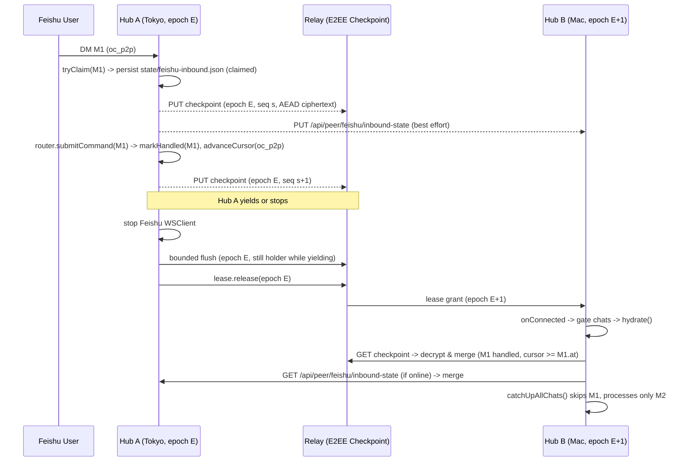

# Cross-hub Feishu inbound deduplication

> Snapshot: 2026-11-26 (commit `09535fb7`)

## Plan review and decisions

- **Decision 1 (Recommended, reversible): Persist local inbound state in `state/feishu-inbound.json` rather than adding SQLite migration `0057`.** Open PR #461 holds migration `0056` and is not yet on `main`; `src/daemon/store/migrate.ts` requires contiguous migration numbers, so adding `0057` on top of `0055` fails startup on `main`. Beyond the numbering constraint, `feishu_inbound_cursors` has a foreign key to local `feishu_chats`, whereas cross-hub state must also retain remote PM group cursors and bounded message receipts without splitting across tables. Storing a bounded atomic document in `state/feishu-inbound.json` (the same `write-file-atomic` pattern used by `state/peers.json` and `state/feishu-secrets.json`) avoids migration conflicts, stays inside the existing `state/` Worker sandbox deny boundary, supports corrupt-file self-recovery, and keeps local SQLite `feishu_inbound_cursors` monotonically updated for rollback safety.
- **Decision 2 (Ops prerequisite, external deployment): Official Cloudflare relay production deploy.** The recommended design adds an authenticated HTTP route `GET`/`PUT /v1/accounts/:account/leases/:name/checkpoint` to the relay without changing WebSocket protocol version `1`. Daemons degrade cleanly on `404` from an older relay by falling back to peer mTLS sync (`/api/peer/feishu/inbound-state`), which fixes the online-overlap failover bug immediately. Full disjoint-uptime and crash-failover protection activates after the relay staging smoke check and manual production deployment flow in `docs/relay-release-design.md`. No user decision is required before starting implementation; the Project Manager should schedule the relay release after the PR merges.
- **Decision 3 (Scope boundary): Remote-device PM catch-up remains out of scope.** `src/daemon/feishu/inbound-catchup.ts:276` scans only `ctx.store.chats()` (the local device's bindings). Syncing per-chat cursors and `held_offline` / `claimed` / `handled` receipts across the account eliminates cross-hub Router DM replays, duplicate non-deliver PM responses, duplicate offline notices across hub failovers, offline-inbox vs catch-up races, and false 15-minute gap reminders. Adding remote-peer PM catch-up when a remote device's chat is not in `feishu_chats` is a separate feature.
- **Prompt-cache impact: None.** This fix touches zero agent prompts, zero tool or MCP definitions, zero vendor launch arguments, and zero session message histories.

## 1. Problem and goals

User requirements (verbatim):
- 「对于反馈的问题，判断是bug还是需要的功能，bug的话直接派人去修」
- 「修 bug 要修根因，不在错的地基上叠算法」
- 「要注意各家厂商缓存的问题，不能破坏缓存了」

### Observed incident

On 2026-11-26, a two-device live Feishu test (`a8ed799c`, Tokyo Linux + MacBook Pro macOS) reproduced cross-device duplicate execution on a single shared Feishu bot (`[Measured]` in `/tmp/ai-tester/impl2/router-head/acceptance.md`, `head-lease.txt`, `mac-posts-after.json`, `tokyo-after.log`, `state-after.json`):

1. `05:52:40.883Z`: The owner sent Router DM `M1` (`om_x100b7f48dc41a0b4dd1b9fb94ecaef1`) into `oc_p2p`. Tokyo held the `feishu` lease and processed `M1` at `05:52:47.488Z` (posting a Claude quota failure card).
2. `05:53:00Z` to `05:53:01Z`: Tokyo stopped; Mac acquired the `feishu` lease at `05:53:01.086Z`.
3. `05:53:04.794Z`: The owner sent a new Router DM `M2` (`om_x100b7f48dac404a8c0f671ab8c50e7f`).
4. `05:53:07.332Z`: Mac's inbound catch-up pulled `M1` (already handled by Tokyo 20 seconds earlier) and executed it again (`router_commands.id = 3`, `client_id = feishu:om_x100b7f48dc41a0b4dd1b9fb94ecaef1`). At `05:53:08.451Z`, Mac also processed `M2` (`router_commands.id = 4`, `client_id = feishu:om_x100b7f48dac404a8c0f671ab8c50e7f`). Both posted new cards into `oc_p2p`.
5. `05:53:08Z` to `05:53:12Z`: Tokyo restarted and reclaimed the `feishu` lease.
6. `05:53:27.445Z`: Tokyo's inbound catch-up pulled `M2` (already handled by Mac) and executed it a second time, posting a third card.

### Goals

1. Every Feishu inbound user message (`message_id`) executes at most once across all devices in an account, across hub lease takeovers, bounce-backs, daemon restarts, and offline-to-online transitions.
2. Eliminate the sibling defects sharing the same root cause: duplicate non-deliver Router/PM routes (`/settings`, `/群设置`, `hint`, `reject`, disabled-router notice), mid-turn hub-yield double execution, false 15-minute offline gap reminders after hub handoff, duplicate offline-inbox notices across hub switches, and offline-inbox vs inbound-catch-up races when an owning device wakes up and takes the hub lease.
3. Preserve zero-knowledge relay security (the relay never sees Feishu chat IDs, message IDs, or credentials), full backward compatibility with relay protocol version `1` and mixed-version peers, strict memory/disk/payload bounds, and zero impact on vendor prompt caches.

## 2. Codebase and git history investigation

### Git history of the broken premise

- `cb6c9d85` and `a4d5ca8d` introduced `feishu_inbound_cursors` (migration `0041`) and inbound catch-up (`src/daemon/feishu/inbound-catchup.ts`) under a single-device premise: one daemon owned the Feishu bot, its SQLite ledger, and its in-memory `ctx.catchUp.seen` LRU (`[Measured]`).
- `3e21e492`, `bac39f69`, and `2fcf8493` added multi-device account-bot sharing: all devices share one `appId`/`appSecret` and one `oc_p2p` Router chat while rotating the single Feishu `WSClient` through `CenterLease` (`src/daemon/mesh/lease.ts`) (`[Measured]`).
- Those multi-device commits never introduced an account-wide inbound consumption ledger. Each standby device adopts `oc_p2p` via `adoptRouterChat` -> `bindRouterChat` (`src/daemon/feishu/chat-sync.ts:110-113`), freezing its local `feishu_inbound_cursors(oc_p2p)` at adoption time or its last lease term (`[Measured]`).

### Full-link audit of every Feishu ingress and replay path

| Path | Code boundary (`[Measured]`) | Vulnerable to cross-hub duplicate? | Root mechanism |
| --- | --- | --- | --- |
| Router DM (`oc_p2p`) normal `deliver` | `inbound-catchup.ts:232-243`, `inbound-dispatch.ts:200-246`, `router/dispatcher.ts:1068-1075` | **Yes (primary incident)** | Standby hub has stale `feishu_inbound_cursors`, empty `ctx.catchUp.seen`, and local-only `router_commands.client_id`. On takeover, `onConnected` (`connection.ts:138-142`) runs catch-up and replays up to 15 minutes of handled messages. Additionally, `deliverToRouter` awaits the full LLM turn (`inbound-dispatch.ts:239`) before `recordSeen()`, leaving a multi-second mid-turn yield/crash race. |
| Router DM (`oc_p2p`) non-deliver routes (`/settings`, `reject`, `hint`, `ignore`, disabled router, `LedgerRequestError`) | `inbound-dispatch.ts:161-198`, `233-245` | **Yes (cross-hub and single-device restart)** | None of these routes write to `router_commands`. Deduplication relies solely on in-memory `ctx.catchUp.seen`, which clears on restart and is absent on other hubs. Replays on hub switch and within the 30-second overlap (`FEISHU_INBOUND_CATCHUP_OVERLAP_MS`) after restart. |
| Router DM (`oc_p2p`) 15-minute gap reminder | `inbound-catchup.ts:64-87`, `133-197` | **Yes (false positive)** | After hub A serves `oc_p2p` for over 15 minutes and hands off to hub B, B's stale local cursor creates a synthetic `[B.cursor, now - 15m)` gap. `gapHasUnansweredAsk` sees A's handled messages as unseen and posts a false `"电脑离线超过 15 分钟...没得到回复的请重发"`. |
| PM project group (`oc_pm_*`) normal `deliver` | `account-bot.ts:510-533`, `inbound-dispatch.ts:200-204`, `248-265` | **Partial (file/race side effects)** | All events route to the single owning device, where SQLite `messages.dedupe_key = client:<conv>:feishu:<messageId>` suppresses duplicate DB rows. However, `receiveFiles` (`inbound-dispatch.ts:206-224`) runs before `postUserMessage` if an offline-inbox drain races with catch-up, and non-deliver error notices can duplicate. |
| PM project group (`oc_pm_*`) non-deliver routes (`/群设置`, `hint`, `reject`, `context`) | `inbound-dispatch.ts:161-198` | **Yes** | Not written to `messages`; relies on RAM `ctx.catchUp.seen`. Replays when the owning device restarts or reclaims the hub lease. |
| PM project group offline inbox & wake-up takeover | `account-bot.ts:473-508`, `579-612`, `inbound-catchup.ts:171-244` | **Yes (2 failure modes)** | (1) Hub A holds `M_off` in A's local `feishu_offline_inbox` and fails over to Hub C while owning device B is still offline; C has no record of `M_off` and sends a duplicate offline notice on redelivery. (2) Owning device B sleeps >15m, wakes up, and takes hub; B's stale `feishu_inbound_cursors` triggers a false 15-minute gap reminder even though A already queued `M_off`, and B's catch-up races A's offline-inbox drain. |
| Card action callbacks (`card.action.trigger`) | `account-bot.ts:455-461`, `card-actions.ts:1-200` | **No** | Never fetched by `message.list`. Routed to the single owning device via group marker or button field `d: <deviceId>` (`routeCardByIssuer`). Owning device enforces SQLite idempotency via `feishu_decisions` and `feishu_posts`. |
| Outbound cards & catch-up (`replay.ts`) | `text-cards.ts:44`, `replay.ts` | **Not the fix point** | `devicePostUuid(ctx, "c", command.id)` scopes UUIDs per device, so Feishu does not dedupe duplicate replies from two devices. Even if outbound UUIDs were shared, suppressing cards would not stop duplicate LLM execution or duplicate `pm.forward` / `worker.start` calls. Deduplication must happen before execution. |

### Protocol and transport findings

- **Relay WebSocket schemas are strict (`[Measured]`):** Both `clientFrameSchema` and `serverFrameSchema` in `src/relay/protocol.ts:219-257` use `z.strictObject` with `RELAY_PROTOCOL_VERSION = 1`. Sending any unknown WS server frame terminates older daemons (`src/daemon/mesh/relay-client.ts:302-307`), and sending any unknown WS client frame closes the socket on an older relay (`src/relay/core.ts:541-543`). Therefore, new relay capability must use an additive HTTP route, never new WS frames or fields in v1.
- **Peer mTLS push already experiences transient timeouts (`[Measured]`):** `tokyo-after.log` lines 38, 43-45, 52-53, and 74-75 record `pushFeishuToPeer` timeouts between Tokyo and Mac during normal operation. Peer-to-peer push alone cannot cover abrupt crash, sleep before peer wake-up (disjoint uptime), or peer-timeout handoffs.
- **Existing lease yield barrier (`[Measured]`):** `src/daemon/mesh/lease.ts:165-169` awaits `options.disconnect()` before sending `lease.release(epoch)` to the relay. Meanwhile, `src/relay/core.ts:627-640` keeps `lease.holder === oldHolder` and `lease.epoch === oldEpoch` throughout `yielding === true` until `lease.release` arrives or TTL expires. This gives the yielding hub a clean, fenced window to flush its final inbound checkpoint before handing over the lease.

### Matching `origin/main:REVIEW.md` rules (item by item)

Changed paths fall under `src/daemon/feishu/**`, `src/daemon/mesh/**`, `src/daemon/peers/**`, `src/daemon/daemon.ts`, `src/relay/**`, `src/shared/**`, `docs/**`, and `**/*.test.ts`. Notice `src/daemon/feishu/**`, `src/daemon/mesh/**`, and `src/relay/**` are listed under **Paths that require a review stamp** (`bellwood/review`).

| `REVIEW.md` rule from `origin/main` | Trigger match | Design compliance |
| --- | --- | --- |
| **Async work stops touching the ledger after shutdown starts** | `src/daemon/feishu/**`, `src/daemon/daemon.ts` | `hydrate()`, `flush()`, and `waitForClaimSync()` take an `AbortSignal` / check `ctx.life.closed` after every `await` before mutating local state or SQLite cursors. `close()` aborts in-flight sync HTTP calls, performs a bounded final flush while transport is still disconnecting, and awaits settled background promises before daemon shutdown closes SQLite. Every background publish catches and logs errors. |
| **Restart recovery finishes what the last run left** | `src/daemon/daemon.ts` | Claimed/handled receipts and cursors persist synchronously in `state/feishu-inbound.json` before `router.submitCommand` or side-effecting replies run. On restart, startup loads the persisted state, merges any existing SQLite `feishu_inbound_cursors`, and hydrates from Relay and peers before catch-up scans Feishu history. |
| **Caches key on identity, have a limit, and retry failures soon** | `src/shared/paths.ts`, `src/shared/limits.ts` | Local receipts and cursors are keyed by `(appId, messageId)` and `(appId, chatId)`, cleared on `appId` change or disconnect. Peer `404` unsupported responses cache only for `FEISHU_INBOUND_PEER_UNSUPPORTED_TTL_MS` (5 minutes), and relay `404` unsupported status resets automatically on every new relay WebSocket session. Every map and cache uses a cap in `src/shared/limits.ts`. |
| **Growing data has a cap in `limits.ts`** | `src/daemon/feishu/**`, `src/shared/limits.ts` | Local receipts, local cursors, local file bytes, wire checkpoint receipts, wire checkpoint cursors, plaintext bytes, encrypted relay payload bytes, and relay HTTP body bytes all have named caps in `src/shared/limits.ts`. Relay and peer HTTP readers reject payloads exceeding byte limits before JSON parsing. |
| **The relay trusts only `CF-Connecting-IP` and resists flushing** | `src/relay/**` | Cloudflare Worker routes `GET`/`PUT /v1/accounts/:account/leases/:name/checkpoint` through a dedicated `createIpRateLimiter` (`src/relay/guards.ts`) keyed on `clientKeyOf(clientIpOf(request))` (`CF-Connecting-IP` only, never `X-Forwarded-For`), with `RELAY_CHECKPOINT_PER_IP_PER_MINUTE = 120` and the same flood-resistant `fresh`/`counting`/`blocked` table caps. Node relay uses the identical limiter helper via `req.ip`. |
| **Feishu code goes through `transport.ts`** | `src/daemon/feishu/**` | Zero new imports of `@larksuiteoapi/node-sdk`. Chat cursors advance **only** after message handling succeeds (`markHandled`) or after a window gap is settled (`settleWindowGap`); `tryClaim` writes a `claimed` receipt without advancing `lastInboundAt`, and `tryHoldOffline` writes a `held_offline` receipt without advancing `lastInboundAt`. |
| **Tests wait for events, not for time** | `**/*.test.ts` | All acceptance and unit tests use injected clocks (`now`), fake transports/relays, and explicit promises or `await service.idle()`, with zero `sleep` waits and zero wall-clock duration assertions (`src/wall-clock-guard.test.ts`). |
| **Persisted fields have a reader and dual retention bounds** | `src/shared/resource-registry.ts`, `src/daemon/feishu/store.ts` | Every field in `FeishuInboundStateSnapshot` (`version`, `appId`, `seq`, `cursors`, `receipts`) has a live production reader (`hydrate`, `tryClaim`, `markHandled`, `tryHoldOffline`, `catchUpInboundChat`). `HubPaths.feishuInboundFile` is registered in `RESOURCE_REGISTRY` as `growing` with both age (`FEISHU_INBOUND_RECEIPTS_TTL_MS`), count (`FEISHU_INBOUND_RECEIPTS_MAX`, `FEISHU_INBOUND_CURSORS_MAX`), and byte (`FEISHU_INBOUND_STATE_MAX_BYTES`) caps, enforced on every write and merge. |
| **A result is matched to its request by an id both carry** | `src/daemon/**` | Inbound deduplication matches the immutable Feishu `messageId` (and `clientId = feishu:<messageId>`), never wall-clock timestamps alone. Relay checkpoint PUT requests carry `(epoch, seq)` and the response echoes `(epoch, seq)` (or `409` with `currentEpoch`/`currentSeq`), matching the exact write request. |
| **Planned acceptance scenarios cover every requirement and pass real tests** | `**` | Section 8 maps every user quote, settled rule, all 9 categories, and every matching `REVIEW.md` rule to runnable Vitest tests with real assertions (no `it.todo`), recorded failing before implementation. |

## 3. Architecture design

### Reference designs

1. **Apache Kafka Consumer Group Coordinator (`__consumer_offsets` + `generation_id`)** ([Kafka Design: Consumer Group Protocol](https://kafka.apache.org/documentation/#design_consumerposition), [KIP-848](https://cwiki.apache.org/confluence/display/KAFKA/KIP-848+The+Next+Generation+of+the+Consumer+Rebalance+Protocol)): The coordinator that owns partition assignment also stores committed consumer offsets keyed by group and partition, fenced by a monotonic `generation_id`. Any stale member attempting to commit with an older generation receives `ILLEGAL_GENERATION`, preventing split-brain offset regression.
2. **NATS JetStream Durable Consumers (`ack_floor` + `duplicate_window`)** ([NATS JetStream Consumers](https://docs.nats.io/nats-concepts/jetstream/consumers), [Message Deduplication](https://docs.nats.io/nats-concepts/jetstream/headers#message-deduplication)): Combines a contiguous durable floor (`ack_floor`, which advances only when messages are acknowledged) with a bounded time-windowed `Nats-Msg-Id` receipt set (`duplicate_window`) that suppresses redeliveries for out-of-order or in-flight messages ahead of the floor.
3. **Slack Events API Idempotent Ingestion (`event_id` deduplication + Ack-then-Queue)** ([Slack Events API](https://docs.slack.dev/apis/events-api/)): Claims each incoming `event_id` in a shared durable store **before** dispatching downstream work so retries, timeouts, and worker failovers never double-execute side effects, rather than relying on downstream reply inspection.

### Candidate designs

#### Candidate A (Recommended): Coordinator-fenced E2EE Relay Checkpoint + Peer mTLS Mirror + Local Persistent Receipts

Introduce one domain concept: **Account-wide Feishu Inbound State** (`FeishuInboundStateSnapshot` = per-chat monotonic cursors + bounded message receipts with monotonic phase lattice `held_offline < claimed < handled`).

- **Local persistence (`state/feishu-inbound.json`)**: Synchronously updated via `write-file-atomic` before any side-effecting handler runs (`tryClaim`) and on completion (`markHandled`, `advanceCursor`, `tryHoldOffline`). Local SQLite `feishu_inbound_cursors` stays monotonically updated for local chats.
- **Relay E2EE checkpoint (`GET`/`PUT /v1/accounts/:account/leases/:name/checkpoint`)**: The same coordinator that already owns `CenterLease` epochs stores one opaque AES-256-GCM ciphertext per `(accountId, leaseName)` in `RelayAccountRecord.leaseCheckpoints`, encrypted with a key derived via HKDF-SHA256 from `(accountId, appId, appSecret)` (which only trusted devices hold) and bound via AAD to `(accountId, leaseName, epoch, seq)`. Relay enforces holder + `(epoch, seq)` fencing (`409 stale_epoch` / `409 stale_seq`).
- **Peer mTLS mirror (`GET`/`PUT /api/peer/feishu/inbound-state`)**: Online peers also receive best-effort state pushes and answer pull requests during takeover hydration.
- **Takeover & yield protocol**: On `lease.yield` / disconnect, the outgoing hub flushes its state to Relay and online peers before releasing the lease. On takeover `onConnected`, the incoming hub hydrates from Relay and online peers (CRDT merge) **before** `inbound-catchup` scans Feishu history.

#### Candidate B: Peer-to-peer mTLS Sync Only (No Relay Checkpoint)

Add `GET`/`PUT /api/peer/feishu/inbound-state` over peer mTLS and local `state/feishu-inbound.json`, with no relay storage.

- **Why rejected**: Fails structurally whenever the previous hub goes offline (sleep, power loss, crash, daemon stop) before the standby hub wakes up or whenever cross-region mTLS pushes time out (as observed in `tokyo-after.log:38-75`). In the exact real-world desktop+laptop workflow (close laptop A, open desktop B 5 minutes later), A and B have zero online overlap, so B still has a stale cursor and replays every message from the last 15 minutes.

#### Candidate C: Feishu Message-History Reconciliation (`GET im/v1/messages` + `parent_id` Reply Inspection)

Skip cross-device state sync and infer whether a user message was already handled by scanning Feishu chat history for a subsequent bot message (or switching bot replies to `POST im/v1/messages/:id/reply` with `parent_id`).

- **Why rejected**:
  1. **In-flight race**: A Router turn takes 5-30 seconds; before any bot reply lands in Feishu, a failover hub sees zero reply and executes a second LLM call.
  2. **Non-reply routes**: `context`, `ignore`, and failed/rate-limited replies produce no bot reply in Feishu history and would still replay or leak false gap notices.
  3. **Shared `oc_p2p` ambiguity**: Multiple devices independently post proactive briefing cards, decision cards, and delivery reports into `oc_p2p`; seeing an app message after user message `M` does not prove `M` was answered. Switching all Router replies to quoted `reply` alters Feishu UX and still cannot cover multi-part cards or unposted failures.

#### Structural comparison

| Dimension | Candidate A (Relay E2EE + Peer mTLS + Local State) | Candidate B (Peer mTLS Only) | Candidate C (Feishu History Inspection) |
| --- | --- | --- | --- |
| Online-overlap takeover (Tokyo -> Mac -> Tokyo) | **Fixed** (Relay + Peer) | Fixed (if mTLS succeeds) | Partial (races on in-flight turns) |
| Disjoint uptime (Laptop A sleeps, Desktop B wakes) | **Fixed** (Relay holds fenced E2EE checkpoint) | **Broken** (no online peer to query) | Partial (fails non-reply & in-flight) |
| Mid-turn yield / crash deduplication | **Fixed** (`claimed` receipt persisted + pushed before LLM start) | Broken on crash/timeout | **Broken** (no bot reply exists yet) |
| Non-deliver routes (`/settings`, `reject`, `hint`, `held_offline`) | **Fixed** (all claim a receipt) | Fixed only when peers overlap | **Broken** (no reliable Feishu marker) |
| False 15-minute gap reminder after takeover | **Fixed** (hydrated cursor + receipt check) | Broken on disjoint uptime | Broken unless scanning all gap replies |
| Works before Relay production deploy | **Yes** (degrades to Peer mTLS on `404`) | Yes | Yes |
| Relay zero-knowledge privacy | **Preserved** (AES-256-GCM + HKDF from `appSecret`) | Preserved | Preserved |
| Feishu UX unchanged | **Yes** | Yes | No (requires quoted replies) |

### Design red flags check

Screened against `.agents/skills/architect/references/design-red-flags.md`:

1. **Band-aid on wrong foundation**: Avoided. We do not patch outbound UUIDs or add sleep delays; we introduce the missing account-wide inbound consumption ledger and pre-execution claim boundary.
2. **Shallow module / pass-through layers**: Avoided. All merge laws, pruning, AEAD encryption, local file persistence, and single-flight sync live inside one cohesive module (`src/daemon/feishu/inbound-checkpoint.ts`), and all relay checkpoint validation/fencing lives inside `src/relay/lease-checkpoint.ts`.
3. **Dual sources of truth**: Avoided. `FeishuInboundSync` becomes the single source of truth for inbound dedupe across `inbound-catchup.ts`, `inbound-dispatch.ts`, and `account-bot.ts`, replacing separate RAM-only `ctx.catchUp.seen` and `noticedOfflineMessages` caches. Local SQLite `feishu_inbound_cursors` is strictly a write-through projection for local chats and legacy upgrade seeding.
4. **Protocol breaking change**: Avoided. Relay WS v1 frames stay untouched; relay checkpoint uses a new HTTP endpoint that gracefully degrades on `404`.
5. **Unbounded growth**: Avoided. Every table, file, map, and wire payload has explicit TTL + count + byte caps in `src/shared/limits.ts`.
6. **Non-deterministic merge**: Avoided. `mergeFeishuInboundState` is a commutative, associative, idempotent join-semilattice with deterministic tie-breakers.
7. **Hidden failure mode / over-claiming**: Avoided. Residual window is stated explicitly below: if a hub suffers instant power loss before its pre-LLM publish reaches either the relay or an online peer (within the <=500ms claim-sync window), no remote copy exists yet.
8. **Scope creep**: Avoided. Card callbacks (already idempotent on owning device), outbound replay, and remote-PM catch-up remain untouched.

### Rolling upgrade and compatibility

| Scenario | Behavior |
| --- | --- |
| **New Daemon + Old Relay** (before relay deploy) | `GET`/`PUT /v1/accounts/:account/leases/feishu/checkpoint` returns `404 { error: "not_found" }`. Control WS stays untouched. Daemon marks relay checkpoint unsupported for the current relay WS session (re-probed automatically on reconnect after relay deploy) and syncs via Peer mTLS (`GET`/`PUT /api/peer/feishu/inbound-state`). |
| **Old Daemon + New Relay** (after relay deploy) | Relay sends zero new WS frames and keeps `RELAY_PROTOCOL_VERSION = 1`. Old daemons never call the new HTTP route and see zero changes. |
| **New Daemon + Old Peer** (mixed device versions) | `GET`/`PUT /api/peer/feishu/inbound-state` returns `404` on the old peer. Caller caches unsupported status for `FEISHU_INBOUND_PEER_UNSUPPORTED_TTL_MS` (5 min) and relies on the Relay checkpoint and other upgraded peers. |
| **Relay unreachable / `orphan_holder`** | `CenterLease` enters `orphan_holder` only after `MESH_LEASE_ORPHAN_MS` (60 s) and confirming no LAN peer holds the lease. Before catch-up, the orphan holder still hydrates over LAN mTLS from reachable peers, records receipts with `epoch = 0`, and mirrors over LAN. When the relay reconnects, `CenterLease` disconnects `orphan_holder`, obtains a fenced `epoch`, hydrates from Relay + peers, CRDT-merges both states, and publishes. |
| **Hard crash mid-claim (residual edge)** | `tryClaim` writes locally first (`write-file-atomic`) and `deliverToRouter` waits up to `FEISHU_INBOUND_CLAIM_SYNC_WAIT_MS` (500 ms) for the single-flight publish before starting the LLM turn. Only instant process kill before that publish reaches any remote target leaves the receipt local-only. |

### Module boundaries, state model, and protocols

#### 1. Shared state lattice (`src/daemon/feishu/inbound-checkpoint.ts`)

Receipt phase rank is strictly monotonic:
- `"held_offline"` (rank `1`): Held in a hub's `feishu_offline_inbox` for an offline PM device. Suppresses duplicate offline holds/notices on any other non-owning hub and suppresses false 15-minute gap reminders in `settleWindowGap`. Does **not** advance the chat cursor and does **not** block the owning device from executing the message once.
- `"claimed"` (rank `2`): Claimed for execution by the handling device (Router hub or PM owning device) before side effects start. Suppresses execution on all devices. Does **not** advance the chat cursor (`REVIEW.md` rule: cursor advances only after handling succeeds).
- `"handled"` (rank `3`): Handling completed. Suppresses execution on all devices and permits advancing `cursors[chatId]` (subject to existing `cursorHold` and `gateEpochs` guards).

Merge laws (`mergeFeishuInboundState(local, remote, now)`):
- Snapshots with different `appId` never merge (returns `local`).
- `seq = Math.max(local.seq, remote.seq)`.
- Per-chat cursor: higher `lastInboundAt` wins; ties break by higher `updatedAt`, then lexicographically larger `lastMessageId` (non-null beats null).
- Per-message receipt: higher phase rank (`handled > claimed > held_offline`) wins; ties break by higher `epoch`, then higher `updatedAt`, then lexicographically larger `claimedBy`.
- Result is pruned immediately by `pruneFeishuInboundState` to enforce TTL, max counts, and max UTF-8 byte size.

#### 2. E2EE Relay checkpoint (`src/relay/protocol.ts`, `src/relay/lease-checkpoint.ts`, `src/relay/core.ts`, `src/relay/cloudflare/worker.ts`, `src/relay/node/server.ts`)

- **Key derivation**: `HKDF-SHA256(ikm = appSecret, salt = "fusa-feishu-checkpoint-v1:" + accountId + ":" + appId, info = "feishu-inbound-checkpoint-aes-256-gcm", len = 32)`.
- **Encryption**: AES-256-GCM with 12-byte random IV and AAD `utf8(accountId + "\n" + leaseName + "\n" + epoch + "\n" + seq)`. Wire envelope: `v1.<base64url(iv)>.<base64url(ciphertext || tag16)>`.
- **Route**: `GET` / `PUT /v1/accounts/:account/leases/:name/checkpoint?device=<deviceId>&session=<relayToken>`.
- **Auth**: Active control WebSocket for `device` with matching `session` and `device.state === "active"`.
- **Fencing on `PUT`**:
  - Must hold `leases.get(name)` with `lease.holder === device && lease.epoch === body.epoch` (allowed while `lease.yielding === true` so the outgoing hub's final flush succeeds before `lease.release`). Stale holder or older epoch returns `409 { error: "stale_epoch", currentEpoch }`.
  - Lexicographic `(epoch, seq)` ordering: if `existing !== undefined && body.epoch === existing.epoch && body.seq <= existing.seq`, return `409 { error: "stale_seq", currentSeq }`.
  - Size cap: `ciphertext` UTF-8 bytes `<= RELAY_LEASE_CHECKPOINT_MAX_BYTES` (`64 KiB`), raw HTTP body `<= 68 KiB`.
  - Rate limit: dedicated `createIpRateLimiter` with `RELAY_CHECKPOINT_PER_IP_PER_MINUTE = 120` keyed on `CF-Connecting-IP` (Cloudflare) / `req.ip` (Node).
  - Persistence: stored on `RelayAccountRecord.leaseCheckpoints[name]` in the existing SQLite `account` / `accounts` row (survives Cloudflare DO hibernation and Node relay restarts with zero schema migration).

#### 3. Peer mTLS endpoint (`src/shared/api.ts`, `src/daemon/peers/routes.ts`)

- `GET /api/peer/feishu/inbound-state` (requires authenticated mTLS peer): returns `{ state: FeishuInboundStateSnapshot | null }` (bounded wire export).
- `PUT /api/peer/feishu/inbound-state` (requires authenticated mTLS peer): validates via `parseFeishuInboundStateSnapshot`, merges into local `FeishuInboundSync`, and returns `204`.

#### 4. Takeover and yield sequence

## 4. Caches, state bounds, and performance

All four repository cache and state-bound rules are satisfied:

1. **Invalidation**:
   - Local state clears immediately on `disconnectLocal` or `forgetPreviousApp` (switching to a different `appId`).
   - Relay `404` unsupported flag resets whenever the relay control WebSocket reconnects.
   - Peer `404` unsupported entries expire after `FEISHU_INBOUND_PEER_UNSUPPORTED_TTL_MS` (5 min) and are deleted when a peer is removed from trust.
   - `close()` aborts in-flight HTTP calls and clears in-memory timers/maps.
2. **Upper bounds (`src/shared/limits.ts`)** sized for one month of continuous use (300 Workers, 30,000 messages, 50,000 step logs):

| Constant in `src/shared/limits.ts` | Value | Purpose and sizing rationale |
| --- | --- | --- |
| `FEISHU_INBOUND_RECEIPTS_TTL_MS` | `24 * 60 * 60_000` (24 h) | Matches `FEISHU_OFFLINE_INBOX_TTL_MS`; strictly exceeds the 15-minute catch-up window and Feishu's ~7.5 h WS redelivery window while preventing multi-week accumulation. |
| `FEISHU_INBOUND_RECEIPTS_MAX` | `2_000` | Matches `FEISHU_SEEN_MESSAGES_MAX`; caps local receipts even under high-rate message bursts. |
| `FEISHU_INBOUND_CURSORS_MAX` | `200` | Matches `FEISHU_CHAT_CACHE_MAX`; bounds local chat cursor count across all devices in the account. |
| `FEISHU_INBOUND_STATE_MAX_BYTES` | `256 * 1024` (256 KiB) | Hard disk file cap for `state/feishu-inbound.json` (`~200 * 165 B + 2000 * 110 B` fits comfortably, with oldest-receipt eviction if IDs are unusually long). |
| `FEISHU_INBOUND_STATE_FILE_MODE` | `0o600` | Matches `FEISHU_SECRETS_FILE_MODE` and `MESH_TRUST_FILE_MODE`. |
| `FEISHU_INBOUND_CHECKPOINT_RECEIPTS_MAX` | `150` | Newest 150 receipts in the synced wire checkpoint (covers 10 msg/min across the entire 15-minute catch-up window). |
| `FEISHU_INBOUND_CHECKPOINT_CURSORS_MAX` | `100` | Newest 100 active chat cursors in the synced wire checkpoint. |
| `FEISHU_INBOUND_CHECKPOINT_PLAINTEXT_MAX_BYTES` | `44 * 1024` (44 KiB) | Guarantees AES-256-GCM + base64url ciphertext stays under `60 KiB`, strictly below `RELAY_LEASE_CHECKPOINT_MAX_BYTES` (`64 KiB`). |
| `FEISHU_INBOUND_HYDRATE_TIMEOUT_MS` | `3_000` | Upper bound for takeover hydration before catch-up proceeds even if the network is slow. |
| `FEISHU_INBOUND_FLUSH_TIMEOUT_MS` | `2_000` | Upper bound for outgoing hub checkpoint flush during lease yield or shutdown. |
| `FEISHU_INBOUND_CLAIM_SYNC_WAIT_MS` | `500` | Short pre-LLM sync wait on Router DM claims so even mid-turn hard crashes leave a remote claim without stalling degraded networks. |
| `FEISHU_INBOUND_PEER_HYDRATE_CONCURRENCY` | `4` | Caps parallel peer HTTP pulls during takeover hydration. |
| `FEISHU_INBOUND_PEER_UNSUPPORTED_TTL_MS` | `5 * 60_000` | Short backoff for legacy `404` peers so upgrades take effect automatically. |
| `RELAY_LEASE_CHECKPOINT_MAX_BYTES` | `64 * 1024` (64 KiB) | Matches `RELAY_MAX_DATA_FRAME_BYTES` and Node relay `bodyLimit`; keeps Durable Object SQLite row size well under 3.5% of the 2 MB limit. |
| `RELAY_CHECKPOINT_PER_IP_PER_MINUTE` | `120` | Matches `RELAY_UPGRADES_PER_IP_PER_MINUTE`; allows 2 checkpoint ops/sec per IP while blocking abuse. |

3. **Stable front-end references**: Not applicable; this change adds no web UI selectors or components.
4. **Performance**: Single-flight coalesced publishing ensures bursts of incoming Feishu messages never spawn concurrent HTTP floods to Relay or peers. Local atomic writes occur only on distinct user messages (at most ~4/s per chat) on a <=256 KiB file (<1 ms on SSD).

## 5. Cross-vendor and cross-platform compatibility

### Cross-vendor coverage (all 8 registered vendors)

All 8 vendors in `src/vendors/registry.ts` (`claude`, `agy`, `codex`, `pi`, `deepseek`, `cursor`, `opencode`, `kimi`) interact with Feishu solely downstream of `deliverToRouter` (`router.submitCommand`) and `deliverToPm` (`ledger.postUserMessage`). Deduplication runs strictly upstream in `src/daemon/feishu/`, so:
- All 8 vendors receive the exact same at-most-once inbound guarantee whether configured as Router or PM.
- **Prompt-cache preservation**: Zero changes to `src/daemon/prompt.ts`, `src/daemon/router/prompt.ts`, `src/vendors/**`, tool/MCP definitions, or session message ordering. Previously sent session messages, system prompts, and tool lists remain byte-for-byte identical, so `TokenUsage.cacheRead` cannot regress for any vendor.

### Cross-platform coverage (macOS, Windows, Linux)

- **Atomic file writes**: Uses `write-file-atomic` (`writeFileAtomic.sync`), already proven across macOS, Linux, and Windows in `src/daemon/mesh/trust.ts:99` and `src/daemon/feishu/secrets.ts:32`.
- **Path resolution & sandboxes**: `HubPaths.feishuInboundFile` uses `joinForBase(stateDir, "feishu-inbound.json")` (`src/shared/paths.ts`), producing POSIX paths on macOS/Linux and Win32 paths on Windows. Because `src/daemon/driver/write-scope.ts:758-763` enumerates `resolveHubPaths` automatically, `state/feishu-inbound.json` is automatically denied to Workers on macOS Seatbelt, Linux `bwrap`, and Windows MXC/NTFS ACL sandboxes.
- **Web-standard Relay code**: `src/relay/protocol.ts` and `src/relay/lease-checkpoint.ts` use only Web-standard APIs (`TextEncoder`, `zod`), compiling under both Node 24 (`tsconfig.json`) and Cloudflare Workers (`src/relay/cloudflare/tsconfig.json`).

## 6. Deletions

During the implementation step, remove superseded single-device dedupe structures so old and new paths never coexist:
- Remove standalone `ctx.catchUp.seen` (`LRUCache`) from `src/daemon/feishu/context.ts`, `inbound-catchup.ts`, `inbound-dispatch.ts`, `connection.ts`, `setup-service.ts`, and `service.ts`; route all seen/claimed checks through `ctx.inboundSync`.
- Remove standalone `noticedOfflineMessages` (`LRUCache`) from `src/daemon/feishu/account-bot.ts`; route offline hold deduplication through `inboundSync.tryHoldOffline`.
- Update `docs/feishu-design.md` and `docs/account-mesh-design.md` where they describe inbound cursors as local-only or list relay HTTP endpoints without `/leases/:name/checkpoint`.

## 7. Code skeleton

| File | Role & exported contracts | Implementation order |
| --- | --- | --- |
| `src/shared/limits.ts` | Bounded constants for local state, wire checkpoint, timeouts, and relay checkpoint rate/size limits. | Done in plan step |
| `src/shared/api.ts` | `API_PATHS.peerFeishuInboundState` (`/api/peer/feishu/inbound-state`). | Done in plan step |
| `src/shared/paths.ts` | `HubPaths.feishuInboundFile` (`state/feishu-inbound.json`). | Done in plan step |
| `src/shared/resource-registry.ts` | Registers `path:feishuInboundFile` as `growing` with age, count, and byte bounds. | Done in plan step |
| `src/relay/protocol.ts` | `RELAY_PATHS.leaseCheckpoint`, checkpoint record/request/response/conflict types, `parseRelayLeaseCheckpointPut`, `parseRelayLeaseCheckpointResponse`. | Step 1 (Relay) |
| `src/relay/lease-checkpoint.ts` | Web-standard `parseLeaseCheckpointRoute`, `readLeaseCheckpoint`, `writeLeaseCheckpoint` with active-session auth and `(epoch, seq)` fencing. | Step 1 (Relay) |
| `src/relay/core.ts` | Optional `leaseCheckpoints` on `RelayAccountRecord` and `getLeaseCheckpoint` / `putLeaseCheckpoint` methods on `RelayAccountRoom`. | Step 1 (Relay) |
| `src/relay/cloudflare/worker.ts` & `src/relay/node/server.ts` | Wire `GET`/`PUT /v1/accounts/:account/leases/:name/checkpoint` with `createIpRateLimiter` (`CF-Connecting-IP` / `req.ip`) and body cap. | Step 1 (Relay) |
| `src/daemon/mesh/lease.ts` & `src/daemon/mesh/relay-client.ts` & `src/daemon/mesh/index.ts` | Expose `CenterLease.epoch()`, `RelayClient` / `Mesh` checkpoint `getLeaseCheckpoint` / `putLeaseCheckpoint` helpers (top-level helpers to stay within `code-hygiene` function caps). | Step 2 (Mesh) |
| `src/daemon/feishu/inbound-checkpoint.ts` | Core deep module: `createEmptyFeishuInboundState`, `parseFeishuInboundStateSnapshot`, `mergeFeishuInboundState`, `pruneFeishuInboundState`, `deriveFeishuCheckpointKey`, `encryptFeishuCheckpoint`, `decryptFeishuCheckpoint`, `readFeishuInboundStateFile`, `writeFeishuInboundStateFile`, `createFeishuInboundSync`. | Step 3 (Core dedupe) |
| `src/daemon/feishu/` (`context.ts`, `inbound-catchup.ts`, `inbound-dispatch.ts`, `account-bot.ts`, `connection.ts`, `setup-service.ts`, `service.ts`), `src/daemon/peers/routes.ts`, `src/daemon/daemon.ts` | Wire `FeishuInboundSync` into catch-up hydration, pre-execution claim, post-handling cursor advance, offline hold, yield/close flush, and peer mTLS routes (extracting mesh wiring out of `daemon.ts` to keep `daemon.ts` within its line cap). | Step 4 (Integration & deletions) |

## 8. Verification plan

### Acceptance scenarios (plain-language 3-part format)

Every scenario maps to at least one quoted user requirement, settled rule, category (`C1`-`C9`), and matching `REVIEW.md` rule.

- **S1 [User bugfix + Root cause + C9 Multi-computer Feishu]: Dual-device Router DM takeover and bounce-back (2026-11-26 incident repro)**
  - **Given**: Tokyo and Mac share one account and Feishu app (`oc_p2p`), connected through the Relay and peer mTLS. Tokyo holds `feishu` lease (`epoch 1`).
  - **When**: User sends `M1` to `oc_p2p` (Tokyo handles it); Tokyo stops and Mac takes `epoch 2`; user sends `M2` during/after handoff (Mac handles `M2`); Tokyo restarts and reclaims `epoch 3`.
  - **Then**: `M1` is submitted to Router exactly once (on Tokyo, never replayed on Mac) and `M2` is submitted to Router exactly once (on Mac, never replayed on Tokyo).
  - **Test**: `src/daemon/feishu/inbound-checkpoint.test.ts` ("replays neither M1 on takeover nor M2 on bounce-back across two hubs").

- **S2 [C1 Two consecutive turns in one conversation]: Two consecutive Router DMs across a mid-conversation hub handoff**
  - **Given**: Hub A holds `epoch 1` on `oc_p2p`.
  - **When**: User sends turn 1 (`M1`), Hub A claims and completes `M1`; Hub A yields cleanly to Hub B (`epoch 2`); user sends turn 2 (`M2`) immediately after handoff, and catch-up overlap re-reads both `M1` and `M2`.
  - **Then**: Turn 1 executes once on Hub A, turn 2 executes once on Hub B, cursors advance monotonically to `M2.at`, and `seq` increases without overwriting turn 1's receipt.
  - **Test**: `src/daemon/feishu/inbound-checkpoint.test.ts` ("handles two consecutive Router DM turns across a hub switch without replaying turn 1").

- **S3 [C2 Restart mid-operation + `REVIEW.md` Restart recovery + Async shutdown]: Hub restarts or yields mid-turn and during shutdown**
  - **Given**: Hub A receives `M1` in `oc_p2p`, claims `M1` (`claimed`), and persists + publishes the claim before the Router LLM turn finishes.
  - **When**: (a) Hub A restarts or yields to Hub B mid-turn while `M2` arrives right after `M1`; (b) `sync.close()` runs while `hydrate()` or `flush()` is awaiting network I/O.
  - **Then**: (a) Hub B skips `M1` (already `claimed`) yet still catches up and executes `M2` (because `cursors[oc_p2p]` stayed behind `M1` until `handled`); (b) after `close()`, late HTTP resolutions neither write `state/feishu-inbound.json` nor touch SQLite cursors.
  - **Test**: `src/daemon/feishu/inbound-checkpoint.test.ts` ("prevents duplicate execution on mid-turn failover while still catching up subsequent messages" and "aborts in-flight hydrate and flush cleanly on shutdown without late writes").

- **S4 [C3 State or configuration change while queued]: App switch, disconnect, and `appSecret` rotation invalidate previous dedupe state**
  - **Given**: Hub A has receipts and cursors for `app_A` synced to Relay and local disk.
  - **When**: (a) Feishu disconnects or switches to `app_B`; (b) `appSecret` rotates so an older encrypted Relay checkpoint cannot decrypt with the new secret; (c) a snapshot from `app_B` arrives during merge.
  - **Then**: (a) `resetForApp` clears local receipts/cursors for `app_A`; (b) `decryptFeishuCheckpoint` returns `null` safely without throwing, falling back to local/peer state and allowing the new epoch holder to overwrite the checkpoint; (c) `mergeFeishuInboundState` refuses to mix snapshots across different `appId`s.
  - **Test**: `src/daemon/feishu/inbound-checkpoint.test.ts` ("isolates state across appId switches, disconnect, and appSecret rotation").

- **S5 [C4 Existing rules + `REVIEW.md` Feishu transport & cursor-after-handling + Request ID matching]: Non-deliver routes, false 15-minute gap reminder, and PM offline-inbox failover**
  - **Given**: (a) Hub A handles `/settings` and a guest `reject` in `oc_p2p` / `oc_pm` and runs for >20 minutes before handing off to standby Hub B whose old cursor is 25 minutes stale; (b) Hub A holds `M_off` in `feishu_offline_inbox` (`held_offline`) for offline Mac, fails over to Hub C while Mac stays offline, and later Mac wakes up and takes hub.
  - **Then**: (a) Non-deliver routes do not replay on single-device restart or cross-hub takeover, and Hub B emits zero false 15-minute gap reminders; (b) Hub C suppresses duplicate offline holds/notices for `M_off`; (c) Mac executes `M_off` exactly once whether `M_off` arrives via Hub A's offline-inbox drain or Mac's own catch-up after Hub A crashes, and emits zero false gap reminders; (d) dedupe matches immutable `messageId` even when timestamps collide (`M1.at === M2.at`).
  - **Test**: `src/daemon/feishu/inbound-checkpoint.test.ts` ("deduplicates non-deliver routes and suppresses false 15-minute gap reminders on takeover", "deduplicates PM offline holds across hubs while letting the owning device execute once", and "matches receipts by immutable messageId even with identical timestamps").

- **S6 [C4 Existing rules + `REVIEW.md` Relay IP guard + Epoch fencing + Zero-knowledge E2EE + Rolling upgrade]: Relay checkpoint fencing, E2EE blindness, rate limits, and `404` fallback**
  - **Given**: A Relay account room (and Cloudflare/Node HTTP entry points) with active devices A (`epoch 1`) and B (`epoch 2`), plus a revoked/pending device C.
  - **When**: (a) A writes an encrypted checkpoint at `(epoch 1, seq 1)`, B takes `epoch 2` and reads/writes `(epoch 2, seq 2)`, then stale A attempts `PUT (epoch 1, seq 2)` and B attempts out-of-order `PUT (epoch 2, seq 1)`; (b) C or an invalid session calls `GET`/`PUT`; (c) ciphertext is inspected on the relay and tampered with (flipped byte or swapped `epoch`/`seq` AAD); (d) requests flood past `RELAY_CHECKPOINT_PER_IP_PER_MINUTE` using spoofed `X-Forwarded-For` vs `CF-Connecting-IP`; (e) a new daemon talks to a legacy `404` relay and a legacy `404` peer.
  - **Then**: (a) Valid writes succeed and echo `(epoch, seq)`; stale epoch returns `409 stale_epoch` with `currentEpoch`; stale seq returns `409 stale_seq` with `currentSeq`; (b) unauthorized/non-active callers receive `401`/`403`; (c) relay ciphertext leaks zero plaintext `chatId`/`messageId` substrings and tamper/AAD swap fails decryption (`null`); (d) rate limiting keys only on `CF-Connecting-IP`, returning `429` without evicting counting clients; (e) `404` relay degrades cleanly to Peer mTLS sync and `404` peer backs off for `FEISHU_INBOUND_PEER_UNSUPPORTED_TTL_MS` without closing control WS.
  - **Test**: `src/relay/lease-checkpoint.test.ts` and `src/daemon/feishu/inbound-checkpoint.test.ts` ("degrades cleanly on 404 from legacy relay and legacy peer").

- **S7 [C5 Large data volume — one-month sizing + `REVIEW.md` Dual retention bounds]: Bounded pruning under 1-month production volume**
  - **Given**: State accumulates 30,000 simulated Feishu messages across 250 chats over 30 simulated days (including bursts exceeding `FEISHU_INBOUND_RECEIPTS_MAX` and oversized IDs).
  - **When**: `pruneFeishuInboundState`, `mergeFeishuInboundState`, and `exportForWire` run across rolling timestamps.
  - **Then**: Local receipts stay `<= FEISHU_INBOUND_RECEIPTS_MAX` (`2,000`) and within `FEISHU_INBOUND_RECEIPTS_TTL_MS` (`24 h`); local cursors stay `<= FEISHU_INBOUND_CURSORS_MAX` (`200`); persisted JSON stays `<= FEISHU_INBOUND_STATE_MAX_BYTES` (`256 KiB`); wire checkpoint stays `<= FEISHU_INBOUND_CHECKPOINT_RECEIPTS_MAX` (`150`), `<= FEISHU_INBOUND_CHECKPOINT_CURSORS_MAX` (`100`), plaintext `<= 44 KiB`, and encrypted ciphertext `<= RELAY_LEASE_CHECKPOINT_MAX_BYTES` (`64 KiB`).
  - **Test**: `src/daemon/feishu/inbound-checkpoint.test.ts` ("enforces dual TTL, count, and byte bounds across 30,000 messages and 250 chats over 30 days").

- **S8 [C6 Malformed, corrupt, and legacy data]: Corrupt disk file, oversized payload, and legacy SQLite upgrade**
  - **Given**: (a) `state/feishu-inbound.json` contains truncated JSON, wrong version, invalid IDs, or exceeds `FEISHU_INBOUND_STATE_MAX_BYTES`; (b) a peer or relay returns malformed JSON or oversized ciphertext; (c) an upgraded daemon starts with an existing SQLite `feishu_inbound_cursors` table and no `state/feishu-inbound.json`.
  - **When**: Startup loads local state and seeds from SQLite.
  - **Then**: (a) `readFeishuInboundStateFile` returns `null` safely without crashing daemon startup; (b) `parseFeishuInboundStateSnapshot` and `parseRelayLeaseCheckpointPut` reject malformed/oversized inputs cleanly; (c) existing SQLite `feishu_inbound_cursors` seed the initial cursor map so upgrade never re-pulls historical messages.
  - **Test**: `src/daemon/feishu/inbound-checkpoint.test.ts` ("recovers safely from corrupt or oversized state files and seeds from legacy SQLite cursors") and `src/relay/lease-checkpoint.test.ts`.

- **S9 [C7 Cross-vendor coverage & prompt-cache preservation]: Vendor-agnostic deduplication across all 8 registered vendors**
  - **Given**: All 8 registered vendors in `VENDOR_LIST` (`claude`, `agy`, `codex`, `pi`, `deepseek`, `cursor`, `opencode`, `kimi`).
  - **When**: Deduplication guards inbound Router/PM delivery across hub switches.
  - **Then**: The deduplication layer carries zero vendor-specific branches and makes zero modifications to prompts, tool/MCP definitions, or session history; unchanged prompt-portability and vendor contract suites pass, confirming prompt caching is untouched.
  - **Test**: `src/daemon/feishu/inbound-checkpoint.test.ts` ("preserves vendor-neutral delivery across all 8 registered vendors without altering payload text or prompts") plus existing `src/prompt-portability.test.ts` and `src/vendors/acme-contract.test.ts`.

- **S10 [C8 Cross-platform coverage]: Path resolution and Worker sandbox isolation on macOS, Windows, and Linux**
  - **Given**: `resolveHubPaths` invoked with `darwin`, `linux`, and `win32` roots, plus `dataDirDenyList` and `RESOURCE_REGISTRY`.
  - **When**: Paths and sandbox deny lists are computed.
  - **Then**: `feishuInboundFile` resolves to `<stateDir>/feishu-inbound.json` using native separators on all three platforms, is registered in `RESOURCE_REGISTRY` with valid bounds, and is included in the Worker read-deny list.
  - **Test**: `src/daemon/feishu/inbound-checkpoint.test.ts` ("resolves feishuInboundFile across macOS, Linux, and Windows and keeps it inside the Worker deny boundary") plus `src/daemon/resources/registry.test.ts` and `src/shared/write-scope.test.ts`.

- **S11 [C9 Cross-entry-point and layout coverage]: Multi-computer Feishu + `hub` / daemon boundaries (Web UI layout N/A)**
  - **Web UI layout rationale**: Web UI components, CSS, and narrow/wide layouts are unchanged by this backend Feishu/Mesh/Relay fix, so web layout scenarios do not apply.
  - **Multi-computer Feishu & daemon entry points**: Covered end to end by S1, S5, and S6 (shared account bot over Feishu WS + Peer mTLS + Relay HTTP + local daemon startup/shutdown).

### Real-environment verification plan (for implementation review)

1. **Isolated local multi-daemon + Node relay + FakeFeishuHub test**: Start two real Bellwood daemons in separate temporary data directories connected through a real local Node relay (`startNodeRelay`) and `FakeFeishuHub`, execute the S1 Tokyo->Mac->Tokyo failover sequence, verify via `/api/state` and Playwright UI inspection that Router commands and Feishu cards execute once each, and capture a start-to-finish screenshot sequence or video.
2. **Real Feishu live dual-device verification**: Requires a live Feishu app credential and two host machines (or dedicated testbed) that cannot run safely inside an isolated local worker sandbox without touching user credentials. Run on the dual-device Feishu testbed when available (replaying the 2026-11-26 Tokyo↔Mac scenario with screen recording / full screenshot sequence); if the dual-device Feishu testbed is unavailable during review, record the live-Feishu portion as `not verified` with exact reason per `AGENTS.md`.
3. **Prompt-cache preservation gate**: This change touches zero session prompts, messages, tools, or MCP definitions, so no vendor prompt-cache comparison is triggered; `git diff origin/main...HEAD -- src/daemon/prompt.ts src/daemon/router/prompt.ts src/vendors/` must remain empty.

### Verification commands

- **Pre-implementation baseline (plan step)**:
  - `pnpm lint` (must pass)
  - `pnpm typecheck` (must pass across all 5 tsconfigs including Cloudflare Workers)
  - `pnpm exec vitest run src/docs-guard.test.ts src/code-hygiene.test.ts src/daemon/resources/registry.test.ts src/wall-clock-guard.test.ts src/prompt-portability.test.ts src/shared/write-scope.test.ts` (unchanged structural guards must pass)
  - `pnpm exec vitest run src/daemon/feishu/router-mesh.test.ts src/daemon/feishu/account-bot.test.ts src/daemon/feishu/store.test.ts src/daemon/feishu/inbound.test.ts src/relay/core.test.ts src/relay/protocol.test.ts src/daemon/mesh/lease.test.ts` (unchanged-rule regressions must pass)
  - `pnpm exec vitest run src/daemon/feishu/inbound-checkpoint.test.ts src/relay/lease-checkpoint.test.ts` (new-behavior acceptance tests must FAIL before implementation)
- **Post-implementation final gate**:
  - `pnpm lint && pnpm typecheck && pnpm test:related && pnpm verify`
  - `node scripts/wait-checks.ts <PR>` (required because `src/daemon/mesh/**`, `src/relay/**`, and `src/daemon/feishu/**` trigger cross-platform checks and require `bellwood/review` stamp).
