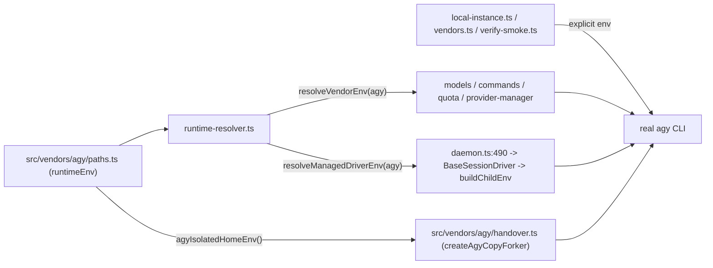
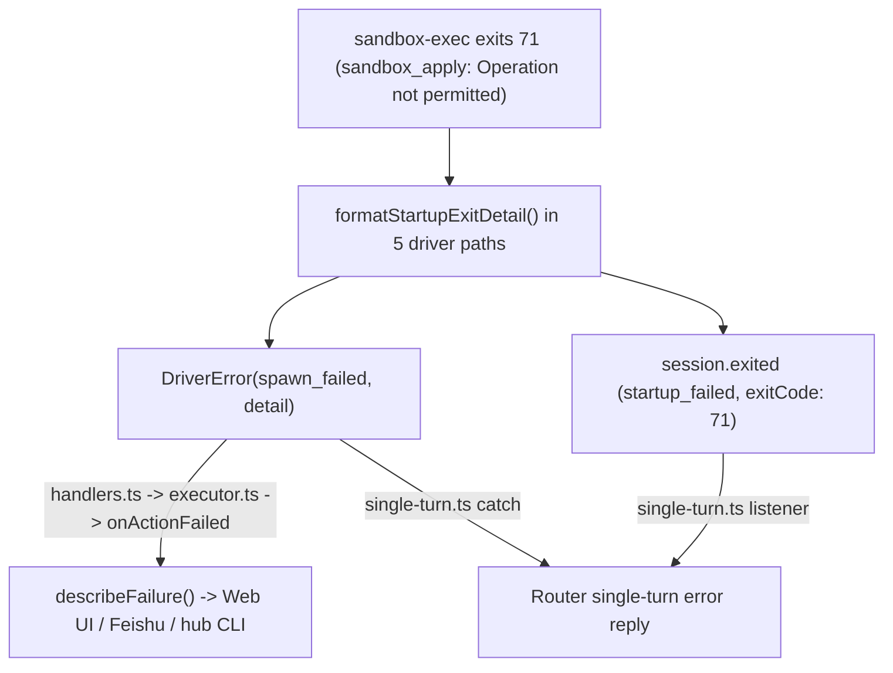

# Friction diagnostics, isolated-HOME agy keychain safety, CI script resilience, and event-driven tests

> Snapshot: 2026-11-28 (commit `59358e6e`)

## Plan review and decisions

### Files to review

- [docs/friction-and-stability-fixes-design.md](friction-and-stability-fixes-design.md): Verified root-cause analysis, approach comparisons, cross-vendor/cross-platform unification, bounds, and acceptance scenarios for all six items.
- [src/vendors/agy/limits.ts](../src/vendors/agy/limits.ts) and [src/vendors/agy/rules.ts](../src/vendors/agy/rules.ts): Bounded rule-budget inspection (`inspectAgyRuleBudget`) and actionable warning formatting listing offending filenames and byte sizes.
- [src/shared/errors.ts](../src/shared/errors.ts), [src/daemon/driver/base-driver.ts](../src/daemon/driver/base-driver.ts), [src/daemon/router/single-turn.ts](../src/daemon/router/single-turn.ts), [src/vendors/agy/driver-state.ts](../src/vendors/agy/driver-state.ts), [src/vendors/claude/driver-state.ts](../src/vendors/claude/driver-state.ts), [src/vendors/codex/driver-state.ts](../src/vendors/codex/driver-state.ts), [src/vendors/pi/driver-state.ts](../src/vendors/pi/driver-state.ts), and [src/vendors/_common/acp/driver.ts](../src/vendors/_common/acp/driver.ts): Unified macOS nested `sandbox-exec` exit code 71 detection and actionable failure messaging across all eight vendors and Router single-turn runs.
- [src/vendors/daemon-types.ts](../src/vendors/daemon-types.ts), [src/vendors/agy/paths.ts](../src/vendors/agy/paths.ts), [src/vendors/agy/handover.ts](../src/vendors/agy/handover.ts), [src/daemon/provider-manager/runtime-resolver.ts](../src/daemon/provider-manager/runtime-resolver.ts), [test/tester/local-instance.ts](../test/tester/local-instance.ts), [test/tester/vendors.ts](../test/tester/vendors.ts), and [scripts/verify-smoke.ts](../scripts/verify-smoke.ts): Safe macOS isolated-`HOME` protection via `AGY_CLI_FORCE_FILE_TOKEN_STORAGE=1` across driver sessions, model/command/quota/setup probes, copy-fork handovers, and test harnesses without touching the user's real Keychain.
- [scripts/gh-transient.ts](../scripts/gh-transient.ts), [scripts/wait-checks.ts](../scripts/wait-checks.ts), and [scripts/post-review-stamp.ts](../scripts/post-review-stamp.ts): Shared transient GitHub CLI error classifier (covering both `gh pr view` and `migration-claims` GraphQL `EOF`) and post-stamp `CLEAN` merge-state polling across all GitHub `MergeStateStatus` values.
- [test/append-log.ts](../test/append-log.ts), [src/vendors/pi/handover.ts](../src/vendors/pi/handover.ts), [src/vendors/pi/fork-turn.ts](../src/vendors/pi/fork-turn.ts), [src/vendors/_common/acp/driver.test.ts](../src/vendors/_common/acp/driver.test.ts), [src/daemon/router/target-port.test.ts](../src/daemon/router/target-port.test.ts), and [src/vendors/pi/composer-transcript-handover.test.ts](../src/vendors/pi/composer-transcript-handover.test.ts): Event-driven log watching, fake-timer timeout control, and deterministic process-exit synchronization for the three load-sensitive tests.
- Acceptance and regression test files: [src/vendors/agy/rules.test.ts](../src/vendors/agy/rules.test.ts), [src/shared/describe-failure.test.ts](../src/shared/describe-failure.test.ts), [src/daemon/driver/base-driver.test.ts](../src/daemon/driver/base-driver.test.ts), [src/daemon/router/single-turn.test.ts](../src/daemon/router/single-turn.test.ts), [src/vendors/agy/paths.test.ts](../src/vendors/agy/paths.test.ts), [src/vendors/agy/handover.test.ts](../src/vendors/agy/handover.test.ts), [src/daemon/provider-manager/runtime-resolver.test.ts](../src/daemon/provider-manager/runtime-resolver.test.ts), [test/tester/bench.test.ts](../test/tester/bench.test.ts), [test/tester/vendors.test.ts](../test/tester/vendors.test.ts), [scripts/wait-checks.test.ts](../scripts/wait-checks.test.ts), [scripts/post-review-stamp.test.ts](../scripts/post-review-stamp.test.ts), [test/append-log.test.ts](../test/append-log.test.ts), and the three stabilized test suites above.

### Project Manager plan review

- Every quoted user sentence in Section 1 maps to concrete acceptance scenarios in Section 8.
- All ten verification categories from `docs/plan-standard.md` are addressed in Section 8 (with explicit one-sentence explanations for categories that cannot apply).
- Section 3 compares genuinely structurally distinct architectures for the batch structure, macOS isolated-`HOME` Keychain safety, macOS nested `sandbox-exec` exit 71 handling, and CI script retry/wait coordination.

### Decisions needed

None. All six items are additive diagnostics, safe test-environment isolation, CI script resilience, and flaky-test stabilization; none alter user-visible workflows destructively, rebuild a foundation, or execute irreversible external actions. Routine design choices for PM confirmation:

1. Bundle all six verified items in one cohesive PR structured into four clean, independent module boundaries (agy rules & isolated-HOME runtime env, nested sandbox exit-71 diagnostics, GitHub CLI scripts, and event-driven test stabilization), because all six stem from the same verified developer-friction batch and touch mostly disjoint files with one shared test/review cycle.
2. Keep `seatbeltBackend.available()` returning `true` on macOS (avoiding breaking macOS unit tests that run inside Worker sandboxes) while diagnosing exit code 71 (`sandbox_apply: Operation not permitted`) uniformly at the driver startup, `single-turn`, and `describeFailure` boundaries.

---

## 1. User goal

Original user statements:

- "有产品反馈直接去核实然后做就行"
- "直接把这些都建起来开始跑就行"
- "走流程解决问题，之后我们的做什么都先走完整流程"

Intended outcome: Verify all six reported product-experience and test/CI stability issues on current `main`, deliver root-cause fixes through the full plan-skeleton-test-implement-review workflow, and eliminate opaque errors, macOS Keychain GUI popups in isolated `HOME` runs, premature CI script exits, and load-induced test timeouts.

---

## 2. Current state and history

All six issues were verified directly against `main` (`59358e6e`) on 2026-11-28. None have been fixed by recent PRs.

### Design history

1. **`agy` rule budget warning (`src/vendors/agy/rules.ts`)**: Originally added when Bellwood began injecting system prompts through `.agents/rules/fusa-NN.md` because `agy` 1.5.x has no system-prompt flag and silently truncates rule files over 24,000 bytes or drops rules past ~60,000 total bytes. The original check counted `total` and `oversized++` as a quick safeguard; it never captured which files caused the overflow.
2. **macOS nested `sandbox-exec` exit code 71**: Seatbelt sandboxes (`sandbox-exec`) are non-nestable in the macOS kernel (`sandbox_apply` returns `EPERM` and `sandbox-exec` exits with `EX_OSERR = 71`). PR #473 (`8b6b5b75`) added an early probe (`sandboxAllowsNestedSandbox()`) in `test/tester/local-instance.ts:276`, and every vendor disables its own built-in sandbox via `ownSandboxOffArgs`. However, when any daemon or Router session runs inside a macOS sandbox or launches a subprocess that invokes `sandbox-exec`, `seatbeltBackend.available()` (`src/daemon/driver/write-scope.ts:973`) unconditionally returns `true`, the child dies with exit 71 before init, `single-turn.ts:94` races `session.exited` ahead of `driver.start()` rejection to emit `"进程提前退出（startup_failed）"`, and `describeFailure()` (`src/shared/errors.ts:123`) collapses `spawn_failed` into generic `"<Vendor> 没能启动"`.
3. **macOS isolated `HOME` running real `agy`**: `test/tester/local-instance.ts:146`, `test/tester/vendors.ts:173`, `scripts/verify-smoke.ts:62`, and ad-hoc real-environment review runs isolate `HOME` to a temporary directory so vendor CLIs cannot mutate developer config. `agy` stores OAuth tokens using `zalando/go-keyring`, which shells out to `/usr/bin/security`. When `$HOME/Library/Keychains/login.keychain-db` is missing, macOS pops up a blocking GUI dialog ("找不到用于储存“antigravity”的钥匙串"). Ironically, `test/tester/vendors.ts:249` already expects `agy` credentials in the file store `$HOME/.gemini/antigravity-cli/antigravity-oauth-token`, because `agy` falls back to file storage on Linux or when forced, but nothing told `agy` to use file storage on macOS isolated `HOME`s.
4. **`scripts/wait-checks.ts` GraphQL `EOF`**: `classifyGhQueryError` (`scripts/wait-checks.ts:546`) retries `network|connect|timed? out|dns|resolve|enotfound|econnrefused|econnreset|tls|ssl|HTTP 5\d\d`, built around common Node/HTTP failure strings. Go's `net/http` client inside `gh` frequently reports dropped HTTP/2 or idle keep-alive connections to `https://api.github.com/graphql` as `Post "https://api.github.com/graphql": EOF` or `http2: client connection lost`, which misses the regex and exits 1 immediately.
5. **`scripts/post-review-stamp.ts` returning before `CLEAN`**: Added as a minimal commit-status poster (`POST repos/<owner>/<repo>/statuses/<sha>`). GitHub recomputes PR `mergeStateStatus` asynchronously after receiving a commit status, so an immediate `gh pr merge` right after `post-review-stamp.ts` exits often fails with a branch-protection rejection while `mergeStateStatus` is still `"BLOCKED"`.
6. **Three load-sensitive time-wait tests**:
   - `src/vendors/_common/acp/driver.test.ts:71-77, 750-766`: Uses a `realSleep(10)` 5-second polling loop (`waitForLog`) that ignores `session.exited`, runs two separate Node subprocesses inside one default-5s Vitest test, and races `startTimeoutMs: 1000` against Node + `@agentclientprotocol/sdk` cold import time.
   - `src/daemon/router/target-port.test.ts:395-396`: Configures real-timer `peerDigestTimeoutMs: 60` and `peerDispatchTimeoutMs: 80` on real loopback HTTP calls in the first test block, whereas the later `cold mesh link` block in the same file (`lines 485-563`) already switched to `vi.useFakeTimers` plus an event gate (`digestRequested`).
   - `src/vendors/pi/composer-transcript-handover.test.ts:54, 241`: Overrides `createPiComposer` timeout down from `COMMANDS_QUERY_TIMEOUT_MS` (15,000 ms) to `3_000` ms, polls `alive(failedPid)` with `vi.waitFor(..., { timeout: 3_000 })` instead of awaiting child exit, and waits a real `KILL_WAIT_MS` (2,000 ms) inside a default-5s Vitest test.

### Subsystem architecture (via `how`)

Before finalizing the design, each affected subsystem was traced end-to-end from entry points through data flow, ownership boundaries, and failure paths.

#### Overview

The six items sit across four distinct subsystem boundaries in Bellwood:
1. **Vendor runtime environment and `agy` launch pipeline**: Controls how `agy` discovers rules, builds child process environments, and stores OAuth tokens across session drivers, model/command/quota/setup probes, copy-fork handovers, and isolated test harnesses.
2. **Driver startup, Seatbelt sandboxing, and failure propagation**: Controls how OS sandboxes wrap vendor processes, how startup exits become `DriverError` or `session.exited` events, and how both the action executor (`handlers.ts` -> `executor.ts` -> `describeFailure`) and Router (`single-turn.ts`) surface errors to users.
3. **GitHub PR check and review-stamp CLI gates**: Controls how `scripts/wait-checks.ts`, `scripts/migration-claims.ts`, and `scripts/post-review-stamp.ts` wrap `execGh`, classify transient vs. permanent errors, and confirm mergeability before squash-merge.
4. **Test synchronization harnesses**: Controls how ACP driver tests, Router peer-timeout tests, and Pi transcript-handover tests synchronize with child processes, JSONL append logs, and timers.

#### Key concepts

- **Dual vendor env resolution (`resolveVendorEnv` vs. `resolveManagedDriverEnv`)**: `src/daemon/provider-manager/runtime-resolver.ts` exposes two separate env builders. `resolveVendorEnv(vendor)` returns the full process env (merged `PATH` + managed secrets) for short-lived probes (`models`, `commands`, `provider-manager`, `provider-quota`). `resolveManagedDriverEnv(vendor)` returns the overlay passed to `driver.options.env` in `src/daemon/daemon.ts:490`, which `BaseSessionDriver` merges into `buildChildEnv(process.env, launch.env, driverEnv)`.
- **Independent copy-fork spawner**: `src/vendors/agy/handover.ts` (`createAgyCopyForker`) spawns `agy` directly with `buildChildEnv(process.env, src.launch.env)`, bypassing `runtime-resolver.ts` because `src.launch.env` comes from `prepareLaunch` rather than `driver.options.env`.
- **Two failure paths on startup exit**: When a sandboxed child dies before emitting `init`, the driver emits `session.exited` (`reason: "startup_failed", exitCode`) and rejects `driver.start()` / `driver.send()` with `DriverError("spawn_failed", detail)`. Normal conversations retry `DriverError` through `actions/executor.ts` and format the final message with `describeFailure()`; Router's `single-turn.ts` subscribes to `session.exited` and settles before `driver.start()` rejects unless it inspects `startup_failed` exit context.
- **Two GraphQL call sites in `wait-checks.ts`**: `waitForChecks` queries PR status via `deps.queryPr` AND (once checks pass on open PRs targeting `main`) calls `deps.checkMigrationClaims` (`scripts/migration-claims.ts`), which catches `execGh` errors and returns `{ kind: "incomplete", reason }`.
- **GitHub `MergeStateStatus` enum**: GitHub GraphQL returns `CLEAN`, `HAS_HOOKS`, `DRAFT`, `BLOCKED`, `UNKNOWN`, `DIRTY`, `BEHIND`, or `UNSTABLE`. Only `BLOCKED` and `UNKNOWN` indicate waiting for status/mergeability recomputation; `CLEAN` and `HAS_HOOKS` are mergeable; `DIRTY`, `BEHIND`, and `UNSTABLE` are terminal non-mergeable states.

#### How it works





#### Where things live

- `agy` rules & warning: `src/vendors/agy/rules.ts` (`agyRuleBudgetWarning`), called by `src/vendors/agy/driver.ts` -> emitted as `driver.warning` (excluded from model prompt history by `src/daemon/ledger/vendor-switch-context.ts:63`).
- `agy` env & keychain safety: `src/vendors/agy/paths.ts` (registered via `src/vendors/paths-registry.ts`, which forbids importing `node:fs`), `src/daemon/provider-manager/runtime-resolver.ts`, `src/daemon/daemon.ts`, `src/vendors/agy/handover.ts`, `test/tester/local-instance.ts`, `test/tester/vendors.ts`, `scripts/verify-smoke.ts`.
- Nested macOS sandbox exit 71: `src/shared/errors.ts` (`describeFailure`), `src/daemon/driver/base-driver.ts` (`formatStartupExitDetail`), `src/vendors/{agy,claude,codex,pi}/driver-state.ts`, `src/vendors/_common/acp/driver.ts`, `src/daemon/router/single-turn.ts`.
- GitHub CLI gates: `scripts/gh-transient.ts`, `scripts/wait-checks.ts`, `scripts/migration-claims.ts`, `scripts/post-review-stamp.ts`, `src/daemon/git/gh.ts`.
- Flaky test harnesses: `test/append-log.ts`, `src/vendors/_common/acp/driver.test.ts`, `src/daemon/router/target-port.test.ts`, `src/vendors/pi/handover.ts`, `src/vendors/pi/fork-turn.ts`, `src/vendors/pi/composer-transcript-handover.test.ts`.

#### Gotchas

1. **Missing `resolveManagedDriverEnv` silently breaks driver sessions**: Wiring `VendorPathsModule.runtimeEnv` only into `resolveVendorEnv` protects `models`/`commands`/`quota` probes while leaving actual `agy` driver sessions (`daemon.ts:490`) unprotected against macOS Keychain popups. Both `resolveVendorEnv` AND `resolveManagedDriverEnv` must apply `runtimeEnv`, and `createAgyCopyForker` (`src/vendors/agy/handover.ts:201`) must merge `agyIsolatedHomeEnv` because it does not go through `runtime-resolver.ts`.
2. **`paths-registry.ts` cannot import `node:fs`**: Test `setupFiles` load `src/vendors/paths-registry.ts` before Vitest mocks `node:fs`. Therefore `src/vendors/agy/paths.ts` must accept an `exists` callback via `VendorRuntimeEnvInput` rather than importing `node:fs`.
3. **`wait-checks.ts` `transientErrors = 0` reset trap**: Line 627 resets `transientErrors = 0` right after `deps.queryPr` succeeds. If `deps.checkMigrationClaims` subsequently returns `{ kind: "incomplete", reason: "... EOF" }`, retrying without keeping `transientErrors` intact across the `checkMigrationClaims` failure would create an infinite loop; `transientErrors` must only reset after both `queryPr` and `checkMigrationClaims` pass without a transient error.
4. **Full GitHub `MergeStateStatus` handling**: `HAS_HOOKS` is a valid mergeable state (required checks passed, repo has pre-receive hooks) and must return `ok: true`; `UNSTABLE` means a non-required check failed or branch protection marked the PR unstable and must fail fast (`reason: "unstable"`) rather than waiting out the 30s timeout.
5. **Preserving `driver.test.ts:2472` warning substring**: Existing tests assert `driver.warning` includes `"1 个文件超过"`. The improved filename-aware warning must keep that summary phrase while appending the sorted filenames and UTF-8 byte counts.
6. **Action retries on `DriverError("spawn_failed")`**: `src/daemon/handlers.ts:187` rethrows `DriverError("spawn_failed")` to `src/daemon/actions/executor.ts:171`, which retries up to `retry[row.type].maxAttempts` before invoking `onActionFailed` -> `describeFailure()`. Keeping `DriverError("spawn_failed")` retry semantics unchanged avoids unexpected regressions in transient spawn-error recovery while ensuring the surfaced failure message is always `MACOS_NESTED_SANDBOX_MESSAGE`.

### Core concepts

| State / Concept | Write authority | Duplicated facts | Missing concept |
| --- | --- | --- | --- |
| `agy` rule budget | `src/vendors/agy/rules.ts` | None | Structured per-file budget report (`AgyRuleBudgetReport`) listing oversized and top contributing files |
| macOS nested `sandbox-exec` failure | Driver close/startup + `src/shared/errors.ts` | Each of 5 driver startup formatters and `single-turn.ts` format exit failures separately | Shared nested-sandbox exit detector & actionable message (`formatStartupExitDetail` + `isNestedMacOsSandboxError`) |
| `agy` macOS token storage in isolated `HOME` | `src/vendors/agy/paths.ts` (`runtimeEnv`) + `runtime-resolver.ts` (`resolveVendorEnv` & `resolveManagedDriverEnv`) + `src/vendors/agy/handover.ts` + bench env | `test/tester/vendors.ts` checked file-store path while `local-instance.ts`, `runtime-resolver.ts`, and `handover.ts` omitted `AGY_CLI_FORCE_FILE_TOKEN_STORAGE` | Vendor-declared `runtimeEnv` hook in `VendorPathsModule` applied to both probe and driver env paths |
| Transient `gh` network errors | `scripts/gh-transient.ts` | `wait-checks.ts` owned its own regex and did not retry transient `migration-claims` errors; `post-review-stamp.ts` had no retry | Shared `isTransientGhError` classifier covering Go `net/http` `EOF` / HTTP/2 resets across `queryPr`, `checkMigrationClaims`, and `waitForPrCleanState` |
| Post-stamp mergeability readiness | `scripts/post-review-stamp.ts` | None | Bounded `waitForPrCleanState` poll after posting `success` stamp |
| Test synchronization on logs/timeouts/exits | `test/append-log.ts` + individual tests | Inline `realSleep` loops and hard-coded millisecond timeouts | Event-driven `waitForJsonLogEvent` + injectable `killWaitMs` + fake-timer timeout tests |

### Verified evidence

- `[Measured]` `src/vendors/agy/rules.ts:100-126`: Inspected source directly; `agyRuleBudgetWarning` tracks only `total` and numeric `oversized`, emitting `1 个文件超过单文件 24000 字节` with no filenames or per-file byte sizes.
- `[Measured]` Nested `sandbox-exec` behavior on this macOS Worker sandbox: Ran `/usr/bin/sandbox-exec -p '(version 1)(allow default)' /usr/bin/true`; exited with code `71` and stderr `sandbox-exec: sandbox_apply: Operation not permitted`.
- `[Measured]` `src/daemon/router/single-turn.ts:94`, `src/shared/errors.ts:116-128`, `src/daemon/driver/write-scope.ts:972-973`, `src/vendors/{agy,claude,codex,pi}/driver-state.ts`, and `src/vendors/_common/acp/driver.ts:376-380`: Inspected source; `single-turn.ts:94` settles on `session.exited` with ``进程提前退出（${event.reason}）`` before `driver.start()` rejects, and `describeFailure` collapses `spawn_failed` with exit 71 into generic `${name} 没能启动`.
- `[Measured]` `agy 1.5.18` binary inspection (`/Users/yuxin.zhangnewsbreak.com/.local/bin/agy`) and live isolated-`HOME` execution:
  - Binary links `/System/Library/Frameworks/Security.framework/Versions/A/Security`, embeds `google3/third_party/golang/github_com/zalando/go_keyring/v/v0/keyring` calling `/usr/bin/security` (`find-generic-password`, `add-generic-password`), and checks env var `AGY_CLI_FORCE_FILE_TOKEN_STORAGE`.
  - Ran real `agy --log-file <tmp>/agy.log --output-format json models`, `agy -p hi`, `agy mcp list`, and `agy acp` (with `initialize`) in a fresh temp `HOME` (no `Library/Keychains/`) with `AGY_CLI_FORCE_FILE_TOKEN_STORAGE=1`:
    - `agy.log` explicitly logged: `composite_token_storage.go:207] Using file-based token storage because AGY_CLI_FORCE_FILE_TOKEN_STORAGE is set`.
    - `models` exited `1` in `1.22s` cleanly reporting `Please sign in to view available models`; `mcp list` exited `0` in `0.08s`; `acp` replied to `initialize` and exited `0` in `0.08s`; `-p hi` started in `53ms` and printed the OAuth login URL cleanly. Zero Keychain GUI popups occurred, and no real user Keychain files were accessed.
- `[Measured]` `scripts/wait-checks.ts:546`: Regex `/network|connect|timed? out|dns|resolve|enotfound|econnrefused|econnreset|tls|ssl|HTTP 5\d\d/iu` does not match `Post "https://api.github.com/graphql": EOF`.
- `[Measured]` `scripts/post-review-stamp.ts:185-211`: Returns `0` immediately after `POST repos/.../statuses/<sha>` with no `gh pr view` poll for `mergeStateStatus === "CLEAN"`.
- `[Measured]` `src/vendors/_common/acp/driver.test.ts:71-77, 750-766`, `src/daemon/router/target-port.test.ts:395-396`, and `src/vendors/pi/composer-transcript-handover.test.ts:54, 241`: Inspected source and confirmed `KILL_WAIT_MS = 2_000` (`src/shared/limits.ts:169`) and `COMMANDS_QUERY_TIMEOUT_MS = 15_000` (`src/shared/limits.ts:182`).

---

## 3. Reference designs and approach comparison

### Reference designs

1. **File-backed credential fallback for headless/isolated CLI sessions**:
   - **GitHub CLI (`gh`)** ([cli/cli auth storage](https://github.com/cli/cli/blob/trunk/internal/keyring/keyring.go)) and **99designs/keyring** ([99designs/keyring](https://github.com/99designs/keyring)) expose explicit backend selectors (env vars / file backend) so CI runners and isolated test homes bypass macOS Keychain prompts instead of mutating `login.keychain-db`.
   - **Antigravity CLI (`agy`)** itself implements `composite_token_storage.go` with `AGY_CLI_FORCE_FILE_TOKEN_STORAGE` to select `$HOME/.gemini/antigravity-cli/antigravity-oauth-token` directly.
2. **Transient Go `net/http` GraphQL retries & mergeability polling**:
   - **Octokit (`@octokit/plugin-retry`)** ([octokit/plugin-retry.js](https://github.com/octokit/plugin-retry.js)) and **Mergify / Bors-NG** treat `EOF` / `ECONNRESET` / HTTP/2 `GOAWAY` as transient transport drops while keeping 4xx responses fatal, and poll GitHub's `mergeStateStatus` after status updates because GitHub computes mergeability asynchronously.
3. **Event-driven test waits**:
   - **Vitest** ([Vitest Fake Timers](https://vitest.dev/guide/mocking/timers.html)) and **Node `fs.watch` + `AbortSignal`** wait on deterministic state transitions and virtual clock advances rather than racing real OS scheduling against 60–80 ms wall-clock budgets.

### Candidate comparisons

#### A. macOS isolated `HOME` Keychain popup prevention (Item 3)

| Dimension | Candidate 1: Temporary macOS Keychain DB via `security create-keychain` | Candidate 2: Harness-only env injection (`test/tester` & `verify-smoke` only) | Candidate 3 (Recommended — Day-one design): Vendor `runtimeEnv` boundary + explicit bench env |
| --- | --- | --- | --- |
| Structure | Run `security create-keychain` / `unlock-keychain` in temp `HOME/Library/Keychains/login.keychain-db` | Hard-code `AGY_CLI_FORCE_FILE_TOKEN_STORAGE=1` only in `local-instance.ts`, `vendors.ts`, `verify-smoke.ts` | Add `VendorPathsModule.runtimeEnv` in `src/vendors/agy/paths.ts` (sets `AGY_CLI_FORCE_FILE_TOKEN_STORAGE=1` on `darwin` when `HOME` lacks `Library/Keychains/login.keychain-db`), wired into both `resolveVendorEnv` and `resolveManagedDriverEnv` in `runtime-resolver.ts` plus `createAgyCopyForker` (`src/vendors/agy/handover.ts`) and explicit env in test bench & `loginFix` |
| Touches real Keychain / `securityd`? | Risky: `security`/`cfprefsd` are per-UID daemons and can pollute user keychain search list | Never | Never |
| Protects ad-hoc isolated-`HOME` review daemons? | Only if every reviewer script runs keychain setup | No — every new script re-hits the popup | Yes — daemon protects every `agy` invocation automatically |
| Real user `HOME` impact | N/A | None | Zero — real `HOME` has `Library/Keychains/login.keychain-db`, so normal Keychain login is untouched |
| Aligns with `benchHoldsCredential` (`vendors.ts:249`)? | No (stores in `.keychain-db`, not JSON file) | Yes | Yes — `antigravity-oauth-token` file matches `vendors.ts:249` and `catalogWatchPaths` |

#### B. macOS nested `sandbox-exec` exit 71 diagnostics (Item 2)

| Dimension | Candidate 1: Make `seatbeltBackend.available()` probe nested `sandbox-exec` | Candidate 2 (Recommended): Unified exit-71 classifier at driver startup, `single-turn`, and `describeFailure` |
| --- | --- | --- |
| Structure | `osSandboxAvailable("darwin")` executes `sandbox-exec` probe and returns `false` inside a sandbox | Keep `seatbeltBackend.available()` returning `true`; add shared `isNestedMacOsSandboxError` (`src/shared/errors.ts`) + `formatStartupExitDetail` (`src/daemon/driver/base-driver.ts`) used by all 5 driver paths + fix `single-turn.ts` `startup_failed` race |
| Compatibility with macOS Worker unit tests | Breaks dozens of unit tests (`write-scope.test.ts`, `workers.test.ts`) that run inside Worker sandboxes and rely on `osSandboxAvailable() === true` without spawning `sandbox-exec` | 100% compatible with existing unit tests |
| Covers inner vendor/child `sandbox-exec` exit 71 too? | No — only blocks outer wrap | Yes — catches both outer and inner `sandbox-exec` exit 71 (`sandbox_apply: Operation not permitted`) across all 8 vendors |
| Actionable message for users & Router | Shows generic `sandbox_unavailable` (Linux/Windows hint) | Shows explicit macOS nested-sandbox cause and actionable fix (run from host terminal outside sandbox or disable inner sandbox) |

#### C. Batch organization across all 6 items

| Dimension | Candidate 1: Six separate PRs | Candidate 2 (Recommended): One high-cohesion PR partitioned into four independent module groups |
| --- | --- | --- |
| Review & CI overhead | 6x full CI runs + 6x independent review rounds for small, closely related fixes | Single review & CI cycle with crisp per-item skeleton contracts and isolated test files |
| Blast radius | Low per PR, high coordination lag | Low — the 4 groups (agy rules/env, exit-71 diagnostics, `scripts/` GitHub tools, 3 test files) have minimal overlapping files |

### Design red-flag screening

Screened against `.agents/skills/architect/references/design-red-flags.md`:

- **Shallow module**: Avoided. `inspectAgyRuleBudget` encapsulates rule discovery, deduplication, frontmatter parsing, and byte measurement; `agyIsolatedHomeEnv` encapsulates platform + keychain-presence + caller-override policy; `waitForPrCleanState` encapsulates polling, transient retry, and terminal state classification behind one call.
- **Information leakage**: Avoided. `AGY_CLI_FORCE_FILE_TOKEN_STORAGE` lives in one exported constant in `src/vendors/agy/paths.ts`; `scripts/gh-transient.ts` owns transient `gh` error patterns instead of duplicating regexes across scripts.
- **Split ownership / Hand-synced list**: Avoided. `VendorPathsModule.runtimeEnv` lets `runtime-resolver.ts` apply vendor runtime env uniformly for drivers, model catalogs, quota probes, and setup adapters from one registry.
- **Two ways to do one task**: Avoided. Inline `waitForLog` sleep loops are replaced by `waitForJsonLogEvent` in `test/append-log.ts`; `wait-checks.ts` and `post-review-stamp.ts` share `isTransientGhError`.
- **Importable internals**: Avoided. `src/vendors/agy/paths.ts` remains `node:fs`-free (taking `exists` as a parameter) to preserve `src/vendors/paths-registry.ts`'s mock-safety invariant.

### Patch rationale

Items 1, 3, 4, 5, and 6 are full root-cause fixes. For Item 2, we intentionally keep `seatbeltBackend.available()` returning `true` on macOS rather than probing live `sandbox-exec` inside `osSandboxAvailable("darwin")`, because changing `osSandboxAvailable("darwin")` to return `false` inside a macOS Worker sandbox would require rewriting the sandbox mock plumbing across ~15 daemon/ledger test suites (an order-of-magnitude larger change) while still failing to diagnose inner-process `sandbox-exec` exit 71 errors. Fixing the startup-exit and failure-classification boundaries directly resolves the user-visible defect for all eight vendors and Router.

---

## 4. Performance and bounds

All four rules in `AGENTS.md` ("Caches and state bounds") are satisfied:

1. **Invalidation**: `agyRuleBudgetWarning` reads current files on every launch (no stale cache); `agyIsolatedHomeEnv` checks `exists(login.keychain-db)` dynamically on `resolveVendorEnv` with no stale cache; `waitForPrCleanState` fetches fresh PR snapshots per poll.
2. **Upper bounds**: Every new output list and poll loop is explicitly bounded:

| Constant | Location | Value | Sizing rationale |
| --- | --- | --- | --- |
| `AGY_RULE_WARNING_MAX_FILES` | `src/vendors/agy/limits.ts` | `10` | Caps listed filenames in `agyRuleBudgetWarning` even if a workspace has hundreds of `.agents/rules/*.md` files, keeping the UI notice concise under 2 KB. |
| `DEFAULT_CLEAN_WAIT_SECONDS` | `scripts/post-review-stamp.ts` | `30` | Upper bound for GitHub branch-protection recomputation after posting `bellwood/review`; prevents indefinite hangs. |
| `DEFAULT_CLEAN_POLL_INTERVAL_MS` | `scripts/post-review-stamp.ts` | `2_000` | At most 15 `gh pr view` polls over 30s, staying well inside GitHub GraphQL rate limits. |
| `MAX_TRANSIENT_CLEAN_POLL_ERRORS` | `scripts/post-review-stamp.ts` | `5` | Matches `MAX_TRANSIENT_QUERY_ERRORS` in `scripts/wait-checks.ts`; caps retries on consecutive transient `EOF`/5xx errors. |

3. **Stable front-end references**: No React selectors, hooks, or client stores are modified.
4. **Measured verification**: No hot-path regression; `agyIsolatedHomeEnv` performs at most one `existsSync` stat on macOS when `AGY_CLI_FORCE_FILE_TOKEN_STORAGE` is unset.

---

## 5. Cross-vendor and cross-platform unification

- **All eight registered vendors (`claude`, `codex`, `agy`, `pi`, `cursor`, `deepseek`, `opencode`, `kimi`)**:
  - **Exit 71 nested-sandbox diagnostics**: Unified in `src/shared/errors.ts` (`isNestedMacOsSandboxError`, `describeFailure`) and `src/daemon/driver/base-driver.ts` (`formatStartupExitDetail`), called by all five driver startup paths (`claude`, `codex`, `agy`, `pi`, and `_common/acp` serving `cursor`, `deepseek`, `opencode`, `kimi`) plus `src/daemon/router/single-turn.ts`. Any future vendor using `BaseSessionDriver` or `createAcpDriver` gets nested-sandbox diagnostics automatically with zero vendor-specific code.
  - **Isolated-`HOME` runtime environment**: Unified via optional `VendorPathsModule.runtimeEnv` in `src/vendors/daemon-types.ts`, invoked by `createVendorRuntimeResolver` (`src/daemon/provider-manager/runtime-resolver.ts`) in both `resolveVendorEnv` (probes/catalog/commands/quota) and `resolveManagedDriverEnv` (session drivers), with `createAgyCopyForker` (`src/vendors/agy/handover.ts`) invoking `agyIsolatedHomeEnv` directly. A future vendor that needs platform-specific isolated-`HOME` env vars implements only its single `src/vendors/<vendor>/paths.ts` file.
  - **`agy` rule budget warning**: Specific to `agy` (the only vendor injecting prompts through `.agents/rules/*.md` with 24 KB/60 KB limits); kept in `src/vendors/agy/rules.ts` so both the current stream-json driver and any future `agy acp` driver call the same `agyRuleBudgetWarning` / `inspectAgyRuleBudget` functions.
- **All three platforms (`darwin`, `win32`, `linux`)**:
  - `agyIsolatedHomeEnv` activates exclusively on `platform === "darwin"` and returns `{}` on `linux` and `win32`.
  - `isNestedMacOsSandboxError` matches explicit macOS `sandbox_apply` / `sandbox-exec` signatures, never false-firing on Linux `bwrap` or Windows `fusa-run.exe`.
  - `scripts/gh-transient.ts`, `scripts/wait-checks.ts`, `scripts/post-review-stamp.ts`, and `test/append-log.ts` use Node standard APIs that behave identically on macOS, Windows, and Linux.

---

## 6. Deletions

In the implementation step (same PR):

1. Remove the numeric-only warning branch in `src/vendors/agy/rules.ts:125` that hid offending filenames.
2. Remove the inline `waitForLog` `realSleep(10)` polling helper in `src/vendors/_common/acp/driver.test.ts:71-77`, replacing it with `waitForJsonLogEvent` from `test/append-log.ts`.
3. Remove the fragile real-timer `peerDigestTimeoutMs: 60` / `peerDispatchTimeoutMs: 80` timeout race in `src/daemon/router/target-port.test.ts:395-396`, moving timeout verification to fake timers + event gate.
4. Remove the artificial `timeoutMs: 3_000` override and `vi.waitFor(..., { timeout: 3_000 })` polling in `src/vendors/pi/composer-transcript-handover.test.ts:54, 241`.
5. Remove the inline transient-error regex in `scripts/wait-checks.ts:546`, replacing it with `isTransientGhError` from `scripts/gh-transient.ts`.

---

## 7. Skeleton files

- `docs/friction-and-stability-fixes-design.md`: Full design document and verification plan.
- `docs/README.md`: Indexes `friction-and-stability-fixes-design.md`.
- `src/vendors/agy/limits.ts`: Adds `AGY_RULE_WARNING_MAX_FILES` constant capping listed rule filenames.
- `src/vendors/agy/rules.ts`: Exports `AgyRuleFileInfo`, `AgyRuleBudgetReport`, and skeleton `inspectAgyRuleBudget` alongside `agyRuleBudgetWarning`.
- `src/shared/errors.ts`: Exports `MACOS_NESTED_SANDBOX_MESSAGE` and skeleton `isNestedMacOsSandboxError`.
- `src/daemon/driver/base-driver.ts`: Exports skeleton `formatStartupExitDetail` for unified driver startup exit diagnostics.
- `src/vendors/daemon-types.ts`: Adds optional `runtimeEnv` hook to `VendorPathsModule`.
- `src/vendors/agy/paths.ts`: Exports `AGY_FORCE_FILE_TOKEN_STORAGE_ENV`, `AGY_MACOS_LOGIN_KEYCHAIN_REL`, skeleton `agyIsolatedHomeEnv`, and `runtimeEnv`.
- `src/vendors/agy/handover.ts`: Adds optional `platform?: string` to `AgyCopyOptions` so copy-fork `write()` can merge `agyIsolatedHomeEnv` deterministically across platforms.
- `scripts/gh-transient.ts`: Exports skeleton `isTransientGhError` shared by `wait-checks.ts` and `post-review-stamp.ts`.
- `scripts/post-review-stamp.ts`: Exports `CleanWaitResult` (covering `CLEAN`, `HAS_HOOKS`, `DRAFT`, `MERGED`, `BLOCKED`, `UNKNOWN`, `DIRTY`, `BEHIND`, `UNSTABLE`, `CLOSED`, `moved_head`), `DEFAULT_CLEAN_WAIT_SECONDS`, `DEFAULT_CLEAN_POLL_INTERVAL_MS`, `MAX_TRANSIENT_CLEAN_POLL_ERRORS`, extends `PostStampArgs`/`PostStampDeps`, and exports skeleton `waitForPrCleanState`.
- `test/append-log.ts`: Exports `WaitForJsonLogOptions` and skeleton `waitForJsonLogEvent`.
- `src/vendors/pi/handover.ts` and `src/vendors/pi/fork-turn.ts`: Adds optional `killWaitMs?: number` to `PiForkerOptions` and `runPiForkTurn`.
- Acceptance & regression test files: `src/vendors/agy/rules.test.ts`, `src/shared/describe-failure.test.ts`, `src/daemon/driver/base-driver.test.ts`, `src/daemon/router/single-turn.test.ts`, `src/vendors/agy/paths.test.ts`, `src/vendors/agy/handover.test.ts`, `src/daemon/provider-manager/runtime-resolver.test.ts`, `test/tester/bench.test.ts`, `test/tester/vendors.test.ts`, `scripts/wait-checks.test.ts`, `scripts/post-review-stamp.test.ts`, `test/append-log.test.ts`, `src/vendors/_common/acp/driver.test.ts`, `src/daemon/router/target-port.test.ts`, `src/vendors/pi/composer-transcript-handover.test.ts`.

---

## 8. Verification plan

### Acceptance scenarios

Every quoted user sentence maps to scenarios below:
- "有产品反馈直接去核实然后做就行" -> Scenarios S1, S2, S3, S4, S5, S6.
- "直接把这些都建起来开始跑就行" -> Scenarios S3, S4, S5, S6.
- "走流程解决问题，之后我们的做什么都先走完整流程" -> Scenarios S1–S8 (full pre-implementation baseline, post-implementation tests, and real-environment verification).

#### Core functional scenarios

- **S1 (`agy` rule budget warning names offending files — Item 1)**:
  - *First*: A workspace has `AGENTS.md` (24,001 bytes) and `.agents/rules/huge.md` (25,000 bytes, `trigger: always_on`), or several normal files totaling > 60,000 bytes.
  - *Next*: `agy` starts a session and runs `agyRuleBudgetWarning(home, workspaces)`.
  - *User sees*: The warning lists the specific oversized filenames and their exact UTF-8 byte counts sorted largest-first (and top contributing files when total > 60,000 bytes with zero single-file overflow), capped at `AGY_RULE_WARNING_MAX_FILES` with an overflow summary count.
- **S2 (macOS nested `sandbox-exec` exit code 71 — Item 2)**:
  - *First*: A daemon or Router session runs inside an outer macOS Seatbelt sandbox and spawns a Worker or inner sandboxed command that exits with code `71` and stderr `sandbox-exec: sandbox_apply: Operation not permitted`.
  - *Next*: The driver closes before init and emits `session.exited` (`reason: "startup_failed", exitCode: 71`) while `driver.start()`/`send()` rejects with `DriverError("spawn_failed", ...)`.
  - *User sees*: Both the Worker/conversation failure message (`describeFailure`) and Router single-turn result report the actionable macOS nested-sandbox explanation (`MACOS_NESTED_SANDBOX_MESSAGE`), never bare `"进程提前退出（startup_failed）"` or generic `"<Vendor> 没能启动"`.
- **S3 (macOS isolated `HOME` runs real `agy` without Keychain popup — Item 3)**:
  - *First*: A Bellwood daemon, copy-fork handover, or test bench starts on macOS with an isolated temporary `HOME` that contains no `Library/Keychains/login.keychain-db`.
  - *Next*: `vendorRuntime.resolveVendorEnv("agy")`, `vendorRuntime.resolveManagedDriverEnv("agy")`, `createAgyCopyForker().write()`, `localDaemonEnv`, `verify-smoke`, or `loginFix` prepares the environment and runs real `agy --output-format json models`, `agy acp`, or `agy -p`.
  - *User sees*: `AGY_CLI_FORCE_FILE_TOKEN_STORAGE=1` is injected automatically across every path; `agy` uses file-based token storage in `$HOME/.gemini/antigravity-cli/antigravity-oauth-token`, completes without triggering any macOS Keychain GUI popup, and never touches the user's real Keychain. On a normal macOS `HOME` that has `Library/Keychains/login.keychain-db`, `resolveVendorEnv("agy")`, `resolveManagedDriverEnv("agy")`, and `createAgyCopyForker` leave the variable unset so existing Keychain logins continue working unchanged.
- **S4 (`scripts/wait-checks.ts` retries GraphQL `EOF` — Item 4)**:
  - *First*: `node scripts/wait-checks.ts <PR>` polls a PR while CI checks are running or while verifying migration claims.
  - *Next*: Either `gh pr view` returns exit 1 with stderr `Post "https://api.github.com/graphql": EOF` (or `unexpected EOF`, `http2: client connection lost`, `broken pipe`, `i/o timeout`) twice before succeeding, OR `checkMigrationClaims` returns `{ kind: "incomplete", reason: 'gh api failed: Post "https://api.github.com/graphql": EOF' }` before succeeding.
  - *User sees*: `wait-checks.ts` logs transient retry notices and retries up to `MAX_TRANSIENT_QUERY_ERRORS` (5) across both `queryPr` and `checkMigrationClaims` (exiting `1` once consecutive transient errors reach the cap, never looping forever), exiting `0` once checks finish green, while still failing immediately with exit `1` on permanent 401/403/404/GraphQL-schema errors.
- **S5 (`scripts/post-review-stamp.ts` waits for `CLEAN` — Item 5)**:
  - *First*: Independent review passes on PR head `<SHA>` and `node scripts/post-review-stamp.ts <PR> --sha <SHA>` posts `bellwood/review` `success`.
  - *Next*: GitHub initially reports `mergeStateStatus: "BLOCKED"` (and optionally a transient GraphQL `EOF` on one poll) before recomputing `mergeStateStatus: "CLEAN"` (or `"HAS_HOOKS"`).
  - *User sees*: `post-review-stamp.ts` waits until `mergeStateStatus` becomes `"CLEAN"` (or `"HAS_HOOKS"`) and then exits `0` with `{ posted: true, mergeStateStatus: "CLEAN", ... }`. If the PR is `DIRTY`, `BEHIND`, `UNSTABLE`, `CLOSED`, or its head moved, it fails fast with exit `1`; if `DRAFT` or `MERGED`, it exits `0` without hanging; `--no-wait` and `--state failure` skip the `CLEAN` wait; timeout exits `1` while clearly reporting `posted: true`.
- **S6 (Three load-sensitive tests wait on events — Item 6)**:
  - *First*: Under CPU contention, Vitest runs `src/vendors/_common/acp/driver.test.ts`, `src/daemon/router/target-port.test.ts`, and `src/vendors/pi/composer-transcript-handover.test.ts`.
  - *Next*: Each test synchronizes via `waitForJsonLogEvent` (event-driven `fs.watch` + early-exit abort), fake timers + request-received gate, or child `"exit"` event + short `killWaitMs`.
  - *User sees*: Zero timeouts or polling races even under heavy load; if a child process dies early during `waitForJsonLogEvent`, the waiter fails immediately instead of burning 5 seconds.

#### Required plan-standard categories

1. **Two consecutive turns in the same conversation**:
   - *S7*: In an `agy` session, turn 1 runs with an oversized `AGENTS.md` (emitting the filename-specific warning); before turn 2 (after idle respawn), the user trims `AGENTS.md` below 24,000 bytes; turn 2 re-evaluates fresh files and emits no warning.
2. **A restart in the middle of the operation**:
   - *S8*: In `scripts/wait-checks.ts`, consecutive transient GraphQL `EOF` errors followed by a fresh successful poll reset the transient error counter (`transientErrors = 0`), matching recovery after a dropped connection mid-wait; in `scripts/post-review-stamp.ts`, if a first run times out after `posted: true` while GitHub is still recomputing, re-running `post-review-stamp.ts` on the same `<SHA>` is idempotent and returns `0` once `CLEAN`.
3. **A state or configuration change while work or a notice waits in a queue**:
   - *S9*: While `post-review-stamp.ts` is polling for `CLEAN` after posting `bellwood/review`, a new commit is pushed (moving `headRefOid`) or the PR becomes `BEHIND`/`DIRTY`; the poller detects the state change on the next poll and exits `1` immediately instead of waiting out the full timeout.
4. **Existing rules or boundaries (`REVIEW.md` from `main`)**:
   - `Read-only Workers never reach a write-capable MCP tool` (`src/vendors/_common/acp/**`): Only startup error formatting in `src/vendors/_common/acp/driver.ts` is touched; permission gating (`decideAcpPermission`) and readonly sandbox inputs are untouched and verified by existing `driver.test.ts` cases.
   - `Child processes are tracked and gone before cleanup` (`src/daemon/driver/**`, `src/daemon/provider-manager/**`): No new unmanaged child processes are spawned; `pi` handover test awaits real child `"exit"` events before temp-dir cleanup.
   - `Detached child processes and temp dirs stay inside the session boundary` (`src/daemon/driver/**`, `scripts/**`): No changes to session tags, temp-dir ownership, or cleanup scopes.
   - `Tests wait for events, not for time` (`**/*.test.ts`, `test/**`): Directly enforced and improved by Item 6; all new tests use injected clocks/fake timers or event waits, never fixed `setTimeout` sleeps.
   - `Hub error codes change on both sides` (`src/shared/errors.ts`): No new `API_ERRORS` or `LOCAL_ERRORS` code is added; `describeFailure` keeps the existing `FailureKind` union (`kind: "start"`).
   - `A result is matched to its request by an id both carry` (`src/daemon/**`): `single-turn.ts` continues matching events by `sessionId` and preserves `start()`/`send()` rejection correlation without wall-clock inference.
   - `Planned acceptance scenarios cover every requirement and pass real tests` (`**`): Satisfied by this document, pre-implementation failing baseline, post-implementation passing tests, and real-environment verification.
   - Note on `Paths that require a review stamp`: This PR touches `src/vendors/_common/acp/driver.ts`, `scripts/wait-checks.ts`, and `scripts/post-review-stamp.ts`, so it requires a `bellwood/review` `success` stamp before merge.
5. **Reopening a closed view after cached data becomes stale**:
   - Not applicable to web query caches because no web React Query cache, view, or selector is modified; `agyRuleBudgetWarning` and `agyIsolatedHomeEnv` perform direct filesystem reads with no in-memory cache.
6. **Large data volume sized for one month of continuous use (300 finished Workers, 30,000 messages, 50,000 step logs)**:
   - *S10*: `agyRuleBudgetWarning` is tested with 50 oversized `.agents/rules/*.md` files; it completes cleanly and caps output to `AGY_RULE_WARNING_MAX_FILES` (10) filenames plus an overflow count so neither the warning string nor ledger message rows grow unboundedly. Ledger tables and snapshot payloads are otherwise unchanged.
7. **Malformed or dirty data**:
   - *S11*: Broken symlinks and non-`always_on` or malformed frontmatter in `agyRuleBudgetWarning`; unrelated exit code `71` without `sandbox_apply`/`sandbox-exec` stderr does NOT falsely trigger `MACOS_NESTED_SANDBOX_MESSAGE`; explicit caller `AGY_CLI_FORCE_FILE_TOKEN_STORAGE="0"` is respected by `agyIsolatedHomeEnv`; malformed JSON from `gh pr view` during `waitForPrCleanState` fails cleanly without crashing; truncated JSONL line without trailing newline in `waitForJsonLogEvent` is ignored until complete.
8. **Cross-vendor coverage and prompt-cache preservation**:
   - *S12*: All 8 vendors (`claude`, `codex`, `agy`, `pi`, `cursor`, `deepseek`, `opencode`, `kimi`) inherit nested-sandbox exit-71 diagnostics through `describeFailure` and `formatStartupExitDetail`; `VendorPathsModule.runtimeEnv` is queried for all 8 vendors in `runtime-resolver.ts` and injects `AGY_CLI_FORCE_FILE_TOKEN_STORAGE=1` only for `agy` on macOS isolated `HOME`s.
   - **Prompt-cache impact**: None. Zero changes touch system prompts, tool/MCP lists, or message ordering/prepending (`agyRuleBudgetWarning` is emitted as a `driver.warning` UI/system notice, never sent to the model). Therefore no `TokenUsage.cacheRead` prompt-cache regression is possible.
9. **Cross-platform coverage (macOS, Windows, Linux)**:
   - *S13*: `agyIsolatedHomeEnv` is tested across `darwin`, `linux`, and `win32`; `isNestedMacOsSandboxError` is verified to trigger only on macOS Seatbelt exit-71 signatures; `wait-checks.ts`, `post-review-stamp.ts`, and `waitForJsonLogEvent` are pure Node APIs verified on Ubuntu CI shards and Windows CI.
10. **Cross-entry-point and layout coverage (wide/narrow web, Feishu, `hub` CLI, multiple computers)**:
    - *S14*: `describeFailure` and `driver.warning` feed the web workbench (both wide and narrow viewports), Feishu failure/notice cards, and `hub` CLI / Router error replies from the same shared `src/shared/errors.ts` and `driver.warning` text; verified in the isolated local web workbench via Playwright screenshot sequence.

### Real-environment and real-CLI verification

1. **Real `agy` CLI on macOS isolated `HOME` (S3)**: Run real `/Users/yuxin.zhangnewsbreak.com/.local/bin/agy` via an isolated local Bellwood daemon (fresh temporary `HOME` and `AGENT_HUB_HOME`) and directly with `agy --log-file`, capturing command output, `agy.log` confirming `Using file-based token storage because AGY_CLI_FORCE_FILE_TOKEN_STORAGE is set`, and verifying zero macOS Keychain popups.
2. **Real nested `sandbox-exec` exit 71 (S2)**: Run real `/usr/bin/sandbox-exec` inside an already-sandboxed macOS process (or reproduce via a real daemon/CLI invocation inside a Seatbelt sandbox) and verify the surfaced error text in the web workbench / CLI output.
3. **Isolated local web workbench + Playwright (S1, S2, S14)**: Start an isolated local Bellwood daemon with a temporary `AGENT_HUB_HOME` and capture a Playwright start-to-finish screenshot sequence showing a rendered `driver.warning` containing specific oversized filenames and a rendered nested-sandbox failure message in both wide and narrow viewports.
4. **Real GitHub CLI scripts (S4, S5)**: Run `node scripts/wait-checks.ts <PR> --once` and `node scripts/post-review-stamp.ts <PR> --sha <SHA> --dry-run` against this PR on GitHub, plus full automated unit tests for `EOF` retry and `BLOCKED -> CLEAN` polling.
5. **High-load verification of stabilized tests (S6)**: Run the three stabilized test files repeatedly (`--repeat` / parallel stress) and verify zero timeouts.
6. **Feishu / multi-computer mesh / desktop app**: Not touched by this PR; if any remote-bench verification is unavailable locally, record the exact scope and reason as `not verified`.

### Commands and visual checks

- Typecheck & lint: `pnpm typecheck`, `pnpm lint`
- Pre-implementation & post-implementation targeted acceptance suite:
  ```sh
  pnpm exec vitest run \
    src/vendors/agy/rules.test.ts \
    src/shared/describe-failure.test.ts \
    src/daemon/driver/base-driver.test.ts \
    src/daemon/router/single-turn.test.ts \
    src/vendors/agy/paths.test.ts \
    src/vendors/agy/handover.test.ts \
    src/daemon/provider-manager/runtime-resolver.test.ts \
    test/tester/bench.test.ts \
    test/tester/vendors.test.ts \
    scripts/wait-checks.test.ts \
    scripts/post-review-stamp.test.ts \
    test/append-log.test.ts \
    src/vendors/_common/acp/driver.test.ts \
    src/daemon/router/target-port.test.ts \
    src/vendors/pi/composer-transcript-handover.test.ts
  ```
- Final local gate (implementation step): `pnpm lint`, `pnpm typecheck`, `pnpm test:related`, `pnpm verify`.
