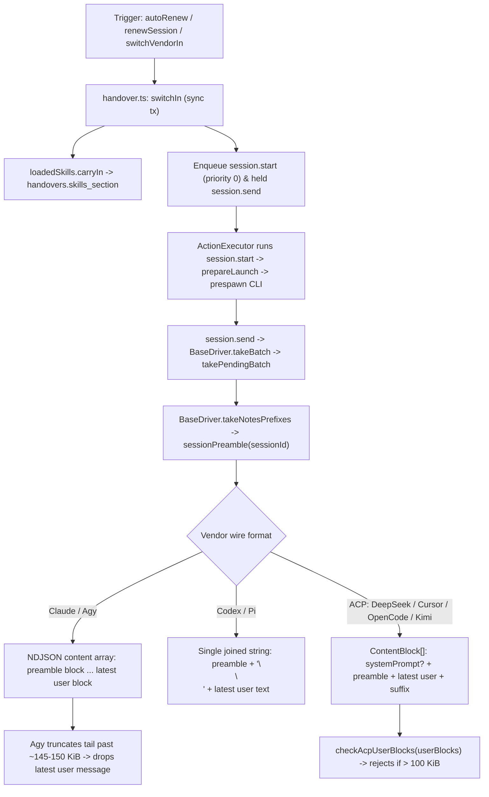

# Handover byte budget and lightweight skill carryover

> Snapshot: 2026-11-28 (commit `59358e6e`)

## Plan review and decisions

### Files to review

- [docs/handover-budget-and-skills-design.md](handover-budget-and-skills-design.md): Root-cause audit, design comparison, byte-budget math, cross-vendor coverage, and verification plan.
- [docs/README.md](README.md): Adds the index entry for this design document.
- [src/shared/limits.ts](../src/shared/limits.ts): Defines per-vendor handover byte caps, priority-tier byte limits, and lightweight skill-index caps.
- [src/vendors/types.ts](../src/vendors/types.ts) and [src/vendors/agy/spec.ts](../src/vendors/agy/spec.ts): Declares optional `handover.maxSingleMessageBytes` on `VendorSpec` and sets the `agy` ceiling.
- [src/shared/vendors.ts](../src/shared/vendors.ts): Adds `handoverMaxSingleMessageBytesOf` as the single lookup for every registered vendor.
- [src/shared/driver.ts](../src/shared/driver.ts), [src/shared/ledger.ts](../src/shared/ledger.ts), [src/daemon/daemon.ts](../src/daemon/daemon.ts), [src/daemon/driver/session-preamble.ts](../src/daemon/driver/session-preamble.ts), and [src/daemon/ledger/handover.ts](../src/daemon/ledger/handover.ts): Adds optional `SessionPreambleOptions` (`reservedBytes`) to `sessionPreamble` without altering existing runtime behavior in the planning step.
- [src/daemon/ledger/handover-budget.ts](../src/daemon/ledger/handover-budget.ts): Compiling code skeleton for UTF-8 and UTF-16 safe slicing, lightweight skill-index rendering, and priority-tiered preamble assembly.
- [src/daemon/ledger/handover-budget.test.ts](../src/daemon/ledger/handover-budget.test.ts): Executable acceptance tests covering every quoted user requirement, contract clause, and failure mode.

### Project Manager plan review

Check three items before implementation starts:

1. Every quoted user sentence in Section 1 maps to at least one acceptance scenario in Section 8.
2. Every applicable verification category in Section 8 has a concrete scenario, and every omitted category states in one sentence why it does not apply.
3. The three candidate designs in Section 3 have genuinely distinct architectures.

### Decisions needed

**Approved by Project Manager (2026-11-28, PR #505):** Candidate C is approved in full:

- **Decision 1 — Approved (Option C):** Replace inline full skill bodies in handover preambles with a verified skill index (`<= 4 KiB`, verified disk path + source + single-line description). `user`-invoked skills persist across generations; `model`-loaded skills carry for one hop on normal handovers and persist across same-generation vendor switches. Exclude built-in `fusa-task-graph` from false missing-file alarms when `switchIn` runs before `next`'s `prepareLaunch`.
- **Decision 2 — Approved:** Per-vendor single-message UTF-8 byte caps set to `120 KiB` for `agy` and `160 KiB` default for all other vendors. In `AcpSessionDriver`, `send()` keeps `MAX_MESSAGE_BYTES` for raw user messages while `writeBatch()` validates combined Turn 1 blocks against `handoverMaxSingleMessageBytesOf(this.vendor)`. Both `AcpSessionDriver` and `AgyDriver` wire through `BaseDriver.takeNotesPrefixes` cleanly and independently so concurrent work migrating `agy` to ACP (PR #501) stays decoupled without merge conflicts.

**Decision 1: Replace inline full skill bodies in handover preambles with a verified skill index.**
Recommended: Option C (index only, maximum 4 KiB, `user`-invoked skills persist across generations while `model`-loaded skills carry for one hop and full generation on vendor switch).

Concrete example of what the Project Manager session receives after handover:

Before (current behavior, 50,000 to 80,000 chars, up to ~240 KiB UTF-8):

```markdown
## 上一个会话加载过的技能

下面是上一个会话里加载过的技能正文，按最近加载排在前面……

<skill name="poteto-mode" path="/path/to/.agents/skills/poteto-mode/SKILL.md" loaded-by="user">
(20,000+ chars of full SKILL.md markdown body...)
</skill>

<skill name="benchmark-checklist" path="/path/to/.agents/skills/benchmark-checklist/SKILL.md" loaded-by="model">
(12,000+ chars of full SKILL.md markdown body...)
</skill>
```

After (proposed behavior, typically 300 to 1,200 bytes, hard cap 4 KiB UTF-8):

```markdown
## 上一个会话加载过的技能（索引，按需读取）

以下是上一个会话用过的技能路径，不再整段贴正文；需要时直接读取对应文件或重新调用技能：
- `poteto-mode`（用户调用，路径：`/path/to/.agents/skills/poteto-mode/SKILL.md`）：Project manager orchestration workflow
- `benchmark-checklist`（模型加载，路径：`/path/to/.agents/skills/benchmark-checklist/SKILL.md`）：Performance measurement checklist
```

**Decision 2: Per-vendor single-message byte caps (`120 KiB` for `agy`, `160 KiB` default).**
Routine engineering choice for Project Manager approval: `agy` gets `120 * 1024` bytes (122,880 bytes, staying ~20 to 25 KiB below the measured ~145 to 150 KiB silent tail-truncation threshold even after JSON escaping, while leaving 20 KiB headroom above `MAX_MESSAGE_BYTES = 100 KiB`), and all other vendors default to `160 * 1024` bytes (163,840 bytes). In `AcpSessionDriver`, `send()` keeps the `MAX_MESSAGE_BYTES` check on raw user messages, while `writeBatch()` validates the combined Turn 1 blocks against `handoverMaxSingleMessageBytesOf(this.vendor)`.

## 1. User goal

Original user requests (from `/tmp/handover-skill-bloat/context.md`):

- 2026-11-26: "提示词是不是有点膨胀了"
- 2026-11-27: "走流程解决问题，之后我们的做什么都先走完整流程"
- 2026-11-28: "有产品反馈直接去核实然后做就行" and "直接把这些都建起来开始跑就行"

Intended outcome: Stop handover and vendor-switch preambles from stuffing full historical `SKILL.md` bodies into every new PM session, enforce a unified per-vendor single-message UTF-8 byte budget across all handover paths so the latest user message at the tail is never truncated or rejected, and keep prompt caching (`TokenUsage.cacheRead`) intact on every vendor.

## 2. Current state and history

### Subsystem architecture (`/how` synthesis)

#### Overview

Bellwood renews long-running Project Manager (`role = 'pm'`) sessions in two ways: background handover (when `usage.context >= handoverTokenThresholdOf(vendor)` or the user clicks "New session") and instant vendor switch (when the user changes the PM's vendor in Profile). Both paths end the old `agent_sessions` row, insert a `generation + 1` row, prespawn the new CLI process, and inject an opening brief (`sessionPreamble`) ahead of the very first message delivered to the new session. Once the driver reports `message.processing { preamble: true }`, the ledger marks `session_preamble_seen` and never injects the preamble again.

#### Key concepts

- **`loaded_skills` and `createLedgerLoadedSkills` (`src/daemon/ledger/loaded-skills.ts`):** Records every skill loaded by a PM session via user slash command (`message.processing`), native `Skill` tool (`agent.tool`), or `Read`/`Bash` output matching (`agent.tool_result` via `src/shared/skill-loads.ts` and `src/daemon/skill-files.ts`). On handover, `carryIn` resolves recorded rows against disk and renders `handovers.skills_section`.
- **Handover state machine (`src/daemon/ledger/handover.ts`) and background runner (`src/daemon/handover/runner.ts`):** Drives `queued -> forking -> writing -> ready -> switched` for normal handovers (falling back to `in_session` writing when a vendor has no forker), and writes `method = 'vendor_switch', status = 'ready'` for instant vendor switches. Both converge in `switchIn`.
- **Turn 1 batch assembly (`src/daemon/driver/base-driver.ts`, `src/daemon/driver/driver-helpers.ts`, `src/daemon/driver/session-preamble.ts`):** `ActionExecutor` (`src/daemon/actions/executor.ts:28-36`) prioritizes `session.start` (`0`) ahead of `session.send` (`1..3`) on the same session lane. When a message arrives, `takePendingBatch` coalesces consecutive queued user messages (`mergeUserTexts`) and riders, `takeNotesPrefixes` fetches `sessionPreamble(sessionId)` plus recovery/persona notes, and each vendor driver serializes `[...prefixes, body.text]` with `deliverySuffix` appended at write time.
- **Live ledger suffixes (`src/daemon/ledger/pm-agenda.ts`, `src/daemon/ledger/pm-delivery.ts`):** `sessionPreamble` appends live `pendingAsksSection` and `preambleAgendaSection`. Later, `withDeliverySuffix` calls `pmAgendaFooterFor(db, sessionId, now, preamble)`, suppressing the agenda footer only when `preamble.includes(preambleAgendaSection(agenda, now))` matches verbatim (`pm-agenda.ts:216`).

#### How it works



1. **Skill tracking during a session:** `ledger.ts:411` feeds every scoped driver event to `loadedSkills.afterDriverEvent`. `SkillFiles` (`src/daemon/skill-files.ts`) discovers skills under `<launchDir>/<sessionId>/skills`, project `.agents/skills`, vendor sync targets, and user-home directories, verifying `realpathSync` inside trusted roots.
2. **Switch transaction (`switchIn`, `handover.ts:414-500`):** Inserts `next` (`generation + 1`), runs `loadedSkills.carryIn(conversationId, old.generation, next)`, ends `old`, moves queued messages to `next`, and enqueues `session.start`. For normal handovers, `switchIn` pre-bakes `handovers.preamble` right here before Turn 1's triggering message exists; for `vendor_switch`, it leaves `preamble = NULL`.
3. **Turn 1 delivery (`BaseDriver` and vendor drivers):** `takeBatch` coalesces pending user entries via `takePendingBatch`, calls `takeNotesPrefixes` (placing `preamble` at index 0 and the latest user message at the tail), and hands the batch to `writeBatch` or `startup`. `withDeliverySuffix` appends live agenda/busy lines at write time. For `first_message` ACP vendors (`cursor`, `opencode`, `kimi`), `runAcpHandshake` (`src/vendors/_common/acp/handshake.ts:58-68`) reads `files.promptFile` into `proc.pendingSystemPromptBlock`, and `writeBatch` prepends it via `buildAcpPromptBlocks`.
4. **Compaction (`context.compacted`):** Compaction lowers `usage.context`, flags `reinjectPending` on `first_message` ACP vendors (`src/vendors/_common/acp/driver.ts:119-133`), and resets `pmAgendaFooterFor` (`pm-agenda.ts:214`). It does not create a handover row, and `vendor-switch-context.ts:75` skips `context.compacted` rows, so a post-compaction vendor switch still replays the full generation.
5. **Consumption and cleanup:** On `message.processing { preamble: true }`, `handover.ts:860-865` inserts `session_preamble_seen` and calls `clearConsumedHandoverBlobsIn` to null `handovers.preamble` and `handovers.skills_section`. On startup crash or untaken release, `batch.notes.preamble.restore()` resets `preambleTaken = false` so the retry re-fetches `sessionPreamble`.

#### Where things live

- `src/daemon/ledger/handover.ts`: Handover state machine, `switchIn`, and `sessionPreamble`.
- `src/daemon/ledger/handover-text.ts` and `src/daemon/ledger/handover-recent.ts`: Normal handover prompt templates and recent-message selection.
- `src/daemon/ledger/vendor-switch-context.ts`: Generation message filtering, transcript path listing, and vendor-switch preamble builder.
- `src/daemon/ledger/loaded-skills.ts`, `src/daemon/skill-files.ts`, and `src/shared/skill-loads.ts`: Skill detection, trusted-root catalog, and carryover persistence.
- `src/daemon/handover/runner.ts`: Background fork-and-write scheduler.
- `src/daemon/driver/base-driver.ts`, `src/daemon/driver/driver-helpers.ts`, `src/daemon/driver/session-preamble.ts`, and `src/daemon/ledger/pm-delivery.ts`: Batch coalescing, preamble/persona prefixing, and delivery suffix attachment.
- `src/vendors/agy/driver.ts`, `src/vendors/claude/driver.ts`, `src/vendors/codex/driver.ts`, `src/vendors/pi/driver.ts`, and `src/vendors/_common/acp/{driver,handshake,protocol}.ts`: Vendor wire serialization and input checks.
- `src/shared/limits.ts`, `src/shared/vendors.ts`, and `src/vendors/types.ts`: Shared numeric limits and per-vendor specifications.

#### Gotchas

- **ACP `writeBatch` 100 KiB hard rejection (`src/vendors/_common/acp/driver.ts:396`, `protocol.ts:133-145`):** `checkAcpUserBlocks` checks combined `userBlocks` (which already includes `preamble` and `deliverySuffix`) against `MAX_MESSAGE_BYTES` (102,400 bytes). Any handover or vendor-switch Turn 1 exceeding 100 KiB on `deepseek`, `cursor`, `opencode`, or `kimi` fails with `invalid_input`.
- **Cold-start ACP `pendingSystemPromptBlock` timing (`src/vendors/_common/acp/driver.ts:312-335`, `handshake.ts:58-68`):** When `st.proc` is prespawned by `session.start`, `proc.pendingSystemPromptBlock` is already in memory when `takeBatch` runs. On a cold start (for example after a daemon restart before Turn 1), `st.proc` is `null` during `takeBatch`, so `systemPromptBlock` is not read until `#spawn` runs. Drivers must reserve `ACP_FIRST_TURN_SYSTEM_PROMPT_RESERVE_BYTES` when `proc === null` and use exact `Buffer.byteLength(proc.pendingSystemPromptBlock)` when `proc !== null`.
- **Built-in `fusa-task-graph` skill timing trap (`src/daemon/launch.ts:259`, `src/daemon/skill-files.ts:108`, `src/daemon/ledger/handover.ts:441`):** `writeProductSkills` writes `<launchDir>/<next.id>/skills/fusa-task-graph/SKILL.md` inside `prepareLaunch(next)` after `session.start` runs, whereas `switchIn` calls `loadedSkills.carryIn` synchronously before `session.start`. Looking up `fusa-task-graph` in `next`'s launch directory at `switchIn` time therefore misses and falsely reports it as missing, even though `prompt.ts` already points to `next`'s exact `taskGraphSkillFile` path.
- **`deliverySuffix` agenda fallback (`src/daemon/ledger/pm-agenda.ts:216`):** If `preamble` trims or omits `preambleAgendaSection`, `pmAgendaFooterFor` will not match and will append the agenda snapshot (~1 to 3 KiB) to the tail of the user message. Reserving `HANDOVER_DELIVERY_SUFFIX_RESERVE_BYTES` and keeping live agenda in Priority 1 prevents late overflow.
- **`AgyDriver.startup()` skips `checkAgyUserLine` (`src/vendors/agy/driver.ts:295-296`):** Only `writeBatch` validates the serialized NDJSON line; `startup` writes directly to stdin, so enforcing the byte budget before serialization is the only guard on cold-start Turn 1.
- **Unbounded coalesced user batches (`src/daemon/driver/driver-helpers.ts:124-162`):** `takePendingBatch` merges every queued user message into one batch (`mergeUserTexts`), so the triggering Turn 1 payload can exceed `MAX_MESSAGE_BYTES` if multiple messages queued during handover. Computing `reservedBytes` from the coalesced `body` protects all queued user text from being pushed over the vendor limit.

### Design history

Inspecting the current code and three retired design documents from git commit `3437df1f~1` (`docs/background-handover-design.md`, `docs/vendor-switch-context-design.md`, and `docs/skill-carryover-design.md`) shows a stack of four independent features added without a shared byte budget:

1. **Background handover (`background-handover-design.md`, PR #113):** Assumed a handover preamble contained only a ~2,000-char summary plus `HANDOVER_RECENT_CHARS = 30_000` chars of recent conversation. `switchIn` pre-baked the full preamble string into `handovers.preamble` before the next user message arrived.
2. **Instant vendor switch (`vendor-switch-context-design.md`, migration 0027):** Bypassed summary writing and replayed the entire current generation on demand in `sessionPreamble` using `VENDOR_SWITCH_CONTEXT_MAX_CHARS = 240_000` UTF-16 code units. For Chinese text (3 UTF-8 bytes per character), 240,000 characters equals 720,000 UTF-8 bytes.
3. **Full-body skill carryover (`skill-carryover-design.md`, migration 0031):** Added `loaded_skills` and `carryIn`, reading full `SKILL.md` bodies from disk up to `SKILL_CARRYOVER_SKILL_MAX_CHARS = 30_000` per skill and `SKILL_CARRYOVER_TOTAL_MAX_CHARS = 80_000` total (up to 240,000 UTF-8 bytes), and prepending them to both normal handovers and vendor switches. Every carried skill updated its `generation` column to `next.generation`, so once a PM loaded a skill in generation 1, that full body propagated into every future generation forever.
4. **Live pending asks and PM agenda (PR #471, PR #484):** Appended `pendingAsksSection` and `preambleAgendaSection` onto the end of `sessionPreamble`, and appended `deliverySuffix` onto the end of the user message.

The original premise that Turn 1 preambles stay small (~35 KB) no longer holds. Normal handovers, vendor switches, and post-compaction handovers now concatenate five independently capped (or uncapped) blocks on top of the triggering user message.

### Core concepts

- **Write authority and duplicate storage:**
  - `loaded_skills` is written only by `createLedgerLoadedSkills` and deleted on PM purge (`src/daemon/ledger/persona.ts:755`).
  - `handovers` is written only by `createLedgerHandover` and cleaned by `src/daemon/ledger/db-table-retention.ts`.
  - Duplicate storage: for normal handovers, `skills_section` is stored both in `handovers.skills_section` and embedded inside `handovers.preamble` (`handover.ts:470-495`).
- **Missing concept:** A single-owner, priority-tiered Turn 1 UTF-8 byte budgeter parameterized by the target vendor's single-message byte ceiling and the exact UTF-8 bytes reserved by the triggering turn payload (coalesced user messages, riders, recovery/persona notes, ACP `first_message` system prompt, and delivery suffix reserve).

### Verified evidence

- `[Measured]` `src/shared/limits.ts:75-76,86` sets `SKILL_CARRYOVER_SKILL_MAX_CHARS = 30_000`, `SKILL_CARRYOVER_TOTAL_MAX_CHARS = 80_000`, and `VENDOR_SWITCH_CONTEXT_MAX_CHARS = 240_000` (inspected directly in worktree commit `59358e6e`). Combined Chinese content can exceed 960,000 UTF-8 bytes before adding live asks, agenda, or the user message.
- `[Measured]` `src/daemon/ledger/loaded-skills.ts:178-185` updates `generation = next.generation` for every carried skill regardless of `source` (`user` or `model`), causing skills loaded many generations earlier to carry forward indefinitely (inspected directly).
- `[Measured]` Real session transcript `transcript_full.jsonl` inspected on 2026-11-26 17:35 (recorded in `/tmp/handover-skill-bloat/context.md`): a vendor-switch opening message to `agy` exceeded 220 KB, and `agy` silently truncated the trailing 75,262 bytes (~145 to 150 KB retained), dropping the user's latest message at the end. Local CLI version confirmed via `agy --version` (`1.5.18`).
- `[Measured]` `src/vendors/_common/acp/protocol.ts:133-145` and `src/vendors/_common/acp/driver.ts:392-402` validate combined `userBlocks` (including `preamble` and `deliverySuffix`) against `MAX_MESSAGE_BYTES` (102,400 bytes) in `writeBatch` (inspected directly). Any handover or vendor-switch Turn 1 payload over 100 KiB to `deepseek`, `cursor`, `opencode`, or `kimi` is rejected with `invalid_input` ("message exceeds 102400 bytes").
- `[Measured]` `src/daemon/driver/base-driver.ts:456-486`, `src/daemon/driver/driver-helpers.ts:124-162`, and `src/daemon/driver/protocol.ts:17-21` coalesce queued user messages, place `preamble` at index 0 of `prefixes`, and put the triggering user message at the tail (inspected directly).
- `[Measured]` `src/daemon/ledger/handover.ts:470-495,922-980` pre-bakes `handovers.preamble` at `switchIn` time for normal handovers without knowing the triggering Turn 1 message size, while `vendor_switch` builds dynamically in `sessionPreamble` without any byte budget (inspected directly).
- `[Measured]` `src/daemon/launch.ts:259` and `src/daemon/skill-files.ts:108` write per-session `fusa-task-graph/SKILL.md` only when `prepareLaunch` runs on `session.start`, after `switchIn` has already called `loadedSkills.carryIn` (inspected directly).
- `[Measured]` `src/daemon/prompt.ts` (searched with `git grep`) does not reference carried skill bodies; system prompts across all 8 vendors do not need edits.

## 3. Reference designs and approach comparison

### Reference designs

1. **Claude Code (`SKILL.md` progressive disclosure):** [Anthropic Agent Skills overview](https://docs.anthropic.com/en/docs/agents-and-tools/agent-skills/overview) keeps only skill metadata (`name` and `description`, ~100 tokens per skill) in the initial prompt and loads full `SKILL.md` bodies on demand from disk when the task needs them.
2. **OpenAI Codex CLI (metadata-first skills and oldest-first context trimming):** [OpenAI Codex](https://github.com/openai/codex) exposes discovered skills as a compact name, description, and path index instead of inlining every skill body, and trims older conversation entries first when fitting a turn budget so the system instructions and newest user message stay intact.
3. **Aider (budgeted summary plus recent turns with stable cache prefix):** [Aider prompt caching documentation](https://aider.chat/docs/usage/caching.html) separates stable prefix content from bounded history, reserves explicit room for the current user request, and preserves prefix byte stability across turns so provider prompt caches hit on Turn 2 and beyond.

### Candidate approaches

| Dimension | Candidate A: Lower char caps plus blind driver truncation (Patch) | Candidate B: Two-tier recent-body hybrid plus static reserve | Candidate C: Lightweight skill index plus single-owner delivery-time byte budgeter (Recommended, Day-One design) |
| --- | --- | --- | --- |
| Skill carryover | Keep inline `<skill>` bodies; lower total cap to ~16K chars | Inline 1 to 2 recent user-invoked bodies (8 KiB) plus index for others | Index only for all skills (name, verified path, source, one-line description), capped at 4 KiB; `user` skills persist, `model` skills carry one hop (preserved across same-generation vendor switches) |
| Budget unit and timing | Char caps in ledger plus blind byte slice in `BaseDriver` | Static char caps assuming fixed 32 KiB reserve | Exact UTF-8 byte budget computed at delivery time (`sessionPreamble(sessionId, { reservedBytes })`) |
| Latest user message protection | Blind truncation in driver can cut live asks/agenda or mid-section | Fails if user sends a 60 to 100 KiB message on `agy`; wastes 32 KiB on short messages | Hard invariant: subtracts exact `reservedBytes` (user message, system prompt, other prefixes, suffix) first; latest message is never truncated |
| ACP 100 KiB rejection bug | Still breaks unless ACP `writeBatch` limit is raised | Still breaks on large user messages | Fixed cleanly: `send()` keeps `MAX_MESSAGE_BYTES` for raw input; `writeBatch()` uses `handoverMaxSingleMessageBytesOf(vendor)` |
| Single code path | Two paths (pre-baked normal vs dynamic vendor switch) | Two skill formats plus two handover paths | One `assembleBudgetedPreamble` pipeline for normal handover, vendor switch, and post-compaction handover |
| Prompt bloat reduction | Moderate (~16K chars skill bodies still injected) | Partial (8 to 16 KiB stale bodies still injected) | ~98% to 99.5% skill reduction (80K chars / ~240 KiB down to <= 4 KiB) |

### Recommendation

Adopt **Candidate C**. It is the day-one architecture: one authoritative byte-budget module (`src/daemon/ledger/handover-budget.ts`) invoked when Turn 1 is assembled, one lightweight skill index format backed by disk verification, and one declarative per-vendor single-message byte ceiling on `VendorSpec`.

### Design red-flag screening

- **Shallow module:** Candidate C concentrates UTF-8 and UTF-16 safe slicing, priority-tier allocation, omission hints, and legacy fallback inside `handover-budget.ts` behind a small set of typed functions.
- **Information leakage:** Drivers never parse or slice preamble Markdown. Drivers report `reservedBytes`; `handover-budget.ts` owns all section trimming; `src/shared/vendors.ts` owns per-vendor byte caps.
- **Temporal decomposition:** Candidate A kept pre-baking `handovers.preamble` at `switchIn` time when the next user message did not exist yet. Candidate C removes that split by assembling both normal handovers and vendor switches at delivery time in `sessionPreamble`.
- **Split ownership:** One owner for skill tracking (`loaded-skills.ts`), one owner for byte budgeting (`handover-budget.ts`), and one owner for vendor limits (`VendorSpec.handover.maxSingleMessageBytes` via `handoverMaxSingleMessageBytesOf`).
- **Two ways to do one task:** Candidate B delivered skills in two formats (inline XML bodies and index lines). Candidate C uses one compact index format for every skill and one budget assembler for every handover path. Legacy pre-baked `handovers.preamble` rows from older versions are read-only upgrade compatibility handled by `fitLegacyPreambleToBudget`.
- **Hand-synced list:** Every registered vendor inherits `DEFAULT_HANDOVER_MAX_SINGLE_MESSAGE_BYTES` automatically unless its `spec.ts` overrides `handover.maxSingleMessageBytes`.

### Patch rationale

None. Candidate C fixes the root causes directly without adding a schema migration or rebuilding unrelated subsystems.

### Synthesis record

None. Single-worker design plan.

## 4. Performance and bounds

All four rules in `AGENTS.md` ("Caches and state bounds") apply:

1. **Invalidation:** `SkillFiles` keeps its `LRUCache` keyed on `(cwd, roots)` with directory `mtimeNs` validation (`src/daemon/skill-files.ts:101,157-166`). `loaded-skills.ts` calls `skillFiles.catalog(next, { fresh: true })` at handover so deleted or replaced skills are never served from stale cache. `clearConsumedHandoverBlobsIn` clears `handovers.preamble` and `handovers.skills_section` as soon as `message.processing { preamble: true }` arrives.
2. **Upper bounds (one-month sizing: 300 finished Workers, 30,000 messages, 50,000 step logs):**
   - `loaded_skills` remains bounded to `SKILL_CARRYOVER_RECORDS_MAX = 200` rows per conversation.
   - `recentRowsOf` stops paging once byte budget or `HANDOVER_POST_CUT_MAX_CHARS` is reached; `collectGenerationContext` stops after `VENDOR_SWITCH_MESSAGE_SCAN_LIMIT = 4_000` rows or once `historyMaxBytes` fills.
   - Single-turn output is strictly bounded in UTF-8 bytes by `handoverMaxSingleMessageBytesOf(vendor)`.
3. **Stable front-end references:** No frontend selectors, stores, or snapshot shapes change.
4. **Measured verification:** Section 8 includes a one-month scale acceptance test (300 finished Workers, 30,000 messages, 50,000 step logs, 200 loaded skills) asserting strict byte bounds and deterministic execution.

New `src/shared/limits.ts` constants:

| Constant | Value | Sizing rationale |
| --- | --- | --- |
| `DEFAULT_HANDOVER_MAX_SINGLE_MESSAGE_BYTES` | `160 * 1024` (163,840 B) | Leaves >= 60 KiB for preamble even with a `MAX_MESSAGE_BYTES` (100 KiB) user message; fits ~54K CJK chars while staying well below provider and ACP frame caps (`800 KiB`). |
| `AGY_HANDOVER_MAX_SINGLE_MESSAGE_BYTES` | `120 * 1024` (122,880 B) | Leaves ~20 to 25 KiB safety margin below `agy`'s measured ~145 to 150 KiB silent tail-truncation limit (including JSON escaping), while leaving 20 KiB above `MAX_MESSAGE_BYTES`. |
| `HANDOVER_MIN_PREAMBLE_BYTES` | `512` | Minimum bytes needed for a meaningful handover header; below this, preamble returns `null` rather than pushing the triggering message past the vendor ceiling. |
| `HANDOVER_DELIVERY_SUFFIX_RESERVE_BYTES` | `4 * 1024` (4,096 B) | Headroom reserved for late-attached `deliverySuffix` (`PM_AGENDA_BUSY_LINE` or agenda snapshot fallback when agenda changes during cold-start handshake); `AcpSessionDriver.writeBatch` also refits Turn 1 preamble dynamically when actual `deliverySuffix` or `systemPrompt` exceeds the reserve. |
| `ACP_FIRST_TURN_SYSTEM_PROMPT_RESERVE_BYTES` | `MAX_PERSONA_BYTES + 24 * 1024` (57,344 B) | Upper-bound reserve for `first_message` ACP vendors (`cursor`, `opencode`, `kimi`) on cold-start Turn 1 covering the ~16 KiB base prompt plus up to `MAX_PERSONA_BYTES` (32 KiB) persona and `<system_instructions>` wrapper; prespawned turns measure the exact block bytes and `writeBatch` refits if needed. |
| `HANDOVER_SUMMARY_MAX_BYTES` | `24 * 1024` (24,576 B) | Caps summary or generation anchor (~8,000 CJK chars) so a long summary cannot crowd out live asks, live agenda, or recent turns. |
| `HANDOVER_LIVE_STATE_MAX_BYTES` | `24 * 1024` (24,576 B) | Bounds live pending asks plus PM agenda (fits worst-case 20 active graphs × 8 step lines with 4-byte UTF-8 titles plus 30 pending decisions verbatim so `pmAgendaFooterFor` suppresses duplicate footers). |
| `HANDOVER_REPORTS_MAX_BYTES` | `8 * 1024` (8,192 B) | Fits ~80 one-line post-cut Worker report pointers while capping bursty 300-Worker histories. |
| `HANDOVER_RECENT_MAX_BYTES` | `96 * 1024` (98,304 B) | Byte cap for recent chat on normal handover (~32K CJK chars), further bounded by remaining turn bytes. |
| `VENDOR_SWITCH_CONTEXT_MAX_BYTES` | `128 * 1024` (131,072 B) | Replaces char-based `VENDOR_SWITCH_CONTEXT_MAX_CHARS = 240_000` (which inflated to 720 KiB in CJK); actual budget is `min(128 KiB, remainingBytes)`. |
| `SKILL_CARRYOVER_LIST_MAX` | `20` | Lists up to 20 recently loaded skills; sufficient for active project workflows without unbounded growth. |
| `SKILL_CARRYOVER_INDEX_MAX_BYTES` | `4 * 1024` (4,096 B) | Hard cap on the entire loaded-skills index section (down from ~240 KiB of inline bodies). |
| `SKILL_CARRYOVER_DESCRIPTION_MAX_CHARS` | `120` | Single-line frontmatter description cap per skill entry. |

## 5. Cross-vendor and cross-platform unification

- **Cross-vendor:** One shared field `VendorSpec.handover.maxSingleMessageBytes` (`src/vendors/types.ts`) and one shared lookup `handoverMaxSingleMessageBytesOf(vendor)` (`src/shared/vendors.ts`) cover all eight registered vendors in `src/vendors/registry.ts` (`claude`, `agy`, `codex`, `pi`, `deepseek`, `cursor`, `opencode`, `kimi`).
  - `agy` declares `handover.maxSingleMessageBytes: AGY_HANDOVER_MAX_SINGLE_MESSAGE_BYTES` in `src/vendors/agy/spec.ts`.
  - The other seven vendors inherit `DEFAULT_HANDOVER_MAX_SINGLE_MESSAGE_BYTES` automatically.
  - `BaseDriver.takeNotesPrefixes` (`src/daemon/driver/base-driver.ts`) computes `reservedBytes` via `measureTurnReservedBytes` once for all drivers (`ClaudeDriver`, `AgyDriver`, `CodexDriver`, `PiDriver`, and `AcpSessionDriver`), including `HANDOVER_DELIVERY_SUFFIX_RESERVE_BYTES` for late-attached delivery suffixes and all coalesced user messages from `takePendingBatch`.
  - `AcpSessionDriver` (`src/vendors/_common/acp/driver.ts`) adds exact `Buffer.byteLength(proc.pendingSystemPromptBlock)` (when prespawned) or `ACP_FIRST_TURN_SYSTEM_PROMPT_RESERVE_BYTES` (on cold start with `proc === null`) for `capabilities.systemPrompt === "first_message"` vendors (`cursor`, `opencode`, `kimi`) into `reservedBytes`, and passes `handoverMaxSingleMessageBytesOf(this.vendor)` to `checkAcpUserBlocks` in `writeBatch` while keeping `MAX_MESSAGE_BYTES` in `send()`.
  - Built-in product skill `fusa-task-graph` (written asynchronously on `session.start` by `prepareLaunch`) is excluded from `loaded_skills` missing-file false alarms during `switchIn` because `prompt.ts` already carries `next`'s exact `taskGraphSkillFile` path.
  - **Single file for a future vendor:** A future vendor only declares `handover.maxSingleMessageBytes` (if stricter than the default) in its own `src/vendors/<vendor>/spec.ts`.
- **Cross-platform (`macOS`, `Windows`, `Linux`):**
  - Byte budgets use `Buffer.byteLength(text, "utf8")`, independent of OS locale or path separator.
  - Frontmatter description extraction handles both LF (`\n`) and CRLF (`\r\n`) line endings and UTF-8 BOM.
  - Skill index path display and `SkillFiles` trusted-root checks continue using Node `node:path` and `realpathSync` across macOS, Windows, and Linux.
  - All prompt text added or changed in `handover-text.ts`, `loaded-skills.ts`, `handover-budget.ts`, and `vendor-switch-context.ts` stays project-agnostic and Windows-safe.

## 6. Deletions

Delete the following superseded code, constants, and prompt text in the implementation PR so old and new paths never coexist:

- Delete `SKILL_CARRYOVER_SKILL_MAX_CHARS`, `SKILL_CARRYOVER_TOTAL_MAX_CHARS`, and `VENDOR_SWITCH_CONTEXT_MAX_CHARS` from `src/shared/limits.ts` (replaced by `SKILL_CARRYOVER_INDEX_MAX_BYTES`, `SKILL_CARRYOVER_LIST_MAX`, `SKILL_CARRYOVER_DESCRIPTION_MAX_CHARS`, and `VENDOR_SWITCH_CONTEXT_MAX_BYTES`).
- Delete full-body `SKILL.md` reading (`SKILL_READ_MAX_BYTES`, `SkillFiles.read` full-body helper if no other callers remain, `clip()`, `bodyOf()`, and XML `<skill>` body rendering) from `src/daemon/skill-files.ts` and `src/daemon/ledger/loaded-skills.ts`.
- Delete pre-baking of `handovers.preamble` in `switchIn` (`src/daemon/ledger/handover.ts:470-481`); set `preamble = NULL` on newly switched rows and keep read-only legacy fallback in `sessionPreamble` only for pre-upgrade rows already in SQLite.
- Delete the old "技能正文（系统自动带上……）" and "先是上一个会话加载过的技能正文" wording from `src/daemon/ledger/handover-text.ts` and `src/daemon/ledger/vendor-switch-context.ts`, replacing it with index-only on-demand wording.

## 7. Skeleton files

Created or modified in this planning step:

- [docs/handover-budget-and-skills-design.md](handover-budget-and-skills-design.md): Full design plan, approach comparison, bounds, and verification plan.
- [docs/README.md](README.md): Indexes this design document.
- [src/shared/limits.ts](../src/shared/limits.ts): Adds the new handover byte-budget and skill-index constants alongside existing constants (old ones deleted during implementation).
- [src/vendors/types.ts](../src/vendors/types.ts): Adds optional `maxSingleMessageBytes` to `VendorSpec["handover"]`.
- [src/vendors/agy/spec.ts](../src/vendors/agy/spec.ts): Declares `maxSingleMessageBytes: AGY_HANDOVER_MAX_SINGLE_MESSAGE_BYTES` for Antigravity.
- [src/shared/vendors.ts](../src/shared/vendors.ts): Exports the `handoverMaxSingleMessageBytesOf` skeleton function.
- [src/shared/driver.ts](../src/shared/driver.ts) and [src/shared/ledger.ts](../src/shared/ledger.ts): Exports `SessionPreambleOptions` and adds the optional parameter to `sessionPreamble`.
- [src/daemon/daemon.ts](../src/daemon/daemon.ts), [src/daemon/driver/session-preamble.ts](../src/daemon/driver/session-preamble.ts), and [src/daemon/ledger/handover.ts](../src/daemon/ledger/handover.ts): Threads the optional `SessionPreambleOptions` parameter through existing signatures without altering runtime behavior yet.
- [src/daemon/ledger/handover-budget.ts](../src/daemon/ledger/handover-budget.ts): Exports the typed data shapes, contracts, and `Not implemented` skeleton functions for UTF-8/UTF-16 safe slicing, skill description extraction, lightweight skill-index rendering, reserved-byte measurement, priority-tiered preamble assembly, and legacy preamble fitting.
- [src/daemon/ledger/handover-budget.test.ts](../src/daemon/ledger/handover-budget.test.ts): Executable acceptance tests for every scenario in Section 8 and every contract in `handover-budget.ts`, plus unchanged-rule regression tests.

Additional production files to update during implementation:

- `src/daemon/driver/base-driver.ts`: Computes `reservedBytes` for the triggering batch and passes it into `takeSessionPreamble`.
- `src/vendors/_common/acp/protocol.ts` and `src/vendors/_common/acp/driver.ts`: Includes `systemPromptBlock` in `reservedBytes` and validates `writeBatch` against `handoverMaxSingleMessageBytesOf(this.vendor)`.
- `src/daemon/skill-files.ts`, `src/daemon/ledger/loaded-skills.ts`, `src/daemon/ledger/handover-text.ts`, `src/daemon/ledger/vendor-switch-context.ts`, and `src/daemon/ledger/handover.ts`: Implement lightweight skill-index carryover, generation decay for model-loaded skills, dynamic byte-budgeted assembly for normal handover and vendor switch, and deletions listed in Section 6.

## 8. Verification plan

### Acceptance scenarios

Every quoted user sentence and every settled rule maps to executable tests in [src/daemon/ledger/handover-budget.test.ts](../src/daemon/ledger/handover-budget.test.ts):

- **S1 (User quote: "提示词是不是有点膨胀了" / Skill index convergence):**
  - First: A PM loads 20 skills across generations (mixing user-invoked `/poteto-mode` and model-loaded `teach`, `arena`, `tdd` with 15 KB bodies each) and triggers normal handover or vendor switch.
  - Next: `carryIn` and `sessionPreamble` build the Turn 1 opening brief.
  - Expected: The skills section contains zero full `SKILL.md` bodies, stays at or under `SKILL_CARRYOVER_INDEX_MAX_BYTES` (4 KiB), lists verified paths and one-line descriptions, persists user-invoked skills across generations, and drops unreferenced model-loaded skills on subsequent generation handovers while preserving them across same-generation vendor switches.
- **S2 (User quote: "有产品反馈直接去核实然后做就行" / Latest user message never truncated on `agy` overflow):**
  - First: A PM has >200 KB of generation dialogue plus loaded skills and switches to `agy` (`120 KiB` cap), with a 50 KiB triggering user message queued at the tail.
  - Next: `AgyDriver` / `BaseDriver` requests `sessionPreamble(sessionId, { reservedBytes })` and assembles Turn 1.
  - Expected: `preambleBytes + reservedBytes <= AGY_HANDOVER_MAX_SINGLE_MESSAGE_BYTES` (120 KiB), history trims oldest-first with an explicit omission marker, live asks and agenda stay intact, and the entire 50 KiB triggering user message at the tail arrives byte-for-byte intact.
- **S3 (Two consecutive turns in the same conversation):**
  - First: Turn 1 runs on generation 2 after handover or vendor switch and emits `message.processing { preamble: true }`.
  - Next: The user sends Turn 2 in the same session.
  - Expected: Turn 1 receives the budgeted preamble; `session_preamble_seen` is persisted and consumed handover blobs are cleared; Turn 2 receives `sessionPreamble(...) === null` with zero preamble text prepended.
- **S4 (Restart in the middle of the operation):**
  - First: A handover or vendor switch creates generation 2 (covering both a new dynamic row with `preamble = NULL` and a pre-upgrade row with an oversized 250 KiB `handovers.preamble`), and the daemon restarts before Turn 1 starts.
  - Next: After restart, Turn 1 delivers a message to generation 2, then restarts again after `message.processing { preamble: true }` before Turn 2.
  - Expected: Turn 1 still delivers a valid preamble strictly within `handoverMaxSingleMessageBytesOf(vendor)` (legacy blob fitted via `fitLegacyPreambleToBudget`), and Turn 2 after the second restart delivers no preamble.
- **S5 (State or configuration change while work or a notice waits in a queue):**
  - First: A user message and Worker report wait queued while the old session finishes a turn; the user switches vendor from `claude` to `agy` and a new pending ask / Task Graph step state changes before generation 2 sends Turn 1.
  - Next: Generation 2 claims the queued message and computes `sessionPreamble(sessionId, { reservedBytes })`.
  - Expected: The preamble uses `agy`'s `120 KiB` cap, reflects the latest live `pendingAsks` and `pmAgenda`, and preserves the queued message intact.
- **S6 (Existing rules and boundaries, including every matching `REVIEW.md` rule from `origin/main`):**
  - First: A skill symlink is swapped outside trusted roots before handover; an ACP vendor (`deepseek`) receives both an illegal >100 KiB raw user message in `send()` and a legal 70 KiB user message plus budgeted handover preamble in `writeBatch()`.
  - Next: Run handover and ACP delivery.
  - Expected: The escaped symlink leaks zero bytes (no body, no description) and reports `读不到了`; ACP `send()` still rejects raw user text > `MAX_MESSAGE_BYTES`, while ACP `writeBatch()` accepts the 70 KiB user message plus budgeted preamble up to `handoverMaxSingleMessageBytesOf("deepseek")`.
  - Item-by-item check against every matching rule in `git show origin/main:REVIEW.md`:
    1. `Vendor launch arguments never widen the permission tier` (`src/vendors/agy/spec.ts`): Only declarative `handover.maxSingleMessageBytes` is added; launch flags and permissions are untouched.
    2. `Read-only Workers never reach a write-capable MCP tool` (`src/vendors/agy/spec.ts`, `src/vendors/_common/acp/**`): Permission gates and read-only sandboxes are untouched.
    3. `Async work stops touching the ledger after shutdown starts` (`src/daemon/ledger/**`, `src/daemon/daemon.ts`): All new budget and index logic is synchronous with no new background tasks.
    4. `Database transactions stay synchronous` (`src/daemon/ledger/**`): Zero async I/O or child processes inside transactions; skill catalog reads shrink from 120 KB to cached 16 KB heads.
    5. `Caches key on identity, have a limit, and retry failures soon` (`src/daemon/skill-files.ts`, `src/daemon/ledger/loaded-skills.ts`, `src/shared/limits.ts`): Existing `LRUCache` bounds and `mtimeNs` invalidation stay intact; no unbounded cache is added.
    6. `Growing data has a cap in limits.ts` (`src/daemon/ledger/**`, `src/shared/limits.ts`): Every byte and count cap lives in `src/shared/limits.ts` with one-month sizing math in Section 4.
    7. `Child processes are tracked and gone before cleanup` (`src/daemon/driver/**`): No new child processes are added.
    8. `Tests wait for events, not for time` (`**/*.test.ts`): All acceptance tests are synchronous or event-driven with injected clocks and no sleeps.
    9. `Hub error codes change on both sides` (`src/shared/ledger.ts`): No error codes change.
    10. `Persisted fields have a reader and dual retention bounds` (`src/daemon/ledger/**`): No new columns or tables; existing `loaded_skills` and `handovers` blobs retain live readers and dual cleanup.
    11. `Text shipped to agents holds in any project` (`src/daemon/ledger/**`, `src/vendors/*/spec.ts`): All updated Chinese handover text stays project-agnostic and passes `src/prompt-portability.test.ts`.
    12. `Planned acceptance scenarios cover every requirement and pass real tests` (`**`): Every quoted user sentence, settled rule, category, and hard gate is mapped below.
    13. `A result is matched to its request by an id both carry` (`src/daemon/**`): Preamble consumption remains keyed by `sessionId` and `messageIds`.
    14. `Restart recovery finishes what the last run left` (`src/daemon/daemon.ts`, `src/daemon/ledger/handover.ts`): Pre-upgrade `handovers.preamble` blobs stay bounded via `fitLegacyPreambleToBudget`, and Turn 1 non-command processing persists `session_preamble_seen` even when budget omits the preamble so restarts never replay Turn 1 mid-session.
    15. `Detached child processes and temp dirs stay inside the session boundary` (`src/daemon/driver/**`): Process tags and session temp directories are untouched.
    16. `Ledger state invariants hold across every transition and reader path` (`src/daemon/ledger/**`): `loaded_skills.source = 'user'` stays sticky against later model reads, and `session_preamble_seen` plus handover blob cleanup hold whether Turn 1 injected or budget-omitted the preamble.
- **S7 (Reopening a closed view after cached data becomes stale):**
  - Not applicable: this change adds no frontend view, React Query endpoint, or client cache; existing web conversation views render unchanged and are smoke-checked via `pnpm verify`.
- **S8 (Large data volume sized for one month of continuous use: 300 finished Workers, 30,000 messages, 50,000 step logs):**
  - First: Seed a PM conversation with 30,000 messages, 300 finished Workers, 50,000 step logs, and 200 loaded skills.
  - Next: Trigger both normal handover and vendor switch to `agy` (`120 KiB`) and `claude` (`160 KiB`) with a 60 KiB user message.
  - Expected: `sessionPreamble` completes deterministically, returns total bytes strictly within `vendorCap - reservedBytes`, keeps skills index <= 4 KiB, and preserves the 60 KiB user message intact.
- **S9 (Malformed or dirty data):**
  - First: Provide `SKILL.md` files with unclosed frontmatter, BOM, control characters, empty description; multi-byte CJK and emoji surrogate pairs (`😀`, `🚀`) straddling exact byte-cut offsets; a 300 KiB legacy `handovers.preamble`; and negative or `NaN` `reservedBytes`.
  - Next: Invoke `extractSkillDescription`, `sliceUtf8HeadSafe`, `sliceUtf8TailSafe`, `renderLoadedSkillsIndex`, `assembleBudgetedPreamble`, and `fitLegacyPreambleToBudget`.
  - Expected: Zero crashes, zero lone UTF-16 surrogates, valid UTF-8 output strictly within byte bounds, and safe fallback when `budgetBytes < HANDOVER_MIN_PREAMBLE_BYTES`.
- **S10 (Cross-vendor coverage across all 8 registered vendors and prompt-cache preservation):**
  - First: Iterate over all 8 vendors in `AGENT_VENDORS` (`claude`, `agy`, `codex`, `pi`, `deepseek`, `cursor`, `opencode`, `kimi`), including `first_message` ACP vendors (`cursor`, `opencode`, `kimi`) with a 15 KiB `<system_instructions>` block, plus post-compaction handover/switch.
  - Next: Compute `handoverMaxSingleMessageBytesOf(vendor)` and assemble Turn 1 with `reservedBytes` including `systemPrompt` for `first_message` vendors.
  - Expected: Every vendor resolves a valid byte cap (`agy` = 120 KiB, others = 160 KiB), `systemPromptBytes + preambleBytes + messageBytes <= vendorCap`, system prompts (`src/daemon/prompt.ts`), tool/MCP lists, and Turn 2+ messages remain completely unmodified mid-session, and Turn 2+ hits the established prompt cache prefix without invalidation.
- **S11 (Cross-platform coverage across macOS, Windows, and Linux):**
  - First: Feed Windows backslash paths (`C:\Users\dev\.agents\skills\s1\SKILL.md`), POSIX paths, and CRLF (`\r\n`) frontmatter into `extractSkillDescription` and `renderLoadedSkillsIndex`.
  - Next: Render the index and assemble preambles.
  - Expected: Paths and descriptions parse identically across platforms and byte limits hold everywhere.
- **S12 (Cross-entry-point and layout coverage: wide and narrow web screens, Feishu, `hub` CLI, and multiple computers):**
  - First: Deliver Turn 1 after handover or vendor switch from Web UI (wide and narrow layouts), Feishu inbound message, or a multi-computer mesh/hub flow.
  - Next: All entry points pass through the same `ledger.sessionPreamble` and driver delivery pipeline.
  - Expected: Every entry point preserves the triggering message intact under the target vendor's byte ceiling, and wide/narrow Web UI renders normally during `pnpm verify`.

### Real-environment and real-CLI verification

During independent real-environment review after implementation:

- **Web flows (local isolated instance + Playwright):** Start an isolated Bellwood daemon in a temporary `AGENT_HUB_HOME`, trigger manual handover and vendor switch in the web UI (wide and narrow viewports), and capture a start-to-finish Playwright screen recording or screenshot sequence confirming the conversation remains responsive and no error or truncation banner appears.
- **Real CLI scenarios (local with verified isolated config or resident testbed):** Run real handover and vendor-switch turns against installed real vendor CLIs (`agy`, `claude`, `codex`, `pi`, `deepseek`, `cursor`; plus `opencode` and `kimi` on the resident testbed where installed). For `agy`, send a post-switch Turn 1 carrying heavy generation history plus a distinct marker at the tail of the latest user message, and verify from real `agy` output that the model echoes the tail marker verbatim (proving zero tail truncation). Record any vendor unavailable both locally and on the testbed as `not verified` with reason.
- **Prompt-cache preservation (hard gate):** Because this change alters Turn 1 handover preamble content (a session message), compare before (`main`) and after (PR branch) `TokenUsage.cacheRead` across real multi-turn sessions (Turn 1 warm-up -> Turn 2 follow-up -> Turn 3 follow-up, using the same vendor, same model, and comparable session warm-up) for every affected vendor (`claude`, `agy`, `codex`, `pi`, `deepseek`, `cursor`, `opencode`, `kimi`), parsed via `src/daemon/driver/protocol.ts`, `src/vendors/_common/acp/protocol.ts`, and per-vendor `protocol.ts` modules. Run locally where safely isolated or on the resident testbed. If any affected vendor cannot run locally or on the testbed, mark it `not verified` and have the Project Manager escalate a per-vendor decision card to the user before merge. Any measured `TokenUsage.cacheRead` regression fails review unconditionally.
- **Feishu and multi-computer mesh flows:** Run on the resident testbed when available; otherwise record the scenario, reason, and `not verified`.
- **Local load:** Run at most one local real-environment verification session at a time.

### Commands and visual checks

- Automated acceptance and regression suite:
  - `pnpm typecheck`
  - `pnpm lint`
  - `pnpm exec vitest run src/daemon/ledger/handover-budget.test.ts src/daemon/ledger/loaded-skills.test.ts src/daemon/ledger/handover.test.ts src/daemon/ledger/vendor-switch-context.test.ts src/vendors/_common/acp/driver.test.ts src/vendors/agy/driver.test.ts src/docs-guard.test.ts src/code-hygiene.test.ts src/prompt-portability.test.ts src/vendors/migration-snapshot.test.ts`
  - Full pre-push gate: `pnpm test:related` and `pnpm verify`
- Visual and real-environment evidence to capture during review:
  - Playwright recording or start-to-finish screenshot sequence of handover and vendor switch in wide and narrow web layouts.
  - Real `agy` Turn 1 tail-marker echo transcript and before/after `TokenUsage.cacheRead` table for every runnable vendor.
