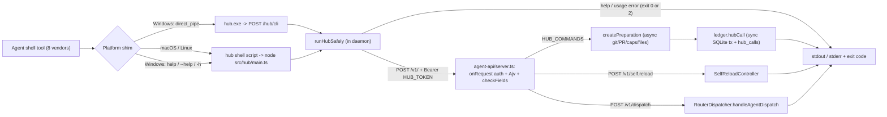

# Hub CLI audit and redesign

> Snapshot: 2026-11-28 (commit `59358e6e`)

This plan audits Bellwood's `hub` CLI and daemon handlers against Claude Code's tool-exposure and error-handling patterns, records verified defects on `59358e6e`, compares three structurally distinct redesigns, and defines a unified command metadata registry plus targeted daemon fixes without altering any cached system prompt.

## Plan review and decisions

### Files to review

- [This design document](hub-cli-audit-design.md): measured audit of `src/hub/`, `src/daemon/agent-api/`, `src/daemon/ledger/`, and `src/daemon/prompt.ts`, comparison of three candidate architectures, cache-safety proof, and acceptance scenarios.
- [`src/hub/registry.ts`](../src/hub/registry.ts): typed metadata registry covering every `hub` command (`HUB_COMMANDS`, `self-reload`, `dispatch`), progressive-disclosure help renderers, and typo or argument diagnostic helpers.
- [`src/daemon/ledger/task-graphs/spec-errors.ts`](../src/daemon/ledger/task-graphs/spec-errors.ts): strict JSON-spec issue formatter that reports exact field paths, expected types, and closest valid keys for `graph create` and `graph patch`.
- [`src/shared/hub-caps.ts`](../src/shared/hub-caps.ts): shared types and bounded text formatter for the help-only `hub caps` command.
- [`src/daemon/self-reload-busy.ts`](../src/daemon/self-reload-busy.ts): bounded formatter that names active Workers, PMs, and running background commands for `hub self-reload` and `hub status`.
- Additive contract extensions in [`src/shared/limits.ts`](../src/shared/limits.ts), [`src/shared/domain.ts`](../src/shared/domain.ts), [`src/shared/api.ts`](../src/shared/api.ts), [`src/daemon/sent-files.ts`](../src/daemon/sent-files.ts), and [`src/daemon/self-reload.ts`](../src/daemon/self-reload.ts).
- Acceptance tests: [`src/hub/registry.test.ts`](../src/hub/registry.test.ts), [`src/daemon/ledger/task-graphs/spec-errors.test.ts`](../src/daemon/ledger/task-graphs/spec-errors.test.ts), [`src/daemon/ledger/hub-caps.test.ts`](../src/daemon/ledger/hub-caps.test.ts), and [`src/daemon/self-reload-audit.test.ts`](../src/daemon/self-reload-audit.test.ts).

### Project Manager plan review

- **User sentences to scenarios.** Every quoted sentence in Section 1 maps to S1 through S11 in Section 8.
- **Subsystem understanding (`how`).** Section 2 documents the real end-to-end architecture, data flow, ownership boundaries, and verified gotchas across POSIX/Windows shims, `agent-api/server.ts`, `launch.ts`, `hub-commands.ts`, `sessions.ts`, `turn-background-waits.ts`, and `router/dispatcher.ts`.
- **Verification categories.** Section 8 covers all nine categories from `docs/plan-standard.md`, and addresses every matching rule in `REVIEW.md` on `main`.
- **Structurally distinct designs.** Section 3 compares three distinct structures: a unified CLI command metadata registry with layered diagnostics (Design A, chosen), a full schema-first tool compiler with an optional native MCP bridge (Design B, day-one design), and minimal point patches on the current layout (Design C).

### Decisions (settled by Project Manager)

None of the choices below changes what a human user sees in the web workbench or Feishu, so no user decision card is required. The Project Manager approved **Design A** and all three recommended options before implementation:

- **D1 -> Option 1 (Approved):** Bare `hub help` outputs a compact ~2.5 KB grouped index; `hub help <group> [<action>]` and `<cmd> --help` / `-h` output scoped help; `hub help --all` outputs the full manual (`HUB_USAGE`).
- **D2 -> Option 1 (Approved):** `hub graph create` and `hub graph patch` enable `.strict()` to reject unknown JSON keys with closest-key suggestions.
- **D3 -> Option 1 (Approved):** `hub caps` is read-only inspection (`hub caps [--kind skill|mcp|connector] [--vendor <vendor>]`) and does not mutate Settings capability switches.

#### D1. Output of bare `hub help`

| Option | What an agent sees when running `hub help` | Tradeoff |
|---|---|---|
| **1. Compact grouped index plus `--all` (recommended)** | About 2.5 KB listing every group, each command's one-line summary, the `--stdin` shell note, and a header pointing to `hub help <group> [<action>]`, `hub <cmd> --help`, `hub help graph`, and `hub help --all`. | Cuts bare `hub help` context cost by about 85% and matches `claude --help` and `gh --help`. Requires one extra scoped call if the agent omits the group name. |
| 2. Keep bare `hub help` as the 17.6 KB full dump | Bare `hub help` stays 17,582 bytes; only `hub help <group> [<action>]` and `<cmd> --help` return short scoped help. | Keeps exact backward compatibility for agents that read the pinned system prompt hint `详细参数跑 hub help 看`, but still wastes ~4,500 tokens whenever an agent runs bare `hub help`. |

Example under Option 1:

```
用法：hub <命令> [参数]（看某组或某条命令的完整参数和上限：hub help <组> [<动作>] 或 hub <组> [<动作>] --help；看全部展开：hub help --all）

核心
  status              查看身份、项目、文件夹、准备命令、活跃任务图与热重启状态
  models              查看各厂商可用模型、思考程度与额度状态
  caps                查看当前项目可用的外接能力（skill/mcp/connector）及开关状态
  checklist           无专用清单工具时更新本轮进度清单
  self-reload         热重启守护进程（--build / --cancel / --status）
...
```

#### D2. Unknown JSON keys in `hub graph create` and `hub graph patch`

| Option | What happens when an agent sends `"no_outer_sandbox": true` or `"dependencies": ["a"]` | Tradeoff |
|---|---|---|
| **1. Reject with `.strict()` and suggest the closest key (recommended)** | Fails with exit code 1: `步骤「impl」包含不认识的字段 "no_outer_sandbox"（你是不是想写 "noOuterSandbox"？）`. Nothing is created or patched. | Eliminates silent parameter loss. Agents that previously sent ignored typo keys now fail fast and fix them. |
| 2. Accept and print a warning in the receipt | Graph is created or patched without the unrecognized key, and the receipt appends a warning line. | Never breaks existing callers, but leaves the graph running with wrong sandbox or dependency settings until the PM patches it. |

#### D3. Scope of `hub caps`

| Option | What `hub caps` does | Tradeoff |
|---|---|---|
| **1. Read-only inspection command (recommended)** | `hub caps [--kind skill\|mcp\|connector] [--vendor <vendor>]` prints the project's base policy, enabled or disabled status per discovered item, supported vendors, and `[支持 --no-outer-sandbox]` markers. | Respects the human-owned capability policy boundary (`docs/pm-capabilities-design.md`) and requires no approval flow. |
| 2. Allow `hub caps enable/disable` from CLI | Adds mutation subcommands so a PM can toggle project capabilities itself. | Violates the policy boundary where only the user enables external MCP servers or Computer Use in Settings. |

### Settled by this plan

- **Zero edits to pinned system prompts.** `HUB_USAGE_PROMPT`, `WORKER_HUB_USAGE_PROMPT`, `taskGraphSkillCatalogEntry`, and `buildRouterSystemPrompt` stay byte-for-byte identical. `hub caps` registers in `HUB_HELP_ONLY_COMMANDS` and is announced from `hub help`, `--no-outer-sandbox` errors, and blocked-capability receipts.
- **No changes to existing `HubErrorCode` values or `HUB_EXIT` codes.** All new errors reuse `invalid`, `not_found`, `forbidden`, `conflict`, and exit codes `1` (daemon rejection) or `2` (CLI usage error).
- **Retain `HUB_USAGE` as the full-manual export (`hub help --all`).** Existing portability and limit-visibility guards keep scanning the entire command reference.
- **Legacy `hub router ask` and `hub graph ask` parsers stay untouched in this PR.** They remain undocumented compatibility paths and are noted as a follow-up deletion once no older PM session calls them.

## 1. User goal

Quoted from the user's request and task graph goal (`/tmp/hub-cli-claude-audit/context.md`):

> 对标 Claude code 对于工具的操作，看看我们的 hub 命令有什么问题

> 直接把这些都建起来开始跑就行

> 走流程解决问题，之后我们的做什么都先走完整流程

> 现在所有的需求你来拍板，直到一切都完成，检查，不满意的话重新来，明天我要看到所有的都完美

Intended outcome: `hub` exposes progressive, bounded help and clear recovery diagnostics modeled after mature agent tool interfaces, closes every verified field gap (`help` scoping, `caps` visibility, `graph show` execution flags, PM memory file sharing, `self-reload` cancel and busy visibility, strict graph JSON errors, and receipt/copy consistency), and preserves prompt caching across every vendor.

## 2. How the `hub` subsystem works and current state

### Overview

`hub` is Bellwood's authenticated command-line bridge between eight vendor agent CLIs and the local daemon (`src/daemon/`). Instead of registering separate MCP tools per vendor, Bellwood prepends a per-install `hub` shim onto each session's `PATH` and injects two environment variables (`HUB_SOCK` and a per-session bearer `HUB_TOKEN`). Every agent role (Project Manager, Worker, and Router) invokes `hub` through its normal shell tool; the daemon authenticates the bearer token, resolves the caller's role, executes any async I/O outside the SQLite lock, mutates the ledger synchronously, logs the call to `hub_calls`, and returns concise Chinese text on stdout (or an error on stderr with exit code `1` or `2`).

### Key concepts

- **Per-session bearer tokens and role gating.** `createLaunchPreparer` (`src/daemon/launch.ts:288-292`) issues one revocable token per active session via `SessionTokens.issue(session.id)`. `agent-api/server.ts:690-696` resolves the token on every HTTP request before reading the body, and re-verifies it after async preparation (`server.ts:735-741`). Role enforcement splits cleanly: Workers may call only `status` and `checklist` (`HUB_COMMAND_ROLES` in `src/shared/hub.ts:84-123`); Router dispatch sessions (`role === "assistant"`) are blocked from all regular `HUB_COMMANDS` (`server.ts:728-732`) and allowed only `POST /v1/dispatch`; Project Managers may call all `HUB_COMMANDS` plus `POST /v1/self.reload`, subject to `feishuGuestTurnBlockReason` (`hub-commands.ts:382-392,421`).
- **Two-tier endpoint architecture (`HUB_COMMANDS` vs sidecar routes).** The 37 standard commands live in `HUB_COMMANDS` (`src/shared/hub.ts:44-82`), mount at `POST /v1/<command>` (`server.ts:723-746`), and flow through `ledger.hubCall` (which wraps synchronous `write(...)` and inserts every success/failure into `hub_calls`). Two commands sit outside `HUB_COMMANDS` as sidecar routes: `hub self-reload` (`POST /v1/self.reload`, `server.ts:749`) and `hub dispatch` (`POST /v1/dispatch`, `server.ts:789`), routed to `SelfReloadController` and `RouterDispatcher.handleAgentDispatch` respectively.
- **Sync SQLite ledger lock vs async `createPreparation`.** SQLite transactions in `ledger.write(...)` are strictly synchronous. Slow or network-bound work (`git` workspace probes, `gh` PR probes, `models.list()`, `quota.get()`, `capabilityInventory.get()`, and `shareHubFiles()`) runs ahead of the transaction inside `createPreparation` (`server.ts:535-609`), controlled by a shutdown `AbortController` (`closing.signal`) and passed into `ledger.hubCall(..., context)` via `HubCallContext`.
- **Prompt-cache fingerprint pinning and `HUB_HELP_ONLY_COMMANDS`.** `createLaunchPreparer` hashes `buildFingerprintPrompt`, vendor base settings, readonly policy, and `taskGraphSkillCatalogEntry()` (`launch.ts:298-303`), and `src/daemon/launch-fingerprint.test.ts` pins those SHA-256 digests. Adding a command to `HUB_HELP_ONLY_COMMANDS` (`src/shared/hub.ts:129-133`) exposes it in `hub help` and error hints without changing any system prompt or invalidating live vendor prompt caches.
- **Live session memory vs persisted background waits.** Active session status lives in two places: in-memory `LiveSession` maps inside `src/daemon/ledger/sessions.ts` (holding `activity`, `currentTool`, `backgroundTasks`, and `backgroundTaskList`), and the SQLite table `turn_background_waits` (`src/daemon/ledger/turn-background-waits.ts:118-121`) storing held post-reply background commands and reminder schedules. `SessionState` (`sessions.ts:231-252`) intentionally projects a summary without `backgroundTaskList`, and `SelfReloadController`'s `busySessions` helper (`self-reload.ts:249-264`) tracks only a `Set<SessionId>`.
- **Role-scoped file-sharing boundary (`ShareScope`).** `shareFilePaths` (`src/daemon/sent-files.ts:116-120`) validates user-attached files after `realpathSync` and `openRegularFileNoFollow`. Currently it enforces `DATA_DIR_READABLE_ENTRIES` (`["worktrees", "uploads", "tools"]`) uniformly for every session inside `dataHome`, even though PM memory lives under `state/pm-memory/<pmId>`.

### How it works



1. **Launch wiring.** Before spawning a vendor CLI, `createLaunchPreparer` (`src/daemon/launch.ts:178-325`) writes `prompt.md`, vendor settings, and (for PMs) the Task Graph skill file, then injects `ENV_HUB_TOKEN`, `ENV_HUB_SOCK`, and `PATH=<hubBinDir>:...`.
2. **Shim execution.** On macOS and Linux, `src/daemon/agent-api/shim.ts:62-70` installs a `#!/bin/sh` wrapper executing `node src/hub/main.ts "$@"`. On Windows, `shim.ts:40-59` installs `hub.exe` (`apps/windows/crates/fusa-win-helper/src/bin/hub.rs`) beside `hub.json` (`direct_pipe: true`). For non-help invocations, `hub.exe` reads `--stdin` up to `HUB_MAX_STDIN_BYTES + 1` and POSTs `{ argv, cwd, msystem, exepath, stdinUtf8 }` over the local named pipe or loopback socket to `POST /hub/cli` (`server.ts:841-877`), which runs `runHubSafely` inside the daemon process to avoid Node cold-start overhead.
3. **CLI parse and help short-circuit.** `runHub` (`src/hub/cli.ts:39-121`) parses `argv` via `parse.ts` and `parse-{worker,graph,ask,dispatch}.ts`. Help requests exit immediately with no daemon round-trip; usage errors exit `2`; valid commands POST JSON to `HUB_SOCK` over HTTP/1.1 (`src/hub/http.ts`).
4. **Daemon validation, preparation, and execution.** `agent-api/server.ts` authenticates `Bearer <token>`, enforces `BODY_SCHEMAS` (Ajv with `removeAdditional: false, coerceTypes: false`), runs `checkFields` (`HUB_LIMITS`, path absoluteness, control characters), runs `createPreparation` outside SQLite, re-checks token validity, and invokes `ledger.hubCall` (or `selfReload` / `onRouterDispatch`).
5. **Response and persistence.** `hub-commands.ts:440-460` commits state and appends a truncated summary to `hub_calls`. `cli.ts` writes `result.text` to stdout (exit `0`) or error message to stderr (exit `1` on daemon rejection, `2` on CLI usage error).

### Where things live

| Layer | Files | Responsibility |
|---|---|---|
| Platform shims | `src/daemon/agent-api/shim.ts`, `apps/windows/crates/fusa-win-helper/src/bin/hub.rs`, `.../src/pipe_http.rs` | POSIX shell wrapper, Windows `hub.exe` `direct_pipe` client, `is_help_invocation` check |
| CLI parser & help | `src/hub/{main,cli,args,parse,parse-worker,parse-graph,parse-ask,parse-dispatch,usage,http}.ts` | Argument parsing, Git Bash path-mangle detection, help output, HTTP client |
| Shared contracts | `src/shared/{hub,hub-limits,limits,domain,api,sandbox-approval,task-graph-skill}.ts` | `HUB_COMMANDS`, `HUB_COMMAND_ROLES`, `HUB_HELP_ONLY_COMMANDS`, `HUB_LIMITS`, sandbox rules |
| Launch & prompts | `src/daemon/launch.ts`, `src/daemon/prompt.ts`, `src/daemon/router/prompt.ts` | Token injection, prompt-cache fingerprint, pinned PM/Worker/Router prompts |
| Agent HTTP API | `src/daemon/agent-api/{server,tokens}.ts` | Bearer auth, Ajv schemas, `checkFields`, async `createPreparation`, `/hub/cli` proxy |
| Ledger & domain | `src/daemon/ledger/{hub-commands,sessions,turn-background-waits,sent-files,capability-rows,worker-view,router}.ts`, `src/daemon/ledger/task-graphs/{spec,rows,store,text,step-agent-label,gate}.ts` | Synchronous SQLite transactions, `hub_calls` log, Task Graph specs, file sharing, live session state |
| Reload & Router | `src/daemon/self-reload.ts`, `src/daemon/daemon.ts`, `src/daemon/router/dispatcher.ts`, `src/daemon/pm-capabilities/inventory.ts` | Drain/build/restart controller, `busyReasons` wiring, Track A/B dispatch, cached capability scan |

### Gotchas discovered from the code

1. **Dead command shipped in a live PM reminder (`src/daemon/ledger/turn-background-waits.ts:113`).** When a Worker finishes writing a reply while background commands are still running, `reminderText` tells the PM: ``用 hub worker show <id> 看现场，需要时用 hub worker send <id> 或 hub worker stop <id> 处理。`` **`hub worker stop` does not exist**: a PM only has `hub worker end <id>` (while `worker-stop` is a Router-only `hub dispatch` op). No static guard previously verified that `${HUB_COMMAND} <group> <action>` hints in `src/` resolve to real commands.
2. **Windows `hub.exe` dual-path help handling (`apps/windows/crates/fusa-win-helper/src/pipe_http.rs:214-219`).** `is_help_invocation` only checks `args[0]` (`help`, `--help`, `-h`). So `hub help worker` falls back to spawning Node, while `hub worker start --help` travels over `direct_pipe` -> `POST /hub/cli` -> `runHubSafely` inside the daemon. Intercepting help in `src/hub/cli.ts` before `HUB_TOKEN`/`HUB_SOCK` validation guarantees identical scoped output on both paths.
3. **`busySessions` and `SessionState` cannot see background command labels (`src/daemon/self-reload.ts:249-264`, `src/daemon/ledger/sessions.ts:231-252`).** `SessionState` omits `backgroundTaskList`, and `busySessions` reduces `session.status` notifications to a `Set<SessionId>`. Detailed reload diagnostics in `daemon.ts:940-951` must query a ledger snapshot that joins `sessions.workingSessionIds()`, `sessions.liveOf(id).backgroundTaskList`, `turn_background_waits`, and worker/PM titles.
4. **Sidecar routes bypass `HUB_COMMANDS` and `hub_calls` (`src/daemon/agent-api/server.ts:748-825`).** `/v1/self.reload` and `/v1/dispatch` live outside `HUB_COMMANDS`, which caused `SELF_RELOAD_USAGE` and `DISPATCH_USAGE` to drift out of `HUB_COMMAND_SPECS` and left `self-reload` outside `hub_calls` logging.
5. **Async preparation boundary (`server.ts:535-609`).** `capabilityInventory.get({ projectDir })` is async filesystem I/O and already runs in `prepareWorkerStart` (`server.ts:505-511`). `hub caps` must preload `context.capabilityInventory` in `createPreparation` (never inside `ledger.write(...)`) and respect `closing.signal` plus post-prepare token re-validation.
6. **Three-layer validation asymmetry (`server.ts:438-465` vs `task-graphs/spec.ts:331-332` and `router.ts:410`).** Fastify's `describeIssue` gives clear Chinese field-level errors for top-level JSON fields, but `graph.create` and `graph.patch` pass a nested `specJson` string that bypasses Ajv and hits Zod schemas that omit `.strict()` and discard `parsed.error.issues` into fixed opaque strings.

### Design history

| Area | Original premise | What changed it | Patch stack? |
|---|---|---|---|
| CLI help and parsing (`src/hub/`) | One flat `HUB_USAGE` string and a shared `parseArgs` option map were small enough when `hub` had about 10 commands. | `hub` grew to 37 `HUB_COMMANDS` plus `self-reload` and 8 `dispatch` actions, and PR #481 added generated `上限：` lines. `HUB_USAGE` reached 17,582 bytes, while `parse.ts:57-58` still routes every `help` and `--help` invocation to the full dump. | Yes. `commandUsageFor` (`usage.ts:372`) was added only for error paths; `DISPATCH_USAGE` and `SELF_RELOAD_USAGE` sit outside `HUB_COMMAND_SPECS`. |
| Step capabilities and sandbox (`task-graphs/`, `sandbox-approval.ts`) | `graph show` printed only status, worker, and artifacts; later PRs added `vendor/model/effort`, `slot`, `caps`, and `noOuterSandbox` in separate tables. | `hydrateNodes` (`store.ts:128`) hydrated `slot` and `sandboxApproval` but skipped `task_graph_step_capabilities` and `task_graph_step_sandbox_modes`. No CLI read path for project capabilities was added. | Yes. Validation errors in `sandbox-approval.ts:147-164` remained static sentences without key hints. |
| File sharing (`sent-files.ts`) | `DATA_DIR_READABLE_ENTRIES` (`write-scope.ts:32`) defined what Workers may read inside `~/.agent-hub`, and `isShareable` (`sent-files.ts:116-120`) reused that boundary for every session. | PM memory files moved under `~/.agent-hub/state/pm-memory/<pmId>` (`paths.ts:122`). Because `isShareable` checks `DATA_DIR_READABLE_ENTRIES` for PMs too, a PM cannot attach its own memory files via `--file`. | No, an unmodeled role distinction in `ShareScope`. |
| Daemon `self-reload` (`self-reload.ts`, `daemon.ts`) | `self-reload` was built as a one-way drain trigger with a session count (`busySessions.count()`). | Long-running Workers with tracked background commands (`live.backgroundTaskList`, PR #480) made reloads wait up to 10 minutes with no way to cancel or see which Worker is blocking. | No, missing `cancel()` operation and structured busy-session view. |
| Graph JSON validation (`task-graphs/spec.ts`) | Zod schemas validated `specJson` shape before domain validators ran. | `parseSpecJson` (`spec.ts:331-332`) discarded `parsed.error.issues` and threw a fixed string, and `z.object(...)` lacked `.strict()`, silently dropping misspelled keys. | No, missing issue formatter and strictness. |
| `hub ask` receipt and `worker show` budget (`hub-commands.ts`, `worker-view.ts`) | Early versions omitted the card ID on `ask` and printed two "一轮" phrases in `worker show`. | PR #463 (`f7230639`) added `，卡 #${item.id}` on plain `hub ask`; PR #480 (`194a9314`) split `这一轮跑了` from `时间预算（从派活时起算，重启不重置）` in `worker show`. | Small residuals remain: `ask --node` prints `#${askMsg.id}` without `--message`, and `usage.ts`/`timers.ts` still say `本轮最大容忍时间` / `当前一轮已运行`. |

### Core concepts

- **Command metadata.** Split across six hand-synced places: `HUB_COMMANDS` and `HUB_COMMAND_ROLES` (`src/shared/hub.ts:44-123`), `HUB_ARG_OPTIONS` (`src/hub/args.ts:94-149`), five hand-written parsers (`src/hub/parse-*.ts`), `HUB_COMMAND_SPECS` plus `DISPATCH_USAGE` and `SELF_RELOAD_USAGE` (`src/hub/usage.ts:37-370`), `BODY_SCHEMAS` and `STRING_LIMITS` (`src/daemon/agent-api/server.ts:113-380`), and `hub-commands.ts` dispatch.
- **Write authority.** The ledger owns every durable mutation. `SelfReloadController` owns reload state (`idle | building | draining | restarting`). `CapabilityInventoryService` owns cached filesystem scans of installed capabilities. `ShareScope` owns file-sharing eligibility.
- **Facts stored in more than one place.**
  - Command flag lists exist in `HUB_ARG_OPTIONS`, each `allowOnly(...)` call in `parse-*.ts`, and prose in `usage.ts`.
  - Step `maxTime` meaning is stated as "from dispatch, survives restart" in `worker-view.ts:168`, but as "single-turn maximum" in `usage.ts:107,124,131` and `timers.ts:61`.
  - Step ask IDs use `messages.id` while independent ask IDs use `router_items.id`, so `ask --node` receipts and `ask show`/`ask close` must agree on `--message <id>`.
- **Missing concepts.**
  1. A single CLI command metadata registry that drives progressive help, group/action lookup, and recovery suggestions.
  2. A strict graph-spec error formatter that surfaces Zod paths and unknown keys.
  3. A PM read path for project capabilities (`hub caps`) and step execution flags in `hub graph show`.
  4. Role-scoped private data exceptions in `ShareScope` (PM-own memory only, never Workers).
  5. Reload cancellation and named busy-session reporting.

### Verified evidence

All `[Measured]` CLI probes ran on `59358e6e` via `node src/hub/main.ts <argv>` in the worktree (`task-89` probe script across 24 invocations):

- `[Measured]` **Help scoping is broken everywhere (`P0`).** `hub help`, `hub help router`, `hub help worker`, `hub help worker start`, `hub help dispatch`, `hub help self-reload`, `hub help nonexistent`, `hub worker start --help`, `hub router report -h`, `hub checklist --help`, `hub dispatch --help`, and `hub self-reload --help` all exit `0` and write **17,582 bytes (124 lines)** to stdout (`src/hub/parse.ts:33,57-58`, `src/hub/cli.ts:57-60`). `hub help graph create` ignores `create` and writes the **11,715-byte** Task Graph manual (`src/hub/parse.ts:57`).
- `[Measured]` **Environment and usage errors flood stderr without recovery guidance (`P0`).** Running `hub status` without `HUB_TOKEN` writes **17,656 bytes (125 lines)** to stderr (`src/hub/cli.ts:73-79` passes `full = true`). Running `hub worker` or `hub graph` prints `不认识的子命令：worker` plus 4,765 or 3,938 bytes of usage. Running `hub worker stat` prints no suggestion. Running `hub ask --foo` dumps 2,427 bytes of all four `ask` commands because `commandUsageFor` (`src/hub/usage.ts:379-381`) treats `--foo` as an action name. Running `hub graph show 1 2` prints `hub graph show 的参数个数不对` without stating expected vs actual counts.
- `[Measured]` **Graph JSON validation hides error locations and silently strips unknown keys (`P0`).** `src/daemon/ledger/task-graphs/spec.ts:331-332` discards `parsed.error.issues` and throws `"任务图规格字段格式不正确"` or `"patch 字段格式不正确"`. `createStepItemSchema`, `createSpecSchema`, `patchUpdateItemSchema`, and `patchSpecSchema` (`spec.ts:343-407`) omit `.strict()`, so unknown keys are stripped with no error.
- `[Measured]` **`hub graph show` omits `caps` and `noOuterSandbox`, no `hub caps` exists, and `--no-outer-sandbox` errors omit keys (`P0`).** `toTaskNode` (`src/daemon/ledger/task-graphs/rows.ts:127-139`) and `formatStepAgentConfig` (`src/daemon/ledger/task-graphs/step-agent-label.ts:11-20`) do not read or print `task_graph_step_capabilities`, `noOuterSandbox`, `readonly`, or `maxTimeMs`. `HUB_COMMANDS` (`src/shared/hub.ts:44-82`) has no capability inspection command. `validateNoOuterSandboxRequest` (`src/shared/sandbox-approval.ts:147-164`) returns static messages without listing `eligibleComputerUseCapabilities(vendor, inventory)`, disabled keys, or installed keys.
- `[Measured]` **`hub ask --file` rejects PM memory files (`P0`).** `createLedger` (`src/daemon/ledger/ledger.ts:267-275`) omits `pmMemoryDir` when constructing `createLedgerSentFiles`. `isShareable` (`src/daemon/sent-files.ts:116-120`) restricts every path inside `dataHome` to `DATA_DIR_READABLE_ENTRIES` (`["worktrees", "uploads", "tools"]`), which excludes `state/pm-memory/<pmId>` even for that PM's own session.
- `[Measured]` **`hub self-reload` cannot cancel and hides busy Workers (`P0`).** `SelfReloadController` (`src/daemon/self-reload.ts:42-46`) has only `request`, `status`, and `close`. `POST /v1/self.reload` (`src/daemon/agent-api/server.ts:748-758`) accepts only `{ build?: boolean }`. `busyReasons` (`src/daemon/daemon.ts:940-951`) reports only `${sessionsBusy} 个会话还在跑、停止中、准备中或等后台命令`, never naming which Workers are running or waiting on long background commands.
- `[Measured]` **Prompt and manual sizes on `59358e6e`.** `HUB_USAGE_PROMPT`: 3,744 bytes; `WORKER_HUB_USAGE_PROMPT`: 533 bytes; `buildRouterSystemPrompt()`: 6,726 bytes; `HUB_USAGE`: 17,582 bytes; `taskGraphSkillBody()`: 11,715 bytes; bundled models across 8 vendors: 40 models.
- `[Measured]` **Status of items 2 and 3 from `/tmp/hub-cli-claude-audit/context.md` (`P2` residuals).** Plain `hub ask` already prints `，卡 #${item.id}` (`src/daemon/ledger/hub-commands.ts:332`, from PR #463), and `hub worker show` already separates `这一轮跑了` from `时间预算（从派活时起算，重启不重置）` (`src/daemon/ledger/worker-view.ts:165-169`, from PR #480). Two residuals remain: `hub ask --node` (`src/daemon/ledger/task-graphs/gate.ts:153`) prints `拍板卡 #${askMsg.id}` without telling the PM to pass `--message ${askMsg.id}` to `ask show` or `ask close`; and `src/hub/usage.ts:107,124,131` plus `src/daemon/ledger/workers/timers.ts:61` still describe `max-time` as a per-turn limit.
- `[Measured]` **Dead `hub worker stop` hint shipped in live PM background-wait reminders (`P1`, discovered via full-repo `how` audit).** `src/daemon/ledger/turn-background-waits.ts:113` emits `需要时用 ${HUB_COMMAND} worker send ${worker.id} 或 ${HUB_COMMAND} worker stop ${worker.id} 处理`, even though `worker` only supports `start | send | max-time | end | list | show | search | log`. Executing that suggested command exits `2` (`不认识的子命令：worker stop`). Full grep across all 91 non-test `hub` references in `src/` confirmed this is the sole dead shipped command hint.

## 3. Reference designs and approach comparison

### Reference products

1. **Claude Code CLI and Anthropic tool-design guidelines** ([Writing effective tools for agents](https://www.anthropic.com/engineering/writing-tools-for-agents), [Claude Code CLI reference](https://docs.anthropic.com/en/docs/claude-code/cli-reference), and local `claude --help` verified on this machine).
   - **Progressive disclosure and prompt-cache stability.** Claude Code keeps the base system prompt and core tool list small and static so prompt-cache prefixes stay warm, loading specialized tool definitions on demand instead of dumping every schema upfront.
   - **Actionable, path-level validation errors.** Tool calls are validated against strict schemas; errors name the exact invalid field, why it failed, and the valid choices or next command so the model recovers in one turn instead of guessing.
   - **Bounded, high-signal responses.** Outputs stay concise and name exact IDs (such as session IDs returned by `--bg` that `attach`, `logs`, `stop`, and `rm` directly accept) so follow-up commands require zero guesswork.
2. **GitHub CLI (`gh`)** ([`gh help` manual](https://cli.github.com/manual/)).
   - Bare `gh --help` prints a grouped one-line command index under 3 KB. `gh <group> --help` and `gh <group> <action> --help` print only that scope. Unknown subcommands exit non-zero and suggest the closest valid command via edit distance.
3. **Kubernetes CLI (`kubectl`)** ([`kubectl` reference](https://kubernetes.io/docs/reference/kubectl/)).
   - Every resource command pairs write verbs (`apply`, `patch`, `rollout restart`) with matching read and cancel verbs (`describe`, `rollout status`, `rollout undo`) that echo every configured constraint and list blocking pods by name.

### Candidate structures

| Dimension | A. Unified CLI metadata registry + layered diagnostics (chosen) | B. Day-one: full schema-first tool compiler + optional MCP bridge | C. Minimal point patches |
|---|---|---|---|
| Structure | Add `src/hub/registry.ts` as the single CLI metadata source covering all `HUB_COMMANDS`, `self-reload`, and `dispatch`. Derive compact index, scoped help, `--all`, and typo/arg suggestions from it. Add strict Zod issue formatting in `spec-errors.ts`, read-only `hub caps` (help-only), step execution flags in `graph show`, PM-own memory exception in `ShareScope`, and `self-reload --cancel`/`--status` with named busy sessions. | Declare every `hub` command once in `src/shared/hub-commands/` with Zod schemas + metadata; generate CLI parsing (replacing `args.ts` and `parse-*.ts`), help text, Fastify JSON schemas, ledger validation, and an optional MCP server exposing `hub` as native tools. | Add an `if` branch in `parse.ts` for `help <group>`, leave `HUB_USAGE` flat and `dispatch`/`self-reload` outside `HUB_COMMAND_SPECS`, patch `sent-files.ts`, `self-reload.ts`, `text.ts`, and `sandbox-approval.ts` individually, and leave `spec.ts` non-strict. |
| Solves all audited gaps | Yes (P0 + P1 + P2 residuals) | Yes | Partial (keeps 17.6 KB bare help, silent JSON key stripping, and hand-synced CLI specs) |
| Prompt-cache impact | Zero (`HUB_USAGE_PROMPT` and tool lists untouched) | High if MCP bridge changes vendor tool lists; zero only if CLI-only | Zero |
| Estimated size | ~1,100–1,500 lines across ~18 files in one PR | ~3,000–4,000 lines across 35+ files | ~400–600 lines |
| Main risk | CLI parsers (`parse-*.ts`) still exist beside `BODY_SCHEMAS`, though `registry.ts` unifies help, groups, actions, flags, and diagnostics. | Rewriting all 5 parsers risks regressions in Windows/Git Bash path mangling (`findGitBashMangledArg`), `checklist` positional grammar, and `worker show --report [N]`. | Leaves hand-synced command lists and silent JSON typos unfixed; future commands repeat the same drift. |

**Recommendation: Design A.** It introduces the missing concepts cleanly (command registry, strict JSON diagnostics, capability read path, role-scoped private share exception, reload cancel and busy formatter), fixes every verified P0/P1/P2 issue in one cohesive PR, preserves every existing Windows and Git Bash parser guard, and guarantees zero prompt-cache churn across all eight vendors.

### Design red flags

Checked against `.agents/skills/architect/references/design-red-flags.md`:

- **Hand-synced list.** Previously `HUB_COMMAND_SPECS`, `DISPATCH_USAGE`, `SELF_RELOAD_USAGE`, and `parse.ts` each tracked command names separately. Design A unifies every CLI command into `HUB_CLI_REGISTRY` in `src/hub/registry.ts` and derives `HUB_COMMAND_SPECS`, `HUB_USAGE`, `HUB_HELP_INDEX`, `resolveHelpTarget`, and suggestion lists from it. A test asserts parity between `HUB_CLI_REGISTRY`, `HUB_COMMANDS`, `self-reload`, and `dispatch`.
- **Two ways to do one task.** Avoided: `hub help <group> [<action>]` and `hub <group> [<action>] --help` both call the single `resolveHelpTarget` + `renderScopedHelp` path. `hub caps` is read-only and does not duplicate Settings write flows.
- **Split ownership.** `SelfReloadController` remains the sole owner of reload state (`request`, `cancel`, `status`, `close`). `ShareScope` remains the sole owner of file-sharing eligibility. `HUB_LIMITS` remains the sole owner of input limit text.
- **Information leakage.** `spec-errors.ts` translates internal Zod `ZodIssue` objects into caller-facing Chinese field messages; `self-reload-busy.ts` formats live sessions without exposing internal DB rows; `hub-caps.ts` renders capability keys and status without exposing raw vendor config files.
- **Shallow module, pass-through method, temporal decomposition, importable internals.** Each new module owns a distinct domain policy (`registry.ts`, `spec-errors.ts`, `hub-caps.ts`, `self-reload-busy.ts`) behind a small exported interface.

### Patch rationale

Design A keeps the existing hand-written argument parsers (`src/hub/parse-*.ts`) and Fastify `BODY_SCHEMAS` (`src/daemon/agent-api/server.ts`) instead of replacing them with Design B's schema-first compiler. Replacing both layers is estimated at 3,000–4,000 lines and would risk subtle regressions in `findGitBashMangledArg`, PowerShell UTF-8 stdin handling, and special grammars (`checklist set`, `worker show --report [N]`, `ask --message`). Design A's `HUB_CLI_REGISTRY` already structures each command's group, action, flags, positionals, and limits so a future schema-first unification can adopt it incrementally without blocking any current fix.

### Synthesis record

None.

## 4. Performance and bounds

All four rules in `AGENTS.md` ("Caches and state bounds") apply:

1. **Invalidation.** `hub caps` reads `CapabilityInventoryService.get({ projectDir })`, which already validates file/directory mtime/size stamps (`src/daemon/pm-capabilities/inventory.ts:444-450`) and uses a short 5-second retry TTL (`PM_CAPABILITY_INVENTORY_RETRY_MS`) on scan errors. No new cache is added.
2. **Upper bounds.** Every new text response and diagnostic list has an explicit cap in `src/shared/limits.ts`, sized for one month of continuous use (300 finished Workers, 30,000 messages, 50,000 step logs, up to 2,000 discovered capabilities):

| Constant | Value | One-month sizing math |
|---|---|---|
| `HUB_CAPS_LIST_MAX` | `100` | `PM_CAPABILITY_INVENTORY_MAX_ITEMS` is 2,000; listing 2,000 items (~80 bytes each) would dump ~160 KB into PM context. Capping at 100 items keeps `hub caps` under ~8 KB and appends an overflow line guiding `--kind` or `--vendor`. |
| `SELF_RELOAD_BUSY_ITEMS_MAX` | `10` | Even with dozens of active Workers/PMs across projects, 10 named items (~100 bytes each, ~1 KB total) identify the blocking Workers and background commands without inflating `hub status` or `hub self-reload` receipts. |
| `HUB_ERROR_SUGGESTIONS_MAX` | `3` | Caps edit-distance suggestions in CLI usage errors and unknown-key graph JSON errors to at most 3 candidates (~80 bytes). |

3. **Stable front-end references.** No web selector, hook, or React Query cache changes. `TaskNode.capabilities` and `TaskNode.noOuterSandbox` are populated only when `includeDetails = true` (`hub graph show`), never in slim WebSocket snapshots, so snapshot size and frontend memory stay unchanged.
4. **Measured verification.** Before-and-after byte measurements for `hub help`, `hub help <group>`, `hub <cmd> --help`, and error paths are recorded in Section 8 and verified against real CLI output.

## 5. Cross-vendor and cross-platform unification

- **Vendors.** All eight registered vendors in `src/shared/vendors.ts` (`claude`, `agy`, `codex`, `pi`, `deepseek`, `cursor`, `opencode`, `kimi`) invoke the same `hub` binary through their shell tool. `hub caps` and `--no-outer-sandbox` read capability metadata from `vendorSpec(vendor)` and `CapabilityInventoryService`. A future vendor implements no new file for `hub`: its existing `src/vendors/<vendor>/spec.ts` (including optional `capabilities.builtInSandbox`) and `VendorSyncAdapter` automatically feed `hub caps`, `hub models`, and sandbox error hints.
- **Prompt cache preservation.**
  - `HUB_USAGE_PROMPT`, `WORKER_HUB_USAGE_PROMPT`, `taskGraphSkillCatalogEntry()`, and `buildRouterSystemPrompt()` are **not edited** (byte-for-byte identical).
  - `hub caps` is added to `HUB_HELP_ONLY_COMMANDS` in `src/shared/hub.ts`, so no system prompt changes and no live session relaunches.
  - Every improved help page, error message, `hub caps` output, `graph show` line, and `self-reload` receipt arrives strictly as a tool result appended to the end of the conversation.
  - `src/daemon/launch-fingerprint.test.ts` remains unchanged and green, proving every vendor's cached prefix is preserved.
- **Platforms.**
  - macOS, Windows, and Linux share the exact same `src/hub/registry.ts`, `spec-errors.ts`, `hub-caps.ts`, and `self-reload-busy.ts` TypeScript code.
  - Windows `/hub/cli` proxy (`src/daemon/agent-api/server.ts:841-877`) executes `runHubSafely` directly, so scoped help, `--help`, and typo diagnostics work identically inside Windows sandboxes and PowerShell/cmd.
  - `ShareScope.privateDataExceptions` uses `within()` (`src/daemon/sent-files.ts:91-96`), which delegates to case-insensitive `isPathInsideOrEqual` on `win32` and `realpathSync.native` on all platforms.
  - `--no-outer-sandbox` platform checks keep enforcing macOS-only support (`NO_OUTER_SANDBOX_SUPPORTED_PLATFORMS`) and clearly state the platform constraint on Linux and Windows.

## 6. Deletions

Delete in the implementation step so old and new paths never coexist:

- Separate `DISPATCH_USAGE` and `SELF_RELOAD_USAGE` side-tables in `src/hub/usage.ts` (absorbed into `HUB_CLI_REGISTRY` in `src/hub/registry.ts`).
- The catch-all `if (values.help === true || group === "help") return "help"` and `if (group === "help" && action === "graph") return "help-graph"` shortcuts in `src/hub/parse.ts:57-58` (replaced by `resolveHelpTarget`).
- The `full = true` flag on missing `HUB_TOKEN`/`HUB_SOCK` usage errors in `src/hub/cli.ts:73-79`.
- The opaque `badShape` error discard in `src/daemon/ledger/task-graphs/spec.ts:331-332` (replaced by `formatGraphSpecIssues`).
- The anonymous `${sessionsBusy} 个会话还在跑、停止中、准备中或等后台命令` string in `src/daemon/daemon.ts:943` (replaced by a ledger busy-session snapshot joining `sessions.liveOf` + `turn_background_waits`, formatted via `describeBusySessionsForReload`).
- The outdated `本轮最大容忍时间` and `当前一轮已运行` wording in `src/hub/usage.ts:107,124,131` and `src/daemon/ledger/workers/timers.ts:61` (aligned with `时间预算` / `从派活时起算，重启不重置`).
- The invalid `${HUB_COMMAND} worker stop ${worker.id}` hint in `src/daemon/ledger/turn-background-waits.ts:113` (replaced with `${HUB_COMMAND} worker end ${worker.id}` and locked down by the S11 static guard).

## 7. Skeleton files

New skeleton modules (all exported functions throw `new Error("Not implemented")` until implementation):

- `src/hub/registry.ts`: command metadata registry types, `HUB_CLI_REGISTRY`, progressive help resolution and rendering (`resolveHelpTarget`, `renderHelpIndex`, `renderScopedHelp`, `renderFullHelp`), and CLI diagnostic helpers (`suggestSubcommands`, `suggestFlags`, `formatMissingActionError`, `formatPositionalCountError`).
- `src/daemon/ledger/task-graphs/spec-errors.ts`: `formatGraphSpecIssues` converting strict Zod validation errors into actionable path-level and closest-key messages.
- `src/shared/hub-caps.ts`: shared `HubCapsArgs`, `HubCapsData`, `HubCapabilityEntry` types and bounded `formatHubCapabilities` renderer.
- `src/daemon/self-reload-busy.ts`: `BusySessionSnapshot` types and bounded `describeBusySessionsForReload` formatter naming active Workers, PMs, and running background commands.

Additive contract updates in existing files (preserving all current runtime behavior):

- `src/shared/limits.ts`: adds `HUB_CAPS_LIST_MAX`, `SELF_RELOAD_BUSY_ITEMS_MAX`, and `HUB_ERROR_SUGGESTIONS_MAX`.
- `src/shared/domain.ts`: adds optional `capabilities?: WorkerCapabilities` and `noOuterSandbox?: boolean` to `TaskNode`.
- `src/shared/api.ts`: adds optional `cancel?: boolean` and `status?: boolean` to `SelfReloadRequestBody`.
- `src/daemon/sent-files.ts`: adds optional `privateDataExceptions?: string[]` to `ShareScope`.
- `src/daemon/self-reload.ts`: adds `cancel(input: { by: string }): { text: string; status: SelfReloadStatus }` to `SelfReloadController` (body throws `Not implemented`).
- `docs/README.md`: indexes `docs/hub-cli-audit-design.md`.

Acceptance test files (every new-behavior test fails before implementation; every unchanged-rule regression test passes):

- `src/hub/registry.test.ts`: acceptance tests for S1, S2, S10, and S11.
- `src/daemon/ledger/task-graphs/spec-errors.test.ts`: acceptance tests for S3.
- `src/daemon/ledger/hub-caps.test.ts`: acceptance tests for S4, S5, and S6.
- `src/daemon/self-reload-audit.test.ts`: acceptance tests for S7, S8, and S9.

## 8. Verification plan

### Acceptance scenarios

Every scenario states what happens first, what happens next, and what the agent or user sees.

- **S1. Progressive-disclosure help and exact scoping.**
  - First: a PM or Router invokes `hub help`, `hub help router`, `hub help worker start`, `hub worker start --help`, `hub router report -h`, `hub help graph`, `hub help graph create`, `hub help dispatch`, `hub help self-reload`, `hub help --all`, and `hub help nonexistent`.
  - Next: `runHub` resolves the target via `HUB_CLI_REGISTRY` without contacting the daemon.
  - Expected: bare `hub help` exits `0` and prints a compact grouped index under 4 KB with drill-down instructions; `hub help router` prints only `router report` (under 1 KB, never 17.6 KB); `hub worker start --help` and `hub help worker start` print only `worker start` plus its `上限：` line; `hub help graph` prints the Task Graph manual while `hub help graph create` prints only `graph create`; `hub help dispatch` and `hub dispatch --help` print only `dispatch` commands; `hub help self-reload` prints only `self-reload`; `hub help --all` prints the full `HUB_USAGE` manual; `hub help nonexistent` exits `2` with an error and suggestions; missing `HUB_TOKEN` exits `2` with a 1-line error and never dumps `HUB_USAGE`.
  - Test: `src/hub/registry.test.ts`.

- **S2. Actionable CLI usage errors and recovery suggestions.**
  - First: an agent runs `hub worker`, `hub worker stat`, `hub worker start --tite hi`, `hub ask --foo`, and `hub graph show 1 2`.
  - Next: `runHub` validates against `HUB_CLI_REGISTRY` and exits `2`.
  - Expected: `hub worker` lists the valid `worker` actions instead of saying `不认识的子命令：worker`; `hub worker stat` suggests `show` / `start` and lists valid actions; `hub worker start --tite hi` suggests `--title`; `hub ask --foo` prints only `hub ask` usage (not `ask close`/`list`/`show`); `hub graph show 1 2` states the expected positional count vs received count.
  - Test: `src/hub/registry.test.ts`.

- **S3. Strict JSON validation and path-level error reporting for `graph create` and `graph patch`.**
  - First: a PM runs `hub graph create --stdin` with an unknown step key (`"no_outer_sandbox": true` or `"dependencies": ["plan"]`) or a wrong field type (`"readonly": "yes"`), then retries with valid JSON on the next turn.
  - Next: the daemon validates with strict Zod schemas and `formatGraphSpecIssues`.
  - Expected: the first call fails with exit code `1`, names the exact path (`steps[0].no_outer_sandbox` or `steps[0].readonly`), suggests the closest valid key (`noOuterSandbox` / `deps`) or states the expected type, and creates no graph; the second call succeeds cleanly. Corrupt JSON fails with a clear JSON parse message.
  - Test: `src/daemon/ledger/task-graphs/spec-errors.test.ts`.

- **S4. Read-only `hub caps` command with filtering, caching freshness, and bounds.**
  - First: a PM runs `hub caps`, `hub caps --kind mcp`, and `hub caps --vendor claude`; then a capability is toggled off in project policy or added on disk, and the PM runs `hub caps` again; separately, a fixture seeds 250 discovered capabilities.
  - Next: the daemon loads the PM's effective policy and `CapabilityInventoryService` and formats via `formatHubCapabilities`.
  - Expected: each entry shows its exact `skill:*` / `mcp:*` / `connector:*` key, enabled/disabled state, vendors, and `[支持 --no-outer-sandbox]` on eligible Computer Use items; toggling policy or touching config immediately updates the output; 250 items are capped at `HUB_CAPS_LIST_MAX` (100) with `另有 150 项未列出` and filter hint.
  - Test: `src/daemon/ledger/hub-caps.test.ts`.

- **S5. `hub graph show` displays step execution flags without growing slim snapshots.**
  - First: a PM creates a graph with steps using `caps: "none"`, `caps: "custom"` + `allow: ["mcp:peekaboo"]`, `noOuterSandbox: true`, `readonly: true`, and `maxTime: "45m"`, then reopens the ledger after a restart and runs `hub graph show`.
  - Next: `hydrateNodes` loads details for `graph show` while keeping `includeDetails = false` for WebSocket snapshots.
  - Expected: `hub graph show` prints each non-default attribute (`只读`, `外接能力 none`, `外接能力 custom（mcp:peekaboo）`, `申请取消外层沙箱`, `时间预算 45m`) and survives restart; corrupt capability JSON falls back to `none` without crashing; slim snapshot nodes omit `capabilities` and `noOuterSandbox`.
  - Test: `src/daemon/ledger/hub-caps.test.ts`.

- **S6. Actionable `--no-outer-sandbox` validation errors.**
  - First: a PM starts a Worker or creates a graph step with `--no-outer-sandbox` while (a) omitting `--caps custom --allow ...`, (b) mounting a Computer Use capability disabled in project policy, (c) targeting a vendor without it installed, or (d) running on Linux/Windows.
  - Next: `validateNoOuterSandboxRequest` evaluates the request with vendor metadata and inventory.
  - Expected: error (a) lists the eligible capability key(s) and exact `--caps custom --allow <key>` flag plus `hub caps` hint; error (b) names the disabled key(s); error (c) names the uninstalled key(s) and any installed alternatives; error (d) clearly states macOS-only support.
  - Test: `src/daemon/ledger/hub-caps.test.ts`.

- **S7. `hub self-reload` cancel, status, and named busy Workers / background commands.**
  - First: two Workers are active (one running a 4-minute background command `pnpm test`, one actively working) and 15 total sessions are busy in a large-volume fixture. A PM runs `hub self-reload --build`, then `hub self-reload --status`, then `hub self-reload --cancel`, and finally re-schedules `hub self-reload`.
  - Next: `SelfReloadController` transitions `idle -> building -> idle (cancelled)` and `describeBusySessionsForReload` formats active sessions.
  - Expected: the receipt and `--status` list the specific busy Workers and background commands with elapsed durations (capped at `SELF_RELOAD_BUSY_ITEMS_MAX = 10` with overflow count); `--cancel` aborts the in-flight build and timers cleanly, removes staging leftovers, and returns idempotently on a second `--cancel`; `--cancel` during `restarting` returns conflict; `--status` inspects without scheduling.
  - Test: `src/daemon/self-reload-audit.test.ts`.

- **S8. `hub ask --file` and `router report --file` allow a PM's own memory directory while keeping Worker and cross-PM isolation strict.**
  - First: PM #1 writes `plan.md` inside `~/.agent-hub/state/pm-memory/1/` and attaches it via `hub ask --file 方案=<path> --stdin` (and in a second turn via `hub router report --file`). In parallel, tests attempt: (a) PM #1 attaching PM #2's `pm-memory/2/secret.md`, (b) PM #1 attaching a symlink inside `pm-memory/1/` pointing to `state/hub.sqlite`, (c) PM #1 attaching `state/ui-token`, and (d) a Worker attaching `pm-memory/1/plan.md`.
  - Next: `createLedgerSentFiles` builds `ShareScope` with PM-only `privateDataExceptions` and `shareFilePaths` resolves realpaths.
  - Expected: PM #1's own `pm-memory/1/plan.md` is copied to `sent-files` and survives daemon restart; cases (a), (b), (c), and (d) are all rejected as `not_allowed`.
  - Test: `src/daemon/self-reload-audit.test.ts`.

- **S9. Receipt ID and `max-time` copy accuracy.**
  - First: a PM posts a plain `hub ask` and a step `hub ask --node plan`, inspects `hub worker show`, and triggers a `max-time` timeout notice.
  - Next: the daemon formats receipts, `worker show`, and timeout notices.
  - Expected: plain `hub ask` prints `卡 #<itemId>` (regression); step `hub ask --node` explicitly names `--message <messageId>` so `hub ask show/close --message <id>` matches verbatim; `hub worker show` separates `这一轮跑了` from `时间预算` (regression); `worker start` / `worker send` / `worker max-time` help and timeout notices use consistent `时间预算` phrasing.
  - Test: `src/daemon/self-reload-audit.test.ts`.

- **S10. Prompt-cache preservation and project-agnostic portability.**
  - First: run `src/daemon/launch-fingerprint.test.ts`, `src/prompt-portability.test.ts`, `src/hub/help-only-commands.test.ts`, and `src/hub-limits-guard.test.ts`.
  - Next: verify every pinned SHA hash, every rendered help string, and every product source literal.
  - Expected: all four pinned prompt/skill hashes remain byte-for-byte identical; no reference product name appears in code comments, help text, or UI copy; no repo-specific or POSIX-only instruction leaks into shipped text.
  - Test: `src/hub/registry.test.ts` plus existing guard suites.

- **S11. Every shipped `hub` command hint in `src/` resolves to a real CLI command.**
  - First: scan every non-test TypeScript file under `src/daemon/` and `src/shared/` for `${HUB_COMMAND} <group> <action>` hints.
  - Next: validate each `(group, action)` pair against the canonical `HUB_COMMANDS` action set.
  - Expected: zero invalid hints remain (specifically replacing the dead `hub worker stop` hint in `src/daemon/ledger/turn-background-waits.ts:113` with `hub worker end`), and any future dead command hint fails CI immediately.
  - Test: `src/hub/registry.test.ts`.

### Verification categories coverage

| Category (`docs/plan-standard.md`) | Covered by | Notes |
|---|---|---|
| 1. Two consecutive turns in one conversation | S3, S7, S8 | S3 retries `graph create` after strict-key failure; S7 schedules, cancels, and re-schedules `self-reload`; S8 attaches PM memory files across two consecutive turns. |
| 2. Restart in the middle of the operation | S5, S7, S8 | S5 reopens ledger to verify persisted step `caps`/`noOuterSandbox`; S7 verifies cancelled build leaves no stale staging marker across restart; S8 verifies copied PM memory deliverable survives restart. |
| 3. State or configuration change while queued | S4, S6, S7 | S4/S6 toggle PM capability policy between calls; S7 cancels `self-reload` while draining/building before restart fires. |
| 4. Existing rules touched (`REVIEW.md` on `main`) | S8, S10, table below | Every matching rule from `origin/main:REVIEW.md` is verified item by item below. |
| 5. Reopening a closed view after cached data becomes stale | S4, S5 | S4 verifies `CapabilityInventoryService` mtime/stamp invalidation reflects disk changes immediately; S5 verifies `graph show` re-reads fresh DB state after `graph patch`. No new web view or frontend cache is introduced. |
| 6. Large data volume (1-month sizing) | S4, S7 | S4 caps 250+ capabilities at `HUB_CAPS_LIST_MAX` (100); S7 caps 15+ busy sessions at `SELF_RELOAD_BUSY_ITEMS_MAX` (10). |
| 7. Malformed or dirty data | S3, S5, S7, S8 | S3 tests invalid JSON and wrong types; S5 tests corrupt capability JSON row; S7 tests unlabeled background tasks; S8 tests symlink escape out of `pm-memory/<id>`. |
| 8. Cross-vendor coverage and prompt-cache preservation | S4, S6, S10 | S4/S6 cover all 8 vendors in `src/shared/vendors.ts`; S10 pins every system prompt and skill catalog SHA unchanged. |
| 9. Cross-platform and cross-entry-point coverage | S1, S2, S6, S8, S9 | CLI works identically across macOS, Linux, and Windows (`/hub/cli` proxy and PowerShell/Git Bash); S6 tests `darwin` vs `linux`/`win32`; S8 uses cross-platform `within()` path comparison; S9 covers CLI receipts and card IDs shared with Web/Router/Feishu. |

### `REVIEW.md` rules on `main` triggered by this plan

| Rule (`git show origin/main:REVIEW.md`) | Triggered paths | How this design satisfies it |
|---|---|---|
| Worker sandboxes keep the data directory out of reach | `src/daemon/sent-files.ts` (security boundary near `DATA_DIR_READABLE_ENTRIES`) | `DATA_DIR_READABLE_ENTRIES` is unchanged; `privateDataExceptions` is populated only for `session.role === "pm"` with that PM's own `pm-memory/<pmId>` directory, verified after `realpath` and `openRegularFileNoFollow`. Workers and other PMs remain strictly denied (S8). |
| Async work stops touching the ledger after shutdown starts | `src/daemon/agent-api/**`, `src/daemon/sent-files.ts`, `src/daemon/ledger/**`, `src/daemon/daemon.ts` | `hub caps` preparation awaits `capabilityInventory.get()` inside `runPrepare` gated by `closing.signal.aborted` and token re-check before entering `ledger.hubCall`. `selfReload.cancel()` aborts any in-flight web build immediately. |
| Restart recovery finishes what the last run left | `src/daemon/daemon.ts`, `src/daemon/ledger/**` | Cancelled `self-reload` removes `.reload-next` staging directories on abort so restart recovery never mistakes a cancelled build for a crash. |
| Database transactions stay synchronous | `src/daemon/ledger/**`, `src/daemon/sent-files.ts` | `capabilityInventory.get()` and `shareHubFiles()` run asynchronously in `agent-api/server.ts` preparation outside `write(...)`; all ledger handlers remain synchronous. |
| Caches key on identity, have a limit, and retry failures soon | `src/shared/limits.ts` | No new cache; `hub caps` reuses `CapabilityInventoryService` (stat-stamped LRU with 5s error retry). |
| Growing data has a cap in `limits.ts` | `src/daemon/ledger/**`, `src/shared/limits.ts` | `HUB_CAPS_LIST_MAX`, `SELF_RELOAD_BUSY_ITEMS_MAX`, and `HUB_ERROR_SUGGESTIONS_MAX` live in `src/shared/limits.ts` and bound all new output lists. |
| Tests wait for events, not for time | `**/*.test.ts` | All new acceptance tests use fake timers (`vi.useFakeTimers`) or injected clocks (`now: () => ...`) with zero fixed sleeps. |
| Hub error codes change on both sides | `src/hub/**`, `src/shared/hub.ts` | No new error code; existing codes and `HUB_EXIT` values are reused consistently on both CLI and daemon. |
| Persisted fields have a reader and dual retention bounds | `src/daemon/ledger/**` | No new DB columns or tables; reads existing `task_graph_step_capabilities` and `task_graph_step_sandbox_modes`. |
| Text shipped to agents holds in any project | `src/daemon/ledger/**`, `src/hub/**` | All new help, error, and receipt strings are project-agnostic and POSIX/PowerShell portable, verified by `src/prompt-portability.test.ts` (S10). |
| Planned acceptance scenarios cover every requirement and pass real tests | `**` | Every quoted user sentence and settled rule maps to S1–S11 with runnable tests and a recorded failing baseline below. |
| A result is matched to its request by an id both carry | `src/daemon/**` | No new request/round matching logic; `ask --node` receipt now echoes its exact `--message <messageId>` identifier (S9). |

### Real-environment and real-CLI verification

- **Isolated local Bellwood + `hub` CLI.** Start a throwaway Bellwood daemon (`pnpm verify` harness with a temporary `AGENT_HUB_HOME`) and run the real `hub` binary inside an authenticated PM session for S1 (`hub help`, `hub help router`, `hub worker start --help`, `hub help nonexistent`), S2 (`hub worker`, `hub worker stat`, `hub ask --foo`), S3 (`hub graph create` with typo key then fixed JSON), S4 (`hub caps`), S5 (`hub graph show`), S6 (`hub worker start --no-outer-sandbox`), S7 (`hub self-reload --status` and `--cancel`), S8 (`hub ask --file` from PM memory), and S9 (`hub ask --node` receipt). Capture the full terminal transcript or start-to-finish screenshot sequence.
- **Web workbench.** In the same isolated instance, render the PM conversation in Playwright (1440 px and 390 px) showing the card attached from `pm-memory/<pmId>` via `hub ask --file` opening cleanly in the browser (start-to-finish screenshot sequence).
- **Real vendor CLI.** Run one real PM turn on two installed vendors (such as Claude and Codex/Agy) exercising `hub help <group>` and recovering from a strict `graph create` typo error in one turn; vendors unavailable locally run on the testbed or are recorded `not verified` with reason.
- **Prompt-cache preservation.** No session prompt, tool list, MCP definition, or prior message changes, verified by `src/daemon/launch-fingerprint.test.ts`. If implementation touches any prompt or tool list, comparable before/after real-session `TokenUsage.cacheRead` measurements become mandatory for every affected vendor.
- **Windows / Linux / Feishu / multi-computer.** Windows and Linux CLI paths run on cloud CI (`windows` and `linux` workflows); real remote Feishu or multi-computer runs use the testbed when available, otherwise recorded `not verified` with reason.

### Commands and visual checks

```sh
pnpm exec vitest run src/hub/registry.test.ts src/daemon/ledger/task-graphs/spec-errors.test.ts src/daemon/ledger/hub-caps.test.ts src/daemon/self-reload-audit.test.ts
pnpm exec vitest run src/daemon/launch-fingerprint.test.ts src/prompt-portability.test.ts src/docs-guard.test.ts src/code-hygiene.test.ts src/hub-limits-guard.test.ts
pnpm lint
pnpm typecheck
pnpm test:related
pnpm verify
```

### Pre-implementation baseline

Recorded on this branch with the skeleton in place (`pnpm typecheck` exits 0, `pnpm lint` exits 0 with knip clean, all 5 repository guard files pass 26/26, and existing `src/hub/cli.test.ts`, `src/daemon/self-reload.test.ts`, and `src/daemon/ledger/sent-files.test.ts` pass 273/273).

Command:

```sh
pnpm exec vitest run --reporter=verbose src/hub/registry.test.ts src/daemon/ledger/task-graphs/spec-errors.test.ts src/daemon/ledger/hub-caps.test.ts src/daemon/self-reload-audit.test.ts
```

Result: **4 files, 26 tests: 21 failed, 5 passed.**

- **Fail as expected (21), new or changed behavior:**
  - `src/hub/registry.test.ts` (8 failed): `HUB_CLI_REGISTRY` is empty; `resolveHelpTarget`, `renderHelpIndex`, and `suggestSubcommands` throw `Not implemented`; `hub help router` dumps full `HUB_USAGE`; `hub help nonexistent` exits 0; bare `hub worker` says `不认识的子命令：worker`; S11 catches the dead `"worker stop"` command hint at `src/daemon/ledger/turn-background-waits.ts:113`.
  - `src/daemon/ledger/task-graphs/spec-errors.test.ts` (3 failed): `formatGraphSpecIssues` throws `Not implemented`; `graph create` silently accepts unknown step key `no_outer_sandbox`; wrong field type returns opaque `任务图规格字段格式不正确` without `steps[0].readonly`.
  - `src/daemon/ledger/hub-caps.test.ts` (6 failed): both `formatHubCapabilities` tests throw `Not implemented`; `hub graph show` omits `readonly`/`caps`/`noOuterSandbox`/`maxTime` and fails to hydrate corrupt capability JSON; both `validateNoOuterSandboxRequest` error tests return static messages without `mcp:cua_repl` or `hub caps`.
  - `src/daemon/self-reload-audit.test.ts` (4 failed): `describeBusySessionsForReload` and `SelfReloadController.cancel` throw `Not implemented`; PM `shareHubFiles` returns `not_allowed` for its own `pm-memory/<pmId>/plan.md`; `hub ask --node` receipt omits `--message <id>` and `HUB_USAGE` still says `本轮最大容忍时间`.
- **Pass as expected (5), unchanged existing rules:**
  - `hub help graph` returns the Task Graph manual (`registry.test.ts`).
  - System prompts omit `hub caps` and keep pinned fingerprint hashes (`registry.test.ts` + `launch-fingerprint.test.ts`).
  - Malformed JSON in `graph create` fails with `invalid` and creates nothing (`spec-errors.test.ts`).
  - `--no-outer-sandbox` rejects `linux` and `win32` with `platform_unsupported` (`hub-caps.test.ts`).
  - Plain `hub ask` already prints `卡 #<id>`, and `hub worker show` already separates turn elapsed from `时间预算（从派活时起算，重启不重置）` (`self-reload-audit.test.ts`).
