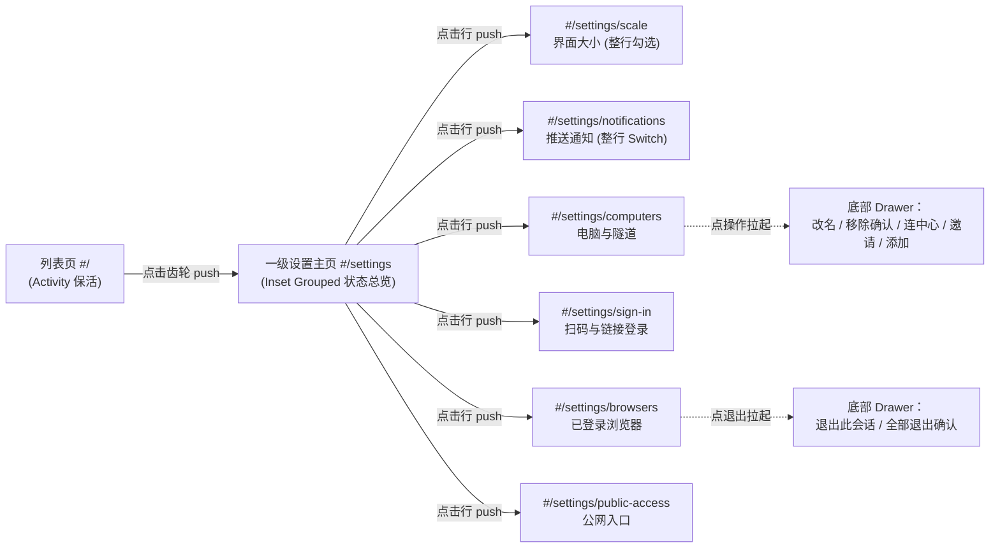
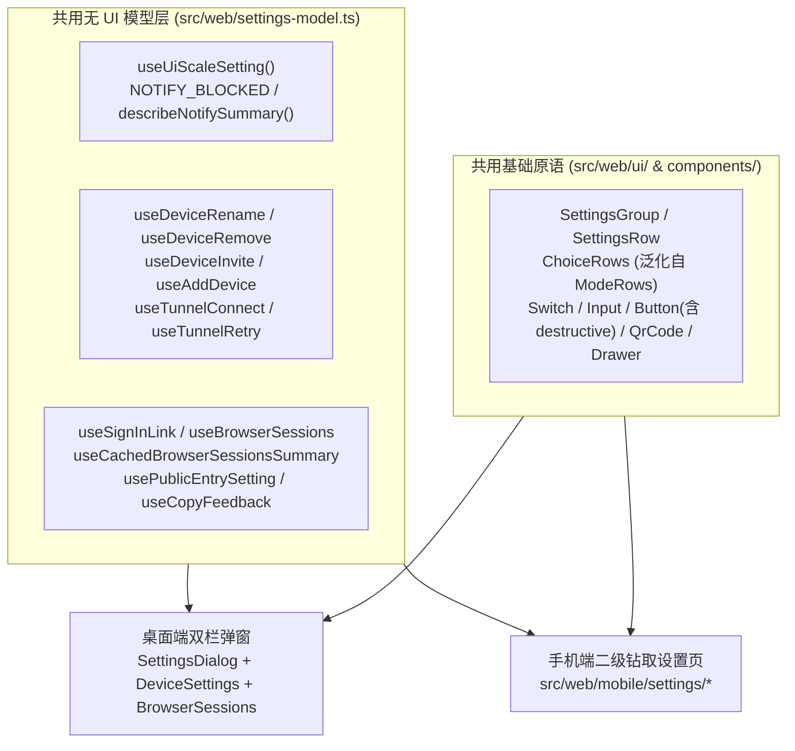
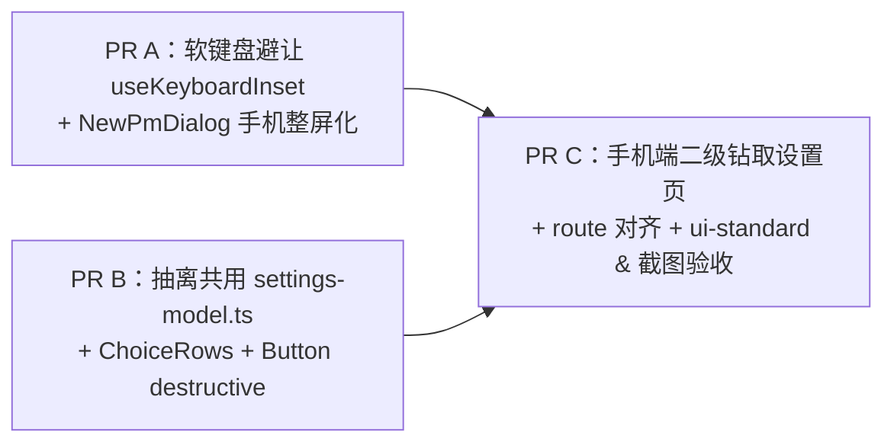

# 手机端设置体验重设计方案（对标顶尖移动应用）

**用户目标**：优化手机上的设置体验，对标市面上最好的应用。

**一句话结论**：废除原 `docs/mobile-ui-design.md` 第 2.4 节与 PR 5 中“把电脑双栏 `SettingsDialog` 弹窗拉满手机整屏 + 保留顶部横滑标签栏 + 右上角小叉号”的网页补丁方案；手机外壳（`src/web/mobile/`）改用对标 iOS 原生设置、Claude iOS、ChatGPT iOS 与 Linear Mobile 的**整屏二级路由钻取架构（Inset Grouped List + Sub-page Drill-down，`#/settings` → `#/settings/<section>`）**：一级主页用圆角分组卡片一眼给出各项当前状态摘要，点行进入聚焦子页重排触屏交互（整行勾选单选、整行 `Switch`、底部确认抽屉 `Drawer` 承载危险操作与输入向导、扫码页补齐复制链接与系统分享）；同时把分散在设置组件里的状态拉取、变更提交与校验逻辑抽成无 UI 的共用 `src/web/settings-model.ts`，让桌面双栏弹窗与手机原生设置页 **100% 共用同一份逻辑**，打开一级设置页 **0 额外网络请求**。

本文件只出设计方案，不改业务代码。用户拍板后按第 5 节拆 3 个独立小 PR 实施。

---

## 0. 设计原则与审美红线对齐

对照 `docs/ui-standard.md`、`docs/mobile-ui-design.md` 与 `frontend-rules`：

1. **把细节藏起来**：一级设置主页只展示“项目名 + 当前状态结论 + `›`”，错误引导、命令原文、配对二维码、设备管理操作与会话明细点进对应子页或拉起底部抽屉才呈现；平时状态正常时不挂任何解释性灰色废话。
2. **严禁符号拼接**：列表行与状态摘要**绝不用 `·`、`|`、`/` 拼接信息**；同一行只呈现单一主结论，子页列表的次要元数据用层级（`text-body` 15px vs `text-minor` 13.5px）与间距（`gap-2` / `gap-3`）分隔。
3. **措辞与计量规范**：界面外壳文案与状态词沿用 `docs/ui-standard.md` 第 3 条简洁地道的英文（`On`、`Off`、`Online`、`Offline`、`Connected`、`Pending`、`Copied`、`Expired`，句首大写 sentence case）；接口与本地错误文案沿用 `src/shared/errors.ts` 的 `humanize` 中文说明；计量一律用英文单位（`KB`、`ms`、`px`、`3m ago`、`4:59`），计数只写纯数字（`tabular-nums`）。
4. **克制的控件与按钮**：顶栏返回键一律用 `Button variant="ghost"`（无底色、无描边、不套胶囊圆底），热区靠 `.touch-target` 撑满 `≥ 44×44px`；钻取列表整行可点（`min-h-12`，标准档 48px、默认“大”档 52.5px），不在行右侧堆叠小胶囊按钮；杜绝渐变、毛玻璃、卡片套卡片与装饰动画。
5. **彻底告别“网页弹窗塞手机”**：去掉模态遮罩套壳、去掉顶部横向滚动 `TabsList`、去掉右上角悬浮 `×` 关闭按钮，设置页融入 `src/web/route.ts` 的浏览器历史栈，左边缘右滑与安卓系统返回键原路退回。

---

## 1. 现状逐项体检（以源码为依据）

### 1.1 现有设置项全量盘点

核对 `src/web/components/Sidebar.tsx`、`SettingsDialog.tsx`、`DeviceSettings.tsx`、`BrowserSessions.tsx`、`ui-scale.ts`、`notify.ts` 与 `push.ts`，当前全局设置的全部真实功能与数据链路如下（所有接口均为入口本机能力，不按远程设备转发）：

| 桌面分类 Tab | 分组（组件） | 具体行 / 控件 | 源码位置与真实行为 | 窄屏（390×844）实测问题 |
| --- | --- | --- | --- | --- |
| **入口** | 左栏底栏（`Sidebar`） | 齿轮按钮 `Settings`（左侧并列 `QuotaPopover` 额度浮层） | `Sidebar.tsx:215, 379-385`：点击改组件局部 `useState(settingsOpen)`，直接挂载 `<SettingsDialog>` | 不走 URL 路由，iOS 左边缘右滑和安卓返回键无法关闭设置，刷新即丢状态；`SettingsDialog` 常驻挂在 `Sidebar` 树尾 |
| **`General`**（始终显示） | `Appearance`（`SettingsGroup`） | `Interface scale`：横排 4 段胶囊 `<Segmented>`（`Compact` / `Default` / `Large` / `XL`） | `SettingsDialog.tsx:25-43`、`ui-scale.ts`：默认 `Large`（根字号 `17.5px`），读写 `localStorage["agent-hub.uiScale"]` 并设 `<html data-ui-scale>` | 390px 宽在默认 `Large` / `XL` 档下，`Interface scale` 标签与 4 段横排胶囊同抢一行，必然触发 `flex-wrap` 折成上下两行；单段胶囊触控宽度偏窄，极易误点相邻档位 |
| **`General`** | `Notifications`（无外标题 `SettingsGroup`） | `Notifications`：右侧 `<Switch>`（`h-5 w-9`）；不可开时 `detail` 显示 `NOTIFY_BLOCKED` 三种原因之一（`denied` / `unsupported` / `install`） | `SettingsDialog.tsx:16-20, 76-89`、`notify.ts:273-292`、`push.ts`：申请浏览器权限、订阅/退订 Web Push、写 `localStorage["agent-hub:notifyEnabled"]` | 控件本身可用，但和 `Interface scale` 混在弹窗一页里，一级入口看不到当前通知是 `On` 还是 `Off` |
| **`Computers`**（仅 `devices !== null` 即 `fleet.managed` 时显示，且**抢占默认选中 Tab**） | `This computer`（右上 `action`：`Connect to hub`） | 1. 本机 `DeviceRow`：`PlatformIcon` + 名字 + `detail`（状态点、系统名、`This computer`），右侧 `Pencil` 图标按钮 → 点后原地变行内表单 `RenameRow`（`<Input flex-1>` + `Cancel` + `Save`，`PATCH /api/devices/:id`）<br>2. `TunnelRow`（有 `tunnel` 时）：`Hub tunnel` + 状态词（`Connecting…` / `Connected` / `Retrying…` / `Key rejected` / `Server fingerprint changed`），报错原文放 `title={tunnel.detail}`，右侧按需出 `Retry`（`POST /api/tunnel/retry`）<br>3. 展开 `TunnelPanel`：`Terminal command`（长命令 + `Copy`）+ `Connection code`（`<Input w-60>` + `Connect`，`POST /api/tunnel/connect`） | `DeviceSettings.tsx:33-95, 269-380, 508-525` | ① 打开设置直接落进最复杂的 `Computers` 页，毫无总览感；<br>② `RenameRow` 把输入框 + `Cancel` + `Save` 硬塞进一行，窄屏输入框只剩百余像素；<br>③ **`TunnelRow` 的详细报错 `tunnel.detail` 只放在 `title` 上，触屏无 hover 完全看不见**；<br>④ `TunnelPanel` 的 `Connection code` 标签 + `w-60` 输入框 + `Connect` 按钮三件套挤一行必折行，且弹起软键盘后列表内嵌表单易被键盘遮挡 |
| **`Computers`** | `Connected computers`（右上 `action`：`Invite`、`Add`） | 1. 空态：`No other computers yet`<br>2. 远程 `DeviceRow`：图标 + 名字 + `detail`（状态点、系统名、传输方式 `PEER_TRANSPORT_SPECS`、在线状态 `StatusText`）；右侧并排两个 `icon-sm`（32px）按钮 `Pencil` + `Trash2`（`gap-1` = 4px）；点 `Trash2` 原地变成 `Cancel` + 主色 `Remove`（`DELETE /api/devices/:id`）<br>3. 展开 `InvitePanel`：`Generate`（`POST /api/devices/invites`）→ 纯文本 `invite.code` + `wide` 截断行 `This computer's URL`（完整地址放 `title`）<br>4. 展开 `AddPanel`：`URL`（`<Input w-60>`）+ `Invite code`（`<Input w-60>`）+ `Add`（`POST /api/devices`） | `DeviceSettings.tsx:97-266, 526-548` | ① **触控热区重叠**：`Pencil` 与 `Trash2` 视觉 32px、间距 4px，中心距仅 36px，两者 `.touch-target::after`（44×44px）在触屏上重叠 8px，点改名极易误点删除；<br>② 移除设备在行内原地出普通主色 `Remove` 小按钮，无红色警示且易连点误删；<br>③ **`InvitePanel` 的邀请码和本机 URL 均无复制按钮**，且 URL 被 `truncate` 截断、全文藏在手机看不见的 `title` 里；<br>④ `AddPanel` 写死 `w-60` 横排且缺 `autoCapitalize="none" autoCorrect="off"`，iOS 键盘默认首字母大写易输错 `https://` 与邀请码 |
| **`Security & Access`**（始终显示） | `Sign in on phone`（无外标题 `SettingsGroup`） | `Sign in on phone` 行 + 右侧 `Show QR code / Hide`（`POST /api/auth/login-links`，5 分钟一次性）；展开居中 `size-40` `<QrCode>` + 倒计时 `formatCountdown`（每秒跳动，同时每 3 秒 `SESSIONS_POLL_MS` 轮询会话列表，新会话登录自动收起）；过期显示 `Expired` + `Regenerate` | `BrowserSessions.tsx:37-77, 134-196` | **手机场景语义与操作断层**：用户正拿手机看设置时，标题叫“在手机上登录”且只给二维码、**没有复制链接与系统分享按钮**——手机没法用自己摄像头扫自己屏幕，想把登录链接发给 iPad 或备用浏览器无路可走 |
| **`Security & Access`** | `Signed-in browsers`（`CollapsibleGroup`，摘要为会话数） | 切到该 Tab 即触发 `useQuery(["browser-sessions"])`（`GET /api/auth/browser-sessions`）；`pending_approval` 置顶出 `Deny` / `Allow`；其余非本机会话出 `Sign out`（**一键直退无确认**）；本机会话点 `Sign out` 原地变 `Cancel` + 红字 `Sign out`（5 秒 `CONFIRM_TIMEOUT_MS` 超时自动退回）；末尾 `All browsers` 点 `Sign out all` 原地变红字 `Confirm sign out all`（5 秒超时 + 在 iOS Safari 上不触发焦点的无效 `onBlur`，调 `POST /api/auth/logout-all`） | `BrowserSessions.tsx:43-132, 197-291` | ① 非本机会话零确认直退，竖屏拇指滑动极易误触右侧 `Sign out`；<br>② 本机退出与全部退出采用“原地变字 + 5 秒倒计时退回”的桌面权宜交互，`onBlur` 在 iOS Safari 失效，一旦双点误退本机且身边无电脑，手机将彻底无法自助重登 |
| **`Security & Access`** | `Public access`（仅 `devices !== null` 时显示，`CollapsibleGroup`，摘要 `On` / `Off`） | 1. `Public domain`：开启时 `detail` 显示 `https://<hostname>`；右侧并排 `<Input w-60 min-w-0>` + `<Button outline>Turn on / Turn off</Button>`（`PUT /api/public-entry`）<br>2. `Funnel command`（开启时显示）：`detail` 为长命令 + 右侧 `Copy command` | `DeviceSettings.tsx:382-483` | `Public domain` 标签 + `w-60` 输入框 + `Turn on` 按钮三者挤在同一行，390px 下必折行错位，输入框缺少 `inputMode="url"` 与防大写纠错属性 |

> 注：左下角的模型额度展示 `QuotaPopover`（`src/web/components/QuotaPopover.tsx`）属于列表页底栏独立入口（`docs/ui-standard.md` 第 11、16 条），单个项目经理的模型/工作方式/定时任务/性格设定/归档属于资料页 `PmProfile`（`#/pm/<id>`），均不在 `SettingsDialog` 内，本方案严格保持边界不混入。

### 1.2 390×844 手机视口结构性痛点总结

1. **弹窗套壳与路由脱节**：`DialogContent` 默认 `w-[calc(100%-48px)] h-[min(35rem,calc(100%-3rem))]` 悬浮居中；即便照原 `mobile-ui-design.md` 2.4 强拉成全屏弹窗，本质仍是脱离 `route.ts` 历史栈的模态层，无法享受 iOS 左边缘右滑返回与安卓系统返回键。
2. **顶部横排标签栏拥挤 + 右上角关闭按钮遮挡**：640px 以下 `TabsList` 退化为顶部横向滚动条（`General` | `Computers` | `Security & Access`），正如 `mobile-ui-design.md` 实拍图 `06-settings.png` 所示，`Security & Access` 标签在未滚到底时直接被 `absolute top-4 right-4` 的 `×` 按钮压住。
3. **刘海与底部横条安全区断层**：`DialogContent` 未统一接入 `--safe-top` / `--safe-bottom`，在 iOS 主屏全屏 Web App（`display: standalone`，`--safe-top: 59px`、`--safe-bottom: 34px`）下顶栏与灵动岛、底部与 Home Indicator 互相挤压。
4. **桌面横排表单在窄屏全面折行**：固定 `w-60`（标准档 `240px`，默认 `Large` 档 `262.5px`，`XL` 档 `285px`）输入框、4 段横排 `Segmented`、行内 `Input + Button` 并排结构在扣除边距后的 `310px～342px` 行宽内全部局促折行。
5. **触屏防呆、悬停盲区、控件高度与软键盘遮挡**：虽然 `styles.css:644` 已在 `(pointer: coarse)` 下统一声明 `font-size: max(16px, var(--text-body))` 防住了 iOS 聚焦放大，但弹窗内输入框与分段胶囊仍沿用电脑紧凑高度 `h-9`（标准档 36px）；`DeviceRow` 相邻两个 32px 图标按钮的 44px 伪元素热区互相重叠；关键报错/长 URL 藏在触屏不可见的 `title` 属性里；危险退出操作缺少移动端标准底部确认抽屉；内嵌展开表单弹起软键盘后主按钮易被顶出可视区。

---

## 2. 对标顶尖移动应用的导航与信息架构

对标 **iOS 原生设置、Claude iOS、ChatGPT iOS 与 Linear Mobile**，手机外壳彻底移除设置弹窗与横滑标签栏，采用**整屏二级页面钻取（Inset Grouped List + Sub-page Drill-down）+ 底部抽屉（`Drawer`）承载瞬时向导与危险确认**的三层职责切分：



### 2.1 一级“设置”主页（`#/settings`）

不点进任何子页，用户在一级主页就能一眼扫清全部全局设置的当前状态：

```
┌──────────────────────────────────────────┐  ← pt-[var(--safe-top)] 刘海安全区（同底色 #f6f6f7）
│  ←   Settings                            │  ← h-16 顶栏：左上 ghost ArrowLeft（44px 热区）+ 17px 600 标题
├──────────────────────────────────────────┤
│  General                                 │  ← 13.5px 500 灰组头（px-4），与卡片间距 8px
│ ┌──────────────────────────────────────┐ │  ← 白底圆角分组卡片 rounded-2xl border-border bg-background
│ │ Type      Interface scale    Large › │ │  ← 16px 线性图标 + 15px 标题，整行 min-h-12（大档 52.5px）
│ ├──────────────────────────────────────┤ │
│ │ Bell      Notifications         On › │ │  ← 右侧当前状态 On / Off（阻断原因藏进子页）
│ └──────────────────────────────────────┘ │
│                                          │  ← 组间距 gap-6 (24px)
│  Computers                               │  ← 仅 devices !== null 时显示整组
│ ┌──────────────────────────────────────┐ │
│ │ Monitor   Computers       2 online › │ │  ← 仅本机写 This computer；多台写 N online / Offline / Attention
│ └──────────────────────────────────────┘ │
│                                          │
│  Security & Access                       │
│ ┌──────────────────────────────────────┐ │
│ │ QrCode    Sign in on another device ›│ │  ← 无冗余状态字，直接 ›
│ ├──────────────────────────────────────┤ │
│ │ Phone     Signed-in browsers     3 › │ │  ← 仅读已有缓存（未拉取时不显示数字；有待批标琥珀点 Pending）
│ ├──────────────────────────────────────┤ │
│ │ Globe     Public access        Off › │ │  ← 仅 devices !== null 时显示，摘要 On / Off
│ └──────────────────────────────────────┘ │
└──────────────────────────────────────────┘  ← pb-[var(--safe-bottom)] 底部横条安全区
```

**一级主页核心设计细节**：
- **原生 Inset Grouped 层次（零新造色值）**：外层页面背景直接复用无激活会话时的 `bg-surface-sidebar`（即 `--sidebar: #f6f6f7` 浅冷灰），内部每组卡片复用 `SettingsList.tsx` 现有的 `GROUP_BOX`（`bg-background` 纯白 `#ffffff` + `1px border-border` + `rounded-2xl`），天然形成与 iOS 原生设置完全一致的白卡浮于浅灰画布的视觉层次。
- **页面左右边距 `px-4`（16px）**：相比电脑弹窗的 `px-6`（24px），在 390px 窄屏上为卡片多释放 16px 横向有效宽度（卡片宽 `358px`）。
- **整行热区与反馈**：钻取行 `SettingsNavRow` 为原生 `<button type="button">`，`min-h-12`（标准档 `48px`，默认 `Large` 档 `52.5px`），左侧 `16px` 线性图标（`stroke-[1.5] text-muted-foreground`）+ `15px` 标题，右侧**单一结论摘要**（`text-minor text-muted-foreground tabular-nums`，绝不用 `·` 拼接多项）+ `16px` `ChevronRight`，触屏按下态 `active:bg-sidebar-hover`。

### 2.2 路由体系与防死循环返回（对齐 `src/web/route.ts` 与 `mobile/back.ts`）

#### 1. 网址映射表

全局设置均为入口本机与当前浏览器级配置，不挂 `#/d/<device>` 前缀，路径干净唯一：

| 页面 | Hash 网址 | `Route` 对象 | 上级 `parent` |
| --- | --- | --- | --- |
| 会话列表页 | `""`（或 `#/`） | `null` | — |
| 一级设置主页 | `#/settings` | `{ view: "settings" }` | `null`（列表页） |
| 界面大小子页 | `#/settings/scale` | `{ view: "settings", section: "scale" }` | `{ view: "settings" }` |
| 推送通知子页 | `#/settings/notifications` | `{ view: "settings", section: "notifications" }` | `{ view: "settings" }` |
| 电脑与隧道子页 | `#/settings/computers` | `{ view: "settings", section: "computers" }` | `{ view: "settings" }` |
| 扫码与链接登录子页 | `#/settings/sign-in` | `{ view: "settings", section: "sign-in" }` | `{ view: "settings" }` |
| 已登录浏览器子页 | `#/settings/browsers` | `{ view: "settings", section: "browsers" }` | `{ view: "settings" }` |
| 公网入口子页 | `#/settings/public-access` | `{ view: "settings", section: "public-access" }` | `{ view: "settings" }` |

#### 2. 返回链路验证（iOS 右滑、安卓返回键、顶栏返回键、深链接四路合一）

直接复用已合入的 `route.ts`（`pushState({ hub: true, previous: window.location.hash })`）与 `src/web/mobile/back.ts`（`mobileBack(parent, replace)`），**无需改动 `mobileBack` 一行代码**即可支持二级设置栈：

1. **常规逐级进入再逐级返回**：
   - 列表页（`""`）点齿轮 → `navigate({ view: "settings" })` → `history.state = { hub: true, previous: "" }`，URL 变 `#/settings`；
   - 点 `Computers` → `navigate({ view: "settings", section: "computers" })` → `history.state = { hub: true, previous: "#/settings" }`，URL 变 `#/settings/computers`；
   - **第一次返回**（iOS 左边缘右滑 / 安卓返回键触发原生 `popstate`，或点左上 `< Settings` 调 `mobileBack({ view: "settings" }, replace)`）：校验 `history.state.previous === "#/settings"` 命中，调 `window.history.back()`，退回 `#/settings`，同时浏览器自动恢复 `#/settings` 条目原本的 `state`（`{ hub: true, previous: "" }`）；
   - **第二次返回**（再次右滑 / 安卓返回键 / 点 `#/settings` 左上返回）：校验 `history.state.previous === ""` 命中，调 `window.history.back()`，退回列表页 `""`（列表页由 `<Activity mode="hidden">` 保活，滚动条与搜索词原封不动）。
2. **深链接 / 新标签直达子页（如直接打开 `#/settings/browsers`）**：
   - 初次加载 `history.state === null`；
   - 点左上 `< Settings`：`mobileBack({ view: "settings" }, replace)` 发现 `history.state?.hub` 为假，不调 `history.back()`（避免直接退出主屏 App 或跳回外部网页），而是执行 `replace({ view: "settings" })`（`replaceState(null, "", "#/settings")`）；
   - 再点 `#/settings` 左上返回：同样走 `replace(null)` 回到列表页 `""`，历史栈不增殖、**绝不产生前进后退死循环**。
3. **不支持联机时的深链接兜底（防竞态）**：
   - 当守护进程未开联机（`fleet.listed === true && !fleet.managed`）而网址是 `#/settings/computers` 或 `#/settings/public-access` 时，`shell-model.ts` 自动 `replace({ view: "settings" })` 退回设置主页；在 `fleet.listed === false`（首次 `GET /api/devices` 尚未返回）期间等待结果，避免刷新 `#/settings/computers` 被误判踢回。
4. **手机与电脑外壳动态切换衔接（如 iPad 分屏拉宽）**：
   - 若用户在 `#/settings` 或 `#/settings/<section>` 时把窗口拉宽切回桌面外壳（`mobile: true → false`）：按子页映射桌面 Tab（`scale` / `notifications` → `general`，`computers` → `computers`，其余 → `security`），自动打开桌面 `SettingsDialog` 对应分类并将网址 `replace` 回首个对话，状态无缝承接。

### 2.3 六个二级子页面的移动端专属交互重排

所有二级子页共用统一的整屏骨架 `MobileSettingsSubpage`：
- **顶栏**：高 `h-16`，顶部垫 `pt-[var(--safe-top)]`；左侧 `< Settings` 返回按钮（`Button variant="ghost"`，左 `ChevronLeft` + `Settings` 文字，无底色无胶囊，`.touch-target` ≥ 44px），中间子页标题（`text-title font-semibold truncate`），右侧等宽占位保持标题视觉平衡（或按第 6 节拍板项采用左对齐标题）。
- **内容区**：`min-h-0 flex-1 overflow-x-hidden overflow-y-auto overscroll-y-contain px-4 pt-2 pb-[calc(var(--safe-bottom)+2rem)]`，组间距 `gap-6`。

#### 子页 1：界面大小（`#/settings/scale` — `Interface scale`）

- **重排做法**：彻底去掉窄屏易挤折行的横排 4 段胶囊 `<Segmented>`，改用单个圆角分组框内的**整行单选勾选列表 `<ChoiceRows>`**（泛化现有 `ModeRows.tsx` 的 `@radix-ui/react-radio-group` + `RadioMark`）：
  - 4 行依次为 `Compact`、`Default`、`Large`、`XL`；
  - 每行 `min-h-12`（≥ 48px），左侧 `text-body` 档位名，右侧 20px `RadioMark`（未选中 `1.5px` 灰边空心圆，选中 `bg-primary` 实心圆配白色粗勾）；
  - 点击整行任意位置立即调用 `saveUiScale(next)` 切换 `<html data-ui-scale>`，整页字号与间距实时缩放，零保存按钮、零多余说明小字。

#### 子页 2：推送通知（`#/settings/notifications` — `Notifications`）

- **重排做法**：
  - 单个分组框内一行 `min-h-12`：左侧 `Notifications`（`text-body`），右侧标准 `<Switch>`（`h-5 w-9`，带 `.touch-target` 44px 热区）；
  - **正常可用时**：全页只有这一行干净的开关，下方不留任何解释文字；
  - **受阻不可开时**（`notify.permission` 为 `install` / `denied` / `unsupported`）：`<Switch>` 置灰 `disabled`，在框下方（`px-4 text-minor leading-snug text-muted-foreground`）展示具体解除步骤（如 iOS Safari 未添加到主屏幕时的 `"In Safari, tap Add to Home Screen, then open the app from its icon"`）。

#### 子页 3：电脑与隧道（`#/settings/computers` — `Computers`）

将桌面端拥挤的“行内双 32px 图标 + 行内改名表单 + 卡片下内嵌向导表单”全面重排为**清爽行列表 + 底部聚焦抽屉（`Drawer`）**：

1. **分组一：`This computer`（本机与中心隧道）**
   - **本机行**：左侧 `PlatformIcon` + 本机名（`text-body font-medium`），次行 `StatusDot` + 系统名 + `This computer`（`gap-x-3` 分隔，不用 `·`）；整行可点（右侧 `Rename` 轻文字提示或 `›`），点击拉起**“修改电脑名称”底部抽屉 `Drawer`**：
     - 抽屉内全宽 `<Input>`（`h-11` 44px 高、字号 `≥ 16px`），实时校验 `nameError` 显示在框下，底部全宽 `Save` 主按钮 + `Cancel` 按钮。
   - **中心隧道行 `Hub tunnel`**（已配置 `tunnel` 时显示）：
     - 左侧 `Hub tunnel`，次行显示状态词（`Connected` / `Connecting…` / `Retrying…` / `Key rejected` / `Server fingerprint changed`）；
     - **消除触屏 `title` 盲区**：当处于异常态且 `tunnel.detail` 非空时，在次行下方直接折行展示关键错误原因（`text-xs text-muted-foreground break-words`），不再藏进触屏看不见的 `title`；可重试态右侧放 `<Button variant="outline" size="sm">Retry</Button>`。
   - **连到中心入口行**：同框末行整行按钮 `Connect to hub…`（`min-h-12`，右带 `›`），点击拉起 **`Connect to hub` 底部抽屉 `Drawer`**：
     - 块 1：`Terminal command` 等宽代码框（完整折行显示）+ 全宽 `<Button variant="outline">Copy command / Copied</Button>`；
     - 块 2：`Connection code` 全宽等宽输入框（`autoCapitalize="none" autoCorrect="off" spellCheck={false}`，占位 `ahtun1_…`，去掉写死的 `w-60`）+ 全宽主按钮 `Connect`。
2. **分组二：`Connected computers`（远程电脑列表与设备管理）**
   - **远程电脑行（彻底根治 32px 图标热区重叠与误删）**：
     - 每台远程电脑是一整行可点击项（`min-h-14`）：左 `PlatformIcon` + 设备名，次行 `StatusDot` + 系统名 + 传输方式 + 在线状态（`Online` / `Reconnecting` / `Offline 3m ago`，`gap-x-3` 分隔），最右仅一个 `ChevronRight` `›`——**行上不放任何小图标按钮，竖向滑动 100% 零误触**。
     - 点击某台远程电脑 → 拉起**该电脑的操作底部抽屉 `Drawer`**：
       - 顶部展示电脑名称与当前状态；
       - 操作 1：`Rename…`（切换抽屉为全宽改名输入框 + `Save`）；
       - 操作 2：`Remove computer…`（红色危险按钮，点击后在抽屉内切换为二次确认视图，配备全宽 `Button variant="destructive"` `Remove` + `Cancel`）。
   - **邀请与添加入口**：分组框底部（或紧邻的操作框）提供两行 `min-h-12` 整行入口 `Invite a computer…` 与 `Add a computer…`：
     - **`Invite a computer` 抽屉**：点击 `Generate` 生成 10 分钟一次性邀请码后，大字号等宽展示邀请码 + 全宽 **`Copy code`** 按钮；完整换行展示本机 Tailscale URL（取消 `truncate` 截断）+ 全宽 **`Copy URL`** 按钮。
     - **`Add a computer` 抽屉**：纵向全宽堆叠表单（去掉 `w-60`）——全宽 `URL` 输入框（`type="url" inputMode="url" autoCapitalize="none" autoCorrect="off" spellCheck={false}`）+ 全宽 `Invite code` 等宽输入框（同样关闭自动大写与纠错）+ 全宽主按钮 `Add`。

#### 子页 4：扫码与链接登录（`#/settings/sign-in` — `Sign in on another device`）

- **重排做法**：
  - 将移动端语义别扭的 `Sign in on phone` 升级为通用准确的 `Sign in on another device`。
  - **按需生成（不进页自动请求）**：进入子页默认展示单张圆角分组卡片与全宽主操作按钮 `Create sign-in link`（避免误进子页就白建 5 分钟令牌并开启 3 秒会话轮询）。
  - **生成后单手大热区布局**：
    - 卡片上半部居中展示 `size-48`（192px，比电脑弹窗 160px 更易对焦扫码）白底圆角 `<QrCode>` + 纯数字倒计时 `4:59`（`tabular-nums`）；
    - 卡片下半部提供纵向/并排大热区按钮（`h-11` 44px 高）：
      1. **`Copy link`**（主按钮，复制 `link.url` 后变 `Copied` 1.5s，解决手机无法扫自己屏幕的痛点）；
      2. **`Share…`**（当 `typeof navigator.share === "function"` 时展示 `outline` 按钮，一键拉起 iOS 系统分享面板通过 AirDrop / 信息发给自己的 Mac 或 iPad）；
      3. **`Hide`**（`ghost` 按钮，收起并立即停止轮询）；
    - 过期后切换为 `Expired` 状态与全宽 `Regenerate` 按钮；另一台设备扫码登录成功后自动收起。

#### 子页 5：已登录浏览器（`#/settings/browsers` — `Signed-in browsers`）

- **重排做法**（独立子页不再套外层折叠壳 `CollapsibleGroup`）：
  1. **待批准公网会话置顶组 `Pending approval`**（仅存在 `pending_approval` 会话时渲染）：
     - 将安全审批项从普通列表中单独提炼置顶；每行展示设备图标 + 浏览器名 + 次行 `Via public access` 与请求时间（`gap-3` 分开），下方/右侧提供热区充足的 `Deny`（`outline sm`）与 `Allow`（主色 `default sm`）。
  2. **已登录会话组**：
     - 当前手机会话置顶（次行标 `This browser` + 时间），其余会话按最近活跃排列（次行标 `Via public access` + `formatAgo`，绝不用 `·`）；
     - **全员接入底部确认抽屉 `Drawer`（淘汰直退与 5 秒行内变字）**：点击任一会话行拉起确认抽屉，展示浏览器名与活跃时间，下方提供全宽红色危险按钮 **`Sign out`**（当前会话明确标 **`Sign out this browser`** 并提示退出后需重新验证登录）+ **`Cancel`**。
  3. **底部独立危险组**：
     - 页面最下方独立单行分组框：红色文字行 `Sign out all browsers…`（`min-h-12`，`text-danger`）；
     - 点击拉起底部确认抽屉 `Drawer`：一句话说明将更换主钥匙并退出所有设备（含本机），下方全宽 `Button variant="destructive"` **`Sign out all browsers`** + **`Cancel`**。

#### 子页 6：公网入口（`#/settings/public-access` — `Public access`）

- **重排做法**（独立子页去掉 `CollapsibleGroup` 折叠壳，把桌面挤一行的三件套拆成上下标准行）：
  1. **主配置分组**：
     - **第 1 行 `Public access`**：左侧标题（已开启时次行展示可全选复制的 `https://<hostname>`），右侧标准 `<Switch>`（未填域名且未开启时置灰，填好域名后拨开关一步提交开启）；
     - **第 2 行 `Public domain`**：纵向全宽布局——上方标签 `Public domain`（`text-minor font-medium text-muted-foreground`），下方 100% 宽度等宽 `<Input>`（`type="url" inputMode="url" autoCapitalize="none" autoCorrect="off" spellCheck={false}`，占位 `e.g. tokyo.tailnet.ts.net`，字号 `≥ 16px`）；若公网入口已开启且用户改动了域名，下方浮现全宽 `Save domain` 按钮。
  2. **`Funnel command` 分组**（仅开启态渲染）：
     - 框内上方完整展示等宽命令代码块，下方整行 `Copy command` 按钮（点后变 `Copied` 1.5s）。

### 2.4 动效与克制（防双层动画叠加）

1. **第一版采用瞬时页面切换 + 系统原生右滑手势**：
   - 修改 `src/web/route.ts` 第 64 行：当跳转涉及 `settings`（进入 `#/settings`、进入 `#/settings/<section>` 或退回）时，与 `profile` 一样直接调同步 `apply()`，**不调 `withViewTransition`**（设置页没有 `.vt-chat-avatar` / `.vt-chat-title`，省去无谓的整屏纹理快照与主线程阻塞，点击响应 `< 16ms`）。
   - iOS Safari（18+）左边缘右滑返回时，直接由系统执行原生跟手抽离过渡（此时派发的 `PopStateEvent` 带 `event.hasUAVisualTransition === true`），网页在 `popstate` 路径零动画介入，**100% 杜绝双层滑动重影**。
   - 一级设置主页 `#/settings` 在进入二级子页 `#/settings/<section>` 时同样用 React 19 `<Activity mode="hidden">` 保活，右滑退回时 DOM 与滚动条位置丝毫不差。
2. **局部控件动效严格守界**：
   - 底部抽屉 `Drawer` 直接使用 `vaul` 内置阻尼弹入与跟手下拉关闭动画，不叠外部 CSS 动画类；
   - `Switch` 滑块与 `RadioMark` 保持 `≤ 200ms` 过渡，`@media (prefers-reduced-motion: reduce)` 下全部关闭。

---

## 3. 统一：桌面与手机怎么共用、怎么扩展

### 3.1 双端外壳分工与单一逻辑底座

- **桌面外壳（宽屏与鼠标窄窗，`!mobile`）**：完全保留现有的 `SettingsDialog` 双栏弹窗体验（`max-w-195` 左栏分类 + 右栏分组，不污染桌面对话网址）。
- **手机外壳（触屏且短边 `< 600px`，`mobile`）**：`Sidebar layout="page"` 底栏点设置齿轮不再打开 `SettingsDialog`，而是调 `navigate({ view: "settings" })` 进入 `src/web/mobile/settings/` 原生感钻取设置页。
- **100% 逻辑共用**：把散落在 `SettingsDialog.tsx`、`DeviceSettings.tsx`、`BrowserSessions.tsx` 内部的所有状态读取、API 请求、表单校验、轮询定时器与复制反馈，统一上提至无 UI 的 **`src/web/settings-model.ts`**，双端视图层只负责“怎么摆”，**绝不写两份接口调用、两份校验或两份文案字典**。



### 3.2 `src/web/settings-model.ts` 抽离清单

| 共用 Hook / 纯函数 | 抽自哪里 | 职责（电脑弹窗与手机设置页共用） |
| --- | --- | --- |
| `useUiScaleSetting()` | `SettingsDialog.tsx:25-43` | 读取/写入 `uiScale`，返回 `{ scale, label, options, setScale }` |
| `NOTIFY_BLOCKED`、`describeNotifySummary(notify)` | `SettingsDialog.tsx:16-20` | 统一受阻原因英文文案字典、不可开启布尔判定与一级摘要 `"On" \| "Off"` |
| `TUNNEL_STATE_SPECS`、`describeComputersSummary(devices)` | `DeviceSettings.tsx:33-39` | 隧道状态文案/可重试表，以及手机一级主页电脑摘要计算（纯函数可独立单测） |
| `useCopyFeedback(resetMs = COPIED_RESET_MS)` | `DeviceSettings.tsx:310-323, 395-433` | 统一封装 `copyText` + 1.5s 自动复位定时器与卸载清理（顺手消除现有两处重复定时器代码，遵守 `web-guard.test.ts` 具名常量规范） |
| `useDeviceRename(device, onChanged)` | `DeviceSettings.tsx:41-60` | 管理 `name`、`clean`（`normalizeName`）、`problem`（`nameError`）、`busy`、`error`、`save()`（`patchDevice`）——电脑喂给行内 `RenameRow`，手机喂给改名 `Drawer` |
| `useDeviceRemove(device, onChanged)` | `DeviceSettings.tsx:116-127` | 管理 `busy`、`error`、`remove()`（`deleteDevice`）——电脑喂给行内确认，手机喂给移除确认 `Drawer` |
| `useDeviceInvite()` | `DeviceSettings.tsx:177-191` | 管理 `invite`、`busy`、`error`、`generate()`（`postDeviceInvite`）+ 邀请码/URL 复制反馈（电脑端 `InvitePanel` 同步补齐复制按钮，双端受益） |
| `useAddDevice(onAdded)` | `DeviceSettings.tsx:222-243` | 管理 `url`、`code`、`ready`、`busy`、`error`、`submit()`（`postAddDevice`） |
| `useTunnelConnect(repoDir, onConnected)`、`useTunnelRetry(onChanged)` | `DeviceSettings.tsx:269-339` | 管理本机 join 命令拼装、连接码提交（`postTunnelConnect`）与隧道重试（`postTunnelRetry`） |
| `usePublicEntrySetting(publicEntry, onChanged)` | `DeviceSettings.tsx:382-433` | 管理 `DEFAULT_PUBLIC_ENTRY`、域名草稿、开关/保存提交（`putPublicEntry`）与一级摘要 `"On" \| "Off"` |
| `useSignInLink(sessions)` | `BrowserSessions.tsx:37-41, 67-77, 134-145` | 管理一次性登录链接生成（`postLoginLink`）、1s 倒计时 `COUNTDOWN_TICK_MS`、过期判定与新会话自动收起 |
| `useBrowserSessions({ enabled, pollWhileActive, onSignedOut })` | `BrowserSessions.tsx:43-132` | 封装 `useQuery(["browser-sessions"])`、`pending_approval` 置顶排序、批准/单个退出（404 幂等）/全部退出变更与行级错误 |
| `useCachedBrowserSessionsSummary()` | 新增（读现有缓存键） | `useQuery({ queryKey: BROWSER_SESSIONS_QUERY_KEY, queryFn: ..., enabled: false })` 只读缓存快照，零网络请求返回计数或待批状态 |

此外，顺手修复 `App.tsx:137-147` 现有的一处引用抖动：当前每次聊天流式消息更新触发 `App` 重渲染时，传给 `Sidebar` 的 `devices={{ devices: fleet.devices, ... }}` 都是新建字面量对象；在 `shell-model.ts` 中用 `useMemo` 按 `[fleet.managed, fleet.devices, local.state.tunnel, local.state.publicEntry, local.state.server.repoDir, fleet.refresh]` 稳定化 `deviceSettings` 引用。

### 3.3 扩展路径：以后新增厂商或新增设置项只需改哪里

1. **新增 Agent 厂商（如 Cursor、Pi、DeepSeek）**：
   - **设置相关代码改动 = 0 个文件**。全局设置不涉及任何写死厂商名（`src/web/web-guard.test.ts` 已强制守卫），模型目录与额度均由 `src/vendors/` 插件注册表自动驱动。
2. **新增一个设置项**：
   - 第 1 步：在 `src/web/settings-model.ts` 增加该设置项的读写 hook 与一句话状态摘要函数；
   - 第 2 步：桌面端在 `SettingsDialog.tsx` 对应分类的 `SettingsGroup` 加一行 `<SettingsRow>`；
   - 第 3 步：手机端在 `SETTINGS_SECTIONS`（若需新子页）及 `src/web/mobile/settings/` 对应子页或一级分组表登记一行。`MobileSettings.tsx` 用 `Record<SettingsSection, SubpageSpec>` 做 TypeScript 编译期穷尽检查，漏配任何子页标题或渲染函数时 `pnpm typecheck` 直接报错。

### 3.4 第三方成熟组件复用对照（零新装依赖）

严格对照 `AGENTS.md` “我们用的组件”，**不新装任何 npm 依赖、不手搓基础状态机**：

| 需求场景 | 复用的现有组件 / 库 | 说明 |
| --- | --- | --- |
| 桌面双栏设置弹窗 | `src/web/ui/dialog.tsx`（`@radix-ui/react-dialog`） | 原样保留桌面体验 |
| 手机危险操作确认 & 输入向导面板 | `src/web/ui/drawer.tsx`（`vaul`） | 已有现成封装（遮罩 `bg-black/30`、`rounded-t-2xl`、抓手 `36×4`、底部自动垫 `pb-[var(--safe-bottom)]`），调用方不直接引 `vaul` |
| 手机字号档位整行单选勾选列表 | 新增 `src/web/components/ChoiceRows.tsx`（底层 `@radix-ui/react-radio-group`） | 将现有 `ModeRows.tsx` 泛化为通用 `<ChoiceRows<T>>`（支持有 `detail` 和纯单行两种），`ModeRows` 改为它的薄包装，零新依赖且消除重复代码 |
| 通知与公网入口开关 | `src/web/ui/switch.tsx` | 已有 `role="switch"` + `.touch-target` 44px 热区 |
| 危险确认主按钮样式 | `src/web/ui/button.tsx`（`cva` 新增 `variant="destructive"`） | 补齐标准危险主按钮变体（`bg-danger text-primary-foreground hover:brightness-90`），统一替代散落手写的 `text-danger` |
| 浏览器会话拉取、缓存与轮询 | `@tanstack/react-query`（`useQuery` / `useMutation`） | 子页按需激活请求、卸载自动停轮询、一级页只读缓存 |
| 登录二维码渲染 | `src/web/components/QrCode.tsx`（`qrcode-generator`） | 纯前端生成轻量 SVG |
| 列表页与一级设置主页保活 | React 19 `<Activity mode="hidden">` | 返回上一级零重挂载、保留滚动位置 |

---

## 4. 性能

严格对照 `AGENTS.md` “缓存、状态快照、会随时间变多的列表必查 4 件事”逐条核验：

### 4.1 列表页首屏：零额外挂载、零额外请求

- **移除手机列表页常驻弹窗树**：`Sidebar` 在 `layout === "page"` 时**不再渲染 `<SettingsDialog>`**，底栏设置按钮只调 `onOpenSettings` 路由跳转；当网址不是 `#/settings*` 时，`<MobileSettings>` 组件树完全不挂载。
- **结果**：用户日常打开手机列表页看消息、进聊天发消息时，设置模块的挂载节点数为 **0**、后台请求数为 **0**、定时器数为 **0**。

### 4.2 一级设置主页：零并发请求，按需懒拉取明细

打开 `#/settings` 一级主页时，6 行状态摘要全部从已有内存状态或 `localStorage` 同步读取，**不发任何网络请求**：

| 一级设置行 | 摘要数据来源 | 打开 `#/settings` 触发的 HTTP 请求 | 进入子页才触发的请求 |
| --- | --- | --- | --- |
| `Interface scale` | `localStorage["agent-hub.uiScale"]` | **0** | **0** |
| `Notifications` | `shell-model` 已有的 `reminders.notify.enabled` | **0** | **0**（拨开关才调 Web Push 订阅接口） |
| `Computers` | `DevicesStore` 已持有的 `fleet.devices` + `local.state.tunnel` | **0** | **0**（提交改名/连接/邀请/添加才发请求） |
| `Sign in on another device` | 无动态摘要 | **0** | **0**（点击生成按钮才调 `POST /api/auth/login-links` 并开启 3s 轮询，离开子页立即清理停轮询） |
| `Signed-in browsers` | 仅订阅 `queryClient` 中 `["browser-sessions"]` 已有缓存（`enabled: false`） | **0** | 进入 `#/settings/browsers` 时发 **1 次** `GET /api/auth/browser-sessions` |
| `Public access` | `/api/state` 已带回的 `local.state.publicEntry` | **0** | **0**（切换开关或改域名才调 `PUT /api/public-entry`） |

### 4.3 缓存失效、列表上限与引用稳定

1. **失效感知**：
   - `["browser-sessions"]` 保持 `staleTime: 0`，每次进入 `#/settings/browsers` 重新校准；批准、退出操作在 `onSuccess` 即时更新缓存；请求失败绝不缓存为空数组，直接展示行内重试错误；
   - 设备与公网入口变更后统一调 `fleet.refresh()` 刷新 `DevicesStore`。
2. **内存与响应上限（跑一个月规模）**：
   - 个人联机电脑数（通常 1～10 台）与浏览器会话数（服务端受上限与 30 天过期自动清理约束）均为十行级短列表，整页 DOM 节点 `< 150` 个，无需引入虚拟列表；所有请求均受 `API_REQUEST_TIMEOUT_MS` 超时保护。
3. **前端引用稳定**：
   - `shell-model.ts` 对 `deviceSettings` 使用 `useMemo` 稳定引用；`describeComputersSummary` 按输入引用稳定计算，对话流高频推送 token 时不击穿设置树重绘。

### 4.4 包体积预估与实现 PR 必测性能表

实现阶段（PR C）必须在 PR 描述中贴出以下实测前后对比数字（使用 pstack `benchmark-checklist` 与 `blast-radius` 核查）：

| 测量指标 | 测量方法 | 目标阈值 |
| --- | --- | --- |
| 生产包体积增量（JS / CSS gzip） | `pnpm build` 前后对比 `dist/web/assets/index-*.js` 与 `*.css` 的 gzip 字节数 | JS gzip 增量 **≤ 2.5 KB**（零新依赖），CSS gzip 增量 **≤ 0.5 KB** |
| 手机首屏 `#/` 请求数变化 | Chrome DevTools Network 面板对比改前改后 | 额外请求 **0 次**（仅原有 `/api/state`、`/api/devices` 与 WebSocket） |
| 打开一级 `#/settings` 请求数 | 从 `#/` 点击齿轮进入 `#/settings`，观察 Network 面板 | **0 次** HTTP 请求 |
| 离开 `#/settings/sign-in` 轮询清零 | 生成二维码后右滑返回 `#/settings`，观察静置 10s 内 Network 面板 | 返回后 `GET /api/auth/browser-sessions` 请求 **0 次** |
| 页面钻取与返回主线程耗时 | Performance 面板 + CPU 4× 降速：`#/` → `#/settings` → `#/settings/computers` → 返回 | 单次切换 scripting + rendering **≤ 16ms**，无 `> 50ms` 长任务，返回 `#/settings` 滚动位置不变 |

---

## 5. `docs/ui-standard.md` 增补草稿与实现拆分

### 5.1 实现时需同步补入 `docs/ui-standard.md` 的条款草稿

> 本轮方案 PR 不修改 `docs/ui-standard.md`；以下条款在实现 PR 中与代码同步合入：

1. **第 3 条（措辞对照表增补）**：
   | 中文含义 | 界面上的英文 |
   | --- | --- |
   | 在其他设备上登录 | Sign in on another device |
   | 创建登录链接 / 复制链接 / 复制邀请码 / 复制网址 / 分享… | Create sign-in link / Copy link / Copy code / Copy URL / Share… |
   | 移除电脑… / 退出此浏览器 / 退出所有浏览器… | Remove computer… / Sign out this browser / Sign out all browsers… |
   | 待批准 / 需留意 | Pending / Attention |

2. **第 6 条（控件尺寸与输入属性增补）**：
   - `Button` 新增 `variant="destructive"`（`bg-danger text-primary-foreground hover:brightness-90 disabled:bg-sidebar-active disabled:text-muted-foreground`），专用于确认弹窗与底部确认抽屉中的不可逆危险主操作（移除设备、退出会话、退出所有浏览器），一屏最多一个。
   - 触屏输入防纠错规范：URL、域名、邀请码、连接码等非自然语言输入框一律声明 `autoCapitalize="none" autoCorrect="off" spellCheck={false}`（网址类再加 `inputMode="url"`），防止 iOS 软键盘自动首字母大写与拼写替换。

3. **第 9 条（分组列表增补）**：
   - **多选一勾选列表（`ChoiceRows`）**：泛化自 `ModeRows`；有说明行用 `py-3`，无说明短选项行（手机端 `Interface scale`）用 `min-h-12 px-4 py-2.5`，右侧统一 20px `RadioMark`，整行可点、点了即存。
   - **钻取导航行（`SettingsNavRow`）**：用于手机一级设置主页与组内动作入口；位于 `GROUP_BOX` 内，整行 `<button type="button">`，`min-h-12 px-4 py-3`（标准档 48px、默认大档 52.5px），左侧可选 16px 线性图标 + `gap-3` + 15px 标题，右侧单一状态摘要（`text-minor text-muted-foreground tabular-nums`，严禁用 `·` 拼接）+ 16px `ChevronRight`，触屏按下态 `active:bg-sidebar-hover`。

4. **第 10 条（弹窗与抽屉增补）**：
   - 全局设置按外壳分流：电脑外壳用 780px 双栏 `SettingsDialog`；手机外壳不用弹窗，走第 20 条整屏钻取路由页。
   - 手机底部抽屉（`Drawer`）除 Pieces 外，统一承载手机设置中的**危险操作二次确认**（标题 + 一句后果说明 + 全宽 `h-11` `destructive` 确认按钮 + 全宽 `outline` `Cancel`）与**短表单向导**（改名、连到中心、邀请电脑、添加电脑；内部输入框全宽铺开，不写死 `w-60`）。

5. **第 20 条（手机外壳增补）**：
   - 新增设置路由层级：列表 `#/` → 一级设置 `#/settings` → 二级设置 `#/settings/<section>`（`scale`、`notifications`、`computers`、`sign-in`、`browsers`、`public-access`），返回统一走 `mobileBack`，不调 `withViewTransition`。
   - 手机设置页画布底色为 `bg-surface-sidebar`，内容左右边距 `px-4`（16px），组间距 `gap-6`（24px），一级主页在进入子页时用 `<Activity mode="hidden">` 保留滚动位置。

### 5.2 与原 `docs/mobile-ui-design.md` PR 5 的关系及实施拆分

原 `docs/mobile-ui-design.md` 中未实施的 **PR 5** 混装了三件事：① 软键盘避让 `useKeyboardInset`、② `NewPmDialog` 手机整屏化、③ `SettingsDialog` 强拉整屏弹窗。现将其中第 ③ 项正式废除并替换为本方案，整体拆分为 **3 个边界正交、可并行推进的小 PR**：



#### PR A：软键盘避让底座 + `NewPmDialog` 手机化（可与 PR B 并行）
- **改动边界**：新建 `src/web/mobile/keyboard.ts`（监听 `visualViewport` 的 `resize` / `scroll` 写入 `--kb-inset` 并在卸载时清理）、`src/web/styles.css`（`--kb-inset` 避让规则）、`NewPmDialog.tsx` 在手机外壳下的整屏适配（上下垫安全区、去掉窄屏局促的固定宽度、底部固定 `Create` 避让软键盘），补 `keyboard.test.ts` 与 `docs/ui-standard.md` 第 19 条键盘说明。
- **不碰文件**：`SettingsDialog.tsx`、`DeviceSettings.tsx`、`BrowserSessions.tsx`、`route.ts`（与 PR B 零冲突，可双 Worker 并行）。

#### PR B：抽离共用 `settings-model.ts` 与基础组件原语（可与 PR A 并行）
- **改动边界**：新建 `src/web/settings-model.ts` + `src/web/settings-model.test.ts`，新建 `src/web/components/ChoiceRows.tsx`（`ModeRows.tsx` 改为调用它），`src/web/ui/button.tsx` 增加 `destructive` 变体，`shell-model.ts` 稳定化 `deviceSettings` 引用；将 `SettingsDialog.tsx`、`DeviceSettings.tsx`、`BrowserSessions.tsx` 内部逻辑切换为调用 `settings-model.ts`（同时给桌面 `InvitePanel` 补上复制按钮、修好桌面鼠标窄窗 `<640px` 下 `TabsList` 右侧关闭键留白）。
- **验收**：`pnpm typecheck`、`SettingsDialog.test.tsx`、`BrowserSessions.test.tsx`、`devices.test.tsx`、`ui-scale.test.tsx`、`web-guard.test.ts` 全绿，桌面端视觉与交互回归一致。

#### PR C：手机端二级钻取设置页 + 路由接入 + 标准与截图验收（依赖 PR A、PR B）
- **改动边界**：扩充 `src/web/route.ts`（`#/settings` 与 `#/settings/<section>`，跳过 `withViewTransition`）与 `route.test.ts`、`src/web/shell-model.ts`、`src/web/App.tsx`、`src/web/components/Sidebar.tsx`（`layout="page"` 时不挂 `SettingsDialog`，点击齿轮导航至 `#/settings`），新建 `src/web/mobile/settings/`（`MobileSettings.tsx` 一级主页 + 6 个移动端重排子页 + 确认/表单 `Drawer`）及 `src/web/mobile/settings/mobile-settings.test.tsx`，同步合入第 5.1 节 `docs/ui-standard.md` 增补条款并更新 `docs/screenshots/mobile/`。

### 5.3 iOS 模拟器与 390×844 截图及交互验收清单（PR C 必检）

在 390×844、iPhone UA、触屏模式（`--safe-top: 59px`、`--safe-bottom: 34px`）及 iOS 模拟器真机环境下逐项核验截图与操作：

- [ ] **一级设置主页（`#/settings`）**：顶部灵动岛安全区留白与底部横条留白清晰，无右上角 `×` 按钮，无顶部横滑标签栏；各分组白底圆角卡片对齐 `px-4`，右侧状态摘要（`Large`、`On`/`Off`、`2 online`、`3`）无任何 `·` 拼接，所有行热区 `≥ 48px`，横向 `scrollWidth === 390` 无溢出。
- [ ] **`XL` 特大字号档极限排版**：在 `#/settings/scale` 切到 `XL`（根字号 `19px`），回看一级主页及全部 6 个子页，文字不重叠、按钮不裁切、输入框字号 `≥ 16px` 聚焦不触发 iOS 页面自动放大。
- [ ] **全部 6 个子页专属截图**：
  1. `#/settings/scale`：4 档整行勾选列表与即点即变反馈；
  2. `#/settings/notifications`：可用态极简一行开关 vs Safari 未加主屏幕（`install`）受阻引导态；
  3. `#/settings/computers`：远程电脑行无重叠小图标、点击拉起电脑管理 `Drawer`、移除二次确认 `Drawer`、邀请码与完整 URL 带一键复制按钮、添加电脑全宽表单；
  4. `#/settings/sign-in`：192px 二维码 + 倒计时 + 全宽 `Copy link` / `Share…` 按钮；
  5. `#/settings/browsers`：`Pending approval` 置顶组 + 点击退出拉起红色 `destructive` 确认 `Drawer` + `Sign out all browsers…` 确认 `Drawer`；
  6. `#/settings/public-access`：整行 `Switch` + 全宽域名输入框，弹起软键盘时输入框与提交按钮不被遮挡。
- [ ] **手势与深链接回退验证**：`#/` → `#/settings` → `#/settings/browsers` 连续两次右滑（及点左上返回）依次退回 `#/settings` 与 `#/`，且一级列表滚动条原位保留；新标签直达 `#/settings/browsers` 连点两次左上返回平滑退回 `#/settings` → `#/`，不退出应用、不死循环。
- [ ] **桌面端零退化验证**：1440×900 宽屏截图确认桌面双栏 `SettingsDialog` 外观与行为不变。

---

## 6. 需要用户拍板的设计取舍

每项均给出明确推荐方案与理由，默认按推荐项推进实现：

| # | 决策点 | 推荐方案 | 备选方案 | 推荐理由 |
| --- | --- | --- | --- | --- |
| 1 | **一级设置主页的颗粒度** | **（推荐）按功能拆成 3 组共 6 行（无联机时 2 组 4 行），每行右侧直接给出状态摘要并直达聚焦子页** | 一级只放 `General`、`Computers`、`Security & Access` 3 行，点进后再混合堆叠多个分组与折叠框 | 拆成 6 行后，用户在 `#/settings` 一眼就能看清字号档位（`Large`）、通知（`On`/`Off`）、在线电脑数（`2 online`）与公网状态（`Off`），彻底避开“在一行右侧用 `·` 强拼多项状态”的违例，且子页无需再套折叠壳 |
| 2 | **`Notifications` 在一级主页的交互方式** | **（推荐）与其余行统一为钻取子页 `#/settings/notifications`（一级右侧显示 `On` / `Off` + `›`）** | 权限正常时在一级主页行右侧直接放 `Switch` 开关，仅权限受阻（如 iOS Safari 未添加到主屏幕）时点进子页看说明 | 钻取子页让一级主页所有行保持 100% 统一的“`标题 …… 状态 ›`”视觉节奏，并把 Safari 添加主屏幕等长引导彻底藏进二级页；若用户更看重少点一次直拨开关，可切备选 |
| 3 | **“扫码登录”的文案与触发时机** | **（推荐）文案改为 `Sign in on another device`；进入子页后点按钮才生成链接，生成后配齐二维码 + `Copy link` + 系统 `Share…`** | 保留旧名 `Sign in on phone`，或一进入 `#/settings/sign-in` 就自动请求生成一次性链接 | 手机上看设置再叫“在手机上登录”语义矛盾，且手机无法扫自己屏幕，必须靠复制链接或系统分享发给另一台设备；点击才生成可避免误进子页白建 5 分钟令牌并启动 3s 轮询 |
| 4 | **二级子页顶栏左上角返回按钮样式** | **（推荐）一级 `#/settings` 左上用纯 `ArrowLeft` 图标返回列表；二级 `#/settings/<section>` 左上用 `< Settings`（`ChevronLeft` + `Settings` 文字，`ghost` 无底色）+ 居中子页标题** | 一级与二级顶栏左上全部只用纯 `ArrowLeft` 图标，标题紧跟图标左对齐（同 `WorkerConversation`） | 二级钻取时左上写 `< Settings`（对标 iOS 原生设置与 Linear Mobile）能让用户一眼确认“点这里是回设置主页而非回会话列表”，空间方位感最强 |
| 5 | **电脑改名、连到中心、邀请、添加四个短向导的手机承载形态** | **（推荐）在 `#/settings/computers` 内拉起 `vaul` 底部抽屉 `Drawer`（路由停在二级，不拆三级网址）** | 再拆三级子路由（如 `#/settings/computers/add`）做成整屏三级页 | 四个向导都只有 1～2 个输入框或复制块，底部抽屉既解决了原列表内嵌展开被软键盘遮挡的问题，又省去了三层深路由来回后退的繁琐感 |
| 6 | **手机上退出浏览器会话的确认策略** | **（推荐）所有会话（含其他设备会话、当前手机会话、全部浏览器）退出一律拉起底部确认抽屉 `Drawer`，配红色 `destructive` 主按钮** | 仅退出“当前手机浏览器”和“全部浏览器”弹确认抽屉，退出其他电脑浏览器保留一键直退 | 手机竖屏单手滚屏时拇指极易误碰行右侧区域，统一走抽屉确认不仅根治误踢电脑会话，也彻底替代了桌面端在 iOS Safari 上 `onBlur` 失效的 5 秒倒计时变字方案 |
| 7 | **页面钻取过渡动效** | **（推荐）第一版点击瞬时切换（`< 16ms`）+ 左边缘右滑直接复用 iOS Safari 原生跟手过渡** | 手写左右推入 CSS 过渡并判断 `PopStateEvent.hasUAVisualTransition` 跳过右滑二次动画 | 与 `docs/mobile-ui-design.md` 2.5 原则一致，零双层动画重影风险、零主线程截屏开销，体感最干脆 |
