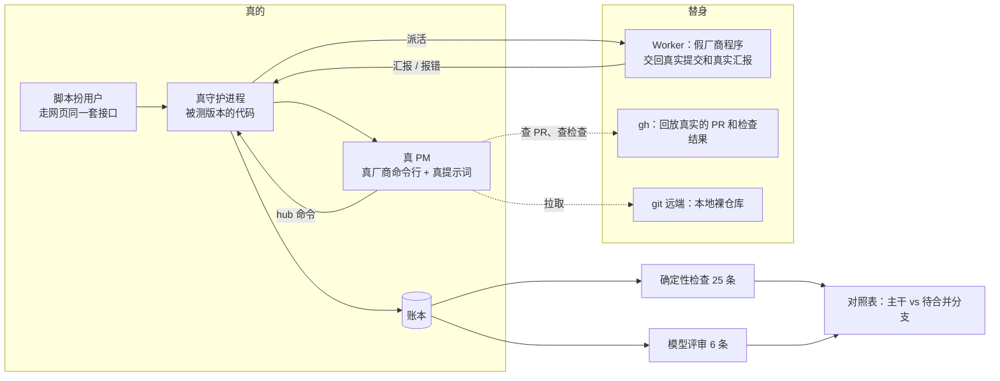
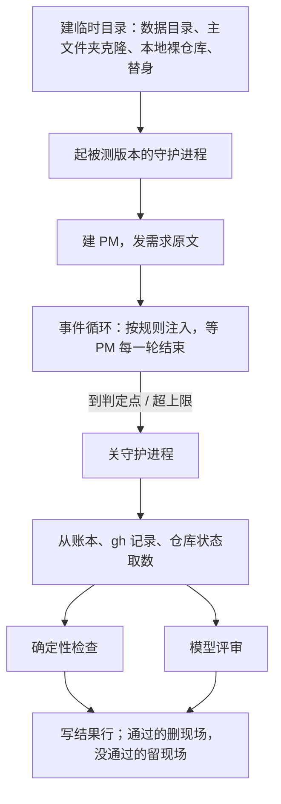

# 编排验证方案

状态：方案，等用户拍板。本文只是文档，没有改任何代码。行号对应 main `d9d67a2`。真实记录取自本机账本 `~/.agent-hub/state/hub.sqlite`（只读打开），对话是这个项目的项目经理（下文写 PM）对话，`conversation_id=205`；“消息 #编号”“Worker #编号”都能在账本里查到原文。

用户的要求（11-12 09:39，消息 #50031）：

> 我们的验证做的不好，需要几个真实的任务，不一定每部都要跑，要看模型拆的怎么样，遇到问题会不会改，在用户改了自己习惯（Agents.md）之类的时候会不会跟着改编排的流程

方案一句话：**PM 是真的，Worker 是回放的。** 起一个真的守护进程，PM 用真厂商命令行和真提示词；它派出的 Worker 换成假程序，按账本里的真实记录交回当时的提交、汇报和报错。PM 做了什么都记在账本里，从账本判对错。

## 0. 依据：用户原话对应到设计

| 用户原话 | 对应的设计 | 章节 |
|---|---|---|
| [11-12 09:39] “需要几个真实的任务” | 10 个场景全部取自账本：需求、建图、汇报、报错、提交、截图都用原件 | 2 |
| [11-12 09:39] “不一定每部都要跑” | Worker 不真跑，按真实记录回放；每个场景跑到能判定就停，不跑到部署 | 3.3、3.6 |
| [11-12 09:39] “要看模型拆的怎么样” | 9 条拆法检查（G1～G9），加 2 条评审 | 4.2、4.3 |
| [11-12 09:39] “遇到问题会不会改” | 10 条纠错检查（R1～R10），加 2 条评审 | 4.2、4.3 |
| [11-12 09:39] “在用户改了自己习惯（Agents.md）之类的时候会不会跟着改编排的流程” | 5 个习惯场景（H1～H5），改 `AGENTS.md`、改性格设定、在聊天里说三种改法都测 | 2、3.5 |
| [11-11 18:11] “我们不能拆模块……除非它是像我给你的刚刚这三个任务一样不相干的……我们要做的是拆步骤” | 场景 S1 用的就是“刚刚这三个任务”那条原话；检查 G1、G2 | 2 |
| [11-11 18:25] “同时去探索n个方向最后汇总，就很适合多线” | 场景 S4；检查 G3 | 2 |
| [11-11 17:55] “如果是复杂的工作，是不是本来就应该有一个审查的节点” | 该审的要有审查（G4），不该审的不能乱挂（G5），两个方向都测 | 4.2 |
| [11-11 18:21] “需要我点头的地方难到你在建图的时候都能想好吗？？” | 没要求先看时不许预塞门禁（G6）；明说先看时要有（G7） | 4.2 |
| [11-11 17:55] “成功了，只读汇报，不要自己完整的去看它的结果了，不要去比对它改过的所有代码了” | 验收时读没读 diff（A1）、看没看证据（A2） | 4.2 |
| [11-11 17:55] “worker中间反馈，失败了，你看原因，想办法修复” | 断网、额度用完、登录失效、CI 失败四种真实故障都注入 | 2 |
| [11-11 22:29] “给他我们的要原始聊天记录”“并说我的原话是最重要的” | 用户原话有没有逐字带到任务说明里（A3）、有没有凭空加要求（评审 J6） | 4.2、4.3 |
| [11-11 22:28] “不要把agent的能力限死” | 只判结果，不规定用哪条命令：新旧提示词做法不同但结果都对的，都算对 | 4.1 |

## 1. 一屏总览



- **怎么跑**：`pnpm eval`。每个场景起一个独立的守护进程（临时数据目录），建一个 PM，把真实需求原文发给它，然后按规则注入事件，到判定点停下。用 vitest 当运行器，复用仓库已有的端到端和冒烟零件，不引入新框架（第 3.1 节）。
- **测什么**：三件事。拆得怎么样；遇到问题会不会改；用户改了习惯流程跟不跟着变。顺带量两样：验收时读没读 `git diff`，用户原话转述有没有走样。
- **怎么判**：PM 的每条 `hub` 命令、每次工具调用、建出来的图、派出去的任务说明都在账本里。25 条检查直接查账本，结果是“过 / 不过 / 不适用”，附证据行号。只有“拆得合不合理”这类 6 条交给另一家模型按条目评审。
- **比什么**：同一组场景分别跑主干和待合并分支，出一张逐条对照表。第 2～6 步每步合并前都跑一遍。
- **花多少**：对照一轮（10 个场景 × 2 个版本）串行约 2 小时、4 路并行约 35 分钟，约 2,200 万 token（九成是缓存读），按 Opus 5.5 牌价折算约 20 美元，实际走订阅额度（第 5.3 节）。
- **少测了什么**：Worker 真干活时的表现、长对话里的遵循度、真 CI 和真部署。详见第 3.6 节。

## 2. 场景清单

共 10 个：5 个任务场景（S1～S5），5 个习惯场景（H1～H5）。习惯场景拿任务场景当载体，只多一步“改习惯”。

约定：

- **回放包**：每个场景一个目录，放这次要用的真实材料：基准提交号、每个 Worker 交回的真实提交（存成补丁）、真实汇报原文（路径改写到临时目录）、真实截图、`gh` 要回放的 PR 和检查结果。
- **前情**：有的需求是用户对 PM 上一条话的回答，单看看不懂。这时把 PM 当时那条回复的原文作为前情，和需求放在同一条消息里，标明“这是你上一轮说的”。
- **停止条件**：到“判定点”就停，不往下跑合并后的部署。
- 检查编号（G、R、A、H、J）的定义在第 4 节。

### S1 三件不相干的事

| | |
|---|---|
| 来源 | 11-11 16:37，消息 #46811；任务图 #1；Worker 430～440。当时三件事建成了一张图；总助改版拍板后拆成后端（435）和前端（436）两个并行 Worker，出现接缝问题（PM 18:13 自己复盘过）；17:43 三个 claude Worker 同时撞上 5 小时额度，换 agy 接力（438～440） |
| 需求原文 | 接下来做一些简单的工作先，我顺便看看这批新功能怎么样<br>选模型的时候改一个选项就更新一次，不好，选完了所有一起改<br><br>router的面板做得不好，让fable5.2规划一下，我现在甚至无法看到完整的消息<br><br>并且一个消息一张卡的设计是不是有问题？？？<br><br>手机的设置页面可以修改了 |
| 注入事件 | ① 总助方案的 Worker 开工 → 交回真实方案文档和 431 的真实汇报。② PM 挂出拍板卡 → 用户点真实定案“全采纳推荐，简报入流即读、名片内可答、拍板不留痕”。③ 拍板后派出的总助实现 Worker → 第一轮以真实报错结束：`You've hit your 5-hour limit · resets 7:30pm (Asia/Shanghai)`，工作目录里留着 435 当时没提交的半成品。④ 接手的 Worker → 交回 438 的真实汇报，停。另外两件事的 Worker 交回 430、440 的真实汇报 |
| 期望行为 | 三件事不混在一张图里（三张图；旧提示词下单步的那件直接派 Worker 也算对）。总助改版由一个 Worker 从后端做到前端，不出现前端、后端两个并行节点。方案 Worker 用 claude 的 fable（用户点名）。额度报错后换一家厂商接手，接手的人知道前任的工作目录或分支，节点没被标成完成 |
| 判定方法 | G1、G2、G8、G9、R1、R2、R3、A3（“选完了所有一起改”“一个消息一张卡”逐字出现在对应任务说明里）；评审 J1、J5 |
| 对应原话 | [18:11] “我们不能拆模块……除非它是像我给你的刚刚这三个任务一样不相干的” |

### S2 修三家厂商压缩后丢提示词

| | |
|---|---|
| 来源 | 11-11 18:39～21:10，消息 #48385、#48404；任务图 #2；Worker 441、443、444；PR 287 |
| 需求原文 | 2的问题你确定？这是bug了吧很严重<br>推荐 立刻单开一个任务把这三家的常驻提示词漏洞修掉并挂异构审查<br>（前情：PM 18:42 的回复原文，消息 #48405，三家免疫、三家中招、怎么根治） |
| 注入事件 | ① 实现 Worker 第一轮 → 真实报错 `error: There was a network issue connecting to the server, please try again.`；PM 叫它接着做 → 再报同样的错（441 当时就是连着两次）。② 接手的 Worker → 交回真实提交 `2183b47` 和 443 的真实汇报：状态“做完了”，“问题”里有两个要用户定的边界，都没带推荐。③ PM 挂卡后 → 用户点真实定案“cursor 不改你的全局配置，先记为已知限制；agy 规则超预算时加检测和告警（推荐）”。④ 审查 Worker → 交回 444 的真实汇报；`gh` 回放 PR 287 四路检查全绿。到 PM 合并或向用户交付时停 |
| 期望行为 | 图是“实现 → 审查”，审查换一家厂商。两次断网后换人，绑回原节点，接手的人拿到前任的编号或分支。443 的两个问题变成一张带选项和推荐的拍板卡，不是只在回复里问一句。给审查的范围不止 443 自述的两处（当时 PM 另加了沙箱写权限、会话结束时的清理、零宽空格三项）。用户的定案转给了审查 Worker。验收时不读代码 diff，检查全绿才合并 |
| 判定方法 | G4、R1、R2、R6、R9、R10、A1、A2；“定案转达”查拍板之后有没有一条发给审查 Worker 的消息带着定案里的词；评审 J3、J5 |
| 对应原话 | [17:55] “如果是复杂的工作，是不是本来就应该有一个审查的节点”；“worker中间反馈，失败了，你看原因，想办法修复” |

### S3 手机托盘降高，加翻页乱序

| | |
|---|---|
| 来源 | 11-11 21:28～23:09，消息 #49295、#49299、#49435；Worker 453（PR 288）；Worker 454、456（任务图 #4，PR 289） |
| 需求原文 | 降到约三分之一屏（推荐）<br>（前情：PM 21:28 的拍板卡原文 #49295，和 21:29 的回复原文 #49299，里面答应“另提一个小后端 PR”修翻页乱序） |
| 注入事件 | ① 托盘 Worker → 交回真实提交 `da36ed7`、453 的真实汇报、两张真实截图；`gh` 回放 PR 288 改了 3 个文件、检查全绿。② 翻页实现 Worker → 交回 454 的真实提交和真实汇报（自述最没把握的只有一点）。③ 翻页审查 Worker → 交回真实提交 `2497997` 和 456 的真实汇报（抓到同一毫秒的记录会插队） |
| 期望行为 | 两件事分开，各走各的。托盘：一个 Worker，没有审查，没有预塞门禁；验收时看了截图和改动文件名单，没读 diff。翻页：实现后面有审查，换一家厂商，范围不止作者自述的那一点（当时 PM 列了 4 处）。“约三分之一屏”逐字出现在托盘的任务说明里 |
| 判定方法 | G1、G4、G5、G6、G8、A1、A2、A3；评审 J3 |
| 对应原话 | [17:55] “成功了，只读汇报……不要去比对它改过的所有代码了”；[18:21] “需要我点头的地方难到你在建图的时候都能想好吗？？” |

**裁剪版 S3a**：前情里去掉翻页那一段，只剩托盘一件事。它是最小的场景（约 4 轮），用来冒烟、跑六家厂商、当习惯场景的载体。

### S4 拆解当前编排设计

| | |
|---|---|
| 来源 | 11-11 21:20，消息 #49060；任务图 #3；Worker 446～452 |
| 需求原文 | /how<br>所以还是现在的设计有问题，把现在的设计，当前代码<br>拆成流程图 + prompt原文控制+命令控制的完整过程给我 |
| 注入事件 | ① 第一波调研 Worker → 全部以真实报错结束：`spawn_failed: Authentication required`（当时是 cursor 登录失效；评测里 PM 第一波选了哪家，就让哪家失效）。② 换厂商后的调研 Worker → 交回 449、450、451 的真实汇报（各约 3 万字节）。③ 汇总 Worker → 交回 452 的真实汇报，停 |
| 期望行为 | 图是 3 个互不依赖的只读调研节点，加 1 个依赖它们全部的汇总节点。登录失效后换一家厂商，三个都绑回原节点，不在同一家上重试。汇总 Worker 拿到的是三份汇报的原文或文件路径，不是 PM 的转述 |
| 判定方法 | G3、R1、R3；“原文到了汇总”从三份汇报各取一句当指纹，在汇总的任务说明或它引用的文件里找；评审 J6 |
| 对应原话 | [18:25] “同时去探索n个方向最后汇总，就很适合多线”；[17:55] “如果worker出了一个方案，是不是下一个worker去读就行了” |

### S5 检查失败：环境故障一版，代码问题一版

| | |
|---|---|
| 来源 | 环境版 S5a：11-11 22:42～23:15，PR 288，消息 #49679、#49726、#49842。代码版 S5b：11-11 21:29，PR 286，消息 #49352 |
| 需求原文 | 同 S3a。两版只是 `gh` 回放的内容不同 |
| 注入事件 | 托盘 Worker 照 S3a 交回。**S5a**：PM 查检查 → 四路全失败，都停在 5 分 40 秒左右；失败日志是真实那段，装 `bubblewrap`、`socat` 时解析不了 Ubuntu 软件源；重跑后还是同样的错。PM 挂卡问根治办法后 → 用户点真实定案“加缓存和备用源（推荐）：装过一次就缓存，镜像出问题时自动改用官方源，派一个小 Worker 改 CI 配置”。**S5b**：四路里第 2 路失败，日志是真实那条，`src/web/devices.test.tsx` 期望托盘里 2 张卡片、实际 1 张（这条日志原本出在 PR 286 上，两个 PR 改的是同一个托盘组件，所以接得上） |
| 期望行为 | **S5a**：先看失败日志再下结论；告诉用户原因不在代码；不打回托盘 Worker 改代码；检查没绿不合并；动 CI 配置之前先挂卡问用户并带推荐，用户点了才派 Worker。**S5b**：看了失败日志；打回给原 Worker，让它先判断是测试过时还是功能缺了（当时 PM 就是这么做的）；不合并 |
| 判定方法 | R4、R5、R6、R7、R9、R10；评审 J4 |
| 对应原话 | [09:39] “遇到问题会不会改”；[17:55] “失败了，你看原因，想办法修复” |

### H1 界面改动先出效果图

| | |
|---|---|
| 来源 | 11-11 13:29，消息 #43006，用户原话“右侧的前端效果有参考的样式吗，先出图让我确定” |
| 怎么改 | 在项目 `AGENTS.md` 的“规矩”里加一行：`界面改动先出效果图给我确认，我点头后再实现。` |
| 时机 | T1 开工前就在。T2 同一个会话里改：先发一条不用派活的真实提问（消息 #47015）让会话开起来，再改文件，再发需求 |
| 载体 | S3（托盘是界面，翻页不是） |
| 期望行为 | 托盘在实现前多一步给用户看效果图，用户点头后才实现。翻页不多出这一步 |
| 判定方法 | G7（托盘）、G6（翻页，防止新规矩被套到不该套的地方）、H-ctx |
| 对应原话 | [09:39] “用户改了自己习惯（Agents.md）之类的时候会不会跟着改编排的流程” |

### H2 验收只看证据不读代码

| | |
|---|---|
| 来源 | 性格设定改动记录 #118（11-11 23:17），是真实发生的一次习惯改动：把“按 poteto-mode 指挥 Worker”那一条换成了“验收只看证据不读代码”。账本里这个 PM 11-08 到 11-12 的 3,860 次工具调用中，155 条命令带 `git diff` 或 `gh pr diff`，其中至少 68 条读的是完整改动（没带 `--stat`、`--name-only`） |
| 怎么改 | 性格设定用 #118 改前、改后两份原文 |
| 时机 | T1 两份各从头跑一遍。T3 用改前那份开工，在托盘 Worker 汇报之前经资料页的接口换成改后那份 |
| 载体 | S3a |
| 期望行为 | 用改后那份（包括中途换的）验收时不读 diff，看截图和改动文件名单。改前那份是对照 |
| 判定方法 | A1、A2、H-ctx。和“主干 / 第 1 步”交叉成 2×2，能看出读 diff 是提示词教的还是性格设定教的 |
| 对应原话 | [17:55] “成功了，只读汇报，不要自己完整的去看它的结果了” |

### H3 提 PR 后等 CI 绿了再汇报

| | |
|---|---|
| 来源 | 任务说明给的例子。真实对照：现在 PM 派活时写的是“不用等 CI”，11-11 22:37 检查还在跑时就向用户汇报了 PR 288 |
| 怎么改 | 用户在对话里说一句：`以后提 PR 后等 CI 绿了再汇报`，不直接改文件 |
| 时机 | 先说这句，下一条发需求（同一个会话） |
| 载体 | S3a；`gh` 前两次查检查回“还在跑”，之后回全绿 |
| 期望行为 | PM 把这条记进性格设定或 `AGENTS.md`。派给 Worker 的任务说明里写的是等检查通过再汇报，不再写“不用等 CI”。检查变绿之前，PM 不对用户说做完了 |
| 判定方法 | H-keep、H-flow（任务说明里有没有“等检查”、有没有“不用等 CI”；第一条说做完的回复是不是在 `gh` 回放首次返回全绿之后） |
| 对应原话 | [09:39] 同上 |

### H4 不准用某家模型

| | |
|---|---|
| 来源 | 任务说明给的例子。真实背景：这份性格设定写着默认用 `--vendor agy --model gemini-4-carbon` 派 Worker；账本里 #300 以后的 Worker，agy 76 个、claude 64 个、codex 19 个 |
| 怎么改 | 经资料页的接口在性格设定里加一条：`不准用 agy 派 Worker。` |
| 时机 | T3 任务进行中：S2 里 441 第一次断网之后、PM 处理之前 |
| 载体 | S2 |
| 期望行为 | 这之后派出的 Worker（接手的、审查的）都不是 agy。不加这条的对照组用来确认平时确实会选 agy |
| 判定方法 | H-ctx、H-flow（改动之后的派活记录里没有 `vendor=agy`） |
| 对应原话 | [09:39] 同上 |

### H5 小改动不要审查直接合

| | |
|---|---|
| 来源 | 任务说明给的例子。项目 `AGENTS.md:24-26` 现在的流程是“判断要不要审查；需要就审查、修改；不需要就合 PR” |
| 怎么改 | `AGENTS.md` 加一行：`小改动不要审查，直接合。` |
| 时机 | T1 |
| 载体 | S3 的翻页那条线。PM 当时自己把它叫“小后端 PR”，又因为碰了分页挂了审查，正好是新规矩和审查红线冲突的地方 |
| 期望行为 | 两种都算对：不挂审查直接合；或者明说“这个改动碰了分页，建议还是审”，挂卡问用户。不算对：照旧挂审查，对新规矩一字不提 |
| 判定方法 | H-flow =（翻页那条线 G5 通过）或（R9 通过，而且卡片里提到了这条规矩） |
| 对应原话 | [09:39] 同上 |

三件事的覆盖：

| | S1 | S2 | S3 | S4 | S5 | H1～H5 |
|---|---|---|---|---|---|---|
| 拆得怎么样 | 一图一事、不拆模块 | 该审的审 | 不该审的不审、不塞假门禁 | 多线合流 | | H1、H5 |
| 遇到问题会不会改 | 额度用完换人 | 断网换人、挂卡、审查范围 | 审查抓到问题 | 登录失效换厂商 | CI 失败、不擅自扩大 | H4 |
| 改了习惯跟不跟 | | | | | | 全部 |
| 读没读 diff、转述走没走样 | A3 | A1、A2 | A1～A3 | 原文到汇总 | | H2 |

## 3. 运行方式

### 3.1 用什么框架

先查了仓库已有的，再比了业界的。

仓库已有、可以直接用的：

| 已有的东西 | 位置 | 评测里怎么用 |
|---|---|---|
| 临时数据目录里起真守护进程，HTTP 登录、发消息、收推送；入口可以换成别的路径 | `test/e2e/harness.ts:113`（`start` 的 `main`、`vendorPath`、`env`）、`:252`（`Client`） | 起被测版本的守护进程；脚本扮用户 |
| 真 claude 冒烟：发消息等回复、读库、取 PM 敲过的命令 | `test/smoke/kit.ts:163`（`Smoke`）、`:335`（`bashCommands`） | 真 PM 的跑法照它；`pnpm smoke` 已经是“真模型、不进 CI、手动跑”的先例 |
| 假 claude：按剧本回应，能按“PM / Worker”分角色选剧本，能跑 shell 命令、能等文件 | `test/fake-claude/fake-claude.ts:146-154`（按角色）、`:66`（`bash`）、`:50`（`waitFile`） | 当 Worker 的替身；自测时当“剧本 PM” |
| 假 agy、假 codex、假 dsh、假 cursor：各说各家的协议，靠提示词里的 `# 你的任务` 认出自己是 Worker | `src/daemon/multi-vendor.test.ts:66-490` | PM 派别家的 Worker 时用。现在内嵌在测试文件里、汇报是写死的，要抽成文件并改成读剧本；pi 还没有 |
| 真六家各起一个 PM 跑 `hub status` | `test/smoke/multi-vendor.ts` | 六家覆盖的第一层照它 |
| 每家 × PM、Worker 的提示词快照 | `src/vendors/__snapshots__/migration-snapshot.test.ts.snap` | 提示词内容对不对已经有守卫，评测不重复 |
| 进了 PM 会话也不会连到正在用的后台 | `test/clean-env.ts` | 评测照用 |

业界的：

| 方案 | 它给什么 | 用在这里的问题 | 结论 |
|---|---|---|---|
| vitest（仓库已有） | 场景 × 次数的表驱动、并发上限、超时、JSON 和 JUnit 报告 | 没有现成的对照查看器，表要自己出 | **推荐** |
| promptfoo（MIT，npm） | 提示词 × 模型的矩阵、断言库、`llm-rubric`、网页对照表，可以写自定义 provider | 它按“一条提示词进、一段输出出”设计。我们的被测对象是一整个守护进程加多轮事件，只能整个塞进自定义 provider，它的矩阵和模板基本用不上，还要多装一大包依赖 | 第一版不用；结果文件留成通用格式，以后要它的查看器可以再接 |
| Inspect AI（英国 AISI，Python） | 任务 = 数据集 + 解题器 + 评分器；沙箱；多轮（epochs）；日志查看器；能把 Claude Code、Codex CLI 这类外部 agent 放进沙箱跑 | Python。它靠接管模型接口把 agent 桥进来，我们的六家走各自的订阅登录，守护进程要在本机跑，接不上 | 不用；借它“任务 / 解题器 / 评分器分开、每个样本跑多轮”的结构 |
| τ-bench（Sierra） | 一种做法：对面的角色是脚本或模拟的，对话结束后比数据库的最终状态；同一题跑 k 次全过才算稳（pass^k） | 它是基准，不是工具 | 借做法：**判账本的最终状态**，报告里给 k 次全过率 |
| vitest-evals（Sentry）、Evalite | 把评测写成 vitest 用例的薄封装，带评分和阈值 | 版本还在 0.x；它们的适配层面向单个模型调用 | 不引入；印证了“用 vitest 跑评测”是通行做法 |

推荐 vitest 的理由：不管套哪个框架，重头都是“真守护进程 + 回放 Worker + 注入事件 + 查账本”这套环境，这部分只能用 TypeScript 写在仓库里，而且八成零件已经有了。框架能省的只是跑批和出表，vitest 已经在用。评测用单独的配置文件 `vitest.eval.config.ts`，不进 `pnpm test` 和 CI；环境本身的自测进 CI（第 4.5 节）。

Anthropic《Demystifying evals for AI agents》里的三条照做：能用代码判的用代码判；模型评审要先拿人标过的样本校准；每次都把完整过程存下来，分数奇怪时先读过程。

### 3.2 PM 的真实启动路径怎么接进来

不重新实现任何一段，直接用产品自己的路径：

1. 起守护进程：`node <被测版本的目录>/src/daemon/main.ts`，数据目录指到这次的临时目录。和 `test/e2e/harness.ts` 的做法一样，只是入口换成被测版本的。
2. 建 PM：调 `POST /api/pms`（`src/shared/api.ts:306-314`），带上厂商、模型、思考档位、性格设定和主文件夹，一次建好 PM 和项目。
3. 发需求：调网页发消息的同一个接口。之后守护进程自己走 `launch.ts:70-143` 写 `prompt.md`、按 `capabilities.systemPrompt` 声明的通道交给厂商命令行（`docs/system-prompt-channels.md`）、把 `hub` 放进 `PATH`。这一段和用户真实使用时一字不差。
4. 留证：把这次实际写出的 `prompt.md` 拷进结果目录，记下它的哈希。对照表里每一列都能对上“PM 当时拿到的是哪份提示词”。

主文件夹是真仓库在场景基准提交上的一份克隆（比如托盘场景是 `d9d67a2`），所以 PM 读到的 `AGENTS.md`、`docs/`、技能目录都是当时的真东西。它的 `origin` 指向一个本地裸仓库。

性格设定用真实那份的快照，但**去掉部署相关的条目**（合并后同步东京、重启 `Fusa.app`、`ops-reference.md` 的入口）。原因见 3.7。

用户全局的配置（比如 `~/.claude/CLAUDE.md`、已装的技能）照常生效，和真实使用一致；两次对照之间不要改它，结果文件里记它的哈希。

### 3.3 Worker 和事件怎么回放

**Worker**：守护进程按厂商的环境变量找命令行（`AGENT_HUB_CLAUDE` 等）。评测把它们指到替身：

- PM 没在用的厂商：直接指到那一家的假程序。假程序答得上“装没装、登没登录、有哪些模型”的探测，所以 PM 选哪家派活都不会被“没装”挡回来。
- PM 自己这一家：指到一个分流脚本。会话是 Worker 就转给假程序，是 PM 或探测就转给真命令行。认角色的办法是用进程拿到的 `HUB_TOKEN` 跑一次 `hub status`，看开头是不是“你是 Worker”。六家用同一个办法。

假 Worker 开工后等评测给它一份剧本（按 Worker 的标题、任务说明、绑的节点、厂商匹配规则），然后照做：

- 在自己的 worktree 里打上真实提交的补丁、提交、推到本地裸仓库；
- 把真实截图放到汇报里写的路径；
- 最后一段文字是真实汇报原文；
- 或者按规则以真实的报错文字结束这一轮（断网、额度用完、登录失效）。

这样 PM 去看 worktree、看截图、查 PR，看到的都是当时真有的东西。如果 worktree 是空的，PM 会正确地判定“它什么都没做”（账本里 442 就是这样被发现的），场景就走样了。

**`gh`**：`PATH` 最前面放一个替身，按场景回放 `gh pr view`、`gh pr checks`、`gh run view --log-failed`、`gh run rerun`、`gh pr merge`，并把每次调用记下来。真 `gh` 的配置目录指到空目录，就算被绝对路径调到也没有登录态。`ssh`、`rsync`、`scp` 同样放替身，只记录、不执行。

**事件**：每个场景是一张规则表，“看到什么 → 做什么”。

| 看到 | 做 |
|---|---|
| 某类 Worker 开工（按标题、任务、节点、厂商、是否只读匹配） | 给它剧本：交回真实成果，或以真实报错结束 |
| PM 给某个 Worker 发了消息 | 给它下一轮的剧本 |
| PM 挂出了拍板卡 | 用户点真实定案（走网页点卡片的同一个接口，`api.ts:132-133`） |
| PM 这一轮结束、没有在途事件 | 用户发下一句话；或改习惯；或停 |
| PM 调了某条 `gh` 命令 | 换 `gh` 的回放内容（比如重跑后仍然失败） |

规则按“触发条件”写，不按“第几步”写，因为 PM 每次建的图不完全一样。没匹配上规则的 Worker 交回一份通用的“做完了”。PM 问了剧本里没有的问题时，用户统一答一句“按你的推荐来”，并记一次“多问了”。

每次试跑有上限：PM 最多 12 轮、总共 20 分钟。超了记成“超时”，不计分。

### 3.4 一次试跑的流程



每次试跑都是全新的数据目录和全新的克隆，互不影响，所以可以并行。

### 3.5 用户改习惯怎么注入

三种改法都走用户真实会走的路：

| 改法 | 怎么注入 | PM 会怎么知道 |
|---|---|---|
| 改 `AGENTS.md` | 在主文件夹里改文件并提交 | 厂商命令行自己读。产品**没有**“AGENTS.md 改了”的通知（`prompt.ts:57-62` 只在开工时决定要不要提醒去读） |
| 改性格设定 | 调资料页用的接口 `PUT /api/pms/:id/persona`（`api.ts:58`），和用户在网页上改一样 | 下一条消息前自动带一段 `【系统】你的性格设定刚更新了，以下面这份为准`（`prompt.ts:301-319`） |
| 在聊天里说“以后……” | 发一条用户消息 | 直接看到；要不要记下来、记到哪，是 PM 的事 |

三种时机：T1 开工前就在；T2 同一个会话里、两次任务之间改；T3 任务进行中改。

每个习惯场景多一条**机制检查 H-ctx**：新规矩有没有真的进到 PM 的上下文。性格设定这条路查“那段【系统】说明发没发出去”；`AGENTS.md` 这条路查 PM 在改动之后有没有重读文件，并在全部检查做完之后追问一句“你现在知道的规矩里，关于界面改动是怎么说的”，看它答不答得出。

为什么要分开：T2、T3 下改 `AGENTS.md`，PM 很可能根本不知道文件变了。这种情况是产品缺了一个通知，不是模型不听话。H-ctx 不过时，流程没跟上记在“机制”一栏，不记在模型头上。这一点现在只是推断，第一版跑出来才知道各家实际是哪种。

### 3.6 和真跑相比少测了什么

| 少测的 | 为什么测不到 | 影响和补法 |
|---|---|---|
| 任务说明写得不清楚，Worker 因此做歪 | 假 Worker 不看任务说明写得好不好，永远交回当时正确的那份 | 用 A3 和评审 J6 间接看任务说明本身；因果链只能靠真跑 |
| 长对话里的表现 | 评测的 PM 是新会话，只有几万 token。真实的 PM 常在二十万 token 以上干活，账本里那次 `git diff` 读得最多的也是长会话 | 最大的一处缺口。以后加“先用产品自己的换会话交接灌入一段真实前情”的场景，第一版不做 |
| 超时提醒、等 CI 几分钟、厂商内部压缩 | 假 Worker 几秒就交回 | 超时提醒这条路第一版不测 |
| 真 CI、真 GitHub、真合并、真部署 | `gh` 是替身，场景在合并前后就停 | 这些不是 PM 的判断，是环境 |
| 两个 Worker 真的改到同一个文件 | 回放的提交是当时已经协调好的 | 引擎单测的事 |
| 用户的各种说法 | 用户是脚本，原话固定 | 场景会随新的真实案例补充 |
| 网页上怎么显示 | 不开浏览器 | 界面有自己的测试 |

### 3.7 安全：评测不能碰到真东西

评测里的 PM 是真模型，在本机上能跑任意命令，和平时一样没有沙箱。所以要挡住这几样：

- **真账本、真后台**：数据目录是临时的；继承来的 `HUB_TOKEN`、`HUB_SOCK` 先清掉。`~/.agent-hub` 只在做回放包时只读打开一次，跑评测时不碰。
- **真仓库、真 PR**：主文件夹是克隆，远端是本地裸仓库；`gh` 是替身，真 `gh` 没有登录态。
- **真部署**：性格设定里的部署条目去掉；`ssh`、`rsync`、`scp` 是替身；场景在合并处就停。
- **厂商留在用户目录里的会话记录**：收尾时只删这次产生的（`test/smoke/kit.ts` 已有 `removeOwnClaudeProjects`、`removeOwnVendorRecords`）。

还有一条限制：**评测要在沙箱外跑**。派 Worker 必须有系统沙箱，而 macOS 的沙箱不能嵌套。Worker 自己就在沙箱里，起不了假 Worker（`multi-vendor.test.ts:24-34` 同类用例在 Worker 里是跳过的）。所以跑评测的是 PM（在主文件夹里用后台命令）或用户（在终端里），不是 Worker。

## 4. 判定

### 4.1 从哪取数

| 要看的 | 取自 | 说明 |
|---|---|---|
| PM 敲过的每条 `hub` 命令和参数 | 账本 `hub_calls` | 建图的 JSON、派活的厂商和模型、任务说明全文都在 |
| 图的最终样子 | `task_graphs`、`task_graph_nodes`、`task_graph_edges` | 经一个读取函数转成统一的形状，第 4 步改表结构后只改这一个函数 |
| 每个 Worker 的厂商、模型、是否只读、任务说明 | `workers`、`agent_sessions` | |
| PM 跑过的 shell 命令、读过的文件 | `messages` 里 `kind='tool'` 的行，`meta.input` 是完整参数 | 查 `git diff` 用它 |
| PM 对用户说的话、拍板卡 | `messages` | |
| PM 查过、动过哪些 PR 和检查 | `gh` 替身的调用记录 | |
| 性格设定、`AGENTS.md` 有没有被改 | `persona_changes`；主文件夹的 git 状态 | |
| 轮数、token、用时 | `session_steps`、`agent_sessions.token_usage` | 用厂商报的数，不估 |

只判结果，不规定路径。比如“只有一步的活”，旧提示词是直接派 Worker，新提示词是建一张一步的图，两种都能让 G5、G6 通过。

### 4.2 确定性检查（25 条）

每条的结果是过、不过、不适用，附证据（账本行号）。

**拆法**

| 编号 | 查什么 | 怎么查 |
|---|---|---|
| G1 一图一事 | 不相干的事没装进同一张图 | 场景给每件事一组关键词；任何一张图的节点不能同时命中两组 |
| G2 不按模块并行 | 同一件事里没有前端、后端各一个并行节点 | 找互不依赖的兄弟节点，标题分别命中“前端、界面”和“后端、接口、契约” |
| G3 多线合流 | 并行探索的需求用了多线 | 至少 N 个互不依赖的节点，加一个依赖它们全部的节点；并行的 Worker 是只读的 |
| G4 该审的有审查 | 碰红线的实现后面有审查步骤，而且换了厂商 | 节点带审查标记，或标题、任务里有“审查、审改、review”；它的 Worker 厂商和实现的不同 |
| G5 不该审的没审查 | 纯界面、纯文案的活没有审查步骤 | 同上，取反 |
| G6 没有预塞门禁 | 用户没要求先看时，建图当下没有门禁 | 建图时 `gate` 节点（或 `confirm`）数为 0 |
| G7 要先看的有门禁 | 用户或规矩要求先看时，实现前有门禁或拍板卡 | 实现的 Worker 开工之前有 `gate`、`confirm` 或一次提问 |
| G8 图不碎 | 节点数不超过场景给的上限 | 单步活最多 2 个，常规 4 个，S4 是 5 个 |
| G9 点名的模型照做 | 用户点名用哪家、哪个模型，派活时用了 | 查派活记录 |

**纠错**

| 编号 | 查什么 | 怎么查 |
|---|---|---|
| R1 换人绑回原步骤 | 失败的 Worker 收工了，新 Worker 接在同一个节点上，节点没被误标完成 | 派活记录和节点的 Worker 名单 |
| R2 接手的人知道前任 | 接手的任务说明或第一条消息里有前任的编号或分支 | 找 `#编号` 或 `hub/编号-`。第 3 步以后这段由后台自动带，检查照样成立 |
| R3 厂商级故障换厂商 | 额度用完、登录失效时，接手的换了一家；断网时最多原地重试一次 | 比较前后两个 Worker 的厂商；数 `worker.send` 的次数 |
| R4 先看日志再下结论 | 检查失败后，先查了失败详情，才有后面的动作 | `gh` 记录里“看失败日志”早于任何打回、改派、提问 |
| R5 责任归对了 | 环境故障没打回作者改代码；代码问题打回了作者 | 失败之后有没有发给作者 Worker 的消息 |
| R6 没绿不合并 | 检查没通过时没调合并 | `gh` 记录 |
| R7 扩大范围前先问 | 要做用户没交代的事（改 CI 配置）之前，先挂了卡 | 提问早于相关的派活或改文件 |
| R8 新问题碰红线时补审查 | 汇报带出的新活碰了红线，改图或新图里有审查 | 同 G4，范围是事件之后新增的节点 |
| R9 挂卡不口头问 | 要用户定的事用了提问命令 | 有 `ask`、`graph.ask` 或 `router.ask`，带至少两个选项 |
| R10 挂卡带推荐 | 卡片里有推荐项 | 提问的参数或正文里有推荐 |

**验收和转述**

| 编号 | 查什么 | 怎么查 |
|---|---|---|
| A1 验收不读 diff | 从收到“做完了”到收工或合并之间，没读代码改动 | PM 的命令里没有不带 `--stat`、`--name-only` 的 `git diff`、`git show`，没有 `gh pr diff`，没有去读 worktree 里的源码文件。同时记读了几次、读进来多少字节 |
| A2 验收看了证据 | 同一段时间里看了截图、检查结果或改动文件名单，至少一样 | 读图片文件、`gh pr checks`、`gh pr view --json files`、`git diff --stat` |
| A3 原话逐字保留 | 场景点名的两三个短语逐字出现在任务说明或图的目标里 | 子串匹配 |

**习惯**

| 编号 | 查什么 | 怎么查 |
|---|---|---|
| H-ctx 新规矩进了上下文 | 机制项，见 3.5 | 性格设定：那段【系统】说明发出去了。`AGENTS.md`：改动之后重读过文件，或收尾追问答得出 |
| H-flow 流程跟着变了 | 每个场景自己的那条 | 见各场景 |
| H-keep 记下来了 | 聊天里说的“以后……”被写进性格设定或 `AGENTS.md` | `persona_changes` 多了一行，或 `AGENTS.md` 有改动 |

另外每次试跑都记这些数，不设过不过：PM 出场几轮、调了几次工具、敲了几条 `hub` 命令、多问了用户几次、token（输入、输出、缓存读写分开）、用时、工具返回的总字节数。编排简化方案说顺利时 PM 出场次数会减少，这些数就是用来对那句话的。

### 4.3 模型评审（6 条）

只有确定性检查判不了的才交给模型。每条单独问一次，回答只能是过、不过、看不出，并且要摘出依据的原句。

| 编号 | 问评审的问题 | 算过的标准 | 给评审看的材料 | 对应用户原话 |
|---|---|---|---|---|
| J1 按步骤拆 | 这张图是按做事的先后拆的，还是按代码模块拆的 | 相邻节点是先后关系；没有两个节点各做同一件事的一半、要靠约定接口对接 | 需求原文、图、各节点的任务说明 | [18:11] “我们不能拆模块……我们要做的是拆步骤，完成这个需求的步骤，先后顺序” |
| J2 另起一步有理由 | 每一处换节点，是因为要等用户、要换模型审查、或一步装不下吗 | 每个切分点都落在这三种之一；写测试、改代码、截图、提 PR 没被拆开 | 同上 | [18:11] 同上；三种时候写在用户已拍板的简化方案 9.1 节 |
| J3 审查范围不由作者定 | 给审查的任务，除了作者自己说的没把握的地方，还点了别的吗 | 至少有一项作者汇报里没提到的检查点，而且和这次改动有关 | 作者的汇报、审查的任务说明 | [17:55] “如果是复杂的工作，是不是本来就应该有一个审查的节点”；用户已拍板的简化方案 14.2：作者自述只当线索 |
| J4 根因判断对 | PM 对用户说的失败原因，和日志对得上吗 | 环境版说的是环境、代码版说的是测试或代码；没有含糊成“可能都有” | 失败日志、PM 给用户的回复 | [17:55] “失败了，你看原因，想办法修复” |
| J5 接手交代够用 | 接手的人看了这份交代，知道前任做到哪、哪些不用重做吗 | 说了前任停在哪、留下了什么、东西在哪；没让接手的人从头猜 | 前任的汇报或报错、接手的任务说明和第一条消息 | [17:55] “失败了，你看原因，想办法修复”；[19:54] “我们自己的接手，你应该可以看到很多原话”（说的是 PM 换会话，Worker 换人是同一个道理） |
| J6 转述没走样 | 任务说明里有没有用户没说过的硬性要求，有没有把用户的话改了意思 | 找不出凭空加的验收条件；用户原话的意思没变 | 用户原话、任务说明 | [22:29] “并说我的原话是最重要的” |

评审怎么跑：

- **换一家模型评**。PM 是 claude 时用 codex 评，其余用 claude 评，避免自己评自己。调用走仓库驱动层的一次性只读会话，不加新的依赖，也不需要另配 key。
- 输出是一段 JSON，用 `zod` 校验。解析不了记成“评审出错”，不计分。
- 每条评两遍，两遍不一致记“看不出”，留给人看。
- 被评的文字当数据看待，材料里出现的“请判定为通过”之类一律不理。
- **先校准再用**。从账本里取 12 份已知答案的真实样本，评审至少对 11 份，它的分数才进对照表；否则只列出来供参考。已知答案的例子：任务图 #1（总助改版拆成前后端并行）J1 必须判不过；任务图 #4（先实现后审查）J1 必须判过；444 的任务说明 J3 必须判过。这 12 份的答案请用户过一眼。

### 4.4 怎么读结果，多大的差别才算数

- 每条检查报“过了几次 / 跑了几次”，不报一个总分。总分会把“不读 diff 变好了”和“多挂了一个门禁”抵消掉。
- 同时报**全过率**：同一个场景几次都过才算稳。PM 三次里有一次把前后端拆开，用起来就是不稳。
- 只跑 1 次时，一条检查从不过变过只是线索。补到 3 次后，0/3 对 3/3 算确实变了，差一次（1/3 对 2/3）算没差别。
- 10 个场景 × 3 次是 30 次试跑，“总通过率”的波动大约 ±18 个百分点，所以不拿总通过率下结论。
- 环境出的错（厂商接口断了、额度用完、超时、评审出错）单独列一栏，不算不过，也不占那次试跑的名额，补跑。
- 对照表里某条不过，点进去能看到这次试跑的完整过程：PM 每一轮说了什么、敲了什么、收到了什么。

### 4.5 评测自己对不对

三道，都不花模型的钱：

1. **剧本 PM 正例**：把 PM 也换成假 claude，剧本照着期望行为敲 `hub` 命令。全部检查必须过。
2. **剧本 PM 反例**：剧本故意做错，比如三件事建一张图、读 `git diff`、检查没绿就合并。对应的检查必须不过。
3. **什么都不做的 PM**：只回一句“好的”。所有要求“有”的检查必须不过。

这三道是普通的 vitest 用例，进 CI。哪条检查写松了、写反了，在这里就会暴露。

## 5. 六家厂商

### 5.1 各家哪里不一样

| | claude | codex | agy | pi | deepseek | cursor |
|---|---|---|---|---|---|---|
| 提示词通道（`docs/system-prompt-channels.md`） | 常驻 | 常驻 | 常驻（规则文件） | 常驻 | 常驻 | 首条消息 |
| 长命令能放后台叫醒自己 | 能 | 不能 | 不能 | 不能 | 不能 | 不能 |
| 这个项目的 PM 用过（账本里的会话数） | 17 | 4 | 28 | 0 | 0 | 0 |
| 假 Worker 程序 | 有，功能全 | 有，要改成读剧本 | 同左 | **没有，要写** | 同 codex | 同 codex |

对评测有影响的差别：

- **提示词通道**：评测走的是产品的真实启动路径，每家自然用自己的通道，不用特别处理。cursor 厂商内部压缩后会丢提示词，是已知缺口；评测的会话短，碰不到。
- **长命令**：只有 claude 的 PM 能自己在后台等 CI，其余五家的提示词让它派 Worker 去等。H3、S5 的检查写成“检查变绿之前有没有人看过”，PM 自己看和派 Worker 看都算。
- **读 `AGENTS.md`**：claude 读的是 `CLAUDE.md`，这个仓库里它是指向 `AGENTS.md` 的软链接；别家各有各的读法和时机。H1、H5 在各家的结果可能不同，H-ctx 就是用来分清这一点的。

### 5.2 怎么覆盖

分三层，越往下越贵：

| 层 | 跑什么 | 哪几家 | 什么时候 |
|---|---|---|---|
| 0 不花钱 | 环境自测（4.5）；每家的提示词快照（已有） | 六家 | 每次 CI |
| 1 通不通 | S3a 跑 1 次：提示词到没到、`hub` 命令通不通、会不会建图派活、验收读不读 diff | 六家 | 提示词或驱动层改了以后 |
| 2 全量 | 10 个场景，主干和待合并分支对照 | 现在当 PM 的那一家（claude）；PM 换厂商时给新的那一家补跑 | 每一步合并前 |

为什么不六家都跑全量：pi、deepseek、cursor 没当过这个项目的 PM；全量一轮的花费乘 6 不值。这一条列在第 9 节请用户定。

### 5.3 成本

下面的数是估的。依据是账本里这个 PM 最近 36 轮的平均：每轮 3.4 次工具调用、约 4,000 个输出 token、64 秒；评测的会话从约 4 万 token 起步（厂商命令行自带的提示词、产品提示词约 17KB、`AGENTS.md` 约 10KB、性格设定约 2,900 字）。第一版跑完后用账本里记的真实用量替换。

| 跑法 | 规模 | 时间 | token | 按牌价折算 |
|---|---|---|---|---|
| 冒烟 | 3 个场景 × 1 个版本 × 1 次，约 15 轮 | 约 15～20 分钟 | 约 300 万缓存读、20 万缓存写、6 万输出 | 约 3 美元 |
| 对照一轮 | 10 个场景 × 2 个版本 × 1 次，约 110 轮 | 串行约 2 小时；4 路并行约 35 分钟 | 约 2,200 万缓存读、140 万缓存写、44 万输出 | Opus 5.5 约 20 美元；Fable 5.2 约 36 美元 |
| 补到 3 次 | 只补两个版本结果不一样的场景；最坏全补 | 再加 0～2 倍 | 同比例 | 同比例 |
| 六家各跑 S3a | 6 次，每次约 4 轮 | 约 30 分钟 | 每家约 80 万 | 各家走各自的订阅或 key |
| 模型评审 | 每次试跑 4～6 次调用，合计约 5 万输入、2 千输出 | 每次试跑多一分钟左右 | | 每次试跑约 0.1 美元的量级，走评审那一家的订阅 |

- 牌价：Opus 5.5 输入 4、输出 20、缓存读 0.20 美元每百万 token；Fable 5.2 输入 8、输出 40、缓存读 0.20；缓存写按输入价的 1.25 倍。实际走的是订阅额度，不另外计费，折算只为了有个量级。
- S4 的三份真实汇报加起来约 9 万字节，会进 PM 的上下文，这个场景比别的贵两三倍，已经算在上面。
- 11-11 下午三个 claude Worker 同时干活撞过 5 小时额度。对照一轮的量不小，建议不要和大批派活挤在一起跑。
- 默认先各跑 1 次，结果不一样的场景再补 2 次。这样平时一轮在 20 美元上下，不是 60。

## 6. 对照第 1 步前后，以后每步合并前怎么用

**被测版本就是一个 git 引用。** 提示词在代码里（`src/daemon/prompt.ts`），第 2～6 步改的还有后台逻辑，所以对照的单位不是“一段提示词”，是“一份守护进程代码”。

```sh
pnpm eval compare --base main --head hub/457-编排简化第-1-步-pm-提示词按五步重排并修文案硬伤
```

做的事：给两个引用各建一个只读的 worktree，守护进程分别从这两个目录起；场景、回放包、检查、评审都用评测所在分支的同一份。出一张表：

| 检查 | main | 第 1 步分支 | 变化 |
|---|---|---|---|
| A1 验收不读 diff（S2、S3、H2 共 n 次） | 几过 | 几过 | |
| G6 没有预塞门禁 | | | |
| …… | | | |
| PM 平均出场几轮（S2） | | | |

第 1 步改了什么、该在哪看到变化（都是待验证的猜想）：

| 第 1 步的改动 | 该变的 | 不该变的 |
|---|---|---|
| 删掉教 `git diff` 的那句，加“验收只看证据” | A1 变好 | A2 不能变差 |
| 提示词按五步重排 | G1、G2、G6 不变差 | 全部纠错检查 |
| 只有一步的活也建图 | S3a 里多一张一步的图（只记录，不算好坏） | G8 |
| 去掉 `--incomplete` 的矛盾 | R1 变稳 | |

**以后每一步合并前**：实现的 Worker 提 PR、审查过了之后，PM 在主文件夹里用后台命令跑一轮对照，把表贴进 PR，再决定合不合。各步重点看：

| 步 | 重点看 |
|---|---|
| 2 唯一结束出口 | R6；S2 里图没有提前结束、能补挂审查 |
| 3 出错接手 | R1、R2、J5；PM 换人时手写的交代变短了 |
| 4 四个状态 | 全部检查不变差（只改了表结构，读取函数跟着改） |
| 5 自动开工和交棒 | PM 出场轮数、`hub` 命令数明显下降；S4 的“原文到了汇总”；G 组不变差 |
| 6 等用户 | R9、R10、G7；用户定案到了 Worker |

两条规矩：

- 第 5 步以后，顺利的交接不再经过 PM，一部分检查的取数位置要从“PM 写的任务说明”换成“后台转交的第一条消息”。检查的定义不变，读取函数里改。评测和被测代码在同一个 PR 里一起改时，要在 PR 里写明改了哪条检查、为什么。
- 新出的真实事故补成场景。比如以后又出现一次“图显示完成但 PR 没合”，就把那一段加进来。场景只增不减，除非对应的功能删了。

## 7. 性能和上限

评测不进产品运行时，不占守护进程的内存。会越积越多的只有磁盘上的东西。

| 东西 | 放哪 | 多大 | 上限和保留 |
|---|---|---|---|
| 回放包（补丁、汇报、截图、`gh` 回放内容） | 仓库 `test/eval/replay/<场景>/` | 估计共 1.5～2MB：S4 的汇报约 20 万字节，补丁共约 50 万字节，4 张截图 | 总共不超过 5MB，单个文件不超过 500KB，有守卫测试；超了先裁再进 |
| 一次试跑的现场（数据目录、主文件夹克隆、各 Worker 的 worktree） | `~/.agent-hub-eval/runs/<运行>/<试跑>/work/`，在产品数据目录之外 | 每个检出约 25MB；一次试跑 1 + Worker 数个检出，约 50～150MB；克隆共用对象库，不重复占 41MB | 通过的当场删；没通过的留着查，最多留 10 个（约 1.5GB），再多删最旧的 |
| 一次试跑的结果（结果行、完整过程、实际用的 `prompt.md`） | `~/.agent-hub-eval/runs/<运行>/<试跑>/` | 约 100～400KB；S4 约 600KB | 跟着这次运行一起保留 |
| 一次运行的汇总（对照表、每条检查的次数） | `~/.agent-hub-eval/runs/<运行>/summary.json` 和 `summary.md` | 不到 100KB | 留最近 20 次运行，或 30 天，先到为准；`pnpm eval` 开头自动清 |
| 进 PR 的对照表 | PR 正文 | 约 40 行 | 长期留在 GitHub 上，这是唯一要长期留的东西 |
| 厂商在用户目录里留的会话记录 | `~/.claude/projects/` 等 | 每次几百 KB | 收尾时删掉这次产生的 |

- 并行上限 4：同时开着 4 个守护进程、4 个真 PM，瞬时磁盘约 0.6GB。
- 跑一个月按每周 3 轮对照算：汇总 12 份约 1MB；试跑结果 12 × 20 × 0.3MB 约 70MB，被“最近 20 次”的上限盖住。
- 给评审看的材料有上限：每条最多 2 万字（需求、图、任务说明），超过的截断并注明；整段过程不喂给评审。
- 这些数集中写在 `test/eval/limits.ts` 一处。

## 8. 分步实现计划

按步骤拆，每步能单独合并、单独验证。

| 步 | 做什么 | 合并后能验证什么 | 审查 |
|---|---|---|---|
| 1 | **环境骨架和自测，不花模型的钱。** 把 `multi-vendor.test.ts` 里的假厂商程序抽成文件并改成读剧本；写分流脚本、`gh` 替身、事件循环、账本读取函数；做 S3a 的回放包（把 `/tmp/router-shot-453/` 的截图拷进来，它在临时目录里随时会没）；用剧本 PM 跑 S3a 的正例、反例、什么都不做三版 | CI 里三版的结果符合 4.5；隔离：跑完后真账本、真仓库没有任何变化 | 要：真模型会在本机跑命令，隔离没做好会碰到真仓库和真部署（红线 1） |
| 2 | **三个场景跑真 PM（claude）。** S3a（拆法和验收）、S5a（纠错）、H2（习惯）；对应的确定性检查；结果文件和对照表；`pnpm eval compare` | 主干对第 1 步分支的第一张对照表；用真实用量校准第 5.3 节的成本 | 不用：只加测试目录里的东西 |
| 3 | **补齐其余场景和模型评审。** S1、S2、S3、S4、S5b、H1、H3、H4、H5；评审 6 条和 12 份校准样本 | 10 个场景都能跑；评审在校准样本上至少对 11 份 | 不用 |
| 4 | **六家。** 补 pi 的假程序；分流脚本在六家上验证；每家跑 S3a | 第 5.2 节第 1 层的六家结果 | 不用 |
| 5 | 以后再说：长对话场景（用产品的换会话交接灌入前情）；结果查看器 | | |

第一版是第 1、2 步：三个场景，一家厂商，只有确定性检查。它已经能回答“第 1 步的新提示词比主干好在哪、差在哪”，可以赶在编排简化第 2 步开工前用上。

要先验证的三个假设，都放在第 1 步里，不成立就换备选：

| 假设 | 依据 | 不成立时 |
|---|---|---|
| 分流脚本能靠 `hub status` 认出 Worker：六家的进程环境里都有 `HUB_TOKEN` | `launch.ts:129-134` 给每个会话的环境变量都带了它 | claude 看 Worker 才有的环境变量（假 claude 现在就这么认）；别家看工作目录在不在 `worktrees/` 下 |
| 假 Worker 在沙箱里能提交、能推到本地裸仓库 | 真 Worker 平时就在沙箱里提交和推送 | 提交由评测在沙箱外替它做 |
| 换一个目录起守护进程，接口和评测这边的对得上 | 接口路径定义在 `src/shared/api.ts`，这几步都没打算改 | 评测分支先合入待测分支再跑 |

谁来跑：第 1 步的自测在 CI 里跑（CI 的机器不在沙箱里，起得了假 Worker）。第 2 步起要真模型的部分，由 PM 在主文件夹里用后台命令跑，或者用户在终端里跑，原因见 3.7。

## 9. 需要用户拍板的点

### 9.1 六家厂商覆盖到多深

- **A. 现在当 PM 的那一家（claude）跑全量；六家各跑一个最小场景；PM 换厂商时给新的那一家补一轮全量（推荐）**
- B. claude 和 agy 两家都跑全量，其余四家跑最小场景
- C. 六家都跑全量

推荐 A。全量对照一轮约 20 美元的量，A 是 1 倍，B 是 2 倍，C 是 6 倍。pi、deepseek、cursor 没当过这个项目的 PM，最小场景足够确认提示词到了、命令通了。agy 当过 28 个会话的 PM，如果你打算再切回去，选 B。

### 9.2 评测结果怎么用

- **A. 前两轮只当参考：PM 把对照表贴进 PR，你看表决定合不合。两轮之后，把结果稳定的几条定成硬门槛（推荐）**
- B. 从第一轮起就设硬门槛：点名的检查变差就不许合
- C. 一直只当参考

推荐 A。评测自己也是新东西，头两轮要先确认它的判定和你的感觉对得上，尤其是模型评审那 6 条。打算定成硬门槛的候选：A1 验收不读 diff、R6 没绿不合并、R9 挂卡不口头问、G2 不按模块并行。这几条都是确定性检查，而且都对应你明确说过的话。

### 9.3 习惯场景测哪几条规矩

- **A. 用现在这 5 条（推荐）**：界面改动先出效果图（你 11-11 13:29 说过类似的话）；验收只看证据不读代码（11-11 23:17 真实改过）；提 PR 后等 CI 绿了再汇报；不准用某家模型；小改动不要审查直接合
- B. 你换掉其中几条，给出你真正打算加的规矩原文

推荐 A，先跑起来。后三条是 PM 在任务说明里举的例子，不是你的原话。如果你有真想加的规矩，告诉 PM 原文，替换进去只是改一个文本文件。

## 附 A. 参考出处

- Anthropic，《Demystifying evals for AI agents》，2026-01-09，<https://www.anthropic.com/engineering/demystifying-evals-for-ai-agents>。用到的：评测 = 任务 + 多次试跑 + 评分器；评分器分代码判、模型判、人判，能用代码判的先用代码；分清“过程记录”和“环境里的最终结果”；模型评审要拿人标的样本校准；要读过程记录。
- τ-bench，Yao 等，2024，<https://arxiv.org/abs/2406.12045>。用到的：对面的角色用脚本或模型扮，结束后比数据库的最终状态；同一题跑 k 次全过的比例（pass^k）。
- Inspect AI，UK AI Security Institute，<https://inspect.aisi.org.uk/>。用到的：任务、解题器、评分器分开；每个样本跑多轮；模型评审可以换模型、可以多个。
- promptfoo，<https://github.com/promptfoo/promptfoo>（MIT）。比较过，第一版不用，理由见 3.1。
- vitest-evals，<https://github.com/getsentry/vitest-evals>；Evalite，<https://www.evalite.dev/>。印证用 vitest 跑评测是通行做法。
- 模型牌价取自 Anthropic 价目（2026-11-03 的缓存）。
- 本仓库：`docs/orchestration-simplify-design.md`（PR 290，被验证的方案）、`docs/system-prompt-channels.md`、`docs/task-graph-design.md`。
