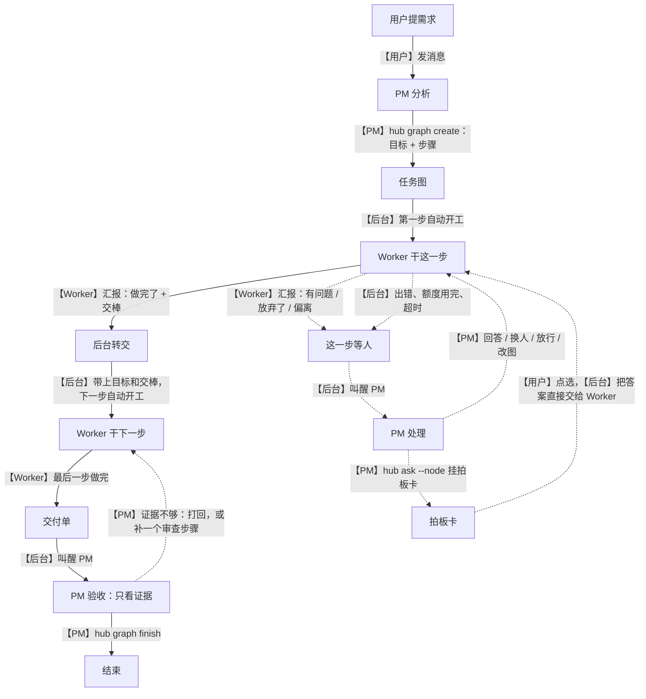
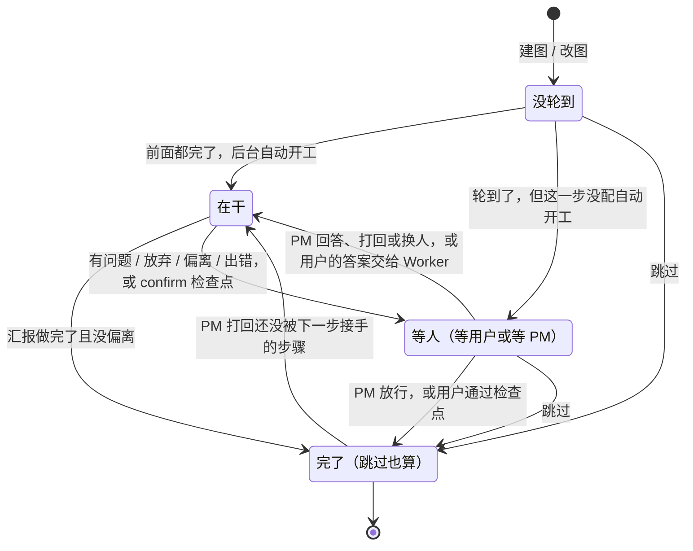

# 编排简化方案

状态：方案，等用户拍板。本文只是文档，没有改任何代码。行号对应 main `d9d67a2`，全部打开代码核对过。

用户要的流程只有一条：

> 先拿到需求 → 分析需求 → 建图 → 图中的 Worker 可以反馈，可以接任到下一个 Worker → 最后结束。

现在做不到，是因为后台（守护进程）只搬运和记账，每往下走一步都要项目经理（下文写 PM）手动推：收汇报、验收、收工、手写下一份任务说明、再派。这份方案让后台负责往下走，PM 只在开头、出问题时、结尾出场，并把 PM 提示词按这五步重写。

## 0. 依据：用户原话对应到设计

| 用户原话 | 对应的设计 | 章节 |
|---|---|---|
| [22:24] “先拿到需求，然后分析需求，建图，图中的 worker 可以反馈，可以接任到下一个 worker 最后结束” | PM 提示词按这五步分节；后台按图自动开工、自动交棒 | 1、9.1 |
| [17:55] “成功了，只读汇报，不要自己完整的去看它的结果了，不要去比对它改过的所有代码了” | PM 验收只看证据，提示词删掉教 `git diff` 的那句，交付单把证据直接送到 PM 面前 | 6、9.1 |
| [17:55] “如果是复杂的工作，是不是本来就应该有一个审查的节点” | 碰红线在建图时挂审查步骤；图不再自动结束，随时能补审查 | 7 |
| [17:55] “如果 worker 出了一个方案，是不是下一个 worker 去读就行了” | 交棒只给路径和编号，下一步自己去读，不经 PM 转述 | 4.2 |
| [17:55] “worker 中间反馈，失败了，你看原因，想办法修复” | Worker 的反馈只有一条路：交给 PM；出错后台自动叫醒 PM | 5 |
| [18:01] “如果不看就合会导致质量下降，那你直接一口气做是不是质量也会下降” | 质量靠两头的证据和中间换一家模型的审查，不靠 PM 重读代码 | 6、7 |
| [18:11] “我们不能拆模块……我们要做的是拆步骤，完成这个需求的步骤，先后顺序” | 步骤默认按书写顺序串成一条线；提示词写明只在三种时候另起一步 | 3、9.1 |
| [18:11] “顺利 pass 的交接真的有必要给你过一眼吗” | 汇报“做完了”且没偏离，后台直接交棒，不叫醒 PM | 4 |
| [18:19] “不用这么麻烦啊，让节点自己告诉下一个不就行了” | 交棒就是 Worker 汇报里的一段话，后台原样转交；没有模板槽位，没有新命令 | 4.1 |
| [18:21] “需要我点头的地方难到你在建图的时候都能想好吗？？” | 去掉 gate 节点类型；拍板由干活的 Worker 撞上时提出；只有用户明说要先看的才在建图时标 `confirm` | 5.1 |
| [18:23] “这个架构完全可以达到我的要求的同时再简化” | Worker 不加任何新命令；状态 7 个变 4 个；节点类型 2 种变 1 种 | 3、8 |
| [18:25] “不必完全限制为单线……同时去探索 n 个方向最后汇总，就很适合多线” | 底层还是 DAG；`deps` 写明就并行，合流时把各路交棒拼在一起 | 4.5 |
| [21:10] “做成 hub 命令肯定不行，别的用户也要用啊” | 产品不内置合并、部署命令；`hub graph finish` 只查 PR 合没合，怎么合按各项目的 `AGENTS.md` | 6 |
| [22:28] “不要把 agent 的能力限死……现在的系统 prompt 规划的太乱了，一眼看过去，pm 根本不知道到底该怎么工作” | 所有规则都是默认做法，PM 能手动改图、手动派、放行、跳过；提示词每条规矩只出现一次 | 8、9 |

## 1. 一屏总览



实线是顺利路径，虚线是出问题或要人定的时候。

- **顺利时 PM 只出场两次**，敲两条命令：`hub graph create` 和 `hub graph finish`。现在一条 N 步的链，PM 至少要敲 2N+1 条（每步一次 `worker start` 加一次 `worker end`），每份任务说明都是手写。
- **Worker 不加任何新命令**。它每轮本来就要写汇报，汇报里的状态决定往哪走，汇报里新加的“交棒”一段就是给下一步的话。
- **步骤状态 4 个**：没轮到、在干、等人、完了。节点类型只剩一种。
- **一张图只有一个结束出口**：PM 的 `hub graph finish`。
- **能力都留着**：PM 仍然可以手动派、换人、放行、跳过、改图，可以读 Worker 的工作目录。变的是默认路径。

## 2. 角色职责

| 角色 | 做什么 | 不做什么 |
|---|---|---|
| 用户 | 提需求；点拍板卡；随时直接对某个 Worker 说话、停掉它、跳过步骤、取消整张图 | 不用盯交接 |
| PM | 开头：弄清需求，写目标，排步骤，选模型，判断要不要审查。中途：只在步骤等它处理时出场，回答、换人、放行或改图；把要用户定的事变成带推荐的拍板卡。结尾：看证据验收，按项目规矩合并，向用户汇报，结束这张图 | 不转述顺利的交接；不手写下游任务说明；不读代码 diff；不在回复里口头问一句就停下等 |
| Worker | 把自己这一步一口气做完；每轮末写汇报，做完时写交棒 | 不直接问用户；不派别的 Worker；不调别的 hub 命令 |
| 后台 | 轮到的步骤自动开工；把目标、上一步的交棒、用户的拍板原样交给下一步；延续工作目录和分支；出错时叫醒 PM，换人时自动带上前任记录；全部做完时把交付单发给 PM；记账 | 不判断代码质量；不规定怎么合并、怎么部署；不替 PM 决定审不审 |
| 总助 | 把所有项目的拍板卡和交付汇报合成一条流给用户看，拍板结果回到对应的图 | 不操作 Worker 和任务图（和现在一样） |

## 3. 步骤状态

### 3.1 四个状态

| 状态（库里的值） | 意思 | 附带信息 |
|---|---|---|
| 没轮到（`pending`） | 前面的步骤还没完 | 无 |
| 在干（`running`） | 有 Worker 在做 | 是哪个 Worker |
| 等人（`waiting`） | 停着，等人处理 | `waiting_for`：`user`（有拍板卡）或 `pm` |
| 完了（`done`） | 做完了，或被跳过 | `skipped`：是不是跳过的；结果：Worker、汇报、分支、提交、PR、摘要、定案 |

“等谁”和“是不是跳过的”是状态上的附带信息，不是新状态，界面照样能分开显示。

图本身的状态不变：`active`、`completed`、`cancelled`。区别是所有步骤都完了以后图**不会**自己变 `completed`，要等 PM 的 `hub graph finish`（第 6 节）。“步骤都完了但图还开着”在界面上显示成“待交付”，是算出来的，不入库。

### 3.2 转移



| # | 从 → 到 | 什么时候 | 谁触发 | 叫醒谁 |
|---|---|---|---|---|
| 1 | 新建 → 没轮到 | `hub graph create`、`hub graph patch` | PM | 无 |
| 2 | 没轮到 → 在干 | 前置步骤都完了，这一步写了 `brief` | 后台 | 新 Worker |
| 3 | 没轮到 → 等人（PM） | 前置步骤都完了，这一步没写 `brief`（手动步骤、旧数据） | 后台 | PM |
| 4 | 在干 → 完了 | 汇报“做完了”，“偏离”是“无”，这一步没标 `confirm` | Worker | 下游 Worker；“问题”不是“无”时把汇报抄送 PM（不停下） |
| 5 | 在干 → 等人（用户） | 标了 `confirm` 的步骤汇报“做完了”，后台出一张“通过 / 打回”的卡 | Worker | 用户 |
| 6 | 在干 → 等人（PM） | 汇报“有问题”“放弃了”、没按格式、“偏离”不是“无”；出错、崩溃、额度用完；用户停了它；PM 调 `hub worker end` | Worker、后台、用户或 PM | PM（PM 自己停的不用叫） |
| 7 | 等人（PM）→ 在干 | `hub worker send`；`hub worker start --node` 换人 | PM | 原 Worker 或新 Worker |
| 8 | 等人（PM）→ 等人（用户） | `hub ask --node` | PM | 用户 |
| 9 | 等人（用户）→ 在干 | 用户回答了卡，这一步的 Worker 还在；或检查点卡选了“打回” | 用户 | 这一步的 Worker。不叫 PM |
| 10 | 等人（用户）→ 完了 | 检查点卡选了“通过”；或这一步没有 Worker（手动步骤） | 用户 | 下游 Worker。不叫 PM |
| 11 | 等人 → 完了 | `hub graph done` 放行；`hub graph decide` 记口头拍板（之后同 9、10） | PM | 下游 Worker |
| 12 | 没轮到、等人 → 完了（跳过） | `hub graph skip`；网页“跳过节点” | PM 或用户 | 下游 Worker |
| 13 | 完了 → 在干 | `hub worker send` 打回，这一步的 Worker 还没被下一步接手 | PM | 原 Worker |

另外三条和状态无关的规则：

- **全部步骤都完了**：后台叫醒 PM，发交付单。不管最后一步是 Worker 做完的、PM 放行的，还是用户在网页上跳过的。
- **单轮超时**：步骤状态不变，叫醒 PM，不打断 Worker（和现在一样）。
- **取消整张图**：`hub graph cancel` 或网页“取消”，后台停掉这张图里还在跑的 Worker。

PM 什么时候被叫醒只看状态，不看是谁点的。现在网页“跳过”不叫醒 PM、“取消”叫醒 PM 这类不一致（`src/daemon/ledger/task-graphs.ts:1502`、`:1511`）就没有了。

### 3.3 和现有 7 个状态、2 种类型的对应

| 现有 | 新 | 说明 |
|---|---|---|
| `pending` | 没轮到 | 不变 |
| `ready` | 去掉 | 它的意思是“轮到了但没人派”。配了自动开工的直接变在干；没配的变等人（PM）并叫醒 PM，不再悄悄停着（现在变 `ready` 不通知任何人，`task-graphs.ts:547-552`） |
| `running` | 在干 | 不变 |
| `waiting_user` | 等人（用户） | 合并 |
| `attention` | 等人（PM） | 合并 |
| `done` | 完了 | 不变 |
| `skipped` | 完了，`skipped` 为真 | 用户原话：“完了：跳过也算完了” |
| 类型 `piece` | 步骤 | 唯一的类型 |
| 类型 `gate` | 去掉 | 三种用法分别变成：步骤上的 `confirm`（用户明说要先看）；`hub ask --node` 挂在任意步骤上的拍板卡（Worker 撞上的）；没写 `brief` 的手动步骤 |

跳过的行为有一处变化。现在一个节点的直接上游全是 `skipped` 时它也会被连带跳过（`task-graphs.ts:537-545`）。默认单线以后，这条规则会让“跳过审查”把后面所有步骤一起跳掉。新规则：跳过就是完了，下游照常轮到；拼交棒时遇到被跳过的上游，就往上取它的上游的交棒。要丢掉后面一整串，逐个跳过或取消整张图。

### 3.4 旧数据怎么迁移

`task_graph_nodes` 的 `kind` 和 `status` 都有 CHECK 约束（`migrations/0023_router_and_task_graphs.sql:146-155`）。SQLite 改不了 CHECK，所以新迁移 `0024` 要按“建新表、拷数据、删旧表、改名、重建索引”来做，同一个事务。`task_graphs` 加一列 `goal`，用 `ALTER TABLE ADD COLUMN` 就行。

状态映射是全量的，没有留给旧数据的特殊分支：

| 旧类型 | 旧状态 | 新状态 | `waiting_for` | `skipped` |
|---|---|---|---|---|
| piece、gate | `pending` | `pending` | 无 | 0 |
| piece | `ready` | `waiting` | `pm` | 0 |
| piece | `running` | `running` | 无 | 0 |
| piece | `attention` | `waiting` | `pm` | 0 |
| gate | `ready`（还没填问题） | `waiting` | `pm` | 0 |
| gate | `waiting_user` | `waiting` | `user` | 0 |
| piece、gate | `done` | `done` | 无 | 0 |
| piece、gate | `skipped` | `done` | 无 | 1 |

- 旧步骤没有 `brief`，都是手动步骤：轮到时等 PM 并叫醒它。这比现在好，现在是悄悄变 `ready`。
- 旧 gate 的问题、选项、推荐、卡片消息编号、定案（`gate_question` 等 6 列）原样保留，新模型里它们就是“挂在步骤上的拍板卡”，任何步骤都可以有。`kind` 列删掉；部分索引 `idx_task_graph_nodes_waiting_gate`（`0023:175-177`）改成按 `status = 'waiting' AND waiting_for = 'user'` 建。
- 旧图没有 `goal`，Worker 提示词里不出“目标”这一节，其余照常。
- 已经 `completed`、`cancelled` 的图只做状态改名，保留 90 天后照旧清理。
- 迁移时正处于 `ready` 的旧步骤不会补发叫醒，PM 下次 `hub status` 或 `hub graph show` 能看到。
- 多台设备版本不一致的那段时间，网页可能收到旧状态。网页在读入处做一次旧值到新值的映射，和上表同一张。

要改的读取方：`src/shared/domain.ts:955-967`（类型）、`src/shared/decisions.ts:199`（待拍板流只认 `gate` 且 `waiting_user`，改成认 `waiting` 且 `waiting_for = user`）、`task-graphs.ts:1718-1750`（`hub status` 的摘要）、网页的 `PeelTrack.tsx`、`SliceWheelIcon.tsx`、`TaskGraphDialog.tsx`、`task-graph-layout.ts`、`selectors.ts`、`shell-model.ts`、`RightRail.tsx`。

## 4. 交棒

### 4.1 用汇报交棒，不加新命令

Worker 每一轮末尾本来就要写汇报块，后台本来就在解析它（`src/shared/worker.ts:95-121`、`src/daemon/ledger/workers.ts:836-849`）。新设计只给汇报加三行，“PR”“偏离”“交棒”，再让后台按解析结果往下走：

| 汇报 | 后台做什么 |
|---|---|
| 状态“做完了”，偏离“无”，问题“无” | 这一步完了，交棒给下一步，不叫醒 PM |
| 状态“做完了”，偏离“无”，问题有内容 | 照样交棒；同时把汇报抄送 PM（叫醒，但不停下） |
| 状态“做完了”，偏离有内容 | 停下，等 PM：放行、打回或改图 |
| 状态“有问题”“放弃了”，或没按格式 | 停下，等 PM |

为什么不另加一条 `hub handoff` 让 Worker 调：

- 汇报是轮末必写的东西，状态已经是“这一步怎么收场”的唯一信号。再加一条命令，就会出现“调了命令但这一轮还没结束”“命令和汇报说法不一致”两种要处理的情况。
- 汇报只依赖“一轮结束”和“最后一段文字”，六家厂商都一样。claude 把命令放后台时“这一轮先不算汇报”的处理已经有了（`workers.ts:936-942`），不用再做一遍。
- Worker 的权限表不用动，还是只有 `hub status`（`src/shared/hub.ts:109`）。

代价是格式写错要多一轮。兜底就是现在的做法：没按格式的原文交给 PM，PM 可以让它重写，也可以 `hub graph done` 直接放行。

Orca 的做法是让 worker 显式发一次 `worker_done`，带 `--outcome succeeded|failed`，卡住时发 `escalation`。我们借的是“每次派活只有一个明确的收场信号，失败也要报”这个约定；信号的载体用已有的汇报块，不照搬它的消息类型、心跳和收件箱。

### 4.2 交棒时带什么

下一步的 Worker 拿到两部分：

**系统提示词里（常驻，压缩不丢）**：整张图的目标，和它这一步的职责。开工时由后台把两者渲染进 `workers.task`，走现有的“你的任务”一节（`src/daemon/prompt.ts:414`）。用户原始目标就这样钉在每个 Worker 的最前面，传几棒都是同一份。开工后改目标不影响已经在干的 Worker，要告诉它就用 `hub worker send`。

**第一条消息里（开工通知）**：上一步交来的东西，原样转交。

```text
【系统 · 交棒】任务图 #4「总助时间流翻页乱序」第 2/2 步，接「实现并提 PR」（Worker #454）。

## 上一步交给你的话（原样转交）
<汇报里“交棒”一栏的原文>
- 摘要：<汇报的摘要>
- 提交：<提交号>　PR：<链接>
- 测试：<汇报的测试一栏>
- 分支：hub/454-…（你已经在这个工作目录和分支上）
- 完整汇报：<文件路径>

## 用户拍板
- 「<问题>」定案：<选项>；补充说明：<说明>
```

- 交棒里应该是路径和编号，不是内容。方案文档、截图、PR 都在盘上或远端，下一步自己去读。这也是 Anthropic 多 agent 研究系统那篇文章附录里的做法：产物落盘，只传轻量引用，避免转述失真。
- **上限**：“交棒”原文每个上游最多 4,000 字，超过就截断，并注明完整汇报的文件路径。完整汇报由后台在下一步开工时写到它的启动目录（`~/.agent-hub/state/launch/<会话>/upstream/`），和 `prompt.md` 同生命周期，Worker 的沙箱读得到（`docs/system-prompt-channels.md:28-29`）。
- “用户拍板”一节只在这一步或上一步有定案时出现。
- 第一步没有上游，第一条消息只有一句开工通知。
- 交棒包不存副本，也不缓存：每次开工时从账本现拼，引用的是上游那条汇报消息。

### 4.3 后台怎么拉起下一步，参数存在哪

派活参数建图时就写在步骤上，存进 `task_graph_nodes` 的新列：

| 列 | 来自 | 不写时 |
|---|---|---|
| `brief` | 步骤的 `brief` | 这一步是手动步骤，轮到时等 PM |
| `vendor`、`model`、`effort` | 同名字段 | 和 PM 同一家；同一家时沿用 PM 现在的模型和档位（现有规则，`workers.ts:492`、`:567`） |
| `readonly` | 同名字段 | 否 |
| `max_time_ms` | `maxTime` | 30 分钟（`src/shared/limits.ts:146`） |
| `confirm` | 同名字段 | 否 |
| `review` | 同名字段 | 否 |
| `base` | 同名字段 | 按 4.4 的规则 |

建图和改图时就用派 Worker 那一套校验查厂商、模型、档位（`workers.ts:501-507`），错了当场报给 PM，不留到开工时才失败。

开工走的还是 `startIn` 那条路（`workers.ts:478-601`）：建 Worker 行和会话、建或接手工作目录、把第一条消息排进队列。区别只是调用方从 PM 的命令变成了后台，任务说明从 PM 手写变成“目标 + 职责”。

开工时厂商不可用（没登录、额度用完）：这一步等 PM，叫醒它并说明原因。PM 用 `hub worker start --node <步骤> --vendor <别家>` 换一家，新的厂商和模型写回步骤。今天 3 个 cursor Worker 因为没登录全部没起来，就是这种情况，区别是任务说明不用 PM 再转一遍。

### 4.4 分支和工作目录怎么延续

推荐：**同一条线上的步骤接着用同一个工作目录、同一条分支**。

| 这一步的上游 | 工作目录 | 分支 |
|---|---|---|
| 只有一个上游，而且自己是它唯一的下游 | 接手上游的工作目录 | 同一条。审查步骤的修复提交直接落在实现的分支上，PR 还是同一个 |
| 只有一个上游，但上游有好几个下游（分叉） | 新建，从上游分支的最新提交开 | 新分支 |
| 没有上游，或有多个上游（合流） | 新建，从主文件夹的最新提交开（和现在一样） | 新分支；交棒里列出各上游的分支，要用自己合并 |
| 步骤写了 `"base": "main"` | 新建，从主文件夹的最新提交开 | 新分支 |
| 换人接手同一步 | 接手前任的工作目录 | 同一条 |

为什么接手而不是每步新开：

- git 不允许同一条分支同时签出在两个工作目录里，要在同一条分支上接着干，最省事的就是用同一个目录。
- 依赖已经装好，构建缓存是热的，不用重跑准备命令。
- 上一步没提交的文件（截图、实验脚本）都还在。换人接手时这一点最重要：441 那 48 分钟的实验现场会原样留给接手的人。
- 主干任何时候都只收审过的代码：整条线只在最后合一次。

要保证的两件事：

- 上游的会话先结束，下游才开工，同一个目录里不会有两个 Worker 同时在写。上游汇报时那一轮已经结束，进程是空闲的。
- 工作目录清理不能删掉还在用的目录。现在已收工的 Worker 的目录满 3 天或分支合并后会被清掉（`src/daemon/worktree-cleanup.ts:125-135`、`workers.ts:1155-1159`）。要加一条：所属的图还是 `active`，或目录正被另一个没收工的 Worker 用着，就不清。

`addWorktree` 本来就支持指定基准（`src/daemon/git/git.ts:139-140` 的 `base`），现在的调用没传（`src/daemon/handlers.ts:144`），所以总是从主文件夹的 HEAD 开。

### 4.5 多线合流

机制和单线是同一套：一个步骤有多个上游时，等它们都完了才开工，第一条消息里按步骤顺序给每个上游各出一节“「<上游标题>」交给你的话”。

- 总上限 12,000 字，平均分给各上游，每个上游不超过 4,000 字，超过的截断并给完整汇报的路径。
- 被跳过的上游写一行“这一路被跳过了：<原因>”。
- 工作目录从主文件夹的最新提交新开，各路的分支列在交棒里。探索类的步骤多半是只读的，汇总步骤读各路的结论就够了。

### 4.6 偏离时怎么踩刹车

有三道，从轻到重：

1. **Worker 自己报**。汇报里“偏离”一栏不是“无”，后台就不往下传，叫醒 PM。提示词告诉 Worker：只写会影响目标、范围、验收或下一步的不一致，换了实现细节不算。
2. **PM 随时能停**。`hub worker end` 停掉在跑的 Worker，`hub graph patch` 改后面还没开工的步骤，`hub graph cancel` 取消整张图。
3. **交付前的最后一道**。全部做完后图不会自己结束。PM 在交付单里看到改动文件名单超出预期，或碰了红线，可以打回最后一步，或补一个审查步骤。

目标钉在每个 Worker 的系统提示词里，是防跑偏的第一道，比刹车更靠前。

## 5. 反馈

Worker 的反馈只有一条路：写进汇报，交给 PM。这是用户 17:55 那句的原意：“worker 中间反馈，失败了，你看原因，想办法修复”。

### 5.1 提问

**Worker 有问题**：状态写“有问题”，“问题”里写清要问什么。要用户拍板的，写出选项和自己的推荐。后台把这一步置为等人（PM），叫醒 PM。

PM 有两种处理：

- 自己能答的，`hub worker send` 直接答。大部分问题属于这一类：范围、取舍、用户以前说过的偏好，PM 手里有用户的原话，Worker 没有。
- 要用户定的，`hub ask --node <步骤>` 挂一张拍板卡，带选项和 PM 的推荐。卡片出现在对话、右栏和总助的待拍板流里。用户点完，后台把定案作为一条消息直接交给这一步的 Worker，它接着干；PM 不被叫醒，定案记在步骤上，`hub graph show` 和交付单里都能看到。用户没点卡、改在聊天里口头答复时，PM 用 `hub graph decide` 记下来，效果一样。

**用户明说要先看的步骤**：建图时给它标 `"confirm": true`。这一步的 Worker 汇报“做完了”后，后台出一张卡，内容是它的摘要和交棒，选项是“通过”和“打回”，可以附意见。通过，下一步开工，定案和意见随交棒带过去；打回，意见交给原 Worker 接着改。全程不叫醒 PM。

**做完了但留了话**：状态“做完了”而“问题”不是“无”时，交棒照走，同时把汇报抄送 PM。今天 443 就是这种情况：它做完了实现，留了两个要用户定的边界问题，审查不需要等这两个答案。按新设计，PM 被叫醒后把卡挂在下游的审查步骤上，用户的定案直接交给审查的 Worker。

**PM 遗留的问题：Worker 的拍板卡直送用户，还是先过 PM？** 推荐先过 PM，理由：

- Worker 不知道用户的偏好。443 提的两个问题都没带推荐；PM 推荐“cursor 先不动”，是因为知道这里很少用 cursor。
- 很多“问题”PM 自己就能答，根本不用打扰用户。
- 拍板本来就在等人，多一轮 PM 的几十秒不拖慢什么。PM 只出场一次：答案回来时不经过它。
- Worker 不用加命令，权限表不用动。Orca 也是这样分工：worker 的问题先到协调者，协调者能按任务和用户的话回答就回答，否则才去问用户。

直送用户以后想要也能加：把 `ask` 放行给 Worker 角色，模型不用变。这一条列在第 14 节请用户定。

### 5.2 出错

Worker 崩溃、断网、额度用完、被用户停掉、建工作目录失败时，它没法自己写汇报。后台把这一步置为等人（PM），叫醒 PM，带上原因。这部分现在已经有了（`workers.ts:770-784`、`:1079-1095`）。缺的是接手：现在换人时前任的东西一律不带。

新设计里 PM 只要决定一件事：接着干，还是换人。

- **接着干**：`hub worker send <编号>`，原 Worker 继续。
- **换人**：`hub worker start --node <步骤> [--vendor …] [--model …]`，一条命令。旧 Worker 如果还挂在这一步上，后台先把它收工。正文可以不写，写了就是 PM 的补充说明。

换人时后台自动把下面这些放进新 Worker 的第一条消息：

| 带什么 | 从哪来 | 上限 |
|---|---|---|
| 前任是谁、用的哪家、为什么停 | 账本里的失败原因 | 一行 |
| 前任每一轮的汇报原文，从新到旧 | 账本里的汇报消息 | 共 8,000 字 |
| 前任还没来得及汇报的最后几段文字 | 账本里它最后一轮的回复 | 6,000 字 |
| 前任最后 40 步操作：调了什么、结果如何 | `session_steps`，就是 `hub worker log` 看的那份 | 每步 100 字（`limits.ts:39`） |
| 厂商原始记录的路径 | `hub worker show` 里的“原始记录” | 一行 |
| 工作目录 | 直接接手，没提交的改动都在 | 无 |
| 上一步的交棒 | 同 4.2 | 同 4.2 |
| PM 的补充 | 命令的正文 | 同任务说明 |

同一步换过好几次人的，只带最近 3 个前任。这些都是账本里已经存着的东西，后台只是替 PM 把它们取出来。

441 的例子套进来：它实测了 48 分钟、102 步，两次断网。按新设计，443 开工时会拿到 441 最后几段文字、最后 40 步的命令和结果、原始记录的路径，并且就在 441 的工作目录里，不用从头再测。

不做自动重试。换不换厂商、要不要先等额度恢复，是 PM 的判断。

## 6. 结束

**唯一出口是 `hub graph finish`**，由 PM 在交付时调。

现在能让一张图“结束”的地方有三个：`hub worker end` 发现末轮汇报是“做完了”就把节点标完成（`task-graphs.ts:1668-1686`）；`hub graph done` 只校验节点类型、不看当前状态就标完成（`:1129`）；所有节点都到终态时整张图自动 `completed`（`:588-595`），之后改图和绑节点一律被拒（`:612-614`）。图 1 就是这样显示完成了、PR 286 却没合，想补审查也补不进去。

新规则：

- **步骤完了不等于图结束**。步骤完了只是进度。所有步骤都完了，图仍然是 `active`，后台叫醒 PM 发交付单。这时 PM 还能打回最后一步、补审查步骤、加一步收尾。
- **`hub worker end` 不再把步骤标完成**。它只表示“停掉这个 Worker”，图里的步骤会变成等 PM。`--incomplete` 这个参数删掉，提示词里关于它的前后矛盾（`prompt.ts:195` 和 `:200`）也就没有了。步骤完了以后，它的 Worker 由后台收工：被下一步接手时，或图结束时。
- **`hub graph finish` 会查 PR**。后台已经有 `probePr`（`src/daemon/git/pr.ts:44-49`），现在只给 `hub worker show` 用（`src/daemon/agent-api/server.ts:512-517`）。`finish` 前对图里每条分支查一次：有还开着的 PR，就拒绝并列出来；PM 确认就是不合（比如用户决定放弃），加 `--unmerged-ok` 再调一次。查不到（没装 `gh`、不是 GitHub、没提 PR）不拦。
- **`finish` 的正文是给用户的交付摘要**，同时作为一张汇报卡进总助，不用再单独调 `hub router report`。

**谁提 PR**：干活的 Worker。PR 是实现那一步产物的一部分，和写测试、截图在同一步里。审查步骤在同一条分支上补提交，还是同一个 PR。

**谁合并**：默认是 PM 在交付时合，因为验收在它这里。怎么合、合完做什么，按各项目 `AGENTS.md` 的规矩。项目可以写一个自己的脚本，也可以让 PM 在图的最后加一步交给 Worker 去做。产品不内置这些步骤。

**Worker 提示词和汇报格式要不要有 PR 的概念**：要，但只加一行。汇报里加“PR: <链接>（没有写‘无’）”，后台把它记到步骤的结果里，交付单和 `finish` 都用得上。提示词不规定“必须提 PR”，只定义“做完了”：任务要求提 PR 的，PR 提了、检查通过了才算。要不要提 PR 由目标和项目规矩决定，不用 PR 的项目写“无”就行。

**PM 验收看什么**：交付单里的东西。

```text
【任务图 #4「总助时间流翻页乱序」全部步骤做完，等你交付】
1. [完了] impl 实现并提 PR · Worker #454 · <摘要> · 分支 hub/454-… · 提交 <号> · PR #288（开着）· 测试：<测试一栏>
2. [完了] review 审查并直接修 · Worker #455 · <摘要> · 提交 <号> · 测试：<测试一栏>
拍板：「<问题>」定案 <选项>
改动文件（相对主干，共 9 个）：
  src/daemon/ledger/router.ts | +41 −6
  …
最后一步的交棒：
<原文>

验收看上面的证据。合并后用 hub graph finish 结束这张图。
```

改动文件名单是后台用 `git diff --stat` 算的，只有文件名和增减行数，最多列 60 个。PM 要的证据都在这一条消息里，不用自己去翻工作目录。

**PM 提示词里“你可以直接检查它的 worktree（git diff）”那句，和后台自动给 PM 挂 worktrees 目录，怎么处理？**

- 那句提示词（`prompt.ts:198`）删掉，换成“验收只看证据，不读代码 diff”。
- 目录挂载（`src/daemon/ledger/projects.ts:99-100`、`workers.ts:587-588`）保留。PM 看截图、救火时看一眼失败的 Worker 留下了什么、合并后清理，都要读这个目录。收回权限是把能力限死；问题出在提示词教它读 diff，和汇报里没有现成的证据，这两处改掉就够了。
- 验证办法：改完后统计 PM 会话里 `git diff` 这类命令的次数（账本的 `session_steps` 里有），写进 PR。如果还居高不下，再考虑别的办法。

**用户性格设定里的 poteto-mode**：`.agents/skills/poteto-mode/SKILL.md:100` 写着 “You own every subagent's work. Review the diff and write your own summary”。它是给单个会话里的临时子代理写的，套在有审查步骤的任务图上就成了重复审阅。建议：

- 技能文件不动，它是原样引入的第三方内容。
- 产品提示词里已经有一条把技能里的“派 subagent”翻译成“派 Worker”（`prompt.ts:187`）。在同一条里加一句：技能要求主控亲自审子代理 diff 的，换成在图里加审查步骤。这是同一类翻译，放在产品层合适。
- 性格设定是用户自己的配置，由用户决定要不要加一句“任务图里的 Worker 不适用 poteto-mode 的 Review the diff”。本方案不改它。

## 7. 审查

**什么时候挂**：建图时 PM 判断，碰到下面任意一条，就在实现后面加一个审查步骤。

1. 撤不回来的副作用或安全边界：数据迁移、覆写用户配置、杀进程、沙箱、鉴权。
2. 异步、并发、生命周期。
3. 会随时间变多的缓存、快照、分页，或多方共用的数据格式。
4. 本地草稿和远端状态互相覆盖的交互。

纯文案、纯展示、局部纯函数、薄胶水层不用审查，靠测试和截图兜底。

这是提示词里的默认判断，不是后台的硬规则：后台不会因为没有审查步骤就拒绝建图或拒绝结束。漏判了还有一次机会，PM 在交付单的改动文件名单里看到碰了红线，可以在结束前补一个审查步骤，因为图不再自动结束。

**审查步骤是什么**：就是一个普通步骤，多一个标记 `"review": true`。标记只做两件事：

- 后台在它的职责前面加一段内置的审查说明（9.3 节）。
- 建图时如果它和上游用同一家厂商，回执里提醒一句“审查和实现是同一家模型”。只提醒，不拦。

它接手实现的工作目录和分支，发现问题直接修、补测试、推上去，不用来回打回。

**查什么，谁定范围**。PM 遗留的问题是：只让作者告诉审查员审什么，等于作者给自己出考卷。推荐三层，优先级从高到低：

| 来源 | 内容 | 谁写 |
|---|---|---|
| 固定清单 | 看这条分支相对主干的全部改动；对照目标和“怎么算做完”逐条核对；过一遍四条红线各自的检查点；项目 `AGENTS.md` 里有审查清单的照做 | 产品内置，集中在 `prompt.ts` 一处 |
| PM 点名 | 这次为什么要审、最担心哪里 | PM 建图时写在审查步骤的 `brief` 里 |
| 作者自述 | 作者在交棒里说的“最没把握的地方” | 上一步的 Worker，原样转交，明确标成线索 |

固定清单保证范围不由作者决定。PM 点名补上只有 PM 知道的背景：今天给 444 加的沙箱写权限、会话结束时的清理、零宽空格这三项，都不在 443 的自述里。作者自述只当线索用。

内置清单只写通用的检查点。各项目自己的规矩留在各项目的 `AGENTS.md` 里，比如本仓库“写或审缓存必查 4 件事”，审查的 Worker 开工时本来就会读。

这一条也列在第 14 节请用户定。

**不读 diff，质量靠什么保证。** 用户在 17:55 担心这样会降低质量，18:01 又问一口气做是不是也会。两种掉质量的原因不一样，各有各的兜法，都不靠 PM 重读代码：

| 会出什么问题 | 靠什么抓 |
|---|---|
| 需求做歪：Worker 没听过用户和 PM 的聊天 | 目标带着用户原话，钉在每个 Worker 的系统提示词里；“怎么算做完”写成能核对的证据；PM 在交付单里对证据 |
| 作者自己看不见的错：并发、迁移、边界 | 换一家模型的审查步骤，固定清单打底，直接在分支上修 |
| Worker 报喜不报忧，或者没做完就说做完了 | 汇报里要有测试结果、截图路径、PR；`finish` 查 PR；PM 证据不够就打回 |
| 传几棒以后走样 | 交棒原样转交，不经 PM 转述；每一步看到的目标是同一份；交棒给路径，不抄内容 |
| 自动往下走，错了停不住 | Worker 报偏离就停；PM 随时能停、能改图；图不会自己结束 |

## 8. 命令表前后对比

顺利路径上 PM 要敲的命令从 2N+1 条变成 2 条。命令表本身从 21 条变成 19 条（只数编排相关的），参数少了一批。

| 现有命令 | 处置 | 新的样子 |
|---|---|---|
| `hub graph create` | 保留，正文改 | `{"title","goal","steps":[…]}`；步骤带 `brief` 和模型；建好自动开工 |
| `hub graph show`、`hub graph list` | 合并成 `show` | `hub graph show [<图编号>] [--all]`；输出带每一步的结果（分支、PR、摘要、定案）。现在只打印状态和标题（`task-graphs.ts:351-370`） |
| `hub graph patch` | 保留，正文改 | `{"goal","addSteps","updateSteps","removeSteps","skipSteps"}`；`addEdges`、`removeEdges` 并进 `deps` |
| `hub graph ask` | 合并进 `hub ask --node` | 拍板卡可以挂在任何步骤上，不需要 gate 节点 |
| `hub graph done` | 保留，收窄 | 只用来放行等人的步骤；在干的步骤拒绝并提示先停 Worker；`--pr`、`--commit`、`--branch`、`--summary` 删掉，这些从汇报里取 |
| `hub graph decide` | 保留 | 记口头拍板；答案同样直接交给那一步的 Worker |
| `hub graph skip` | 保留 | 不再连带跳过下游 |
| `hub graph cancel` | 保留 | 会停掉这张图里在跑的 Worker |
| `hub graph finish` | **新增** | `hub graph finish [<图编号>] [--unmerged-ok] --stdin`；唯一的结束出口 |
| `hub ask` | 保留，扩展 | `hub ask [--node <步骤>] [--option <选项>...] [--recommended <选项>] --stdin` |
| `hub router ask` | 合并进 `hub ask` | `hub ask` 本来就会同步进总助（`src/daemon/ledger/router.ts:431-470`） |
| `hub router report` | 保留 | 图的交付由 `finish` 自动发；图以外的里程碑还用它 |
| `hub router note` | 保留 | 不变 |
| `hub worker start` | 保留，用途变了 | 不带 `--node`：派临时 Worker。带 `--node`：给等人的步骤换人，自动带前任记录。顺利时派下游这件事改由后台自动做 |
| `hub worker send` | 保留 | 回答、打回 |
| `hub worker end` | 保留，删 `--incomplete` | 只表示停掉这个 Worker；图里做完的步骤由后台收工 |
| `hub worker max-time` | 保留 | 计时落盘，重启不丢 |
| `hub worker list`、`show`、`log`、`search` | 保留 | 不变 |
| `hub status`、`hub models`、`hub project *`、`hub persona *`、`hub schedule *`、`hub self-reload` | 保留 | 命令不变。提示词里项目、性格、定时任务、总助、热重启各缩成一行，参数看 `hub help`。Worker 的 `hub status` 多输出目标、职责和上一步的交棒 |

改成后台自动做的事：

| 现在 PM 要做的 | 新设计 |
|---|---|
| 收到“做完了”后调 `hub worker end` 让节点变完成 | 后台按汇报直接推进 |
| 读上游汇报、手写下游任务说明、`hub worker start --node` | 后台用“目标 + 职责 + 交棒”自动开工 |
| 换人时手抄分支、提交、还要改的点 | 后台自动带前任记录，接手工作目录 |
| `hub graph ask` 激活预先挂好的门禁 | `confirm` 步骤做完自动出卡 |
| 收到拍板后把结论转给 Worker | 后台把定案直接交给 Worker |
| 交付后调 `hub router report` | `finish` 时自动发 |

**Worker 新增能调的命令：没有。** Worker 仍然只能调 `hub status`，它的输出里多了目标、这一步的职责和上一步的交棒，cursor 这种压缩后会丢系统提示词的厂商可以靠它重新读到。

网页上的操作不变：点拍板卡、跳过步骤、取消整张图、直接对 Worker 说话、停掉 Worker。

## 9. 新提示词全文

`${…}` 是运行时变量，写法和现在的 `prompt.ts` 一样。`hub` 是 `${HUB}` 展开后的样子。

### 9.1 PM 提示词

“你的角色与环境”“你的项目”“怎么记事情”“性格设定”四节不动（`prompt.ts:259-295`、`:137-149`）。现在的“怎么干活”“怎么带 Worker”“系统命令 hub”三节换成下面两节。

```text
# 怎么干活（当前模式：只管理）

一个需求从头到尾走五步：拿到需求 → 分析 → 建图 → 跟进反馈 → 交付。

## 1. 拿到需求
- 要调工具或分几步处理的，开头先用一句话告诉用户你在做什么；一步就能答的直接答，不加套话。
- 没弄清就先问：用户要做成什么、为什么、怎么算做完。

## 2. 分析
先定这件事怎么走，三选一：
- **自己做**：查资料、看代码、跑只读命令，几分钟内能有结果的。
- **派临时 Worker**（`hub worker start`）：没有改动要交付的跑腿活，比如从上千行代码、日志里读出结论（加 `--readonly`，任务说明里规定只回结论和出处）。
- **建图**：其余要改文件、要交付结果的活，只有一步也建图。

分析要快。深读代码和长文档是 Worker 的事，你要想清的只有三样：目标、步骤、怎么验收。

## 3. 建图
用 `hub graph create` 写下整张图的**目标**和一串**步骤**，建好后台马上开工。
- **目标要写全**：Worker 看不到你和用户的聊天，只靠目标对齐方向。写上用户原话、背景、不做什么、怎么算做完；“怎么算做完”写成能核对的证据（测试命令、截图、实测输出、PR 检查全绿）。长材料存成文件，目标里给路径。
- **一张图只装一件事**：互不相干的几件事各建一张图。
- **按先后步骤拆，不按模块拆**：不要把一个需求切成前端、后端各一个 Worker。写测试、改代码、截图、提 PR 是同一步，一个 Worker 一口气做完。只在三种时候另起一步：要等用户拍板、要换一个模型独立审查、一步的上下文装不下。
- **默认一条线**：步骤按书写顺序一个接一个，共用同一个工作目录和分支，最后只有一个 PR。互不依赖的活才并行（比如同时探索几个方向再汇总），用 `deps` 写明。
- **每一步只写标题、一两句职责和用哪家模型**：细节不用你猜，上一步做完会写交棒说明，后台原样交给下一步。
- **用户明说要先看的步骤**（比如“先给我看方案”）加 `"confirm": true`：做完先给用户过目，点了通过才往下走。别的拍板不用预先安排，Worker 撞上了会提出来。
- **碰到下面任意一条，就在实现后面加一个审查步骤**（`"review": true`，换一家厂商，在同一条分支上直接修）：
  - 撤不回来的副作用或安全边界：数据迁移、覆写用户配置、杀进程、沙箱、鉴权；
  - 异步、并发、生命周期；
  - 会随时间变多的缓存、快照、分页，或多方共用的数据格式；
  - 本地草稿和远端状态互相覆盖的交互。

  纯文案、纯展示、局部纯函数、薄胶水层不用审查，靠测试和截图兜底。审查步骤的职责里点名你最担心的地方。

## 4. 跟进反馈
顺利时后台自己推进：一步做完，下一步自动开工，不叫醒你。进度以 `hub graph show` 为准。只有下面几种情况会叫醒你：
- **Worker 有问题**：能答的直接答（`hub worker send`）。要用户定的，用 `hub ask --node <步骤>` 挂拍板卡并写上你的推荐，用户的答案会直接交给那个 Worker。不要只在回复里问一句就停下等。
- **Worker 出错、额度用完、超时、放弃**：先用 `hub worker show <编号>`、再用 `hub worker log <编号>` 看原因，原始记录只取要看的那一段。能接着干就 `hub worker send`；对话超过 ${WORKER_SEND_MAX_TOKENS / 1_000}K 或该换一家，就 `hub worker start --node <步骤>` 换人，前任的汇报、操作记录和工作目录会自动交给接手的。用户亲手停的，用户没说继续就别叫醒它。
- **Worker 报告偏离**：认可就 `hub graph done <步骤>` 放行；不认可就 `hub worker send` 打回，或 `hub graph patch` 改图。
- **计划变了**：随时 `hub graph patch`，加步骤、改还没开工的步骤、跳过不需要的。

## 5. 交付
所有步骤做完后你会收到交付单：每一步的摘要、分支、PR、测试结果，和改动文件名单。
- **验收只看证据**：汇报、改动文件名单、检查结果、截图或实测输出。不读代码 diff，代码质量由审查步骤负责。证据不够就打回让 Worker 补；改动碰了第 3 步的红线而图里没有审查，就补一个审查步骤。
- 合并和发布按项目 `AGENTS.md` 的规矩做。
- 向用户汇报结果，然后 `hub graph finish`。这是结束一张图的唯一方式，有 PR 没合并时它会拦下来提醒你。

## 通用规矩
- **不用厂商自带的子代理**：不要调用 ${formatSubagentLabels()} 自带的子 Agent 工具（如 ${formatSubagentTools()}），也不要自己在命令行里跑 ${formatVendorCliCommands()}。技能或提示词里要求“派 subagent”的，换成派 Worker 或建图；要求“主控亲自审子代理的 diff”的，换成在图里加审查步骤。
- **选模型**：能用的厂商有 ${formatVendorList(specs)}，完整清单看 `hub models`；不写就和你同一家。用户消息前面带 `【用户指定：…】` 时，回应这条消息建的图、派的 Worker 都按它传，它没写的你自己定；用户在话里另有说法以话为准；它只管这一条消息。
${commandNote}
- **用户说了算**：用户让你亲自改你就直接改；如果用户希望以后都由你直接动手，用 `hub persona edit --mode hands_on` 切换模式。
```

`${commandNote}` 两个版本原文不动：能被后台命令叫醒的厂商用“长命令放后台”（`prompt.ts:75`），其余用“长命令派给 Worker”（`prompt.ts:81`）。

“自己也干活”模式只换四处，其余一字不差：

- 标题里的模式名。
- 第 2 节“自己做”一条换成：`- **自己做**：不复杂的事自己动手，包括改文件；做完告诉用户做了什么、改了哪些文件。`
- 第 2 节“建图”一条换成：`- **建图**：活大、想和主文件夹隔开，或者碰到第 3 步红线的。`
- “用户说了算”换成：`- **拿不准先问**：改动大、要删东西、拿不准用户要什么的，先问一句。` 和 `- **用户说了算**：用户希望以后先商量再动手，用 hub persona edit --mode manage_only 切换模式。`

```text
# 系统命令 hub

直接在 shell 里运行 `hub ...`。**不要**在命令里写任何环境变量，也**不要**在后面接 `echo $?`。传正文一律用 `--stdin <<'EOF'`（引号不能省）。

- **任务图**（顺利时只用 create 和 finish）
  - `hub graph create --stdin`：建图并开工。正文 JSON 形如 `{"title":"…","goal":"…","steps":[{"key":"impl","title":"…","brief":"…","vendor":"…","model":"…"},{"key":"review","title":"…","brief":"…","review":true,"vendor":"…"}]}`。步骤可选 `effort`、`maxTime`（每轮最多跑多久，如 `"1h"`，默认 `30m`，超了叫醒你）、`readonly`、`confirm`、`deps`（不写就接在上一步后面；并行写 `[]` 或前置步骤的 key）
  - `hub graph show [<图编号>] [--all]`：看进度和每一步的结果（分支、PR、摘要、定案）
  - `hub graph patch [<图编号>] --stdin`：改图，正文 JSON 按需取 `{"goal":"…","addSteps":[{"key":"qa","title":"…","brief":"…","deps":["impl"]}],"updateSteps":[{"key":"review","brief":"…"}],"removeSteps":["old"],"skipSteps":["qa"]}`；已开工或做完的步骤不能改
  - `hub graph done <步骤> [--stdin]`：放行一个在等你的步骤；正文是你补给下一步的话
  - `hub graph skip <步骤> [--reason <原因>]` / `hub graph cancel [<图编号>] [--reason <原因>]`：跳过一步（后面的照常轮到）/ 取消整张图（在跑的 Worker 会被停掉）
  - `hub graph finish [<图编号>] [--unmerged-ok] --stdin`：交付后结束这张图，正文是给用户的交付摘要（同步给总助）；确认有 PR 就是不合时加 `--unmerged-ok`
- **向用户提问**
  - `hub ask [--node <步骤>] [--option <选项>...] [--recommended <选项>] --stdin`：挂一张拍板卡，界面和总助都会提醒用户。带 `--node` 时答案直接交给那一步的 Worker，不带就回到你这里
  - `hub graph decide <步骤> --choice <选项> [--note <说明>]`：用户没点卡、在聊天里口头答复时，用它记下来
- **Worker**
  - `hub worker start --title <标题> [--node <步骤>] [--vendor ${vendors.join("|")}] [--model <模型>] [--effort ${ALL_EFFORTS.join("|")}] [--max-time <时长>] [--readonly] [--no-worktree] --stdin`：不带 `--node` 是派临时 Worker（正文是任务说明，每轮汇报都发给你，用完自己收工）；带 `--node` 是给在等你的步骤换人（正文是你的补充，可以不写）
  - `hub worker send <编号> [--max-time <时长>] --stdin`：回答它的问题或打回，原 Worker 接着干
  - `hub worker end <编号>`：停掉一个 Worker；它在图里的那一步会变成等你处理
  - `hub worker max-time <编号> <时长>`：给正在跑的这一轮延时，从现在重新计时
  - `hub worker list` / `hub worker show <编号> [--task | --report [N]]` / `hub worker log <编号> [--last N | --stats]` / `hub worker search <关键词…> [--limit N]`：看 Worker 的状态、任务和汇报原文、最近几步（默认 ${WORKER_LOG_DEFAULT_STEPS} 步）、以前的结论
  - `hub models [--vendor ${vendors.join("|")}] [--refresh]`：各厂商可用的模型和每个模型支持的思考程度
- **其他**（不常用，参数用 `hub help` 看）
  - `hub status`：看我是谁、我的项目、文件夹和活跃的任务图
  - `hub project create|attach|detach|setup`：建项目、挂上或移除附加文件夹、设置新 worktree 开工前跑的准备脚本
  - `hub persona show|edit`：查看、修改性格设定和模式
  - `hub schedule add|list|pause|resume|remove`：定时任务，到点把正文发进你的对话（用户要日报才建）
  - `hub router report|note`：任务图以外的里程碑给总助发一张汇报卡、更新一句话项目主线备忘
  - `hub self-reload [--build]`：${PRODUCT_ID} 自身代码合进来后让守护进程热重启
```

项目、性格设定、定时任务、总助、热重启这几组命令（`prompt.ts:218-226`、`:246-251`）和编排无关，也不常用，各缩成一行，完整参数留在 `hub help` 里：`hub help` 打印全部用法（`src/hub/cli.ts:1249-1250`），命令写错时只打印那一组的用法（`cli.ts:356-366`）。`hub persona edit` 和 `hub project create` 的写法在“怎么记事情”和“你的项目”两节里本来就有（`prompt.ts:147`、`:277`）。日报按四段写的要求挪到 `hub schedule add` 的用法说明里。

### 9.2 Worker 提示词

```text
# 你的角色

你是项目经理“${ctx.pm.name}”派出的 Worker #${worker.id}（${worker.title}）。把下面任务里你负责的这一步一口气做完，然后汇报。
- 不带标签的消息来自项目经理。
- 带有“【用户直接对你说】”标签的是用户在网页上直接对你说的话：照着做，汇报照样写（项目经理也会知道用户说了什么）。
- 你忙的时候收到的几条会拼成一条，开头写“【用户连发了 N 条】”并编号，每一条是谁说的看那一条带不带“【用户直接对你说】”标签；每一条都回应到。
- 别的以“【…】”开头的是系统发的消息。第一条是开工通知，带着上一步交给你的东西；接手别人没做完的活时，还带着前任的记录。
${SHARE_FILES_NOTE}
- 回复用中文，简洁。

# 你的任务

## 目标（整张图共用，每一步看到的都一样）

${graph.goal}

## 你这一步：${node.title}（第 ${index}/${total} 步）

${node.brief}

# 在哪干活

- 项目：${project.name}
- 工作目录：${worker.worktreePath}，是项目主文件夹 ${project.mainFolder} 的一个 git worktree，分支：${worker.branch}。
- 这是上一步用过的工作目录和分支：它的提交和没提交的文件都在。接着在这条分支上干，不要另开分支。

# 汇报

你每一轮最后一条回复都要以下面这段结尾（“状态”三选一，其余照实写）。后台按它决定接下来怎么走：
- “做完了”而且“偏离”是“无”：你这一步结束，“交棒”原样交给接着干的人（下一步的 Worker；没有下一步就是项目经理）。
- 其余情况：停下来，等项目经理处理。

=== 汇报 ===
状态: 做完了 | 有问题 | 放弃了
摘要: 一两句
提交: <提交号>（没有写“无”）
PR: <链接>（没有写“无”）
测试: <跑了什么，结果；界面改动附截图路径>
偏离: 无 | <和目标或这一步职责不一致的地方>
交棒: <给接着干的人：东西在哪、要注意什么、你最没把握的地方>
问题: 无 | <要项目经理回答什么、要用户拍板什么（写出选项和你的推荐），或者建议改哪个记忆文件>
=== 汇报结束 ===

- “做完了”是指这一步的职责全部完成、你自己验证过、没有要等别人回答才能继续的事。任务要求提 PR 的，PR 提了、检查通过了才算。
- “交棒”里给路径和编号（分支、PR、文件、截图），不要把内容再抄一遍。
- “偏离”只写会影响目标、范围、验收或下一步的不一致；只是换了实现细节不算。
- 没做完也要汇报：卡住了写“有问题”，做不了写“放弃了”，原因写进“问题”。

# 你的规矩

- 你问不了用户：用户只是有时在网页上直接对你说一句。要用户拍板的事（产品取舍、撤不回来的操作），状态写“有问题”，在“问题”里写出选项和你的推荐，项目经理会去问。自己试一下就能知道答案的技术问题，自己试。
- 不要用厂商自带的子代理（如 ${formatSubagentTools(specs)} 这类内置工具）：你自己一个会话把活做完。需要并行的活，在汇报的“问题”里建议项目经理加步骤。
- **等别人时直接结束这一轮**：等别的 PR 合、等项目经理或用户答复这类要等别人的事，直接结束这一轮并汇报，不要自己设定时器、定时唤醒，也不要 sleep 轮询；有答复时会有消息叫你。（等 CI 用一条会自己等到出结果的命令，如 `gh pr checks <号> --watch`。）
${backgroundWake ? WORKER_BACKGROUND_COMMAND_NOTE : WORKER_BLOCKING_WAIT_NOTE}

# 系统命令 hub

- `hub status`：看我是哪个 Worker、目标和这一步的职责、上一步交来的东西、在哪干活。直接在 shell 里敲，**不要在命令里写任何环境变量**：hub 会自己读，命令里出现变量会被权限检查拒绝。
- 别的 `hub` 命令只给项目经理用，你调会被拒绝。
```

几处按情况变的：

- **“你的任务”**：图里的 Worker 是上面的“目标 + 你这一步”。临时 Worker 没有图，还是 PM 手写的任务说明原文。
- **“在哪干活”**：上面是接手上一步目录时的样子。新开目录的用现有那句“它是从主文件夹最后一次提交开出来的……”（`prompt.ts:380`）；在主文件夹里干、只读的各自用现有原文（`prompt.ts:384-387`、`:359`）。
- **长命令那一条**两个版本原文不动（`prompt.ts:344`、`:350`），只把 `:344` 里“这一轮的回复不会交给项目经理”改成“这一轮的回复不算汇报”。

### 9.3 审查步骤的内置职责

步骤标了 `"review": true` 时，后台把这一段放在“你这一步”的开头，PM 写的 `brief` 接在最后。

```text
这一步是独立审查，你不是作者。
- 看这条分支相对主干的全部改动，对照上面的目标和“怎么算做完”逐条核对。上一步在交棒里点名的地方只是线索，不是审查范围。
- 项目 `AGENTS.md` 里有审查清单的照做。另外重点过这四类：撤不回来的副作用和安全边界；异步、并发、生命周期（两件事交错、中途退出、重启恢复）；会随时间变多的数据（失效、上限）和多方共用的格式（两边是不是都改了）；本地草稿和远端状态互相覆盖。
- 发现问题直接在这条分支上修，补上能复现它的测试，推上去。修不了或拿不准的写进“问题”。
- 汇报的“摘要”写结论：可以合，或者还有什么没解决。“交棒”列出你查了什么、改了什么，每条给出文件和行号。

项目经理点名要看的：
${node.brief}
```

### 9.4 后台发给各方的消息

除了 4.2 的交棒和第 6 节的交付单，还有三种。

步骤等 PM 处理时，发给 PM：

```text
【任务图 #${graph.id}「${graph.title}」第 ${index}/${total} 步「${node.title}」等你处理】Worker #${worker.id}：${原因}

${汇报原文，或失败说明}

回答或打回：hub worker send ${worker.id} --stdin；换人：hub worker start --node ${node.key}；放行：hub graph done ${node.key}；改图：hub graph patch。
```

`${原因}` 是这几种之一：汇报有问题、放弃了、报告偏离、没按格式、这一轮没做完（接具体原因）、用户亲手停了它、轮到了但这一步没配自动开工。用户亲手停的那一种，保留现在那句“用户没有明确说继续之前，不要叫醒它”（`workers.ts:773`）。

换人接手时，发给新 Worker 的第一条消息：

```text
【系统 · 接手】任务图 #${graph.id}「${graph.title}」第 ${index}/${total} 步。前任没做完，下面是后台自动带过来的记录。你就在前任的工作目录和分支上，没提交的改动都还在，先看 git status 和 git log。

## 前任 Worker #${prev.id}（${prev.vendor}）停下的原因
${reason}

## 它的汇报（从新到旧）
${reports}

## 它最后说的话
${tailText}

## 它最后 ${n} 步操作
${steps}

原始记录：${transcriptPath}

## 上一步交给你的话（原样转交）
${handoff}

## 项目经理的补充
${pmNote}
```

用户的拍板交给 Worker 时：

```text
【用户拍板】${question}
定案：${choice}
补充说明：${note}
```

### 9.5 现有规则去了哪里

PM 提示词。“位置”是 `prompt.ts` 的行号。

| 现有规则 | 位置 | 处置 | 新位置 |
|---|---|---|---|
| 先回应再动手 | 85 | 保留 | 第 1 步 |
| 先对齐再推进 | 111 | 保留；“把大活拆成小步”并进第 3 步 | 第 1、3 步 |
| 读写分工；耗时短的自己做 | 112 | 保留，改写成三选一 | 第 2 步 |
| 多步或并行先建任务图；小事不建 1 节点假图 | 89 | 改：有交付物的都建图，只有一步也建；跑腿活派临时 Worker | 第 2 步 |
| 先亮骨架图再深读 | 90 | 合并成“分析要快，深读是 Worker 的事”。建图即开工，不再有空骨架 | 第 2 步 |
| 一张图只装一件事 | 91 | 保留 | 第 3 步 |
| 拍板分水岭必挂门禁（禁口头问） | 92 | 改：不预设门禁；用户明说要先看的标 `confirm`；“禁口头问”保留 | 第 3、4 步 |
| 审查/CI 返工、增删步骤用 patch | 93 前半 | 保留 | 第 4 步“计划变了” |
| 报错、超额度、超上下文先 `end --incomplete` 再重绑 | 93 后半、200 后半、232 | 改成一条命令换人；`--incomplete` 删除，由后台保证 | 第 4 步 |
| 长命令放后台 / 派给 Worker | 75、81 | 保留原文 | 通用规矩 |
| 用户说了算；拿不准先问 | 115、124-125 | 保留 | 通用规矩 |
| “自己也干活”模式：能直接做就直接做；活大了再派 Worker | 120、121 | 保留，改写成第 2 步里的两条 | 第 2 步 |
| 严禁用厂商自带的 subagent | 187 | 保留，补一句“技能要求审 diff 的换成审查步骤” | 通用规矩 |
| 用别家的模型；不要自己跑厂商命令行 | 188 | 保留，合并 | 通用规矩 |
| 用户指定 Worker 用的模型 | 189 | 保留，范围加上“建的图” | 通用规矩 |
| 派活要交代清楚 | 190 | 改：写进图的目标和每步职责 | 第 3 步“目标要写全” |
| 大量材料交给 Worker 读 | 191 | 保留，缩短 | 第 2 步“派临时 Worker” |
| 按任务难度设最大时间 | 192 | 合并：步骤的 `maxTime` 和命令表一行；超时怎么查并进“出错”一条 | 命令表、第 4 步 |
| 看 Worker 干了什么，一层层往下看 | 193 | 保留，缩短 | 第 4 步 |
| 工作目录隔离 | 194 | 改由后台保证，留一句结果 | 第 3 步“默认一条线” |
| 别反复打回对话很长的 Worker；新派时写清分支、提交、要改的点 | 195 | 上限保留；“手写分支和提交”删除，后台自动带 | 第 4 步 |
| 会收到汇报；用户手动停的不擅自叫醒 | 197 前半 | 保留 | 第 4 步 |
| 用户直接对 Worker 说话会通知你，无需转告 | 197 后半 | 删出提示词：通知消息的标题自己已经写明“Worker 已收到” | 无 |
| 可以直接检查它的 worktree（git diff / log） | 198 | **删除**，换成“验收只看证据，不读代码 diff” | 第 5 步 |
| 打回或回答用 `worker send` | 199 | 保留 | 第 4 步 |
| 验收通过、合并或不再需要后 `worker end` | 200 前半 | 改由后台保证：图里的 Worker 自动收工；临时 Worker 才要自己收工 | 命令表 |
| 命令表 38 行 | 214-251 | 编排命令见第 8 节；项目、性格、定时任务、总助、热重启各缩成一行，参数留在 `hub help` | 命令表，28 行 |

Worker 提示词。

| 现有规则 | 位置 | 处置 |
|---|---|---|
| 你只负责做完下面的任务，每做完一轮汇报给项目经理 | 364 | 改：负责其中一步，一口气做完；汇报决定往哪走 |
| 消息来源的三条说明 | 365-368 | 保留；补一句第一条消息是开工通知 |
| 发文件给用户；回复用中文 | 369-370 | 保留 |
| 你的任务 = PM 手写的正文 | 414 | 改：目标 + 这一步的职责；临时 Worker 不变 |
| 在哪干活（worktree、主文件夹、只读） | 377-390、359 | 保留；接手上一步目录时换一句说明 |
| 汇报格式五项 | `worker.ts:31-37` | 保留五项，加“PR”“偏离”“交棒”三项；“问题”没有时写“无” |
| 没做完也要汇报 | 401 | 保留 |
| 你问不了用户 | 333 | 保留，补上“要拍板的写出选项和推荐”“能自己试的自己试” |
| 不要用厂商自带的子代理 | 334 | 保留，“多派几个 Worker”改成“加步骤” |
| 等别人时直接结束这一轮 | 335 | 保留 |
| 长命令放后台 / 一条命令等到底 | 344、350 | 保留原文 |
| `hub status`；别的命令会被拒绝 | 324-327 | 保留，说明里补上目标、职责、交棒 |

## 10. 上一轮拆出的 12 个问题逐条对应

| # | 现象 | 新设计里怎么解决 |
|---|---|---|
| 1 | PM 自己重读 Worker 改的全部代码 | 提示词删掉教 `git diff` 的那句（`prompt.ts:198`），改成验收只看证据；交付单把汇报、分支、PR、测试、改动文件名单直接给 PM；汇报加“PR”“交棒”，证据有地方放；代码质量交给审查步骤。目录挂载保留（第 6 节）。poteto-mode 那一条给了建议 |
| 2 | 审查游离在任务图之外 | 审查是图里的普通步骤，建图时按红线挂；图不再自动结束，交付前随时能补；它接手实现的分支直接修 |
| 3 | 节点标完成了但 PR 没合 | 步骤完了不等于图结束；唯一出口 `hub graph finish` 会查还开着的 PR；`hub worker end` 不再把步骤标完成，`--incomplete` 删除；汇报有了“PR”一栏 |
| 4 | 顺利的交接也要经过 PM 转手 | 派活参数存在步骤上；“做完了”直接推进；后台自动开工并原样转交交棒；PM 不被叫醒 |
| 5 | 换人接手时前任的实测结果全丢 | 换人一条命令；后台自动带前任的汇报、最后几段文字、最后 40 步操作、原始记录路径；接手前任的工作目录和分支；`hub graph show` 能看到每步的结果 |
| 6 | 网页上点“跳过”不叫醒 PM | 叫醒只看状态。跳过以后下游由后台自动开工，不需要 PM 动手；跳完如果整张图都完了，PM 会收到交付单。从来没人走到的那段叫醒代码（`task-graphs.ts:1273-1286`）删掉 |
| 7 | 超时计时重启后丢失 | 每一轮的截止时间和时长写进 `workers` 表，重启后按库里的值重新挂（现在只在内存里，`workers.ts:231-233`） |
| 8 | `hub worker end` 悄悄改了图 | 它不再把步骤标完成。它让步骤变成等 PM 时，回执里写明；所有会改图的命令共用同一段“哪些步骤变了”的回执 |
| 9 | 换人带不带 `--incomplete` 前后矛盾 | 参数删除，矛盾消失。新提示词每条规矩只出现一次 |
| 10 | `hub graph done` 能把在跑的节点直接标完成 | 只允许放行等人的步骤。在干的拒绝并提示先停 Worker；没轮到的拒绝并提示用 `skip` |
| 11 | patch 的用法提示漏了 `skipNodes` | 新的示例里有 `skipSteps`。示例只留一份，在 `src/shared/hub.ts`，提示词和 `hub help` 共用（现在已经共用，只是内容漏了） |
| 12 | 两处注释还写 agy 走首条消息 | 实现第 1 步里顺手改：`src/vendors/agy/driver.ts:3`、`src/daemon/driver/persona-note.ts:7` |

核对代码时另外发现的两处：

- **任务说明在 Worker 的上下文里出现两遍**。它既在系统提示词的“你的任务”里（`prompt.ts:414`），又作为第一条消息发了一次（`workers.ts:580`）。本任务的说明约 33KB，实际占了约 66KB。新设计里图上的 Worker 不再重复：系统提示词放目标和职责，第一条消息放交棒。临时 Worker 这次先不动。
- **`task-graphs.ts:1652` 的注释还写着“100K 上下文”**，实际上限是 200K（`limits.ts:138`）。实现第 1 步里顺手改。

## 11. 性能

### 11.1 会随时间变多的数据

| 数据 | 存在哪 | 上限 | 失效 |
|---|---|---|---|
| 图的目标 | `task_graphs.goal` | 6,000 字 | 改图时更新；只影响还没开工的步骤 |
| 步骤的职责 | `task_graph_nodes.brief` | 1,500 字 | 同上 |
| 步骤的结果 | `task_graph_nodes.result_json` | 只存引用：Worker 编号、汇报消息编号、分支、提交、PR、500 字摘要 | 随图清理 |
| 交棒包 | 不另存。开工时从上游的汇报消息现拼，作为新 Worker 的第一条消息 | 每个上游 4,000 字，合计 12,000 字 | 不缓存，没有失效问题 |
| 完整汇报的文件 | 新 Worker 的启动目录 | 一条汇报最大就是一条消息 | 跟启动目录一起清理 |
| 前任记录 | 不另存。换人时从账本现取 | 汇报 8,000 字，最后的文字 6,000 字，40 步，最近 3 个前任 | 不缓存 |
| 交付单 | 不另存。叫醒 PM 时现拼 | 6,000 字，改动文件最多 60 个 | 不缓存 |

按跑了一个月算（300 个已收工 Worker、3 万条消息）：

- 同时活跃的图最多 20 张，每张最多 32 步（`limits.ts:707-709`，不变）。目标和职责加起来，最坏是 20 ×（6,000 + 32 × 1,500）= 108 万字。**这些正文不能进推给网页的快照**。快照里的步骤只带标题、状态、等谁、结果摘要；目标和职责在点开某张图时按需拉取。
- 已结束的图保留 90 天后清理（`limits.ts:747`，不变）。
- 交棒包、前任记录、交付单都是“用的时候现拼”，内存里没有新的 Map，也没有要淘汰的缓存。
- 活跃的图里的 Worker 不参与保留期清理，换人时前任的操作记录一定还在。每个会话的操作记录本来就有 1,000 条的上限（`limits.ts:24`）。

目标定 6,000 字的另一个原因是 agy。它的系统提示词走规则文件，一个会话最多 3 块、每块 20,000 字节，还要和项目的 `AGENTS.md` 共用约 60,000 字节的预算（`docs/system-prompt-channels.md:40-44`）。6,000 字中文约 18KB，加职责和其余各节，Worker 提示词约 27KB，占两块，放得下。现在任务说明的上限是 100KB（`limits.ts:132`），超过 60,000 字节的部分 agy 的规则区会截掉（`src/vendors/agy/rules.ts:28-49`），只是第一条消息里还有一份；新设计不再发第二份，所以上限必须收到规则区放得下的范围内。

前端引用稳定：状态的新旧映射放在一个纯函数里，按输入的图对象用 `WeakMap` 缓存结果，沿用现在任务图选择器的做法。

### 11.2 写进 `src/shared/limits.ts` 的数

| 常量 | 值 | 用在哪 |
|---|---|---|
| `MAX_GRAPH_GOAL_CHARS` | 6,000 | 建图、改图时校验目标 |
| `MAX_STEP_BRIEF_CHARS` | 1,500 | 校验步骤职责 |
| `HANDOFF_NOTE_MAX_CHARS` | 4,000 | 每个上游的交棒原文 |
| `HANDOFF_TOTAL_MAX_CHARS` | 12,000 | 多线合流时各上游合计 |
| `TAKEOVER_REPORTS_MAX_CHARS` | 8,000 | 换人时带的前任汇报 |
| `TAKEOVER_TAIL_TEXT_MAX_CHARS` | 6,000 | 前任最后几段文字 |
| `TAKEOVER_STEPS_MAX` | 40 | 前任最后几步操作 |
| `TAKEOVER_PREDECESSORS_MAX` | 3 | 最多带几个前任 |
| `DELIVERY_NOTE_MAX_CHARS` | 6,000 | 交付单全文 |
| `DELIVERY_FILES_MAX` | 60 | 交付单里的改动文件名单 |

### 11.3 提示词长度（实测）

用脚本渲染现在的 `prompt.ts`，再数新稿，都按 claude、“只管理”模式、不含性格设定算。

| | 现在 | 新稿 | 变化 |
|---|---|---|---|
| “怎么干活” + “怎么带 Worker” | 4,137 字 | 3,305 字 | −20% |
| “系统命令 hub” | 3,817 字 | 2,477 字 | −35% |
| 编排相关三节合计 | 7,954 字 | 5,782 字 | −27% |
| PM 提示词全文 | 9,271 字 | 7,097 字 | −23% |
| Worker 提示词（不含任务正文） | 1,483 字 | 1,884 字 | +27% |

- PM 提示词按字节算是 17,081 → 13,677。新稿里有 675 字是渲染出来的厂商和模型清单，“你的角色与环境”“你的项目”“怎么记事情”三节约 1,300 字，这些两边一样，没动。
- “系统命令 hub”缩得多，是因为和编排无关的几组命令各缩成了一行。
- Worker 提示词变长了，多出来的是汇报的三个新栏和“后台按汇报决定怎么走”的说明。这是把原来由 PM 判断的事交给汇报的代价。
- 比字数更要紧的是结构：现在 PM 要在三节、二十多条并列的规矩里自己拼出流程；新稿按五步排，每条规矩只在它所属的那一步出现一次。

### 11.4 PM 的上下文能省多少

下面是按机制推出来的，不是实测。实测要等实现后用同一个脚本再量一次。

对比的基准是 PM 在 18:37 量的那一小时：留在窗口里的 116 步中，工具输出 197.7KB 外加 8 张图，占六成以上，内容主要是读进来的源码、交接文档、PR 文件列表和 Worker 日志；思考 105.3KB；工具调用参数 19.9KB，主要是派活时手写的任务说明；Worker 汇报和系统提醒 14.3KB，共 8 条；用户原话只有 4.5KB。

| 进 PM 上下文的东西 | 现在 | 新设计 |
|---|---|---|
| 任务说明 | 每个 Worker 一份，PM 手写，进工具调用参数 | 每张图一份目标，每步一两句职责 |
| Worker 汇报 | 每个 Worker 每一轮的全文 | 顺利的步骤不进；只进出问题的那一轮和最后一份交付单 |
| 为验收读的源码、diff、PR 文件列表 | 提示词鼓励读，是工具输出的大头 | 默认不读；改动文件名单在交付单里，最多 60 行 |
| 被叫醒的次数 | N 步的链至少 N+1 次，每次都要过一遍整个上下文 | 顺利时 2 次：建图、交付 |
| 每次被叫醒时的思考 | 每次都有 | 次数少了，总量跟着少 |

拿今天的图 2 粗数一下（修三家厂商压缩后丢提示词：441 失败，443 实现，444 审查）。按聊天记录粗数，PM 为这张图出场了 8 到 9 次：建图派 441、两次处理 441 断网、换 443、收 443 的汇报并手写 444 的任务、挂拍板卡、把定案转给 444、收 444 的汇报、合并。按新设计是 4 次：建图、441 失败后换人、443 留了问题时挂卡、交付。

## 12. 六家厂商

编排用到的厂商能力只有三样：把提示词交给它、给它发消息、知道它一轮结束了。三样六家都有，所以交棒机制只有一份定义。

| | claude | codex | agy | pi | deepseek | cursor |
|---|---|---|---|---|---|---|
| 系统提示词通道 | 常驻 | 常驻 | 常驻（规则文件） | 常驻 | 常驻 | 首条消息 |
| 厂商内部压缩后提示词还在吗 | 在 | 在 | 在 | 在 | 在 | 会丢（已知缺口） |
| 自己放到后台的命令跑完能叫醒自己（`backgroundWake`） | 能 | 不能 | 不能 | 不能 | 不能 | 不能 |
| 守护进程发一条消息就能叫醒 | 能 | 能 | 能 | 能 | 能 | 能 |
| 一轮结束、拿到最后一段文字 | 有 | 有 | 有 | 有 | 有 | 有 |

出处：通道声明在各家的 `src/vendors/<厂商>/spec.ts` 里的 `systemPrompt`（claude 第 115 行、codex 103、agy 133、pi 135、deepseek 130、cursor 150）；`backgroundWake` 在同一个文件（claude 第 112 行为真；codex 99、agy 129、pi 132、deepseek 126、cursor 144 为假）；说明见 `docs/system-prompt-channels.md:19-26`。

各件事怎么做到一处定义：

- **叫醒**。后台叫醒 PM 或 Worker，用的都是“往会话里放一条消息”（`workers.ts:430`、`src/daemon/ledger/messages.ts:229`），六家一样。`backgroundWake` 说的是另一回事：会话自己放到后台的命令跑完后能不能把它叫醒。交棒、出错叫醒、拍板答案都不依赖它。
- **交棒的触发**。只看“一轮结束”和“最后一段文字里的汇报块”，六家一样。claude 多一个情况：一轮结束时还有后台命令在跑，这一轮先不算汇报。这个判断已经有了（`workers.ts:936-942`），交棒直接沿用。其余五家的 Worker 提示词不让它们把命令放后台（`prompt.ts:350`）。
- **目标钉在最前面**。目标和职责写进 `prompt.md`，走各家声明的通道，五家是常驻的。cursor 走首条消息，厂商内部压缩后会丢，这是已有的缺口（`docs/system-prompt-channels.md:74-75`）。缓解有两个：每一步都是新会话，单步有时间上限，对话不容易长到压缩；Worker 的 `hub status` 能重新打印目标、职责和上一步的交棒。
- **模型和思考档位**。建图时用派 Worker 的同一套校验（`workers.ts:501-507`）。agy 把档位写在模型 ID 里，由同一个函数拆开，步骤上存的是拆开后的值。
- **提示词里按厂商分叉的只有一处**：长命令怎么等。PM 两个版本、Worker 两个版本，原文不动。新流程里等 CI 是 Worker 那一步的事，PM 很少需要自己等，这个差异的影响比现在小。
- **厂商不可用**。没登录、额度用完在开工时才会暴露，六家都按 4.3 处理：这一步等 PM，PM 换一家。

## 13. 分阶段实现计划

这份计划自己也按步骤拆，没有按模块拆。每一步都能单独合并、单独验证。“审查”一栏按第 7 节的红线判断，碰到的在那一步的图里挂一个审查步骤。

| 步 | 做什么 | 合并后能验证什么 | 审查 |
|---|---|---|---|
| 1 | **提示词按五步重排，顺手修文案硬伤**。用现有命令能表达的部分先上：删掉教 `git diff` 的那句，加“验收只看证据”；去掉 `--incomplete` 的矛盾；技能里“审 diff”换成审查步骤；补 `skipNodes` 的示例；改三处过时注释；`hub worker end` 的回执写明节点变化；`hub graph show` 和换会话的交接摘要带上分支、PR、摘要；`hub graph done` 拒绝在干的节点 | 提示词快照测试；数一段时间内 PM 会话里 `git diff` 的次数，和改前比 | 不用：文案、展示、局部校验 |
| 2 | **唯一结束出口**。加 `hub graph finish`；所有节点完了图不再自动结束，改成给 PM 发交付单；`finish` 查没合并的 PR；跳过不再连带下游；删掉“跳过”里没人走到的叫醒代码 | 重放图 1 的场景：最后一个节点完了，图还开着，能补挂审查；PR 没合时 `finish` 被拦 | 要：图的生命周期（红线 2） |
| 3 | **出错接手**。`hub worker start --node` 给停着的节点换人时，自动带前任的汇报、最后的文字、最后几步操作，并接手前任的工作目录；超时计时落盘；清理时不删还在用的目录 | 重放 441 的场景：前任失败，接手的第一条消息里有前任记录，工作目录里有前任的文件；重启后超时提醒照常触发 | 要：进程和目录的生命周期（红线 2），会变多的记录要有上限（红线 3） |
| 4 | **四个状态**。迁移 `0024` 重建节点表；引擎、待拍板流、`hub status`、网页一起改；轮到的手动步骤叫醒 PM | 迁移测试覆盖 3.4 的每一行；旧图升级后能继续走完；网页四种状态的截图 | 要：数据迁移（红线 1），多方共用的数据格式（红线 3） |
| 5 | **自动开工和交棒**。步骤带职责和模型；汇报加“PR”“偏离”“交棒”三栏；“做完了”自动推进；交棒包；一条线接着用同一个工作目录；取消图时停 Worker；Worker 提示词和 PM 提示词换成第 9 节的终稿 | 一张两步的图从建图到交付单，PM 中途一次没被叫醒；三路并行再汇总的图；报告偏离时停下；六家厂商各跑一遍两步的图 | 要：异步和生命周期（红线 2），汇报格式是多方共用的（红线 3） |
| 6 | **等用户**。`hub ask --node` 和 `--recommended`；`confirm` 检查点；用户的答案直接交给 Worker；`hub graph ask`、`hub router ask` 并进 `hub ask` | 拍板卡在对话、右栏、总助三处都出现；点完后 Worker 收到定案接着干，PM 没被叫醒；检查点卡点“打回”，意见回到原 Worker | 要：消息投递和叫醒的时序（红线 2） |

顺序的考虑：

- 第 1 步不碰引擎，当天就能让 PM 看到一份按流程排的提示词，这是用户最在意的。
- 第 2、3 步各自修掉一个今天实际出过的问题（图 1 显示完成但 PR 没合；441 的 48 分钟白做），都不依赖状态迁移。
- 第 4 步是唯一有数据迁移的一步，单独合并，前后都好回退。
- 第 5、6 步依赖第 4 步。第 5 步合并前，第 1 步的提示词里“建图即开工”“交棒”这些句子先不出现。

每一步碰到缓存、快照或会变多的列表时，按 `AGENTS.md:18-22` 的四件事查，数字写进 PR。

## 14. 需要用户拍板的点

### 14.1 Worker 要用户拍板的事，走哪条路

- **A. 先交给 PM，PM 挂卡并写上推荐；用户的答案直接回到 Worker（推荐）**
- B. Worker 自己直接给用户挂卡，不经过 PM

推荐 A。Worker 不知道用户的偏好，今天 443 提的两个问题都没带推荐；不少问题 PM 按用户以前的话就能答，不用打扰用户；Worker 不用加命令。代价是 PM 多出场一次，但那时本来就在等人。B 以后想要也能加，不用改模型。

### 14.2 审查查什么，由谁定范围

- **A. 产品内置一份固定清单打底，PM 建图时点名这次最担心的地方，作者的自述只当线索（推荐）**
- B. 只用固定清单
- C. 每次都由 PM 现写

推荐 A。固定清单保证范围不由作者决定；PM 点名补上只有它知道的背景，今天给 444 加的三项都不在 443 的自述里；各项目自己的审查规矩留在各项目的 `AGENTS.md`，产品清单只写通用的四类。

### 14.3 `hub graph finish` 遇到还开着的 PR 怎么办

- **A. 拦一次并列出来，PM 确认就是不合时加 `--unmerged-ok` 放行（推荐）**
- B. 只在回执里提醒，不拦
- C. 不查

推荐 A。图 1 显示完成而 PR 286 没合，是今天实际出过的问题；拦一次的代价是一条命令，而且有放行的口子，不会卡住不用 PR 的项目（查不到 PR 时不拦）。

## 附 A. 对已认可方向的几处调整

任务说明里列的 11 条方向大多照做，有 5 处做了调整：

1. **交棒不加命令**（方向 4）。PM 在 18:24 设想的是 Worker “调一下传棒”。这里改成用汇报里的一栏，理由见 4.1。
2. **拍板由 Worker 提出，但默认先过 PM**（方向 5）。谁先发现、谁提出，这一点照做；送达路径推荐先过 PM，理由见 5.1，列入 14.1。
3. **“等人”要记下等的是谁，“完了”要记下是不是跳过的**（方向 8）。状态还是 4 个，这两样是附带信息。另外多一条“完了 → 在干”的转移，对应 PM 在交付时打回最后一步。
4. **只有一步的活也建图**。现在的提示词说“不要强行建 1 节点假图”。新设计里图带着目标、自动收工和唯一的结束出口，小活走同一条路，PM 少记一套规矩。没有交付物的跑腿活仍然派临时 Worker。
5. **跳过不再连带下游**（方向 8 的推论）。理由见 3.3。

没有采纳的：PM 在 18:24 提过把有向图退化成纯顺序列表，用户在 18:25 否掉了。这里保留 DAG，只把“不写 `deps` 就接在上一步后面”作为默认。

## 附 B. 这次不做的事

- 不内置合并、部署、同步服务器这类命令。那是各项目自己的环境。
- 不强制审查，不规定必须几步。
- 不做失败自动重试，不自动换厂商。
- 不让 Worker 直接给用户挂卡（见 14.1 的 B）。
- 不动临时 Worker 的流程，不动“用户直接对 Worker 说话会通知 PM”的行为。
- 不改用户的性格设定，不改 poteto-mode 技能，不改 `AGENTS.md`。

## 附 C. 参考出处

- Anthropic，《How we built our multi-agent research system》，2025-06-13，<https://www.anthropic.com/engineering/multi-agent-research-system>。
  - 用到的两点：需要所有 agent 共享同一份上下文、或 agent 之间依赖很多的领域，现在不适合多 agent，大多数编码任务可并行的部分比研究少；多 agent 适合能大量并行、信息量超过单个上下文窗口的任务。对应“按步骤拆、不按模块拆”和“多线只用于并行探索”。
  - 附录“Subagent output to a filesystem to minimize the ‘game of telephone’”：产物落盘，只把轻量引用传回去。对应交棒给路径不抄内容、不经 PM 转述。
- Anthropic，《Building effective agents》，2024-12-19，<https://www.anthropic.com/engineering/building-effective-agents>。用到的一点：先找最简单的方案，只在确实需要时才增加复杂度。
- stablyai/orca 的 orchestration，<https://www.onorca.dev/docs/cli/orchestration>，<https://github.com/stablyai/orca/blob/main/skill-guides/orchestration.md>。
  - 借用的：每次派活只发一次 `worker_done`，失败也要发，带明确的成败；卡住时上报（escalation）而不是自己停着；worker 的问题先到协调者，协调者能按任务和用户的话回答就回答，否则才问用户；协调者不轮询，由运行时叫醒。
  - 没有照搬的：Run、Dispatch、心跳、收件箱确认这几层，以及独立的 decision gate 对象。Fusa 已经有轮末汇报和消息投递，用它们就够了。
