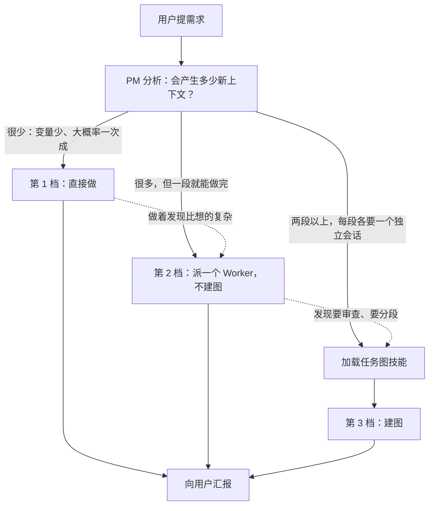
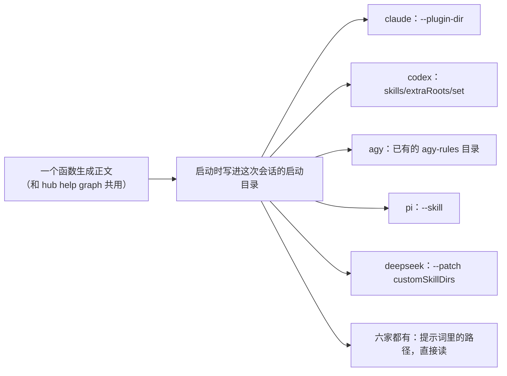

# 按需拆分与任务图技能方案

状态：第一阶段（三档判断，PR 298）、第二阶段（技能、六家挂载、K1～K5 验证）都已落地，落地时和方案不一样的地方、附 B 的实测结果见第 12 节。下面各节的行号对应写方案时的 main `a26be7e`。真实记录取自本机账本 `~/.agent-hub/state/hub.sqlite`（只读打开），“消息 #编号”“Worker #编号”“任务图 #编号”都能在账本里查到原文。厂商能力在本机实测（2026-11-12）：claude 2.1.322、codex-cli 0.167.1、agy 1.5.6、pi 1.5.2、dsh 0.2.2-rc.1、cursor-agent 2026.11.10-731fb78。

用户的要求（11-12 10:44，消息 #50677）：

> 简单的需求也拆得很复杂，什么事情是有必要拆的呢，这个问题需要思考一下，有的事情的变量很少，虽然流程是固定的，但是步骤大概刘会成功，不用创造新的上下文
> 嗯我的意思是，比如写代码，写方案，需要在一个专属的空间内完成，因为他会创造很多新的上下文，但是比如一个安装软件，就不需要拆的很复杂，这个编排的图的能力pm很喜欢用，甚至有一点强制用，我们可以把它做成skill，把propmt放到skill里面节省上下文，按需加载

用户定的范围（11-12 10:47，消息 #50719）：

> 补方案（推荐）：三档判断（直接做 / 单个 Worker / 建图）写进基础提示词，撤掉“一步也建图”；建图手册做成按需加载的 Skill，一份正文覆盖 6 家（原生 Skill + 读文件兜底）；验证加“简单活不建图”“复杂活会加载 Skill”两类场景。先只写 docs，拍板后再实现

方案一句话：**拆不拆看这件事会产生多少新上下文，不看它有几步。** 基础提示词只留三档判断和一句指路，建图的全部做法挪进一份技能正文，要建图时才加载。

## 0. 依据：用户原话对应到设计

| 用户原话 | 对应的设计 | 章节 |
|---|---|---|
| [11-12 10:44] “什么事情是有必要拆的呢” | 三档判断，标准只有一条：会不会产生大量新上下文 | 3 |
| [11-12 10:44] “变量很少，虽然流程是固定的，但是步骤大概率会成功，不用创造新的上下文” | 第 1 档“直接做”：不开新会话 | 3.2 |
| [11-12 10:44] “写代码，写方案，需要在一个专属的空间内完成，因为他会创造很多新的上下文” | 第 2 档“派一个 Worker，不建图”：一段活一个独立会话 | 3.2 |
| [11-12 10:44] “一个安装软件，就不需要拆的很复杂” | 账本里装软件被建成 5 个节点的真实案例，按新规则是 0 张图、最多 1 个 Worker | 2.1、8 |
| [11-12 10:44] “编排的图的能力 pm 很喜欢用，甚至有一点强制用” | 撤掉“只有一步也建图”；建图手册不再常驻，基础提示词里建图只占一条 | 4 |
| [11-12 10:44] “做成 skill，把 prompt 放到 skill 里面节省上下文，按需加载” | 技能正文 2,648 字，基础提示词省 1,742 字（23%） | 5、9 |
| [11-12 10:47] “一份正文覆盖 6 家（原生 Skill + 读文件兜底）” | 一个函数生成正文；四家实测有只对这次会话生效的原生入口，六家都能读文件 | 6 |
| [11-12 10:47] “验证加‘简单活不建图’‘复杂活会加载 Skill’两类场景” | 5 个新场景、4 条新检查，全部取自账本 | 8 |
| [11-11 18:21] “需要我点头的地方难到你在建图的时候都能想好吗？？” | 要用户拍板本身不是建图的理由，一张提问卡就够 | 3.3 |
| [11-11 22:28] “不要把 agent 的能力限死” | 三档是默认判断，可以升档，用户点名怎么做就怎么做；没加载手册就建图只提醒不拦 | 3.2、7 |
| [11-11 18:11] “我们要做的是拆步骤”；[18:25] “同时去探索 n 个方向最后汇总，就很适合多线” | 第 3 档的三个例子：先方案后实现、实现后审查、并行探索再汇总。原有规矩一字不改地搬进技能 | 5 |

## 1. 一屏总览



- **基础提示词**（常驻）：三档判断加一句“建图前先加载技能”。实测 7,675 字降到 5,933 字，省 1,742 字（23%）。
- **技能正文**（按需）：建图规矩、图里怎么跟进、全部 `hub graph` 命令，共 2,648 字。只有一段的活永远不会加载它。
- **六家一份正文**：claude、codex、agy、pi 四家在本机实测到“只对这次会话生效”的原生技能入口；deepseek 按包内文档可行，没实测；cursor 实测没有。六家都保留“直接读这个文件”的兜底，路径写在基础提示词里。
- **不写用户的技能目录，不写用户仓库**：文件放在守护进程自己的启动目录里，只有项目经理会话带上它。
- **最大的风险**是该建图时不加载。主要靠基础提示词在“建图”那一条里点名，其次靠 `hub graph create` 的回执带上手册路径；用验证量加载率和拆法有没有退化。

## 2. 账本里的真实情况

### 2.1 装软件被建成 5 个节点

某外部工具项目的项目经理（claude，“只管理”模式，性格设定是空的，所以行为完全来自产品提示词）。11-12 10:32:56 用户说“接一下试试”（消息 #50482，意思是装本地模型路由 CLI 工具并把公开模型目录接到 Pi；公开仓库中统一以示例工具 `pi-bridge` 代称）。它的第一句话是“先建个任务图，再看 README 里怎么安装”（#50483）。

任务图 #7 最后的样子：

| 节点 | 类型 | 做了什么 |
|---|---|---|
| `approve` | 门禁 | 让用户批准运行外部安装脚本 |
| `setup` | 活 | Worker #465：装 CLI 工具和插件，发起浏览器授权登录 |
| `login` | 门禁 | 等用户登录 |
| `login2` | 门禁 | 用户说链接过期，补的第二道 |
| `connect` | 活 | Worker #466：把 Pi 接上，冒烟测试 |

| 花了什么 | 数 |
|---|---|
| 用时 | 10 分 43 秒（10:32:56 到 10:43:39） |
| PM 敲的 `hub graph`、`hub worker` 命令 | 14 条：`graph create` 1、`graph patch` 2、`graph ask` 3、`graph done` 2、`graph decide` 1、`worker start` 2、`worker send` 1、`worker end` 2 |
| PM 出场 | 7 轮，16 次工具调用 |
| PM 手写的任务说明 | 两份，1,378 字和 2,060 字。第二份主要在转述第一个 Worker 已经知道的事 |
| 两个 Worker | 各 29 次工具调用；新写入缓存 118,735 和 98,594 个 token |

5 个节点里 3 个是门禁。真正要用户做的只有两件事：批准一次，登录一次。第二个 Worker 重新建立了一遍上下文，只是为了接着做同一件事。

### 2.2 同一批项目经理，简单活直接做的时候

| 案例 | 账本 | 怎么做的 | 花了什么 |
|---|---|---|---|
| 改本机配置 | 同一个 PM、同一个会话，消息 #50729“A. 只给 Pi 显示指定分组的模型…再刷新 hub 的模型列表” | 自己跑过滤命令（如 `pi-bridge filter pi coder`），发现列表缓存没同步，顺手触发同步后再刷新模型列表 | 53 秒，7 次工具调用，没有图，没有 Worker |
| 合 PR | 本项目 PM，11-10 17:33:14，消息 #34762“可以合吧” | 自己查了 PR 238 的检查结果，然后 `gh pr merge` | 11 秒后合并命令已经发出 |
| 升级本机 6 家命令行 | 本项目 PM，11-11 09:46，消息 #40114“更新一下本机的这些agent” | 派了一个不建图、不开 worktree 的 Worker #388 | 9 分钟，43 次工具调用，没有图 |
| 修 bug | 本项目 PM，11-12 09:59，消息 #50200（果皮轨连线画错） | 派了一个不建图的 Worker #463，提了 PR 295 | 48 分钟，105 次工具调用，没有图 |

本项目 PM 在“只管理”模式下自己敲过至少 51 条带 `gh pr merge` 的命令。也就是说，“简单的操作直接做”“一段活派一个 Worker 不建图”账本里本来就有，而且都顺利。出问题的是“几步就建图”这条规则。

### 2.3 两个结论

1. **过度建图是提示词按步数判断造成的。** 2.1 那个会话用的提示词写的是“包含两步及以上阶段…开工先调 `hub graph create`”“先亮骨架图再深读”“拍板分水岭必挂门禁”（`~/.agent-hub/state/launch/557/prompt.md` 第 22～25 行）。装软件正好有四五步，于是被建成了图，两次要用户动手的地方各挂了一道门禁。
2. **第 1 步的新提示词在这件事上会更重。** 它把“两步及以上”换成了“其余要改文件、要交付结果的活，只有一步也建图”（`src/daemon/prompt.ts:120`）。装软件要改环境、有结果要交，照样会建图。另外，第 1 步虽然已经合并（PR 292），到 11-12 10:56 为止正在跑的守护进程还没有热重启，两个 PM 会话的 `prompt.md` 里仍是旧文字。所以这次的小补丁最好赶在热重启之前合进去（第 10 节）。

## 3. 三档判断

### 3.1 判断标准

只问一个问题：**这件事会不会产生大量新上下文？** 也就是要不要读很多代码、要不要反复试、要不要写长东西。不看它有几步，也不看它属于哪一类。

同样叫“装软件”：`brew install` 一条命令是第 1 档；2.1 那次要读安装脚本、验签名、装插件、等登录、起网关、改 Pi 配置、冒烟测试，两个 Worker 加起来 58 次工具调用，放进一个 Worker 更合适，是第 2 档。两种都不需要图。

### 3.2 三档

| 档 | 什么时候 | 怎么做 | 例子 |
|---|---|---|---|
| 1 直接做 | 变量少，照着做大概率一次成，产出少 | PM 自己做，不开新会话 | 查资料、看代码、跑命令、装一个工具、合 PR、改本机配置 |
| 2 派一个 Worker，不建图 | 一段就能做完，但中间过程多 | `hub worker start`，不带 `--node`。一个独立会话从头做到尾 | 修 bug、写一份方案、小的界面改动、从上千行代码和日志里读出结论 |
| 3 建图 | 有两段以上，每段各要一个独立会话 | 先加载任务图技能，再 `hub graph create` | 先出方案、用户看过再实现；实现后换一家模型审查；几个方向并行探索再汇总 |

三条附带的规矩：

- **默认判断，不是死规定。** 拿不准选轻的一档。
- **可以升档。** 直接做着发现要读很多东西，就停下改派 Worker；单个 Worker 做完发现改动碰了审查红线，就补一张图挂审查。升档不丢东西：Worker 的分支和汇报都在。
- **用户点名怎么做的，照用户说的。**

### 3.3 对任务说明里那版三档的三处调整

任务说明给的三档大体照用，有三处改动，都有账本依据。

1. **“中间要等用户拍板”单独不算建图的理由。** 任务图 #7 的 5 个节点里 3 个是门禁，这正是用户说的“拆得很复杂”。等用户点头只需要一张提问卡（`hub ask`），不需要图。只有“先出方案、用户看过再实现”这种前后两段都很重的活才建图，它已经被“两段以上、每段各要一个独立会话”覆盖。这也是用户 11-11 18:21 那句话的意思：要点头的地方建图时想不全，撞上了再问。
2. **审查红线要在基础提示词里留一句。** “要不要换人审查”决定了一件事是一段还是两段，也就决定了第 2 档还是第 3 档。如果红线只写在技能里，PM 在定档时看不到，一个碰了并发的 bug 修复会被当成第 2 档，漏掉审查。所以基础提示词留一句压缩过的四类红线，完整版和审查节点怎么写放在技能里。
3. **“改几行文案”“改配置”按文件在哪分。** 本机配置（仓库外）是第 1 档。项目仓库里的文件，哪怕只改几行，在“只管理”模式下要走分支和 PR，而且主文件夹可能有别的 Worker 在改，所以派一个 Worker；在“自己也干活”模式下 PM 直接改。

### 3.4 两种模式下第 1 档怎么落地

任务说明里写“只管理模式下项目经理不能自己改动环境”。核对下来，产品对这个模式的定义比这句话宽：

- `docs/prototype-design.md:97`：“只管理｜只讨论、拆任务、派 Worker、验收，**自己不改代码**”。
- `docs/prototype-design.md:100`：“模式只是提示词里的默认做法，程序不硬拦”。
- 本项目 `AGENTS.md:23` 的 rule a：“耗时短、花 token 少、需要及时反馈的任务自己做”。
- 账本：“只管理”的 PM 自己合 PR 至少 51 次，自己改过本机配置（2.2）。

现在的提示词把“自己做”收窄成了“查资料、看代码、跑只读命令”（`prompt.ts:117`），和上面四条都对不上。

推荐的落地：

| | 只管理 | 自己也干活 |
|---|---|---|
| 第 1 档 | PM 直接做，**只要不改项目里的文件**：查、跑命令、装工具、合 PR、改本机配置 | PM 直接做，包括改几行项目文件 |
| 要改项目文件的小活 | 派一个 Worker，不建图 | 第 1 档，直接改 |
| 第 2、3 档 | 一样 | 一样 |

这样“只管理”的意思回到原设计的“不改代码”，两种模式只差“改不改项目文件”这一处。另一种做法是“只管理”的 PM 只做只读的事和合并发布，其余一律派一个不建图的 Worker；它更保守，代价是 2.2 第一行那种 53 秒的活要开一个新会话。这一条列在第 11 节请用户定。

### 3.5 不建图的 Worker 少了什么

| 少了什么 | 影响 | 怎么补 |
|---|---|---|
| 网页果皮轨上没有图 | 只在 Worker 列表里看得到 | 不补。一段活本来就没有“进度” |
| 编排简化第 2 步的 `hub graph finish` 查“PR 没合” | 单个 Worker 的 PR 没有这道兜底 | 第 2 步里顺手给 `hub worker end` 的回执加一句“它的分支还有开着的 PR”，用同一个 `probePr`，只提醒不拦 |
| 第 3 步“换人自动带前任记录”是按节点做的 | 单个 Worker 出错换人，还得手写交代 | 第 3 步实现时按 Worker 做，不按节点做 |
| 第 5 步“目标钉在系统提示词里” | 没影响 | 单个 Worker 的任务说明本来就在系统提示词的“你的任务”里（`prompt.ts:435`） |

## 4. 基础提示词：改前、改后

下面都是“只管理”模式、claude、不含性格设定的渲染结果。`hub` 是 `${HUB}` 展开后的样子。

### 4.1 第 2 步“分析”

改前（`prompt.ts:133-139`）：

```text
## 2. 分析
先定这件事怎么走，三选一：
- **自己做**：查资料、看代码、跑只读命令，几分钟内能有结果的。
- **派临时 Worker**（`hub worker start`，不带 `--node`）：没有改动要交付的跑腿活，比如从上千行代码、日志里读出结论（加 `--readonly`，任务说明里规定只回结论和出处）。
- **建图**：其余要改文件、要交付结果的活，只有一步也建图。

分析要快。深读代码和长文档是 Worker 的事，你要想清的只有三样：目标、步骤、怎么验收。
```

改后：

```text
## 2. 分析
先定这件事走哪一档。看它会不会产生大量新上下文（要读很多代码、要反复试、要写长东西），不看它有几步：
- **直接做**：变量少、照着做大概率一次成、产出少的。比如查资料、看代码、跑命令、装软件、合 PR、改本机配置。要改项目里的文件的不算，派 Worker。
- **派一个 Worker，不建图**（`hub worker start`，不带 `--node`）：一段就能做完，但中间过程多的。比如修 bug、写一份方案、做一个小的界面改动、从上千行代码和日志里读出结论（只读的加 `--readonly`，任务说明里规定只回结论和出处）。
- **建图**：有两段以上、每段各要一个独立会话的。比如先出方案、用户看过再实现；实现后换一家模型审查；几个方向并行探索再汇总。**建图前先加载 `fusa:task-graph` 技能**，建图、改图、换人、审查的做法都在里面；技能清单里没有它，就直接读 `<启动目录>/skills/fusa-task-graph/SKILL.md`。

改动碰到下面任意一类，实现后面要换一家模型审查，所以走建图：撤不回来的副作用或安全边界；异步、并发、生命周期；会随时间变多的缓存、快照、分页，或多方共用的数据格式；本地草稿和远端状态互相覆盖。

这是默认判断，不是死规定：拿不准选轻的一档，做着发现比想的复杂再升档；用户点名怎么做的，照用户说的。

分析要快。深读代码和长文档是 Worker 的事，你要想清的只有三样：目标、步骤、怎么验收。
```

几处用词的考虑：

- “看…不看它有几步”放在最前面，直接否掉旧规则的判断方式。
- 三档各带例子，例子用的就是用户说的（装软件、写代码、写方案）和账本里出现过的（合 PR、改本机配置、修 bug）。
- “一步也建图”整句删掉，没有留反面的话。提示词里写“不要建 1 节点的图”这类否定句，旧版有过（`launch/557/prompt.md` 第 22 行），没拦住 2.1。
- 技能名和路径由代码按厂商填：claude 是 `fusa:task-graph`，其余是 `fusa-task-graph`；没有原生入口的厂商（cursor）这一句变成“建图前先读 `<路径>`”。

“自己也干活”模式只有“直接做”一条不同：

```text
- **直接做**：变量少、照着做大概率一次成、产出少的，包括改几行文件。比如查资料、跑命令、装软件、合 PR、改配置、改文案；做完告诉用户做了什么、改了哪些文件。
```

### 4.2 其余各步：留什么，挪什么

| 现在的内容 | 位置（`prompt.ts`） | 处置 |
|---|---|---|
| 五步的名字“拿到需求 → 分析 → 建图 → 跟进反馈 → 交付” | 127 | 第三步改叫“派活”。走建图那一档时，用户定的五步原样在技能里 |
| 第 1 步两条 | 130-131 | 不动 |
| 第 3 步：一张图只装一件事、按步骤拆不按模块拆、默认一条线、门禁、四条审查红线和审查节点怎么写 | 142-151 | 挪进技能，原文不改 |
| 第 3 步：任务说明要写全 | 146 | 留下。派单个 Worker 也要用 |
| 第 4 步：收到汇报、有问题怎么答、出错怎么查和续时、用户亲手停的别叫醒 | 154-157 | 留下，去掉和图有关的半句 |
| 第 4 步：节点自动标完成、给下一个节点派 Worker 时给路径不转述、换人绑回原节点（`--incomplete`）、计划变了用 `graph patch` | 154-158 | 挪进技能 |
| 第 5 步：验收只看证据、合并发布按 `AGENTS.md`、向用户汇报 | 161、163-164 | 留下 |
| 第 5 步：补审查要赶在收工前，图结束后不能再改 | 162 | 留一句“该审查而没审查的，收工前补上”，做法挪进技能 |
| 通用规矩四条 | 167-168、229-230 | 不动 |
| 命令表“任务图”一组 6 行 | 249-254 | 缩成一行，全文挪进技能 |
| 命令表 `hub graph ask`、`hub graph decide` | 257-258 | 挪进技能 |
| 命令表 `hub worker start` 的 `--node`、`hub worker end` 的 `--incomplete` | 260、262 | 说明挪进技能。`hub help` 里照旧查得到 |
| 命令表开头那句“`<节点>` 是节点的 key…” | 247 | 挪进技能 |

### 4.3 改后的第 3～5 步和命令表里的一行

```text
## 3. 派活
- **任务说明要写全**：Worker 看不到你和用户的聊天，只靠任务说明对齐方向。写上用户原话、背景、不做什么、怎么算做完；“怎么算做完”写成能核对的证据（测试命令、截图、实测输出、PR 检查全绿）。长材料存成文件，任务说明里给路径。

## 4. 跟进反馈
Worker 每干完一轮，你会收到 `【Worker #编号 · 标题 的汇报】`（出错、超时、被停止也会告诉你原因）。
- **Worker 做完了**：按第 5 步验收，通过就 `hub worker end <编号>` 收工。
- **Worker 有问题**：能答的直接答（`hub worker send`）。要用户定的，用 `hub ask` 提问并写上选项和你的推荐，答复回来再转给 Worker。不要只在回复里问一句就停下等。
- **Worker 出错、额度用完、超时、放弃**：先用 `hub worker show <编号>`、再用 `hub worker log <编号>` 看原因，原始记录只取要看的那一段。超时只是提醒，Worker 还在跑：在正常推进就用 `hub worker max-time` 续时。能接着干就 `hub worker send`；对话超过 200K 或该换一家，就收工后新派一个接手，任务说明里写清分支、已有的提交、还要改的点。用户亲手停的，用户没说继续就别叫醒它。

## 5. 交付
- **验收只看证据**：汇报、PR 的改动文件名单和检查结果、截图或实测输出。不读代码 diff，代码质量由审查负责。证据不够就打回让 Worker 补（`hub worker send`）。
- **该审查而没审查的，收工前补上**：改动碰了第 2 步那四类，就按技能里的做法补一个审查。
- 合并和发布按项目 `AGENTS.md` 的规矩做。
- 向用户汇报结果。
```

命令表里“任务图”一组变成一行，“向用户提问”只剩 `hub ask`，“Worker”一组去掉 `--node` 和 `--incomplete` 的说明，其余不动：

```text
- **任务图**：`hub graph create|show|list|patch|done|skip|cancel|ask|decide`，用法在 `fusa:task-graph` 技能里
```

## 5. 技能正文

一份正文，全文如下。规矩和命令说明都是从现在的 `prompt.ts` 原样搬过来的，只改了衔接的句子。

```markdown
---
name: task-graph
description: Fusa 任务图手册。要用 hub graph 建图或改图、给图里的节点派 Worker 或换人、挂门禁让用户拍板、加审查节点之前，先加载。一段就能做完的活不建图，不用加载。
---

# 任务图手册

一件事有两段以上、每段各要一个独立会话时才建图。一段就能做完的活不建图，直接派一个 Worker。

## 建图
用 `hub graph create` 把这件事排成一串节点，然后给轮到的节点派 Worker（`hub worker start --node <节点>`）。
- **一张图只装一件事**：互不相干的几件事各建一张图。
- **按先后步骤拆，不按模块拆**：不要把一个需求切成前端、后端各一个 Worker。写测试、改代码、截图、提 PR 是同一步，一个 Worker 一口气做完。只在三种时候另起一个节点：用户明说要先看、要换一个模型独立审查、一步的上下文装不下。
- **默认一条线**：用 `deps` 把节点按先后串起来，前一个完成后一个才轮到。互不依赖的活才并行（比如同时探索几个方向再汇总）。
- **用户明说要先看的地方**（比如“先给我看方案”）挂一个 `gate` 节点：轮到时用 `hub graph ask` 填上问题、选项和你的推荐，用户点了才往下走。别的拍板不预先挂门禁，撞上了用 `hub ask` 问。
- **碰到下面任意一条，就在实现后面加一个审查节点**（派给另一家厂商的 Worker，任务说明里写清实现的分支和 PR、你最担心的地方，发现问题让它直接修）：
  - 撤不回来的副作用或安全边界：数据迁移、覆写用户配置、杀进程、沙箱、鉴权；
  - 异步、并发、生命周期；
  - 会随时间变多的缓存、快照、分页，或多方共用的数据格式；
  - 本地草稿和远端状态互相覆盖的交互。

  纯文案、纯展示、局部纯函数、薄胶水层不用审查，靠测试和截图兜底。

## 跟进
进度以 `hub graph show` 为准。
- **节点的 Worker 做完了**：验收通过就 `hub worker end <编号>` 收工，节点自动标完成，后面的节点轮到。给下一个节点派 Worker 时，任务说明里给上一步的分支、PR 和文件路径，让它自己去读，不要转述内容。
- **换人**：`hub worker end <编号> --incomplete`，再 `hub worker start --node <节点>` 新派一个接手，任务说明里写清分支、已有的提交、还要改的点。
- **计划变了**：随时 `hub graph patch`，加节点、改还没开工的节点、跳过不需要的。
- **补审查要赶在收工前**：改动碰了上面的红线而图里没有审查节点，先 `hub graph patch` 补一个，再让最后一个节点的 Worker 收工；所有节点都完成后整张图自动结束，不能再改。

## 命令
`<节点>` 是节点的 key，它在几张活跃的图里重名时加 `--graph <图编号>`。
- `hub graph create [--title <标题>] --stdin`：建图，正文 JSON 形如 `{"title":"…","nodes":[{"key":"plan","title":"…","kind":"piece"},{"key":"ok","title":"…","kind":"gate","deps":["plan"]}]}`（`kind` 不写是 `piece`，要用户拍板的写 `gate`；`deps` 写前置节点的 key，不写就是一开始就轮到）
- `hub graph show [<图编号>]` / `hub graph list [--all | --status active|completed|cancelled]`：看一张图的进度和每个节点的结果（分支、PR、摘要、定案）/ 列出任务图
- `hub graph patch [<图编号>] --stdin`：改图，正文 JSON 按需取 `{"addNodes":[{"key":"qa","title":"…","deps":["ok"]}],"updateNodes":[{"key":"ok","title":"…"}],"removeNodes":["old"],"skipNodes":["polish"],"addEdges":[{"from":"plan","to":"qa"}],"removeEdges":[{"from":"a","to":"b"}]}`；已经结束的图不能改
- `hub graph done <节点> [--pr <URL>] [--commit <SHA>] [--branch <分支>] [--summary <摘要> | --stdin]`：把没有 Worker 在干的节点标完成（比如你自己做完的），或给节点补记 PR 等结果（图已完成时加 `--graph <图编号>`）；有 Worker 在干的会被拒绝，先让它收工
- `hub graph skip <节点> [--reason <原因>]` / `hub graph cancel [<图编号>] [--reason <原因>]`：跳过一个节点 / 取消整张图
- `hub graph ask <节点> [--question <问题>] [--option <选项>...] [--recommended <选项>] [--stdin]`：给轮到的 `gate` 节点填上问题、选项和推荐，交给用户拍板；正文是给用户看的背景摘要
- `hub graph decide <节点> --choice <选项> [--note <说明>]`：用户没点选项、在聊天里口头答复时，用它记下来
- `hub worker start --node <节点> …`：把 Worker 绑到图里轮到的节点上，其余参数和不带 `--node` 时一样
- `hub worker end <编号> [--incomplete]`：它最近一轮汇报是“做完了”时，绑定的节点自动标完成；否则节点等人接手。加 `--incomplete`：不管它汇报了什么，节点都等人接手
```

frontmatter 里的 `name` 按目标填：claude 插件里是 `task-graph`，加上插件前缀就是 `fusa:task-graph`；其余几家是 `fusa-task-graph`。正文一字不差。

写法上的三点：

- **最要紧的放最前**。Claude Code 压缩对话后只重新挂上每个技能的前 5,000 个 token（出处见 6.2）。这份正文约 1,700 个 token，放得下，但规矩仍然排在命令前面。
- **说明（`description`）先写“什么时候加载”，再写“什么时候不用”**。各家都是靠说明决定要不要加载。说明 87 字。
- **名字不叫 `orchestration`**。实测时发现用户本机已经有一个同名技能（Orca 的 `orchestration`，讲的是另一套编排）。撞名的话 PM 可能加载错手册，所以名字带 `fusa` 和 `task-graph`。

## 6. 六家厂商怎么加载

### 6.1 一览

要的是三样：模型能自己决定加载；只对这次会话生效；不写用户的技能目录和仓库。

| 厂商 | 模型自己按需加载 | 只对这次会话生效的入口 | 状态 | 兜底 |
|---|---|---|---|---|
| claude | 能。说明常驻，正文在调用 `Skill` 工具时加载 | `--plugin-dir <目录>` | 本机实测通过 | 读文件 |
| codex | 能。先看名字、说明和路径，决定用时再读 `SKILL.md` | app-server 的 `skills/extraRoots/set` | 本机实测通过；接口在官方文档里没写 | 读文件 |
| agy | 能。每轮看到技能清单，相关就读正文 | 放进已有的 `--add-dir <启动目录>/agy-rules` 里的 `.agents/skills/` | 本机实测通过 | 读文件 |
| pi | 能。名字、说明、路径进系统提示词，模型自己读文件 | `--skill <目录>` | 本机实测通过 | 读文件 |
| deepseek | 能。会话开头给一份技能目录，模型调 `skill` 工具加载 | `--patch` 里设 `customSkillDirs` | 本机实测通过（第 12.2 节） | 读文件 |
| cursor | 能，但只认项目目录和用户目录里的技能 | **没有**。ACP 下 `--plugin-dir`、`--add-dir` 里的技能都读不到 | 本机实测没有 | 只有读文件 |

“读文件”兜底六家都一样：基础提示词里写着正文的绝对路径，模型用读文件工具或 `cat` 读它。这和 Fusa 记忆的做法是同一个思路：`MEMORY.md` 这份薄索引常驻在提示词里，专题子文件用到时再读（`src/daemon/pm-memory.ts:40-41`）。

### 6.2 每家的出处

**claude**

- `claude --help`：`--plugin-dir <path>  Load a plugin from a directory or .zip for this session only`。
- 官方文档 <https://code.claude.com/docs/en/skills>：插件里的技能放在 `<plugin>/skills/<skill-name>/SKILL.md`，名字带插件前缀（`/plugin-name:skill-name`），和别处的同名技能都保留；默认“Description always in context, full skill loads when invoked”；压缩后“re-attaches the most recent invocation of each skill after the summary, keeping the first 5,000 tokens of each”，合计 25,000；技能清单的预算是上下文窗口的 1%，技能多时会丢掉一部分说明，名字都在。
- 本机实测：只发 `initialize` 控制请求，不调模型。不带参数 211 个命令；带 `--plugin-dir` 多出 `fusa:orchestration`（探针技能）；换成 `--add-dir <目录>`（里面放 `.claude/skills/`）多出 `fusa-task-graph`，标着 `(project)`。
- 推荐 `--plugin-dir`：它就是为“只这一次会话”设计的，名字带前缀不会和用户的技能撞；`--add-dir` 会把目录变成工作目录，同名时还要改名。
- 这台机器上有 200 多个技能和命令，说明有可能被清单预算裁掉。所以基础提示词里要点名，不能只靠说明匹配。

**codex**

- 官方文档 <https://developers.openai.com/codex/skills>：渐进加载，“start with each skill's name and description, then load the full `SKILL.md` instructions when they decide to use that skill”，清单里带文件路径，最多占上下文的 2%；读的位置是仓库的 `.agents/skills`、`~/.agents/skills`、`/etc/codex/skills` 和内置的；任务和说明对得上时会自己选用。
- 会话级入口：`codex app-server generate-ts` 生成的协议里有 `skills/extraRoots/set`，参数 `extraRoots: AbsolutePathBuf[]`。官方文档没有这一项，app-server 本身标着 experimental。
- 本机实测：`skills/list` 原来 62 项；先发 `skills/extraRoots/set` 再查是 63 项，多出的那项 `scope: "user"`、`enabled: true`，路径在临时目录。每个 Fusa 会话有自己的 app-server 进程（`src/vendors/codex/protocol.ts:38`），所以只影响这一个会话。
- 未核实：真模型对这样加进来的技能会不会主动选用。

**agy**

- 官方文档 <https://antigravity.google/docs/skills>：“On every turn, the agent sees a list of available skills with their names and descriptions. If a skill looks relevant to your task, the agent reads the full instructions”；位置是工作区的 `.agents/skills/` 和全局的 `~/.gemini/config/skills/`。
- 本机实测：`agy -p "/skills" --output-format json` 原来 11 项；加 `--add-dir <目录>`（里面放 `.agents/skills/…/SKILL.md`）后 12 项，多出的那项 `model_invocable: true`。
- Fusa 起 agy 时本来就带 `--add-dir <启动目录>/agy-rules`（`docs/system-prompt-channels.md` 第 2 节，`src/vendors/agy/rules.ts`），技能放进这个目录就行，不用多加参数。
- `CLAUDE.md` 里写的“agy 里这些技能只能手打”说的是 pstack：58 个里 57 个自己设了 `disable-model-invocation: true`。这是技能自己的设置，不是 agy 的限制。
- 未核实：技能清单占不占 agy 那 60,000 字节的规则预算。

**pi**

- 随包文档 `docs/skills.md`（同 <https://github.com/earendil-works/pi/blob/main/packages/coding-agent/docs/skills.md>）：“At startup, Pi scans configured skill locations and adds each skill's name, description, and path to the system prompt… When a task matches, the model reads `SKILL.md`”；也写明“A model might fail to load a relevant skill”。`pi --help`：`--skill <path>  Load a skill file or directory`。
- 本机实测：`pi --mode rpc --no-session --offline --no-mcp --no-approve --skill <目录>`，`get_commands` 里有 `skill:fusa-orchestration`，`scope: "temporary"`。
- Fusa 起 pi 时本来就用 `--skill` 传项目的技能目录（`src/vendors/pi/composer.ts:38` 的 `buildPiSkillArgs`，实测记录在 `docs/vendors/pi.md:46-55`），再加一个参数即可。

**deepseek（dsh）**

- 随包文档 `@deepseek-ai/dsh-tool-skill` 的 README：会话开头给模型一份技能目录（名字和说明），模型调 `skill` 工具拿到正文。`@deepseek-ai/dsh-skill-filesystem` 的 README：扫描项目的 `.dsh/skills`、`.agents/skills`，配置项 `customSkillDirs`，再是 `$DSH_HOME/skills`、`~/.agents/skills`。
- 会话级入口：用 `--patch` 给 `dsh-skill-filesystem` 设 `customSkillDirs`。Fusa 已经用 `--patch` 写系统提示词（`docs/system-prompt-channels.md` 第 3 节）。那里记过一个坑：`--patch` 改一行时整行配置被替换，默认值要照抄。
- 未实测：这条路没有真跑过。另外技能目录是一条用户角色的消息，厂商内部压缩后还在不在，未核实。

**cursor**

- 官方文档 <https://cursor.com/docs/context/skills>：读 `.agents/skills/`、`.cursor/skills/`、`~/.cursor/skills/`，以及 Claude、Codex 的技能目录；“The agent is presented with available skills and decides when they are relevant”。
- 本机实测（ACP，建完会话等 6 秒收 `available_commands_update`）：不带参数 62 项；`--plugin-dir <目录>` 还是 62 项；`--add-dir <目录>` 还是 62 项。探针技能都没出现。这和已有结论一致：ACP 下 `--add-dir`、`--plugin-dir` 里的规则也不读（`docs/system-prompt-channels.md` 第 4 节）。
- 项目目录和用户目录都不能写，所以 cursor 只有读文件这一条路。
- 未核实：探针用的插件清单（`.cursor-plugin/plugin.json`）格式对不对。
- cursor 的产品提示词走首条消息，厂商内部压缩后会丢（已知缺口），指路的那句话也会跟着丢。缓解见第 7 节第 3 条。

### 6.3 一处定义怎么覆盖六家



- **正文只有一处**。新建一个模块放在 `src/daemon/prompt.ts` 旁边，一个函数返回正文。里面的命令格式用现有的常量拼（`TASK_GRAPH_CREATE_JSON_HINT`、`TASK_GRAPH_PATCH_JSON_HINT`、`PM_REVIEW_REDLINES`），不手写第二份。`hub help` 里“任务图”那一组也用同一个函数，命令改了三处一起变。
- **写文件只有一处**。`src/daemon/launch.ts` 的 `createLaunchPreparer` 现在写 `prompt.md` 和设置文件（`launch.ts:116-124`），在同一个地方多写技能目录，只给项目经理会话写。
- **每家只声明一个字段**。照 `capabilities.systemPrompt` 的做法（`docs/system-prompt-channels.md` 第 1 节），各家在 `src/vendors/<厂商>/spec.ts` 里声明技能走哪个入口，驱动层把目录翻译成自己的参数；公共代码只按声明走。没有原生入口的声明“只读文件”。新接一家厂商，只补这一个字段。
- **提示词里的那句话由声明决定**：有原生入口的写“先加载 `<名字>` 技能；清单里没有就读 `<路径>`”，没有的写“先读 `<路径>`”。
- **守卫测试**：各家目录形状里的正文逐字节相同；六家 × 两种模式的提示词快照（`src/vendors/__snapshots__/migration-snapshot.test.ts.snap` 已有）里都有路径；正文不超过上限（第 9.4 节）。

### 6.4 文件放在哪

```text
~/.agent-hub/state/launch/<会话>/
  prompt.md                                    ← 已有
  skills/fusa-task-graph/SKILL.md              ← 通用形状：pi、codex、deepseek、读文件兜底都用它
  claude-plugin/.claude-plugin/plugin.json     ← claude 的插件形状，插件名 fusa
  claude-plugin/skills/task-graph/SKILL.md
  agy-rules/.agents/skills/fusa-task-graph/SKILL.md   ← agy-rules 是已有目录
```

- 这是守护进程自己的目录，现有约定就是“不碰用户的项目目录和 worktree”（`docs/system-prompt-channels.md:28`）。不写 `~/.claude/skills`、`~/.agents/skills`、`<仓库>/.agents/skills` 中的任何一个。
- 不走仓库已有的两条技能通路。`src/vendors/_common/sync/skills.ts` 是把用户仓库 `.agents/skills` 里的技能逐项软链到各家的用户目录，管的是用户自己的技能。`docs/vendor-plugin-design.md:521` 说的“技能目录共用 `.agents/skills/`，新厂商能读这个目录就自动有”，是项目技能的路。产品自带的这一份两条都不能用，因为都要写用户的目录。
- 生命周期跟 `prompt.md` 一样：每次启动重写，内容没变就不变；项目经理删除、Worker 保留期清理时整个启动目录一起删（`docs/system-prompt-channels.md` 第 6 节）。目录 0700，文件 0600。
- 只有项目经理会话带这些参数。Worker 和总助的会话不带，技能清单里看不到它。
- 正文改了（比如守护进程升级）不用重启会话：各家都是加载时才读文件。名字和说明改了才需要重启，把这两样算进启动指纹。

## 7. 风险：该用的时候不加载

不加载会怎样：命令格式写错，`hub` 会当场报错并打印用法，能自己纠正。真正的损失是规矩，PM 可能按模块拆、漏挂审查、乱塞门禁。这些正是编排简化第 1 步刚理顺的东西。

各家官方文档都承认模型可能不加载（pi 的文档原话见 6.2）。所以不能只靠说明匹配，分四层：

1. **在定档的那一条里点名**（主要手段）。“建图前先加载 `<名字>` 技能”写在基础提示词第 2 步“建图”那一条里，常驻，带名字和路径。PM 走到建图这一步时一定读过这句话，不依赖厂商的清单预算和说明匹配。
2. **`hub graph create`、`hub graph patch` 的回执带一行手册路径**，出错的回执也带。后台不判断它加载过没有，每次都带，约 40 字。这是和厂商无关的第二道，漏了第一道也会在建图当下被提醒，接着派活、换人、挂审查之前还来得及读。
3. **有活跃的图时，`hub status` 和换会话的开场说明各带一行手册路径**。PM 换了新会话、或者厂商内部压缩丢了前文之后，手里有图却没有手册，靠这一行找回来。cursor 压缩后连基础提示词都会丢，也靠这一行。
4. **`hub help graph` 打印同一份正文**。读不到文件时还有一个入口。`hub help` 现在由命令行在本地打印（`src/hub/cli.ts:1261-1262`），不进 `hub_calls`，但这条 shell 命令在 PM 的工具调用记录里查得到。

不做的事：没加载就建图时不拒绝。拒绝要靠后台准确判断“加载过没有”，六家的痕迹各不相同，判错一次 PM 就卡住。只提醒，符合“少限制”。

怎么量：

| 量什么 | 怎么量 | 多少算合格 |
|---|---|---|
| 该加载时加载了 | 复杂场景里，第一条 `hub graph create` 之前有没有加载痕迹（检查 L1，第 8.3 节） | 每个场景 3 次里 3 次。差一次就改提示词或说明，不上线 |
| 加载以后拆法没退化 | 同一组复杂场景，对比“手册常驻”（现主干）和“手册按需”两个版本的拆法检查 G1、G2、G4、G5、G6、G7 | 逐条不变差 |
| 不该加载时没加载 | 简单场景里的加载次数（检查 L2，只记录） | 记录。多了说明说明写得太宽 |
| 原生入口比读文件强多少 | 同一家厂商两种入口各跑一遍，看 L1 | 用来决定别家的原生入口值不值得做 |

## 8. 验证场景

按 `docs/orchestration-eval-design.md` 的格式写，接在它的 S1～S5、H1～H5 后面。沿用它的约定：PM 是真的，Worker 回放真实记录，到判定点就停。新增 5 个场景，另有 3 个现有场景加检查。

### 8.1 第一类：简单活不建图

#### K1 装软件并接上

| | |
|---|---|
| 来源 | 11-12 10:32～10:43，装 CLI 工具并接入 Pi 的真实对话（`conversation_id=476`），消息 #50482；任务图 #7；Worker 465、466（回放素材已脱敏为开源示例 `pi-bridge`） |
| 需求原文 | 接一下试试<br>（前情：PM 说明安装与接入步骤的两段回复原文） |
| 注入事件 | ① PM 挂卡问能不能跑外部安装脚本 → 用户点定案“批准，按计划装”。② PM 派了 Worker → 交回第一阶段汇报（装好了，授权链接已生成，等用户确认）；PM 把链接交给用户后 → 用户答“已登录成功；服务临时用 pi-bridge serve 跑”；之后交回第二阶段汇报，停。③ PM 自己动手 → `curl`、`pi-bridge`、`pi` 都是替身，按表回放输出，不真装；到 PM 向用户汇报时停 |
| 期望行为 | 不建图。最多 1 个 Worker（一个 Worker 从安装做到冒烟测试，或者 PM 自己做，两种都算对）。没有门禁节点。要用户批准或登录时用提问卡或直接说，不建节点 |
| 判定方法 | T1、T2（上限 1）、L2；问不问批准不判，问了就查 R9、R10 |
| 对应原话 | [11-12 10:44] “比如一个安装软件，就不需要拆的很复杂” |

这是账本里的反例：当时是 1 张图、5 个节点、3 道门禁、2 个 Worker。

#### K2 改本机配置

| | |
|---|---|
| 来源 | 11-12 10:48，同一个对话，消息 #50729；PM 自己做完，没有图，没有 Worker（回放素材已脱敏为 `pi-bridge`） |
| 需求原文 | A. 只给 Pi 显示 coder 分组的模型（pi-bridge filter pi coder），再刷新 hub 的模型列表<br>（前情：PM 的诊断与确认卡回复） |
| 注入事件 | `pi-bridge` 是替身，回放输出：第一次 `pi-bridge filter` 之后 `models.json` 需再 `sync` 或重连一次才重写生效 |
| 期望行为 | 不建图，不派 Worker，PM 自己跑命令；第一次没重写模型文件时顺手同步，不因此改派。最后告诉用户做了什么 |
| 判定方法 | T1、T2（上限 0，见下）、L2；替身的调用记录里有 `pi-bridge filter pi coder` 和 `hub models --vendor pi --refresh` |
| 对应原话 | [11-12 10:44] “变量很少…步骤大概率会成功，不用创造新的上下文” |

T2 的上限取决于第 11.1 节怎么定：选 A 是 0；选 B 时“只管理”模式是 1。

#### K3 合 PR

| | |
|---|---|
| 来源 | 11-10 17:33:14，本项目 PM 的对话（`conversation_id=205`），消息 #34762；PR 238 |
| 需求原文 | 可以合吧<br>（前情：PM 17:31 的回复原文 #34719，README 已改成 Fusa、在 PR 238 里、合并还要等什么） |
| 注入事件 | `gh` 回放 PR 238 当时的真实状态：检查全绿，可以合并 |
| 期望行为 | 不建图，不派 Worker。先看检查结果再合并，不读代码 diff |
| 判定方法 | T1、T2（上限 0）、R6、A1、L2 |
| 对应原话 | [11-12 10:44] “简单的需求也拆得很复杂” |

#### K4 升级本机的命令行工具

| | |
|---|---|
| 来源 | 11-11 09:46，本项目 PM 的对话，消息 #40114；Worker 388（不建图、不开 worktree，9 分钟，43 次工具调用） |
| 需求原文 | 更新一下本机的这些agent<br>（前情：PM 09:45 的回复原文 #40104） |
| 注入事件 | PM 派了 Worker → 交回 388 的真实汇报，停。PM 自己动手 → `npm`、`brew`、各家命令行的升级命令是替身，回放 388 记录里的真实输出 |
| 期望行为 | 不建图。自己做或派一个 Worker 都算对：六个工具各升一次，量在第 1、2 档的边界上 |
| 判定方法 | T1、T2（上限 1）、L2 |
| 对应原话 | [11-12 10:44] “什么事情是有必要拆的呢” |

### 8.2 第二类：复杂活会加载技能；一段活只派一个 Worker

#### K5 修一个界面 bug

| | |
|---|---|
| 来源 | 11-12 09:59，本项目 PM 的对话，消息 #50200；Worker 463（不建图）；PR 295 |
| 需求原文 | 这个图是不是还是有问题，验证方案不应该直接连接用户拍版吗，<br>（附当时的截图；前情是 PM 上一条回复原文） |
| 注入事件 | Worker 开工 → 交回 463 的真实提交和真实汇报；`gh` 回放 PR 295 检查全绿，停 |
| 期望行为 | 正好 1 个能改文件的 Worker，不建图，不加载技能。改的是纯展示，没有审查。验收看截图和检查结果 |
| 判定方法 | T1、T2（正好 1）、G5、A1、A2、L2 |
| 对应原话 | [11-12 10:44] “写代码，写方案，需要在一个专属的空间内完成” |

#### 现有场景加检查

| 场景 | 现在测什么 | 加什么 |
|---|---|---|
| S2 修三家厂商压缩后丢提示词 | 实现后换一家审查、换人、挂卡 | L1：第一条 `hub graph create` 之前加载了手册。G4 不变差 |
| S4 拆解当前编排设计 | 三路只读调研加一个汇总 | L1。G3 不变差 |
| S1 三件不相干的事 | 一图一事、不按模块拆 | L1。G1、G2 不变差。单步的那件（选模型一起保存）不建图，直接派 Worker |
| S3a 手机托盘降高 | 一个 Worker、没有审查 | T1：不建图 |

`docs/orchestration-eval-design.md` 第 6 节有一行“只有一步的活也建图｜S3a 里多一张一步的图（只记录，不算好坏）”。按这份方案，这一行要改成“S3a 不建图”，实现时一起改。

### 8.3 新增的检查

接在现有 25 条确定性检查后面。

| 编号 | 查什么 | 怎么查 |
|---|---|---|
| T1 简单活不建图 | 这次试跑里没有建图 | `hub_calls` 里 `graph.create` 的次数是 0 |
| T2 Worker 数不超过这一档的上限 | 没有把一段活拆给几个 Worker | `hub_calls` 里 `worker.start` 的次数不超过场景给的上限；写“正好”的要相等 |
| L1 建图前加载了手册 | 第一条 `graph.create` 之前有加载痕迹 | PM 的工具调用（`messages` 里 `kind='tool'` 的行）里有下面任意一种：调技能工具且名字里有 `task-graph`；读文件工具或 shell 命令读了那个 `SKILL.md` 的路径；shell 命令里有 `hub help graph` |
| L2 简单活没加载手册 | 只记录，不判对错 | 同上，数次数 |

- “手册到位以后拆法没退化”不单列编号，用现有的 G1～G7 做两个版本的对照。
- 第一版验证（PR 294）只有 S3a、S5a、H2 三个场景。跟这份方案一起加的最小一组是 K2（简单）、K1（边界）、S2（复杂）。
- 环境自测照 `docs/orchestration-eval-design.md` 4.5 节加三版剧本：正例（不建图）、反例（装软件建了 5 节点的图，T1 必须不过）、没加载就建图（L1 必须不过）。

## 9. 性能

### 9.1 基础提示词省多少（实测）

用脚本渲染现在的 `prompt.ts`（claude、“只管理”、不含性格设定），再量改后的稿子。字数是字符数。

| | 现在 | 改后 | 变化 |
|---|---|---|---|
| 五步（不含通用规矩） | 2,149 字 | 1,669 字 | −22% |
| 其中第 2 步“分析” | 249 字 | 684 字 | 三档写在这里，变长了 |
| 其中第 3 步 | 773 字 | 129 字 | 建图规矩挪走了 |
| 其中第 4 步 | 686 字 | 472 字 | |
| 其中第 5 步 | 254 字 | 197 字 | |
| “系统命令 hub” | 2,823 字 | 1,561 字 | −45% |
| **PM 提示词全文** | **7,675 字 / 14,634 字节** | **5,933 字 / 11,638 字节** | **省 1,742 字（23%）/ 2,996 字节（20%）** |
| 技能正文 | — | 2,648 字 / 4,964 字节 | 只在建图时进上下文 |
| 加载以后合计 | 7,675 字 | 8,581 字 | 多 906 字 |

- 只有一段的活，全程省 1,742 字。要建图的活，加载以后比现在多 906 字：红线在基础提示词里有一句压缩版，技能里有完整版，加上技能的说明。
- 没算进去的常驻部分没有动：通用规矩 1,393 字，其中厂商和模型清单约 700 字；“怎么记事情”833 字。
- 折成 token：省下约 1,000 个，技能正文约 1,700 个。这是按每个 token 约 3 个字节粗估的，没有用分词器实测。

### 9.2 这个数放在整个上下文里有多大

一个新的 PM 会话大约从 4 万 token 起步（厂商命令行自带的提示词、产品提示词、`AGENTS.md`、性格设定，见 `docs/orchestration-eval-design.md` 5.3 节）。省下的 1,000 个 token 约占 2.5%。

所以要说清楚：**省上下文是实在的，但量不大；更大的收益是行为。** 现在常驻的“怎么干活”五步里，建图一步占了三分之一以上，命令表的四成也是 `hub graph`。PM 每一轮都读到它们，自然“很喜欢用，甚至有一点强制用”。挪走以后，基础提示词里建图只是三档中的一条。

行为这一头省的更多。2.1 那一次，如果按新规则只派一个 Worker：

| | 当时 | 按新规则 |
|---|---|---|
| 任务图 | 1 张，5 个节点，3 道门禁 | 没有 |
| Worker | 2 个 | 1 个 |
| 新写入缓存 | 118,735 + 98,594 个 token | 省掉第二个 Worker 重新建立上下文的那一份，约 9.9 万 |
| PM 手写的任务说明 | 1,378 + 2,060 字 | 一份 |
| `hub graph`、`hub worker` 命令 | 14 条 | 约 5 条：派活、问批准、转告登录结果、收工 |

右边一栏是按机制推的，不是实测。实测要等验证里的 K1 跑出来。

### 9.3 缓存怎么命中

- **基础提示词在系统提示词里**，是每次请求的前缀。它变短，每次请求读缓存的量就少一点；内容在一个会话里不变，缓存一直命中。
- **技能正文是加载时才追加到对话末尾的**（一次工具结果，或厂商自己挂上的技能内容）。追加不改前面的内容，所以不会让已有的缓存失效。加载那一轮多写一次约 1,700 个 token 的缓存，之后每轮按读缓存算。
- **原生清单里多的那一行**（名字加 87 字说明）会话一开始就在，整个会话不变。
- **路径里带会话编号**，一个会话里是固定的，不影响这个会话的缓存。后台写交接时复制的那份用的是同一个 `prompt.md`（`src/vendors/claude/handover.ts:3`），前缀不变。
- **压缩以后**：claude 自己把加载过的技能重新挂上；别家随对话一起被摘要掉，要用时再读一次，约 1,700 个 token。

### 9.4 上限和失效

按 `AGENTS.md` 第 18～22 行的四件事查：

| | |
|---|---|
| 失效 | 文件每次启动重写，内容来自代码里的常量。正文在加载时才读，改了下一次加载就是新的。名字和说明算进启动指纹，改了会重启会话 |
| 上限 | 正文不超过 12,000 字节，说明不超过 200 字，两个数写进 `src/shared/limits.ts`，有守卫测试。12,000 字节约 4,000 个 token，在 claude 压缩后保留的 5,000 个 token 以内。每个项目经理会话 3 个小文件，约 15KB；Worker 会话不写。按一个月 300 个已收工 Worker 算，新增的磁盘占用是 0，因为只有 PM 会话有 |
| 内存 | 没有新的 Map 和缓存。正文是启动时现拼的字符串 |
| 前端 | 不涉及。网页“/”命令列表里 PM 会话会多出这一个技能，要不要藏起来实现时定，用现有的隐藏名单 |

## 10. 和现有计划的衔接

### 10.1 分两步做

| 步 | 做什么 | 改哪里 | 合并后能验证什么 | 审查 |
|---|---|---|---|---|
| 1b 小补丁 | 第 2 步换成三档；撤掉“只有一步也建图”；“只管理”的“直接做”按第 11.1 节的定案写。建图手册先留在原处 | 只改 `prompt.ts` 里的文字和它的快照测试 | 提示词快照；验证里 K1、K2、S3a 的 T1、T2 | 不用：纯文案 |
| 1c 技能 | 手册挪进技能；启动时写文件；各家声明入口；`hub graph create` 回执、`hub status`、交接开场带路径；`hub help graph` 打印正文 | `prompt.ts`、新模块、`launch.ts`、各家 `spec.ts` 和驱动层、`hub-commands.ts` | 第 7 节那张表：加载率 3/3，拆法检查不变差；六家各跑一次“读文件”能读到 | 要：启动参数和启动目录的生命周期（红线 2），启动文件格式是六家共用的（红线 3） |

- **1b 现在就做，赶在守护进程热重启之前。** 第 1 步的提示词已经合并但还没生效（2.3 节）。它一生效，“只有一步也建图”就上线了，会比现在更爱建图。1b 只改文字，比现在的提示词多 306 字。
- **1c 等验证第一版（PR 294）合并后做。** 它的风险是“该加载时不加载”，要有验证才量得出来。排在编排简化第 2 步之前：后面第 2～6 步每一步都要改 `hub graph` 的命令，手册先进了技能，以后每一步只改技能正文一处，基础提示词不用再动。
- 原生入口分批：claude、pi、agy 用的是命令行帮助或官方文档里写明的参数，随 1c 一起做。codex 的 `skills/extraRoots/set` 是没写进官方文档的实验接口，deepseek 没实测过，这两家先用读文件，实测通过后再接原生入口。cursor 只有读文件。这一条列在第 11.2 节。

### 10.2 对第 5 步终稿提示词的影响

`docs/orchestration-simplify-design.md` 第 9.1 节的终稿要跟着拆成两份：

| 终稿里的内容 | 去向 |
|---|---|
| 第 2 步“三选一”，含“只有一步也建图” | 换成本文 4.1 的三档 |
| 第 3 步“建图”：目标、步骤、`confirm`、`review`、默认一条线 | 进技能。只留“任务说明要写全”给单个 Worker 用 |
| 第 4 步：后台自动推进、报告偏离、计划变了 | 和图有关的进技能；Worker 有问题、出错这两条留下 |
| 第 5 步：交付单、`hub graph finish` | 进技能；“验收只看证据”留下 |
| 命令表“任务图”一组、`hub ask --node`、`hub graph decide` | 进技能 |

按终稿原文粗估，能挪走约 1,860 字，加回三档和指路约 350 字，基础提示词从 7,097 字降到 5,600 字上下。这是估的，实现时用同一个脚本重量。

同一份文档里还有两处要改口径，实现时一起改，这次不动：

- 附 A 第 4 条“只有一步的活也建图…小活走同一条路，PM 少记一套规矩”，撤回。理由就是用户 11-12 的话和 2.1 的案例。
- 第 9.5 节那张表里“多步或并行先建任务图；小事不建 1 节点假图｜改：有交付物的都建图，只有一步也建”一行，改成指向本文的三档。

### 10.3 不受影响的

- Worker 的提示词不动。技能只给项目经理。
- 任务图的后台逻辑、命令、数据表都不动。这份方案只改“什么时候用图”和“图的说明放在哪”。
- 总助不动。
- 用户的性格设定、`AGENTS.md`、`.agents/skills/` 不动。

## 11. 需要用户拍板的点

### 11.1 “只管理”模式下，简单的操作谁来做

- **A. PM 直接做，只要不改项目里的文件：装工具、跑命令、合 PR、改本机配置都自己做；要改项目文件的派一个不建图的 Worker（推荐）**
- B. PM 只做只读的事和合并发布；其余会改环境的，一律派一个不建图的 Worker

推荐 A。你的原话是这类事“不用创造新的上下文”；原设计对“只管理”的定义是“自己不改代码”；账本里“只管理”的 PM 已经自己合过 51 次 PR，自己改本机配置用了 53 秒。B 更保守，代价是这类小事每次都要新开一个会话。不管选哪个，装软件那个例子都不会再建图。

### 11.2 原生技能入口先做哪几家

- **A. 六家都先能“读文件”；claude、pi、agy 同时做原生入口；codex 和 deepseek 实测通过后再加；cursor 只读文件（推荐）**
- B. 六家都只用读文件，不做原生入口
- C. 等六家的原生入口都验证完再一起上

推荐 A。读文件六家都一样，一天就能上。claude、pi、agy 的入口是它们文档里写明的参数，本机实测过。原生入口多一个好处：claude 压缩对话后会自己把手册重新挂上。B 最简单，如果验证里读文件的加载率已经是 3/3，也可以就停在 B。

### 11.3 什么时候做

- **A. 先打小补丁：三档判断加撤掉“一步也建图”，只改提示词，赶在守护进程热重启前合。技能等验证第一版合并后做，用它量加载率（推荐）**
- B. 小补丁和技能一起做
- C. 都等到编排简化第 5 步换终稿提示词时再做

推荐 A。第 1 步的新提示词还没生效，一生效“一步也建图”就上线了，小补丁要抢在前面。技能的风险要靠验证量，分开做互不耽误。

## 附 A. 出处

- Claude Code 技能：<https://code.claude.com/docs/en/skills>（位置、插件技能的名字、说明常驻而正文按需、压缩后的保留额度、清单预算）。`claude --help`（2.1.322）的 `--plugin-dir`、`--add-dir`。
- Codex 技能：<https://developers.openai.com/codex/skills>（渐进加载、位置、隐式选用、`allow_implicit_invocation`）。`codex app-server generate-ts`（0.167.1）生成的 `v2/SkillsExtraRootsSetParams.ts`、`v2/SkillsListParams.ts`。
- Antigravity 技能：<https://antigravity.google/docs/skills>（每轮看到清单、相关时读正文、位置）。
- Cursor 技能：<https://cursor.com/docs/context/skills>（位置、由 agent 决定、`disable-model-invocation`）。
- Pi 技能：随 npm 包发布的 `docs/skills.md`，同 <https://github.com/earendil-works/pi/blob/main/packages/coding-agent/docs/skills.md>。
- DeepSeek Harness：随 npm 包发布的 `@deepseek-ai/dsh-skill`、`@deepseek-ai/dsh-skill-filesystem`、`@deepseek-ai/dsh-tool-skill` 三份 README（dsh 0.2.2-rc.1）。
- Agent Skills 规范：<https://agentskills.io/specification>（六家用的 `SKILL.md` 格式）。
- 本仓库：`src/daemon/prompt.ts`、`src/daemon/launch.ts`、`src/daemon/pm-memory.ts`、`src/vendors/*/spec.ts`、`src/vendors/pi/composer.ts`、`src/vendors/agy/rules.ts`、`src/vendors/_common/sync/skills.ts`、`docs/system-prompt-channels.md`、`docs/vendors/pi.md`、`docs/prototype-design.md`、`docs/orchestration-simplify-design.md`、`docs/orchestration-eval-design.md`。

## 附 B. 实测怎么重放

都不调模型，不花额度。探针技能是一个只有名字和说明的 `SKILL.md`，放在临时目录 `$P` 里。

```sh
# claude：只发 initialize 控制请求，看 commands 里有没有探针
claude -p --input-format stream-json --output-format stream-json --verbose --no-session-persistence \
  --settings '{"disableAllHooks":true}' --strict-mcp-config --plugin-dir "$P/claude-plugin"
#   标准输入：{"type":"control_request","request_id":"1","request":{"subtype":"initialize"}}

# codex：起 app-server，依次发 initialize、initialized、skills/extraRoots/set、skills/list
codex app-server --listen stdio://
#   {"method":"skills/extraRoots/set","params":{"extraRoots":["$P/skills"]}}
#   {"method":"skills/list","params":{"cwds":["<空目录>"],"forceReload":true}}

# agy：$P/agy-add/.agents/skills/<名字>/SKILL.md
agy -p "/skills" --output-format json --add-dir "$P/agy-add"

# pi
echo '{"id":"1","type":"get_commands"}' | pi --mode rpc --no-session --offline --no-mcp --no-approve --skill "$P/skills"

# cursor：ACP 的 initialize、session/new 之后等 available_commands_update
cursor-agent --trust --approve-mcps --plugin-dir "$P/cursor-plugin" acp
cursor-agent --trust --approve-mcps --add-dir "$P/agy-add" acp
```

提示词字数：一个小脚本 `import` 现在的 `src/daemon/prompt.ts`，调 `buildLaunchPrompt`（claude、`manage_only`、空性格设定），按一级标题和二级标题切开数字符数和 UTF-8 字节数；改后的稿子存成文本用同一段代码数。

## 12. 落地记录（第二阶段，2026-11-12）

### 12.1 和方案不一样的地方

| 方案 | 落地 | 为什么 |
|---|---|---|
| claude 里叫 `fusa:task-graph`，其余叫 `fusa-task-graph`，三种目录形状各放一份 | 只有一份文件 `launch/<会话>/skills/fusa-task-graph/SKILL.md`，名字六家都是 `fusa-task-graph`；claude 显示成 `fusa:fusa-task-graph` | 用户定“唯一一份”。claude 插件目录 `claude-plugin/skills` 是指向 `../skills` 的软链（claude 跟软链）；agy 规则目录里放的是硬链接（agy 不跟软链，见 12.2），同一个 inode |
| codex、deepseek 实测通过后再接原生入口 | 两家都接了 | 用户定“实测通的全接”；codex 握手后发 `skills/extraRoots/set`，老版本报错就照常建线程、只记一行日志 |
| 正文和 `hub help graph` 共用一个函数，`hub help` 里“任务图”那一组也换成它 | `hub help graph` 打印正文；`hub help` 原来那组用法不动 | 那组用法写错命令时也会打印，命令行要的是参数表，不是手册 |
| 第 4 步留“计划变了”一条 | 删了，“原本没建图、做着发现要分段的随时补建一张图”挪进手册 | 第 2 步已经有“做着发现比想的复杂再升档” |
| 启动目录清理“跟 prompt.md 一样” | 顺手修了清理一直没生效的问题 | 写的是 `launch/<编号>/`，PM 删除和 Worker 保留期清理删的是 `launch/session-<编号>/`，名字对不上，本机已经积了 567 个启动目录。现在写、删都用 `sessionLaunchDir` |
| K1、K2 的 `curl`、`pi-bridge`、`pi` 是替身，按表回放输出 | 加了“命令替身”：场景声明一张回放表（`test/eval/replay/*/stubs.json`），PATH 最前面放同名外壳，只记录、按表回放 | K1/K2 公开仓库回放素材已脱敏为开源示例 CLI `pi-bridge`，并通过 `afterCall` 保留“先过滤再同步生效”的真实交互结构。K4 的 Worker #388 是 agy 跑的，原始记录在 agy 的 sqlite 里没有逐条输出，版本号取自它的真实汇报，升级命令的回显是按汇报重建的 |

### 12.2 附 B 探针实测（本机，2026-11-12；claude 2.1.322、codex-cli 0.167.1、agy 1.5.6、pi 1.5.2、dsh 0.2.2-rc.1、cursor-agent 2026.11.10-731fb78）

探针技能放在临时目录，形状和落地的一样：`$P/skills/fusa-task-graph/SKILL.md`。

| 厂商 | 怎么测 | 结果 |
|---|---|---|
| claude | `--plugin-dir $P/claude-plugin`（`.claude-plugin/plugin.json` 名字 `fusa`，`skills` 软链到 `../skills`），只发 `initialize` | 通过：命令里有 `fusa:fusa-task-graph`，说明是 `(fusa) …` |
| codex | `codex app-server`：`initialize`、`initialized`、`skills/extraRoots/set {extraRoots:[$P/skills]}`、`skills/list` | 通过：`skills/extraRoots/set` 回 `{}`；之后的 `skills/list` 里有 `fusa-task-graph`，`scope: "user"`、`enabled: true`，路径是探针目录 |
| agy | `agy -p "/skills" --output-format json --add-dir <目录>` | 软链（目录或文件）**不认**：11 项，没有探针；普通文件、硬链接都认：12 项，`fusa-task-graph` 在清单里。所以落地用硬链接 |
| pi | `pi --mode rpc --no-session --offline --no-mcp --no-approve --skill $P/skills`，发 `get_commands` | 通过：`skill:fusa-task-graph`，`scope: "temporary"` |
| deepseek | `dsh --profile acp --patch <补丁>`，补丁 `[{"id":"skill-filesystem","config":{"customSkillDirs":["$P/skills"]}}]`（会话记录另指到临时目录、模型指到不存在的名字：第一次请求在调模型前就失败，不花额度），`session/new` 后发一条 `session/prompt`，再解开会话记录看第一次请求前写进去的技能目录 | **通过**：带补丁的会话记录里技能目录有 `{"name":"fusa-task-graph","description":…}`；不带补丁的对照没有。acp profile 里 `skill-filesystem` 那一行本来没有 config，整行替换不丢默认值。ACP 下 10 秒内没有 `available_commands_update`，所以要看会话记录 |
| cursor | ACP `initialize`、`session/new` 后等 14 秒收 `available_commands_update`：不带参数、`--plugin-dir`、`--add-dir` 各一次 | 三次都是 62 项，探针都不在：没有会话级入口，只能按路径读文件 |
