# Product capability evaluation

> Snapshot: 2026-11-28 (commit `59358e6e`)

## Plan review and decisions

### Files to review

- [docs/product-eval-design.md](product-eval-design.md): This plan. It preserves the full architectural walkthrough of Bellwood's execution, driver, ledger, and testing subsystems, defines the boundary between functional testing and product capability evaluation, compares three structurally distinct evaluation architectures derived from Bellwood's own design, and specifies the five capability dimensions, anti-gaming and anti-flakiness rules, cost and latency budgets, and release-gate integration.
- [docs/README.md](README.md): Indexes this design document under Testing.
- [test/eval/product/types.ts](../test/eval/product/types.ts): Shared types for dimensions, tiers, suites, splits, vendor evaluation profiles (including `resident` versus `first_message` system-prompt channels), mock model server captures, multi-trial aggregates, non-collapsed scorecards, scale-safe ledger facts (`turns`, `router_commands`, `workers`, `messages`, `session_steps`), and baseline ledger records.
- [test/eval/product/limits.ts](../test/eval/product/limits.ts): Centralized caps and statistical thresholds for product evaluation, sized for one month of continuous ledger volume.
- [test/eval/product/vendor-profiles.ts](../test/eval/product/vendor-profiles.ts): Exhaustive per-vendor evaluation profile registry keyed over `AgentVendor`, derived from `VENDOR_LIST` capabilities, plus isolated mock-server launch configuration and coverage matrix contracts.
- [test/eval/product/mock-model-server.ts](../test/eval/product/mock-model-server.ts): Loopback mock model server speaking OpenAI Responses SSE and Anthropic Messages SSE, deterministic prompt-cache prefix checker covering both `resident` and `first_message` prompt channels, and normalized model-visible context snapshot contracts.
- [test/eval/product/scoring.ts](../test/eval/product/scoring.ts): Unbiased `pass@k` and `pass^k` estimators, Wilson intervals, environment-error quarantine, paired `base` versus `head` comparison, grader fingerprinting, holdout overfit detection, and release-gate verdict contracts.
- [test/eval/product/catalog.ts](../test/eval/product/catalog.ts): Unified five-dimension scenario catalog wrapping existing orchestration scenarios, selection filters, external holdout loader, and bounded one-month fact extraction contracts over Bellwood's turn-state and Router tables.
- [test/eval/product/ledger.ts](../test/eval/product/ledger.ts): Corruption-tolerant JSONL baseline history reader and writer, retention pruning, and multi-dimension report renderer contracts.
- Acceptance test files: [mock-model-server.test.ts](../test/eval/product/mock-model-server.test.ts), [scoring.test.ts](../test/eval/product/scoring.test.ts), [vendor-profiles.test.ts](../test/eval/product/vendor-profiles.test.ts), and [catalog-ledger.test.ts](../test/eval/product/catalog-ledger.test.ts).

### Project Manager plan review

Check three criteria before implementation begins. Every quoted user sentence in Section 1 maps to at least one acceptance scenario in Section 8. Every verification category in Section 8 has at least one runnable scenario or a one-sentence explanation of why it cannot apply. Section 3 compares three structurally distinct candidates grounded in Bellwood's real architecture: passive production-ledger telemetry mining, a deterministic real-CLI loopback harness alone, and a unified ledger-anchored three-tier evaluation architecture with telemetry-to-replay promotion.

### Decisions needed

The user delegated product and technical decisions for this task to the Project Manager ("现在所有的需求你来拍板"). Settle five core rules before implementation starts, or escalate any item that changes release-blocking budgets or external accounts.

| # | Decision | Recommended rule | Concrete example of what you see | Alternative |
|---|---|---|---|---|
| D1 | Core evaluation dimensions | Measure five non-collapsed dimensions tied directly to Bellwood's subsystems: `routing`, `orchestration`, `execution`, `efficiency`, and `resilience`. Never collapse them into one scalar score. | Scorecard lists five rows (`routing: pass`, `orchestration: pass`, `execution: pass`, `efficiency: regressed (-11% cacheRead)`, `resilience: pass`) and fails the gate even when four dimensions pass. | A single weighted 0 to 100 score. Rejected because a prompt-cache regression or stale-notice bug can hide behind a routing gain. |
| D2 | Three-tier cost and latency budget | Tier 1 (`harness`, real CLI plus loopback mock model server) costs 0 USD and runs in 30 to 90 s on PRs and RCs. Tier 2 (`replay`, real target LLM plus replayed counterparties) runs `k=3` trials per scenario at 1.50 to 6.00 USD per vendor (or inside subscriptions) in 8 to 20 min before RCs and on prompt PRs. Tier 3 (`canary`, real PM plus real Workers) runs 2 to 3 tasks before formal release at 5 to 15 USD in 20 to 45 min. | A prompt PR runs Tier 1 automatically in CI (0 USD) and Tier 2 on demand (`pnpm eval compare --tier replay --trials 3`). An RC runs Tier 1 plus Tier 2 regression gates before promotion. | Run live multi-role tasks on every PR. Rejected because 45 to 120 min latency and 20 to 80 USD per PR block normal iteration. |
| D3 | Release-gate enforcement | Tier 1 (`harness`) is a hard PR and RC CI gate with 100% pass required. Tier 2 regression suite is a hard RC gate requiring `k >= 3` trials, zero `pass^3` regressions against `base`, and environment-error rate at or below 20%. Tier 2 capability suite and Tier 3 canary are advisory hill-climbing signals recorded in the RC evidence package. | Running `pnpm eval compare --trials 1` prints `Verdict: inconclusive (k=1 exploratory run cannot pass release gate)`. Running `--trials 3` with zero regressions prints `Release Gate: PASS`. | Gate formal releases on `k=1` runs or block PRs on stochastic Tier 2 capability tasks. Rejected because stochastic noise breaks CI trust. |
| D4 | Public versus holdout split | Store public regression and capability scenarios in `test/eval/`. Store holdout scenarios outside the agent-readable repo tree (loaded via `--holdout-dir` and denied by OS sandboxes). Flag `overfit_warning` whenever public pass rate rises while holdout pass rate drops by more than 15 percentage points (`PRODUCT_EVAL_MAX_OVERFIT_GAP`). | Scorecard displays `Split Parity: public +12%, holdout -18% -> WARNING (overfit_warning, gap 0.18 > 0.15)`. | Keep all scenarios public inside the repo. Rejected because agents and humans can memorize or overfit prompts to visible fixtures. |
| D5 | Single entry point in `test/eval/` | Build the unified framework under `test/eval/product/` and wire `pnpm eval` (`test/eval/cli.ts`) to it, preserving `test/eval/replay/` fixtures and deleting superseded single-trial comparison paths in the implementation PR. | One command (`pnpm eval`) runs `preflight`, `harness`, `compare`, and `scorecard`, with zero parallel eval directories. | Create a separate `test/product-eval/` command alongside `pnpm eval`. Rejected because two eval tools split callers and rot independently. |

Example Markdown scorecard output produced by `renderCapabilityReport`:

```markdown
# Bellwood Product Capability Scorecard (20261128-030000)

- Base: `main` (`59358e6e`) | Head: `pr-eval` (`a1b2c3d4`) | Trials: `k=3` | Grader: `sha256:9f84c2e1` (matched)
- Verdict: `PASS` | Release Gate: `PASS` | Env Error Rate: `0.0%` (limit `20.0%`) | Split Gap: `+0.02` (limit `0.15`)

| Dimension | Suite | Base (pass^3 / pass@3) | Head (pass^3 / pass@3) | Efficiency Delta | Status |
|---|---|---|---|---|---|
| routing | regression | 1.00 / 1.00 | 1.00 / 1.00 | +0.0 turns, cache prefix stable | pass |
| orchestration | regression | 0.88 / 1.00 | 1.00 / 1.00 | -0.7 turns, -12% output tokens | improved |
| execution | regression | 1.00 / 1.00 | 1.00 / 1.00 | +0.0 turns, 0 boundary violations | pass |
| efficiency | regression | 1.00 / 1.00 | 1.00 / 1.00 | cacheRead 0.86 -> 0.89, prefix 100% | pass |
| resilience | regression | 1.00 / 1.00 | 1.00 / 1.00 | 0 lost receipts on restart | pass |
```

## For Workers and reviewers

### 1. User goal

> 「探索一个评测我们产品能力的方案」
>
> 「走流程解决问题，之后我们的做什么都先走完整流程」
>
> 「现在所有的需求你来拍板，直到一切都完成，检查，不满意的话重新来，明天我要看到所有的都完美」

Bellwood needs a repeatable product capability evaluation system grounded in its actual runtime architecture (Router, PM, Workers, Task Graph, turn-state ledger, `hub` CLI, OS sandboxes, and eight vendor drivers). The system must measure how strongly Bellwood amplifies a fixed model, tell engineers whether each iteration makes the product stronger or weaker, separate functional bug checks from capability measurement, control cost and stochastic variance, guard against prompt overfitting and silent grader weakening, and plug into CI and release gates.

### 2. Current state and history

#### Subsystem architecture (from codebase walkthrough)

##### Overview

Bellwood is a local-first, cross-platform multi-agent workbench (`src/daemon/`, `src/vendors/`, `src/web/`, `src/hub/`, `src/mesh/`, `src/relay/`). Every user interaction enters one of two durable pipelines backed by SQLite (`hub.sqlite`): the **Router pipeline** (stateless cross-project and cross-device command dispatch) or the **PM and Worker pipeline** (stateful project management, Task Graph DAG scheduling, isolated git worktrees, and OS-sandboxed Worker execution across eight external vendor CLIs).

Evaluating Bellwood's product capability means measuring the quality of Bellwood's own orchestration, routing, prompt-delivery, turn-settlement, and isolation layer on top of a fixed LLM, rather than benchmarking the LLM's raw coding ability in isolation.

##### Key concepts

- **Router Track A versus Track B (`src/daemon/router/dispatcher.ts`):** Messages prefixed with `@project`, `@pm#id`, or `@device/pm` take Track A (`resolveAtMention`), a deterministic zero-LLM fast path. Natural-language messages take Track B (`RouterTurnRunner` in `src/daemon/router/single-turn.ts`), a stateless single-turn LLM call fed a bounded fleet digest (`formatFleetDigestForPrompt`, `ROUTER_FLEET_DIGEST_MAX_BYTES`) and the last five receipts (`ROUTER_RECENT_RECEIPTS_CONTEXT`). Durable `router_command_deliveries` receipts ensure restart recovery never double-sends.
- **Turn state foundation (`src/daemon/ledger/turns.ts`, migration `0058_turn_state.sql`):** Each model turn is a first-class aggregate across four tables (`turns`, `turn_inputs`, `turn_tools`, `turn_background_waits`). `afterDriverEvent` opens a turn on the first taken input and attaches mid-turn messages as `role = 'mid_turn'`. `settle` ends the turn atomically inside the `turn.ended` receipt transaction (`turn-completions.ts`). On daemon restart, `recoverAfterRestartIn` closes orphaned running turns as `interrupted` (`crash`) and emits bounded `RecoveryResend` actions (`TURN_RECOVERY_MAX_ATTEMPTS`).
- **PM delivery suffix and agenda cursor (`src/daemon/ledger/pm-delivery.ts`, migration `0057_pm_agenda.sql`):** Before delivering messages to a PM, `createPmDelivery` prepends `pendingAsksNote` on user messages and appends `pmAgendaFooterFor` (`pm_agenda_cursors` + `task_graph_step_states`) at the tail of the message via `appendDeliverySuffix` (`src/daemon/driver/base-driver.ts:1`). Appending at the tail preserves prompt-cache prefixes. If a turn is requeued or cancelled, `invalidateReclaimedAgendaIn` rolls back the cursor so the next wakeup resends the full delta.
- **Notice currency (`src/daemon/ledger/notice-currency.ts`):** Before a queued system wakeup runs, `isSystemMessageCurrent` rechecks live SQLite state and drops superseded notices (finished graphs, expired Worker timeouts, obsolete background reminders, or already-ended non-completed Workers).
- **Four vendor driver families and two prompt channels (`src/vendors/`):** Bellwood drives eight CLIs (`src/vendors/registry.ts:11`) through four distinct process protocols:
  1. `ClaudeDriver` (`claude -p --input-format stream-json --output-format stream-json`, extends `BaseSessionDriver`): sole vendor with `backgroundWake: true` (holds Worker reports while background commands run) and `readonly: "settings"`.
  2. `CodexDriver` (`codex app-server` JSON-RPC 2.0, extends `VendorSessionDriver`): `readonly: "driver"`, `CODEX_HOME`, explicit `defaultModel` probe required.
  3. `AgyDriver` and `PiDriver` (custom NDJSON RPC, extend `VendorSessionDriver`): `readonly: "os_sandbox"`, workspace rules dir (`agy`) or `PI_CODING_AGENT_DIR` (`pi`).
  4. **ACP family** (`deepseek`, `cursor`, `opencode`, `kimi` via `createAcpDriver` in `src/vendors/_common/acp/`): standard ACP JSON-RPC 2.0, `readonly: "os_sandbox"`.
  Across those eight vendors, five use `systemPrompt: "resident"` (`claude`, `codex`, `agy`, `pi`, `deepseek`), where the system prompt lives in a resident channel surviving compaction, and three use `systemPrompt: "first_message"` (`cursor`, `opencode`, `kimi`), where Bellwood prepends the system prompt to the first user message.

##### How it works

```mermaid
flowchart LR
  In["Web / Feishu / hub CLI"] --> Choice{"Router or PM?"}
  Choice -->|"Router @target"| TrackA["Track A: resolveAtMention<br/>(zero LLM)"]
  Choice -->|"Router natural text"| TrackB["Track B: single-turn LLM<br/>+ fleet digest + receipts"]
  TrackA --> Delivery["router_command_deliveries"]
  TrackB --> Delivery
  Delivery --> PMQ["PM messages queue"]
  Choice -->|"Direct PM chat"| PMQ
  PMQ --> Currency["isSystemMessageCurrent<br/>(drop stale wakeups)"]
  Currency --> Suffix["createPmDelivery<br/>(+ pendingAsksNote + pmAgendaFooter)"]
  Suffix --> Driver["Vendor Driver (4 protocols / 8 CLIs)<br/>BaseSessionDriver or AcpSessionDriver"]
  Driver --> Turns["turns / turn_inputs / turn_tools<br/>+ turn_background_waits"]
  Driver --> Hub["hub CLI (worker / graph / ask / watch)"]
  Hub --> Slots["Task Graph + step slots (0059)"]
  Slots --> Worker["Sandboxed Worker in worktree"]
  Worker -->|"structured report"| PMQ
```



1. **Ingress and routing:** User text arrives through HTTP/WS (`src/daemon/ui-server/`), Feishu (`src/daemon/feishu/`), or `hub` (`src/daemon/agent-api/`). Router commands hit `RouterDispatcher.submitCommand`, branching into Track A or Track B and persisting durable receipts before dispatching to local or remote peer PMs.
2. **Delivery preparation:** `SqliteLedger` (`src/daemon/ledger/ledger.ts`) drains queued inputs per session. `isSystemMessageCurrent` skips stale system wakeups. `createPmDelivery` attaches `pendingAsksNote` and the `pmAgendaFooterFor` delta, and `BaseSessionDriver` appends any pending persona updates (`takePersonaNote`) to the turn input rather than mutating the system prompt mid-session.
3. **Vendor execution and turn settlement:** The vendor driver launches or resumes its CLI with sanitized environment variables (`buildChildEnv` in `src/daemon/driver/protocol.ts:56` strips `PARENT_SESSION_ENV` case-insensitively on Windows), wraps Workers inside OS or vendor sandboxes (`src/daemon/driver/write-scope.ts`), parses streaming tool events and `TokenUsage` (`cacheRead`, `cacheWrite`, `input`, `output`), and emits a durable `turn.ended` receipt that `LedgerTurns.settle` commits atomically.
4. **Orchestration loop:** The PM calls `hub` commands (`worker start`, `graph create`, `graph patch`, `ask`, `watch`). `installSlotAdmission` (`0059_step_slots.sql`) queues steps sharing a local execution slot, and finished Workers deliver structured `=== 汇报 ===` messages back into the PM queue.

##### Where things live

- `src/daemon/router/`: `dispatcher.ts` (Track A/B dispatch), `prompt.ts` (fleet digest), `single-turn.ts`, `delivery-receipt.ts`.
- `src/daemon/ledger/`: `ledger.ts` (assembly), `turns.ts` and `turn-completions.ts` (turn state), `pm-delivery.ts` and `pm-agenda.ts` (agenda footer), `notice-currency.ts` (stale wakeup guard), `task-graphs/` (DAG scheduler and `slots.ts`), `workers/` (worktrees and reports), `hub-commands.ts`.
- `src/daemon/driver/`: `base-driver.ts` (shared session state machine), `protocol.ts` (`parseUsage`, `buildChildEnv`), `write-scope.ts` (OS sandboxes).
- `src/vendors/<id>/`: `spec.ts` (capabilities, `cli.envVar`, `configHome`, `systemPrompt`), `driver.ts`, `paths.ts`, `protocol.ts`, plus shared ACP implementation in `src/vendors/_common/acp/`.
- Existing quality subsystems:
  - `vitest` (`src/**/*.test.ts`, `test/e2e/harness.ts`, `test/fake-claude/fake-claude.ts`): functional unit and integration tests with fake CLIs.
  - `scripts/verify-smoke.ts` (`pnpm verify`): local Chromium render, round-trip, and restart smoke (< 10 s).
  - `test/tester/` (`pnpm tester`, `docs/ai-tester-design.md`): resident real-boundary test bench (real Feishu, real relay, two computers, all eight CLIs probed, four vendor-computer pairs running live turns).
  - `test/smoke/` (`pnpm smoke`): manual Claude smoke scripts including `persona-cache.ts` (S29 live `cacheRead` check).
  - `test/eval/` (`pnpm eval`): historical Claude-only, macOS-only PM orchestration replay eval.

##### Gotchas

- **Legacy `test/eval/facts.ts` reads pre-`0058` tables:** `test/eval/facts.ts:146` still counts PM turns from `session_steps WHERE kind = 'turn_started'` and never reads `turns`, `turn_inputs`, `turn_tools`, `turn_background_waits`, `router_commands`, or `pm_agenda_cursors`. Any modern product eval fact extractor must read the `0057` and `0058` tables while degrading cleanly on older ledgers.
- **`resident` versus `first_message` prompt-cache asymmetry:** For the five `resident` vendors (`claude`, `codex`, `agy`, `pi`, `deepseek`), mutating the system prompt breaks cache on `systemText`. For the three `first_message` vendors (`cursor`, `opencode`, `kimi`), the system prompt lives inside `inputMessages[0]`, so prefix stability MUST verify `inputMessages` strict append-only extension as well as `systemText`, `toolNames`, and `promptCacheKey`.
- **Vendor-specific runtime quirks that break naive harnesses:**
  - `kimi` (2.5 to 2.7.1) resolves failed non-auth ACP turns as `end_turn`; `src/vendors/kimi/driver.ts:118` polls `wire.jsonl` to read the real failure.
  - `deepseek` (`dsh`) rewrites `profiles/acp/cordis.yml` on every start and fails on unescaped `{{...}}` templates, requiring lossy `{\u200b{` escaping (`src/vendors/deepseek/driver.ts:40,67`).
  - `cursor` ignores `--model` in ACP mode and mutates `~/.cursor/cli-config.json` if `--model` is passed (`src/vendors/cursor/driver.ts:2`).
  - `opencode` relies on `OPENCODE_CONFIG_CONTENT` last-match-wins permission rules and pins read-only sessions onto the `plan` agent (`src/vendors/opencode/driver.ts:51-68`).
  - `claude` is the only vendor with `backgroundWake: true` (`src/vendors/claude/spec.ts:126`), so background-wait hold behavior differs between Claude and the other seven vendors.
- **Blanket Windows exclusion on `test/eval/`:** `vitest.config.ts:31` excludes all of `test/eval/**` on `win32` because legacy `test/eval/isolation.ts` hardcodes macOS `sandbox-exec` and POSIX shell shims.
- **Every vendor already exposes a binary override env var:** All eight specs define `cli.envVar` (`AGENT_HUB_CLAUDE` through `AGENT_HUB_KIMI`), and four (`codex`, `pi`, `deepseek`, `kimi`) also declare `home.configHome` env overrides (`CODEX_HOME`, `PI_CODING_AGENT_DIR`, `DSH_HOME`, `KIMI_HOME`), enabling safe isolated testing without mutating the user's real CLI configs.

#### Design history and the functional-versus-capability boundary

`test/eval/` was created on 2026-11-12 (commit `13c974cf`) under `docs/orchestration-eval-design.md` to test Claude-only PM task splitting on macOS. Commit `db25cf36` added `K1` through `K5` for the on-demand `fusa-task-graph` skill. On 2026-11-20, commit `3437df1f` deleted `docs/orchestration-eval-design.md` while leaving `test/eval/` behind with comments citing deleted sections. Meanwhile, the last 40 commits on `main` fixed real product-level capability failures across the entire stack: step-slot queuing (`#489`), turn-state receipts and empty recovery (`#480`), PM agenda awareness (`#484`), unified PM wakeups (`#482`), visible `hub` input limits (`#481`), checkpoint handover (`#471`), progress checklists (`#468`), Router duplicate delivery (`#464`), and lost Worker briefs and stale notices (`#450`).

This history draws a sharp boundary between two jobs:

- **Functional testing ("Did we break a known behavior?"):** `vitest` (`pnpm test`, `pnpm test:related`), `pnpm verify`, and `pnpm tester`. Binary pass or fail on code contracts, UI rendering, and external integration health.
- **Product capability evaluation ("How strong is Bellwood, and did this change make it stronger or weaker?"):** Holds the model fixed and measures Bellwood's own gain across five product capabilities that directly mirror the subsystems and real historical failures above:
  1. **`routing`:** Router Track A/B project selection, `--verbatim` quote preservation, avoiding hallucinated projects, and zero duplicate deliveries on restart.
  2. **`orchestration`:** Proportionate PM decomposition (absorbing the 8 legacy `test/eval/scenarios.ts` tasks), evidence-first acceptance, PM agenda awareness, stale-notice resilience, and mid-flight habit adoption.
  3. **`execution`:** Worker `=== 汇报 ===` format compliance, progress checklists, handover continuity, and read-only or write-scope discipline across all eight vendors.
  4. **`efficiency`:** Prompt-cache prefix stability across both `resident` and `first_message` channels (including `takePersonaNote` and `appendDeliverySuffix`), live `TokenUsage.cacheRead` ratio, and turn/tool-call overhead per completed step.
  5. **`resilience`:** Mid-turn daemon restart recovery (`turns` / `turn_inputs`), empty-recovery handling, step-slot contention, corrupt/legacy ledger tolerance, and abnormal vendor CLI errors.

#### Verified evidence

- [Measured] `pnpm exec vitest run test/eval/ --reporter=dot` ran all 8 test files in `test/eval/` with 116 passed and 18 skipped in 118.87 s inside this macOS Worker sandbox (the 18 skipped cases live in `test/eval/selftest.test.ts` and `test/eval/isolation.test.ts`, skipped via `sandboxAllowsNestedSandbox()`).
- [Measured] `vitest.config.ts:31` excludes `test/eval/**` on Windows (`process.platform === "win32" ? ["test/eval/**"] : []`), added in `361e1384`.
- [Measured] `test/eval/cli.ts:83` rejects real-model runs on non-macOS hosts, `test/eval/trial.ts:358` hardcodes `vendor: "claude"`, `test/eval/facts.ts:146` still queries `session_steps` instead of `turns`, and `test/eval/report.ts:49` runs `k=1` with a prose warning instead of multi-trial statistical gating.
- [Measured] `test/eval/replay/` holds 1.4 MB of sanitized replay artifacts (`du -sh test/eval/replay/`), under `EVAL_REPLAY_MAX_TOTAL_BYTES` (5 MB, `test/eval/limits.ts:40`).
- [Measured] `grep` across all eight `src/vendors/*/spec.ts` files confirmed exact capability split: five `resident` prompt vendors (`claude`, `codex`, `agy`, `pi`, `deepseek`), three `first_message` vendors (`cursor`, `opencode`, `kimi`), one `backgroundWake: true` vendor (`claude`), and explicit `configHome` env overrides on `codex` (`CODEX_HOME`), `pi` (`PI_CODING_AGENT_DIR`), `deepseek` (`DSH_HOME`), and `kimi` (`KIMI_HOME`).
- [Measured] `/tmp/codex-tests/report.md` (Section 3) proved locally against `codex-cli 0.169.0` with a 60-line loopback mock Responses API server and temporary `CODEX_HOME` that a real CLI executes multi-turn sessions (`exec` and `exec resume --last`) at zero API cost and captures exact request prefixes (`check_prefix.py` caught `prompt_cache_key` drift on a fresh session).
- [Measured] `.github/workflows/release.yml:77-133` gates release candidates on `check.yml`, `windows.yml`, `macos.yml`, and `pnpm verify`, with zero product capability or deterministic prefix-stability gates.
- [Inferred] Vendors whose CLIs lack a documented custom base-URL override (`agy`, `cursor`, `deepseek` pending per-CLI probes during implementation) must declare `tier1Coverage: "fake_driver_contract"` with an explicit `gapReason` rather than being skipped silently.

### 3. Reference designs and approach comparison

#### Reference designs

1. **Anthropic ("Demystifying evals for AI agents", https://www.anthropic.com/engineering/demystifying-evals-for-ai-agents):** Separates **capability evals** (hard frontier tasks starting at low pass rates for hill-climbing) from **regression evals** (graduated tasks targeting near-100% pass rates as a safety net). Uses two complementary multi-trial metrics: **`pass@k`** (probability of at least one pass in `k` trials, measuring capability ceiling when retries are cheap) and **`pass^k`** (probability that all `k` trials pass, measuring production consistency for autonomous workflows). Combines deterministic code-based graders (fast, objective, outcome-focused) with model-based graders and human calibration, grading outcomes and transcripts rather than prescribing one rigid tool sequence.
2. **OpenAI Codex (`https://github.com/openai/codex` commit `afe555b9`, analyzed in `/tmp/codex-tests/report.md`):** Runs the real agent binary against an in-process local mock Responses API server (`core/tests/common/responses.rs` and `test_codex.rs`) for deterministic end-to-end tests with zero token cost. Enforces prompt-cache preservation deterministically in CI by asserting that consecutive request bodies extend the previous input strictly while keeping `instructions`, `tools`, and `prompt_cache_key` constant (`core/tests/suite/prompt_caching.rs`). Captures normalized snapshots of the exact context sent to the model (`context_snapshot.rs`) so prompt diffs are visible during review, and separates deterministic harness checks in the repo from live frontier benchmarks (SWE-bench and internal SWE suites).
3. **OpenHands Evaluation Harness (`https://github.com/OpenHands/benchmarks`) and UK AISI Inspect AI (`https://github.com/UKGovernmentBEIS/inspect_ai`):** Decouple the benchmark **Task and Dataset**, the **Agent Solver and Harness**, **Sandbox Isolation**, and the **Scorer and Telemetry** so different models and harness revisions compare apples to apples. Record both outcome accuracy and operational telemetry (turns, tool calls, token spend, wall-clock time). Combat data contamination and flakiness through private or freshly cut task splits, containerized isolation, and multi-sample evaluation rather than trusting single-run leaderboard scores.

#### Structurally distinct candidate architectures

Derived directly from Bellwood's SQLite turn-state core, four vendor driver families, and existing test layers:

| Criterion | Candidate 1: Passive production-ledger telemetry mining | Candidate 2: Deterministic real-CLI loopback harness only | Candidate 3 (Recommended, day-one design): Unified ledger-anchored three-tier eval (`harness` + `replay` + `canary`) with failure-to-replay promotion |
|---|---|---|---|
| Structure | Read-only analyzer over real `hub.sqlite` (`turns`, `router_commands`, `pm_agenda_cursors`, `workers`) tracking passive KPIs (empty recovery, unformatted reports, `cacheReadRatio`, stale notices). No controlled synthetic trials. | Real daemon plus real vendor CLIs talking to a loopback SSE mock model server (and fake ACP agents). Zero real LLM calls. | One shared contract (`test/eval/product/`) reading the real turn/router ledger across three tiers: Tier 1 deterministic `harness` (real CLI plus loopback mock server), Tier 2 controlled `replay` (real target LLM plus replayed counterparties), Tier 3 live `canary` plus structured promotion of real production failures into sanitized Tier 2 scenarios. |
| Measures Bellwood product capability? | Captures 100% real user pain, but conflates Bellwood changes with upstream model updates and shifting user task difficulty. | Measures plumbing fidelity (`resident` and `first_message` cache prefixes, turn settlement, sandboxes) only. Blind to whether prompt or `hub` changes improve real LLM routing or planning. | Yes. Tier 1 locks down plumbing and cache prefixes; Tier 2 isolates Bellwood's prompts, Router digest, PM agenda, and `hub` contracts with controlled `base` versus `head` pairs; Tier 3 validates live multi-agent synergy and promotes real escapes back into Tier 2. |
| Can gate a PR before merge? | No. Must ship to users first before telemetry arrives. | Yes (30 to 90 s, 0 USD), but blind to real LLM behavior regressions. | Yes: Tier 1 blocks PRs and RCs in CI; Tier 2 regression (`k=3`) blocks RCs and runs on prompt/Router/`hub` PRs; Tier 3 informs release promotion. |
| Cost per run | 0 USD | 0 USD | Tier 1: 0 USD. Tier 2: 1.50 to 6.00 USD per vendor (`k=3`, or existing subscriptions). Tier 3: 5 to 15 USD pre-release. |
| Duration per run | Under 5 s | 30 to 90 s | Tier 1: 30 to 90 s. Tier 2: 8 to 20 min. Tier 3: 20 to 45 min. |
| Anti-flakiness and anti-gaming | Uncontrolled confounding; privacy prevents running raw user DBs in CI. | 100% deterministic, zero variance, easy to overfit mock scripts. | Tier 1 100% deterministic; Tier 2 enforces `k >= 3`, `pass^k` versus `pass@k`, `envError` quarantine, grader SHA-256 lock, and public versus holdout gap; Tier 3 human-calibrated canary. |
| Reuses existing Bellwood assets? | Uses `hub.sqlite` schema only; abandons `test/eval/` and mock-server checks. | Reuses loopback mock server idea; abandons `test/eval/replay/` and orchestration checks. | Reuses everything cleanly: reads `0057`/`0058` ledger tables, wraps all 8 `test/eval/scenarios.ts` tasks into `orchestration`, adds loopback mock server for Tier 1, and aligns vendor coverage with `test/tester/`. |

#### Recommendation

Adopt **Candidate 3 (Unified ledger-anchored three-tier architecture under `test/eval/product/`)**. It is the design we would build from day one because Bellwood's real failures split cleanly across three boundaries:

1. **Plumbing, protocol, and prompt-cache prefix regressions** (broken `resident` or `first_message` cache prefixes after `takePersonaNote` or `appendDeliverySuffix`, CLI protocol drift, turn-receipt mismatches, sandbox leaks) belong in **Tier 1 (`harness`)**, running deterministically for 0 USD in under 90 s on every PR and RC.
2. **Workbench intelligence regressions** (Router Track B misrouting, PM over-decomposition, ignoring PM agenda footers or mid-flight persona changes, Worker handover amnesia) belong in **Tier 2 (`replay`)**, where replaying non-target counterparties strips out Worker coding noise so a `k=3` paired comparison (`base` versus `head`) isolates Bellwood's own changes.
3. **Emergent multi-agent behavior and real-world escapes** (real PM plus real Worker coordination, live `TokenUsage.cacheRead`, and real production bugs mined from `hub.sqlite`) belong in **Tier 3 (`canary`)**, feeding sanitized failures back into Tier 2 regression fixtures so every confirmed product escape becomes a permanent test.

#### Design red flags screening

Every candidate was screened against `.agents/skills/architect/references/design-red-flags.md`:

- **Shallow module:** Rejected splitting statistics, comparison, and gating into separate wrapper classes. `scoring.ts` owns the full statistical and gating policy behind six focused functions; `mock-model-server.ts` hides HTTP routing, SSE framing, request capture, and dual-channel (`resident` and `first_message`) prefix checking behind three entry points.
- **Information leakage:** Raw OpenAI Responses and Anthropic Messages wire schemas stay private inside `mock-model-server.ts`. Downstream scorers read only normalized `RecordedModelRequest` and `PrefixStabilityReport`. Raw SQLite schema queries (`turns`, `router_commands`, `workers`, `messages`, `session_steps`) stay inside `catalog.ts`.
- **Temporal decomposition:** Modules group by owned domain (wire simulation, vendor matrix, scenario catalog and ledger extraction, statistical scoring, baseline history) rather than pipeline stages (`load`, `validate`, `transform`, `save`).
- **Pass-through method:** None. Legacy `test/eval/scenarios.ts` specs are imported directly by `catalog.ts` and enriched with dimension, tier, suite, and split metadata rather than copied through forwarding layers.
- **Split ownership:** `VENDOR_LIST` in `src/vendors/registry.ts` owns the vendor list and `systemPrompt` channel; `VENDOR_EVAL_PROFILES` in `test/eval/product/vendor-profiles.ts` derives from `AgentVendor` at compile time and mirrors `vendorSpec(v).capabilities.systemPrompt`. `test/eval/scenarios.ts` owns the 8 replay scenario definitions. `test/eval/product/limits.ts` owns all product-eval caps.
- **Two ways to do one task:** Both legacy orchestration eval and new capability eval run through one command (`pnpm eval`). Implementation removes the old single-trial-only warning path from `test/eval/cli.ts` and `test/eval/report.ts` so two comparison engines never coexist.
- **Importable internals:** Only public contracts and types are exported; internal parsers, SSE formatters, and SQLite helpers stay unexported.
- **Hand-synced list:** Adding a vendor to `src/vendors/registry.ts` breaks `pnpm typecheck` until `VENDOR_EVAL_PROFILES` in `test/eval/product/vendor-profiles.ts` adds its entry. Adding a scenario to `test/eval/scenarios.ts` appears automatically in `listProductEvalScenarios()`.

#### CI and release-gate integration

- **PR CI (`.github/workflows/check.yml`, `windows.yml`, `macos.yml`):** Runs `test/eval/product/*.test.ts` (unit, calibration, mock-model-server, prefix-stability, scoring, and ledger tests) on all three operating systems. A Tier 1 real-CLI mock-server smoke job runs when `src/vendors/**`, `src/daemon/prompt.ts`, `src/daemon/router/prompt.ts`, `src/daemon/ledger/pm-delivery.ts`, or `src/shared/task-graph-skill.ts` change.
- **Nightly (`.github/workflows/nightly.yml` and resident bench):** Runs the full Tier 1 matrix across installed real CLIs (catching upstream CLI protocol drift) and records baseline trends in the bounded JSONL ledger.
- **Release candidate (`.github/workflows/release.yml` and RC checklist):** Tier 1 `harness` runs as a required CI job on `vX.Y.Z-rc.N` tags alongside `check`, `windows`, `macos`, and `smoke`. Tier 2 `replay` regression suite (`k=3` paired against the previous formal release tag) and Tier 3 `canary` (including live `TokenUsage.cacheRead` verification) run on the resident bench before promoting `vX.Y.Z-rc.N` to `vX.Y.Z`.

### 4. Performance and bounds

No production daemon cache, web selector, or SQLite schema changes in this plan. All evaluation caps live in `test/eval/product/limits.ts` (following `test/eval/limits.ts` and `test/tester/limits.ts`), so `src/shared/limits.ts` needs no new entries. The four rules in `AGENTS.md` ("Caches and state bounds") apply to the evaluation infrastructure as follows:

1. **Invalidation:** Each Tier 1 mock server instance binds an isolated loopback port and discards its request buffer on `close()`. Holdout scenario reads do not cache across runs, so editing a holdout file takes effect on the next run. Failed environment probes are never cached as valid passes.
2. **Upper bounds (one-month sizing):** Sized so evaluating a one-month ledger (300 finished Workers, 30,000 messages, 50,000 step logs, plus `turns` and `router_commands` rows) and retaining three months of evaluation history stay strictly bounded:

| Constant (`test/eval/product/limits.ts`) | Value | One-month sizing math |
|---|---|---|
| `PRODUCT_EVAL_MIN_REGRESSION_TRIALS` | `3` | Minimum independent trials `k` for `pass^k` gating; `k=1` stays exploratory. |
| `PRODUCT_EVAL_DEFAULT_CAPABILITY_TRIALS` | `3` | Default trials `k` for `pass@k` capability hill-climbing. |
| `PRODUCT_EVAL_MAX_ENV_ERROR_RATE` | `0.2` | Invalidates a run if more than 20% of trials fail due to environment or quota errors. |
| `PRODUCT_EVAL_MAX_OVERFIT_GAP` | `0.15` | Flags overfitting when public improves while holdout drops by more than 15 percentage points. |
| `PRODUCT_EVAL_MAX_CACHE_READ_DROP` | `0.05` | Flags an efficiency regression when `cacheReadRatio` drops by more than 5 percentage points. |
| `PRODUCT_EVAL_HISTORY_MAX_RUNS` | `180` | About 90 nightly runs plus 90 PR and RC runs; at roughly 12 KB per JSONL line, history stays near 2.2 MB. |
| `PRODUCT_EVAL_MAX_RECORDED_REQUESTS` | `200` | Caps captured HTTP requests per mock-server session so a runaway CLI loop cannot exhaust memory. |
| `PRODUCT_EVAL_MAX_REQUEST_BODY_BYTES` | `4 * 1024 * 1024` | 4 MiB streaming byte cap per incoming mock LLM request, aborting oversize bodies even when `Content-Length` is omitted. |
| `PRODUCT_EVAL_MAX_EVIDENCE_BYTES` | `2 * 1024 * 1024` | 2 MiB UTF-8 cap on any rendered scorecard or saved transcript artifact. |
| `PRODUCT_EVAL_LEDGER_SCAN_MAX_ROWS` | `50_000` | Matches the one-month 50,000 step-log budget; `extractScaleSafeFacts` bounds queries and sets `truncated: true` if a synthetic stress ledger exceeds it. |

3. **Stable front-end references:** Not applicable because this plan adds no web UI selectors or components.
4. **Measured verification:** Implementation will benchmark `extractScaleSafeFacts` against a seeded one-month SQLite fixture (300 Workers, 30,000 messages, 50,000 step logs, plus `turns` and `router_commands`) and record peak heap and scan duration in the PR body.

### 5. Cross-vendor and cross-platform unification

- **Cross-vendor unification:** `test/eval/product/vendor-profiles.ts` defines a single exhaustive map typed as `Readonly<Record<AgentVendor, VendorEvalProfile>>` derived from `VENDOR_LIST` in `src/vendors/registry.ts`. Every registered vendor (`claude`, `agy`, `codex`, `pi`, `deepseek`, `cursor`, `opencode`, `kimi`) declares its wire protocol (`anthropic_messages`, `openai_responses`, `openai_chat`, `acp_fake`, or `unsupported`), its `systemPromptChannel` (`"resident"` or `"first_message"`, verified against `vendorSpec(vendor).capabilities.systemPrompt`), its isolated loopback base-URL injection strategy (`ANTHROPIC_BASE_URL`, `CODEX_HOME/config.toml` `model_providers`, `OPENAI_BASE_URL`, `KIMI_MODEL_BASE_URL`, or ACP fake fallback), its prompt-cache check level (`prefix_and_key`, `prefix_only`, or `live_cache_read_only`), and its Tier 2 replay support (`full` or `driver_contract_only` with an explicit reason).
- **Single file for future vendors:** Adding a ninth vendor to `src/vendors/registry.ts` causes `pnpm typecheck` to fail until that vendor adds its single entry to `test/eval/product/vendor-profiles.ts`. Its Tier 1 and coverage-matrix rows appear automatically.
- **Cross-platform unification (`macOS`, `Windows`, `Linux`):** All path normalization, process-tree termination, and spawn resolution in `test/eval/product/` go through `src/daemon/platform/index.ts`, and all OS-sandbox availability probes go through `test/sandbox-probes.ts` and `src/daemon/driver/write-scope.ts`. No module in `test/eval/product/` hardcodes macOS `sandbox-exec` or POSIX-only shell shims. During implementation, `vitest.config.ts:31` narrows its `win32` exclude from all of `test/eval/**` to only the POSIX-only legacy files (`test/eval/isolation.test.ts`, `test/eval/cli.test.ts`, `test/eval/selftest.test.ts`), so `test/eval/product/*.test.ts` runs natively on macOS, Linux, and Windows CI.

### 6. Deletions

In the implementation step (same PR line, once `test/eval/cli.ts` switches to the unified scorecard engine), delete the following superseded paths and references so old and new code never coexist:

- Remove the single-trial-only prose comparison warning and non-gated renderer path in `test/eval/report.ts` (`renderSummary`), replacing callers with `renderCapabilityReport` from `test/eval/product/ledger.ts`.
- Remove the stale comments across `test/eval/*.ts` that cite deleted `docs/orchestration-eval-design.md` and `docs/orchestration-skill-design.md` sections.
- Migrate `test/eval/facts.ts` turn counting from legacy `session_steps` to the `turns` table (with fallback only for pre-`0058` archived commits) so `test/eval/` has one authoritative turn reader.
- Narrow the blanket `test/eval/**` Windows exclusion in `vitest.config.ts` so only macOS-specific legacy isolation tests stay excluded on `win32`.

### 7. Skeleton files

- `docs/product-eval-design.md`: Full design plan, subsystem architecture walkthrough, reference comparison, decisions, bounds, and verification plan.
- `docs/README.md`: Indexes `product-eval-design.md` under Testing.
- `test/eval/product/types.ts`: Domain interfaces and discriminated unions for dimensions, tiers, suites, splits, vendor profiles, mock server captures, statistics, scorecards, ledger facts, and baseline history records.
- `test/eval/product/limits.ts`: Centralized evaluation limits and statistical gate thresholds.
- `test/eval/product/vendor-profiles.ts`: Exhaustive `AgentVendor` evaluation profile registry, isolated mock-server launch builder, and vendor coverage matrix builder.
- `test/eval/product/mock-model-server.ts`: Loopback SSE mock model server (OpenAI Responses and Anthropic Messages), deterministic prompt-cache prefix checker for both `resident` and `first_message` channels, and normalized model-visible context snapshotter.
- `test/eval/product/scoring.ts`: Statistical estimators (`pass@k`, `pass^k`, Wilson interval), trial aggregator with environment-error quarantine, paired comparator, grader fingerprinter, holdout overfit detector, and release-gate evaluator.
- `test/eval/product/catalog.ts`: Unified five-dimension scenario catalog wrapping existing orchestration scenarios, scenario selector, isolated holdout loader, and bounded one-month fact extractor reading `turns`, `router_commands`, `workers`, `messages`, and `session_steps`.
- `test/eval/product/ledger.ts`: Corruption-tolerant JSONL baseline ledger reader and writer, bounded history pruner, and multi-dimension report renderer.
- `test/eval/product/mock-model-server.test.ts`: Acceptance tests for loopback SSE handling, multi-turn prefix stability across both `resident` and `first_message` channels, prefix regression detection, context snapshot normalization, fault injection, and oversize body rejection.
- `test/eval/product/scoring.test.ts`: Acceptance tests for `pass@k`, `pass^k`, Wilson bounds, `k=1` exploratory rejection, `envError` quarantine, non-collapsed dimension regression blocking, grader fingerprint mismatch, and public-versus-holdout overfit detection.
- `test/eval/product/vendor-profiles.test.ts`: Acceptance tests verifying exhaustive 8-vendor registration, `systemPromptChannel` parity with `vendorSpec`, isolated mock-launch configuration without user-home mutation, coverage matrix transparency, and cross-platform path handling.
- `test/eval/product/catalog-ledger.test.ts`: Acceptance tests verifying 5-dimension catalog coverage, legacy orchestration scenario wrapping, external holdout loading, mid-run restart persistence, one-month scale-safe fact extraction (300 Workers, 30,000 messages, 50,000 step logs, plus `turns` and `router_commands` with legacy fallback), and malformed/legacy JSONL tolerance.

### 8. Verification plan

#### Acceptance scenarios

Every quoted user sentence in Section 1 and every settled rule (D1 through D5) maps to at least one executable scenario below.

| Scenario | Maps to | Category | First | Next | Result | Executable test |
|---|---|---|---|---|---|---|
| S1: Five-dimension non-collapsed scorecard | User quote 1, D1 | Core capability | Run paired `base` and `head` evaluation where four dimensions pass and `efficiency` drops in `cacheReadRatio` by 10 percentage points. | Call `evaluateComparison` and `renderCapabilityReport`. | Scorecard marks `efficiency` as `regressed`, sets `releaseGatePass` to `false`, and lists all five dimensions separately with no collapsed total score. | `test/eval/product/scoring.test.ts` |
| S2: Two consecutive turns preserve prompt-cache prefix across `resident` and `first_message` channels | User quote 1, D2 | Two consecutive turns in one conversation | Start `startMockModelServer` on loopback and send Turn 1 and Turn 2 through both OpenAI Responses (`resident`) and Anthropic Messages (`resident` and `first_message` with appended agenda/persona suffix on Turn 2). | Run `checkPromptPrefixStability` on both append-only sequences, then on sequences that mutate the system prompt, edit `inputMessages[0]`, or prepend a message. | Append-only sequences return `stable: true`; mutated or prepended sequences return `stable: false` with `firstDivergenceTurn: 1` and exact violation kinds. | `test/eval/product/mock-model-server.test.ts` |
| S3: Restart mid-evaluation keeps completed records and prunes cleanly | User quote 2, D5 | Restart in the middle of the operation | Write two completed baseline entries with `appendBaselineEntry`, simulate a crash that leaves a half-written JSON line at EOF, and start a fresh reader process. | Call `readBaselineLedger` and append a third entry. | The two complete entries survive intact, the half-written tail is reported in `skippedMalformedLines` without crashing, and the third entry appends cleanly. | `test/eval/product/catalog-ledger.test.ts` |
| S4: Grader or scenario config changes while comparison is queued | User quote 2, D3 | State or configuration change while work waits in a queue | Record a `base` run under `graderSha256` A, then modify a scenario check definition while the `head` run is pending so `head` produces `graderSha256` B. | Run `evaluateComparison` on the `base` and `head` results. | Comparison returns `verdict: "grader_changed"` and `releaseGatePass: false`, refusing to treat modified assertions as an improvement. | `test/eval/product/scoring.test.ts` |
| S5: Multi-trial anti-flakiness gate and environment-error quarantine | User quote 1, D3 | Existing rules and boundaries | Supply a `k=1` exploratory run, a `k=3` run with 1 of 3 passing (`pass^3 = 0`, `pass@3 = 1`), and a run where 2 of 5 trials have `envError` (40% > 20%). | Run `aggregateScenarioTrials` and `evaluateComparison`. | `k=1` returns `inconclusive` and blocks release gate; `k=3` computes exact unbiased `pass@3` and `pass^3` plus Wilson bounds; 40% `envError` returns `invalid_run` instead of passing. | `test/eval/product/scoring.test.ts` |
| S6: Holdout split anti-overfitting guard | User quote 1, D4 | Existing rules and boundaries | Load external holdout scenarios via `loadHoldoutScenarios` from a directory outside the repo, then compare `base` and `head` where `public` rises by +20% while `holdout` falls by -20%. | Run `evaluateComparison`. | Scorecard reports `overfitGap >= 0.20`, emits `overfit_warning`, and blocks the release gate. | `test/eval/product/scoring.test.ts`, `test/eval/product/catalog-ledger.test.ts` |
| S7: One-month ledger volume fact extraction over turn-state and Router tables | User quote 3, D2 | Large data volume (one-month sizing) | Seed a SQLite fixture matching one month of use (300 finished Workers, 30,000 messages, 50,000 step logs, 400 `turns` including interrupted turns, and 150 `router_commands`) plus 200 baseline history entries exceeding `PRODUCT_EVAL_HISTORY_MAX_RUNS` (180). | Run `extractScaleSafeFacts` and `appendBaselineEntry`. | Fact extraction reports exact worker, message, step-log, turn, interrupted-turn, and Router-command counts within `PRODUCT_EVAL_LEDGER_SCAN_MAX_ROWS`, and ledger pruning retains the newest 180 runs. | `test/eval/product/catalog-ledger.test.ts` |
| S8: Malformed, legacy, and abnormal vendor inputs | User quote 3 | Malformed or dirty data | Feed corrupt JSONL, a v0 legacy baseline entry missing newer fields, a pre-`0058` SQLite ledger without `turns` or `router_commands`, an oversize HTTP request body (> 4 MiB) to the mock server, and an abnormal truncated SSE error stream. | Call `readBaselineLedger`, `extractScaleSafeFacts`, `loadHoldoutScenarios`, and `startMockModelServer` fault routes. | Corrupt lines are skipped and counted, v0 legacy entries and pre-`0058` ledgers degrade cleanly without throwing, oversize bodies reject with HTTP 413 without unbounded buffering, and abnormal vendor errors classify as `envError`. | `test/eval/product/mock-model-server.test.ts`, `test/eval/product/catalog-ledger.test.ts` |
| S9: All eight vendors registered with `systemPromptChannel` parity, isolated config, and transparent gaps | User quote 1, D2 | Cross-vendor coverage and prompt-cache preservation | Query `getVendorEvalProfiles`, `buildVendorCoverageMatrix`, and `resolveVendorMockEnv` for every vendor in `AGENT_VENDORS` (`claude`, `agy`, `codex`, `pi`, `deepseek`, `cursor`, `opencode`, `kimi`). | Inspect `systemPromptChannel` against `vendorSpec(vendor).capabilities.systemPrompt` and launch env/config files in a scratch directory. | Every registered vendor has an explicit profile matching `vendorSpec` with zero silent skips; mock-server vendors inject isolated loopback base URLs without modifying real user config; prompt-cache check level is explicitly declared for every vendor. | `test/eval/product/vendor-profiles.test.ts` |
| S10: Cross-platform paths, process cleanup, and catalog selection | User quote 3, D5 | Cross-platform coverage (macOS, Windows, Linux) | Run `normalizeContextSnapshot` with macOS `/Users/...`, Linux `/home/...`, and Windows `C:\Users\...` paths, and verify `startMockModelServer` binds `127.0.0.1:0` and releases sockets on `close()`. | Execute the full `test/eval/product/*.test.ts` suite on macOS, Ubuntu, and Windows CI. | All platform path formats normalize deterministically without POSIX-only assumptions, and mock servers shut down with zero leaked handles. | `test/eval/product/mock-model-server.test.ts`, `test/eval/product/vendor-profiles.test.ts` |
| S11: Multi-entry-point capability catalog coverage | User quote 1, D1 | Cross-entry-point and layout coverage | Query `listProductEvalScenarios` and `selectEvalScenarios` across dimensions, tiers, and changed-file triggers. | Verify every legacy `test/eval/scenarios.ts` orchestration scenario is wrapped and that `routing`, `execution`, `efficiency`, and `resilience` cover `hub` CLI, Router multi-device dispatch, Feishu handoff contracts, and web-triggered workflows. | All five dimensions have runnable scenarios; changed-path selection maps daemon, prompt, Router, Feishu, and vendor diffs to the right tier without duplicating scenario tables. | `test/eval/product/catalog-ledger.test.ts` |

Category non-applicability note:

- **Reopening a closed view after cached data becomes stale:** Cannot apply because this plan adds CLI and test-runner evaluation infrastructure under `test/eval/product/` and modifies no web UI views or React Query caches.

#### Matching `REVIEW.md` rules from `origin/main`

Checked against `git show origin/main:REVIEW.md`:

- **Tests wait for events, not for time** (`Trigger: **/*.test.ts, **/*.test.tsx, test/**`): Every test in `test/eval/product/*.test.ts` awaits HTTP server `listen` and `close` promises directly, uses zero `sleep` calls, pins timestamps explicitly instead of reading the wall clock, asserts zero wall-clock durations (`src/wall-clock-guard.test.ts`), and delegates any OS-sandbox probe to `test/sandbox-probes.ts`.
- **Planned acceptance scenarios cover every requirement and pass real tests** (`Trigger: **`): Every quoted user sentence and settled decision maps to Scenarios S1 through S11, all ten verification categories are covered or explained in one sentence, every scenario maps to runnable assertions (zero `it.todo`), and the pre-implementation baseline records every new-behavior test failing against the skeleton while existing `test/eval/` and repo guard tests pass.
- **Growing data has a cap in limits.ts** (applies if implementation narrows `vitest.config.ts` on Windows): `vitest.config.ts` never imports `src/shared/limits.ts`, and every growing evaluation buffer and history file uses explicit caps from `test/eval/product/limits.ts`.
- **Review mechanism and its gate** (applies if a later step wires Tier 1 into `.github/workflows/release.yml` or `check.yml`): Any workflow edit passes `scripts/ci-workflows.test.ts` and requires a `bellwood/review` stamp before merge.

#### Real-environment and real-CLI verification

- **Tier 1 real-CLI verification (local and CI):** During implementation and real-environment review, run the real installed `codex` and `claude` CLIs inside an isolated temporary `HOME` and `CODEX_HOME` (confirming real user config files remain untouched via mtime/sha256 check) against `startMockModelServer` for two consecutive turns, capturing the full terminal transcript, recorded request JSON, and `PrefixStabilityReport` proving `stable: true` on resume and `stable: false` on a forced prefix mutation. Vendors not installed or lacking a base-URL override on the local machine record the scenario, exact reason, and `not verified` for the live-CLI portion while passing their `fake_driver_contract` tests.
- **Prompt-cache preservation (hard gate):** This plan adds evaluation infrastructure under `test/eval/product/` and does not modify session prompts, messages, tools, or MCP definitions in `src/`. Therefore, no live `TokenUsage.cacheRead` before-versus-after gate is triggered by this PR itself; when future PRs touch prompts, tools, or MCP definitions, Tier 1 provides fast deterministic prefix gating in CI while live real-session `TokenUsage.cacheRead` remains the mandatory merge hard gate per `docs/review-and-merge.md`.
- **Web flows, Feishu, multi-computer mesh, and desktop app flows:** This plan changes no web UI, Feishu transport, mesh protocol, or desktop shell code. `pnpm verify` still runs as part of the final local gate to confirm Bellwood boots, renders in headless Chromium, completes a round trip, and survives restart with complete screenshot evidence. Feishu, multi-computer mesh, and desktop-specific Tier 3 canary runs execute on the resident test bench (`pnpm tester`) when available, or record the scenario, reason, and `not verified` when the bench is unavailable locally.

#### Commands and visual checks

- Typecheck: `pnpm typecheck` (must exit 0 on the skeleton and after implementation).
- Lint and unused-export check: `pnpm lint` (`oxlint` and `knip` clean).
- New acceptance test files:
  - `pnpm exec vitest run test/eval/product/mock-model-server.test.ts test/eval/product/scoring.test.ts test/eval/product/vendor-profiles.test.ts test/eval/product/catalog-ledger.test.ts` (all fail on skeleton before implementation; all pass after implementation).
- Unchanged existing-rule regression tests and repo guards:
  - `pnpm exec vitest run test/eval/checks.test.ts test/eval/fixtures.test.ts test/eval/report.test.ts test/eval/review.test.ts src/docs-guard.test.ts src/code-hygiene.test.ts src/wall-clock-guard.test.ts src/direct-dependencies.test.ts` (all pass before and after implementation).
- Final local gate (after implementation): `pnpm lint`, `pnpm typecheck`, `pnpm test:related`, and `pnpm verify` (capturing the Chromium verification screenshots and terminal outputs).
- Real-CLI Tier 1 verification (during implementation and real-environment review): run the Tier 1 harness against real installed `codex` and `claude` binaries pointing at `startMockModelServer` in an isolated scratch home, capturing the start-to-finish command output, captured request log, and verified `PrefixStabilityReport`.
