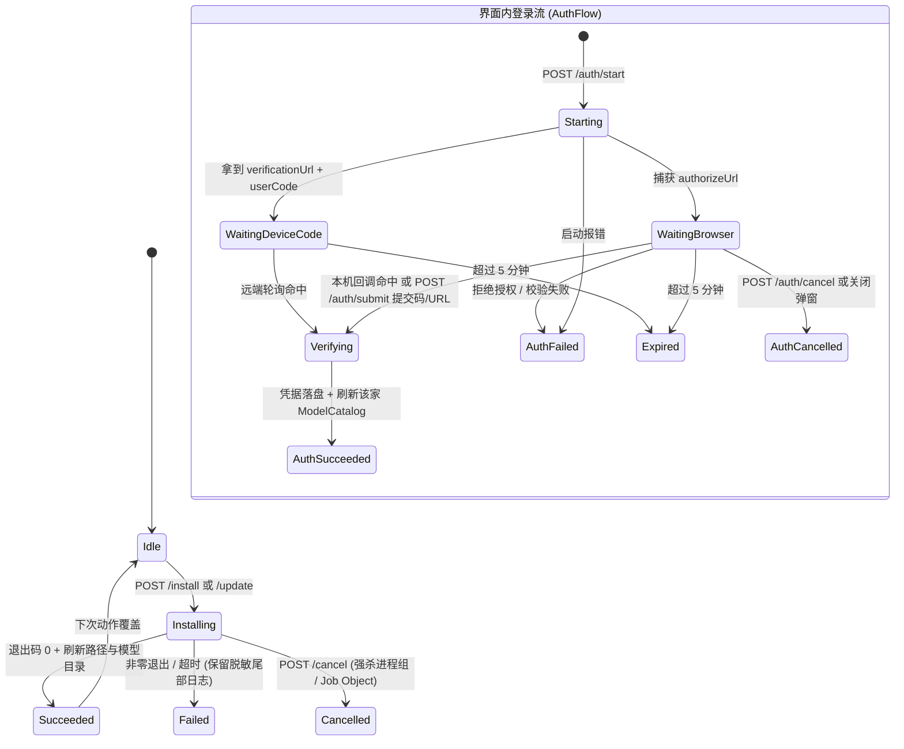

# Settings → Providers 一键安装与界面内直接登录（设计方案）

> 对应用户原话：
> 1. 「这个provider页面可以做到设置里面」
> 2. 「不要直接复制啊，直接点击安装，直接可以在我们的界面登录，设计一下」
> 3. 「顺便把我们之前讨论的换产商直接切对话不交接也做了，都走完整流程吧，还是得先设计，设计完给我讲讲方案，从用户角度」（注：跨厂商直接切对话不交接在独立并行方案中推进，本文聚焦 `Settings → Providers` 一键安装、界面内直接登录、`Vendor sync` 归拢与桌面首次启动收口。）

---

## 1. 从用户视角看完整体验

核心变化只有一句话：**用户从此不需要为了装一家 Agent CLI 或登录账号去打开系统终端、复制粘贴命令了——点一下 `Install` 自动装好，再点一下 `Sign in…` 直接在 Fusa 里完成登录，装完登完马上能派活。**

### 1.1 入口在哪、`Vendor sync` 归到哪

打开左下角齿轮 **`Settings`**：

- **桌面端（780px 双栏弹窗）**：左栏分类调整为 **`General`** → **`Providers`**（新增，`Blocks` 图标）→ **`Computers`**（开启联机时显示）→ **`Security & Access`**。
  - 原先塞在 `General` 最底下的 **`Vendor sync`（同步 MCP / Skills / Cloud connectors）搬进 `Providers` 页下半部分**，`General` 只保留清爽的 `Appearance`（界面大小）与 `Notifications`（通知）。
  - 用户刚在 `Providers` 上半部分装好并登录完一家新厂商（比如 Codex），视线往下移就是 `Vendor sync` → 点 `Scan…` → 点 `Sync`，一秒把原本在别家配好的 MCP 服务和 Skills 同步给新装的这家。
- **手机端（390px 整屏二级钻取）**：`#/settings` 一级主页在 `General` 下方新增独立的 **`Providers`** 分组，内含两行钻取入口：
  1. **`Providers`**（右侧单一状态摘要如 `4 ready`，0 家可用时标琥珀色关注点与 `Attention`）→ 点进 `#/settings/providers`；
  2. **`Vendor sync`**（右侧摘要 `Synced` 或留空）→ 点进 `#/settings/vendor-sync`。

桌面端 `Settings → Providers` 完整版面示意（遵循 `docs/ui-standard.md`：白底 `1px` 细框 `SettingsGroup`、无灰色解释性副标题、无满屏黑底终端、各项用间距隔开不用 `·`）：

```text
┌──────────────────────────────────────────────────────────────────────────────┐
│  General            │  Providers                                         ✕  │
│  Providers        ◀ │                                                        │
│  Computers          │  Computer                        [ This computer ⌄ ]   │ ← 仅多设备联机时显示
│  Security & Access  │                                                        │
│                     │  ┌──────────────────────────────────────────────────┐  │
│                     │  │ ● Claude Code                      [ Account… ]  │  │
│                     │  │   Signed in   2.1.323                            │  │
│                     │  ├──────────────────────────────────────────────────┤  │
│                     │  │ ● Codex                           [ Sign in… ]   │  │
│                     │  │   Not signed in   0.167.1                        │  │
│                     │  ├──────────────────────────────────────────────────┤  │
│                     │  │ ◌ Antigravity     Cancel   [ ⟳ Installing… ]     │  │
│                     │  │   Downloading binary…                            │  │
│                     │  ├──────────────────────────────────────────────────┤  │
│                     │  │ ○ Pi                               [ Install ]   │  │
│                     │  │   Not installed                                  │  │
│                     │  ├──────────────────────────────────────────────────┤  │
│                     │  │ ● DeepSeek                         [ Account… ]  │  │
│                     │  │   API key configured   0.2.2-rc.1                │  │
│                     │  ├──────────────────────────────────────────────────┤  │
│                     │  │ ○ Cursor                           [ Install ]   │  │
│                     │  │   Not installed                                  │  │
│                     │  └──────────────────────────────────────────────────┘  │
│                     │                                                        │
│                     │  Integrations                                          │
│                     │  ┌──────────────────────────────────────────────────┐  │
│                     │  │ Vendor sync                           [ Scan… ]  │  │
│                     │  │ Merge MCP servers and skills across providers    │  │
│                     │  └──────────────────────────────────────────────────┘  │
└──────────────────────────────────────────────────────────────────────────────┘
```

每家厂商只有 3 种清晰的视觉状态（左侧 `8px` 状态圆点对齐 `DeviceSettings`）：
- **已就绪（`bg-success` 绿点）**：已安装且已登录。小字显示登录身份摘要（如邮箱、`Signed in`、`API key configured`，Pi 显示 `2 configured`）与版本号；右侧按钮为 `Account…`（点开可切换账号、重填 Key、触发 `Update` 或 `Sign out`）。
- **待登录（`bg-caution` 琥珀点）**：CLI 已装好但还没登录。小字显示 `Not signed in` 与版本号；右侧按钮是醒目的 **`Sign in…`**。
- **未安装（`bg-muted-foreground/40` 灰点）**：这台机器没装该 CLI。小字显示 `Not installed`；右侧按钮是 **`Install`**。

---

### 1.2 场景一：新电脑第一次打开 Fusa（0 家可用自动引导，告别静态复制页）

1. **双击打开 Fusa（Mac 或 Windows 原生桌面版）**：
   - 后台守护进程在 1～2 秒内拉起，**直接进入 Fusa 主界面**（去掉原来 Windows 首次启动挡在门外、只能看灰代码块点 `Open terminal` 的本地静态拦截页）。
2. **自动弹出 `Settings → Providers`**：
   - 主界面检测到本机目前 **0 家厂商就绪**，自动弹出 `Settings → Providers`。
   - 如果是一台刚装系统的全新 Windows 电脑连 `Git` 都没装，`Providers` 列表上方会多出一个临时的 `Environment` 框，一行 `Git` + 右侧 `[ Install ]` 按钮（一键调用系统 `winget` 免交互装 Git；装好后该框自动消失，平时对已装 Git 的用户完全隐形，也不阻断纯聊天使用）。
3. **随时可补装**：
   - 如果用户在“新建项目经理”弹窗发现想用的厂商没装，或本机 0 家可用导致下拉为空，厂商行旁边直接有一个文字按钮 **`Manage providers…`**，点一下就跳到 `Settings → Providers`。

---

### 1.3 场景二：本机电脑（Mac / Windows）一键安装 + 界面内直接登录

以用户在一台全新的 Windows（连 Node.js 都没装过）或 Mac 上配置 **Codex** 和 **DeepSeek** 为例：

1. **点一下 `Install`（装 Codex）**：
   - `Codex` 行右侧按钮变为转圈的 `Installing…`（左边附一个轻量 `Cancel` 文字按钮可随时取消）。
   - **没有满屏黑底滚动日志**：行下只用一行简短动态文字柔和反馈阶段（`Installing package…`），Windows 下自动使用 Fusa 安装包内置的 Node 24 与随包 `npm` 免管理员装入用户目录（不弹 UAC 管理员黑框、不报缺少 Node）。
   - 十几秒装完后，后台**自动刷新可执行文件路径与模型目录**（无需重启 Fusa），这一行当场变成琥珀点 `Not signed in`，右侧按钮变成 **`Sign in…`**。
   - *万一网络断了安装失败*：行下显示一句红色人话原因（如 `Download failed: network timeout`），右侧按钮变回 `Retry` 并附一个 `Show log` 开关——只有点 `Show log` 才会展开一个浅灰底代码块（最多最近 80 行脱敏输出）供排查。
2. **点一下 `Sign in…`（登 Codex 账号）**：
   - 叠出一个紧凑干净的窄弹窗 **`Sign in to Codex`**（`max-w-110`）：
     - 顶部分段选择（`Segmented`）：`Browser` | `Device code` | `API key`（本机默认选 `Browser`）；
     - 底部主按钮 **`Continue in browser`**。
   - 用户点 **`Continue in browser`**：
     - 系统默认浏览器自动弹开 ChatGPT 授权页，弹窗主按钮变为等待态 `Waiting for browser…`（同时给一个 `Copy link` 以备用户想换别的浏览器窗口打开）；
     - 用户在浏览器里点“允许”，浏览器自动回调本机，**用户切回 Fusa 时连一个字都不用粘，窄弹窗已自动关闭，`Codex` 行已亮起绿点 `Signed in`！**
3. **点一下 `Sign in…`（填 DeepSeek API Key）**：
   - 点 `DeepSeek` 行的 `Sign in…` → 弹窗默认聚焦单行密码框（占位 `sk-...`）→ 粘贴 API Key 点 **`Save`** → 后台以 `0600` 权限写入 `~/.dsh/.credentials.yaml`，弹窗秒关，`DeepSeek` 行亮起绿点 `API key configured`，立即可用。

---

### 1.4 场景三：给远端无头服务器（如东京 Linux Peer）安装与登录

用户在自己的 Mac 桌面（或手机）上打开 `Settings → Providers`，顶部的 **`Computer`** 下拉切到 **`Tokyo`**（如果用户本来就在看东京上的项目经理对话，打开 `Providers` 默认就已经选中 `Tokyo`）：

1. **远端一键安装**：
   - 点 `Tokyo` 下任意一家的 `Install`，指令通过已配对的加密通道发给东京守护进程，东京在自己的用户目录（`~/.local/bin` 或 `~/.agent-hub/tools/npm`）免 `sudo` 完成安装，界面实时同步进度。
2. **远端界面内直接登录（彻底告别 `ssh -L` 端口转发！）**：
   系统按每家原厂能力自动选最顺手的远端登录方式：
   - **情况 A：原生支持设备码或云端轮询（Codex / Cursor / Pi OAuth）**
     - **Codex**：连接远端设备时默认选中 **`Device code`**。点开始后，弹窗直接居中显示大号等宽验证码（如 `WXYZ-5678`，配一键 `Copy code`）和 **`Open verification page`** 按钮；用户在手头这台 Mac 的浏览器点开验证页填入验证码，东京服务器自动收到授权完成通知，弹窗自动收起变绿点！
     - **Cursor**：点 **`Continue in browser`**，手头 Mac 浏览器直接打开东京服务器生成的 `cursor.com` 授权页，点“确认登录”，东京后台轮询立即落盘成功，零粘贴！
   - **情况 B：浏览器回调 `localhost` 或展示授权码（Claude Code / Antigravity / DeepSeek 账号登录）**
     - 弹窗展示 **`Open sign-in page`** 按钮，**同屏下方直接常驻一个单行输入框**（占位 `Paste code or redirect URL…` + 右侧 `Submit` 按钮）：
       ```text
       ┌────────────────────────────────────────────────────┐
       │  Sign in to Antigravity                         ✕  │
       │                                                    │
       │  [    Personal Google    |   Gemini Enterprise   ] │
       │                                                    │
       │  [ Open sign-in page ]               [ Copy link ] │
       │                                                    │
       │  ┌──────────────────────────────────┐ ┌──────────┐ │
       │  │ Paste code or redirect URL…      │ │  Submit  │ │
       │  └──────────────────────────────────┘ └──────────┘ │
       │                                                    │
       │                                        [ Cancel ]  │
       └────────────────────────────────────────────────────┘
       ```
     - 用户点 `Open sign-in page` 在手头 Mac 浏览器登录 Google / Claude：
       - 若网页直接给出一串授权码，复制粘贴进输入框点 `Submit` 即完成；
       - 若浏览器跳转到 `http://127.0.0.1:54321/oauth-callback?code=...&state=...` 显示“无法访问此网站”（因为这个端口开在远端东京服务器上），用户**只需把浏览器地址栏整条 `http://127.0.0.1:...` 网址复制下来，粘贴进输入框点 `Submit`**——东京守护进程校验该回调 URL 的端口与 `state` 确属本次登录后，直接在东京本机向 `127.0.0.1:54321` 完成回环回调，1 秒钟换票成功！

---

### 1.5 场景四：手机端（iPhone PWA）操作体验

1. 打开手机主屏上的 Fusa → 点左下设置图标进入 `#/settings` → 点 `Providers` 分组下的 **`Providers`** 进入 `#/settings/providers`。
2. 顶部（若多台电脑联机）可切换 `This computer` / `Tokyo`，下方是一列干净的厂商行（每行触屏高度 ≥ `48px`，按钮热区 ≥ `44×44px`）。
3. 点某家的 **`Install`**：原地转圈安装；点 **`Sign in…`**：从屏幕底部滑出原生感十足的 **`SettingsDrawer` 抽屉**，按钮全宽 `h-11 w-full`，输入框强制 `16px`（iOS 不自动放大页面）并关闭自动首字母大写与拼写纠错，点开 Safari 授权或粘贴 API Key 一气呵成。

---

### 1.6 场景五：聚合多模型商的 Pi，以及日常换号/更新

- **Pi（一家 CLI 聚合 40+ 模型商）**：
  - 点 `Pi` 的 `Sign in…`（已登录时点 `Account…`），弹窗顶部多一行 **`Model provider`** 下拉（把常用的 `DeepSeek`、`Anthropic`、`OpenAI Codex`、`OpenAI`、`Google`、`OpenRouter`、`GitHub Copilot`、`xAI` 排在最前，已配过的右侧标 `Configured`）。
  - 选 `DeepSeek` → 直接填 API Key 点 `Save`；选 `OpenAI Codex` 或 `Anthropic` → 可直接走 `Browser` OAuth / Device Code 登录或填 API Key。配好任意一家，`Pi` 即亮绿点可用，后续还能随时点 `Account…` 追加或移除其他子模型商。
- **更新与换号（`Account…`）**：
  - 对已就绪的厂商点右侧 `Account…`，弹出轻量管理窗：显示当前状态与版本号，提供 **`Update`**（一键升级 CLI 到最新/兼容版本）、**`Sign in with another account…`**（或重填 API Key）以及红色的 **`Sign out`**。

---

## 2. 6 家厂商安装、更新与原厂登录机制逐一实测对照表

以下结论全部基于 macOS arm64 本机已安装的 6 家真实 CLI（零大模型额度消耗探测）、官方公开安装脚本（`install.sh` / `install.ps1`）源码核查、官方文档以及 `pingdotgg/t3code`、`stablyai/orca` 的生产实践整理。

### 2.1 六家全平台总览对照表

| 厂商 (`id` / 命令 / 本机实测版本) | macOS / Linux 免 root 安装方式 | Windows（内置 Node 24）免管理员安装方式 | 更新方式 (`Update`) | 界面内直接登录方式（本机 & 远端无头） | 凭据落盘与受管存储位置 | 轻量就绪探测（零重进程阻塞） |
| --- | --- | --- | --- | --- | --- | --- |
| **Claude Code**<br>`claude` / `claude`<br>`2.1.323` | 官方原生脚本 `https://claude.ai/install.sh`（装入 `~/.local/bin/claude` → `~/.local/share/claude/versions/`，脚本自带防 `sudo` 保护） | 官方 PowerShell 脚本 `https://claude.ai/install.ps1`（自动识别 x64/arm64 + SHA-256 校验，装入 `%USERPROFILE%\.local\bin\claude.exe`） | 原生路径调 `claude update`；包管理器安装重跑官方脚本 | ① **Browser OAuth**（`claude auth login` `--claudeai` / `--console`，`BROWSER` 拦截 URL；本机自动回调或回车，远端粘贴授权码或回环 URL）<br>② **API Key / Token**（`ANTHROPIC_API_KEY` 或 `CLAUDE_CODE_OAUTH_TOKEN`） | OAuth：macOS Keychain / Linux & Win `~/.claude/.credentials.json` (`0600`) + `~/.claude.json`<br>API Key：Fusa 受管 `provider-secrets.json` (`0600`) | 复用 `ModelCatalogs` 缓存；单家刷新走 `initialize` 或 `claude auth status --json`（实测 `68ms`）；盯 `.claude.json`、`.credentials.json` 与受管密钥 stat 指纹 |
| **Antigravity**<br>`agy` / `agy`<br>`1.5.8` | 官方原生脚本 `https://antigravity.google/cli/install.sh`（装入 `~/.local/bin/agy`） | 官方 PowerShell 脚本 `https://antigravity.google/cli/install.ps1`（装入 `%LOCALAPPDATA%\agy\bin\agy.exe`） | `agy update` | ① **Google / Enterprise OAuth**（起 `agy acp` 调 `authenticate` `oauth-personal` / `oauth-business`，`BROWSER` 拦截 URL；本机直连回调，远端粘贴 `http://127.0.0.1:<port>/...` 回环转发或粘 SSH 授权码）<br>② **Gemini API Key**（`GEMINI_API_KEY`） | OAuth：系统钥匙串 / `~/.gemini`<br>API Key：Fusa 受管 `provider-secrets.json` + 联动局部补丁 `~/.gemini/antigravity-cli/settings.json` `"modelProvider": "gemini"` | 复用 `ModelCatalogs` 缓存（`agy --output-format json models`）；盯 `.gemini/antigravity-cli`、`oauth_creds.json` 与受管密钥指纹 |
| **Codex**<br>`codex` / `codex`<br>`0.167.1` | 官方独立脚本 `https://chatgpt.com/codex/install.sh`（设 `CODEX_NON_INTERACTIVE=1`，装入 `~/.local/bin/codex`，独立原生包不依赖系统 Node） | 随包 Node 24 + 随包 `npm` 安装至受管目录：`npm install -g --prefix <hubHome>/tools/npm @openai/codex`（生成 `codex.cmd`） | macOS/Linux 重跑 `install.sh`；Windows 重跑受管 `npm install` | 原生 **`codex app-server` JSON-RPC**：<br>① **Browser OAuth**（`account/login/start` `{type:"chatgpt"}` → 返 `authUrl`，本机直连或远端转发回调，收 `account/login/completed`）<br>② **Device Code**（`{type:"chatgptDeviceCode"}` → 返 `verificationUrl` + `userCode`，远端首选）<br>③ **API Key**（`{type:"apiKey", apiKey}`） | 原厂直接写入 `$CODEX_HOME/auth.json`（默认 `~/.codex/auth.json`，或 `config.toml` 配置的 keyring） | 复用 `ModelCatalogs` 缓存（`app-server` 单进程 `model/list` + `account/read`）+ 零子进程 `codexAuthFileAvailability` 读 `auth.json` |
| **Pi**<br>`pi` / `pi`<br>`1.5.2` | 官方脚本 `https://pi.dev/install.sh`（前置注入守护进程 Node 24 + npm `PATH`、`TERM=dumb`、`stdin: ignore`，装入 `~/.local/bin/pi`；失败回退受管 `npm install -g --ignore-scripts`） | 官方脚本 `https://pi.dev/install.ps1`（前置注入随包 Node 24 + `npm.cmd` 到 `PATH`）；若受组策略限制自动回退随包 `npm install -g --ignore-scripts --prefix <hubHome>/tools/npm @earendil-works/pi-coding-agent` | `pi update pi`（失败回退重跑安装配方） | 先选子模型商（40+ 内置列表）：<br>① **API Key**（原子合并写入 `$PI_CODING_AGENT_DIR/auth.json` `{type:"api_key", key}`）<br>② **OAuth / Device Code**（对 `anthropic` / `openai-codex` / `github-copilot` / `openrouter` / `xai` 等跑 `pi auth login <id> [--no-browser]`） | 原厂 `$PI_CODING_AGENT_DIR/auth.json`（默认 `~/.pi/agent/auth.json`，`0600`，`proper-lockfile` 兼容原子写） | 复用 `ModelCatalogs` 缓存（`pi --offline --no-approve --list-models` 纯离线读本地凭据，无网络请求）+ 盯 `auth.json` 指纹 |
| **DeepSeek**<br>`deepseek` / `dsh`<br>`0.2.2-rc.1` | 守护进程 Node 24 + `npm` 受管安装：`npm install -g --prefix <hubHome>/tools/npm @deepseek-ai/dsh@0.2.2-rc.1`（免 `sudo`，避免 `/usr/local` `EACCES`） | 随包 Node 24 + 随包 `npm` 受管安装：`npm install -g --prefix <hubHome>/tools/npm @deepseek-ai/dsh@0.2.2-rc.1` | 重跑受管 `npm install`（沿用经协议验证的版本） | ① **API Key（默认推荐）**：按 v1 schema 原子写入 `$DSH_HOME/.credentials.yaml`（`version: 1` + `refs.DEEPSEEK_API_KEY`，`0600`）<br>② **DeepSeek Account OAuth**：本地回环回调调 `dsh` PKCE 换取 grant 写入 `records["deepseek-account-platform/default"]`（远端支持粘贴回环 URL 转发） | 原厂 `$DSH_HOME/.credentials.yaml`（默认 `~/.dsh/.credentials.yaml`，强制 `0600`；优先级高于 `<cwd>/.env`） | **0 子进程**纯本地有界文件检查 `hasDeepSeekLocalCredentials`（`< 1ms`）+ 盯 `.credentials.yaml` / `.env` 指纹 |
| **Cursor**<br>`cursor` / `cursor-agent`<br>`2026.11.10` | 官方脚本 `https://cursor.com/install`（装入 `~/.local/bin/cursor-agent` 与 `~/.local/share/cursor-agent/versions/`，自带独立 node） | 官方 PowerShell 脚本 `https://cursor.com/install?win32=true`（装入 `%LOCALAPPDATA%\cursor-agent\cursor-agent.cmd`） | `cursor-agent update` | ① **Browser OAuth（全环境免回调）**：`NO_OPEN_BROWSER=1 cursor-agent login` 打印 URL 并云端轮询，本机与远端东京服务器均只需在任意浏览器点确认即自动落盘（Linux 无 keyring 时设 `AGENT_CLI_CREDENTIAL_STORE=file`）<br>② **API Key**：`CURSOR_API_KEY` | OAuth：系统钥匙串 / Linux `~/.cursor/auth.json` (`0600`)<br>API Key：Fusa 受管 `provider-secrets.json` (`0600`) | 复用 `ModelCatalogs` 缓存（`cursor-agent status --format json`）；盯 `.cursor/auth.json`、`agent-cli-state.json` 与受管密钥指纹 |

### 2.2 实测挖出的 5 个关键工程细节（避免实现踩坑）

1. **`claude` 与 `codex` 在 macOS 上的 `fallbackPaths` 缺口**：
   - 核查现有 `src/vendors/claude/paths.ts` 与 `src/vendors/codex/paths.ts` 发现：`claude` 在 `darwin` 下 `fallbackPaths` 返回 `[]`，`codex` 在 `darwin` 下只查了 `ChatGPT.app` 和 `.codex/plugins`，**两者都漏了 `~/.local/bin`**。
   - 从 Finder / Launchpad 启动 `Fusa.app` 时，macOS GUI 进程的默认 `PATH` 只有 `/usr/bin:/bin:/usr/sbin:/sbin`，不含 `~/.local/bin`。若不补齐，用户在 `Fusa.app` 里点一键安装把 `claude` / `codex` 装进 `~/.local/bin` 后依然会被判为 `Not installed`。实现步必须在两家的 `darwin` `fallbackPaths` 中补入 `~/.local/bin/<cmd>`、`/opt/homebrew/bin/<cmd>`、`/usr/local/bin/<cmd>` 以及受管 `<hubHome>/tools/npm/bin/<cmd>`。
2. **Antigravity 使用 `GEMINI_API_KEY` 的双开关铁律**：
   - 核查官方 `antigravity.google/docs/install.md` 确认：单传环境变量 `GEMINI_API_KEY` 对 `agy` **完全无效**；必须同时在 `~/.gemini/antigravity-cli/settings.json` 写入 `"modelProvider": "gemini"`。反之，若留下了 `"modelProvider": "gemini"` 却移除了 `GEMINI_API_KEY`，`agy` 启动会直接报错退出。因此保存/移除 `agy` API Key 或是切回 Google OAuth 账号时，必须用 `jsonc-parser` 原子联动增删该字段。
3. **DeepSeek `.credentials.yaml` 的 `0600` 与 `version: 1` 强校验**：
   - 核查 `@deepseek-ai/dsh-credentials-local` 源码确认：POSIX 下若 `.credentials.yaml` 含任何 group/other 权限位（`(mode & 0o077) !== 0`），`dsh` 直接拒绝启动并抛错；文档非空时根映射必须声明 `version: 1`，API Key 必须嵌套在 `refs: { DEEPSEEK_API_KEY: "sk-..." }` 下且值非空（空字符串同样抛错），同时写入这里比写 `~/.dsh/.env` 优先级更高，能防止被不可信项目目录里的 `<cwd>/.env` 覆盖。
4. **`pi.dev/install.sh` 与 `install.ps1` 的非交互前置要求**：
   - 核查官方安装脚本源码确认：`pi.dev/install.sh` 若在 `PATH` 里找不到 `node`（`>= 22.19.0`）和 `npm`，会进入 `install_node_npm_interactive` 交互等待；`install.ps1` 第 416 行硬性要求 `Get-Command npm.cmd, npm.exe` 命中（故意跳过 `npm.ps1` 以避开 PowerShell `Restricted` 策略）。因此运行 Pi 安装器时，必须把 Fusa 守护进程所在的 Node 24 目录（含 `node` 与 `npm.cmd`/`npm`）置于子进程 `PATH` 首位，并设 `TERM=dumb`、`NO_COLOR=1`、`stdin: "ignore"`。
5. **`codex/install.sh` 的非交互开关**：
   - 核查 `chatgpt.com/codex/install.sh` 第 6、100 行确认：当机器上已有通过 npm 或 Homebrew 安装的旧 `codex` 时，不带环境变量的脚本可能提示冲突，必须传入 `CODEX_NON_INTERACTIVE=1`。

---

## 3. Windows 原生桌面版（内置 Node 24）免管理员安装与运行闭环

### 3.1 现状缺口

当前 `scripts/stage-win-runtime.ts` 在组装 Windows 随包运行时目录时，从官方 `node-v24.22.3-win-x64.zip` 中仅提取了单文件 `node/node.exe`，未提取同压缩包内的 `npm.cmd`、`npx.cmd` 与 `node_modules/npm/`。在一台从未装过 Node.js 的普通用户 Windows 电脑上：
1. 无法免管理员安装 `@openai/codex` 与 `@deepseek-ai/dsh@0.2.2-rc.1`；
2. `pi.dev/install.ps1` 检查 `npm.cmd` 失败退出；
3. `vendor-sync` 为不支持远程 SSE 的厂商自动包裹的 `npx -y mcp-remote <url>` 也缺少随包 `npx.cmd`。

### 3.2 根治方案：随包提取官方 `npm` + 受管 `<hubHome>/tools/npm` 目录

1. **打包期（`scripts/stage-win-runtime.ts`）**：
   - 从同一个已通过 `BUNDLED_NODE_WIN_X64_ZIP_SHA256` 严格校验的官方 `node-v24.22.3-win-x64.zip` 中，额外提取 `npm.cmd`、`npx.cmd` 与 `node_modules/npm/` 到 `<outDir>/node/`；
   - 复用 `pruneStagedNodeModules` 剥离 `node_modules/npm` 下的 `docs/`、`man/`、`changelogs`、`.map`、`.d.ts` 及任何软链（保持 `assertNoSymlinksInTree` 100% 通过）；
   - **体积核算**：裁剪后的 `npm` 纯 JS 文件压缩进 NSIS 安装包仅增加约 **`2.4 MiB`**，安装包总体积从实测 `37.39 MiB` 增至约 **`39.8 MiB`**，远低于 `60 MiB` 预算上限；`runtime-manifest.json` 保持校验核心可执行文件 SHA-256。
2. **安装期免管理员受管目录（`<hubHome>/tools/npm`）**：
   - 在 `HubPaths`（`src/shared/paths.ts`）新增 `toolsNpmDir: joinForBase(home, "tools", "npm")`，其可执行文件导出目录 `toolsNpmBinDir` 在 `win32` 下为 `toolsNpmDir` 本身（npm 在 Windows `--prefix` 根下生成 `<cmd>.cmd`），在 `darwin` / `linux` 下为 `join(toolsNpmDir, "bin")`。
   - 执行 `kind: "npm"` 安装配方时，守护进程**不经过任何 shell**，直接用 `spawnOwnedProcess(process.execPath, [npmCliJsPath, "install", "-g", "--prefix", paths.toolsNpmDir, "--no-fund", "--no-audit", "--loglevel", "error", ...extraArgs, packageSpec])` 执行：
     - **零管理员 / 零 `sudo`**：读写全在用户自己的 `<hubHome>/tools/npm` 下，彻底消灭 Linux/macOS 系统 Node 全局安装报 `EACCES` 和 Windows 写 `Program Files` 报权限不足的问题；
     - **零 PowerShell 执行策略干扰**：直接由 `node.exe` 运行 `npm-cli.js`；
     - **自动继承沙箱受保护根防篡改**：`<hubHome>` 在守护进程启动时已挂有 `ensureWin32ProtectedRootAcl`（Windows 写受限令牌显式拒写）与 macOS/Linux Worker `writeScope` 禁写保护，普通 Worker 与只读 Worker 只能读/执行其中的 CLI，**绝无可能覆写篡改受管 CLI 垫片实现沙箱逃逸**。
3. **运行期子进程 `PATH` 闭环**：
   - Windows `fusa-supervisor` 启动守护进程时已将随包 `node/` 目录放入守护进程 `PATH`（`supervisor.rs:445`）；
   - 守护进程自身在 `buildChildEnv` 及 `VendorRuntimeResolver` 中确保 `toolsNpmBinDir` 与 `dirname(process.execPath)` 位于查找链与子进程 `PATH` 中（末尾兜底不抢占用户自己在项目里装的 `node` 版本，裸机无系统 Node 时又能保证 `dsh.cmd`、`codex.cmd` 内部的 `node` 调用 100% 命中随包 Node 24）。
4. **官方 PowerShell 安装器的安全受管执行**：
   - 对 Windows 下 `kind: "powershell_script"` 的厂商（`claude`、`agy`、`cursor`、`pi`），守护进程使用固定绝对路径 `%SystemRoot%\System32\WindowsPowerShell\v1.0\powershell.exe`（找不到回退 `powershell.exe`），传固定参数数组：
     ```ts
     [
       "-NoProfile",
       "-NonInteractive",
       "-ExecutionPolicy",
       "Bypass",
       "-Command",
       `[Net.ServicePointManager]::SecurityProtocol = [Net.SecurityProtocolType]::Tls12; & ([scriptblock]::Create((Invoke-RestMethod -UseBasicParsing -Uri '${recipe.scriptUrl}')))`,
     ]
     ```
   - `stdin` 设为 `"ignore"`，子进程挂入 Windows Job Object（`spawnOwnedProcess` + `trackChild`），并在任务结束后调用注册表 `HKLM` + `HKCU` `Environment\Path` 重读合并（将官方安装器新写入用户级 `Path` 的目录即时吸收进当前守护进程内存环境，无需重启桌面壳）。

---

## 4. 免重启立即可用的根因修复：动态路径解析与受管凭据注入

### 4.1 现状根因

在现有 `src/daemon/daemon.ts`（第 191、346、448 行）中，`executables = resolveVendorExecutables(...)` 只在守护进程启动那一刻计算了一次静态字符串：
- 若启动时某家（如 `agy`）尚未安装，`executables.agy.path` 被固化为裸命令名 `"agy"`；
- 当用户随后把 `agy` 装进 `~/.local/bin/agy` 或 `<hubHome>/tools/npm`，虽然 `installed()` 查文件返回了 `true`，但 `VendorCatalogSource` 和 `Driver` 手里拿的仍然是启动时固化的裸 `"agy"`，一旦守护进程自身的 `PATH` 不含 `~/.local/bin`，拉模型名单和起会话就会直接报 `ENOENT`！

### 4.2 根治设计：`VendorRuntimeResolver`

在守护进程侧引入统一的轻量运行时解析器 `createVendorRuntimeResolver({ paths, userHome, baseEnv, secretsStore })`：

1. **动态解析可执行文件路径 `resolveExecutablePath(vendor)`**：
   - 按最新环境 `currentPathEnv()`（含 `toolsNpmBinDir` 及 Windows 安装后刷新的注册表 `Path`）+ `VENDOR_FALLBACK_PATHS[vendor]`（含 `toolsNpmBinDir` 候选）实时查找；
   - 命中结果复用有上限的 `locatedExecutables` LRU（已有 `statSync` 存在性校验）；当触发安装、更新或手动 `Refresh` 时调用 `invalidate(vendor)` 清空对应缓存槽。
2. **动态合成厂商子进程环境 `resolveVendorEnv(vendor)`**：
   - 在守护进程基础 `env` 之上合并该厂商在 `<stateDir>/provider-secrets.json` 中配置的受管凭据键值（仅当用户未在外部显式设置同名非空环境变量，或用户在界面主动保存了受管凭据时注入；若用户通过界面保存了受管凭据，受管凭据优先于空环境）；
   - 确保 `toolsNpmBinDir` 与 `dirname(process.execPath)` 存在于子进程 `PATH` 兜底位置。
3. **全链路统一接入**：
   - `VendorCatalogSource`（每次 `query` / `confirm` / `installed` / `fingerprint`）、`VendorDriver`（每次起进程）与 `VendorComposer`（每次空闲问命令列表）统一通过 `runtime.resolveExecutablePath(vendor)` 与 `runtime.resolveVendorEnv(vendor)` 取路径和环境；
   - `vendorCatalogFingerprint` 额外纳入该厂商受管凭据的修订序号（不拼明文，只拼单调递增的 `revision` 或 HMAC 摘要），保证刚在界面填完/改完 API Key 时 `ModelCatalogs` 指纹当即变化并重算 `availability`。

---

## 5. 统一厂商注册表扩展设计（`src/vendors/<id>/` 零硬编码）

严格遵守 `docs/vendor-plugin-design.md` 与 `src/shared/vendor-guard.test.ts`：`src/daemon/`、`src/shared/`、`src/web/` **绝不出现任何单家厂商分支或厂商名字符串字面量**，全部能力由 `src/vendors/<id>/` 声明驱动。

### 5.1 共享与守护进程类型定义（`src/shared/providers.ts` + `src/vendors/daemon-types.ts`）

前端与后端共用的纯数据结构放在 `src/shared/providers.ts`：

```ts
import type { AgentVendor, VendorAvailability } from "./vendors.ts";

/** 前端据此渲染登录弹窗中的选项卡与表单控件，零厂商硬编码。 */
export type ProviderAuthMethodDescriptor =
  | {
      readonly id: string;
      readonly kind: "browser_oauth";
      readonly label: string;
      /** 可选子模式单选（如 Claude 的 Subscription / Console，Antigravity 的 Personal / Enterprise）。 */
      readonly variants?: readonly { readonly id: string; readonly label: string }[];
      /** 登录进行中是否允许用户粘贴授权码或回环回调 URL（远端无头服务器闭环）。 */
      readonly manualInput: "none" | "code" | "callback_url" | "code_or_callback";
      /** 远端无头访问时是否优先推荐另一方法（如 Codex 在远端优先选 device_code）。 */
      readonly preferDeviceCodeWhenRemote?: boolean;
    }
  | {
      readonly id: string;
      readonly kind: "device_code";
      readonly label: string;
    }
  | {
      readonly id: string;
      readonly kind: "api_key";
      readonly label: string;
      readonly placeholder: string;
      /** 多子模型商聚合厂商（如 Pi）声明可选目标列表；单厂商不传。 */
      readonly targets?: readonly {
        readonly id: string;
        readonly label: string;
        readonly configured: boolean;
        readonly supportsOauth?: boolean;
      }[];
    };

export type ProviderJobKind = "install" | "update";
export type ProviderJobPhase = "running" | "succeeded" | "failed" | "cancelled";

export interface ProviderJobSnapshot {
  readonly jobId: string;
  readonly kind: ProviderJobKind;
  readonly phase: ProviderJobPhase;
  /** 单行简短进度文案（英文，如 "Installing package…"），不刷屏。 */
  readonly progressLine: string | null;
  readonly error: string | null;
  /** 仅失败或取消后按需读取的脱敏尾部输出（最多 PROVIDER_JOB_LOG_MAX_LINES 行）。 */
  readonly logTail: string;
  readonly startedAt: number;
  readonly finishedAt: number | null;
}

export type ProviderAuthFlowPhase =
  | "starting"
  | "waiting_browser"
  | "waiting_device_code"
  | "verifying"
  | "succeeded"
  | "failed"
  | "cancelled"
  | "expired";

export interface ProviderAuthFlowSnapshot {
  readonly flowId: string;
  readonly methodId: string;
  readonly phase: ProviderAuthFlowPhase;
  /** 仅对发起该登录流的同一客户端会话暴露 URL 与验证码；其他客户端会话置 null。 */
  readonly authorizeUrl: string | null;
  readonly verificationUrl: string | null;
  readonly userCode: string | null;
  readonly manualInput: "none" | "code" | "callback_url" | "code_or_callback";
  /** 被其他浏览器会话占用时为 true（界面提示 "Sign-in in progress in another window"）。 */
  readonly ownedByOtherClient: boolean;
  readonly error: string | null;
  readonly expiresAt: number;
}

export interface ProviderStatusItem {
  readonly vendor: AgentVendor;
  readonly label: string;
  readonly installed: boolean;
  readonly version: string | null;
  readonly availability: VendorAvailability;
  /** 克制的身份/凭据状态短语（如邮箱、"Signed in"、"API key configured"、"2 configured"），绝不含密钥原文。 */
  readonly accountSummary: string | null;
  readonly canInstall: boolean;
  readonly canUpdate: boolean;
  readonly canSignOut: boolean;
  readonly authMethods: readonly ProviderAuthMethodDescriptor[];
  readonly job: ProviderJobSnapshot | null;
  readonly authFlow: ProviderAuthFlowSnapshot | null;
}

export interface ProvidersStatusResponse {
  readonly platform: "darwin" | "win32" | "linux" | string;
  readonly gitInstalled: boolean;
  readonly canInstallGit: boolean;
  readonly gitJob: ProviderJobSnapshot | null;
  readonly providers: readonly ProviderStatusItem[];
}
```

守护进程侧在 `src/vendors/daemon-types.ts` 的 `VendorDaemon` 新增 `setup: VendorSetupAdapter`：

```ts
export type VendorInstallRecipe =
  | {
      readonly kind: "npm";
      readonly packageSpec: string;
      readonly extraArgs?: readonly ("--ignore-scripts" | "--min-release-age=0")[];
    }
  | {
      readonly kind: "posix_script";
      readonly scriptUrl: string;
      readonly shell: "bash" | "sh";
      readonly args?: readonly string[];
      readonly env?: Readonly<Record<string, string>>;
    }
  | {
      readonly kind: "powershell_script";
      readonly scriptUrl: string;
      readonly args?: readonly string[];
      readonly env?: Readonly<Record<string, string>>;
      /** PowerShell 受限失败时的可选免脚本回退配方（如 Pi 回退受管 npm 安装）。 */
      readonly fallback?: {
        readonly kind: "npm";
        readonly packageSpec: string;
        readonly extraArgs?: readonly ("--ignore-scripts" | "--min-release-age=0")[];
      };
    };

export type VendorUpdateRecipe =
  | { readonly kind: "reinstall" }
  | {
      readonly kind: "cli_subcommand";
      readonly args: readonly string[];
      readonly canUse?: (binaryPath: string, platform: string) => boolean;
    };

export interface VendorSetupContext {
  readonly platform: string;
  readonly userHome: string;
  readonly executablePath: () => string;
  readonly installed: () => boolean;
  readonly env: () => Record<string, string | undefined>;
  readonly secrets: ManagedProviderSecrets;
}

export interface VendorSetupAdapter {
  /** 按目标平台返回白名单安装配方（禁止任意 shell 字符串）。 */
  installRecipe(platform: string): VendorInstallRecipe;
  /** 返回更新配方。 */
  updateRecipe(platform: string): VendorUpdateRecipe;
  /** 可选版本解析参数（默认 ["--version"]，结果按二进制 stat 指纹缓存，不在每次请求时重复起进程）。 */
  versionArgs?: readonly string[];
  /** 返回当前环境下该厂商支持的界面内登录方法列表与已登录摘要。 */
  inspectAuth(ctx: VendorSetupContext): Promise<{
    accountSummary: string | null;
    canSignOut: boolean;
    methods: readonly ProviderAuthMethodDescriptor[];
  }>;
  /** 启动交互式登录流（Browser OAuth 或 Device Code）。 */
  startAuthFlow?(
    ctx: VendorSetupContext,
    input: { methodId: string; variantId?: string; targetId?: string },
    hooks: AuthFlowHooks,
    signal: AbortSignal,
  ): Promise<void>;
  /** 保存 API Key（写入原厂凭据文件或受管 secrets，必要时联动厂商配置）。 */
  saveApiKey?(ctx: VendorSetupContext, input: { targetId?: string; apiKey: string }): Promise<void>;
  /** 退出登录或移除指定子模型商凭据。 */
  signOut(ctx: VendorSetupContext, input?: { targetId?: string }): Promise<void>;
}
```

### 5.2 六家厂商 `src/vendors/<id>/setup.ts` 声明与守卫校验

- 每家在 `src/vendors/{claude,agy,codex,pi,deepseek,cursor}/setup.ts` 实现各自的 `VendorSetupAdapter`，并挂到各自 `daemon.ts` 的 `defineVendorDaemon({ ..., setup })` 上。
- 公共复用原语放在 `src/vendors/_common/setup/`：
  - `browser-capture.ts`：生成临时单行 Node `BROWSER` 拦截脚本捕获 CLI 欲打开的 OAuth URL（照 `t3code` `antigravityAuthSupport.ts`）；
  - `loopback-callback.ts`：解析授权 URL 中的回环 `redirect_uri` 与 `state`，并在用户粘贴回调 URL 时做 6 重安全校验后向本机回环端口发起无代理 GET；
  - `version-probe.ts`：按可执行文件 `stat` 指纹（`mtimeMs + size`）缓存 `--version` 单行解析结果（上限 `AGENT_VENDORS.length`），文件不变绝不重复起进程。
- **守卫测试 100% 闭环**：
  - `src/shared/vendor-guard.test.ts`：公共代码 `src/daemon/provider-manager/**`、`src/web/**`、`src/shared/providers.ts` 零单家分支、零厂商名字符串字面量；
  - `src/vendors/contract.test.ts` 与 `acme-contract.test.ts`：断言 `VENDOR_LIST` 全部成员均提供 `setup`，且 `installRecipe("darwin" | "linux" | "win32")` 返回的 `scriptUrl` 均为合法 `https://` 固定地址；
  - `src/web/web-guard.test.ts`：前端源码零厂商字面量、零数字定时器字面量、零违规圆角类名。

---

## 6. 后端状态机、HTTP 接口与跨设备 Peer 代理

### 6.1 为什么采用“异步启动秒回 + 轻量状态快照”而非长阻塞请求

`src/daemon/peers/proxy.ts` 对跨设备 HTTP 请求设有响应头超时 `PEER_PROXY_HEADERS_TIMEOUT_MS`（防止睡死设备拖垮入口连接池）。而 CLI 下载安装可能需要 15～90 秒，浏览器 OAuth 登录更需要等待用户操作 1～5 分钟。

因此所有写操作接口均采用**异步受管任务模式**：
- `POST` 发起安装、更新或登录流时，守护进程立即在内存槽启动受管任务并在 **`< 50ms` 内返回最新状态快照**（登录流若在 `800ms` 内已拿到 `authorizeUrl` / `userCode` 则首包直接带上，否则返回 `phase: "starting"`）；
- 前端仅在存在活跃任务（`job.phase === "running"` 或 `authFlow.phase` 处于进行中）且页面可见时，以具名常量 `PROVIDER_ACTIVE_POLL_MS`（`1_000ms`）轮询 `GET /api/providers`；一旦全部任务进入终态或用户关掉弹窗/切走页面，**立即停止轮询（静止态 0 请求）**；
- 这一设计天然无缝穿透 `/d/<device>/api/providers/*` 跨设备代理（无论是 SSH 隧道连入的 Mac/Windows 还是直连的东京 Linux 服务器，无需额外改 WebSocket 协议）。

### 6.2 安装/更新与登录流状态机



**并发与互斥保护**：
- 同一厂商在同一时刻最多运行 **1 个**安装/更新任务或登录流：安装进行中禁止发起登录或重复安装（幂等返回当前进行中快照）；发起登录或登出前若该厂商无在跑会话，正常执行；若有在跑会话，新凭据保存后对新轮次/新会话自然生效，不强杀用户正在跑的 Worker。
- 守护进程关机（`close()`）或热重启时：遍历全部在途安装与登录槽触发 `AbortController.abort()`，经 `killThenSettle`（POSIX 进程组 + Windows Job Object）在 `KILL_WAIT_MS` 内干净回收全部子进程。

### 6.3 REST API 契约清单（挂载于 `ui-server`，自动支持 `/d/<device>/api/...`）

所有接口均要求已认证的活跃会话（`pending_approval` 待批准公网浏览器会话一律 `403` 拒绝）：

| 方法与路径 | 请求体（`zod` 严格校验） | 作用与返回 |
| --- | --- | --- |
| `GET /api/providers` | 查询参数可选 `?refresh=1`（主动点刷新时重扫） | 轻量汇总 6 家安装状态、缓存版本号、`ModelCatalogs` 当前 `availability`、身份摘要、可用登录方法及活跃任务快照（不带 `refresh=1` 时 **0 子进程拉起**） |
| `POST /api/providers/:vendor/install` | `{}`（空对象，拒收多余字段） | 按 `VendorSetupAdapter.installRecipe` 启动后台安装，完成后失效路径缓存并触发 `models.list({ vendor, refresh: true })` |
| `POST /api/providers/:vendor/update` | `{}` | 按 `updateRecipe` 启动更新，完成后刷新版本缓存与该家模型目录 |
| `POST /api/providers/:vendor/job/cancel` | `{ "jobId": string }` | 取消并强杀指定安装/更新任务进程树 |
| `POST /api/providers/environment/git/install` | `{}`（仅 `win32` 放行，其余平台回 `400`） | 调用固定参数 `winget` 安装 `Git.Git`，完成后刷新 `gitInstalled` |
| `POST /api/providers/:vendor/auth/start` | `{ "methodId": string, "variantId"?: string, "targetId"?: string, "remoteHint"?: boolean }` | 启动 OAuth / Device Code 登录流，绑定当前客户端 `ownerKey`，返回最新 `ProviderStatusItem` |
| `POST /api/providers/:vendor/auth/submit` | `{ "flowId": string, "input": string }` | 提交用户粘贴的授权码或 `http://127.0.0.1:<port>/...` 回调 URL（仅 `ownerKey` 匹配时允许） |
| `POST /api/providers/:vendor/auth/cancel` | `{ "flowId": string }` | 取消当前活跃登录流并回收临时进程 |
| `POST /api/providers/:vendor/auth/api-key` | `{ "targetId"?: string, "apiKey": string }` | 校验非空与长度后原子保存 API Key，立即触发单家 `models.list({ vendor, refresh: true })` 并返回最新状态 |
| `POST /api/providers/:vendor/auth/logout` | `{ "targetId"?: string }` | 执行原厂登出命令并清理对应受管密钥，刷新单家 `ModelCatalog` |

---

## 7. 桌面首次启动收口与前端双端共用模型

### 7.1 退役 Windows 静态引导页，双桌面壳统一体验

1. **Windows 外壳（`apps/windows/crates/fusa-desktop/`）减法清理**：
   - 本地内嵌页 `ui/{index.html,app.js,styles.css}` 只保留守护进程启动中（`Starting Fusa…`）、重连退避（`Restarting…`）、停止与故障恢复（`Retry` / `Open logs`）视图；
   - 移除 `bootstrap.rs` 中的 `FIRST_RUN_MARKER_FILE`（`desktop-onboarding.json`）暂停拦截逻辑、`providers-section` 静态命令块渲染以及 `open_vendor_terminal` / `enter_workspace` Tauri 命令；一旦监管状态进入 `Running` 并换好会话 Cookie，与 macOS `MainWindowController.swift` 完全一致，**直接进入 Web 主界面**。
   - `src/daemon/desktop-preflight.ts` 保留纯函数供 Windows `--self-test` 冒烟校验随包运行时与注册表完整性。
2. **Web 主界面首次 0 家就绪自动引导（`src/web/shell-model.ts`）**：
   - 电脑外壳下，当入口本机状态 `ready` 且首次拉回本机 `models` 名单后，若 `catalogs.every((c) => !isSelectable(c.availability))`（即 **0 家厂商就绪**）且当前没有任何已有项目经理会话、本次浏览器尚未弹过首次引导（`sessionStorage` / `localStorage` 轻量标记 `agent-hub.providersGuided`），自动调用 `setDesktopSettings({ open: true, section: "providers" })` 直接打开 `Settings → Providers`！
   - `NewPmDialog` 与 `PmProfile` 中若目标设备当前无可用厂商，在厂商行旁展示 `Manage providers…` 按钮，点击即关闭当前弹窗（如在新建弹窗中）并打开对应设备的 `Settings → Providers`。

### 7.2 前端状态模型与路由对齐（`settings-model.ts` + `route.ts`）

1. **设置分类与手机路由**：
   - `SettingsDialogSection`（桌面左栏）：`"general" | "providers" | "computers" | "security"`；默认选中规则：若外部显式传入 `defaultSection`（如首次 0 家自动引导传 `"providers"`，或手机切回桌面映射）按传入值；否则保持现有逻辑（开启联机默认 `"computers"`，单机默认 `"general"`）。
   - `SETTINGS_SECTIONS`（`src/web/route.ts` 手机二级子页）：新增 `"providers"`，完整列表为 `["scale", "notifications", "providers", "vendor-sync", "computers", "sign-in", "browsers", "public-access"]`。
   - 窄屏/手机拉宽切回桌面映射（`shell-model.ts` `desktopSectionOf`）：`"providers"` 与 `"vendor-sync"` 均映射到桌面 `"providers"` 分类！
2. **目标设备切换（本机与远端 Peer 统一套代码）**：
   - `Providers` 组件内部支持可选的目标设备选择（当 `devices` 存在且在线设备 `>= 2` 时在顶部渲染 `Computer` 下拉，默认取打开设置时用户正在查看的 `current` 设备若在线、否则入口本机；单机模式不渲染 `Computer` 行）；
   - 根据选中的 `deviceKey` 通过 `fleet.hub(deviceKey).client` 发起 `/api/providers/*` 请求，完成后联动刷新对应设备的 `["models", catalogKey]` React Query 缓存——装好登好关掉设置，新建项目经理或切模型下拉**零延迟立即可选**！
3. **手机一级主页零请求与 `WeakMap` 引用稳定**：
   - 手机 `#/settings` 一级主页的 `Providers` 导航行摘要通过纯函数 `describeProvidersSummary(catalogs)` 直接从已有的 `useModelCatalogs(false)` 缓存计算（不额外发 `GET /api/providers` 请求，严守 `MobileSettings` 打开一级主页 **0 HTTP 请求**铁律）：
     - 若缓存尚未就绪返回 `undefined`；
     - 若就绪数 `readyCount === 0` 返回 `"Attention"`（并亮 `attention: true` 琥珀关注点）；
     - 否则返回 `` `${readyCount} ready` ``（`tabular-nums`，不用 `·` 或 `/` 拼接）。
   - `describeProvidersSummary` 使用 `WeakMap<readonly ModelCatalog[], { summary: string; attention: boolean }>` 按数组引用缓存，流式帧重绘时引用 100% 稳定。

---

## 8. 安全、性能与缓存边界（必守红线）

### 8.1 安全边界

1. **严禁任意命令执行（Zero Arbitrary Shell）**：
   - 前端到后端的所有请求只传受 `zod` 校验的枚举厂商 ID、`methodId`、`flowId` 等结构化字段，**后端没有任何接收命令字符串、脚本 URL 或路径参数的入口**；
   - 所有安装/更新命令均来自服务端静态编译的 `src/vendors/<id>/setup.ts` 白名单配方；npm 安装直接 `execFile` / `spawn` `node` + `npm-cli.js`（`shell: false`）；官方脚本仅允许固定 `https://` 源，且挂进程组 / Windows Job Object 支持随时取消与超时整树回收。
2. **密钥与授权凭证零泄漏**：
   - API Key、OAuth `code`、长效 Token **绝不写入 SQLite 数据库任何表**，**绝不写入守护进程日志或错误消息表**；
   - 受管密钥文件 `<stateDir>/provider-secrets.json`（登记于 `HubPaths.providerSecretsFile`）创建与原子替换强制 `mode: 0o600`（Windows 下位于已施加 `hardenWin32PrivateDirAcl` 的 `state/` 私密目录内），**并同步将 `"provider-secrets.json"` 加入 `src/shared/readonly-policy.ts` 的 `READONLY_SECRET_STATE_FILES`**（与 `"ui-token"` 同级，使只读 Worker 沙箱显式禁读该文件，且 `sent-files.ts` 数据目录默认禁止分享；仓库 `setup` 准备脚本继续按各家 `paths.ts` 的 `credentialEnv` 全量剥离）；
   - 当只读 Worker 运行于使用受管密钥的厂商（如 `claude`、`agy`、`cursor`）时，密钥通过进程启动环境变量注入该厂商自身进程（不落临时文件），跨厂只读 Worker 无法从磁盘读到 `state/provider-secrets.json`；
   - 任务输出缓冲写入内存前统一经过 `redactProviderLog(text)` 脱敏（擦除 `sk-[A-Za-z0-9_-]+`、`Bearer\s+\S+`、URL 查询串中的 `code=`/`token=`/`access_token=`/`state=` 值）。
3. **回环回调防 SSRF（6 重硬校验）**：
   - `POST /api/providers/:vendor/auth/submit` 仅在输入匹配当前活跃登录流自己捕获的 `http://127.0.0.1:<port><pathname>`（或 `localhost`）且 `timingSafeEqual(state, expectedState)` 通过时，才由服务端使用 `agent: false`、无代理、零重定向跟随向本机 `127.0.0.1:<port>` 发起单次 GET，并丢弃响应体不回传客户端，彻底封死借回调转发探测内网任意端口的可能。
4. **跨客户端会话隔离**：
   - 登录流绑定发起方的认证会话标识（浏览器会话 ID 或 Peer 设备 ID），其他浏览器窗口轮询时 `authorizeUrl`、`verificationUrl`、`userCode` 全部脱敏为 `null` 并标记 `ownedByOtherClient: true`。

### 8.2 缓存与性能 4 项军规逐条核对

| 核查维度 | 本方案落实设计 |
| --- | --- |
| **1. 失效** | ① 安装/更新成功立即清空 `locatedExecutables`、Windows 重读注册表 `Path`、更新版本缓存并触发单家 `models.list({ vendor, refresh: true })`；<br>② 登录/保存 API Key/登出成功立即递增受管密钥指纹并触发单家 `models.list({ vendor, refresh: true })`；<br>③ 失败状态（`not_installed` / `signed_out`）保持现有 `MODEL_CATALOG_RETRY_MS` 短退避与文件指纹秒级感知，绝不当成功长缓存；关闭弹窗或离开子页当即停止 `PROVIDER_ACTIVE_POLL_MS` 轮询。 |
| **2. 上限** | ① 守护进程内存按固定 `AGENT_VENDORS.length`（6 个槽）存放最新任务与活跃登录流，新任务覆盖已终结旧槽，跑一个月内存占用恒定 `O(6)`，零无限增长数组；<br>② 单次任务日志尾部环形截断 `16 KiB` / `80` 行 / 单行无换行 `4096` 字符；<br>③ 版本号 `LRUCache` 上限 `AGENT_VENDORS.length`；所有超时与字节上限全部集中定义于 `src/shared/limits.ts`。 |
| **3. 前端引用稳定** | `describeProvidersSummary` 采用 `WeakMap` 按 `catalogs` 引用缓存；`useProvidersSetting` 返回字段按 `useMemo` / `useCallback` 稳定引用；无活跃任务时 `refetchInterval: false`，不引发无关流式重绘。 |
| **4. 性能开销指标** | 打开 `Settings → Providers` 默认走 `GET /api/providers` 轻量路径：仅做 `findExecutable` 文件 stat + 读取 `ModelCatalogs` 内存态 + 读受管凭据键名，**0 子进程拉起**，本机预计耗时 `< 5ms`、单次 JSON 响应 `< 6 KB`（远低于 `ui-server` 压缩与快照预算）。实现步将实测打开延迟、内存槽封顶与打包体积数字写入 PR。 |

### 8.3 新增 `src/shared/limits.ts` 常量清单

| 常量名 | 值 | 用途说明 |
| --- | --- | --- |
| `PROVIDER_INSTALL_TIMEOUT_MS` | `15 * 60_000` (15m) | 单次 CLI 安装或更新任务硬超时（兼顾慢网下载原生二进制） |
| `PROVIDER_AUTH_FLOW_TIMEOUT_MS` | `5 * 60_000` (5m) | 单次浏览器 OAuth 或 Device Code 登录流有效期上限 |
| `PROVIDER_AUTH_START_WAIT_MS` | `800` | `POST /auth/start` 首包最多等待捕获 `authorizeUrl`/`userCode` 的毫秒数（超时先回 `starting` 由轮询接力，防卡跨机代理） |
| `PROVIDER_CALLBACK_FORWARD_TIMEOUT_MS` | `10_000` (10s) | 远端粘贴回环回调 URL 后向本机 `127.0.0.1:<port>` 转发的超时 |
| `PROVIDER_VERSION_PROBE_TIMEOUT_MS` | `5_000` (5s) | 后台按需读取已装 CLI `--version` 的超时上限 |
| `PROVIDER_LOGOUT_TIMEOUT_MS` | `10_000` (10s) | 执行原厂 `logout` 子命令的超时上限 |
| `PROVIDER_JOB_LOG_MAX_BYTES` | `16 * 1024` (16 KiB) | 单个安装/更新任务保留的脱敏输出最大 UTF-8 字节数 |
| `PROVIDER_JOB_LOG_MAX_LINES` | `80` | 单个安装/更新任务保留的最大行数 |
| `PROVIDER_JOB_PARTIAL_LINE_MAX_CHARS` | `4_096` | 无换行进度条（`\r`）单行缓冲字符上限 |
| `PROVIDER_PROGRESS_LINE_MAX_CHARS` | `120` | 行下实时展示的单行进度短语最大字符数 |
| `PROVIDER_AUTH_URL_MAX_CHARS` | `8_192` | 捕获的授权或验证 URL 最大字符长度 |
| `PROVIDER_AUTH_INPUT_MAX_CHARS` | `8_192` | 用户粘贴的授权码或回调 URL 最大字符长度 |
| `PROVIDER_API_KEY_MAX_CHARS` | `2_048` | 用户输入的 API Key / Token 最大字符长度 |
| `PROVIDER_SECRETS_FILE_MAX_BYTES` | `64 * 1024` (64 KiB) | `<stateDir>/provider-secrets.json` 读取体积硬上限 |
| `PROVIDER_ACTIVE_POLL_MS` | `1_000` (1s) | 前端存在进行中安装或登录流时的状态轮询间隔 |

---

## 9. 界面规范对齐与下一步实现验收清单

### 9.1 实现步需同步补入 `docs/ui-standard.md` 的内容

1. **第 3 条英文界面词表新增**：
   - 分类与分组：`Providers`、`Environment`
   - 状态与摘要：`N ready`、`Signed in`、`API key configured`、`N configured`、`Installing…`、`Updating…`、`Waiting for browser…`
   - 按钮与操作：`Install`、`Update`、`Sign in…`、`Account…`、`Sign out`、`Continue in browser`、`Open sign-in page`、`Open verification page`、`Submit`、`Show log`、`Hide log`、`Manage providers…`
   - 占位符：`Paste code or redirect URL…`
2. **第 10 条（桌面双栏 `SettingsDialog`）与第 20 条（手机二级钻取设置）同步更新分类顺序**：
   - 桌面左栏：`General` → `Providers`（含 `Providers` 管理组与归拢过来的 `Integrations → Vendor sync`）→ `Computers` → `Security & Access`；
   - 手机路由：`#/settings` 新增 `Providers` 分组（`Providers` → `#/settings/providers`，`Vendor sync` → `#/settings/vendor-sync`）。

### 9.2 下一步（`impl` + `review`）测试与渲染截图验收矩阵

1. **自动化单测与守卫**：
   - `pnpm typecheck` 零错误；
   - `src/shared/vendor-guard.test.ts`、`src/web/web-guard.test.ts`、`src/shared/readonly-policy.test.ts`、`src/shared/write-scope.test.ts`、`src/vendors/contract.test.ts`、`src/vendors/acme-contract.test.ts` 全绿；
   - `src/daemon/provider-manager/provider-manager.test.ts`（新增）：覆盖 6 家安装配方分派、任务互斥与取消强杀、日志脱敏与 `16 KiB` 截断、`BROWSER` URL 拦截、回环回调 6 重防 SSRF 校验、跨客户端 `ownerKey` 隔离、`<stateDir>/provider-secrets.json` `0600` 原子读写、DeepSeek `.credentials.yaml` v1 格式、Pi `auth.json` 多子模型商合并、Antigravity `settings.json` `modelProvider` 联动，以及装完/登完免重启动态刷新 `VendorRuntimeResolver` 与 `ModelCatalogs`；
   - `src/web/components/ProvidersSettings.test.tsx` 与 `src/web/mobile/settings/mobile-settings.test.tsx`：覆盖桌面与手机端安装进度、失败折叠日志、OAuth / Device Code / 回调粘贴 / API Key 交互、多设备切换、0 家可用自动弹 `Settings → Providers`、以及 `Vendor sync` 归拢后的完整功能回归；
   - Windows 随包 `npm` 打包测试（`scripts/stage-win-runtime.test.ts`）与 Rust `fusa-desktop` 启动流简化单测。
2. **真机渲染截图（必查，不只看代码）**：
   - 桌面端（1440×900）：`Settings → Providers` 全貌（含未安装、安装中、已装待登录、已就绪及下方 `Vendor sync` 排布）、`Sign in` 窄弹窗（Browser / Device Code / 远端粘贴回调输入框 / Pi 多模型商 API Key）、失败时 `Show log` 展开态；
   - 手机端（390×844，含 `--safe-top` / `--safe-bottom`）：`#/settings` 一级主页（`Providers` 分组摘要）、`#/settings/providers` 列表页、底部 `SettingsDrawer` 登录抽屉（验证无横向滚动条、触屏热区与字号合规）。
