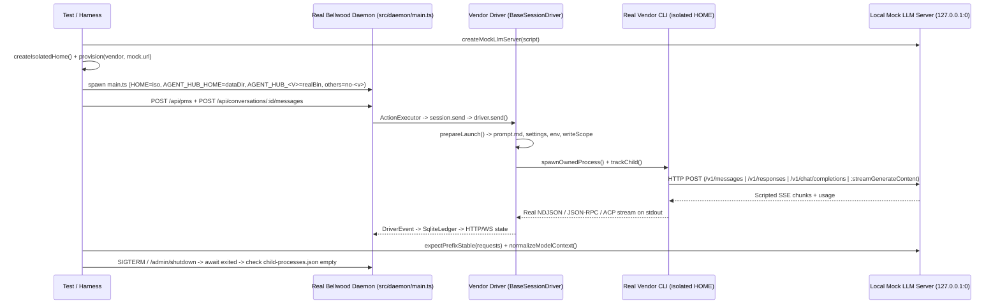

# Real CLI with Mock Model Test Environment

> Snapshot: 2026-11-28 (commit `59358e6e`)

Bellwood's automated test suite currently exercises either hand-written fake CLIs (`test/fake-claude/fake-claude.ts`) that cannot catch real vendor CLI protocol drift or Windows process/pipe quirks, or the resident test bench (`test/tester/`) that requires live vendor accounts and paid quotas. This design introduces a deterministic, zero-account, zero-egress test environment under `test/mock-llm/` that pairs **real vendor CLI binaries** and the **real Bellwood daemon** with a **local multi-dialect mock LLM HTTP/SSE server** inside strictly isolated temporary `HOME` directories.

## Plan review and decisions

### Files to review

- [docs/real-cli-mock-model-design.md](real-cli-mock-model-design.md): Empirical 8-vendor endpoint audit, three structurally distinct architecture candidates, bounds, cross-vendor/cross-platform plan, and acceptance scenarios.
- [docs/README.md](README.md): Indexes this design document under `Testing`.
- [test/mock-llm/limits.ts](../test/mock-llm/limits.ts): Bounded capacities and timeouts for request recording, body streaming, snapshots, and loopback blackhole proxy.
- [test/mock-llm/types.ts](../test/mock-llm/types.ts): Domain types for multi-dialect scripts, recorded requests, vendor adapters, isolation configs, prefix stability diffs, normalized snapshots, and daemon session handles.
- [test/mock-llm/server.ts](../test/mock-llm/server.ts): Skeleton for the loopback multi-dialect HTTP/SSE mock LLM server (`anthropic-messages`, `openai-responses`, `openai-chat-completions`, `gemini-generate-content`).
- [test/mock-llm/isolation.ts](../test/mock-llm/isolation.ts): Skeleton for isolated temporary `HOME` validation, real-credential scrubbing, and loopback egress blackholing.
- [test/mock-llm/vendors.ts](../test/mock-llm/vendors.ts): Exhaustive 8-vendor adapter registry (`Record<AgentVendor, VendorMockAdapter>`), binary probe, and CI required-vendor gate.
- [test/mock-llm/prefix-cache.ts](../test/mock-llm/prefix-cache.ts): Skeleton for protocol-aware prompt-cache prefix stability assertions (`checkPrefixStability` and `expectPrefixStable`).
- [test/mock-llm/protocol-snapshot.ts](../test/mock-llm/protocol-snapshot.ts): Skeleton for volatile-field normalization, outbound model-context snapshots, inbound driver-event snapshots, and JSON Schema tree diffing.
- [test/mock-llm/harness.ts](../test/mock-llm/harness.ts): Skeleton for booting an unmodified real Bellwood daemon connected to a real vendor CLI and the local mock LLM server.
- [test/mock-llm/server.test.ts](../test/mock-llm/server.test.ts), [test/mock-llm/isolation-and-vendors.test.ts](../test/mock-llm/isolation-and-vendors.test.ts), [test/mock-llm/prefix-cache.test.ts](../test/mock-llm/prefix-cache.test.ts), [test/mock-llm/protocol-snapshot.test.ts](../test/mock-llm/protocol-snapshot.test.ts), [test/mock-llm/real-cli-e2e.test.ts](../test/mock-llm/real-cli-e2e.test.ts): Runnable acceptance test suite covering every scenario in Section 8 plus unchanged-rule regression checks.

### Project Manager plan review

- **User sentences to scenarios.** Every quote in Section 1 maps to executable scenarios in Section 8: Q1 ("构建真实 cli 加上假模型的测试环境") maps to S1, S2, S3, S5, S6, S7, S8, S9, and S10; Q2 ("走流程解决问题，之后我们的做什么都先走完整流程") maps to this design plan, skeleton, pre-implementation failing baseline, and the Section 8 verification gates; Q3 ("现在所有的需求你来拍板，直到一切都完成，检查，不满意的话重新来，明天我要看到所有的都完美") maps to the settled design choices below, zero silent vendor skips (S6/S7), and end-to-end real-CLI verification on all locally testable vendors (S1, S2, S3, S6, S8).
- **Verification categories.** Section 8 covers every applicable category from `docs/plan-standard.md` and explains every non-applicable category in one sentence (reopening a closed web view, Feishu cards, and multi-computer mesh).
- **Structurally distinct designs.** Section 3 compares three structurally different architectures: (A) an in-process loopback multi-dialect mock LLM server with isolated-`HOME` vendor config provisioning driving unmodified Bellwood drivers, (B) an out-of-process TLS MITM proxy with a test CA plus driver-injected test endpoint flags inside `src/vendors/*/driver.ts`, and (C) purely offline per-vendor fake CLI shims extending `test/fake-claude/`.

### Decisions needed

None. No user-visible UI or product behavior changes, no production foundation rebuild is needed, and no irreversible or external-facing operations are introduced. The user also delegated routine product/engineering choices to the Project Manager (Q3).

Settled routine choices for Project Manager review (all reversible without user escalation):

1. **Zero production driver changes.** All 5 locally supported CLIs (`claude`, `codex`, `agy`, `pi`, `deepseek`) and both locally absent open-protocol CLIs (`opencode`, `kimi`) honor isolated-`HOME` config files or standard environment variables. Production drivers in `src/vendors/*/driver.ts` and `src/daemon/daemon.ts` stay untouched.
2. **Cursor handling.** Live probing proved `cursor-agent` speaks proprietary binary Protobuf/ConnectRPC (`aiserver.v1.*`) even when `--endpoint` points to loopback. We explicitly classify `cursor` as `unsupported_protocol` rather than reverse-engineering closed protobuf schemas, keeping offline ACP tests plus `initialize` handshake checks and the resident bench (`pnpm tester`) for full Cursor turns.
3. **CI vendor rollout.** Keep fast unit/mock-server tests in default `pnpm test:related` on every PR; run real-CLI + mock-LLM tests on installed CLIs locally and in dedicated CI steps (`windows.yml` installing `@openai/codex` and `@earendil-works/pi-coding-agent` for real Windows Job Object/sandbox/pipe coverage, and `nightly.yml` running pinned + `@latest` protocol-drift checks including `codex app-server generate-json-schema`).

## 1. User goal

> Q1「帮我构建真实 cli 加上假模型的测试环境」
>
> Q2「走流程解决问题，之后我们的做什么都先走完整流程」
>
> Q3「现在所有的需求你来拍板，直到一切都完成，检查，不满意的话重新来，明天我要看到所有的都完美」

Build a deterministic, isolated, zero-credential test harness that runs real vendor CLIs through the real Bellwood daemon against a local mock LLM HTTP/SSE server. The environment closes three existing testing gaps: running real CLIs in CI (including Windows Job Objects, sandboxes, and pipes) without live accounts, catching vendor CLI streaming/protocol drift automatically with normalized snapshots and schema diffs, and deterministically verifying prompt-cache prefix stability across turns and daemon restarts.

## 2. Current state and history

### Subsystem architecture walkthrough

The architectural walkthrough below follows the `how` multi-angle exploration across four slices of Bellwood: (1) daemon boot, vendor runtime resolution, `ModelCatalogs`, and `prepareLaunch`, (2) OS sandboxes, write scopes, and process-ledger lifecycles, (3) vendor driver startup, resume, persona updates, and token-usage accounting, and (4) existing test harnesses (`test/e2e/harness.ts`, `test/spawn-guard.ts`, `scripts/verify-smoke.ts`, `test/tester/local-instance.ts`).

#### Overview

When Bellwood runs a Project Manager (PM) or Worker turn, the daemon (`src/daemon/daemon.ts`) never talks to LLM HTTP APIs directly. Instead, it resolves a vendor CLI executable and environment via `createVendorRuntimeResolver`, materializes per-session prompt/settings/skill files via `createLaunchPreparer`, and delegates stdio JSON/RPC/ACP framing to a vendor driver under `src/vendors/<vendor>/driver.ts` (all sharing `BaseSessionDriver` in `src/daemon/driver/base-driver.ts`). Each spawned CLI child process then makes outbound HTTPS calls to its vendor's model API. A mock-model test environment therefore sits **outside** Bellwood's production drivers—at the loopback HTTP/SSE boundary behind each real CLI—while strictly isolating the daemon's `HOME`, `AGENT_HUB_HOME`, vendor config homes, ports, and child process trees.

#### Key concepts

- **`VENDOR_LIST` and `VENDOR_PATHS`** (`src/vendors/registry.ts:11`, `src/vendors/paths-registry.ts`): Single registry of all 8 vendors (`claude`, `agy`, `codex`, `pi`, `deepseek`, `cursor`, `opencode`, `kimi`), their CLI binary names, `AGENT_HUB_<VENDOR>` env overrides, config-home env vars (`CODEX_HOME`, `PI_CODING_AGENT_DIR`, `DSH_HOME`, `KIMI_CODE_HOME`), fallback binary paths, and `credentialEnv` secret lists.
- **`VendorRuntimeResolver`** (`src/daemon/provider-manager/runtime-resolver.ts:153-255`): Locates each vendor binary from `env[cli.envVar]` → `PATH` → `VENDOR_FALLBACK_PATHS`, and merges managed provider secrets (`provider-secrets.json`) into `resolveVendorEnv` (probes/catalogs) and `resolveManagedDriverEnv` (driver launches).
- **`createLaunchPreparer`** (`src/daemon/launch.ts:178-325`): Writes `state/launch/<sessionId>/prompt.md`, optional `settings.json`, skills, and review hooks; computes `launchFingerprint` (deliberately excluding persona edits so persona updates append a note instead of restarting the process); constructs `WriteScope` / `ReadonlyPolicy` for Workers (returning `writeScope = null` for PMs).
- **`BaseSessionDriver` & `spawnDetachedChild`** (`src/daemon/driver/base-driver.ts:850-891`): Merges `buildChildEnv(process.env, { ...resolvedDriverEnv, ...extraEnv })` (stripping `PARENT_SESSION_ENV` in `src/daemon/driver/protocol.ts:46-80`), applies `withChecklistEnv`, spawns via `spawnOwnedProcess` (detached process group on POSIX, Job Object on Windows), and registers every PID in `state/child-processes.json` via `trackChild`.
- **`ModelCatalogs` & `ProjectCatalogRunner`** (`src/daemon/driver/model-catalog.ts`, `src/daemon/project-catalog/runner.ts`): Background subsystems in `daemon.ts` that probe vendor CLIs for model lists/availability and automatically dispatch background Router turns (`purpose: "catalog"`) to summarize newly created project folders.
- **`spawn-guard` & `clean-env`** (`vitest.config.ts:15`, `test/clean-env.ts`, `test/spawn-guard.ts`): Vitest `node`-project setup hooks that strip inherited agent-session env vars before tests start and fail the entire test file in `afterAll` if any spawned child or detached process group outlives `TEST_CHILD_EXIT_WAIT_MS` (5 s).

#### How it works

1. **Daemon boot (`src/daemon/main.ts:4` → `src/daemon/daemon.ts:192-760`):** `main.ts` passes `userHome: homedir()` (which reads `HOME` on POSIX and `USERPROFILE` on Windows) into `startDaemon`. `startDaemon` resolves all paths under `AGENT_HUB_HOME`, opens SQLite, starts `AgentApi` (`run/hub.sock` or Windows named pipe), binds UI on `AGENT_HUB_PORT=0` and mesh LAN on `meshListenPort(env, port)` (`src/daemon/mesh/listen-port.ts:11-16`, returning `0` when UI port is `0` or `FUSA_MESH_PORT=0`), wires all 8 drivers via `createVendorDrivers` + `createMultiVendorDriver`, and starts `ActionExecutor`, `HandoverRunner`, and `ProjectCatalogRunner`.
2. **Message dispatch (`src/daemon/handlers.ts:105-202` → `src/daemon/driver/base-driver.ts`):** `POST /api/conversations/:id/messages` enqueues a `session.send` action. `createSessionSendHandler` calls `driver.send(sessionId, ...)`, which lazily calls `prepareLaunch(row)`, wraps Worker commands in OS sandboxes (`spawnInWriteScope` / `wrapInReadonlyOsSandbox` in `src/daemon/driver/write-scope.ts`), spawns the real vendor CLI via `spawnOwnedProcess`, and parses real vendor stdout into `DriverEvent`s.
3. **Outbound LLM request & streaming reply:** The real CLI reads its isolated config (`CLAUDE_CONFIG_DIR`, `CODEX_HOME/config.toml`, `PI_CODING_AGENT_DIR/models.json`, `DSH_HOME/cordis.patch.yml`, `$HOME/.gemini/antigravity-cli/settings.json`, `$XDG_CONFIG_HOME/opencode/opencode.json`, or `KIMI_CODE_HOME` + `KIMI_MODEL_BASE_URL`), connects to `http://127.0.0.1:<mockPort>` (allowed by macOS Seatbelt, Linux `bwrap`, and Windows `fusa-run.exe`), and streams the mock SSE reply back through its own real CLI stdout protocol to Bellwood's driver.
4. **Persona updates & restart recovery (`src/daemon/driver/persona-note.ts`, `src/daemon/launch.ts:297-304`):** Updating PM persona (`PUT /api/pms/:id/persona`) increments `personaRevision` without changing `launchFingerprint`, so running drivers append a persona note on the next user turn instead of restarting. On daemon restart, `ledger.recoverAfterRestart()` restores sessions and drivers resume using the persisted `vendorSessionId`.

#### Where things live

- `src/daemon/main.ts`, `src/daemon/daemon.ts`: Process entry, startup/shutdown ordering, driver/catalog/mesh wiring.
- `src/daemon/provider-manager/runtime-resolver.ts`: Executable resolution (`AGENT_HUB_<VENDOR>` → `PATH` → fallbacks) and env assembly.
- `src/daemon/launch.ts`, `src/daemon/driver/base-driver.ts`, `src/daemon/driver/protocol.ts`: Launch file generation, fingerprint, `buildChildEnv`, process spawning, and `trackChild`.
- `src/daemon/driver/write-scope.ts`, `src/daemon/platform/index.ts`: macOS Seatbelt (`sandbox-exec`), Linux `bwrap`, and Windows `fusa-run.exe` / MXC sandboxes.
- `src/daemon/driver/persona-note.ts`, `src/daemon/driver/usage.ts`: Persona-change note injection (`CODEX_RESUME_REBAKES`) and `TokenUsage.cacheRead` aggregation.
- `src/daemon/project-catalog/runner.ts`: Background project-folder summarization via Router turns.
- `src/vendors/<vendor>/{spec,paths,driver,protocol,catalog,setup}.ts`: Per-vendor launch flags, wire parsers, catalog probes, and credential declarations.
- `test/clean-env.ts`, `test/spawn-guard.ts`, `test/sandbox-probes.ts`, `test/e2e/harness.ts`, `scripts/verify-smoke.ts`, `test/tester/local-instance.ts`: Existing test isolation, leak guards, sandbox probes, and daemon harnesses.

#### Gotchas

1. **Background `ProjectCatalogRunner` steals turns on the mock server:** `daemon.ts:673-683` starts `catalogRunner` and runs `scanAtStartup`. Creating a PM with a project `folder` triggers a background Router turn (`purpose: "catalog"`, `src/daemon/project-catalog/runner.ts:75-88`) on the available vendor CLI, which hits the mock LLM server with a different system prompt and `prompt_cache_key`. The mock harness must either filter/isolate `catalog` turns (e.g., via a built-in matcher or per-session request filtering in `harness.ts`) so background catalog traffic never steals PM script turns or causes false `expectPrefixStable` failures.
2. **macOS 104-byte Unix domain socket path cap:** `run/hub.sock` and `run/admin.sock` under `AGENT_HUB_HOME` fail `listen()` if the path exceeds 104 bytes (`test/e2e/harness.ts:482-486`, `scripts/verify-smoke.ts:41-45`). `createIsolatedHome` must anchor its default root under `shortTmp()` (`tmpdir().length <= 40 || !existsSync("/tmp") ? tmpdir() : "/tmp"`), never deep inside macOS's ~50-char `/var/folders/.../T/`.
3. **Unpinned non-target vendors can spawn host CLIs:** Because `ModelCatalogs`, `CommandCatalogs`, and `ProjectCatalogRunner` iterate `AGENT_VENDORS`, `startRealCliDaemon` must pin every vendor *other than* the vendor under test to a nonexistent path (`join(isolated.rootDir, "no-<vendor>")`), matching `test/tester/local-instance.ts:131`.
4. **Nested macOS Seatbelt (`sandbox-exec`) blocks Worker sandboxes inside an agent sandbox:** PM sessions have `writeScope = null` and run fine inside a macOS Worker sandbox, but Worker sessions wrap vendor CLIs in `sandbox-exec`, which macOS refuses to nest (exit 71). Any Worker real-CLI test must gate on `sandboxAllowsNestedSandbox()` from `test/sandbox-probes.ts` so `pnpm test:related` reports sandbox skips rather than silently passing or crashing.
5. **Daemon shutdown and `spawn-guard` leak checks:** `test/spawn-guard.ts` fails the whole Vitest file if any detached child process group survives `TEST_CHILD_EXIT_WAIT_MS`. `RealCliSessionHandle.close()` must stop the daemon cleanly (`SIGTERM` on POSIX, `/admin/shutdown` named pipe on Windows), await `daemon.exited`, verify `readLedgerFile(paths.childProcessesFile)` has zero live PIDs (`scripts/verify-smoke.ts:148-149`), close the mock server, and only then delete the temp directory.
6. **Mesh port and relay isolation:** Daemon tests must set `AGENT_HUB_PORT=0`, `FUSA_MESH_PORT=0`, and `FUSA_RELAY_URL=http://127.0.0.1:1` so a test daemon never takes port `4317`/`4320` from a developer's live Bellwood instance and never dials the production Cloudflare relay (`src/daemon/daemon.ts:728-730`).
7. **Vendor-specific persona-on-resume divergence:** Live-session persona edits append a note on all vendors (`src/daemon/launch.ts:297`), preserving `system`. Across a daemon restart, `claude` and `codex` (`CODEX_RESUME_REBAKES = false` in `src/daemon/driver/persona-note.ts:4`) keep the original system prompt and append a note, whereas `deepseek` (`rebakesPersonaOnResume: true` in `src/vendors/deepseek/driver.ts:367`) re-bakes `personaSuffix` into `system` on resume.
8. **Codex `explicitDefaultModel` and OpenCode `OPENCODE_CONFIG_CONTENT` overwrite:** `codex` triggers a second `codex app-server` catalog probe when `defaultModel` is `null` (`src/daemon/daemon.ts:492-496`), so `startRealCliDaemon` always passes the provisioned `model` explicitly. `src/vendors/opencode/driver.ts:76-79` overwrites `OPENCODE_CONFIG_CONTENT` on every launch, so OpenCode's mock provider must live in `$XDG_CONFIG_HOME/opencode/opencode.json`.

### Design history

Bellwood's testing evolved in three separate layers (`docs/ai-tester-design.md:37-44`, `test/fake-claude/fake-claude.ts:1-31`, `.github/workflows/windows.yml:138-160`):

- **Layer 1 (Unit and e2e with fake CLIs).** Built first around `test/fake-claude/fake-claude.ts`, whose header explicitly notes its stream-json fields were copied by hand from early manual traces, plus `test/e2e/harness.ts` (`makeEnv`) and `test/windows/worker-sandbox-and-readonly.test.ts` (using `writeFakePiBinary` and fake shims). This premise assumed hand-maintained fake stdout streams were sufficient for CI.
- **Layer 2 (Manual live smoke).** `test/smoke/main.ts` and `test/smoke/persona-cache.ts` drive a real `claude` CLI against live Anthropic APIs to measure real `TokenUsage.cacheRead` (`test/smoke/persona-cache.ts:14-68`), requiring manual invocation and a signed-in account.
- **Layer 3 (Resident AI tester bench).** `test/tester/` (`docs/ai-tester-design.md`, commit `80be62d0`) runs real CLIs, real Feishu, and the real relay on dedicated Mac/Linux bench machines, still relying on real vendor logins and paid quotas, and leaving Windows without any real-CLI execution.

As Bellwood expanded to eight vendors (`src/vendors/registry.ts:11`) and native Windows sandboxing (`.github/workflows/windows.yml`), the gap between fake CLIs and live accounts became structural: three recurring failure classes—Windows real-CLI process/pipe bugs, upstream CLI protocol drift after upgrades, and accidental prompt-cache prefix breaks—had no deterministic automated gate.

### Core concepts

- **States and write authorities:**
  - Vendor registration list: `VENDOR_LIST` in `src/vendors/registry.ts:11` (single authority over all 8 vendor IDs: `claude`, `agy`, `codex`, `pi`, `deepseek`, `cursor`, `opencode`, `kimi`).
  - Binary lookup and credential env declarations: `VENDOR_PATHS` in `src/vendors/paths-registry.ts` and `src/vendors/*/paths.ts`.
  - Daemon runtime resolution: `createVendorRuntimeResolver` in `src/daemon/provider-manager/runtime-resolver.ts:153-255` resolves binaries from `AGENT_HUB_<VENDOR>` env vars and passes `env` to drivers.
  - Child environment assembly: `BaseSessionDriver.spawnDetachedChild` (`src/daemon/driver/base-driver.ts:850-865`) calls `buildChildEnv(process.env, { ...resolvedDriverEnv, ...extraEnv })` (`src/daemon/driver/protocol.ts:56-80`).
- **Missing concept:** There is no mock-LLM wire boundary or isolated vendor-home provisioner. `test/e2e/harness.ts:155-185` isolates `AGENT_HUB_HOME`, not `HOME`/`USERPROFILE`/`XDG_*`, does not scrub vendor `credentialEnv` variables, and does not block real network egress—making it unsafe to point `makeEnv` directly at real installed vendor CLIs.

### Verified evidence

#### Codebase inspection

- `[Measured]` `src/vendors/registry.ts:11` registers exactly 8 vendors: `claude`, `agy`, `codex`, `pi`, `deepseek`, `cursor`, `opencode`, `kimi`.
- `[Measured]` `.github/workflows/windows.yml:138-160` runs `test/windows` and core unit tests on `windows-latest` using fake binaries (`test/windows/worker-sandbox-and-readonly.test.ts:44` imports `writeFakePiBinary`); no workflow installs or executes a real vendor CLI.
- `[Measured]` `test/e2e/harness.ts:169-185` strips `PARENT_SESSION_ENV` and `WORKER_ENV`, sets `AGENT_HUB_HOME`, points only `DEFAULT_AGENT_VENDOR` to `fake-claude`, and points other vendors to nonexistent paths; it inherits the developer's `HOME` and vendor API keys.
- `[Measured]` `src/vendors/opencode/driver.ts:76-79` overwrites `ctx.files.env.OPENCODE_CONFIG_CONTENT` on every launch, so custom mock provider configuration for OpenCode must live in `$XDG_CONFIG_HOME/opencode/opencode.json` rather than `OPENCODE_CONFIG_CONTENT`.
- `[Measured]` `src/vendors/kimi/setup.ts:15-20,89-97` configures Kimi Platform endpoints via `KIMI_MODEL_API_KEY`, `KIMI_MODEL_NAME`, `KIMI_MODEL_PROVIDER_TYPE`, and `KIMI_MODEL_BASE_URL`.
- `[Measured]` `src/daemon/driver/write-scope.ts` (macOS Seatbelt, Linux `bwrap`, Windows `fusa-run.exe`) permits loopback TCP connections (`127.0.0.1:<port>`), denying only Bellwood data-directory Unix sockets/named pipes and protected filesystem roots.

#### Live empirical 8-vendor endpoint probe (2026-11-28)

All locally installed binaries were probed on this Mac using scratch scripts (`probe-8-vendors.mjs`, `probe-part2.mjs`, `probe-part3.mjs`) against an isolated temporary `HOME`, scrubbed environment (zero real credentials), and egress blackhole (`HTTP_PROXY=http://127.0.0.1:1`, `HTTPS_PROXY=http://127.0.0.1:1`, `NO_PROXY=127.0.0.1,localhost`). No user config under real `$HOME` was read or modified.

| Vendor (`id`) | Binary & local version | Custom local endpoint? | Exact mechanism & wire dialect | Evidence & live probe findings |
|---|---|---|---|---|
| `claude` | `claude` `2.1.332` (`~/.local/bin/claude`) | **Yes (Full)** | `ANTHROPIC_BASE_URL=http://127.0.0.1:<port>`, `ANTHROPIC_API_KEY=<dummy>`, `CLAUDE_CONFIG_DIR=<iso>/.claude`, `CLAUDE_CODE_DISABLE_NONESSENTIAL_TRAFFIC=1`. Speaks **Anthropic Messages SSE** (`POST /v1/messages?beta=true`). | `[Measured]` Ran exact Bellwood `stream-json` args for 2 turns and `--session-id`/`--resume` across restart. **Critical quirk measured:** on turn 1, Claude attaches `cache_control: { type: "ephemeral" }` to the tail message as `content: [{ type: "text", text, cache_control }]`; on turn 2 it moves `cache_control` forward and collapses the earlier message's `content` back to a plain string `text`. Prefix comparison must canonicalize single-text-block arrays and strip `cache_control`. |
| `codex` | `codex` `0.169.0` (`mise/node/24/bin/codex`) | **Yes (Full)** | `$CODEX_HOME/config.toml` (`model_provider = "mock"`, `[model_providers.mock] base_url = "http://127.0.0.1:<port>/v1"`, `wire_api = "responses"`, `env_key = "OPENAI_API_KEY"`), `CODEX_HOME`, `OPENAI_API_KEY=<dummy>`. Speaks **OpenAI Responses SSE** (`POST /v1/responses`). | `[Measured]` Ran exact Bellwood `codex app-server --listen stdio://` JSON-RPC handshake (`initialize` → `initialized` → `thread/start` → 2× `turn/start`). Both turns succeeded; `instructions`, `tools`, `prompt_cache_key`, and `input` prefix stayed stable. `codex app-server generate-json-schema` also exports 39 schema files for drift diffing. |
| `agy` | `agy` `1.5.18` (`~/.local/bin/agy`) | **Yes (Full)** | `$HOME/.gemini/antigravity-cli/settings.json` (`{"modelProvider":"gemini","enableTerminalSandbox":false}`), `GEMINI_API_KEY=<dummy>`, **`GOOGLE_GEMINI_BASE_URL=http://127.0.0.1:<port>`**. Speaks **Gemini GenerateContent SSE** (`POST /v1beta/models/<model>:streamGenerateContent?alt=sse`). | `[Measured]` Isolated env test proved `GOOGLE_GEMINI_BASE_URL` works while `GEMINI_API_BASE_URL` and `GEMINI_BASE_URL` are ignored. Ran exact Bellwood `--input-format stream-json --output-format stream-json ... --print ""` flags for 2 turns; emitted real `init`, `step_update`, `result`; `systemInstruction`, `tools`, and `contents` prefix stayed 100% stable. |
| `pi` | `pi` `1.5.2` (`mise/node/24/bin/pi`) | **Yes (Full)** | `$PI_CODING_AGENT_DIR/models.json` (`providers.mock.baseUrl = "http://127.0.0.1:<port>/v1"`, `api: "openai-responses"` or `"anthropic-messages"` or `"openai-completions"`, `apiKey: "<dummy>"`), `PI_CODING_AGENT_DIR`, `PI_OFFLINE=1`. | `[Measured]` Ran exact Bellwood `pi --mode rpc --model mock/mock-model ...` flags for 2 turns (`get_state` + 2× `prompt` waiting on `agent_settled`). Both turns succeeded; `tools`, `prompt_cache_key`, and `input` prefix stayed 100% stable. |
| `deepseek` | `dsh` `0.2.2-rc.1` (`mise/node/24/bin/dsh`) | **Yes (Full)** | `$DSH_HOME/cordis.patch.yml` (`- id: llm-deepseek\n  config:\n    baseURL: http://127.0.0.1:<port>/v1`), `DSH_HOME`, `DEEPSEEK_API_KEY=<dummy>`, `DSH_TELEMETRY_MODE=OFF`. Speaks **Anthropic Messages SSE** (`POST /v1/messages`). | `[Measured]` Ran exact Bellwood `dsh --profile acp --patch <sandboxPatch>` with ZERO extra driver CLI args (`cordis.patch.yml` overrides `llm-deepseek.baseURL`). Completed ACP `initialize`, `session/new`, and 2× `session/prompt`; `system`, `tools`, and `messages` prefix stayed 100% stable. |
| `cursor` | `cursor-agent` `2026.11.10-731fb78` (`~/.local/bin/cursor-agent`) | **No (Proprietary Protocol)** | Accepts `-e/--endpoint` and `CURSOR_API_ENDPOINT`, redirecting HTTP traffic to loopback, **but** speaks undocumented binary Protobuf/ConnectRPC (`POST /aiserver.v1.DashboardService/GetUserPrivacyMode`, `POST /aiserver.v1.ServerConfigService/GetServerConfig`, `content-type: application/proto`). | `[Measured]` `initialize` succeeded over ACP, then `session/new` failed with `-32603: Failed to initialize session services` because local server cannot implement Cursor's closed `aiserver.v1.*` protobuf RPC stack. Alternative: keep offline ACP driver tests (`src/vendors/cursor/cursor.test.ts`), real-CLI `initialize` smoke probe, and resident bench (`pnpm tester`) for live turns. |
| `opencode` | Not installed on this Mac | **Expected Yes (Unverified locally)** | `$XDG_CONFIG_HOME/opencode/opencode.json` custom provider (`options.baseURL: "http://127.0.0.1:<port>/v1"`, OpenAI-compatible or Anthropic Messages). | `[Inferred]` Not installed locally (`which opencode` and all `src/vendors/opencode/paths.ts` fallbacks absent). Verified from `src/vendors/opencode/driver.ts:55-79` and `spec.ts:49-53`; harness reports `not_installed` explicitly until verified on a host/CI image with `opencode`. |
| `kimi` | Not installed on this Mac | **Expected Yes (Unverified locally)** | `KIMI_CODE_HOME=<iso>/.kimi-code`, `KIMI_MODEL_API_KEY=<dummy>`, `KIMI_MODEL_NAME=kimi-k3`, `KIMI_MODEL_PROVIDER_TYPE=kimi`, **`KIMI_MODEL_BASE_URL=http://127.0.0.1:<port>/v1`**. Speaks **OpenAI Chat Completions SSE** (`POST /v1/chat/completions`). | `[Inferred]` Not installed locally (`which kimi` and all `src/vendors/kimi/paths.ts` fallbacks absent). Env contract verified directly from `src/vendors/kimi/setup.ts:15-20,89-97`; harness reports `not_installed` explicitly until verified on a host/CI image with `kimi`. |

## 3. Reference designs and approach comparison

### Reference designs

1. **`openai/codex` test harness** ([`codex-rs/core/tests/common/responses.rs`](https://github.com/openai/codex/blob/afe555b9d3e95b4f58b247212565070f1555bc5d/codex-rs/core/tests/common/responses.rs), [`prompt_caching.rs`](https://github.com/openai/codex/blob/afe555b9d3e95b4f58b247212565070f1555bc5d/codex-rs/core/tests/suite/prompt_caching.rs), [`context_snapshot.rs`](https://github.com/openai/codex/blob/afe555b9d3e95b4f58b247212565070f1555bc5d/codex-rs/core/tests/common/context_snapshot.rs), [`schema_fixtures_tests.rs`](https://github.com/openai/codex/blob/afe555b9d3e95b4f58b247212565070f1555bc5d/codex-rs/app-server-protocol/src/schema_fixtures_tests.rs)): Mounts a local `wiremock` Responses API SSE server per test, drives full sessions inside isolated temporary `HOME` and `CWD` directories, asserts consecutive requests are strict prefix extensions with stable `instructions`/`tools`/`prompt_cache_key`, renders normalized model-visible context snapshots, and diffs committed JSON Schemas against generated schemas.
2. **HTTP record/replay and scripted stub servers (`Polly.JS` / `wiremock`)** ([Netflix Polly.JS](https://github.com/Netflix/pollyjs), [WireMock](https://wiremock.org/)): Separates wire-protocol framing from test scenario scripts and normalizes volatile fields (ports, UUIDs, timestamps) before diffing or snapshotting HTTP traffic.
3. **Node built-in `node:http` loopback test doubles** (already used across Bellwood's `src/vendors/deepseek/setup.ts:269` and `test/e2e/fake-feishu-hub.ts`): Avoids adding external HTTP mock dependencies while supporting streaming SSE, chunked aborts, and exact request-body byte caps in ~300 lines of TypeScript.

### Candidate architectures

| Dimension | **Candidate A (Recommended, day-one design): In-process loopback multi-dialect mock LLM server + isolated-HOME vendor provisioner (`test/mock-llm/`)** | **Candidate B: Out-of-process TLS MITM proxy with test CA + driver-injected `--mock-endpoint` hooks in `src/vendors/*/driver.ts`** | **Candidate C: Per-vendor offline fake CLI shims (extending `test/fake-claude/` to all 8 vendors)** |
|---|---|---|---|
| **Core structure** | Single `node:http` server inside the Vitest process speaking 4 open wire dialects (`anthropic-messages`, `openai-responses`, `openai-chat-completions`, `gemini-generate-content`); per-vendor adapter provisions isolated `$HOME` configs/env; unmodified Bellwood daemon spawns real CLIs. | External HTTPS MITM proxy child process intercepts real vendor domains (`api.anthropic.com`, `api.openai.com`, etc.) with a generated test CA; production `DriverOptions` and `src/vendors/*/driver.ts` accept test-only endpoint overrides. | Seven additional hand-coded Node fake CLI scripts mimicking stdout NDJSON/JSON-RPC/ACP for each vendor; no real CLI binaries ever spawned. |
| **Production code pollution** | **Zero.** No test flags or branches in `src/daemon/` or `src/vendors/`. | **High.** Touches `src/vendors/*/driver.ts` (review-stamp paths) and injects test CA handling. | Low (test-only), except fake scripts duplicate every driver protocol assumption. |
| **Real CLI coverage (out of 8)** | **5 measured today (`claude`, `codex`, `agy`, `pi`, `deepseek`) + 2 ready when installed (`opencode`, `kimi`)**; `cursor` explicitly flagged `unsupported_protocol`. | Same 5–7 at best: Go/Rust native CLIs (`agy`, `codex`, `claude`) reject untrusted test CAs without OS trust-store changes, and `cursor` still fails on closed `aiserver.v1.*` protobufs. | **0 of 8.** Never executes real vendor CLIs. |
| **Catches Windows real-CLI & protocol drift bugs?** | **Yes.** Real CLIs execute inside `fusa-run.exe` Job Objects/sandboxes and emit real stdout protocols captured in normalized snapshots. | Fragile on Windows (CA trust + extra proxy lifecycle). | **No.** Reproduces only what the fake author already assumed. |
| **Prompt-cache prefix stability (`expectPrefixStable`)** | **Yes.** Captures real HTTP requests sent by real CLIs across turns and restarts; detects prefix breaks and `prompt_cache_key` rotation deterministically. | Yes if TLS interception succeeds, but adds CA/proxy failure modes. | **No.** Fake CLIs never construct real LLM HTTP requests. |
| **New dependencies** | **Zero** (uses built-in `node:http`, `node:fs`, `node:path`). | Needs TLS cert generation / MITM proxy package. | Zero. |
| **Isolation & safety** | Refuses real `HOME`, scrubs all `VENDOR_PATHS[*].credentialEnv`, sets loopback proxy blackhole (`127.0.0.1:1`). | High risk of leaking traffic if proxy env is ignored by a native binary. | Safe (no network), but misses real boundaries. |

### Recommendation and red-flag screening

**Recommendation: Candidate A.** It is the day-one architecture: zero new dependencies, zero production driver pollution, verified live on 5 of 6 locally installed CLIs (and ready for `opencode` and `kimi`), and solves all three Bellwood testing gaps directly.

Screening Candidate A against `.agents/skills/architect/references/design-red-flags.md`:

- **Shallow module:** Avoided. `createMockLlmServer` encapsulates HTTP routing, 4 wire dialects, SSE framing, gate waits, and bounded request recording behind one deep interface; `startRealCliDaemon` encapsulates home isolation, credential scrubbing, vendor provisioning, daemon boot, and clean shutdown.
- **Information leakage:** Avoided. Raw SSE/JSON wire formatting stays private inside the server's dialect encoder; callers pass dialect-neutral `MockLlmTurn` objects and inspect domain `RecordedLlmRequest` / `PrefixStabilityResult` / `NormalizedModelContext` objects.
- **Temporal decomposition:** Avoided. Modules split by domain ownership (`server.ts`, `isolation.ts`, `vendors.ts`, `prefix-cache.ts`, `protocol-snapshot.ts`, `harness.ts`), not sequential pipeline steps.
- **Pass-through method:** Avoided. Every exported function owns distinct policy or transformation.
- **Split ownership:** Avoided. `VENDOR_MOCK_ADAPTERS` in `test/mock-llm/vendors.ts` is the sole owner of per-vendor mock support metadata and isolated-HOME provisioning.
- **Two ways to do one task:** Avoided. `test/fake-claude/` remains strictly for fast state-machine unit tests that inject synthetic process faults (`spawnOrphan`, `stopReading`, `lateReplay`); real-CLI end-to-end tests go exclusively through `test/mock-llm/`.
- **Importable internals:** Avoided. Wire-encoding helpers stay unexported inside `server.ts` (or private internal files); tests import only the public module APIs.
- **Hand-synced list:** Avoided. `VENDOR_MOCK_ADAPTERS` is typed as `Readonly<Record<AgentVendor, VendorMockAdapter>>` derived from `VENDOR_LIST`, so adding a new vendor fails `pnpm typecheck` until its adapter is defined.

## 4. Performance and bounds

No production daemon caches, SQLite tables, or API responses are changed. All four cache/state-bound rules apply to the test harness itself, with explicit caps centralized in `test/mock-llm/limits.ts` (mirroring `test/tester/limits.ts`, since none of `test/mock-llm/` ships in production):

| Constant (`test/mock-llm/limits.ts`) | Value | Sizing rationale |
|---|---|---|
| `MOCK_LLM_MAX_RECORDED_REQUESTS` | `500` | Caps in-memory recorded HTTP requests per server (ring eviction of oldest entries). Even a stress test simulating a 1-month burst (300 workers / 500 turns) stays bounded (~500 × ~8 KB typical = ~4 MB). |
| `MOCK_LLM_MAX_REQUEST_BODY_BYTES` | `4 * 1024 * 1024` (4 MiB) | Streams incoming HTTP request bodies and cancels/truncates once the cap is exceeded—even when `Content-Length` is absent or chunked—preventing OOM on large prompts or dirty payloads. |
| `MOCK_LLM_MAX_CONCURRENT_REQUESTS` | `32` | Bounds simultaneous in-flight gated mock requests so hung clients cannot exhaust sockets or memory. |
| `MOCK_LLM_DEFAULT_WAIT_TIMEOUT_MS` | `15_000` | Default timeout for event-driven `waitForRequests` waiters (no fixed sleeps). |
| `MOCK_LLM_CLI_TURN_TIMEOUT_MS` | `45_000` | Per-turn ceiling for real vendor CLI cold start + turn completion across macOS/Linux/Windows CI runners (≥ 2× measured worst-case cold start of ~12 s for `dsh`). |
| `MOCK_LLM_SNAPSHOT_MAX_BYTES` | `512 * 1024` (512 KiB) | Caps normalized context/event snapshot output to prevent runaway snapshot diffs. |
| `MOCK_LLM_PROXY_BLACKHOLE_URL` | `"http://127.0.0.1:1"` | Localhost closed port used for `HTTP_PROXY`/`HTTPS_PROXY` so any non-loopback network escape fails immediately instead of hanging or hitting live endpoints. |

- **Invalidation:** `server.clearRequests()` clears recorded history between sub-scenarios; `server.close()` aborts open gates and closes all keep-alive connections; `isolated.cleanup()` removes the temp root only after daemon and child processes have exited.
- **Front-end references:** Not applicable (no web code).
- **Measured verification:** Implementation records runtime of each real-CLI suite and confirms zero leaked child processes (`test/spawn-guard.ts`).

## 5. Cross-vendor and cross-platform unification

- **Cross-vendor unification:** `VENDOR_MOCK_ADAPTERS` in `test/mock-llm/vendors.ts` is typed as `Readonly<Record<AgentVendor, VendorMockAdapter>>` keyed on `AGENT_VENDORS` (`src/shared/vendors.ts:10`). Every registered vendor declares its `support` (`"full"` or `"unsupported_protocol"`), `dialect`, `defaultModel`, `reason`, and `provision({ homeDir, mockBaseUrl, model })` function in one place. Adding a future 9th vendor requires implementing **one entry** in `test/mock-llm/vendors.ts` (otherwise `pnpm typecheck` fails).
- **Single-command vendor probing & zero silent skips:** `probeRealCli(vendor)` uses `VENDOR_PATHS[vendor].fallbackPaths` and `vendorSpec(vendor).cli` (same resolution rules as production) to report `{ vendor, support, installed, executablePath, reason }`. In CI jobs, setting `BELLWOOD_REQUIRE_REAL_CLI=codex,pi` (or `claude,codex,pi,deepseek`) causes missing required binaries to **fail** the test instead of skipping.
- **Cross-platform coverage (macOS, Linux, Windows):**
  - **Isolation (`isolation.ts`):** Sets both `HOME` and `USERPROFILE`, `XDG_*` (`XDG_CONFIG_HOME`, `XDG_DATA_HOME`, `XDG_STATE_HOME`, `XDG_CACHE_HOME`), `APPDATA`/`LOCALAPPDATA` on Windows, and `TMPDIR`/`TEMP`/`TMP`, while scrubbing all `VENDOR_PATHS[*].credentialEnv` case-insensitively on `win32`. Uses `node:path` and avoids POSIX-only shell calls.
  - **macOS (local & `macos.yml`):** Runs real `claude`, `codex`, `agy`, `pi`, `deepseek` directly when installed, exercising Seatbelt sandboxes and Unix domain sockets.
  - **Linux (`check.yml` / `nightly.yml`):** Runs mock-server/prefix/snapshot unit tests on every PR; nightly job installs npm-packaged CLIs (`@openai/codex`, `@anthropic-ai/claude-code`, `@earendil-works/pi-coding-agent`, `@deepseek-ai/dsh@0.2.2-rc.1`) in an isolated tool prefix and runs real-CLI + mock-LLM tests inside Linux `bwrap` plus `codex` schema drift diffing (`@pinned` vs `@latest`).
  - **Windows (`windows.yml`):** Installs `@openai/codex` and `@earendil-works/pi-coding-agent` (npm-packaged, fast, zero login) into a cached temp prefix and runs `test/mock-llm/real-cli-e2e.test.ts` with `BELLWOOD_REQUIRE_REAL_CLI=codex,pi`, exercising real vendor CLIs through `fusa-run.exe` Job Objects, restricted tokens, NTFS ACLs, named pipes, and PowerShell stdin/stdout for the first time in CI.

## 6. Deletions

None. No production code paths are superseded:

- `test/fake-claude/fake-claude.ts` stays exclusively for fast deterministic driver-state-machine tests (synthetic crashes, orphaned grandchildren, `stopReading`, `lateReplay`) that a real CLI cannot easily be forced to emit on demand.
- `test/tester/` stays for live Feishu, multi-computer relay, and real-model acceptance on the resident bench.
- `test/smoke/persona-cache.ts` stays as the real-session `TokenUsage.cacheRead` hard gate for PRs that touch production prompts, tools, or MCP definitions.

## 7. Skeleton files

- `test/mock-llm/limits.ts`: Caps, timeouts, and loopback proxy blackhole constant for the mock-LLM test environment.
- `test/mock-llm/types.ts`: Domain interfaces and discriminated unions for mock scripts, 4 wire dialects, recorded requests, vendor adapters, isolation configs, prefix diffs, normalized snapshots, and real-CLI daemon handles.
- `test/mock-llm/server.ts`: Skeleton exporting `detectDialect` and `createMockLlmServer` for the multi-dialect loopback HTTP/SSE mock server.
- `test/mock-llm/isolation.ts`: Skeleton exporting `assertIsolatedHome`, `buildIsolatedEnv`, and `createIsolatedHome` for safe HOME isolation, credential scrubbing, and egress blackholing.
- `test/mock-llm/vendors.ts`: Skeleton exporting `VENDOR_MOCK_ADAPTERS`, `getVendorMockAdapter`, `probeRealCli`, `listRealCliProbes`, and `resolveRequiredRealCliVendors` over all 8 registered vendors.
- `test/mock-llm/prefix-cache.ts`: Skeleton exporting `checkPrefixStability` and `expectPrefixStable` for protocol-aware prompt-cache prefix verification across all 4 wire dialects.
- `test/mock-llm/protocol-snapshot.ts`: Skeleton exporting `normalizeVolatileText`, `normalizeModelContext`, `normalizeDriverEvents`, and `diffJsonSchemaTrees` for protocol-drift detection.
- `test/mock-llm/harness.ts`: Skeleton exporting `startRealCliDaemon` to wire a real Bellwood daemon, real vendor CLI, isolated HOME, and local mock LLM server.
- `test/mock-llm/server.test.ts`: Runnable acceptance tests for all 4 wire dialects, scripted turns, tool calls, gates, error/abort injection, and body/recording bounds.
- `test/mock-llm/isolation-and-vendors.test.ts`: Runnable acceptance tests for HOME safety guards, credential scrubbing, egress blackhole, 8-vendor registry completeness, provisioning, CLI probes, plus unchanged-rule regression checks.
- `test/mock-llm/prefix-cache.test.ts`: Runnable acceptance tests for prompt-cache prefix stability (including Claude's sliding `cache_control` normalization, Codex `prompt_cache_key` rotation detection, Chat Completions, Gemini, and malformed inputs).
- `test/mock-llm/protocol-snapshot.test.ts`: Runnable acceptance tests for volatile-field normalization, outbound context snapshots, inbound driver-event normalization, and Codex JSON Schema diffing.
- `test/mock-llm/real-cli-e2e.test.ts`: Runnable end-to-end acceptance tests exercising real Bellwood daemon + real locally installed CLIs (`claude`, `codex`, `agy`, `pi`, `deepseek`) against the local mock LLM server for multi-turn, restart recovery, mid-queue persona update, malformed stream handling, protocol snapshots, and explicit `cursor`/`opencode`/`kimi` status reporting.

Implementation steps (Steps 2–3 of Task Graph #164) will fill in the bodies of `test/mock-llm/*.ts` until every acceptance test passes, wire `windows.yml` and `nightly.yml` real-CLI steps, and commit the baseline `codex` schema / normalized snapshots.

## 8. Verification plan

### Acceptance scenarios

#### S1. Two consecutive turns through real Bellwood daemon + real CLI + local mock LLM (Q1, Q3; category: two consecutive turns)
- **What happens first:** Boot `startRealCliDaemon` with a real installed CLI (`claude`, `codex`, `agy`, `pi`, or `deepseek`), an isolated temp `HOME`, and a 2-turn mock script returning `"mock-reply-1"` then `"mock-reply-2"`.
- **What happens next:** Send turn 1 (`"hello turn 1"`) through the Bellwood HTTP API (`Client.post`), wait for message status `done`, then send turn 2 (`"hello turn 2"`) in the same conversation and wait for `done`.
- **What the verifier sees:** Both replies appear in the conversation state; the mock server recorded exactly 2 model requests for the active dialect; `expectPrefixStable(requests)` passes with zero diffs; zero files were created or modified under real `$HOME`.
- **Tests:** `test/mock-llm/server.test.ts`, `test/mock-llm/prefix-cache.test.ts`, `test/mock-llm/real-cli-e2e.test.ts`.

#### S2. Daemon restart mid-session resumes against local mock LLM without orphan processes (Q1, Q3; category: restart in the middle of the operation)
- **What happens first:** Complete turn 1 in a real-CLI Bellwood conversation (`startRealCliDaemon`), recording the session ID and vendor session ID in the SQLite ledger.
- **What happens next:** Call `handle.restartDaemon()` (gracefully shutting down the daemon and all vendor child processes, then starting a new daemon on the same `AGENT_HUB_HOME` and isolated `HOME`), and send turn 2 in the same conversation.
- **What the verifier sees:** Turn 2 completes with the turn-2 mock reply via the vendor's resume path (`--resume`, `thread/resume`, `--conversation`, `--session`, or ACP resume); `expectPrefixStable` still holds (and for Codex/Pi, `prompt_cache_key` stays unchanged across the restart); zero old child processes remain alive after `close()`.
- **Tests:** `test/mock-llm/real-cli-e2e.test.ts`.

#### S3. State or configuration change while a turn is queued/in-flight preserves prefix and takes effect cleanly (Q1, Q3; category: state/configuration change while queued)
- **What happens first:** Start turn 1 with a mock gate (`waitForGate: "turn-1-gate"`) so the first model request is in flight, or complete turn 1 and update PM persona via `PUT /api/pms/:id/persona` while updating the mock script for turn 2.
- **What happens next:** Release the gate (`mock.openGate("turn-1-gate")`) / send turn 2 after the persona update.
- **What the verifier sees:** Turn 1 finishes without hanging; turn 2 receives the appended persona update note rather than mutating the system prompt or earlier messages, so `expectPrefixStable` passes; mock server gate release wakes the waiting request via event notification rather than polling sleeps.
- **Tests:** `test/mock-llm/server.test.ts`, `test/mock-llm/real-cli-e2e.test.ts`.

#### S4. Large data volume and bounded recording (category: large data volume sized for one month)
- **What happens first:** Configure `createMockLlmServer` with default caps (`MOCK_LLM_MAX_RECORDED_REQUESTS`, `MOCK_LLM_MAX_REQUEST_BODY_BYTES`) and push over-cap request counts (e.g., 600 requests simulating a full month's 300+ workers) and an oversized chunked request body without `Content-Length`.
- **What happens next:** Inspect `server.requests()` and the oversized request's HTTP response/recorded metadata.
- **What the verifier sees:** Recorded request count never exceeds the cap (oldest entries evicted cleanly); the oversized streaming body is stopped at the byte cap (`truncated: true` or HTTP 413) without buffering unbounded memory; production SQLite ledger tables are unaffected.
- **Tests:** `test/mock-llm/server.test.ts`.

#### S5. Malformed or dirty data and abnormal vendor/model responses (category: malformed or dirty data)
- **What happens first:** Send malformed JSON and unknown paths to the mock server, configure a turn with `httpError: { status: 500 }` and a turn with `streamAbortAfterChunk: 1` (truncated SSE stream), and pass corrupt/incomplete payloads into `checkPrefixStability` and `normalizeModelContext`.
- **What happens next:** Run both unit assertions and a real-CLI turn hitting the injected server error.
- **What the verifier sees:** Unknown routes return HTTP 404 without crashing the server; `checkPrefixStability` and `normalizeModelContext` return structured diagnostics instead of unhandled `TypeError`s; Bellwood surfaces the turn error cleanly and exits with zero leaked processes.
- **Tests:** `test/mock-llm/server.test.ts`, `test/mock-llm/prefix-cache.test.ts`, `test/mock-llm/protocol-snapshot.test.ts`, `test/mock-llm/real-cli-e2e.test.ts`.

#### S6. Cross-vendor coverage across all 8 registered vendors and strict HOME/network isolation (Q1, Q3; category: cross-vendor coverage)
- **What happens first:** Enumerate all 8 vendors from `VENDOR_LIST` (`claude`, `agy`, `codex`, `pi`, `deepseek`, `cursor`, `opencode`, `kimi`), validate `VENDOR_MOCK_ADAPTERS` and `assertIsolatedHome`, scrub real credentials via `buildIsolatedEnv`, and provision isolated configs.
- **What happens next:** Execute real-CLI + mock-LLM turns for every locally installed supported vendor (`claude`, `codex`, `agy`, `pi`, `deepseek`), probe `cursor`, and check `opencode`/`kimi` probe reporting and `BELLWOOD_REQUIRE_REAL_CLI` enforcement.
- **What the verifier sees:** All 5 locally supported CLIs pass end-to-end; `cursor` explicitly reports `unsupported_protocol` with the measured `aiserver.v1.*` reason; `opencode` and `kimi` report `not_installed` (and fail hard if requested in `BELLWOOD_REQUIRE_REAL_CLI`); `assertIsolatedHome` throws if pointed at real `homedir()`; all real `credentialEnv` vars are absent and `HTTP_PROXY`/`HTTPS_PROXY` point to `127.0.0.1:1`.
- **Tests:** `test/mock-llm/isolation-and-vendors.test.ts`, `test/mock-llm/real-cli-e2e.test.ts`.

#### S7. Prompt-cache preservation and prefix stability detection across all 4 wire dialects (Q1, Q3; category: cross-vendor prompt-cache preservation)
- **What happens first:** Capture or construct multi-turn requests across all 4 dialects (`anthropic-messages`, `openai-responses`, `openai-chat-completions`, `gemini-generate-content`), including both valid extensions (with Claude's sliding `cache_control` single-block-to-string collapse) and deliberate cache-breakers (mutated `system`, changed `tools`, prepended message, rotated `prompt_cache_key`).
- **What happens next:** Run `checkPrefixStability` and `expectPrefixStable`.
- **What the verifier sees:** Valid extensions pass across all 4 dialects (including real Claude 2.1.332 sliding `cache_control`); every deliberate cache-breaker fails with an exact `PrefixDiff` naming the broken field (`system`, `tools`, `cache_key`, or `messages`) and `firstMessageDiffIndex`.
- **Prompt-cache impact note:** This feature adds test harness code under `test/mock-llm/` and does **not** alter production session prompts (`src/daemon/prompt.ts`), messages, tools, or MCP definitions, so live `TokenUsage.cacheRead` is unaffected. Real-session `TokenUsage.cacheRead` remains the mandatory hard gate whenever future PRs touch prompts, messages, tools, or MCP definitions, while `expectPrefixStable` catches prefix regressions deterministically in every PR.
- **Tests:** `test/mock-llm/prefix-cache.test.ts`, `test/mock-llm/real-cli-e2e.test.ts`.

#### S8. Cross-platform isolation and CI execution across macOS, Linux, and Windows (Q1, Q3; category: cross-platform coverage)
- **What happens first:** Run `buildIsolatedEnv` unit tests parameterized for `darwin`, `linux`, and `win32` (checking case-insensitive `PATH`/`Path` and `credentialEnv` scrubbing plus `USERPROFILE`/`APPDATA`/`LOCALAPPDATA`), run real-CLI e2e locally on macOS, and run CI jobs on Ubuntu (`check.yml` / `nightly.yml`) and Windows (`windows.yml` with `BELLWOOD_REQUIRE_REAL_CLI=codex,pi`).
- **What happens next:** Observe mock-server tests on all 3 OSes and real `codex`/`pi` execution inside Windows `fusa-run.exe` Job Objects/sandboxes and Linux `bwrap`.
- **What the verifier sees:** Green CI checks across Ubuntu, macOS, and Windows with real vendor CLIs completing turns against the local mock server.
- **Tests:** `test/mock-llm/isolation-and-vendors.test.ts`, `test/mock-llm/real-cli-e2e.test.ts`.

#### S9. Normalized protocol snapshots and schema drift detection (Q1, Q3; category: existing rules & boundaries)
- **What happens first:** Feed recorded outbound model requests and inbound Bellwood `DriverEvent[]` streams containing dynamic UUIDs, temp paths, loopback ports, and timestamps into `normalizeModelContext` and `normalizeDriverEvents`, and compare two JSON Schema fixture directories with `diffJsonSchemaTrees`.
- **What happens next:** Assert deterministic snapshot stability across two independent runs and verify `diffJsonSchemaTrees` flags added, removed, and changed schema files.
- **What the verifier sees:** Two independent runs produce byte-identical normalized context and event snapshots; any added/removed/changed schema file is reported explicitly.
- **Tests:** `test/mock-llm/protocol-snapshot.test.ts`, `test/mock-llm/real-cli-e2e.test.ts`.

#### S10. `hub` CLI invocation from a real CLI tool call (category: cross-entry-point coverage)
- **What happens first:** Script the mock LLM server's turn 1 to emit a shell tool call running `hub status`, and turn 2 (after receiving the tool result) to summarize the status output.
- **What happens next:** Send a message to a real CLI (`claude` or `codex`) through Bellwood's real daemon.
- **What the verifier sees:** The real vendor CLI invokes the real `hub` shim with Bellwood's `HUB_SOCK` and `HUB_TOKEN`, posts the tool result back to the mock LLM server, and returns the final summary to the Bellwood conversation.
- **Tests:** `test/mock-llm/real-cli-e2e.test.ts`.

#### Matching `REVIEW.md` rules from `origin/main`

Checked against `git show origin/main:REVIEW.md`:

- **Tests wait for events, not for time** (`Trigger: **/*.test.ts, test/**`): Every waiter (`waitForRequests`, `openGate`, `waitForStatus`, daemon/child exit) listens to real events and never sleeps a fixed interval or asserts elapsed wall-clock durations (`src/wall-clock-guard.test.ts` clean). Per-test timeouts (`MOCK_LLM_CLI_TURN_TIMEOUT_MS = 45_000`) exceed 2× the slowest observed cold start.
- **Planned acceptance scenarios cover every requirement and pass real tests** (`Trigger: **`): Every quoted sentence (Q1–Q3), settled rule, and applicable verification category maps to runnable `it(...)` tests (zero `it.todo` placeholders) with a recorded pre-implementation failing baseline before implementation starts.
- **Child processes are tracked and gone before cleanup** (applied as defense-in-depth to `test/mock-llm/harness.ts` even though `test/e2e/harness.ts` is unmodified): `handle.close()` terminates the daemon, waits for daemon and child processes to exit (`exited`), closes the mock HTTP server, and only then removes the temporary root directory—no `rmSync` retry hacks.
- **Review-stamp paths (`.github/**`)**: If Step 3 updates `.github/workflows/windows.yml` or `.github/workflows/nightly.yml`, it will run `scripts/ci-workflows.test.ts`, wait for cloud checks (`node scripts/wait-checks.ts`), and obtain the `bellwood/review` stamp before merge.

#### Non-applicable verification categories

- **Reopening a closed view after cached data becomes stale:** Not applicable because this test environment adds no web views, React Query hooks, or browser state caches.
- **Cross-entry-point web layouts (wide/narrow screens), Feishu cards, and multi-computer mesh:** Not applicable because no web UI (`src/web/`), Feishu (`src/daemon/feishu/`), or mesh/relay (`src/daemon/mesh/`, `src/relay/`) code is modified; `hub` CLI entry point is covered in S10.

### Real-environment and real-CLI verification

- **Real CLI scenarios (S1, S2, S3, S5, S6, S8, S9, S10):** Run locally during implementation and real-environment review against the 5 locally installed supported CLIs (`claude`, `codex`, `agy`, `pi`, `deepseek`) through an isolated temporary Bellwood daemon (`startRealCliDaemon`) and capture complete terminal/browser evidence (Playwright video/screenshot sequence of the live isolated workbench showing a real-CLI message round-trip against the local mock LLM server, plus full command logs and normalized snapshots).
- **Unavailable local CLIs (`opencode`, `kimi`):** Recorded explicitly with scenario, reason (`not installed on local Mac`), and `not verified` during local review unless installed on the testbed or CI runner; `cursor` is explicitly classified `unsupported_protocol` (proprietary `aiserver.v1.*` protobufs) and verified via its ACP `initialize` probe plus offline driver tests.
- **Web flows (`pnpm verify`):** Run `pnpm verify` against the built workbench in headless Chromium to confirm zero regressions to the standard smoke path.
- **Prompt-cache preservation (hard gate):** Not triggered because no production prompts, messages, tools, or MCP definitions are modified; deterministic `expectPrefixStable` evidence on real `claude`, `codex`, `agy`, `pi`, and `deepseek` requests is still captured and attached to the PR.
- **Local load:** At most one real-environment verification session runs on the local machine at a time.

### Commands and visual checks

- Typecheck & lint: `pnpm typecheck`, `pnpm lint`
- Acceptance test suite: `pnpm exec vitest run test/mock-llm/server.test.ts test/mock-llm/isolation-and-vendors.test.ts test/mock-llm/prefix-cache.test.ts test/mock-llm/protocol-snapshot.test.ts test/mock-llm/real-cli-e2e.test.ts`
- Guards & related tests: `pnpm test:related`, `pnpm verify`
- Cloud CI verification (on Windows & Ubuntu workflows): `node scripts/wait-checks.ts <PR>`
- Real-environment review evidence: Start-to-finish Playwright screenshot sequence (or video) of the isolated Bellwood workbench completing a real-CLI turn backed by the local mock LLM server, plus saved real-CLI test transcripts, prefix-stability results, and normalized protocol snapshots.
