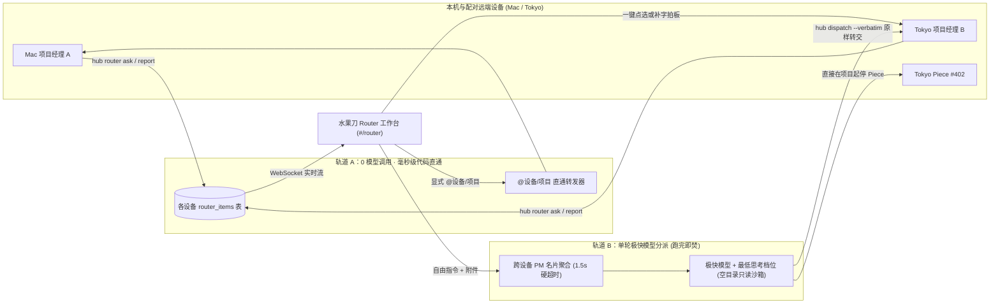
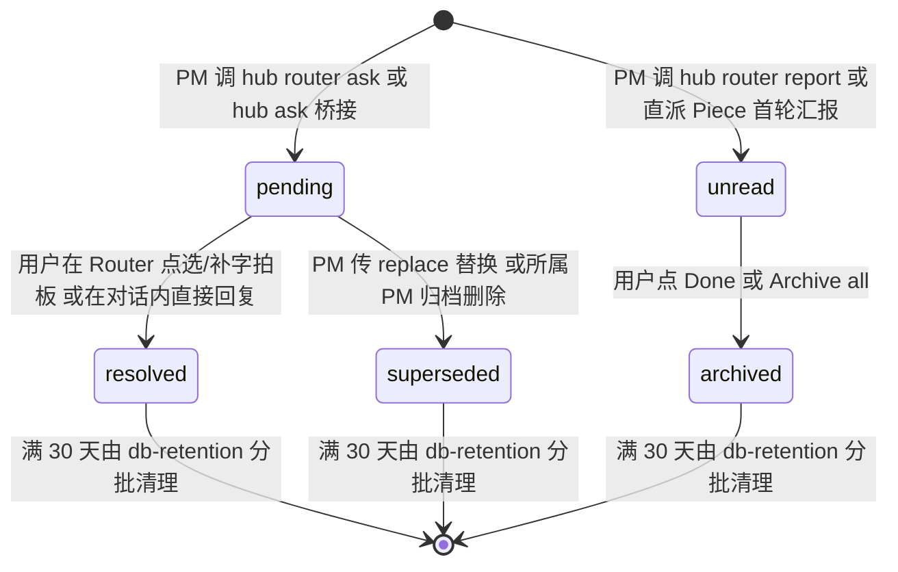
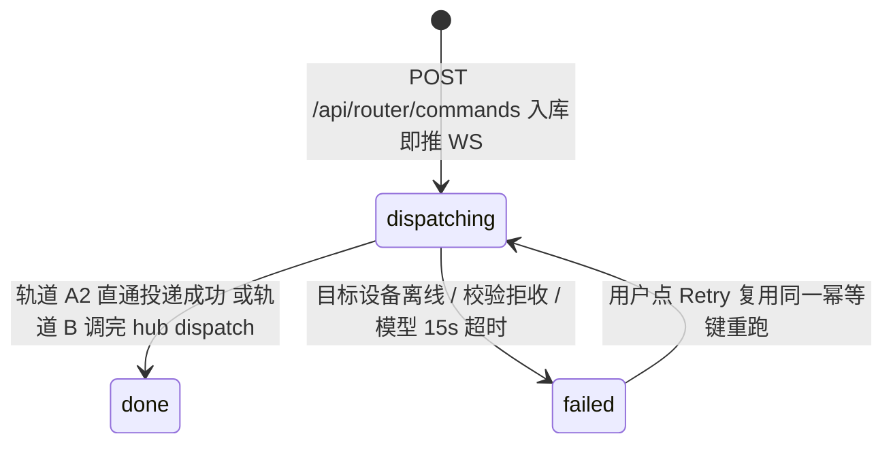
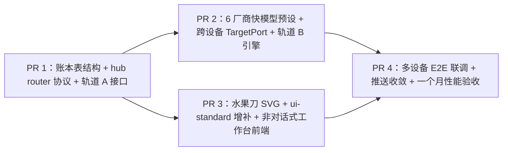

# 水果刀 Router 设计方案：非对话式选项工作台与跨设备极速调度

状态：待审阅（纯设计文档，不改 `src/` 生产代码；拍板后按第 8 节拆 4 个 PR 并行实现）。

---

## 0. 目标与硬边界

### 要解决的根源问题
现在每个项目经理（PM）遇到需要用户拍板的问题或阶段汇报时，各自在自己的聊天对话里发长段文字或 `hub ask`。设备一多（本机 Mac + 东京 Linux 等）、项目一多，用户得挨个点进不同对话阅读上下文、打字回复；给不同项目派活也要先找对话再切过去。

### 核心定位：Router 是一把水果刀（Knife）
延续 Fusa 的水果视觉体系：项目经理是整果横切面（`slice`），Worker（Piece）是切下的一瓣果肉（`wedge`），**Router 是切开与调度所有水果的那把水果刀（`knife`）**：
1. **收口拍板（PM → Router → 用户点一下）**：所有设备上 PM 需要用户决定的事统一汇总到 Router，渲染为**可一键点选、也可顺手补字**的选项卡片；阶段成果渲染为带证据链接的精简汇报卡。用户在一个面板点一下即原样回传对应设备的 PM。
2. **非对话式工作台**：Router **绝不是**从上往下堆气泡的聊天窗口，而是干净克制的行动卡片面板（待决选项卡片 + 近期指令回执 + 阶段汇报卡 + 底部常驻单行发令框），处理完即归档收起。
3. **跨设备极速直达（用户 → Router → 任意设备 PM / 项目 Piece）**：底部发令框支持文字与附件。Router 走**双轨机制**——选项点击、汇报归档、`@设备/项目` 显式指派走**轨道 A（0 模型调用、0 token、毫秒级代码直通）**；自由自然语言指令走**轨道 B（无历史单轮极快模型 + `--verbatim` 原文零拷贝直传）**，既能原样转交 PM，也能直接在任意设备的目标项目里派/停/关 Piece 或新建项目。
4. **内部通信对用户隐身且极短**：Router 与 PM 之间的内部指令、回执、状态摘要受协议层字数与条数硬上限约束，对主界面完全隐藏，不攒长聊天记录。

### 不做的事
- 不把 Router 做成会读业务代码、替 PM 写技术方案的“超级大脑”（系统提示词、工具集、只读空目录沙箱三层硬拦）。
- 不做跨设备全量数据库同步：延续 `docs/multi-device-design.md` 的无主入口架构，每台设备管自己的账本，入口按需聚合与转发，单台离线不阻塞全局。
- 不保留 Router 多轮闲聊历史：每次轨道 B 分派都是全新单轮，跑完即焚。

---

## 1. 现状梳理（基于现有代码的约束与复用点）

下笔前已逐一核对现有实现，直接决定本方案的接口落点：

| 模块 | 现有实现与约束 | 代码出处 | Router 如何衔接 |
|---|---|---|---|
| 角色预留 | `conversations.kind` 与 `agent_sessions.role` 的 SQLite `CHECK` 约束及 TS 类型**均已预留 `'assistant'`**；仅 `SessionRole` 目前缩窄为 `"pm" \| "worker"` | `migrations/0001_init.sql`、`0004_workers.sql`、`src/shared/domain.ts` | 轨道 B 临时单轮分派会话直接使用已预留的 `role = 'assistant'`，无需改旧表 `CHECK` 约束 |
| 数据库迁移 | 单测会把 `PRAGMA user_version` 重置回 `8` 再重跑 `migrate()`，**新迁移严禁写 `ALTER TABLE ... ADD COLUMN`** | `migrations/0010`、`0012`、`0014`、`0020`、`src/daemon/store/migrate.ts` | `migrations/0022_router.sql` 全部采用独立 `STRICT` 新表 + `CREATE TABLE/INDEX IF NOT EXISTS` |
| 初始快照预算 | 跑满一个月（300 个已收工 Worker、3 万条消息）时 `/api/state` 未压缩体积须 `< 384 KB`（`SNAPSHOT_MONTH_MAX_BYTES`） | `src/shared/limits.ts`、`src/daemon/ledger/snapshot-size.test.ts` | `/api/state` 只带未决/未读卡片（上限 50 张）与最近 10 条指令回执；已归档历史走 `@tanstack/react-query` 游标分页；内部审计与临时 `assistant` 会话 0 字节进快照 |
| 对话内提问 | PM 调 `hub ask [--option ...]` 调 `messages.insertAskMessage`，前端 `Messages.tsx` 用 `AskCard` 渲染 A/B/C/D 选项，发消息自动标 `meta.answered = true` | `src/daemon/ledger/messages.ts`、`hub-commands.ts`、`src/web/components/Messages.tsx` | 新增结构化 `hub router ask`，并在账本层与 `hub ask` **双向自动桥接**（共享 `ask_message_id`），两边任一处作答同步消掉另一处，杜绝重复打扰 |
| 多设备联机 | 任意设备可当网页入口；前端 `DevicesStore` 为本机和每台配对设备各维护一个 `DeviceHub`（`/api/state` + `/api/ws` 及 `/d/<id>/api/...`）；守护进程间用 `peers.target(id)` 带 `deviceToken` 互访除 `ENTRY_ONLY_API_PREFIXES` 外的 `/api/*` | `src/daemon/peers/`、`src/daemon/ui-server/server.ts`、`src/web/device-hub.ts` | PM 卡片落在本机库，前端跨 `fleet.devices` 直接汇总（零同步延迟、单台离线不卡首屏）；轨道 A 拍板经 `fleet.hub(deviceKey)` 直达目标机；轨道 B 经 `RouterTargetPort` 统一调本机账本或远端 `/api/router/*` |
| 6 家厂商插件 | `VENDOR_LIST` 统一管理 `claude`、`agy`、`codex`、`pi`、`deepseek`、`cursor`；`web-guard.test.ts` 禁止前端写死厂商名，`vendor-registry.test.ts` 校验契约 | `src/vendors/registry.ts`、`types.ts`、`*/spec.ts`、`src/web/web-guard.test.ts` | 在 `VendorModelsSpec` 增设必填字段 `routerDefault: { model, effort }`，6 家各自声明极快预设，业务代码零厂商 `if/else` |
| OS 沙箱 | `write-scope.ts` 支持 macOS `sandbox-exec` 与 Linux `bubblewrap` 的可写范围与全盘只读沙箱（`wrapInReadonlyOsSandbox` / `nativeReadonly`） | `src/daemon/driver/write-scope.ts`、`src/daemon/launch.ts` | 轨道 B 会话工作目录固定为空目录 `state/router-home`、`addDirs = []`，并套入只读沙箱，从操作系统层断绝读业务代码库的可能 |
| 界面标准与守卫 | 字号仅 4 档（12 / 13.5 / 15 / 17）、圆角仅 3 档、外壳英文固定词、禁用 `·` 拼接、禁用悬停才出现的操作、禁用裸写定时器字面量 | `docs/ui-standard.md`、`src/web/ui/ui-standard.test.tsx`、`src/web/web-guard.test.ts` | 水果刀置顶行、选项卡片、汇报卡、回执条全部严格套用现有 token 与组件原语，同步补全 `docs/ui-standard.md` |

---

## 2. 总体架构：双轨极速流转与跨设备拓扑

### 2.1 双轨流转全景图



### 2.2 为什么这样拆双轨

| 场景 | 走哪条轨 | 模型调用 | 端到端耗时 | 保真度 |
|---|---|---|---|---|
| PM 上报待决问题或阶段汇报 | **轨道 A** | 0 次（0 token） | 本机 `< 10 ms`，跨机 `< 80 ms` | PM 结构化字段原样入库上屏，不经二传手改写 |
| 用户在待决卡片点选选项 / 补字拍板 | **轨道 A** | 0 次（0 token） | 界面乐观收起 `< 16 ms`，唤醒 PM `< 80 ms` | 按 `itemId → conversationId` 原样回传目标设备 PM |
| 用户在汇报卡点 `Done` 归档 | **轨道 A** | 0 次（0 token） | `< 16 ms` | 纯状态翻转 |
| 用户在发令框用 `@设备/项目` 点名直发 | **轨道 A2** | 0 次（0 token） | 本机 `< 20 ms`，跨机 `< 120 ms` | 原文与附件字节级直传 |
| 用户在发令框发自由指令（如“把截图给后端看”“在 agent-hub 派只读 Piece 查慢测”） | **轨道 B** | 单轮极快模型（`flash` / `haiku` + `low`/`off`） | `0.6 s ~ 1.8 s` | 模型只输出 `hub dispatch ... --verbatim`（约 20 个输出 token），守护进程从内存直接搬运用户原文与附件，**零改写、零漏图** |

### 2.3 `--verbatim` 原文零拷贝机制（解决“快、省、不失真”的关键抓手）

传统 LLM 路由慢且容易把用户的长段交代缩水，根源是让模型在工具参数里把用户的 500 字和文件路径重新生成一遍。

本方案在轨道 B 中把当前指令的 `commandId` 绑定到本次临时会话的 `HUB_TOKEN` 上下文里：
- 当用户只针对单一目标发令时，Router 模型只需执行：
  `hub dispatch pm --device tokyo --pm 3 --verbatim` 或 `hub dispatch worker-start --device self --project 1 --title "排查 vitest 慢测" --readonly --verbatim`
- 守护进程收到 `--verbatim` 后，**直接从 `router_commands` 行取出用户原始 `text` 和已上传的 `attachments` 原样投递**（目标在远端设备时，由守护进程流式转发附件到远端 `POST /api/uploads` 再发消息）。
- 模型整轮只需输出二三十个 token，耗时压到 1 秒级，且用户的每一个标点、每一张截图 100% 原样抵达。
- 只有当用户一句话里同时交代两件不同项目的事（如“跟前端说接口改好了，再跟后端说今晚发版”），模型才分别用 `--text "..."` 拆条投递，且提示词硬性规定保留用户原意不添油加醋。

---

## 3. 领域数据模型、状态机与协议契约

### 3.1 SQLite 迁移表结构（`migrations/0022_router.sql`）

严守“零 `ALTER TABLE`、全 `STRICT`、全幂等 `IF NOT EXISTS`”约束：

```sql
-- 1. PM 上报给用户的待决选项卡片（decision）与阶段汇报卡（report）
CREATE TABLE IF NOT EXISTS router_items (
  id                INTEGER PRIMARY KEY,
  kind              TEXT NOT NULL CHECK (kind IN ('decision', 'report')),
  pm_id             INTEGER NOT NULL REFERENCES pms(id) ON DELETE CASCADE,
  project_id        INTEGER REFERENCES projects(id) ON DELETE SET NULL,
  conversation_id   INTEGER NOT NULL REFERENCES conversations(id) ON DELETE CASCADE,
  worker_id         INTEGER REFERENCES workers(id) ON DELETE SET NULL,
  -- 与对话内 hub ask 消息双向唯一绑定：对话内答或 Router 答同步完结，绝不双份提醒
  ask_message_id    INTEGER UNIQUE REFERENCES messages(id) ON DELETE SET NULL,
  status            TEXT NOT NULL CHECK (status IN ('pending', 'resolved', 'unread', 'archived', 'superseded')),
  question          TEXT NOT NULL,                 -- decision 为一句话问题，report 为一句话结论（≤160 字）
  context           TEXT NOT NULL DEFAULT '',      -- 补充背景或要点（≤400 字）
  options_json      TEXT NOT NULL DEFAULT '[]',    -- string[]，0 项（旧 hub ask 无选项桥接）或 2~4 项（每项 ≤120 字）
  recommended_index INTEGER,                       -- 推荐项下标（0~3）或 NULL
  links_json        TEXT NOT NULL DEFAULT '[]',    -- RouterEvidenceLink[]（最多 4 个：PR、Piece、文件、外链）
  resolution_json   TEXT,                          -- RouterResolution JSON；未决时为 NULL
  dedupe_key        TEXT UNIQUE,
  created_at        INTEGER NOT NULL,
  updated_at        INTEGER NOT NULL
) STRICT;

-- 部分索引：/api/state 只扫活跃项，哪怕历史攒了 5000 张归档卡，查询仍是 O(活跃数) < 0.05ms
CREATE INDEX IF NOT EXISTS router_items_active_idx
  ON router_items(status, id DESC)
  WHERE status IN ('pending', 'unread');

-- 游标分页索引：供 @tanstack/react-query 展开 Archived 按 id 倒序翻页
CREATE INDEX IF NOT EXISTS router_items_archived_idx
  ON router_items(id DESC)
  WHERE status IN ('resolved', 'archived', 'superseded');

-- 单 PM 未决上限检查与 PM Digest 计数索引
CREATE INDEX IF NOT EXISTS router_items_pm_pending_idx
  ON router_items(pm_id, status)
  WHERE status = 'pending';

-- 2. 用户在入口设备 Router 发令框发出的指令与极简分派回执
CREATE TABLE IF NOT EXISTS router_commands (
  id               INTEGER PRIMARY KEY,
  client_id        TEXT NOT NULL UNIQUE,
  text             TEXT NOT NULL,
  attachments_json TEXT NOT NULL DEFAULT '[]',     -- Attachment[]
  track            TEXT NOT NULL CHECK (track IN ('direct', 'model')),
  status           TEXT NOT NULL CHECK (status IN ('dispatching', 'done', 'failed')),
  actions_json     TEXT NOT NULL DEFAULT '[]',     -- RouterReceiptAction[]（执行了哪些跨设备分派/起停动作）
  reply_note       TEXT NOT NULL DEFAULT '',       -- 无法分派或简短状态答复时的一句话说明（≤240 字）
  error_text       TEXT,
  duration_ms      INTEGER,
  created_at       INTEGER NOT NULL,
  updated_at       INTEGER NOT NULL
) STRICT;

CREATE INDEX IF NOT EXISTS router_commands_recent_idx
  ON router_commands(id DESC);

-- 3. PM 主动同步给 Router 的一句话当前主线（每个 PM 仅覆盖写 1 行，零历史膨胀）
CREATE TABLE IF NOT EXISTS router_pm_notes (
  pm_id      INTEGER PRIMARY KEY REFERENCES pms(id) ON DELETE CASCADE,
  brief      TEXT NOT NULL,                        -- ≤120 字
  updated_at INTEGER NOT NULL
) STRICT;

-- 4. 本机作为入口时的 Router 模型偏好设置（单行表；未配时自动取可用厂商的 routerDefault）
CREATE TABLE IF NOT EXISTS router_settings (
  id         INTEGER PRIMARY KEY CHECK (id = 1),
  vendor     TEXT,
  model      TEXT,
  effort     TEXT,
  updated_at INTEGER NOT NULL
) STRICT;

-- 5. Router 直接在项目里启动的 Piece 标记表（免改 workers 表结构）
CREATE TABLE IF NOT EXISTS router_worker_origins (
  worker_id   INTEGER PRIMARY KEY REFERENCES workers(id) ON DELETE CASCADE,
  command_id  INTEGER,
  auto_report INTEGER NOT NULL DEFAULT 1,          -- 1 = 该 Piece 首轮汇报时自动在 Router 生成一张精简汇报卡
  created_at  INTEGER NOT NULL
) STRICT;

-- 6. 内部通信审计环形缓冲表（仅留最近 500 条供排障，完全不进 /api/state 与主界面）
CREATE TABLE IF NOT EXISTS router_audit_log (
  id            INTEGER PRIMARY KEY,
  kind          TEXT NOT NULL,                     -- 'pm.ask' | 'pm.report' | 'pm.note' | 'dispatch.op' | 'resolve.ack'
  command_id    INTEGER,
  pm_id         INTEGER,
  target_device TEXT,
  summary       TEXT NOT NULL,
  payload_json  TEXT NOT NULL DEFAULT '{}',
  created_at    INTEGER NOT NULL
) STRICT;
```

### 3.2 核心状态机

#### （1）待决选项卡片与阶段汇报卡状态机（`RouterItem`）



#### （2）用户自由指令状态机（`RouterCommand`）



### 3.3 TypeScript 核心判别联合类型（`src/shared/router.ts`）

```ts
import type { Attachment, ConversationId, DeviceId, MessageId, PmId, PmMode, ProjectId, WorkerId } from "./domain.ts";
import type { AgentVendor } from "./vendors.ts";

export type RouterItemId = number;
export type RouterCommandId = number;

export type RouterEvidenceLink =
  | { kind: "pr"; label: string; url: string }
  | { kind: "worker"; label: string; workerId: WorkerId; workerConversationId: ConversationId }
  | { kind: "file"; label: string; path: string; messageId?: MessageId }
  | { kind: "url"; label: string; url: string };

export interface RouterResolution {
  chosenIndex: number | null;
  chosenOption: string | null;
  note: string;
  actor: "router" | "conversation";
  resolvedAt: number;
}

interface RouterItemBase {
  id: RouterItemId;
  pmId: PmId;
  projectId: ProjectId | null;
  conversationId: ConversationId;
  workerId: WorkerId | null;
  askMessageId: MessageId | null;
  question: string;
  context: string;
  links: RouterEvidenceLink[];
  createdAt: number;
  updatedAt: number;
}

/** 判别联合：待决选项卡片 vs 阶段汇报卡 */
export type RouterItem =
  | (RouterItemBase & {
      kind: "decision";
      status: "pending" | "resolved" | "superseded";
      options: string[];
      recommendedIndex: number | null;
      resolution: RouterResolution | null;
    })
  | (RouterItemBase & {
      kind: "report";
      status: "unread" | "archived";
    });

/** 指令回执里记录的原子调度动作 */
export type RouterReceiptAction =
  | { op: "pm.forward"; deviceId: DeviceId; deviceName: string; pmId: PmId; pmName: string; conversationId: ConversationId; verbatim: boolean }
  | { op: "worker.start"; deviceId: DeviceId; deviceName: string; projectId: ProjectId; projectName: string; workerId: WorkerId; workerConversationId: ConversationId; title: string; readonly: boolean }
  | { op: "worker.send"; deviceId: DeviceId; deviceName: string; workerId: WorkerId; workerConversationId: ConversationId; title: string }
  | { op: "worker.stop"; deviceId: DeviceId; deviceName: string; workerId: WorkerId; workerConversationId: ConversationId; title: string }
  | { op: "worker.end"; deviceId: DeviceId; deviceName: string; workerId: WorkerId; workerConversationId: ConversationId; title: string }
  | { op: "project.create"; deviceId: DeviceId; deviceName: string; pmId: PmId; pmName: string; projectId: ProjectId; projectName: string; conversationId: ConversationId };

export interface RouterCommand {
  id: RouterCommandId;
  clientId: string;
  text: string;
  attachments: Attachment[];
  track: "direct" | "model";
  status: "dispatching" | "done" | "failed";
  actions: RouterReceiptAction[];
  replyNote: string;
  errorText: string | null;
  durationMs: number | null;
  createdAt: number;
  updatedAt: number;
}

/** 暴露给 Router 轨道 B 的单个 PM 轻量名片快照（硬上限 ≤ 1 KB / PM，绝不含聊天历史） */
export interface PmDigestCard {
  pmId: PmId;
  pmName: string;
  mode: PmMode;
  conversationId: ConversationId;
  activity: "idle" | "working" | "waiting_quota";
  project: { id: ProjectId; name: string; mainFolder: string } | null;
  /** 优先取 router_pm_notes.brief；未设时取 persona 前 4 个非空行（截断至 ≤ 200 字） */
  roleSummary: string;
  /** 当前未收工 Piece 摘要（最多 6 个，超出只报活跃总数） */
  activeWorkers: Array<{ id: WorkerId; title: string; activity: string; readonly: boolean }>;
  activeWorkerTotal: number;
  pendingDecisionCount: number;
}

export interface DeviceRouterDigest {
  deviceId: DeviceId;
  deviceName: string;
  platform: string;
  online: boolean;
  stale: boolean;
  generatedAt: number;
  pms: PmDigestCard[];
}

export interface RouterSettings {
  vendor: AgentVendor | null;
  model: string | null;
  effort: string | null;
}

/** 挂在每台设备 StateSnapshot.router 上的轻量切片 */
export interface RouterSliceSnapshot {
  /** 仅含 status IN ('pending', 'unread') 的活跃卡片，最多 50 张 */
  items: RouterItem[];
  /** 仅入口本机带最近 10 条指令回执；被配对设备经 deviceToken 拉取时回空数组 */
  commands: RouterCommand[];
  /** 历史已处理/已归档卡片总数（>0 时界面才渲染 Archived 折叠开关） */
  archivedCount: number;
  settings: RouterSettings;
}
```

### 3.4 `hub` 新增子命令签名与 `hub ask` 统一收敛策略

#### （1）PM 专用：`hub router ...`（仅放行 `role === "pm"`）

```bash
# 1. 上报需要用户拍板的选项卡片（推荐首选，第一个 --option 默认就是推荐项，也可显式传 --recommended <1..4>）
hub router ask \
  --question "路由状态表用独立表还是扩现有 messages 表？" \
  --option "独立 router_items STRICT 表（推荐：兼容迁移幂等且索引最小）" \
  --option "复用 messages 表加 kind='router'" \
  [--recommended 1] \
  [--replace <旧itemId>] \
  [--stdin]          # 可选：标准输入传入 ≤400 字的判断依据摘要（context）

# 2. 上报阶段完成或关键汇总卡片（带可点击证据，不淹没待决项）
hub router report \
  --summary "PR #398 已合并，Linux 沙箱只读回归测试全绿" \
  [--pr "https://github.com/.../pull/398"] \
  [--worker 395] \
  [--file "docs/router-design.md"] \
  [--stdin]          # 可选：标准输入传入 ≤400 字的要点列表（context）

# 3. 更新暴露给 Router 名片的“当前主线一句话”（≤120 字，覆盖写，不产生卡片）
hub router note --text "正在推进 Router 4 个 PR 的拆单与并行验收"
```

#### （2）与现有 `hub ask` 的双向自动桥接（彻底消除双份打扰）

为防止老会话里的 PM 既调 `hub ask` 又调 `hub router ask`，或存量 PM 还没重启提示词时问题漏进对话里看不到，采用**“底层同源绑定 + 提示词收敛”**：

1. **提示词收敛（新标准）**：`src/daemon/prompt.ts` 中 PM 提示词统一改为：凡需用户拍板一律调 `hub router ask`（强制浓缩成 ≤160 字一句话问题 + 2~4 个明确选项，推荐项放第一）；阶段收口需要知会用户时调 `hub router report`；不再教 PM 在对话里发大段文字后再调裸 `hub ask`。
2. **账本层双向桥接（无缝兜底）**：
   - **PM 调 `hub router ask`**：同一个 SQLite 事务内，先插入一条对话内同步消息（`messages`，带 `ask` meta，供用户点进该 PM 对话时也能看到上下文），再插入 `router_items (kind = 'decision', ask_message_id = message.id)`。
   - **PM 调旧命令 `hub ask [--option ...] --stdin`**：`messages.insertAskMessage` 在同一事务内自动生成对应的 `router_items`（首段截断至 160 字作 `question`，余下截断至 400 字作 `context`，`options` 原样带入；无 `--option` 时 `options = []`，卡片自动呈现纯文字拍板输入框）。若该 PM 当前回合内刚发过未决 `router_items`，自动 `superseded` 前一张同回合重复卡。
   - **一处拍板，两处同消**：
     - 用户在 Router 面板点选（或补字）拍板 → 事务内更新 `router_items.status = 'resolved'`，将 `messages(ask_message_id)` 标 `answered = true`，并往 PM 对话写入用户回复消息唤醒 PM（格式化见下）。
     - 用户若碰巧点进了该 PM 的聊天窗直接回复 → `messages.ts` 原有的“用户发言自动标该对话未答 `ask` 为 `answered = true`”逻辑同步把关联的 `router_items` 更新为 `status = 'resolved', actor = 'conversation'`，推送 `router.item.updated`，Router 面板上的卡片即刻自动收起。
3. **拍板回传给 PM 的消息格式（0 失真）**：
   - 纯点选选项：`【Router 拍板】针对「<question>」已选：<chosenOption>`
   - 点选选项 + 备注：`【Router 拍板】针对「<question>」已选：<chosenOption>\n补充说明：<note>`
   - 纯输入文字决定：`【Router 拍板】针对「<question>」决定：<note>`

#### （3）Router 内部专用：`hub dispatch ...`（仅放行 `role === "assistant"`，PM 与 Worker 调一律 `forbidden`）

轨道 B 快模型只能调用这组命令操作本机（`--device self`）或任意已配对在线设备（`--device <deviceId>`）：

```bash
# 1. 原样转交指令给目标设备的 PM（默认 --verbatim 零拷贝搬运当前指令原文与全部附件）
hub dispatch pm --device <self|deviceId> --pm <pmId> [--verbatim | --stdin]

# 2. 直接在目标设备的项目里启动 Piece（自动进该项目账本留痕）
hub dispatch worker-start --device <self|deviceId> --project <projectId> \
  --title <标题> [--vendor <厂商>] [--model <模型>] [--effort <档位>] \
  [--readonly] [--no-worktree] [--verbatim | --stdin]

# 3. 直接操作目标设备上已有的 Piece（暂停当前轮 / 继续追发指令 / 结束收工 / 查列表）
# 说明：Fusa 的 Piece 暂停 = worker-stop（调 driver.interrupt 中断当前轮回到 idle，保留会话与 worktree）；
#       继续 = worker-send（往同一会话追发后续指令恢复执行）；彻底收工 = worker-end（关闭会话标 ended）。
hub dispatch worker-stop --device <self|deviceId> --worker <workerId>
hub dispatch worker-send --device <self|deviceId> --worker <workerId> [--verbatim | --stdin]
hub dispatch worker-end  --device <self|deviceId> --worker <workerId>
hub dispatch worker-list --device <self|deviceId> [--project <projectId>]

# 4. 直接在目标设备上新建 PM 与项目并挂载主文件夹
hub dispatch project-create --device <self|deviceId> --folder <路径> \
  [--name <项目名>] [--pm-name <PM名>] [--vendor <厂商>] [--mode manage_only|hands_on]
```

### 3.5 HTTP / WebSocket 路由与跨设备转发契约（`src/shared/api.ts`）

所有新增 `/api/router/*` 路由均不在 `ENTRY_ONLY_API_PREFIXES` 内，天然同时支持**浏览器会话 Cookie**（含经 `/d/<deviceId>/api/router/...` 转发）与**守护进程间 `deviceToken`**：

| 方法与路径 | 用途 | 谁调 | 跨设备行为 |
|---|---|---|---|
| `POST /api/router/items/:id/resolve` | 轨道 A：用户拍板选项卡片（`{ clientId, optionIndex: number \| null, note?: string }`）或归档单张汇报卡（`{ action: "archive" }`） | 前端 `fleet.hub(deviceKey)` | 本机卡直调 `/api/...`；远端卡调 `/d/<deviceId>/api/...` 经 `proxyHttp` 直达卡片所在设备 |
| `POST /api/router/reports/archive-all` | 轨道 A：一键归档该设备全部未读汇报卡 | 前端跨设备并发调 | 只对当前有 `unread` 汇报的在线设备发请求 |
| `GET /api/router/items?before=<id>&limit=30` | 展开 `Archived` 时按游标拉历史已结卡片 | `@tanstack/react-query` | 按需拉取，走 `@fastify/compress` 压缩 |
| `GET /api/router/digest` | 返回本机 `DeviceRouterDigest`（内存缓存命中 `< 0.1 ms`） | 入口守护进程轨道 B | 入口守护进程并发调各配对设备（`1.5s` 硬超时） |
| `POST /api/router/project-ops` | 在本机原子执行 `worker.start/send/stop/end/list` 或 `project.create` | 本机或入口守护进程 `PeerTargetPort` | 远端设备校验 `deviceToken` + 幂等 `dedupeKey` 后落本机账本 |
| `POST /api/router/commands` | 用户在发令框提交指令（`{ clientId, text, attachmentIds?, target? }`） | 前端固定调入口本机 `localClient` | `target` 非空走轨道 A2；否则走轨道 B |
| `POST /api/router/commands/:id/retry` | 失败回执点 `Retry` 重试（复用原 `clientId` 幂等键） | 前端调入口本机 `localClient` | 已成功的子步骤按 `dedupeKey` 跳过，只补跑失败项 |
| `PUT /api/router/settings` | 修改入口本机 Router 的厂商/模型/思考程度 | 设置弹窗 | 写入入口本机 `router_settings` 并推 `router.settings.updated` |

新增 WebSocket `Change` 事件类型（并入 `src/shared/api.ts` 的 `Change` 判别联合）：
- `router.item.created`：`{ item: RouterItem }`
- `router.item.updated`：`{ item: RouterItem }`
- `router.reports.archived`：`{ upToId: RouterItemId; archivedAt: number }`
- `router.command.created`：`{ command: RouterCommand }`
- `router.command.updated`：`{ command: RouterCommand }`
- `router.settings.updated`：`{ settings: RouterSettings }`

---

## 4. 界面与交互设计（严格对照 `docs/ui-standard.md`）

### 4.1 水果刀视觉规范与刀锋中性色（`KnifeAvatar`）

1. **三元视觉隐喻**：
   - 项目经理（PM）：完整水果横切面（`slice`，彩色果冻行底 `--jelly`、会话彩色 `--fruit`）。
   - Worker（Piece）：切下的一瓣果肉（`wedge`）。
   - **Router**：**水果刀（`<KnifeAvatar size={...} />`，`src/web/components/KnifeAvatar.tsx`）**——干净利落的 45° 斜置削皮水果刀矢量图标（`viewBox="0 0 44 44"`，尺寸同 `Avatar.tsx` 转 `${size / 16}rem` 跟随 `ui-scale.ts` 四档缩放）：
     - **刀身**：冷冽拉丝钢渐变（`#f4f4f6` → `#d4d4d8`），刀锋高光棱线 `#ffffff`，刀背与外轮廓用 `1.5px` 深钢灰 `#3f3f46`（对白底 `#ffffff` 对比度 `10.3:1`，对侧栏 `#f6f6f7` 对比度 `9.5:1`，远超 WCAG 1.4.11 图形 3:1 要求）。
     - **刀颈护手（Bolster）**：`#71717a`。
     - **刀柄**：哑光碳黑 `#18181b`（即 `--foreground`），嵌两枚 `1.5px` 银色铆钉圆点 `#d4d4d8`。
     - 参考 SVG 结构（零外部图片请求，缩放到 20px / 28px / 40px / 44px 均锐利清晰）：
       ```tsx
       export function KnifeAvatar({ size = 44, className }: { size?: number; className?: string }) {
         const rem = `${size / 16}rem`;
         return (
           <span style={{ width: rem, height: rem }} aria-hidden="true" data-slot="knife-avatar" className={cn("inline-flex shrink-0 select-none", className)}>
             <svg viewBox="0 0 44 44" fill="none" className="size-full">
               <defs>
                 <linearGradient id="knife-blade" x1="10" y1="8" x2="30" y2="28" gradientUnits="userSpaceOnUse">
                   <stop offset="0%" stopColor="#f4f4f6" />
                   <stop offset="100%" stopColor="#d4d4d8" />
                 </linearGradient>
               </defs>
               {/* 45° 斜置刀身：右上刀尖 (36,8)，左下连接护手 */}
               <path d="M36 8C29 9.5 22.5 14.5 18 21L23 26C28.5 21 33.5 15 36 8Z" fill="url(#knife-blade)" stroke="#3f3f46" strokeWidth="1.5" strokeLinejoin="round" />
               {/* 刀锋白色刃口高光 */}
               <path d="M34.8 9.5C32.2 15.3 28 20.3 23.2 24.6" stroke="#ffffff" strokeWidth="1.2" strokeLinecap="round" />
               {/* 金属护手 (Bolster) */}
               <path d="M17.2 21.8L22.2 26.8L19.8 29.2L14.8 24.2Z" fill="#71717a" stroke="#3f3f46" strokeWidth="1.2" strokeLinejoin="round" />
               {/* 碳黑刀柄 + 双铆钉 */}
               <path d="M14.8 24.2L19.8 29.2L11.6 37.4C10.2 38.8 8 38.8 6.6 37.4C5.2 36 5.2 33.8 6.6 32.4L14.8 24.2Z" fill="#18181b" />
               <circle cx="14.2" cy="29.8" r="1.2" fill="#d4d4d8" />
               <circle cx="10.6" cy="33.4" r="1.2" fill="#d4d4d8" />
             </svg>
           </span>
         );
       }
       ```
2. **刀锋中性强调色（零新发明色板，直接复用系统根中性色）**：
   - 打开 `#/router` 时，`App.tsx` 向 `<FruitTint colorKey={null}>` 与 `<AccentScope colorKey={null}>` 均传 `null`：
     - 外壳平滑退回纯白工作台 `--background: #ffffff` 与冷灰侧栏 `--sidebar: #f6f6f7`（经 `.tint-fade` 300ms 过渡），不再掺任何单一水果底色。
     - 工作台内的 `--primary` 保持碳黑刀锋色 `#18181b`（白字 `#ffffff`，对比度 `17.9:1`），底部发令框聚焦光晕 `.composer-frame:focus-within` 自然呈现克制的冷灰雾化光晕。
   - 左栏置顶的 Router 行**不设 `--jelly`**，选中态用 `bg-sidebar-active`（`#e9e9ec`），悬停态用 `hover:bg-sidebar-hover`（`#efeff1`），与下方各水果 PM 的彩色果冻行一目了然区分开。
   - 反过来，在纯白中性的 Router 工作台里，每张卡片左上角展示**来源 PM 的 24px 彩色水果切片头像**，一眼就能靠颜色认出是西柚、奇异果还是橙子项目发来的事。

### 4.2 左栏置顶入口（三档响应式布局）

路由新增 `{ view: "router" }`，对应网址 `#/router`（全局唯一，不带 `/d/<device>` 前缀）。桌面端首次打开空锚点 `#` 时默认落到 `#/router`。

1. **桌面 300px 宽栏（`layout === "wide"`）**：
   - 固定在顶部搜索框下方、可滚动 PM 列表 `<nav className="sidebar-list">` **上方**（`px-3 pb-2 border-b border-line shrink-0`），PM 再多、滚得再深，Router 永远钉在左上角第一顺位。
   - 行高与内边距同 `EntryButton`（`rounded-2xl px-3 py-2.5 gap-3`）：
     - 左：`<KnifeAvatar size={44} />`
     - 中上：`Router`（`text-body font-semibold`）
     - 中下（副文，`text-minor text-muted-foreground truncate`）：有未决项时显示第 1 张待决卡的问题摘要；无未决但有未读汇报时显示最新汇报摘要；全清时显示 `All clear`。
     - 右：有未决选项卡片（`pendingCount > 0`）时，显示数字 + 实心绿点（`<span className="text-xs font-semibold tabular-nums text-foreground">{pendingCount}</span>` + `size-2 rounded-full bg-status-active`，间距 `gap-1.5`）；无未决但有未读汇报（`unreadReportCount > 0`）时，仅显示淡灰数字 `text-xs text-muted-foreground tabular-nums`。
   - **减法**：有了置顶 Router 统一承接跨设备待决问题后，删掉 `Sidebar.tsx` 原先在多设备模式下重复渲染的顶部 `Needs you` 列表分组，避免同一件事在左栏出现两次；各设备分组内 PM 行自身的绿点提醒保留。
2. **桌面 72px 窄栏（`layout === "rail"`，窗口 `< 1100px`）**：
   - 固定在 `<nav>` 上方独立槽位，下方配一条 `w-8 border-b border-line` 短分割线：
   - `size-13 rounded-2xl` 按钮，内放 `<KnifeAvatar size={40} />`；`pendingCount > 0` 时右下角叠 `size-2 rounded-full bg-status-active ring-2 ring-surface-sidebar`（与 `NarrowEntryButton` 完全一致）。
3. **手机端整屏首页（`layout === "page"`，`<= 768px`）**：
   - 钉在首页顶部第一行（同宽栏样式，天然满足 `≥ 44px` 触控高度），点按进入全屏 `#/router` 工作台，工作台顶栏左侧带标准 `<ArrowLeft>` 返回键回到列表页。

### 4.3 非对话式行动工作台布局（`RouterWorkbench.tsx`）

严禁聊天气泡、严禁左右对话头像流！主区复用 `.chat-main` 容器与 `.chat-column` 居中列宽体系（`46rem ~ 64rem`），分三层：

```
┌──────────────────────────────────────────────────────────────────────┐
│  [Knife 28px]  Router                              2 needs you       │ ← 顶栏 h-16, px-[var(--header-gutter-start)]
├──────────────────────────────────────────────────────────────────────┤
│  Needs You  2                                                        │ ← 分区标题 text-xs font-medium text-muted-foreground
│  ┌────────────────────────────────────────────────────────────────┐  │
│  │ [🍊 24px] 小林   agent-hub   Tokyo                       11:14 │  │ ← 来源行：gap-2 排布，不用 · 中点！
│  │ 路由状态表用独立表还是扩现有 messages 表？                     │  │ ← 一句话问题 text-body font-medium
│  │ 单测会把 user_version 重置回 8 重跑迁移，扩旧表会挂。          │  │ ← 简短依据 text-minor text-muted-foreground
│  │ ┌────────────────────────────────────────────────────────────┐ │  │
│  │ │ [A] 独立 router_items STRICT 表                Recommended │ │  │ ← 选项按钮 rounded-xl px-3 py-2（点一下即秒定！）
│  │ └────────────────────────────────────────────────────────────┘ │  │
│  │ ┌────────────────────────────────────────────────────────────┐ │  │
│  │ │ [B] 复用 messages 表加 kind 枚举                           │ │  │
│  │ └────────────────────────────────────────────────────────────┘ │  │
│  │ ┌──────────────────────────────────────────────────────┐ [↑]  │  │ ← 轻量补充框 Input(h-9 rounded-xl) + Send(size-9)
│  │ │ Add a note, or type a custom reply…                  │       │  │   空着点 A=秒定；填字再点 A=带备注拍板；填字回车=纯文字决定
│  │ └──────────────────────────────────────────────────────┘       │  │
│  └────────────────────────────────────────────────────────────────┘  │
│                                                                      │
│  Recent                                                              │ ← 仅在有刚发的指令回执时出现（最多展示最近 5 条）
│    [↻ Dispatching…]  在 agent-hub 派个只读 Piece 查慢测              │ ← 处理中：.status-shimmer 流光状态词
│    [✓] Tokyo   Billing   Forwarded verbatim                  11:12   │ ← 完成回执：极简一行，点项目名可跳过去
│                                                                      │
│  Updates  1                                            Archive all   │ ← 阶段汇报区（一键全部收起）
│  ┌────────────────────────────────────────────────────────────────┐  │
│  │ [🥝 24px] 阿青   billing-api   Mac               11:08  [Done] │  │
│  │ PR #398 已合并，Linux 只读沙箱回归测试全绿                     │  │
│  │ [PR #398 ↗]   [Piece #391]   [linux-sandbox.md]                │  │ ← 证据链接（文字链/轻量 tag，无多余厚胶囊）
│  └────────────────────────────────────────────────────────────────┘  │
│                                                                      │
│  Archived ›                                                     48   │ ← 默认收起，展开走 @tanstack/react-query 按需分页
├──────────────────────────────────────────────────────────────────────┤
│  ┌────────────────────────────────────────────────────────────────┐  │
│  │ [📎]  Tell Router, or type @ to pick a project…          [↑]  │  │ ← 复用 DraftComposer (.composer-frame 单行常驻)
│  └────────────────────────────────────────────────────────────────┘  │
└──────────────────────────────────────────────────────────────────────┘
```

### 4.4 关键交互细节与品味守卫

1. **待决选项卡片（`RouterDecisionCard`）三合一拍板交互（零多余点击）**：
   - **纯点选秒定（90% 场景，只需 1 次点击）**：卡片底部补充框为空时，直接点选项 `A` 或 `B` → 立即触发轨道 A 提交 `{ optionIndex: i }`，卡片乐观收起（`120ms` 淡出），全程 **1 次点击**，不要求再点“确认”。
   - **选某项 + 顺手补一句备注**：先在卡片内嵌 `<Input>`（`h-9 rounded-xl`，聚焦无光圈、边框不变）里敲一句补充（如 `注意保留向后兼容`），再点选项 `A` → 同时提交 `{ optionIndex: 0, note: "注意保留向后兼容" }`。
   - **不选预设项、直接打字拍板**：在 `<Input>` 里直接敲自定义决定并按 `Enter`（触屏点右侧 `size="icon"` `ArrowUp` 按钮，空输入时 `disabled` 中性灰）→ 提交 `{ optionIndex: null, note }`。
   - **键盘流支持**：没有输入框聚焦时，卡片本身可 Tab 聚焦各选项按钮，回车直选；无任何悬停才显示的按钮（严守 `ui-standard.test.tsx` 第 236 行守卫）。
   - **离线降级**：若卡片所属远端设备当前 `status === "offline"`，卡片整体 `opacity-60`，右上角标英文状态词 `Offline`（`text-xs text-muted-foreground`），选项与发送键禁用；设备重连成功瞬间自动恢复可点。
2. **阶段汇报卡（`RouterReportCard`）**：
   - 头部展示水果切片头像（24px）、PM 名、项目名、设备名、时间与右侧纯文字按钮 `Done`（`TEXT_BUTTON` 样式 + `touch-target`，不套厚重底色胶囊）。
   - 正文默认只展示 `question`（一句话结论，`text-body`）；若有 `context` 要点，紧随其下用 `text-minor text-muted-foreground` 展示；底部一行紧凑排布证据链接（PR 外链、点开 `#/d/<dev>/w/<id>` 的 `Piece #N` 链接、点开 `FilePreview` 的文件链接）。
3. **近期发令回执条（`RouterReceiptRow`）**：
   - 用户在底部发令框回车后，文字**绝不变成右对齐聊天气泡**，而是在 `Recent` 区生成一条紧凑单行回执（`rounded-xl bg-sidebar px-3 py-2 text-minor`）：
     - 正在分派：左侧英文流光状态词 `Dispatching…`（`.status-shimmer`），右侧是用户刚发的指令单行截断预览。
     - 分派成功：左侧 `Check` 小图标（`size-3.5 text-success`），主文直接给动作结论（无 `·` 中点，用 `gap-2` 分段）：如 `[🍊 18px] 小林  Tokyo  已原样转交` 或 `[🍊 18px] agent-hub  已启动 Piece #402：排查慢测`（点 `Piece #402` 直接跳进该 Worker 对话）。
     - 分派失败：左侧红色 `CircleAlert`（`text-danger`），显示中文错误原因（经 `errors.ts` 人话化）+ 右侧纯文字按钮 `Retry` 与 `Dismiss`。
   - 面板上最多保留活跃项 + 最近 `5` 条已完成回执，更早的自动沉入 `Archived`。
4. **底部常驻单行发令框（复用 `<DraftComposer>`）**：
   - 直接复用现有 `src/web/components/Composer.tsx`（`.composer-frame`、单行自动长高、回形针多文件上传、粘贴截图、发送键回弹动画），草稿独立存在 `drafts.of("router")`（打字只重绘输入框自身）。
   - 接入 `ComposerSource`：输入 `@` 时弹出跨所有在线设备的项目/PM 候选列表（每项带水果小图标、项目名、PM 名、设备名）；选中后生成轻量目标标签芯片（样式同 `WorkerPickChip`），发送时直接走**轨道 A2（0 模型调用直通）**！不敲 `@` 直接打自然语言回车则走**轨道 B**。
5. **严守品味细则核对**：
   - **不用 `·` 中点**：卡片头部的 `PM名`、`项目名`、`设备名`、回执里的 `目标` 与 `动作` 全部通过 `flex items-baseline gap-2` 与字重/颜色层级（`font-medium text-foreground` vs `text-xs text-muted-foreground`）区分，全文零 `·`、`•`、`|` 拼接。
   - **语言边界**：所有固定界面壳词条一律英文（`Router`、`Needs You`、`Updates`、`Recent`、`Archived`、`All clear`、`Recommended`、`Done`、`Archive all`、`Dispatching…`、`Offline`、`Retry`、`Dismiss`、`Add a note, or type a custom reply…`、`Tell Router, or type @ to pick a project…`）；PM 写的问题、选项、汇报正文及人话报错是中文；计量单位（`3s`、`12 KB`）全英文。
   - **空状态**：当 `Needs You`、`Recent`、`Updates` 全空时，主区居中只放一把淡色 `<KnifeAvatar size={36} className="opacity-40" />` 与一句 `All clear`（`text-minor text-muted-foreground`），干净克制。

### 4.5 需同步补入 `docs/ui-standard.md` 的条款清单

在实现 PR 3 时，同步把以下 4 处增量写进 `docs/ui-standard.md`：

1. **第 2 条（界面语言）词汇表新增**：
   - `Router`（总助入口与顶栏标题）、`Needs You`（待决区标题）、`Updates`（汇报区标题）、`Recent`（近期指令回执区标题）、`Archive all`（一键归档汇报）、`All clear`（工作台空状态）、`Recommended`（推荐选项标记）、`Done`（汇报卡阅毕归档）、`Dispatching…`（指令分派中流光状态词）、`Add a note, or type a custom reply…`（选项卡片补充框占位词）、`Tell Router, or type @ to pick a project…`（底部发令框占位词）。
2. **第 4 条（颜色）补入水果刀中性规则**：
   - 水果体系三角色：项目经理用整果切片（彩色 `--fruit` 与 `--jelly`），Piece 用果瓣，**Router 用水果刀（不设 `--fruit`、不设彩色 `--jelly`）**。打开 Router 时外壳回归纯白 `#ffffff` 与中性侧栏 `#f6f6f7`，`--primary` 取默认碳黑 `#18181b`；左栏 Router 行选中态固定用 `bg-sidebar-active`，悬停态固定用 `hover:bg-sidebar-hover`。
3. **第 16 条（窗口、路由与左栏）补入 `#/router` 与三档置顶规则**：
   - 新增全局路由 `#/router`（电脑端空锚点默认落此路由）。
   - 左栏 Router 入口在 `wide`（300px）、`rail`（72px）、`page`（手机列表页）三档均固定置顶于滚动列表上方，带底部分割线 `border-line`；未决项用 `bg-status-active` 8px 圆点（宽栏与手机列表附 `tabular-nums` 未决数）。左栏不再单独渲染跨设备 `Needs you` 汇总分组。
4. **新增第 20 条（Router 非对话式工作台与可补字选项卡片）**：
   - `<KnifeAvatar>` 矢量图标尺寸与描边对比度（刀背 `#3f3f46` 对底色 ≥ 3:1）。
   - Router 面板禁止使用聊天气泡（`.bubble-*`）与消息回合流（`TurnView`）；固定按 `Needs You` → `Recent` → `Updates` → `Archived` 纵向排布。
   - 待决选项卡片（`RouterDecisionCard`）底部常驻单行 `Input`（`h-9 rounded-xl`）+ `Send` 图标按钮，不设展开折叠二级开关，支持直接点选项、先输备注再点选项、纯文字回车三种拍板路径。

---

## 5. 固定专节一：性能（缓存 4 条军规与一个月规模核算）

按 `AGENTS.md` 硬指标，以**连续运行 1 个月**核算：3 台配对设备、20 个 PM、300 个已收工 Worker、30,000 条对话消息、50,000 步工具日志、**1,500 张历史 Router 卡片**（1,000 张已决选项卡片 + 500 张已归档汇报卡）、**800 条历史发令记录**、**3,000 条内部通信审计记录**。

### 5.1 军规一：缓存失效（底层变化必感知、离线/失败绝不长存）

| 缓存项 | 驻留位置 | 失效与清理时机 | 失败 / 空结果策略 |
|---|---|---|---|
| 本机 `DeviceRouterDigest` 缓存 | 每台守护进程内存（单对象引用） | `ctx.write()` 提交涉及 `pms`、`projects`、`project_folders`、`persona`、`workers`、`agent_sessions`、`router_items`、`router_pm_notes` 变更时**同步置 `null`**；PM 归档或删除立刻剔除 | 本机同步算，失败不写缓存 |
| 远端配对设备 `PeerDigest` 缓存 | 入口守护进程内存 `Map<DeviceId, PeerDigestEntry>` | 正常有效期 `ROUTER_PEER_DIGEST_TTL_MS = 10_000`（10s）；设备解除配对或 `PeersService` 断连时立刻 `delete(deviceId)` | 超时（`>1.5s`）或 502 离线**绝不当成空正常结果缓存几分钟**：仅记 `offlineUntil = now + 5_000`（5s 短退避，同 `FETCHED_QUOTA_RETRY_MS` 思路），有最近 5 分钟内旧快照则标 `online: false, stale: true` 供提示，无旧快照标 `online: false, pms: []` |
| 前端 `Archived` 历史分页缓存 | `@tanstack/react-query`（键 `['router-archived', deviceKey]`） | 收到该设备 `router.item.updated`（状态变为 `resolved`/`archived`/`superseded`）、`router.reports.archived` 或 `DeviceHub` `resync` 时 `invalidateQueries`；设备移除时 `removeQueries` | 请求报错由 React Query 按默认重试失败态呈现，不污染已缓存页 |
| 轨道 B 临时 `assistant` 会话 | `launch/<sessionId>` 与驱动进程表 | 单轮 `send()` 返回后 `finally` 块**立即 `driver.end()` + 删除 `launch/<sessionId>` 目录 + 清理库内临时会话行**；守护进程重启时 `cleanupStale()` 兜底清残余 | 启动或调用抛错同样进 `finally` 立即回收，零僵尸子进程 |

### 5.2 军规二：硬上限、索引与体积预算

1. **初始快照 `/api/state` 体积核算（守卫 `< SNAPSHOT_MONTH_MAX_BYTES = 384 KB`）**：
   - `StateSnapshot.router.items`：**只查 `WHERE status IN ('pending', 'unread') ORDER BY id DESC LIMIT 50`**（命中部分索引 `router_items_active_idx`，实测扫描行数 ≤ 50，耗时 `< 0.05 ms`）。1,500 张历史已结卡片在 `/api/state` 中占 **0 字节**。日常 0~8 张活跃卡约 `2.5 KB`，极端满载 50 张上限约 `22 KB`。
   - `StateSnapshot.router.commands`：仅入口本机带最近 `10` 条回执（约 `3.5 KB`）；配对设备被转发拉取时回 `[]`（`0 B`）。
   - `router_audit_log` 内部通信日志与临时 `assistant` 会话：在 `/api/state` 中占 **0 字节**（`ledger.snapshot()` 的 `sessions` 过滤 `role !== 'assistant'`）。
   - 合计一个月后 `/api/state` 新增体积日常 **~6 KB**（极端上限 `≤ 26 KB`），叠加原有 300 Worker 瘦身快照后总大小仍在 `~140 KB` 左右，远低于 `384 KB` 红线；且经 `ui-server` 的 `@fastify/compress` 压缩后网络传输仅增 `~1.5 KB`。
2. **轨道 B 上下文 Token 预算（拒绝越聊越慢）**：
   - 每个 PM 的 `PmDigestCard` 硬截断 `≤ 1,024 B`（`roleSummary ≤ 200` 字、活跃 Piece 标题最多 `6` 条、聊天历史 `0` 条）。
   - 20 个 PM 合计 `FleetDigest` 约 `12 KB ~ 16 KB`，全局硬上限 `ROUTER_FLEET_DIGEST_MAX_BYTES = 24 * 1024`（超限时优先保留有活跃 Piece 或最近活跃的 PM，其余浓缩为单行 `{ pmId, pmName, projectName, deviceId }`）。
   - 最近回执索引只带最新 `5` 条（`≤ 600 B`），仅供消解“把刚才那个停掉”这类指代。
   - 整轮输入恒定在 **2,000 ~ 4,500 tokens**，跑一个月第 1,000 次发令与第 1 次发令一样快。
3. **SQLite 定期清理（接入现有 `src/daemon/db-retention.ts`）**：
   - 复用 `runRetentionRound` 的分批让出事件循环机制（每批 `500` 行 + `setImmediate` + `reclaimFreePages`）：
     - `router_items`：`status IN ('resolved', 'archived', 'superseded')` 且满 `ROUTER_ITEM_RETENTION_DAYS = 30` 天的分批删除。
     - `router_commands`：保留最近 `ROUTER_COMMANDS_RETENTION_MAX = 500` 条且未超 30 天的记录，其余分批删除。
     - `router_audit_log`：每次写入或每轮清理裁剪至最近 `ROUTER_AUDIT_LOG_MAX_ROWS = 500` 行。

### 5.3 新增 `src/shared/limits.ts` 常量全表

所有可调阈值集中写进 `src/shared/limits.ts`，业务代码零魔法数字：

| 常量名 | 值 | 用途与依据 |
|---|---|---|
| `ROUTER_QUESTION_MAX_CHARS` | `160` | 待决问题 / 汇报一句话结论最大字符数，逼出结论先行 |
| `ROUTER_CONTEXT_MAX_CHARS` | `400` | 待决背景 / 汇报补充要点最大字符数，禁止贴长篇聊天记录 |
| `ROUTER_OPTION_MIN_COUNT` | `2` | `hub router ask` 最少选项数（旧 `hub ask` 无选项桥接除外） |
| `ROUTER_OPTION_MAX_COUNT` | `4` | 最多选项数（对应 A/B/C/D 键帽） |
| `ROUTER_OPTION_MAX_CHARS` | `120` | 单个选项最大字符数 |
| `ROUTER_NOTE_MAX_CHARS` | `500` | 用户在选项卡片补充框输入的备注最大字符数 |
| `ROUTER_REPORT_LINKS_MAX` | `4` | 单张汇报卡最多附带的证据链接数 |
| `ROUTER_PM_BRIEF_MAX_CHARS` | `120` | `hub router note` 单行状态摘要最大字符数 |
| `ROUTER_PENDING_DECISIONS_PER_PM_MAX` | `3` | 单个 PM 同时挂起的最大未决卡片数（防失控刷屏，超限提示先等拍板或 `--replace`） |
| `ROUTER_ACTIVE_ITEMS_SNAPSHOT_MAX` | `50` | 单台设备 `/api/state` 最多携带的未决+未读卡片数 |
| `ROUTER_RECENT_COMMANDS_SNAPSHOT_MAX` | `10` | 入口设备 `/api/state` 携带的最近指令回执数 |
| `ROUTER_VISIBLE_RECEIPTS_MAX` | `5` | 工作台 `Recent` 区默认展开显示的已完成回执条数 |
| `ROUTER_ARCHIVED_PAGE_SIZE` | `30` | `GET /api/router/items` 历史归档游标分页每页条数 |
| `ROUTER_PERSONA_SUMMARY_LINES` | `4` | 未设 `brief` 时从 PM `persona` 提取的前 N 个非空行 |
| `ROUTER_PERSONA_SUMMARY_MAX_CHARS` | `200` | `PmDigestCard.roleSummary` 最大字符数 |
| `ROUTER_PM_ACTIVE_WORKERS_MAX` | `6` | `PmDigestCard` 内列出的活跃 Piece 标题上限 |
| `ROUTER_FLEET_DIGEST_MAX_BYTES` | `24_576` | 跨设备总名片快照硬上限（24 KB） |
| `ROUTER_RECENT_RECEIPTS_CONTEXT` | `5` | 轨道 B 注入上下文的最近回执条数 |
| `ROUTER_PEER_DIGEST_TTL_MS` | `10_000` | 远端设备名片缓存有效期（10s） |
| `ROUTER_PEER_DIGEST_TIMEOUT_MS` | `1_500` | 轨道 B 拉取远端设备名片的非阻塞硬超时（1.5s） |
| `ROUTER_PEER_OFFLINE_BACKOFF_MS` | `5_000` | 远端设备离线/超时后的短退避时间（5s） |
| `ROUTER_PEER_OP_TIMEOUT_MS` | `8_000` | 跨设备调度 JSON 请求硬超时（带文件流式上传时单算 20s） |
| `ROUTER_DISPATCH_TIMEOUT_MS` | `15_000` | 轨道 B 单轮快模型最长执行时间（超时 `AbortController` 终止并报可重试错误） |
| `ROUTER_REPLY_NOTE_MAX_CHARS` | `240` | 轨道 B 回复说明最大字符数 |
| `ROUTER_ITEM_RETENTION_DAYS` | `30` | 已决/已归档卡片保留天数 |
| `ROUTER_COMMANDS_RETENTION_MAX` | `500` | `router_commands` 保留条数上限 |
| `ROUTER_AUDIT_LOG_MAX_ROWS` | `500` | 内部通信审计环形表最大行数 |

### 5.4 军规三：前端 Selector `WeakMap` 引用稳定（零无关重绘）

遵循 `src/web/selectors.ts` 与 `selectors-cache.test.ts` 的写法：
1. **单设备切片缓存 `deviceRouterView(state: HubState)`**：
   - 以 `WeakMap<HubState["router"], WeakMap<HubState["pms"], WeakMap<HubState["projects"], DeviceRouterView>>>` 缓存。
   - 当某个 Worker 或 PM 正在高频流式输出消息、更新 `state.conversations` 或 `state.sessions` 时，`state.router`、`state.pms`、`state.projects` 引用均**未变**，`deviceRouterView(state)` O(1) 直接返回上次的对象引用。
2. **跨设备工作台聚合缓存 `fleetRouterView(devices: readonly DeviceView[])`**：
   - 比较每台设备的 `(d.key, d.status, deviceRouterView(d.state))` 元组；只要没有任何一台设备的 Router 切片或在线状态变化，**返回同一个 `{ pendingDecisions, unreadReports, recentCommands, pendingCount, totalArchivedCount }` 引用**。
   - 结果：后台 10 个 Worker 同时跑工具流时，左栏置顶的 `<KnifeEntry>` 与打开中的 `<RouterWorkbench>` **0 次重渲染**。
3. **跨设备聚合不阻塞首屏**：
   - 前端打开 `#/router` 只依赖入口本机 `local.state.phase === "ready"` 即可首屏渲染；远端配对设备连上几台就实时并入几台的卡片，离线或尚在 `connecting` 的远端设备绝不拖慢入口首屏 1 毫秒。

### 5.5 军规四：验证方案（pstack `perf-issue`、`benchmark-checklist`、`blast-radius`）

每个实现 PR 合并前必须跑出真实数据写进 PR 正文（严守 `benchmark-checklist` 7 问与 `blast-radius` 代码实证）：

1. **`benchmark-checklist` 基准验证（PR 1 & PR 3 必测）**：
   - **数据集**：扩展 `snapshot-size.test.ts` 与 `selectors-cache.test.ts` 的一个月造数器——注入 20 个 PM、300 个已收工 Worker、30,000 条消息、1,500 张已归档 `router_items`、15 张活跃 `router_items`、500 条 `router_commands`、500 条 `router_audit_log`。
   - **交替运行**：改前（A）与改后（B）在同一进程环境交替跑 7 轮（A, B, A, B...），报中位数（median）、全距（range）与瓶颈（limiter）：
     - 指标 1：`ledger.snapshot()` 耗时（目标中位数增量 `< 1 ms`）与 JSON 字节数（目标 `< 384 KB`，`EXPLAIN QUERY PLAN` 断言命中 `USING INDEX router_items_active_idx`）。
     - 指标 2：流式消息压测下（连续 `applyChange` 100 条 Worker `message.created`），`fleetRouterView` 单次耗时（目标中位数 `< 0.05 ms`）与返回引用恒等断言（`toBe` 100% 命中）。
     - 指标 3：轨道 A 拍板端到端耗时（`POST /api/router/items/:id/resolve` 到 SQLite 落盘 + WS 广播，目标本机中位数 `< 5 ms`）。
2. **`blast-radius` 爆炸半径实证（PR 1 ~ PR 4 逐项跑代码证明）**：
   - **核心安全事实 1（迁移重跑安全）**：`0022_router.sql` 不含任何 `ALTER TABLE`。用单测把已迁移库设回 `PRAGMA user_version = 8` 再调 `migrate(db)`，断言 0 报错且已有行完好（等级 4：代码实跑证明）。
   - **核心安全事实 2（`hub ask` 兼容与零双响）**：存量测试 `asks.test.ts`、`reminders.test.ts` 全量不改原断言照过；另写实跑测试验证 PM 调 `hub ask` 与 `hub router ask` 时，`ReminderTracker.update()` 对同一问题只产出一个提醒事件。
   - **核心安全事实 3（沙箱隔离）**：轨道 B `role = 'assistant'` 在 macOS `sandbox-exec` 与 Linux `bwrap` 下实跑尝试写磁盘或读用户密钥文件，断言被内核拦截失败（补入 `write-scope.test.ts`）。

---

## 6. 固定专节二：统一（6 家厂商零分支 + 本机/远端操作统一）

### 6.1 6 家厂商统一接入（新增第 7 家自动生效）

严禁在 `src/daemon/`、`src/shared/`、`src/web/` 写任何 `if (vendor === "claude")` 或厂商名正则（`web-guard.test.ts` 与 `vendor-registry.test.ts` 双重守卫）。

1. **单一声明源：扩展 `src/vendors/types.ts` 的 `VendorModelsSpec`**：
   ```ts
   export interface RouterModelPreset {
     /** 该厂商跑 Router 轨道 B 单轮分派时的默认极快模型 ID */
     readonly model: string;
     /** 该厂商对应的最低思考档位（须在该模型支持的 efforts 内） */
     readonly effort: string;
   }
   // 在 VendorModelsSpec 中新增必填字段：
   readonly routerDefault: RouterModelPreset;
   ```
2. **6 家已接入厂商各自在 `src/vendors/<厂商>/spec.ts` 声明 `routerDefault`**：

   | 厂商 ID | CLI | `routerDefault.model` | `routerDefault.effort` | 协议与驱动复用 |
   |---|---|---|---|---|
   | `claude` | `claude` | `"haiku"` | `"low"` | 复用现有 `claude` stream-json 驱动 + 原生只读 `settings` |
   | `agy` | `agy` | `"gemini-3.8-flash"` | `"low"` | 复用现有 `agy` 驱动（`effortInModelId` 自动拼档位）+ 外层只读 OS 沙箱 |
   | `codex` | `codex` | `"gpt-6-luna"` | `"low"` | 复用现有 `codex` app-server 驱动 + 原生 `readOnly` 沙箱策略 |
   | `pi` | `pi` | `"deepseek/deepseek-flash"` | `"off"` | 复用现有 `pi` RPC 驱动（`--thinking off`）+ 外层只读 OS 沙箱 |
   | `deepseek` | `dsh` | `"deepseek-flash"` | `"off"` | 复用现有 `dsh` ACP 驱动（`reasoning_effort = off`）+ 外层只读 OS 沙箱 |
   | `cursor` | `cursor-agent` | `"gemini-3.8-flash"` | `"medium"` | 复用现有 `cursor` ACP 驱动（单档 `medium`）+ 外层只读 OS 沙箱（自动带 `--sandbox disabled`） |

3. **通用选型函数 `resolveRouterModel(settings, catalogs)`（零厂商分支）**：
   - 用户在设置里显式选了 `(vendor, model, effort)` → 原样采用。
   - 未指定时，按 `VENDOR_LIST` 顺序挑本机第一家 `availability === "available"` 的厂商：
     - 若该家实时 `ModelCatalog` 里包含 `spec.models.routerDefault.model`（或目录来源是 `bundled`），直接用 `spec.models.routerDefault`；
     - 若用户账号下没有该预设模型（例如 `pi` 只登了 OpenAI 没配 DeepSeek），自动回退到 `catalog.defaultModelId ?? catalog.models[0].id`，思考档位取 `effortsFor(catalog, model)[0]`（所有厂商 `efforts` 数组均按从低到高排列，第 0 项天然是最低思考档位！）。
4. **契约测试守卫（`src/vendors/vendor-registry.test.ts` S4）**：
   - 新增断言：遍历 `VENDOR_LIST`，校验每家的 `models.routerDefault.model` 非空，且 `models.routerDefault.effort` 合法存在于该模型的 `efforts` 列表中。
   - **未来接入第 7 家厂商时**：只要按 TS 类型填好 `spec.ts` 并挂入 `VENDOR_LIST`，Router 的默认快模型选型、设置页下拉框、只读沙箱包裹、环境变量剥离（`PARENT_SESSION_ENV`）与单轮驱动执行**自动全部生效，业务代码一行不改**。

### 6.2 本机操作与跨设备远端操作接口统一

1. **前端统一（`HubClient` 多实例同构）**：
   - 前端所有卡片操作（`resolveRouterItem`、`archiveAllRouterReports`、`fetchArchivedRouterItems`）都挂在 `src/web/client.ts` 的 `HubClient` 上。
   - 本机实例 `base = ""` 调 `/api/router/...`；远端设备实例 `base = "/d/<deviceId>"` 调 `/d/<deviceId>/api/router/...`。组件层只调 `fleet.hub(item.deviceKey).client.resolveRouterItem(...)`，**不区分本机还是远端**。
2. **守护进程调度层统一（`RouterTargetPort`）**：
   - 定义统一端口接口 `RouterTargetPort`（含 `getDigest()`、`forwardToPm()`、`runProjectOp()`）：
     - `LocalTargetPort`：直接调本机 `SqliteLedger` 与本地附件存储（0 网络开销）。
     - `PeerTargetPort`：经 `PeersService` 走配对加密通道调远端 `GET /api/router/digest`、`POST /api/uploads`、`POST /api/conversations/:id/messages`、`POST /api/router/project-ops`。
   - `hub dispatch ...` 命令处理器只面向 `targetPortFor(deviceId)` 编程，一套参数校验、一套幂等键生成（`router:${selfDeviceId}:cmd:${commandId}:op:${seq}`）、一套回执数据结构（`RouterReceiptAction`）、一套审计落库。
3. **Router 直派 Piece 与项目 PM 的账本统一（零冲突）**：
   - 不管是 PM 自己调 `hub worker start`，还是 Router 跨设备调 `hub dispatch worker-start`，底层走**同一个 `ledger.startWorker` 函数**：
     - 默认都在 `worktrees/<projectId>/<workerId>` 下建独立 git worktree，绝不踩脏 PM 的主目录工作区。
     - 都在该项目的 `pm_conversation_id` 里写标准的 `kind = 'worker', event = 'started'` 系统行（`meta.dispatchedBy = 'router'`，`status = NULL` 静默留痕不吵醒空闲 PM），右栏 `Pieces` 列表立即可见。
     - 当该 Piece 完成首轮工作汇报时，既照常把汇报写入项目账本供 PM 验收收尾，又因命中 `router_worker_origins.auto_report = 1` 自动在 Router 面板生成一张带 `Piece #编号` 链接的精简汇报卡，闭环体验完全一致。

---

## 7. 轨道 B 提示词与安全边界（严防“多想、乱读、改写”）

轨道 B 每次拉起单轮会话时，通过**三道硬栅栏**保证它只做极速调度员：

1. **物理隔离（空工作目录 + OS 只读沙箱）**：
   - 会话 `cwd` 固定为守护进程创建的空目录 `<stateDir>/router-home`（里面没有任何项目源码），`addDirs = []`。
   - 启动统一走只读策略（`buildReadonlyPolicy` + `wrapInReadonlyOsSandbox` / 原生只读 `settings`），禁写磁盘、禁读所有凭据与敏感文件，仅放行 `HUB_SOCK` 让它调 `hub dispatch ...`。
2. **权限表隔离（`HUB_COMMAND_ROLES`）**：
   - `role = 'assistant'` 在 `HUB_COMMAND_ROLES` 中**只放行 `dispatch.*` 系列命令**；不能调 `persona.edit`、不能调 `router.ask`。
3. **极薄系统提示词（集中放在 `src/daemon/router/prompt.ts`）**：
   - 硬性规定四不准：**不准读任何代码文件、不准替项目经理设计技术方案、不准改写或缩减用户的任务原话（单目标一律传 `--verbatim`）、不准跟用户寒暄废话**。
   - 分派规则清晰直接：
     - 目标项目已有 PM 且任务需拆解/跟进 → `hub dispatch pm --device <d> --pm <id> --verbatim`；
     - 用户点名要直接起一个 Piece 查问题或干明确小活 → `hub dispatch worker-start ... --verbatim`；
     - 用户要停掉/结束/催某个 Piece → `hub dispatch worker-stop / worker-end / worker-send`；
     - 用户要建新项目 → `hub dispatch project-create`；
     - 目标设备在名片表里标了 `online: false` → 不调远端，直接用一句中文说明该设备当前离线。

---

## 8. 可独立交付的 PR 拆分路线图（共 4 个 PR）

整个实现拆为 4 个边界清晰的 PR；**PR 1 合入后，PR 2（后端调度引擎）与 PR 3（前端水果刀工作台）互不踩文件，可派 2 个 Worker 并行开发**，最后由 PR 4 做跨设备端到端合龙。



### PR 1：账本数据层、`hub router` 协议与 `hub ask` 自动桥接（基础层）
- **改动范围**：
  - `migrations/0022_router.sql`
  - `src/shared/limits.ts`、`src/shared/router.ts`、`src/shared/hub.ts`、`src/shared/api.ts`、`src/shared/index.ts`
  - `src/hub/cli.ts`（解析 `hub router ask | report | note`）
  - `src/daemon/agent-api/server.ts`（JSON Schema 长度与条数硬校验）
  - `src/daemon/ledger/router.ts`、`messages.ts`（`hub ask` ↔ `router_items` 双向事务桥接）、`hub-commands.ts`、`ledger.ts`（`StateSnapshot.router` 与 `DeviceRouterDigest` 内存缓存及写失效）
  - `src/daemon/db-retention.ts`（过期卡片、回执、环形审计日志分批清理）
  - `src/daemon/ui-server/server.ts`（轨道 A 接口：`POST /api/router/items/:id/resolve`、`POST /api/router/reports/archive-all`、`GET /api/router/items`、`GET /api/router/digest`）
  - `src/daemon/prompt.ts`（PM 提示词收敛至 `hub router ask / report`）
- **TDD 单测与验证点**：
  - `src/daemon/ledger/router.test.ts`：迁移重置回 `user_version = 8` 重跑幂等测试；`zod`/Schema 字数、选项数、每 PM 最多 3 张未决卡边界测试；`hub router ask` 与旧 `hub ask` 双向拍板同步消卡测试；`DeviceRouterDigest` 缓存命中与改名/归档/新卡即时失效测试。
  - `src/daemon/ledger/snapshot-size.test.ts`：注入 1,500 张已归档卡片 + 500 条审计日志 + 300 Worker，断言 `EXPLAIN QUERY PLAN` 走 `router_items_active_idx`，快照 `< 384 KB` 且耗时无退化。
  - `src/daemon/db-retention.test.ts`：30 天到期分批删除与 `router_audit_log` 500 行环形裁剪测试。

### PR 2：6 厂商统一快模型预设、跨设备项目直操与轨道 B 单轮极速分派引擎（与 PR 3 并行）
- **依赖**：PR 1
- **改动范围**：
  - `src/vendors/types.ts` 及 `claude`、`agy`、`codex`、`pi`、`deepseek`、`cursor` 6 家 `spec.ts`（补齐 `routerDefault`）
  - `src/shared/domain.ts`（放开 `SessionRole` 支持 `"assistant"` 临时单轮会话，且不进 `snapshot.sessions`）、`src/shared/hub.ts`（`dispatch.*` 命令仅放行 `"assistant"`）
  - `src/hub/cli.ts` 与 `src/daemon/agent-api/`（`hub dispatch ...` 与基于 `HUB_TOKEN` 绑定 `commandId` 的 `--verbatim` 零拷贝上下文）
  - `src/daemon/router/target-port.ts`（`LocalTargetPort` 与 `PeerTargetPort`）、`src/daemon/router/dispatcher.ts`（轨道 A2 直通 + 轨道 B 单轮执行器、1.5s 远端名片超时与 5s 离线退避、单轮跑完即焚清理）、`src/daemon/router/prompt.ts`
  - `src/daemon/ui-server/server.ts`（`POST /api/router/project-ops`、`POST /api/router/commands`、`POST /api/router/commands/:id/retry`、`PUT /api/router/settings`）
  - `src/daemon/launch.ts`（`role === "assistant"` 空目录 `router-home` + 全盘只读沙箱接线）
- **TDD 单测与验证点**：
  - `src/vendors/vendor-registry.test.ts`：6 家 `routerDefault` 契约守卫 + `resolveRouterModel` 在缺模型时的通用降级单测。
  - `src/daemon/driver/write-scope.test.ts`：`assistant` 角色只读沙箱拦截写盘与敏感文件读取实测。
  - `src/daemon/router/dispatcher.test.ts`：轨道 A2 零模型直转（含多附件流式跨机上传）；轨道 B 假驱动测试 `--verbatim` 字节级无损投递、单轮结束后 `agent_sessions` 与 `launch/` 零残留、远端 peer 挂起时 `1.5s` 准时超时不阻塞本机分派、幂等 `Retry` 不重复建 Piece。

### PR 3：水果刀视觉、`docs/ui-standard.md` 增补与非对话式 Router 工作台（与 PR 2 并行）
- **依赖**：PR 1
- **改动范围**：
  - `docs/ui-standard.md`（补入第 4.5 节列出的 4 项条款）
  - `src/web/components/KnifeAvatar.tsx`
  - `src/web/route.ts`（`#/router` 解析与默认落点）、`src/web/client.ts`、`src/web/state.ts`、`src/web/device-hub.ts`
  - `src/web/selectors.ts`（`deviceRouterView` 与 `fleetRouterView` 双层 `WeakMap` 缓存）
  - `src/web/components/Sidebar.tsx`（宽栏 / 72px 窄栏 / 手机首页三档置顶水果刀入口，移除旧跨设备 `Needs you` 重复块）
  - `src/web/components/RouterWorkbench.tsx`（待决选项卡片三合一拍板、阶段汇报卡、近期指令回执条、`@tanstack/react-query` 归档无限翻页、底部 `@设备/项目` 选择器 + `DraftComposer`）
  - `src/web/App.tsx`、`src/web/shell-model.ts`（`#/router` 下 `FruitTint(null)` 与 `AccentScope(null)` 刀锋中性主题接线）、`src/web/components/SettingsDialog.tsx`（Router 模型选择，直接复用 `<AgentRows>`）
- **TDD 单测与验证点**：
  - `src/web/ui/ui-standard.test.tsx` 与 `src/web/web-guard.test.ts`：校验 `<KnifeAvatar>` 对比度、英文壳词条、零 `·` 中点、零悬停隐藏按钮、零裸定时器字面量、零硬编码厂商名。
  - `src/web/selectors-cache.test.ts`：30,000 条消息流式更新时 `fleetRouterView` 引用恒等与耗时 `< 1 ms` 守卫。
  - `src/web/router-workbench.test.tsx`：纯点选一键秒定、补备注再点选项、纯文字回车拍板、汇报一键归档、展开 `Archived` 按需分页、远端设备离线只读态与手机返回键测试。

### PR 4：多设备端到端联调、提醒推送收敛与性能基线验收（合龙层）
- **依赖**：PR 2 + PR 3
- **改动范围**：
  - `src/shared/reminders.ts`、`src/web/notify.ts`、`src/daemon/push/`：新待决卡片的浏览器通知与 Web Push 统一跳转到 `/#/router`（按 `router-decision:<deviceId>:<pmId>` 去重，不再和旧 `ask` 双弹）；macOS 原生外壳 `hubStatus.askingCount` 改为统计全局未决卡片数。
  - `test/e2e/router-multi-device.test.ts`：双回环守护进程（模拟 Mac + Tokyo）全链路联调。
- **端到端验证点**：
  1. Tokyo 上的 PM 调 `hub router ask` → Mac 入口的 `#/router` 秒出待决卡片 → 用户点一下选项 A → Tokyo PM 会话立即收到拍板并继续执行，卡片归档。
  2. 用户在 Mac 入口的 `#/router` 粘贴一张图片发自由指令 → 轨道 B 经 `--verbatim` 把原图与原话无损送到 Tokyo PM（及直接在 Tokyo 项目里启动 Piece 并收回自动汇报卡）。
  3. 停掉 Tokyo 守护进程模拟合盖断网 → Mac `#/router` 不报错、不白屏，发往 Mac 本机的指令秒级照常分派，发往 Tokyo 的指令 1.5s 内给出离线回执并可在 Tokyo 恢复后一键 `Retry` 成功。
  4. 随 PR 附上 `benchmark-checklist` 7 轮交替实测中位数与 `blast-radius` 实跑输出。
