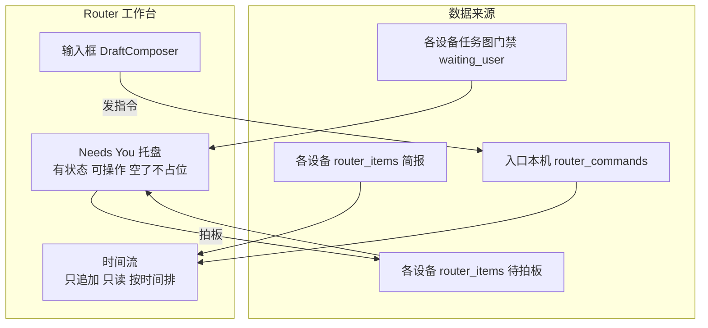
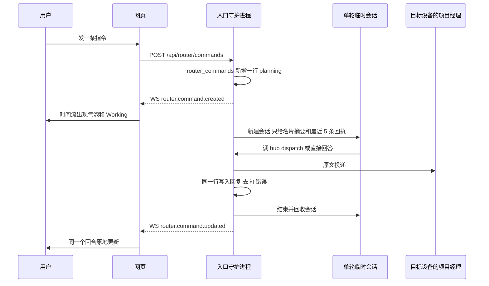
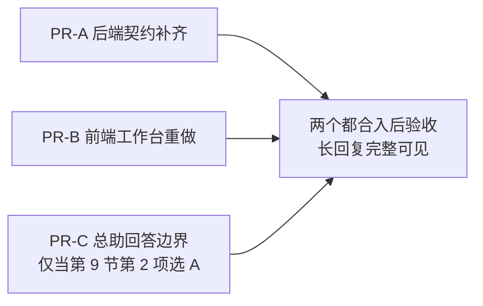

# 水果刀总助工作台 v2：待拍板托盘 + 指令与简报时间流

状态：待用户拍板。纯设计文档，不改 `src/`，不改 `docs/ui-standard.md`。拍板后按第 8 节拆 PR 实现。

替代范围：`docs/router-design.md` 第 4.3、4.4 节（四段式非对话工作台）和 `docs/ui-standard.md` 第 21 条的工作台部分。`router-design.md` 的其余内容继续有效：双轨分派、`--verbatim`、名片摘要、只读沙箱、6 家厂商快模型预设、`hub router ask / report / note`。

文中的行号对应提交 `b47baa6`。标了“静态核对”的结论来自读代码，没有在浏览器里实测；标了“估算”“推算”的数字不是量出来的，实现 PR 要用实测数字替换。

文件名短写：`RouterWorkbench.tsx` 指 `src/web/components/RouterWorkbench.tsx`；`dispatcher.ts`、`prompt.ts` 指 `src/daemon/router/` 下的两个文件；`ledger/router.ts` 指 `src/daemon/ledger/router.ts`；`server.ts` 指 `src/daemon/ui-server/server.ts`；`selectors.ts`、`state.ts`、`client.ts` 指 `src/web/` 下的文件。项目经理自己的提示词写全路径 `src/daemon/prompt.ts`。

---

## 0. 结论

1. **根因**：v1 把“消息”建模成了“通知”。总助的回答、用户的指令、项目经理的简报都被塞进可关闭的单行回执条。回执条只适合指向别处的内容，而总助的回答没有别处，截断就是丢失。
2. **新架构**：页面只有两个区域加一个输入框。
   - `Needs You` 托盘：有生命周期的待拍板项，钉在顶栏下面，没有待拍板项时整块不渲染。
   - 时间流：用户指令、总助回答、分派去向、项目经理简报，按时间从上到下，完整 Markdown，不截断，没有卡片框，没有 `×`。
3. **简报进时间流**，看到就算已读。没有 `Done`、`Archive all`、`Archived` 分区。
4. **后台不变**：每条指令仍是一个全新的单轮临时会话，注入的历史仍是最近 5 条回执、600 字节以内。时间流是 `router_commands` 账本的回放，不是会话记忆，第 500 条指令和第 1 条花的 token 一样多。
5. **数据缺口 8 处**（第 3 节），全部用已有的 JSON 列和查询补齐，不加迁移文件。最严重的两处：总助回复在写库前被截到 240 字；`@` 直转根本不落库。
6. **实施**：2 个并行 PR（后端契约、前端工作台）加 1 个取决于拍板的小 PR（总助回答边界）。
7. **待拍板 3 项**见第 9 节。

---

## 1. 诊断：为什么“一条消息一张卡”是错的

### 1.1 截图里的每个现象对应哪行代码

| 截图里的现象 | 代码位置 | 原因 |
| --- | --- | --- |
| 回复被截成一行，结尾是 `...` | `src/web/components/RouterWorkbench.tsx:779` | 摘要放在带 `truncate` 的 `<span>` 里 |
| 正文里露出 `**本机（…）**` | 同上 | `plan.reply` 被当成纯文本，没有经过 `Markdown.tsx` |
| 看不到自己发了什么 | `RouterWorkbench.tsx:456` | `summaryText = cmd.plan?.reply ?? cmd.inputText`，有回复就只显示回复；失败行（743 行）只显示错误 |
| 英文原始错误 `session_ended: session 512 has been ended` | `src/daemon/router/dispatcher.ts:802-804`、`src/web/format.ts:145-146` | 非预期异常的 `err.message` 原样写进 `router_commands.error`，界面对字符串原样输出。这个错误本身的根因已由提交 `e353326` 修掉，这里说的是呈现 |
| 每行右边一个 `×`，失败行是 `Retry` `Dismiss` | `RouterWorkbench.tsx:746-763`、`780-787` | 回执条被设计成可关闭的通知 |
| 最多看到 5 条 | `RouterWorkbench.tsx:491`、`ROUTER_VISIBLE_RECEIPTS_MAX` | 通知不该堆积，所以限了条数 |

截图之外还有两处，光改界面修不好：

- 界面不截，后端也已经截了。`dispatcher.ts:461-465` 的 `cleanReplyNote` 把回复截到 `ROUTER_REPLY_NOTE_MAX_CHARS`（`src/daemon/router/prompt.ts:32`，240 字）再写库。超出的部分没有存在任何地方。
- 用 `@` 选了目标的直转，回执只在组件的 `useState` 里（`RouterWorkbench.tsx:177`）。切到别的对话再回来，或者刷新，就没了。

### 1.2 根因：两件事被绑在了一起

`router-design.md` 第 0 节写的是“Router 绝不是从上往下堆气泡的聊天窗口”。这句话里绑了两件事：

- 后台不攒多轮上下文。这是对的，快而且省 token。
- 界面不能长得像对话。这是从上一条错推出来的。

界面不许有对话流，用户说的话和总助的回答就没有地方放，只能挤进“回执条”。回执条是通知的形状：短，可关，内容在别处。总助的回答不在别处，回执条是它唯一出现的地方。于是为了让条能堆叠而做的每一件事（单行、截断、限 5 条、带关闭键）都在损坏内容。

### 1.3 生命周期检验：什么东西才配一张卡

一样东西要不要独立的容器，看三条：有没有需要用户改变的状态；有没有只属于它自己的操作；不处理是不是一直有效。

| 事物 | 需要用户改变的状态 | 自带操作 | 应该是 |
| --- | --- | --- | --- |
| 待拍板项（任务图门禁、`hub router ask`、桥接过来的 `hub ask`） | pending → resolved | 选项、备注 | 卡片 |
| 用户指令 | 没有，发出去就是事实 | 只有没发出去时重发 | 时间流条目 |
| 总助的回答、分派去向 | 没有 | 跳转 | 时间流条目 |
| 项目经理的里程碑简报 | 没有。v1 人为加了 unread → archived，才需要 `Done` | 跳转 | 时间流条目 |

v1 给后三种也套了容器。每个容器都要回答“它怎么消失”，于是有了 `×`、`Dismiss`、`Done`、`Archive all`、`Archived`、最多 5 条。这些操作没有一个是用户的事，全是容器带来的家务。

---

## 2. 新信息架构

### 2.1 两类事物，两个区域



| | `Needs You` 托盘 | 时间流 |
| --- | --- | --- |
| 装什么 | 待拍板项 | 指令回合、简报 |
| 数据 | 各设备的门禁节点和 pending 的 `router_items`（现有 `fleetRouterView().decisions`） | 入口本机的 `router_commands` 加各设备的 report 类 `router_items` |
| 生命周期 | 拍板后消失 | 只追加，不消失 |
| 位置 | 顶栏下面，不随时间流滚动 | 中间，贴底滚动 |
| 空的时候 | 整块不渲染 | 居中的水果刀和 `All clear` |
| 容器 | 卡片（复用 `RouterDecisionCard`） | 没有容器 |

### 2.2 布局骨架

桌面（主区沿用 `.chat-main` 和 `.chat-column`，列宽 46rem 到 64rem）：

```
┌──────────────────────────────────────────────────────────────┐
│ [刀 28]  Router                                              │  顶栏 h-16
├──────────────────────────────────────────────────────────────┤
│ Needs You  2                                                 │  托盘：有待拍板项才有
│ ┌──────────────────────────────────────────────────────────┐ │
│ │ [橙 24] 小林  agent-hub                            11:14 │ │  第一张展开
│ │ 路由状态表用独立表还是扩现有 messages 表？               │ │
│ │ [A] 独立 router_items STRICT 表             Recommended  │ │
│ │ [B] 复用 messages 表加 kind 枚举                         │ │
│ │ [ Add a note, or type a custom reply…            ] [↑]   │ │
│ └──────────────────────────────────────────────────────────┘ │
│ [莓 20] 草莓  发版前要不要先跑一遍全量 E2E？       10:52  ›  │  其余收成一行
├──────────────────────────────────────────────────────────────┤
│                                  ┌───────────────────┐       │  时间流（贴底）
│                                  │ 现在谁在干活？    │       │  用户气泡，靠右
│                                  └───────────────────┘       │
│ [刀 26] Router                                               │
│ 目前没有正在干活的 PM，名片里的 PM 全部是空闲状态……          │  完整 Markdown
│ 本机（Yuxin Zhang's MacBook Pro）                            │  加粗正常渲染
│   - 小林（agent-hub）：空闲                                  │  列表正常渲染
│ [复制] 16:31                                                 │
│                                                              │
│              ┌───────────────────────────────────────┐       │
│              │ 让小林查一下 vitest 为什么在 CI 上慢  │       │
│              └───────────────────────────────────────┘       │
│ [刀 26] Router                                               │
│ [瓣 20] 排查 vitest 慢测   agent-hub         Started   ›     │  去向行，整行可点
│ 16:33                                                        │
│                                                              │
│ New ──────────────────────────────────────────────────────── │  上次看过之后的新简报
│ [青 26] 阿青   billing-api   Tokyo                           │
│ PR #398 已合并，Linux 只读沙箱回归测试全绿。                 │
│ PR #398 ↗    Piece #391                                      │
│ 16:40                                                        │
├──────────────────────────────────────────────────────────────┤
│ ┌──────────────────────────────────────────────────────────┐ │
│ │ [附件]  Tell Router, or type @ to pick a project…   [↑]  │ │  复用 DraftComposer
│ └──────────────────────────────────────────────────────────┘ │
└──────────────────────────────────────────────────────────────┘
```

手机（同一棵组件树，只有边距、安全区和占位符不同）：

```
┌──────────────────────────┐
│ ‹  [刀 28] Router        │  顶栏，Back 回列表页
├──────────────────────────┤
│ Needs You  2             │  托盘最高 50dvh，里面滚
│ ┌──────────────────────┐ │
│ │ 小林   agent-hub     │ │
│ │ 路由状态表用独立表… │ │
│ │ [A] 独立 … 表        │ │  选项行 ≥ 44px
│ │ [B] 复用 … 表        │ │
│ │ [ Add a note… ] [↑]  │ │
│ └──────────────────────┘ │
│ 草莓  发版前要不要…   › │
├──────────────────────────┤
│         ┌──────────────┐ │
│         │ 现在谁在干活 │ │
│         └──────────────┘ │
│ [刀] Router              │
│ 目前没有正在干活的 PM…   │
│ 16:31                    │
├──────────────────────────┤
│ [附件] Tell Router… [↑]  │  底部垫安全区 + 8px
└──────────────────────────┘
```

### 2.3 时间流里的两种条目

**指令回合**（一行 `router_commands` 就是一个回合）：

- 上半是用户说的话：靠右的气泡，和项目经理对话里的用户气泡同一套（`Messages.tsx:79` 的 `BUBBLE` 加 `bg-bubble-me`）。在 `#/router` 下 `--primary` 是碳黑，气泡自然是很浅的中性灰。有附件时文件小条在气泡上方。
- 下半是总助的结果：靠左，开头一次“水果刀头像 26px + `Router`（13.5px、500、灰）”，和第 17 条“一轮回复一个头像”一致。下面按有什么画什么：
  - 去向行：每个投递成功的目标一行。左边目标头像 20px（项目经理是整果切面，Piece 是果瓣），名字 15px、500（项目经理名或 Piece 标题），后面项目名、设备名 12px 灰，用 `gap-3` 隔开，不用拼接符。设备名只在多设备或目标不在本机时出现。最右一个 `ChevronRight`。操作不是单纯投递时，箭头前多一个 12px 灰色状态词：`Started`、`Paused`、`Ended`、`Created`。整行是一个按钮，点了进那台设备上的项目经理对话或 Piece 对话。行的尺寸和悬停照右栏的行（`py-2 px-2.5 rounded-xl`，触屏 `min-h-11`），悬停是这个项目经理的水果果冻底。
  - 回复正文：`Markdown.tsx` 渲染全文，不限行数。
  - 结尾一行：复制按钮（有正文才有）和时间（12px 灰，`tabular-nums`）。
- 执行中：头像下面一行 `Working…`，带 `.status-shimmer` 流光。已经投出去的目标行会先出现。
- 失败：见 4.3。

**简报**（一行 report 类的 `router_items`）：

- 开头“来源项目经理的水果头像 26px + 名字（13.5px、500、灰）”，后面项目名、设备名 12px 灰，`gap-2`。名字可点，进那个项目经理的对话。同一个项目经理连着发几条，只有第一条带头像和名字。
- 正文：`Markdown.tsx` 渲染 `summary` 全文。
- 链接：正文下面一行，普通的蓝色行内链接，`gap-3` 隔开，外链带 `ExternalLink` 小图标。不用胶囊。
- 结尾：时间。
- 没有边框，没有底色，没有 `Done`。

三种说话的人靠位置和头像区分：我在右边，水果刀是总助，水果是项目经理。

### 2.4 里程碑简报放哪：进时间流

判断：简报混入时间流，做成安静的条目。不做顶栏，不做折叠区。

理由：

1. 按 1.3 的检验，简报没有需要用户改变的状态。它是“某个时刻项目经理说了一句话”，本来就是时间流的材料。
2. 单独成区就必须回答“这个区怎么不越积越多”，答案只能是逐条 `Done` 或一键 `Archive all`。这正是用户指出的问题。
3. 时间上的相邻有意义。“14:02 我让小林查慢测”和“14:40 小林报告查到了”挨在一起，读起来是一件事。分成两个区，用户要自己对时间。
4. 量是可控的。简报正文上限 400 字（`ROUTER_CONTEXT_MAX_CHARS`），`hub router report` 在项目经理提示词里的定位是里程碑汇报（`src/daemon/prompt.ts:243`）。`router-design.md` 第 5 节按一个月 500 条估，平均一天十几条。

“未读”怎么办：看到就算已读（4.4）。`router_items` 的 unread → archived 不再由用户逐条点，而是打开工作台时自动标。左栏水果刀那一行的灰色数字照旧表示没看过的简报数。

没有重蹈满屏卡片：简报条目没有容器。连续 5 条简报在屏幕上是 5 段带头像的文字，和项目经理对话里连续 5 段回复一样。

### 2.5 后台无状态，前台有问有答



要点：

- 一个回合就是 `router_commands` 的一行：`input_text` 是问，`plan_json.reply` 和 `dispatched_json` 是答。界面把这一行画成“气泡 + 结果”，就有问有答了。不需要另一张消息表。
- 模型每次看到的上下文不随时间流变长。注入的是名片摘要（上限 24 KB）和最近 5 条回执（上限 600 字节，`prompt.ts:24-26`），用来消解“把刚才那个停掉”这种指代。这部分不动。
- 界面不承诺后台没有的东西。时间流是账本回放，回合之间在视觉上各自独立（每个回合自带头像，不合并成一长段），和“每条指令独立处理”的事实一致。

### 2.6 考虑过但不采用的方案

| 方案 | 不采用的原因 |
| --- | --- |
| 把总助做成一个真的 `assistant` 对话，消息写进 `messages` 表，整个复用 `MessageList` | 对话牵着会话投递、交接换代、未读、左栏预览、快照里的消息窗口。每一处都要给“这个对话不投递给 agent”开特例。`router_commands` 的状态机和重试上下文还得留着，变成两份真相。远端设备的简报仍然要在网页端合并，没省下什么 |
| 保留回执条，只去掉 `truncate`，加一个展开 | 只修了“看不全”。关闭键、限 5 条、看不到自己的话、简报要点 `Done` 都还在 |
| 简报放顶栏或折叠区 | 见 2.4 |
| 待拍板项放右栏 | 拍板是总助的第一职责，放侧栏是降级。手机没有右栏，要另做一套 |
| 用户指令不用气泡，改成靠左的加粗指令行 | 时间流里有三种说话的人，靠左右位置区分最省力。气泡也是“没发出去”红色感叹号的落点（第 17 条）。项目里已有的写法优先 |
| 总助回复逐字流式显示 | 轨道 B 的设计目标是 0.6 到 1.8 秒一轮（`router-design.md` 2.2）。一行 `Working…` 够用。流式要加一类高频 WS 事件和内存态，现在不值。实测中位数超过 3 秒再议 |

---

## 3. 数据契约逐字段核查与补齐

### 3.1 核查表

| 需要的数据 | 现状 | 出处 | 结论 |
| --- | --- | --- | --- |
| 用户指令原文 | `router_commands.input_text` 存全文，上限 4,000 字 | `migrations/0023_router_and_task_graphs.sql:51`、`src/shared/limits.ts:652`、`dispatcher.ts:1061-1079` | 齐全 |
| 用 `@` 选了目标的指令 | 网页直接 `postMessage` 到目标对话，不经 `/api/router/commands`，`router_commands` 里没有这一行 | `RouterWorkbench.tsx:565-607` | **缺**。只在组件内存里，切走或刷新就丢 |
| 总助回复全文 | `plan_json.reply`，写库前截到 240 字 | `dispatcher.ts:461-465`、`prompt.ts:32` | **缺**。超出的部分写库时已丢 |
| 回复分段 | 多段 `agent.text` 用单个换行拼 | `dispatcher.ts:462` | 小缺陷。相邻两段可能被 Markdown 并成一段 |
| 分派目标 | `dispatched_json[]` 每项有 `deviceId`、`deviceName`、`pmId`、`pmName`、`projectId`、`projectName`、`conversationId`、`workerId`、`workerConversationId`、`title`、`op`、`ok` | `src/shared/router.ts:116-133`、`dispatcher.ts:276-366` | 齐全，够直接跳转 |
| 界面怎么用分派目标 | 没用记录里的会话编号，而是拿 `deviceId:pmId` 去当前 `@` 候选里反查。候选里本机的键是 `"local"`，记录里是本机的真实设备编号（UUID） | `RouterWorkbench.tsx:335-341`、`429-439`，`src/web/selectors.ts:1058`，`src/daemon/daemon.ts:648-650`，`src/daemon/device.ts:31` | **缺陷**（静态核对）。本机分派对不上键，跳转入口不出现。测试夹具写的是 `deviceId: "local"`（`router-workbench.test.tsx:102`、`110`、`512`），所以没暴露 |
| 时间戳 | `created_at`、`updated_at`、`duration_ms` | `migrations/0023…sql:59-61` | 齐全 |
| 错误详情 | 一个 `error TEXT`。目标操作和账本的错误是中文人话，其余异常是原始 `err.message` | `dispatcher.ts:585`、`802-804` | **缺**。没有“人话”和“原文”两层 |
| 重试上下文 | `input_text`、`plan.attachmentIds`、`plan.retryOps`（失败操作的完整载荷）都在服务端，重试只要指令编号 | `dispatcher.ts:1092-1181` | 基本齐全 |
| 显式目标 | 请求里的 `target` 不落库。整条重跑时不带目标，会改走轨道 B | `dispatcher.ts:1173-1180` | **缺**。v1 网页没用过 `target` 所以没碰到，v2 会用 |
| 附件 | `plan.attachmentIds` 只有上传编号 | `dispatcher.ts:1073-1076` | **缺**。没有文件名，时间流里画不出用户发了什么文件 |
| 更早的指令 | 服务端有 `GET /api/router/commands?cursor=`，网页的 client 没有对应方法 | `src/daemon/ui-server/server.ts:1506-1519`、`src/web/client.ts:258-275` | 缺前端调用 |
| 快照里的指令 | 最近 10 条，只给入口本机；对等设备来取时清空，WS 也不推给对等设备 | `src/daemon/ledger/router.ts:812-817`、`server.ts:1229-1232`、`1623` | 设计如此，保留 |
| 简报正文 | `summary` 上限 400 字，`links_json` 最多 4 条 | `ledger/router.ts:474-495` | 齐全。界面按纯文本画（`RouterWorkbench.tsx:853`），要改走 Markdown |
| 读过的简报 | 快照只带 unread。归档后只能从 `GET /api/router/items` 拉，而且只拉入口本机 | `ledger/router.ts:799-805`、`722-783`，`RouterWorkbench.tsx:505` | **缺**。读过的简报从快照里消失，远端设备的历史拉不到 |
| 快照里的活跃项上限 | pending 和 unread 合用一个 `LIMIT 50` | `ledger/router.ts:799-805` | 隐患。未读简报多了会把较早的待拍板项挤出快照 |
| 简报里的文件链接 | `--file` 生成的 `target` 是文件路径，界面当成普通 `<a href>` | `src/hub/cli.ts:831-835`、`RouterWorkbench.tsx:121-125` | 缺陷（静态核对）。点了会打开一个不存在的相对网址 |
| 多设备聚合 | 待拍板项、未读简报按设备聚合，指令只取入口本机 | `selectors.ts:961-1092` | 保留，时间流沿用 |

### 3.2 补齐方案

原则：不加表，不加列，不加迁移文件。新字段都放进已有的 `plan_json`，都是可选的，老数据不带也合法。

```ts
// src/shared/router.ts
export interface RouterCommandAttachment {
  id: string;
  name: string;
  mime: string;
  size: number;
}

export interface RouterAgentPlan {
  intent: "dispatch" | "answer" | "ambiguous";
  reply: string;
  actions: RouterAction[];
  track?: "A" | "B";
  attachmentIds?: string[];
  retryOps?: Array<{ deviceId: string; op: unknown }>;
  /** 新增：附件的显示信息，创建指令时由守护进程按上传编号解析。 */
  attachments?: RouterCommandAttachment[];
  /** 新增：请求里的显式目标，整条重跑时带回去。 */
  target?: PostRouterCommandTarget;
  /** 新增：回复超过 ROUTER_REPLY_MAX_CHARS 被截时为 true。 */
  replyTruncated?: true;
  /** 新增：原始错误文本，只进悬停提示。 */
  errorRaw?: string;
}
```

`PostRouterCommandTarget` 现在定义在 `src/shared/api.ts`，随这次改动移到 `src/shared/router.ts`，避免两个文件互相引用。

后端要改的 7 件事：

1. **回复不再截到 240 字**。`ROUTER_REPLY_NOTE_MAX_CHARS` 从 `prompt.ts` 删掉，换成 `src/shared/limits.ts` 的 `ROUTER_REPLY_MAX_CHARS = 6_000`。超过才截，截了就标 `replyTruncated`，界面在正文末尾显示一行灰字 `Reply truncated`，不悄悄加省略号。多段之间用空行拼。
2. **显式目标落库**。`submitCommand` 把 `input.target` 写进 `plan.target`，`retryCommand` 整条重跑时带上它。
3. **附件带显示信息**。`createRouterDispatcher` 多收一个按上传编号解析附件的函数（守护进程已有 `resolveUpload`），创建指令时写 `plan.attachments`。
4. **错误分两层**。已经是人话的错误照旧写 `error`。其余异常经 `src/shared/errors.ts` 的 `describeFailure` 得到人话写 `error`，原文写 `plan.errorRaw`。
5. **轨道 A 成功时 `reply` 留空**。现在写的是一句拼出来的回执（`dispatcher.ts:569-575`），内容和 `dispatched` 里的结构化字段重复。老数据还带着这句话，界面的规则是：`plan.track === "A"` 的回合不画 `reply`。
6. **快照按两类分别取**。`snapshotSlice` 的 `items` 改成两个各自有上限的查询再合并：全部 pending 的待拍板项（上限 50），加最近 30 条简报（不分已读未读，按 `created_at` 倒序，另有字节上限）。这样读过的简报留在快照的近窗里，未读简报再多也挤不掉待拍板项。`commands` 仍是最近 10 条，加字节上限。
7. **简报历史能按设备翻页**。`GET /api/router/items` 加查询参数 `kind=report`：只回简报，不分状态，沿用现有的 `<createdAt>:<id>` 游标和 `router_items_cursor` 索引。不带 `kind` 时行为不变。

前端对应的 4 件事（属于第 8 节的 PR-B）：

1. `@` 选了目标的发送改走 `postRouterCommand({ clientId, text, attachmentIds, target })`。附件传到入口本机，由守护进程转给远端（`src/daemon/router/target-port.ts:731-778` 已有）。浏览器访问远端本来就经入口代理，不多绕路。
2. 去向行直接用 `dispatched[]` 里的 `conversationId` 或 `workerConversationId`，设备用 `deviceKeyOf(deviceId, fleet.selfId)`（`src/web/devices.ts:39`）换成网页的设备键。不再反查 `@` 候选。
3. `client.ts` 加 `fetchRouterCommands({ cursor, limit })`，`fetchRouterItems` 加 `kind`。
4. 简报链接里的文件路径没有可预览的副本，画成普通文字，不画成链接（照第 15 条“没存下副本的直接显示原本的文字”）。外链、`worker:N`、`#/c/N`、`#/w/N` 照旧可点。

### 3.3 迁移与兼容评估

| 方面 | 影响 |
| --- | --- |
| 数据库结构 | 不变。没有新迁移文件，不碰“禁止 `ALTER TABLE … ADD COLUMN`”的约束 |
| 已有的指令记录 | 回复已经截到 240 字的补不回来，照存的画。没有 `plan.attachments` 的不画文件小条。没有 `plan.target` 的重试行为和现在一样 |
| 已有的简报 | 不受影响 |
| 快照体积 | 见 5.2。有字节上限兜底 |
| 设备版本不一致：入口新，远端旧 | 远端快照的 `items` 只有活跃项，那台设备读过的简报不在近窗里，只能翻历史时拉到。远端不认识 `kind=report`，会按旧口径回“已拍板的和已归档的”，网页端再按 `kind` 过滤一次，结果正确，只是一页里条数偏少 |
| 设备版本不一致：入口旧，远端新 | 旧网页按 `status === "unread"` 过滤简报（`src/shared/reminders.ts:193`），多出来的已读简报被忽略，行为不变 |
| 要跟着改的测试 | `src/daemon/router/prompt.test.ts`、`dispatcher.test.ts`、`src/daemon/ledger/router.test.ts`、`snapshot-size.test.ts`、`src/web/state.test.ts`、`selectors-cache.test.ts`、`router-workbench.test.tsx` |

---

## 4. 交互细节与双端体验

### 4.1 `Needs You` 托盘

- 没有待拍板项时不渲染，不留标题，不留空隙。
- 位置在顶栏和时间流之间，套 `.chat-column`，和时间流、输入框左右对齐。下边一条 1px `border-border`。
- 组标题照第 12 条：`Needs You`，12px、500、灰，高 32px，右边跟数量（12px 灰，`tabular-nums`）。标题整行是按钮，点了收起或展开（`ui/collapsible.tsx`）。收起不记住，待拍板项清空后复位。
- 第一张完整展开，直接复用现有的 `RouterDecisionCard`（三合一拍板、离线置灰都不改）。其余每张收成一行：来源头像 20px、项目经理名、问题第一行（15px，`truncate`，全文在 `title`）、时间、`ChevronRight`。点一行换它展开。这是右栏 `Needs You` 行的同一种写法。收起的行超过 3 条时出 `Show more`。
- 展开哪一张是推出来的：用户点过的那张，没点过就是第一张。拍掉一张，下一张自动成为第一张并展开。不需要额外的状态。
- 托盘最高 `50dvh`，超出在托盘里滚（`overflow-y-auto overscroll-contain`）。时间流永远留得出位置。
- 排序、乐观隐藏、失败回滚、防连点沿用现有实现。
- 顶栏右边的数量去掉，托盘标题上已经有了。

### 4.2 时间流的滚动

把 `MessageList.tsx:61-146` 的贴底逻辑抽成 `src/web/useStickToBottom.ts`，`MessageList` 和时间流共用。行为由现有的 `stick-to-bottom.test.tsx` 守着，不重写：

- 打开 `#/router`：停在底部。
- 自己发了一条：一定滚到底，哪怕正在往上翻。
- 新条目进来或正文变高（图片加载完、图表画出来）：原本在底部就跟着，往上翻了就不动。
- 离底部超过 80px：输入框上方出现“回到底部”图标按钮（第 17 条）。
- 翻到顶：出现 `Load earlier`（13.5px 灰色文字按钮，和对话里同一个），加载后保持正在看的那一条不动。
- 长回复：自由滚动，不被拉回底部。
- 新条目淡入 120ms，复用 `useMessageEnter`。打开时已有的历史不播。
- 输入框向上叠盖 26px，时间流底部留白 `pb-12`，照 `Conversation.tsx:182` 的写法，文字滚过输入框圆角时不被硬切。

### 4.3 发送、执行中、失败

发送用 `@tanstack/react-query` 的 `useMutation`（`mutationKey: ["router-command"]`），没确认的发送用 `useMutationState` 读出来画。不再手写 `LocalReceipt` 那一套 `useState`。mutation 的缓存在 `QueryClient` 里，切到别的对话再回来，没发完的那条还在。

| 状态 | 怎么判定 | 画面 |
| --- | --- | --- |
| 发送中 | mutation 在途，近窗里还没有同 `clientId` 的行 | 用户气泡，不写任何状态字 |
| 没发出去 | mutation 失败，近窗里没有同 `clientId` 的行 | 气泡左边红色圆圈白色感叹号（`Messages.tsx` 的 `UnsentMark`），点了用同一个 `clientId` 重发 |
| 执行中 | 行的 `status` 是 `planning` | 气泡下面水果刀头像和一行 `Working…`（`.status-shimmer`）。已投出的去向行先出现 |
| 已回答 | `answered` | Markdown 全文，复制，时间 |
| 已分派 | `dispatched` | 去向行，轨道 B 有补充说明时加一段 Markdown，时间 |
| 处理失败 | `failed` | 已成功的去向行照常。下面一行：14px `CircleAlert`（`text-danger`），人话原因（13.5px 灰，原文在 `title`），能重试时后面跟文字按钮 `Retry`（13.5px、500，灰，悬停变前景色） |

说明：

- 同一个 `clientId` 重发是安全的。`router_commands.client_id` 有唯一约束，`createCommand` 命中就直接返回已有记录（`ledger/router.ts:1067-1070`）。
- 请求超时但服务端其实在跑：近窗里已经有这一行，以服务端的行为准，那次 mutation 的失败不显示。
- `Retry` 能不能点和服务端一个口径（`dispatcher.ts:1104-1171`）：有 `retryOps` 就只补跑失败的目标；没有 `retryOps` 且没有任何目标成功就整条重跑；已有目标成功又没有明确失败项的不给 `Retry`，原因里已经写了“还有没交代到的请重新发一条”。
- 点了 `Retry`，这一行回到 `Working…`，不新开一个回合。
- 只有近窗里的失败回合带 `Retry`。翻历史翻出来的失败回合只显示原因，不能重试。隔了很久的指令不该一点就重新执行，想再做就重新发一条。这也让历史页保持只读，不需要回写缓存。
- 没有 `Dismiss`，没有 `×`。失败的回合是发生过的事，留在时间流里。
- 发送被拦（超长、上传失败）沿用输入框自己的规则：原因显示在输入框上方，文字留在输入框里（第 18 条）。
- `router_commands.status` 里的 `needs_confirm` 和 `cancelled` 现在没有代码会写入。`cancelled` 不显示（和 v1 一样），`needs_confirm` 留给以后。

### 4.4 已读和 `New` 分隔线

- 工作台可见（路由是 `#/router` 且页面在前台）而且有未读简报时，对每台在线且有未读简报的设备调一次现有的 `POST /api/router/reports/archive-all`。接口是幂等的。失败了不改任何界面状态，下次可见或有新简报时再试。
- 打开工作台的那一刻，如果有未读简报，在最早的那条未读简报上面画一条分隔线：`New`（12px 灰）后面一条 1px 细线，和第 17 条“换新会话”的分隔线同一种写法。分隔线的位置在打开时定下来，标成已读之后也不动，离开工作台才消失。
- 工作台开着时进来的新简报直接出现在底部并标为已读，不再画分隔线。
- 左栏水果刀那一行的规则不变：有待拍板项显示数字和绿点，只有未读简报显示灰色数字。

### 4.5 空状态

没有待拍板项，也没有任何回合和简报时（只会出现在第一次使用，或者 30 天没用过）：时间流区域居中一把淡色水果刀（36px，`opacity-40`）和 `All clear`（13.5px 灰）。和 v1 的空状态一样。

不加说明卡片，不加示例指令。告诉用户能做什么的是输入框的占位符 `Tell Router, or type @ to pick a project…`，输入框在用鼠标的设备上自动聚焦。

### 4.6 手机端

- 手机外壳的分流条件、返回键、`history` 规则都不变（第 20 条）。`#/router` 是一整屏，顶栏左边 `Back`。
- 同一棵组件树。差别只有：`.chat-column` 的边距（12px）、安全区（顶栏在刘海下面，输入框底部垫安全区加 8px）、占位符换成更短的 `Tell Router…`（390px 宽放不下长的那句，换短句不缩字号）、不自动聚焦。
- 托盘最高 `50dvh`。键盘弹起时视口变矮（`interactive-widget=resizes-content`），托盘跟着变矮，时间流和输入框仍然看得见。想多看时间流，点一下组标题收起托盘。
- 所有能点的东西平时就看得见，不靠悬停：`Retry`、去向行、简报链接、复制。去向行和托盘里收起的行触屏下 `min-h-11`，文字按钮带 `touch-target`。
- 用户气泡最宽 80%。Markdown 里的表格、代码块在自己里面横向滚，390px 宽下页面不出横向滚动条（第 19 条）。
- 验收截图放 `docs/screenshots/router-v2/`：桌面和 390px 各四张（有待拍板项、只有时间流、失败回合、空状态）。

### 4.7 复用清单和删除清单

复用，不新造：

| 用途 | 现有的 |
| --- | --- |
| 回复和简报的正文 | `components/Markdown.tsx` |
| 输入框、`@` 补全、附件、草稿 | `components/Composer.tsx` 的 `DraftComposer`，`composer-suggest.ts` |
| 用户气泡、头像加名字、复制键、红色感叹号 | `components/Messages.tsx` 的 `BUBBLE`、`AgentHead`、`CopyButton`、`UnsentMark`（现在是文件内部的，改成导出，不复制类名字符串） |
| 文件小条 | `components/Attachments.tsx` 的 `AttachmentList`（只用到编号、文件名、大小，`plan.attachments` 够用） |
| 待拍板卡 | `components/RouterDecisionCard.tsx`、`decision-actions.ts` |
| 贴底滚动、新条目淡入 | `MessageList.tsx` 抽出的 `useStickToBottom`，`useMessageEnter.ts` |
| 在忙的流光 | `styles.css` 的 `.status-shimmer` |
| 发送的在途和失败、历史分页 | `@tanstack/react-query` 的 `useMutation`、`useMutationState`、`useInfiniteQuery` |
| 托盘的收起 | `ui/collapsible.tsx` |

删掉（先减后加）：

- `Recent`、`Updates`、`Archived` 三个分区和它们的标题。
- `LocalReceipt`、`UnifiedReceipt`、`ReceiptTargetLink` 三个类型，`localReceipts`、`dismissedReceipts`、`retryingCommands`、`commandRetryErrors`、`hiddenReportKeys`、`archiveError`、`archivedOpen` 七个 `useState`，以及给它们做清理的四个 `useEffect`。
- `ReportLinkItem` 的胶囊链接、`ArchivedRow`、`targetByDeviceAndPm` 反查表。
- `ROUTER_VISIBLE_RECEIPTS_MAX`。`ROUTER_ARCHIVED_PAGE_SIZE`、`ROUTER_ARCHIVED_MAX_PAGES` 改名（5.2）。
- 界面词 `Recent`、`Updates`、`Archived`、`Archive all`、`Done`、`Dismiss`、`Dispatching…`。

`RouterWorkbench.tsx` 现在 943 行。估算改完后它剩 250 行左右，新增的时间流组件和选择器合计 350 行左右。

---

## 5. 性能

对照 `AGENTS.md` 的 4 条。规模按跑了一个月算：3 台设备、20 个项目经理、300 个已收工 Worker、3 万条消息、5 万步日志，外加 500 条指令（`ROUTER_COMMANDS_RETENTION_MAX`）和 500 条简报。

### 5.1 失效

时间流的数据分三层，每层只有一个来源：

| 层 | 放在哪 | 内容 | 怎么更新、怎么失效 |
| --- | --- | --- | --- |
| 近窗 | 每台设备的 `HubState.router`（`device-hub.ts`） | 快照带来的最近 10 条指令（只有入口本机）和最近 30 条简报，加上页面开着期间新来的 | WS 的 `router.command.created / updated`、`router.item.created / updated`、`router.reports.archived_all` 经 `state.ts` 的 reducer 更新。断线重连后整份换成新快照 |
| 历史 | `useInfiniteQuery` | 比近窗最旧一条更早的指令和简报 | 查询键里带近窗最旧一条的游标：`["router-stream", "commands", cursor]`、`["router-stream", "briefings", deviceKey, cursor]`。近窗的边界变了（重连换快照、近窗超上限裁剪），键就变了，历史从新边界重新分页。历史本身只读，`staleTime: Infinity`，不需要手动失效 |
| 未确认的发送 | mutation 缓存 | 还没被服务端确认的指令 | 近窗里出现同 `clientId` 的行就不再显示，`gcTime` 到了自动回收 |

近窗的不变量：它永远是时间上连续的最新一段。因此 reducer 有两条规则：

- `created` 事件加到近窗前面。
- `updated` 事件只更新近窗里已有的行。近窗之外的行不加进来，否则近窗中间会出现空洞，历史的边界也会错。

其余：

- 失败不当结果缓存。历史页拉取失败是 query 的错误态，`Load earlier` 的位置显示 `Couldn't load. Click to retry`（对话里已有的说法），不缓存空页。
- 设备离线时那台的历史查询不启用（`enabled: online`），不记“没有更多”。重新上线后照常可翻。
- 设备被移除时 `removeQueries({ queryKey: ["router-stream", "briefings", deviceKey] })`，那台的 `DeviceHub` 销毁时近窗一起丢。
- 项目经理被删除：近窗里它的简报由现有 reducer 清掉（`state.ts:296-307` 的 `pm.removed`）。被归档的项目经理的简报在选择器里过滤，照 `src/shared/reminders.ts:188-193` 的写法。
- 离开 `#/router` 后历史查询没有订阅者，5 分钟后回收（`query-client.ts` 的 `gcTime`）。
- 标已读的请求按“未读简报编号的集合”去重，集合没变不重发。

### 5.2 上限

`src/shared/limits.ts` 的改动：

| 常量 | 值 | 用途 |
| --- | --- | --- |
| `ROUTER_REPLY_MAX_CHARS` | `6_000` | 新增。总助单条回复入库上限，取代 `prompt.ts` 里的 `ROUTER_REPLY_NOTE_MAX_CHARS`（240） |
| `MAX_ROUTER_REPLY_BYTES` | `4 * ROUTER_REPLY_MAX_CHARS` | 新增。照 `MAX_ROUTER_QUESTION_BYTES` 的写法 |
| `ROUTER_RECENT_COMMANDS_SNAPSHOT_MAX` | `10` | 不变。快照里的指令条数 |
| `ROUTER_COMMANDS_SNAPSHOT_MAX_BYTES` | `64 * 1024` | 新增。快照里指令的字节上限，从新到旧累加，超了就停，至少带 1 条 |
| `ROUTER_STREAM_BRIEFINGS_SNAPSHOT_MAX` | `30` | 新增。快照里的简报条数，不分已读未读 |
| `ROUTER_BRIEFINGS_SNAPSHOT_MAX_BYTES` | `48 * 1024` | 新增。快照里简报的字节上限，同样从新到旧累加 |
| `ROUTER_ACTIVE_ITEMS_SNAPSHOT_MAX` | `50` | 含义收窄：只管 pending 的待拍板项 |
| `ROUTER_STREAM_LIVE_MAX` | `200` | 新增。网页内存里每台设备的近窗最多留多少条指令、多少条简报。超了保留最新的，边界随之前移 |
| `ROUTER_STREAM_PAGE_SIZE` | `30` | 由 `ROUTER_ARCHIVED_PAGE_SIZE` 改名。历史每页条数 |
| `ROUTER_STREAM_PAGE_MAX_BYTES` | `256 * 1024` | 新增。单页响应的字节上限，超了提前截页，游标指向最后一条已给出的 |
| `ROUTER_STREAM_MAX_PAGES` | `10` | 由 `ROUTER_ARCHIVED_MAX_PAGES` 改名。每个来源最多往回翻几页，到了就不再出 `Load earlier` |
| `ROUTER_VISIBLE_RECEIPTS_MAX` | 删除 | 时间流不限条数 |

`ROUTER_FLEET_DIGEST_MAX_BYTES`、`ROUTER_PM_ACTIVE_WORKERS_MAX`、`ROUTER_PERSONA_SUMMARY_MAX_CHARS` 现在在 `limits.ts` 和 `prompt.ts` 各有一份同名常量（`prompt.ts:20-30`）。PR-A 顺手把 `prompt.ts` 那份删掉，改成引用 `limits.ts`。

一个月之后各处有多大：

- 数据库：`router_commands` 最多 500 行（已有的清理）。按上限推算最坏每行 30 KB（4,000 字指令加 6,000 字回复），合计 15 MB；按典型的一两百字估算在 1 MB 以内。简报保留 30 天。清理逻辑不用改。
- 快照：指令最多 64 KB，简报最多 48 KB，加上最多 50 张待拍板项。按字节上限推算，现在的代码在最坏情况下已经能超过 `SNAPSHOT_MONTH_MAX_BYTES`（384 KB）：一条简报带满 4 个链接是 `4 × MAX_ROUTER_REPORT_LINK_BYTES` 约 9 KB 加正文 1.6 KB，50 条约 550 KB。新增的两个字节上限把这个洞堵上。典型增量估算 10 到 20 KB，实测数字由 PR-A 用 `snapshot-size.test.ts` 的一个月数据集给出。
- 网页内存：每台设备近窗最多 200 条指令（只有入口本机有）和 200 条简报，历史最多 10 页 × 30 条。全舰队渲染出来的条目上限是 500 个回合加每台设备 500 条简报。
- 单次响应：历史一页最多 30 条、256 KB，走 `ui-server` 已有的 `@fastify/compress`。
- 给 agent 的上下文：不变。名片摘要 24 KB，最近 5 条回执 600 字节。时间流多长都不影响。

时间流不做虚拟列表。条目数有上面的硬上限，每个条目是 `memo` 组件，`Markdown` 本身也是 `memo`。对话的消息列表在同样的量级上也没有做。

### 5.3 前端引用稳定

- 新增选择器 `routerStreamOf(state)`（单台设备）和 `fleetRouterStream(devices)`（全舰队），写法照 `selectors.ts` 里的 `deviceRouterView` 和 `fleetRouterView`：单台按 `state.router.items`、`state.router.commands`、`state.pms`、`state.projects` 四个引用做 `WeakMap` 缓存；全舰队按每台设备的（键、名字、在线、单台结果引用）指纹比较，全等就返回上一次的数组。
- 条目对象按底层记录缓存（`WeakMap<RouterCommandRecord | RouterReportItem, 条目>`）。reducer 只替换变了的那条记录，其余条目的引用不变。
- 时间流和托盘是两个各自 `memo` 的组件，吃两个各自稳定的输入。拍板一张卡不重画时间流，来一条简报不重画托盘。
- `RouterWorkbench` 的外壳会随 `App` 每次重画而重跑（`leading`、`notices` 是每次新建的节点），所以重的部分必须在 `memo` 的子组件里，回调全部 `useCallback`，`clientForDevice` 沿用已经稳定的 `hub`（`device-hub.ts:559`）。
- 某台机器上的 Worker 高频吐流式 token 时：变的是那台设备的 `sessions` 和 `conversations`，上面四个引用都不变，`fleetRouterStream` 返回同一个数组，时间流组件 0 次重画。一个回合从 `planning` 变成 `dispatched` 时，只重画那一个回合。

守卫测试（PR-B）：

- `selectors-cache.test.ts` 加一组：300 个 Worker、3 万条消息下连续 100 次流式状态更新，`fleetRouterStream` 返回值 `toBe` 上一次，中位数耗时小于 2 ms（和现有 `fleetRouterView` 那组同一条线）。
- `router-workbench.test.tsx` 加一条：同样 100 次无关更新期间，时间流组件的渲染次数是 0；更新一条指令时只有对应的回合组件重画一次。

### 5.4 请求数和压缩

| 动作 | 请求 |
| --- | --- |
| 打开 `#/router` | 0 个额外请求。近窗在 `/api/state` 和 WS 里 |
| 有未读简报时打开 | 每台有未读简报的在线设备 1 个 `POST`，请求体为空 |
| 点一次 `Load earlier` | 入口本机 1 个（指令），每台在线设备 1 个（简报）。3 台设备最多 4 个，每个最多 30 条，压缩传输 |
| 发一条指令 | 每个附件 1 个上传，加 1 个 `POST` |
| 拍板、重试 | 各 1 个 `POST` |

多来源翻页的合并是一个纯函数：每个来源给出“已加载的条目”和“还有没有更早的”。所有还有更早内容的来源里，已加载最旧一条的时间取最大值，叫水位线。只显示不早于水位线的条目。这样往上翻时不会有更早的条目插到已经看过的内容中间。点 `Load earlier` 让所有还有更早内容的来源各翻一页，水位线下移。

### 5.5 验证

实现 PR 按 pstack 的 `benchmark-checklist`、`perf-issue`、`blast-radius` 给出改前改后的数字，写进 PR 正文：

| 指标 | 怎么量 | 目标 |
| --- | --- | --- |
| `/api/state` 未压缩字节 | `snapshot-size.test.ts` 的一个月数据集，另加 500 条指令（10 条带 2,000 字回复）和 500 条简报 | 小于 384 KB，写出增量 |
| `ledger.snapshot()` 耗时 | 同一数据集，改前改后交替各 7 轮，报中位数和范围 | 中位数增量小于 1 ms |
| `fleetRouterStream` 耗时和引用 | 5.3 的守卫测试 | 中位数小于 2 ms，引用全等 |
| 时间流渲染次数 | 5.3 的守卫测试 | 无关更新 0 次 |
| 历史一页的压缩后字节 | `server.test.ts` 用 30 条满长回复请求一页 | 写出数字，未压缩不超过 256 KB |
| 轨道 B 单轮输入大小 | `prompt.test.ts` 断言格式化后的上下文不超过 24 KB 加 600 字节 | 和改前相同 |

---

## 6. 统一

### 6.1 6 家厂商

一套模型和一个视图覆盖 `claude`、`agy`、`codex`、`pi`、`deepseek`、`cursor`，没有任何一处按厂商分支：

- 总助用哪家、哪个模型由 `resolveRouterModel` 按各家 `spec.ts` 里声明的快模型预设决定（`src/shared/router-model.ts`，守护进程从 `src/daemon/router/model-resolver.ts` 引）。这次不动。
- 6 家的回复都经驱动层归一成同一种 `agent.text` 事件（`src/shared/driver.ts:200-204`），`dispatcher` 收到的是纯文本，写进 `plan.reply`，界面用同一个 `Markdown` 组件画。
- 时间流的数据里没有厂商特有的字段。`RouterCommandRecord` 上的 `vendor`、`model`、`effort` 不显示，时间流里不出现厂商名。
- 失败原因的人话化走 `describeFailure`，各家的错误特征在 `src/shared/vendors.ts`，不在界面里。
- 新增第 7 家厂商时，时间流、托盘、契约都不用改。现有的 `web-guard.test.ts`（禁止网页写死厂商名）和 `vendor-registry.test.ts` 继续守着。

### 6.2 本机和远端设备

- 条目只有两种形状（回合、简报），每个条目带 `deviceKey`。本机和远端是同一种条目，没有“远端版”组件。
- 所有按设备的操作走同一个入口 `clientForDevice(deviceKey)`：拍板、标已读、翻简报历史。本机的键是空串，请求走 `/api/...`；远端走 `/d/<设备>/api/...`。
- 跳转走现有的 `onOpenConversation(deviceKey, id)` 和 `onOpenWorker(deviceKey, id)`。去向行和简报里的名字都用它。
- 设备名只在多设备或目标不在本机时显示，沿用 v1 的规则。只有一台设备时，界面和没有联机时一样。
- 设备离线：那台的待拍板卡置灰不可点（已有）；它的简报留在时间流里照常可读；发往它的指令失败，原因是人话，可重试。
- 指令回合属于“入口守护进程”，也就是给当前网页提供服务的那一台。手机经 Mac 的入口访问，看到的和 Mac 上是同一份。直接打开另一台机器自己的入口，看到的是那台机器上发过的指令。这是现有设计（`router-design.md` 3.5），这次不改。

### 6.3 桌面和手机

同一个组件、同一份数据、同一套状态。差别全部在 CSS 和已有的手机外壳里（4.6）。

---

## 7. `docs/ui-standard.md` 增补草案

等用户拍板后随 PR-B 合入。现在不改标准文件。

**第 3 条，界面词表**：

- “总助工作台 / 待决区 / 汇报区 / 近期指令”一行改成“总助工作台 / 待决区”，英文 `Router / Needs You`。
- “全部归档汇报 / 已全清 / 推荐项 / 阅毕归档 / 忽略”一行改成“已全清 / 推荐项”，英文 `All clear / Recommended`。
- “指令分派中（Router 回执流光状态词）”一行改成“总助处理中”，英文 `Working…`。
- 新增一行：“新简报分隔线 / 回复被截断 / 去向行状态词（已启动、已暂停、已结束、已创建）”，英文 `New / Reply truncated / Started / Paused / Ended / Created`。
- “Router 发令框占位”一行补上手机的短句：`Tell Router…`。

**第 4 条，颜色**：

- “不用强调色的”里举的例子“Router 汇报卡的 `Done`”改成“总助失败回合的 `Retry`”。
- “每张卡片左上角展示来源 PM 的 24px 彩色水果切片头像”改成“托盘里的待拍板卡和时间流里的简报，开头展示来源项目经理的彩色水果切片头像”。
- 补一句：`#/router` 下用户气泡照常用 `bg-bubble-me`，因为 `--primary` 是碳黑，气泡是浅中性灰，不单独写颜色。

**第 21 条，整条重写**：

> ## 21. Router 工作台：待拍板托盘和时间流
>
> `#/router` 由三部分组成：顶栏下面的 `Needs You` 托盘、中间的时间流、底部的输入框。方案见 `docs/router-workbench-v2-design.md`。
>
> - **水果刀头像**：（原条文不变）
> - **`Needs You` 托盘**：只放待拍板项。没有待拍板项时不渲染。套 `.chat-column`，下边 1px `border-border`，最高 `50dvh`，超出在里面滚。组标题照第 12 条（12px、500、灰，高 32px，右边数量），整行可点收起。第一张用 `RouterDecisionCard` 完整展开，其余每张一行（来源头像 20px、名字、问题第一行 `truncate`、时间、`ChevronRight`，行的尺寸照第 12 条），点一行换它展开，收起的行超过 3 条出 `Show more`。
> - **待拍板卡（`RouterDecisionCard`）**：（原“三合一待决选项卡片”条文不变）
> - **时间流**：从上到下按时间排，贴底，滚动规则照第 17 条“贴底”。里面只有两种条目，都没有边框、底色和关闭键。
>   - 指令回合：用户说的话是靠右的气泡（第 17 条的用户气泡）。总助的结果靠左，开头一次水果刀头像 26px 和 `Router`（13.5px、500、灰），下面依次是去向行、Markdown 正文（第 15 条，全文不截断）、结尾一行复制键和时间（12px 灰，`tabular-nums`）。
>   - 去向行：一个投递成功的目标一行。目标头像 20px、名字 15px、500，项目名和设备名 12px 灰，`gap-3`，最右 `ChevronRight`；启动、暂停、结束、新建时箭头前有 12px 灰的状态词。整行可点，尺寸和果冻底照第 12 条的行。不用“·”“|”“/”。
>   - 简报：开头来源项目经理的水果头像 26px 和名字（13.5px、500、灰），项目名、设备名 12px 灰。正文 Markdown。链接是正文下面一行普通行内链接，`gap-3`，不用胶囊。结尾是时间。同一个项目经理连着几条只有第一条带头像。
>   - 执行中：水果刀头像下面一行 `Working…`，`.status-shimmer`。
>   - 没发出去：气泡左边红色感叹号，点了重发（第 17 条）。
>   - 处理失败：结果位置一行，14px `CircleAlert`（`text-danger`）、人话原因（13.5px 灰，原文放 `title`）、文字按钮 `Retry`。没有 `Dismiss`。
>   - 未读分隔线：打开时有没看过的简报，在最早一条上面画 `New`（12px 灰）加 1px 细线，写法同第 17 条“换新会话”的分隔线。
> - **空状态**：没有待拍板项也没有任何条目时，居中 `<KnifeAvatar size={36} className="opacity-40" />` 和 `All clear`（`text-minor text-muted-foreground`）。
> - **输入框**：复用 `<DraftComposer>`，占位 `Tell Router, or type @ to pick a project…`，手机外壳是 `Tell Router…`。向上叠盖 26px，写法同对话页。

**第 17 条**：开头补一句“Router 的时间流复用这一条的气泡、头像行、贴底、没发出去的标记”。

---

## 8. 实施拆分

拆成两个可以并行的 PR，加一个取决于拍板的小 PR。不做成单个 PR：账本契约和界面重做的风险不同、测试不同，后端那部分很小，可以先独立验证。



### PR-A：后端契约补齐

范围：3.2 的后端 7 件事，5.2 的常量。不碰 `src/web/` 的组件。

先写测试：

- `dispatcher.test.ts`：2,000 字的回复原样入库；超过 `ROUTER_REPLY_MAX_CHARS` 截断并带 `replyTruncated`；两段文字之间是空行；带 `target` 的指令失败后重试仍走轨道 A；带附件的指令有 `plan.attachments`；未知异常的 `error` 是人话、`plan.errorRaw` 是原文；轨道 A 成功时 `reply` 为空。
- `ledger/router.test.ts`：60 条未读简报加 5 张待拍板项时，快照里 5 张待拍板项都在；已读的简报仍在快照近窗里；`listItems` 带 `kind=report` 回任意状态的简报并能翻页，不带时行为不变。
- `snapshot-size.test.ts`：带满长回复和满链接简报的一个月数据集不超过 384 KB。
- `prompt.test.ts`：单轮上下文大小不变。

独立验证：`pnpm typecheck` 和上面几个测试文件。合入后界面没有可见变化。

### PR-B：前端工作台重做

范围：第 2、4 节，3.2 的前端 4 件事，5.1、5.3，第 7 节的标准增补。

- 新增 `src/web/router-stream.ts`（纯选择器：`routerStreamOf`、`fleetRouterStream`、多来源合并）和 `src/web/components/RouterStream.tsx`。
- `RouterWorkbench.tsx` 改成外壳：顶栏、托盘、时间流、输入框。
- `state.ts` 的 reducer 按 5.1 的两条规则改。
- 抽出 `useStickToBottom.ts`，`MessageList.tsx` 改成用它。
- `client.ts` 加两个方法。
- 4.7 的删除清单。

先写测试：

- `router-workbench.test.tsx`：回复里的 `**加粗**` 渲染成 `<strong>`，全文在 DOM 里，没有 `truncate`；用户的原话在气泡里；没有 `Dismiss`，没有关闭键；本机分派的去向行点了跳到对应对话，夹具里的 `deviceId` 用真实样子的 UUID；失败回合显示原因和 `Retry`，点了回到 `Working…`；`@` 选目标后调的是 `postRouterCommand` 且带 `target`；没有待拍板项时 DOM 里没有 `Needs You`；切走再回来未确认的发送还在。
- `selectors-cache.test.ts` 和渲染次数守卫（5.3）。
- `stick-to-bottom.test.tsx` 原样通过。
- `ui-standard.test.tsx`、`web-guard.test.ts` 原样通过。

PR-B 必须能在 PR-A 没合入时工作（它本来就要兼容旧版本的远端设备）：字段不存在就按 3.3 降级。所以两个 PR 可以并行开发，合入顺序不限。用户看到的完整效果需要两个都合入。

独立验证：`pnpm typecheck`、上面的测试文件，按 `frontend-rules` 渲染桌面和 390px 的截图放进 PR。

### PR-C：总助回答边界（取决于第 9 节第 2 项）

范围：`src/daemon/router/prompt.ts` 第 4 条规矩的改写和对应测试。只有用户选了“名片内可答”才做。

独立验证：`prompt.test.ts`。另外用 10 条真实指令手工跑一遍（5 条该分派的，5 条问状态的），确认该分派的仍然只分派，把每条的结果贴进 PR。

---

## 9. 需要用户拍板的 3 项

### 第 1 项：里程碑简报放哪

- **A（推荐）进时间流，看到就算已读**。简报是带头像的普通条目，没有 `Done`、`Archive all` 和归档区。上次看过之后的新简报上面有一条 `New` 分隔线。
- B：单独一个可折叠的区，保留逐条 `Done`。

推荐 A 的理由：简报没有需要你处理的状态，单独成区就得有“怎么清掉”的操作，那正是这次要去掉的东西。简报和指令挨在一起，前因后果一眼能看出来。代价是简报多的时候会把你和总助的问答往上推，可以靠贴底和“回到底部”找回来。

### 第 2 项：总助能不能直接回答

现状是矛盾的。提示词写的是“只负责分派，说不清就用一句不超过 240 字的话说明原因”（`prompt.ts:145-152`）。但截图里你问的是状态类的问题，总助给了分段带加粗的回答，然后被 240 字的上限截断。

- **A（推荐）名片内可答**。能从跨设备名片里直接看出来的问题（谁在忙、哪个项目卡在拍板上、某个项目在哪台设备、上一条汇报说了什么），总助用 Markdown 完整回答，提示词建议不超过 1,500 字。要读代码、查日志、出方案的仍然必须分派，“四不准”里的前三条不动。
- B：只派不答。不是分派的回复仍限一句话。入库上限照样放开，只是作为保险。

推荐 A 的理由：你已经在这么用了。总助手里有全舰队的名片，是唯一能在一两秒内回答“全局现在怎么样”的地方，不用挨个点开项目经理。后台仍然是单轮无历史。代价是回答类指令的输出从二三十个 token 变成几百个，耗时多一到三秒（估算）；分派类指令不受影响。风险是模型该分派时改成回答，PR-C 用 10 条真实指令验这一点。

### 第 3 项：拍过板的事要不要在时间流里留一行

- **A（推荐）不留**。拍板后卡片从托盘消失。记录在对应项目经理的对话里：那条提问上高亮了你选的选项，下面是“【Router 拍板】”的消息。
- B：在时间流里留一行安静的记录（谁问了什么，你选了什么，可点进对话）。

推荐 A 的理由：时间流只放“你和总助说的话”和“项目经理的简报”两种东西，读起来干净。`router-design.md` 按一个月 1,000 次拍板估，和指令、简报加起来一样多，留痕会让时间流一半是拍板记录。选 B 要给已拍板项加一种按拍板时间排序的历史分页，时间流的来源从两种变成三种。数据都在，以后想加是增量，不用返工。

---

## 附：这次不做的事

- 不改轨道 A、轨道 B 的分派逻辑，不改名片摘要，不改沙箱。
- 不改 `RouterDecisionCard` 的三合一拍板交互，不改待拍板项的排序。
- 不改左栏水果刀入口的样子和计数规则。
- 不做总助回复的逐字流式显示。
- 不做时间流里的搜索、筛选、置顶。
- 不做示例指令和新手引导卡片。
- 不做跨设备的指令历史合并，指令回合只属于入口守护进程。
