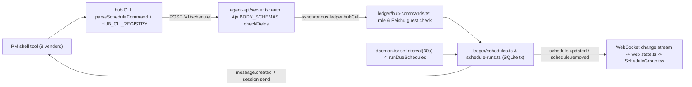

# In-place schedule editing with `hub schedule edit`

> Snapshot: 2026-11-28 (commit `7581a030`)

This plan adds `hub schedule edit <id>` so a Project Manager (PM) can update an existing schedule's name, cadence, or task prompt in place without deleting and recreating it. The design preserves the schedule's numeric ID, run history, and pause state, keeps the web UI and `hub help schedule` synchronized, and leaves every vendor's cached system prompt untouched.

## Plan review and decisions

### Files to review

- [This design document](schedule-edit-design.md): end-to-end architecture walkthrough of the schedule subsystem, comparison of three candidate designs, prompt-cache safety proof, `REVIEW.md` rule mapping, and nine-category verification plan.
- [`src/shared/hub.ts`](../src/shared/hub.ts): registers `schedule.edit` in `HUB_COMMANDS`, `HUB_COMMAND_ROLES`, `HUB_HELP_ONLY_COMMANDS`, `HubArgsMap`, and `HubDataMap`.
- [`src/shared/schedule.ts`](../src/shared/schedule.ts): defines `ScheduleEditInput`, `ScheduleEditPlan`, and the shared `planScheduleEdit` contract for field validation and `nextRunAt` recomputation.
- [`src/daemon/ledger/schedule-edit.ts`](../src/daemon/ledger/schedule-edit.ts): synchronous SQLite mutation `scheduleEditIn` that enforces archive/ownership checks, updates the row in place, and emits `schedule.updated`.
- [`src/daemon/ledger/hub-commands.ts`](../src/daemon/ledger/hub-commands.ts) and [`src/daemon/agent-api/server.ts`](../src/daemon/agent-api/server.ts): wires `POST /v1/schedule.edit` request validation (`BODY_SCHEMAS`, `FIELD_KINDS`, `STRING_LIMITS`) and ledger dispatch without growing `createLedgerHubCommands`.
- Acceptance tests: [`src/daemon/ledger/schedule-edit.test.ts`](../src/daemon/ledger/schedule-edit.test.ts), [`src/hub/schedule-edit.test.ts`](../src/hub/schedule-edit.test.ts), and [`src/web/schedule-edit-sync.test.tsx`](../src/web/schedule-edit-sync.test.tsx) covering all scenarios S1 through S9.

### Project Manager plan review

- **User sentences to scenarios.** Every quoted clause in Section 1 maps directly to S1 through S9 in Section 8.
- **Subsystem understanding (`how`).** Section 2 traces the full `hub schedule` pipeline from CLI parsing and `HUB_CLI_REGISTRY` through `agent-api/server.ts`, `hub-commands.ts`, SQLite `schedules` and `messages`, the daemon's `runSchedulerTick` loop, Feishu guest gating, and the web `ScheduleGroup` component.
- **Verification categories.** Section 8 covers all nine categories from `docs/plan-standard.md`, records one-sentence explanations for non-applicable items, and addresses every matching rule in `REVIEW.md` on `main`.
- **Structurally distinct designs.** Section 3 compares three distinct architectures: shared domain patch validation with in-place ledger update (Design A, recommended), an immutable schedule revision table with dual CLI and web editing (Design B, day-one design), and ad-hoc duplicate handlers or delete-and-reinsert (Design C).

### Decisions needed

None for the user. `hub schedule edit` adds a help-only PM CLI subcommand that updates existing schedule rows through the existing `schedule.updated` WebSocket event without altering the web workbench layout, Feishu cards, or system prompts.

Routine choices settled by the Project Manager (all approved as recommended on PR #518):

- **D1 -> Live sync only, no inline edit form (approved).** `ScheduleGroup.tsx` already reflects every `schedule.updated` event in place. Adding a human inline edit form and a new `PATCH /api/schedules/:id` route is deferred so this PR stays focused on the user's `hub schedule edit` request; `scheduleEditIn` is structured so a future UI route can wrap it directly (just like `addForUser` wraps `addIn`).
- **D2 -> Recompute `nextRunAt` and stay paused when editing frequency while paused (approved).** When a paused schedule changes frequency (`--daily` or `--every`), `scheduleEditIn` keeps `enabled = 0` and recomputes `next_run_at = nextRunAfter(newFrequency, now)` so the stored row carries no stale slot from the previous cadence. The schedule never fires while paused, and `schedule.resume` still recalculates `next_run_at` from the later resume timestamp.
- **D3 -> Emit `schedule.updated` only, no conversation system message (approved).** Matching `schedule.pause` and `schedule.resume`, editing emits a `schedule.updated` WebSocket change and records the call in `hub_calls`, rather than adding a new `schedule.edited` event to `SYSTEM_EVENTS` that would clutter PM chats on repeated prompt tweaks.

## 1. User goal

Quoted from the user's feedback:

> 增加 `hub schedule edit <编号>`：升级定时任务 `#7` 时只能先 `remove` 再 `add` 成新编号 `#13`，连带还要更新记忆里的任务号；支持原地编辑会更顺手。

Intended outcome: Project Managers can update an existing schedule's name, cadence (`--daily` or `--every`), or task prompt in place through `hub schedule edit <id>` while keeping its numeric ID, run history, and pause state intact, with live web UI updates, updated `hub help schedule` output, and zero impact on cached system prompts.

## 2. Current state and history

### Overview

Bellwood schedules let a Project Manager trigger recurring work in its own conversation on a daily local clock (`--daily HH:MM`) or a fixed minute interval (`--every 30m|2h`). Each schedule is one row in the SQLite `schedules` table. The daemon polls due rows every `SCHEDULER_TICK_MS` (30 seconds), inserts a system message with `meta.event = "schedule.run"` into the PM's conversation, and enqueues a `session.send` action. Today the CLI and ledger support `add`, `list`, `show`, `pause`, `resume`, and `remove`, so changing any field on schedule `#7` forces `remove` followed by `add`, which allocates a new autoincrement ID (`#13`) and breaks references stored in PM memory and historical run queries.

### Key concepts

- **Unified CLI registry (`HUB_CLI_REGISTRY`).** `src/hub/registry.ts` holds metadata for every `hub` command (`HUB_COMMANDS`, `self-reload`, and `dispatch`). Progressive help (`hub help`, `hub help schedule`, `hub schedule edit --help`, `hub help --all`) and typo diagnostics derive from this single list.
- **Help-only commands (`HUB_HELP_ONLY_COMMANDS`).** `src/shared/hub.ts:139-147` lists commands that appear in `hub help` and verbatim output hints instead of `HUB_USAGE_PROMPT`. `src/daemon/launch-fingerprint.test.ts` pins the SHA-256 hash of `HUB_USAGE_PROMPT` so adding a help-only command never invalidates live prompt caches across any vendor.
- **Shared limits (`HUB_LIMITS`).** `src/shared/hub-limits.ts:110-112` defines `schedule.name` (40 chars), `schedule.prompt` (100 KB), and `schedule.count` (20 items) once. Help lines (`hubLimitsHelpLine`) and rejection messages (`formatHubLimitViolations`) render from this table.
- **Run history via `messages.dedupe_key`.** Bellwood does not maintain a separate `schedule_runs` table (`migrations/0008_schedules.sql:2`). Each run inserts a system message whose `dedupe_key` is `system:<conversationId>:schedule.run:<scheduleId>:<scheduledAt>`. `recentScheduleRuns` (`src/daemon/ledger/schedule-runs.ts:28-57`) scans this key prefix through the unique `dedupe_key` index.
- **Single-flight and catch-up semantics.** `runOne` (`src/daemon/ledger/schedules.ts:185-209`) skips a due run if `last_message_id` is still in `queued`, `delivered`, or `processing`, marks missed runs older than `SCHEDULE_LATE_MS` (60 seconds) as `catchUp: true` once, and advances `next_run_at = nextRunAfter(schedule, nowMs)`.
- **Timezone re-anchoring.** On every scheduler tick, `reanchorDailyRuns` (`src/daemon/ledger/schedules.ts:26-42`) adjusts enabled `daily` schedules whose stored `next_run_at` no longer matches `at_time` in the machine's current local timezone (`reanchorDailyRun` in `src/shared/schedule.ts:113-119`).

### How it works

1. **CLI parsing.** `parseScheduleCommand` (`src/hub/parse-core.ts:96-128`) validates flags (`--name`, `--daily`, `--every`, `--stdin`), parses `daily` with `parseDailyTime` and `every` with `parseEvery` plus `checkEveryMinutes`, reads multiline prompt text from `--stdin` in `src/hub/cli.ts:97-109`, and rejects empty stdin with exit code `2`.
2. **Agent API validation.** `src/daemon/agent-api/server.ts:760-783` authenticates the session bearer token, rejects Router (`assistant`) sessions, checks JSON body shape with strict Ajv (`BODY_SCHEMAS`), runs `checkFields` (`STRING_LIMITS` and `FIELD_KINDS` control-character checks), runs `createPreparation` (no-op for schedule commands), re-checks token validity, and calls `ledger.hubCall`.
3. **Ledger execution.** `createLedgerHubCommands` (`src/daemon/ledger/hub-commands.ts:434-464`) enforces `HUB_COMMAND_ROLES` (blocking Workers) and `guestTurnBlockReason` (`FEISHU_GUEST_BLOCKED_HUB_COMMANDS` in `src/shared/feishu.ts:149-153`), then executes the schedule handler inside one synchronous `ledger.write(...)` transaction and logs the call to `hub_calls`.
4. **Scheduling loop.** `src/daemon/daemon.ts:642-656` runs `ledger.runDueSchedules(Date.now())` once at startup and every `SCHEDULER_TICK_MS` (30s). `runDueSchedules` calls `reanchorDailyRuns`, short-circuits with a read-only probe when nothing is due, and otherwise opens one write transaction to dispatch every enabled due schedule whose PM is not archived.
5. **Web UI display.** `StateSnapshot.schedules` (`src/shared/api.ts:193`) carries all schedules sorted by `id`. Live updates arrive as `{ type: "schedule.updated", data: { schedule } }` and `{ type: "schedule.removed", data: { scheduleId } }`, applied by `src/web/state.ts:419-422` using `upsertBy` matched on `id`. `WorkPanelShell.tsx:131` filters schedules by `pmId` and renders them in `ScheduleGroup.tsx`.

### Where things live

| Layer | Files | Responsibility |
|---|---|---|
| Shared types and domain math | `src/shared/schedule.ts`, `src/shared/hub.ts`, `src/shared/hub-limits.ts`, `src/shared/feishu.ts` | `ScheduleRecord`, `parseDailyTime`, `parseEvery`, `checkEveryMinutes`, `nextRunAfter`, `reanchorDailyRun`, `HUB_COMMANDS`, `HUB_HELP_ONLY_COMMANDS`, `HUB_LIMITS`, Feishu guest command blocks |
| CLI registry and parser | `src/hub/registry.ts`, `src/hub/parse-core.ts`, `src/hub/args.ts`, `src/hub/cli.ts`, `src/hub/usage.ts` | Command metadata, progressive help, argument parsing, `--stdin` reading, HTTP client |
| Agent HTTP API | `src/daemon/agent-api/server.ts` | Bearer auth, Ajv `BODY_SCHEMAS`, `FIELD_KINDS`, `STRING_LIMITS`, `POST /v1/<command>` routing |
| Ledger and schema | `migrations/0008_schedules.sql`, `src/daemon/ledger/schedules.ts`, `src/daemon/ledger/schedule-runs.ts`, `src/daemon/ledger/hub-commands.ts`, `src/daemon/ledger/rows.ts` | SQLite `schedules` table, CRUD and due-run execution, `schedule.show` run history, `hub_calls` logging |
| Daemon scheduler | `src/daemon/daemon.ts` | Startup catch-up tick and 30-second interval calling `ledger.runDueSchedules` |
| Web UI and UI server | `src/daemon/ui-server/routes-pms.ts`, `src/daemon/ui-server/schemas.ts`, `src/web/state.ts`, `src/web/components/ScheduleGroup.tsx` | Human HTTP routes (`POST`/`PUT`/`DELETE`), snapshot/WS state reducer, Schedules settings view |

### Gotchas

1. **`createLedgerHubCommands` sits at its code-hygiene cap.** `src/code-hygiene.baseline.json:22` caps `src/daemon/ledger/hub-commands.ts#createLedgerHubCommands` at `301` lines, and `createLedgerSchedules` (`src/daemon/ledger/schedules.ts:44-288`) is already `244` lines (just below the 250-line cap). Placing the edit handler in a standalone `src/daemon/ledger/schedule-edit.ts` module (matching `schedule-runs.ts`) and compacting the `schedule.*` switch arm in `hub-commands.ts` prevents breaching either limit.
2. **Feishu guest permissions block schedule mutations.** `FEISHU_GUEST_BLOCKED_HUB_COMMANDS` (`src/shared/feishu.ts:149-153`) blocks `schedule.add` for `chat_only` and `observer` guests while allowing `collaborator` guests. Adding `schedule.edit` without listing it there would let a `chat_only` or `observer` guest rewrite an existing schedule's prompt and cadence.
3. **Existing CLI test asserts `["schedule", "edit", "3"]` fails with exit code 2.** `src/hub/cli.test.ts:852` treats `hub schedule edit 3` (with no edit flags) as a usage error. Requiring at least one mutable flag (`--name`, `--daily`, `--every`, or `--stdin`) keeps that test valid and rejects empty edits fast in the CLI.
4. **Re-specifying the same cadence should not shift `next_run_at`.** If a caller edits a daily `09:00` schedule at `08:55` and passes `--name` (or even repeats `--daily 09:00`), recomputing `next_run_at` only when `(kind, atTime, everyMinutes)` actually changes prevents accidentally postponing an imminent or overdue run.
5. **History relies on `scheduleId` inside `messages.dedupe_key`.** Because `recentScheduleRuns` queries prefix `system:<convId>:schedule.run:<scheduleId>:`, mutating the row in place with `UPDATE schedules ... WHERE id = ?` preserves every historical run link automatically, whereas delete-and-reinsert would orphan history.

### Design history

| Area | Original premise | What changed it | Patch stack? |
|---|---|---|---|
| Schedule lifecycle (`4e956ff1`, M6) | Shipped `add`, `list`, `pause`, `resume`, `remove`, and one `schedules` table with no separate run table. | `hub schedule show` (`f7230639`, PR #463) added full prompt and recent run inspection, and PR #399 (`838329f1`) added timezone re-anchoring on daily runs. In-place editing was never built, forcing `remove` + `add`. | No, a missing operation. |
| CLI discovery and cache safety (`f7230639`, `1bd1d2a3`) | Early commands lived directly inside `HUB_USAGE_PROMPT`. | PR #463 introduced `HUB_HELP_ONLY_COMMANDS` and `launch-fingerprint.test.ts`; PR #509 unified all CLI help into `HUB_CLI_REGISTRY`. | No, clean registries already exist. |

### Core concepts

- **States and write authority.** `schedules` rows (`id`, `pm_id`, `name`, `kind`, `at_time`, `every_minutes`, `prompt`, `enabled`, `next_run_at`, `last_*`, `created_at`, `updated_at`) are written exclusively by ledger schedule modules (`schedules.ts` and the new `schedule-edit.ts`). Historical runs live in `messages` written by `schedules.ts:runOne`.
- **Facts stored in more than one place.**
  - Field validation rules (`name` normalization, `【】` rejection, `prompt` non-blank check, `daily`/`everyMinutes` checks) currently live inline in `schedules.ts:addIn`, partially repeated in `parse-core.ts` and `ScheduleGroup.tsx`.
  - Command limits live once in `HUB_LIMITS` (`src/shared/hub-limits.ts`) and are enforced at both `agent-api/server.ts` and ledger layers.
- **Missing concept.** A shared schedule patch validator and `nextRunAt` transition helper (`planScheduleEdit`) plus an in-place ledger mutation (`scheduleEditIn`) exposed as `hub schedule edit <id>`.

### Verified evidence

- `[Measured]` `node src/hub/main.ts help schedule` on `7581a030` lists only six subcommands (`add`, `list`, `show`, `pause`, `resume`, `remove`) and omits `edit`.
- `[Measured]` `src/hub/cli.test.ts:852` explicitly includes `[["schedule", "edit", "3"]]` in its usage-error table.
- `[Measured]` `src/daemon/ledger/schedules.ts:69-114` contains inline validation only in `addIn`; `schedules.ts` exports no edit method (`schedules.ts:287`), and `HUB_COMMANDS` (`src/shared/hub.ts:69-74`) contains no `"schedule.edit"`.
- `[Measured]` `src/daemon/ledger/schedule-runs.ts:28-57` queries historical runs strictly by `system:<conversationId>:schedule.run:<scheduleId>:` via the `dedupe_key` index, verified by `src/daemon/ledger/schedule-runs.test.ts:7-18`.
- `[Measured]` `src/shared/feishu.ts:149-153` blocks `schedule.add` for `chat_only` and `observer` guests and allows it for `collaborator` guests.
- `[Measured]` `src/web/state.ts:419-420` updates existing schedules in place on `schedule.updated` via `upsertBy(state.schedules, change.data.schedule, (a, b) => a.id === b.id)`, and `src/web/components/ScheduleGroup.tsx:46-60` renders `name`, `formatSchedule(schedule)`, `nextRunAt`, and `lastStatus` directly from props.
- `[Measured]` `src/daemon/launch-fingerprint.test.ts:12-24` pins `HUB_USAGE_PROMPT` to SHA-256 `4841b5863981b8fdec5af0397e46d9afc5db2e630e02ab9e9ee6291da3f72d47`.

## 3. Reference designs and approach comparison

### Reference products

1. **Temporal CLI (`temporal schedule update`)** ([Temporal CLI schedule reference](https://docs.temporal.io/cli/schedule)): updates schedule intervals, calendar specs, and action payloads in place under the same Schedule ID while keeping recent action history and pause state intact.
2. **Google Cloud Scheduler (`gcloud scheduler jobs update`)** ([Cloud Scheduler `jobs update` reference](https://cloud.google.com/sdk/gcloud/reference/scheduler/jobs/update)): applies partial flag-based patches (`--schedule`, `--message-body`, `--description`) to an existing job resource, preserving its identity, pause state, and last execution status.
3. **Kubernetes CronJob (`kubectl patch cronjob`)** ([Kubernetes CronJob documentation](https://kubernetes.io/docs/concepts/workloads/controllers/cron-jobs/)): patches `.spec.schedule` or `.spec.jobTemplate` in place without changing the CronJob UID, deleting past Job history, or disturbing in-flight Jobs, while honoring `.spec.suspend`.

### Candidate structures

| Dimension | A. Shared schedule patch planner + in-place ledger mutation (chosen) | B. Day-one: schedule revisions table + dual CLI/web edit | C. Ad-hoc duplicate handler or delete-and-reinsert |
|---|---|---|---|
| Structure | Put pure field validation and `nextRunAt` transition rules in `planScheduleEdit` (`src/shared/schedule.ts`), implement `scheduleEditIn` in `src/daemon/ledger/schedule-edit.ts`, register `schedule.edit` as a help-only command in `HUB_COMMANDS` / `HUB_CLI_REGISTRY` / `agent-api`, block in Feishu guest tiers, and sync web UI via existing `schedule.updated`. | Split `schedules` into identity + append-only `schedule_revisions` SQLite table (new migration + `RESOURCE_REGISTRY` retention), add `schedule.edited` system event, add `PATCH /api/schedules/:id`, and build an inline edit form in `ScheduleGroup.tsx`. | Copy `addIn` validation into a new branch in `schedules.ts` (or delete + re-insert with explicit `id`), and document `schedule edit` directly inside `HUB_USAGE_PROMPT`. |
| Preserves `#id` and run history | Yes (`UPDATE ... WHERE id = ?`) | Yes | Fragile (delete/reinsert risks resetting `created_at` and `last_*` columns) |
| Schema migration / review stamp | None | New SQLite migration (`migrations/**` stamp) | None |
| Prompt-cache impact | Zero (`HUB_HELP_ONLY_COMMANDS`) | Zero if help-only | High (breaks every live PM cache if `HUB_USAGE_PROMPT` changes) |
| Estimated size | ~450–650 lines across ~12 files | ~1,600–2,400 lines across ~25 files | ~300 lines |
| Main risk | Users cannot edit a schedule's prompt from the web UI yet (they still ask the PM or delete/recreate in UI). | Multiplies scope 3–4× with migration, retention policy, new system event compatibility, and UI form design beyond what the user asked for. | Splits validation between `add` and `edit`; touching `HUB_USAGE_PROMPT` violates the prompt-cache hard gate. |

**Recommendation: Design A.** It solves the user's exact workflow problem cleanly at the domain boundary, unifies validation between `schedule.add` and `schedule.edit`, requires no SQLite migration, keeps `createLedgerHubCommands` and `createLedgerSchedules` inside code-hygiene limits, delivers live web UI updates through the existing `schedule.updated` channel, and guarantees zero prompt-cache churn.

### Design red flags

Screened against `.agents/skills/architect/references/design-red-flags.md`:

- **Split ownership.** Avoided: `src/shared/schedule.ts` owns schedule name, prompt, frequency, and `nextRunAt` transition rules for both `add` and `edit`; `schedules.ts` and `schedule-edit.ts` share those helpers and are the sole ledger writers for `schedules`.
- **Hand-synced list.** Avoided: `HUB_COMMANDS`, `HUB_COMMAND_ROLES`, `HUB_HELP_ONLY_COMMANDS`, `HUB_LIMITS`, `BODY_SCHEMAS`, and `HUB_CLI_REGISTRY` are enforced by TypeScript exhaustiveness and parity tests (`registry.test.ts`, `help-only-commands.test.ts`, `agent-api/server.test.ts`, `prompt.test.ts`).
- **Two ways to do one task.** Avoided: `schedule edit` accepts prompt text only via `--stdin` (matching `schedule add` and rejecting `--text`), and both `hub help schedule` and `hub schedule edit --help` render from `HUB_CLI_REGISTRY`.
- **Shallow module, pass-through method, temporal decomposition, information leakage, importable internals.** `planScheduleEdit` encapsulates all validation and next-run policy behind a single pure interface; `scheduleEditIn` encapsulates archive/ownership checks, synchronous SQLite `UPDATE`, and `schedule.updated` emission without exposing SQL rows.

### Patch rationale

Design A leaves out Design B's `schedule_revisions` audit table and web inline edit form. Building Design B is estimated at 1,600–2,400 lines across migrations, `RESOURCE_REGISTRY`, `SYSTEM_EVENTS`, UI server routes, and `ScheduleGroup.tsx` with wide/narrow visual polish, and neither audit revert nor UI editing was requested. Because Design A places the update logic behind `scheduleEditIn`, adding a future `PATCH /api/schedules/:id` UI route later requires only a thin `editForUser` wrapper and form reuse without rewriting ledger rules.

### Synthesis record

None.

## 4. Performance and bounds

All four rules in `AGENTS.md` ("Caches and state bounds") are satisfied:

1. **Invalidation.** No new cache is introduced. `scheduleEditIn` emits `schedule.updated` in the same committed transaction so every connected web client replaces its in-memory `ScheduleRecord` immediately.
2. **Upper bounds.** No new `src/shared/limits.ts` constants are needed because `schedule.edit` updates one existing row in place (zero row growth) and reuses existing limits from `src/shared/hub-limits.ts` and `src/shared/limits.ts`: `MAX_SCHEDULE_NAME_CHARS` (40 chars), `MAX_TASK_BYTES` (100 KB), `MIN_SCHEDULE_EVERY_MINUTES` (15 minutes), `MAX_SCHEDULE_EVERY_MINUTES` (7 days / 10,080 minutes), `MAX_SCHEDULES_PER_PM` (20 schedules; editing never increments count and succeeds when a PM is already at 20), `SCHEDULE_SHOW_RUNS_MAX` (5 runs), and `HUB_CALL_FIELD_MAX_BYTES` / `HUB_CALL_RESULT_MAX_BYTES` for `hub_calls` logging. Over one month of use (300 finished Workers, 30,000 messages, 50,000 step logs, up to 1,440 runs of a 30-minute schedule), editing executes one primary-key `SELECT` and one primary-key `UPDATE` in O(1), and `schedule.show` continues to read at most 5 runs through the `dedupe_key` index.
3. **Stable front-end references.** No web selector or hook changes. `state.ts:419` updates `state.schedules` only when `schedule.updated` arrives, and exact no-op edits emit no `schedule.updated` change.
4. **Measured verification.** S5 verifies editing at the 20-schedule cap alongside 1,440 schedule runs among 30,000 messages and confirms the `dedupe_key` index query plan remains intact.

## 5. Cross-vendor and cross-platform unification

- **Vendors.** All eight registered vendors in `src/shared/vendors.ts` (`claude`, `agy`, `codex`, `pi`, `deepseek`, `cursor`, `opencode`, `kimi`) invoke the same `hub` CLI shim through their shell tool. No vendor driver changes, and a future vendor implements no extra file beyond its existing `src/vendors/<vendor>/spec.ts`.
- **Prompt-cache preservation.** `HUB_USAGE_PROMPT`, `WORKER_HUB_USAGE_PROMPT`, `taskGraphSkillCatalogEntry()`, and `buildRouterSystemPrompt()` stay byte-for-byte unchanged. `schedule.edit` is registered in `HUB_HELP_ONLY_COMMANDS` and announced only through `hub help`, `hub help schedule`, `hub schedule edit --help`, and verbatim hints at the end of `hub schedule list` and `hub schedule show` (which arrive strictly as appended tool results). `src/daemon/launch-fingerprint.test.ts` remains unmodified and green.
- **Platforms.** macOS, Windows, and Linux execute the identical TypeScript code in `src/shared/schedule.ts`, `src/hub/parse-core.ts`, `src/hub/registry.ts`, `src/daemon/agent-api/server.ts`, and `src/daemon/ledger/schedule-edit.ts`. On Windows, `hub.exe` forwards `hub schedule edit` and its UTF-8 stdin over `POST /hub/cli` (`runHubSafely`), and `findGitBashMangledArg` continues to guard Git Bash path mangling. Local time computation (`nextDailyRun`, `reanchorDailyRun`, `scheduledTimeText`) stays platform-neutral.

## 6. Deletions

Delete in the implementation step so old and new validation logic never coexist:

- Inline schedule name, prompt, and frequency validation inside `addIn` (`src/daemon/ledger/schedules.ts:71-89`), replaced by shared validation helpers in `src/shared/schedule.ts` used by both `addIn` and `planScheduleEdit`.
- Duplicated `--daily` / `--every` flag parsing branches inside `parseScheduleCommand` (`src/hub/parse-core.ts:105-114`), replaced by one helper shared between `schedule add` and `schedule edit`.

## 7. Skeleton files

New skeleton module:

- `src/daemon/ledger/schedule-edit.ts`: declares `ScheduleEditDeps` and exports `scheduleEditIn` (body throws `Not implemented`) for synchronous in-place schedule updates.

Contract updates in existing files:

- `src/shared/hub.ts`: registers `"schedule.edit"` in `HUB_COMMANDS`, `HUB_COMMAND_ROLES`, `HUB_HELP_ONLY_COMMANDS`, `HubArgsMap`, and `HubDataMap`.
- `src/shared/schedule.ts`: exports `ScheduleEditInput`, `ScheduleEditPlan`, and `planScheduleEdit` (body throws `Not implemented`).
- `src/daemon/ledger/hub-commands.ts`: routes `"schedule.edit"` to `scheduleEditIn` while keeping `createLedgerHubCommands` within its code-hygiene line cap.
- `src/daemon/agent-api/server.ts`: adds `"schedule.edit"` to `BODY_SCHEMAS`, `FIELD_KINDS`, and `STRING_LIMITS`.
- `src/daemon/agent-api/server.test.ts`: adds `"schedule.edit"` to the exhaustive `VALID_ARGS` map so `pnpm typecheck` passes.
- `docs/README.md`: indexes `docs/schedule-edit-design.md`.

Acceptance test files (every new-behavior test fails before implementation; every unchanged-rule regression test passes):

- `src/daemon/ledger/schedule-edit.test.ts`: acceptance tests for S1, S2, S3, S4, S5, S6, and S8 (ledger, restart, in-flight queue, permissions, archive, timezone, volume, dirty data, Feishu guest block, and existing-command regressions).
- `src/hub/schedule-edit.test.ts`: acceptance tests for S1, S4, S6, and S7 (CLI parsing, scoped help, `--help`, limits help line, typo suggestions, agent-api round-trip, and prompt-cache fingerprint stability).
- `src/web/schedule-edit-sync.test.tsx`: acceptance tests for S9 (live `ScheduleGroup` in-place updates via `schedule.updated` and reopening after updates while closed).

## 8. Verification plan

### Acceptance scenarios

Categories from `docs/plan-standard.md`: ① two consecutive turns, ② restart mid-operation, ③ state change while queued, ④ existing rules and `REVIEW.md`, ⑤ one-month data volume, ⑥ malformed or dirty data, ⑦ cross-vendor and prompt-cache preservation, ⑧ macOS/Windows/Linux, ⑨ entry points and layouts (wide/narrow web, Feishu, `hub` CLI, multiple computers, reopening stale views).

- **S1. In-place edit keeps `#id`, updates fields, preserves run history, and supports consecutive turns.** (Maps user quote: "增加 `hub schedule edit <编号>`：升级定时任务 `#7` 时只能先 `remove` 再 `add` 成新编号 `#13`，连带还要更新记忆里的任务号；支持原地编辑会更顺手。") ① ④ ⑨
  - First: a PM creates schedule `#1` (`日报`, `--daily 09:00`, prompt v1), triggers two runs that the PM replies to, and inspects `hub schedule show 1` and `hub schedule list`.
  - Next: on turn 1 the PM runs `hub schedule edit 1 --name "升级日报" --every 30m --stdin` (prompt v2); on turn 2 the PM runs `hub schedule edit 1 --daily 18:00` (leaving name and prompt v2 unchanged), then runs an identical no-op `hub schedule edit 1 --name "升级日报" --daily 18:00`.
  - Expected: `id` stays `1` throughout; `createdAt`, `lastRunAt`, `lastStatus`, `lastMessageId`, and all historical runs in `hub schedule show 1` remain intact; `hub schedule list` and `hub schedule show 1` print the verbatim `HUB_HELP_ONLY_COMMANDS["schedule.edit"]` hint; the no-op edit leaves `updatedAt` and `nextRunAt` untouched, emits zero `schedule.updated` changes, and replies `"定时任务 #1“升级日报”和现在一样，没有改动。"`.

- **S2. Restart mid-operation preserves edited schedule and fires new content.** ②
  - First: a PM edits enabled schedule `#1` (new name, new `--every 30m` cadence, new prompt v2) and edits paused schedule `#2` (new `--daily 10:00` cadence, new prompt v2).
  - Next: the daemon closes and reopens SQLite from the same database file, then advances time to `#1`'s new `nextRunAt` and past `#2`'s `10:00` slot.
  - Expected: after restart, `snapshot().schedules` and `schedule.show` return both edited schedules under their original IDs; `#1` fires once with the new name and prompt v2; `#2` stays paused after restart and does not fire until explicitly resumed, at which point `resume` computes `nextRunAt` from resume time using `10:00`.

- **S3. Enabled vs paused `nextRunAt` recalculation, in-flight run interaction, archive/unarchive, and timezone re-anchoring.** ③ ④ ⑧
  - First: enabled schedule `#1` (`every 60m`, due at `09:00`) is edited at `08:50` with only `--name` and `--stdin` (no cadence change); next its cadence changes to `--every 30m` at `08:50`; paused schedule `#2` (`daily 09:00`) is edited at `10:00` to `--every 45m`. Separately, schedule `#3` fires a run that stays `processing` while the PM edits `#3` to `--every 15m`; schedule `#4` belongs to a PM that is archived and later unarchived.
  - Next: advance the clock across ticks, fail or settle `#3`'s in-flight run, attempt to edit `#4` while archived and after unarchiving, and switch `TZ` from `America/New_York` to `America/Los_Angeles` after editing a schedule to `--daily 09:00`.
  - Expected: name/prompt-only edit keeps `#1`'s `nextRunAt` at `09:00`; cadence edit recomputes `#1`'s `nextRunAt` to `09:20` (strictly future, no fake catch-up); paused `#2` stays `enabled: false`, updates `nextRunAt` to `10:45`, never fires while paused, and recomputes from resume time on `schedule.resume`; `#3`'s in-flight run still causes due ticks to record `skipped` and still updates `lastStatus = "failed"` if that run fails, then fires the edited prompt once settled; `#4` rejects edits with `conflict` while archived and allows edits while paused after unarchive; timezone switch re-anchors the edited daily schedule without firing early or twice.

- **S4. Permission boundaries: project isolation, Worker/Router denial, and Feishu guest gating.** ④ ⑨
  - First: PM Lin owns schedule `#1`; PM Zhou owns schedule `#2`; a Worker session and a Router (`assistant`) session exist; a shared Feishu group delivers turns from `chat_only`, `observer`, and `collaborator` guests.
  - Next: Lin calls `schedule.edit` on `#2` and `#999`; Worker and Router call `schedule.edit` on `#1`; Lin calls `schedule.edit` during `chat_only`, `observer`, and `collaborator` guest turns.
  - Expected: cross-PM edit returns `forbidden` (403) and leaves `#2` untouched; missing ID returns `not_found` (404); Worker and Router calls return `forbidden` (403); `chat_only` and `observer` Feishu guest turns block `schedule.edit` with a guest-policy message while `collaborator` guest turns and owner turns allow it.

- **S5. One-month data volume and editing at the 20-schedule cap.** ⑤
  - First: PM Lin already has `MAX_SCHEDULES_PER_PM` (20) schedules, and schedule `#1` has 1,440 `schedule.run` messages among 30,000 messages in Lin's conversation.
  - Next: Lin runs `hub schedule edit 1 --name "满额也能改" --stdin` (new prompt) and then runs `hub schedule show 1`.
  - Expected: `schedule.edit` succeeds without hitting `schedule.count` conflict; `schedule.show 1` returns the updated name and prompt plus the newest 5 runs, and `EXPLAIN QUERY PLAN` for `recentScheduleRuns` still uses the `dedupe_key` range index.

- **S6. Malformed inputs, limit enforcement, and dirty historical data.** ④ ⑥
  - First: invoke CLI and agent-api with invalid shapes: `hub schedule edit`, `hub schedule edit 1` (no fields), `hub schedule edit abc --name x`, `hub schedule edit 0 --name x`, `hub schedule edit 1 2 --name x`, `--daily` plus `--every`, `--text foo`, unknown flag `--nam x`, invalid `--daily` (`9:00`, `24:00`, `09:60`), invalid `--every` (`14m`, `169h`, `2d`, `1.5h`), blank `--stdin`, name with `\n` or `【】` or 41 chars, prompt exceeding `MAX_TASK_BYTES`, and unknown JSON key in `POST /v1/schedule.edit`. Also corrupt one historical run's `meta` JSON and delete another run message.
  - Next: run each invalid command/request and then run a valid edit plus `schedule.show` on the schedule with dirty run history.
  - Expected: every invalid CLI call exits `2` with actionable recovery text (including `--name` suggestion for `--nam`) and zero ledger writes; every invalid API/ledger call returns `invalid` (400) with `HUB_LIMITS` error formatting and zero DB changes; editing and showing a schedule with corrupt/deleted historical run messages succeeds cleanly.

- **S7. CLI help discovery, cross-vendor parity, and zero prompt-cache impact.** ⑦ ⑧ ⑨
  - First: inspect `hub help`, `hub help schedule`, `hub schedule edit --help`, `hub help --all`, `HUB_USAGE_PROMPT`, `WORKER_HUB_USAGE_PROMPT`, `buildRouterSystemPrompt()`, and `src/daemon/launch-fingerprint.test.ts`.
  - Next: run all help invocations and prompt/portability guards.
  - Expected: `hub help` index stays under 4 KB and lists `schedule edit`; `hub help schedule` and `hub schedule edit --help` show the full syntax and `上限：定时任务名称 40 字；任务说明 100 KB`; `HUB_USAGE_PROMPT` and all launch fingerprint hashes are byte-for-byte unchanged (zero prompt-cache rebuild across all 8 vendors); `src/prompt-portability.test.ts` passes with no POSIX-only or repo-specific instructions.

- **S8. Regression checks for existing schedule commands.** ④
  - First: run existing `schedule.add`, `schedule.list`, `schedule.show`, `schedule.pause`, `schedule.resume`, and `schedule.remove` flows.
  - Next: verify existing behavior, ID allocation, receipts, and error paths.
  - Expected: every existing command keeps identical behavior and output compatibility (aside from the additive `schedule.edit` hint line in `schedule.list` and `schedule.show`).

- **S9. Web UI live sync and reopening stale view across wide and narrow viewports.** ⑨
  - First: open PM Lin's Settings -> Schedules view showing schedule `#1` (`日报`, `Daily 09:00`, `Next 09:00`, `Last run failed`).
  - Next: run `hub schedule edit 1 --name "晚报" --daily 18:30 --stdin` so the ledger emits `schedule.updated`, push that event into the web client, then close the Schedules page, apply another `schedule.updated` (or snapshot refresh) changing `#1` to `Every 30 min`, and reopen Schedules on wide and narrow (`390px`) viewports.
  - Expected: while open, `#1` updates in place to `晚报`, `Daily 18:30`, `Next 18:30`, preserving its `Last run failed` indicator and row identity without duplicating the row; after closing and reopening, Schedules renders `Every 30 min` immediately with no stale text and no clipping or truncation on `390px`.

### Category coverage

| Category | Scenarios | Non-applicability note |
|---|---|---|
| ① Two consecutive turns | S1 | — |
| ② Restart mid-operation | S2 | — |
| ③ State change while queued | S3 | — |
| ④ Existing rules and `REVIEW.md` | S1, S3, S4, S6, S8, and table below | — |
| ⑤ One-month data volume | S5 | — |
| ⑥ Malformed or dirty data | S6 | — |
| ⑦ Cross-vendor and prompt cache | S7 | `schedule.edit` runs through the shared `hub` CLI shim above `src/vendors/`, and touches no system prompt, message prefix, tool list, or MCP definition. |
| ⑧ Platforms (macOS, Windows, Linux) | S3, S7 | Real Windows and Linux hosts are unavailable on this macOS machine; platform-neutral logic and Windows `hub` proxy tests run in cloud CI. |
| ⑨ Entry points and layouts | S1, S4, S7, S9 | Multi-computer Mesh forwarding uses the unchanged `schedule.updated` change type and requires a two-computer testbed when verifying live mesh replay. |

### `REVIEW.md` rules on `main` triggered by this plan

| Rule | How this design satisfies it |
|---|---|
| Async work stops touching the ledger after shutdown starts | `schedule.edit` performs zero async preparation in `agent-api/server.ts` and runs inside `tracked(...)`, checking `closing.signal.aborted` and token validity before calling `ledger.hubCall`. |
| Restart recovery finishes what the last run left | All edits persist synchronously in SQLite `schedules` with no in-memory timer cache; post-restart `runDueSchedules` reads the committed row (verified by S2). |
| Database transactions stay synchronous | `scheduleEditIn` executes only synchronous SQLite `SELECT` and `UPDATE` statements inside `ledger.write(...)` with no `await`, child process, file I/O, or network I/O. |
| Growing data has a cap in `limits.ts` | `schedule.edit` updates rows in place (no row growth) and enforces `HUB_LIMITS["schedule.name"]` and `HUB_LIMITS["schedule.prompt"]` on both agent-api and ledger layers (verified by S5 and S6). |
| Stale in-flight queries never overwrite fresh mutations | No React Query cache write is added; web state applies ordered WebSocket `schedule.updated` events via `seq`. |
| A rewrite keeps what the old code guaranteed | `ScheduleGroup.tsx` is not rewritten; all existing switch, delete, validation, and cap guarantees stay intact (verified by S8 and S9). |
| Tests wait for events, not for time | Every acceptance test uses an injected deterministic clock (`clock.now`) or `vi.setSystemTime` with zero fixed sleeps. |
| Hub error codes change on both sides | No new `HubErrorCode` is introduced; `invalid`, `not_found`, `forbidden`, and `conflict` already map in `LEDGER_ERROR_HTTP_STATUS` and `src/hub/cli.ts`. |
| Persisted fields have a reader and dual retention bounds | No new SQLite column or table is added; all updated columns already have live production readers (`toSchedule`, `runDueSchedules`, `scheduleShowIn`, `ScheduleGroup`). |
| Text shipped to agents holds in any project | All help, hint, receipt, and error strings stay project-agnostic and shell-portable, verified by `src/prompt-portability.test.ts` (S7). |
| Planned acceptance scenarios cover every requirement and pass real tests | All quoted sentences, settled rules, `REVIEW.md` rules, and 9 categories map to executable tests in `schedule-edit.test.ts` and `src/hub/schedule-edit.test.ts` with a recorded pre-implementation failing baseline. |
| A result is matched to its request by an id both carry | `schedule.edit` carries `scheduleId`, returns `ScheduleRecord` with the same `id`, and broadcasts `schedule.updated` matched by `a.id === b.id` in `src/web/state.ts`. |
| PM-owned queues and background jobs handle archive, unarchive, and owner teardown | `scheduleEditIn` calls `assertPmNotArchived` (throwing `conflict` when archived), preserves paused state on edit after unarchive, and enforces PM ownership (S3 and S4). |
| Ledger state invariants hold across every transition and reader path | Both `schedule.add` and `schedule.edit` share the same field validation and `nextRunAfter` helpers in `src/shared/schedule.ts` so validation and cadence rules cannot diverge (S1, S3, S6). |

### Real-environment and real-CLI verification

- **Web and local daemon flows (runnable locally).** Start an isolated local Bellwood daemon with a temporary `AGENT_HUB_HOME`, create a PM and a schedule (`#1`), invoke the real `hub` CLI (`hub help schedule`, `hub schedule edit 1 ...`, `hub schedule show 1`, `hub schedule list`), verify restart persistence by restarting the temporary daemon, and capture a Playwright start-to-finish screenshot sequence or video across wide and narrow (`390px`) viewports showing `#1` updating in place in Settings -> Schedules and remaining updated after closing and reopening the view.
- **Real vendor CLI verification.** Run one real PM session against an installed local vendor CLI (with verified isolated vendor config) or on the resident test bench to confirm the PM discovers `hub schedule edit` from `hub help schedule` / `schedule show` and upgrades an existing schedule in place. Record any unavailable local/testbed vendor CLI portion as `not verified` with reason only when neither local isolated execution nor the testbed is available.
- **Prompt-cache preservation (hard gate).** This change does not modify any system prompt, message prefix, tool list, or MCP definition (verified by unchanged SHA-256 hashes in `src/daemon/launch-fingerprint.test.ts`). Real-environment review confirms `src/daemon/launch-fingerprint.test.ts` passes unchanged and, when running a real vendor CLI session, records `TokenUsage.cacheRead` across turns to confirm zero cache regression.
- **Feishu and multi-computer mesh.** Feishu guest blocking is unit-tested in S4; live Feishu group and multi-computer mesh relay tests run on the resident test bench when available, or are recorded with reason and `not verified` if no testbed is available locally.

### Commands and visual checks

- Targeted acceptance tests:
  - `pnpm exec vitest run src/daemon/ledger/schedule-edit.test.ts src/hub/schedule-edit.test.ts src/web/schedule-edit-sync.test.tsx`
- Parity, hygiene, portability, and cache guards:
  - `pnpm exec vitest run src/daemon/launch-fingerprint.test.ts src/daemon/prompt.test.ts src/hub/registry.test.ts src/hub/help-only-commands.test.ts src/hub-limits-guard.test.ts src/prompt-portability.test.ts src/docs-guard.test.ts src/code-hygiene.test.ts`
- Full pre-push local gate (after implementation):
  - `pnpm lint && pnpm typecheck && pnpm test:related && pnpm verify`
- Visual evidence (real-environment review):
  - Playwright video or start-to-finish screenshot sequence of Settings -> Schedules before `hub schedule edit`, live after `hub schedule edit`, and after closing/reopening the Schedules view at both desktop width and `390px` mobile width.
