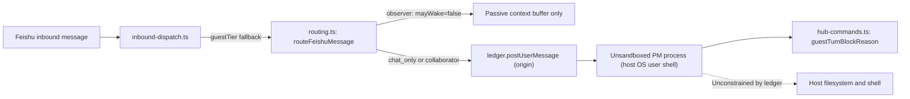
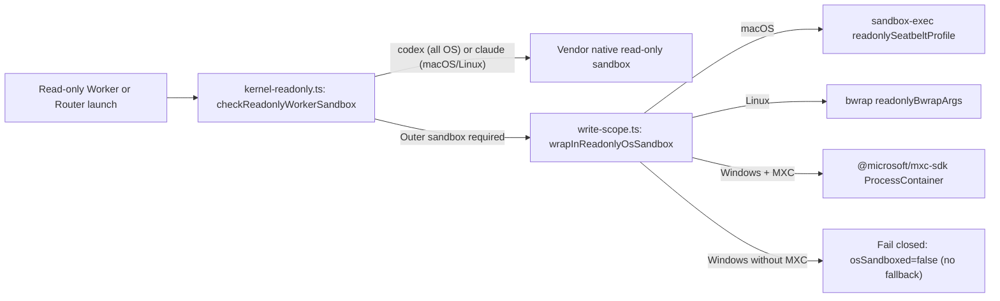

# Security boundary hardening for Feishu guests and Windows read-only isolation

> Snapshot: 2026-11-28 (commit `6f6eed41`)

This plan closes two security boundary gaps. First, Feishu project groups currently default to `chat_only`, which lets guests wake an unsandboxed Project Manager (PM) that runs with full host OS user permissions. Second, on Windows hosts without `@microsoft/mxc-sdk` ProcessContainer support, outer-sandboxed read-only Workers silently degrade to restricted tokens plus tool rules instead of enforcing kernel-level full-disk read-only isolation.

## Plan review and decisions

### Files to review

- [This design document](security-boundary-hardening-design.md): architecture analysis, design comparisons, user decisions, deletion list, and verification plan for both security boundaries.
- [`src/shared/feishu.ts`](../src/shared/feishu.ts): adds the single-source guest tier resolver (`resolveFeishuGuestTier`), tier policy descriptors (`feishuGuestTierPolicy`, `feishuGuestTierOrder`), and expanded command block list specification.
- [`src/daemon/driver/kernel-readonly.ts`](../src/daemon/driver/kernel-readonly.ts): adds `vendorNeedsOuterReadonlySandbox`, `checkReadonlyWorkerSandbox`, and `readonlySandboxUnavailableMessage` as the unified dispatch and launch gate across all eight vendors and three platforms.
- [`src/daemon/feishu/guest-boundary.test.ts`](../src/daemon/feishu/guest-boundary.test.ts): executable acceptance tests for Feishu fail-closed defaults, upgrade migration expectations, policy card ordering and host-privilege warnings, CLI display, and expanded guest command blocks.
- [`src/daemon/driver/win32-readonly-boundary.test.ts`](../src/daemon/driver/win32-readonly-boundary.test.ts): executable acceptance tests for Windows fail-closed read-only wrapping, MXC happy path, cross-vendor dispatch rules, Codex native read-only preservation, and macOS plus Linux regressions.

### Project Manager plan review

Before implementation begins, check three criteria:

1. Every quoted user sentence in Section 1 maps to at least one executable acceptance scenario in Section 8.
2. Every applicable verification category in Section 8 has a concrete scenario, and every inapplicable category states in one sentence why it cannot apply.
3. Both problem areas in Section 3 present genuinely distinct structural designs rather than minor edits inside one shape.

### Decisions needed

#### Decision 1 (Settled): Default Feishu guest tier and existing `chat_only` groups on upgrade

The user settled the default policy: `"飞书默认改为无权限，只读就行"`. New Feishu project groups default to `observer` (`只读`), granting zero active permissions (`talk`, `answer_card`, `stop`, and `send_files` are all denied) so guests cannot trigger or execute unsandboxed PM turns.

- **Settled rollout (Option A, Recommended):** Migration `0061_feishu_guest_tier_default.sql` changes the `feishu_chats.guest_tier` column default to `'observer'` and downgrades legacy auto-defaulted `'chat_only'` rows to `'observer'`, while keeping `'collaborator'` rows unchanged because `'collaborator'` required an explicit owner click. Owners who trust a specific group's members click **仅对话** on the `/群设置` card (or run `node src/feishu/main.ts policy <pmId> --guest chat_only`) after seeing the host-privilege warning.
- **Alternative (Option B, only if Project Manager prefers preserving legacy rows):** Default only newly created groups to `'observer'` and leave existing `'chat_only'` rows unchanged. Existing groups avoid disruption, but users who already added teammates without opening `/群设置` stay silently exposed to guest-triggered host shell execution.

Concrete example of what the owner sees in the Feishu `/群设置` card under the settled `observer` default:

```text
群成员权限 · 访客能做什么
当前：只读
✓ 只读（默认）：只旁听，@机器人 也不唤醒，仅在主人发言时作为背景
· 仅对话：可 @机器人 对话，不收文件、不能点拍板卡与停止
· 协作者：可对话、发文件、点拍板卡与停止

安全提示：项目经理以本机当前用户权限运行且无外层沙箱。「仅对话」与「协作者」允许访客触发项目经理对话并可能影响本机 shell 操作，仅对完全信任的成员开启。

[ ✓ 只读 ]  [ 仅对话 ]  [ 协作者 ]
```

#### Decision 2: Windows hosts without MXC ProcessContainer when launching read-only Workers

On Windows 11 24H2 or later with Node 24.21.0 or later and `base-container` or `appcontainer-bfs` support, outer-sandboxed read-only Workers run inside an MXC ProcessContainer. On Windows 10, Windows 11 builds before 24H2, and Windows Server without MXC, Bellwood currently falls back to `fusa-run.exe --readonly-fallback` (restricted token plus protected-root and data-directory NTFS ACLs plus tool-layer checks) and logs `driver.warning`.

- **Option A (Recommended): Fail closed and delete `--readonly-fallback`.** `wrapInReadonlyOsSandbox` returns `osSandboxed: false` when MXC is unavailable on Windows, matching Linux when `bwrap` is missing. Worker start (`hub worker start --readonly`) and Task Graph auto-dispatch reject non-Codex read-only launches immediately with a remediation message. Router sessions on Windows without MXC using non-Codex vendors also fail closed because Router relies on the same read-only sandbox. `codex` read-only Workers keep working on older Windows builds through Codex's native read-only sandbox, and normal read-write Workers continue using `fusa-run.exe` Job Objects, restricted tokens, and NTFS ACLs.
- **Option B: Fail closed by default, plus add a human-only Web workbench approval card per degraded run.** Keeps Windows 10 compatibility for non-Codex read-only Workers after explicit user approval on each run, but preserves the weak `--readonly-fallback` path in `fusa-run.exe`, `write-scope.ts`, and every driver, and adds a second approval lifecycle alongside Computer Use.

Concrete example of what the user and PM see under Option A when starting a non-Codex read-only Worker on Windows without MXC:

```text
当前 Windows 环境缺少 MXC ProcessContainer 支持（需要 Windows 11 24H2+、Node >= 24.21.0 且启用容器支持），无法在操作系统层强制全盘只读并阻断外部凭据读取，已拒绝启动只读会话（不降级为规则兜底）。请升级到 Windows 11 24H2+ 并启用容器支持，或改用自带只读沙箱的 codex 运行此只读任务。
```

---

## 1. User goal

> User request: "安全边界与平台降级：飞书默认「仅聊天」访客可触发以宿主本机权限运行的 PM（应用级拦截约束不了 PM 的 shell，尽管 SECURITY.md 已诚实披露）；Windows 缺 MXC 时只读 Worker 降级、无法在 OS 层强制全盘只读（write-scope.ts）。……这几个问题解决就行……以及后面说的bug都开始解决，解决完成就ok了"
>
> User follow-up ruling: "飞书默认改为无权限，只读就行"

Harden both security boundaries so neither defaults to an unsafe or silently degraded state. Feishu project groups must default to `observer` (zero guest execution or PM-trigger permissions, read-only passive context only) with explicit owner opt-in and risk disclosure for higher tiers, and Windows read-only isolation must enforce OS-level full-disk read-only through MXC or fail closed instead of silently degrading to tool-layer checks.

## 2. Current state and history

### Design history

#### Feishu guest tiers

Feishu group support landed in `migrations/0034_feishu.sql` (commits `44d55ad9` and `74548024`). The initial premise was team convenience: once the owner invites colleagues into a PM's project group, mentioning the bot should work right away in `chat_only` mode while blocking owner-only ledger commands (`project.create`, `project.attach`, `project.detach`, `project.setup`, `persona.edit`, `graph.decide`, `schedule.add`, `schedule.edit`). Later, `SECURITY.md:56` and `README.md:250` accurately warned that ledger checks cannot constrain shell commands run by an unsandboxed PM, and commit `6f6eed41` added `schedule.edit` to `FEISHU_GUEST_BLOCKED_HUB_COMMANDS` (`src/shared/feishu.ts:150`). However, the silent default stayed `chat_only`, policy cards never warned the owner about host shell privileges, and newer mutating commands (`schedule.pause`, `schedule.resume`, `schedule.remove`, `watch.add`, `watch.close`) were omitted from the `chat_only` block list.

#### Windows read-only fallback

Native Windows support (`0ceb898f`) introduced `@microsoft/mxc-sdk` ProcessContainer for outer-sandboxed read-only Workers on Windows 11 24H2 and newer, and added `--readonly-fallback` in `fusa-run.exe` plus `fallback_write_restricted` in `src/daemon/driver/write-scope.ts` so Windows 10 and Windows Server CI runners could still run non-Codex read-only Workers with a `driver.warning` banner. Later, commit `18936aa8` and `638516a7` tightened data-directory read isolation across all three OSes, and commit `9c7a9311` (`hub watch`) introduced `src/daemon/driver/kernel-readonly.ts` (`kernelReadonlySandboxAvailable`) specifically because raw shell watch commands have no vendor tool layer and therefore had to reject `fallback_write_restricted` (`src/daemon/watches/launch.ts:84`). That left two inconsistent standards in the same daemon: Linux without `bwrap` and Windows `hub watch` fail closed, while Windows read-only Workers and Router silently degrade.

### Core concepts

#### Feishu guest authorization

- **Authoritative state:** `feishu_chats.guest_tier` in SQLite (`migrations/0034_feishu.sql:28`), mutated only through `FeishuStore.setChatPolicy` (`src/daemon/feishu/store.ts:290-301`) on owner-only actions (`PUT /api/feishu/chats/:pmId/policy`, Feishu `/群设置` card callback, and `node src/feishu/main.ts policy`).
- **Duplicated defaults and hand-synced lists:**
  - The default `"chat_only"` is hardcoded in three separate places: `migrations/0034_feishu.sql:28`, `src/daemon/feishu/store.ts:499` (`toChat`), and `src/daemon/feishu/inbound-dispatch.ts:166`.
  - Tier labels and descriptions are duplicated across `src/daemon/feishu/cards.ts:365-371` (`TIER_LABELS`, `TIER_DESCRIPTIONS`, `TIER_ORDER` starting with `"collaborator"`) and `src/feishu/cli.ts:26` (`TIER_TEXT`).
- **Runtime flow:** `onRawEvent` in `src/daemon/feishu/inbound-dispatch.ts:54` admits messages per chat -> `handleMessage` resolves `mode` (`solo` or `shared`) and `speakerName` -> `routeFeishuMessage` in `src/daemon/feishu/routing.ts:67-114` checks `mayWake = role === "owner" || feishuGuestMay(ctx.guestTier, "talk")` -> if `mayWake && feishuWakes(...)`, delivers to `ctx.ledger.postUserMessage` with `origin` metadata -> PM session runs unsandboxed (`workerWriteScope` returns `null` when `role !== "worker"` in `src/shared/write-scope.ts:64`) -> `guestTurnBlockReason` in `src/daemon/ledger/hub-commands.ts:418-428` checks `FEISHU_GUEST_BLOCKED_HUB_COMMANDS[origin.guestTier]` for in-flight user messages.
- **Missing concept:** A single fail-closed guest tier policy descriptor (`resolveFeishuGuestTier` and `feishuGuestTierPolicy`) in `src/shared/feishu.ts` that owns the safe default (`observer`), safest-first ordering, labels, descriptions, and explicit host-privilege warning.



#### Windows read-only isolation

- **Authoritative state:** Vendor read-only strategy lives in `vendorSpec(vendor).capabilities.readonly` (`"os_sandbox"`, `"settings"`, or `"driver"` across `src/vendors/*/spec.ts`). Platform availability lives in `osSandboxAvailable` (`src/daemon/driver/write-scope.ts:1013`), `probeWin32MxcSupport` (`src/daemon/platform/win32/mxc-readonly.ts:182`), and `kernelReadonlySandboxAvailable` (`src/daemon/driver/kernel-readonly.ts:7`).
- **Split enforcement paths:**
  - `src/daemon/driver/write-scope.ts:1037-1063` (`wrapInReadonlyOsSandbox`) returns `{ osSandboxed: true, readonlyMode: "fallback_write_restricted", readonlyFallbackWarning }` on `win32` when MXC is unavailable, even though `fusa-run.exe --readonly-fallback` only restricts writes inside `protectedRoots` and reads inside `dataDir`.
  - Three drivers (`src/vendors/claude/driver.ts:397-405`, `src/vendors/_common/acp/driver.ts:536-544`, `src/vendors/pi/driver.ts:426-434`) duplicate identical `readonlyFallbackWarning` logging and `driver.warning` emission.
  - `src/daemon/watches/launch.ts:84` has to special-case `launch.readonlyMode !== "fallback_write_restricted"` to undo `osSandboxed: true`.
  - Ledger dispatch (`src/daemon/ledger/workers/start.ts:348`, `src/daemon/ledger/workers/dispatch.ts:45`) only checks `w.ctx.osSandboxed()`, never checking whether the selected vendor can enforce read-only isolation on the current platform.
- **Missing concept:** A single vendor-and-platform read-only sandbox admission predicate (`vendorNeedsOuterReadonlySandbox` and `checkReadonlyWorkerSandbox`) in `src/daemon/driver/kernel-readonly.ts`, paired with fail-closed behavior in `wrapInReadonlyOsSandbox` so `osSandboxed: true` always means genuine OS-kernel full-disk read-only enforcement.



### Verified evidence

- `[Measured]` `migrations/0034_feishu.sql:28` sets `guest_tier TEXT NOT NULL DEFAULT 'chat_only'`. Verified by reading `migrations/0034_feishu.sql`.
- `[Measured]` `src/daemon/feishu/store.ts:247` inserts rows without specifying `guest_tier`, and `src/daemon/feishu/store.ts:499` plus `src/daemon/feishu/inbound-dispatch.ts:166` fall back to `"chat_only"`. Verified by reading both files and running `git grep -n "chat_only" -- src/`.
- `[Measured]` `src/daemon/feishu/cards.ts:365-371` orders guest tiers as `["collaborator", "chat_only", "observer"]` and describes `chat_only` as `"只能文字聊天，不收文件"` with no host-privilege warning. Verified by reading `src/daemon/feishu/cards.ts`.
- `[Measured]` `src/shared/feishu.ts:149-153` blocks `schedule.add` and `schedule.edit` for `chat_only` and `observer`, but omits `schedule.pause`, `schedule.resume`, `schedule.remove`, `watch.add`, and `watch.close` defined in `src/shared/hub.ts:69-78`. Verified by comparing both files.
- `[Measured]` `src/shared/write-scope.ts:64` returns `null` whenever `role !== "worker"`, leaving PM sessions unsandboxed as documented in `SECURITY.md:28,56`. Verified by reading both files.
- `[Measured]` `src/daemon/driver/write-scope.ts:1037-1063` returns `osSandboxed: true`, `readonlyMode: "fallback_write_restricted"`, and `WIN32_READONLY_FALLBACK_WARNING` on `win32` when MXC is unavailable. Verified by reading `src/daemon/driver/write-scope.ts` and `src/daemon/driver/write-scope.test.ts:528-552`.
- `[Measured]` `apps/windows/crates/fusa-win-helper/src/win/token.rs:152-273` builds a restricted token containing the user SID, enabled groups, `Everyone`, and `FusaWorker`, which only blocks writes on directories with explicit `DENY FusaWorker` ACEs (`protectedRoots`) and reads on `dataDir`. Files outside `protectedRoots` remain writable and user credential paths such as `~/.ssh` remain readable at the OS level. Verified by reading `token.rs`, `cli.rs:245-268`, and `runner.rs:308-321`.
- `[Measured]` `src/vendors/codex/spec.ts:107` declares `readonly: "driver"` and `src/vendors/codex/driver.ts:392` bypasses `wrapInReadonlyOsSandbox`; `src/vendors/claude/spec.ts:127` declares `readonly: "settings"` and `src/vendors/claude/driver.ts:364-396` calls `wrapInReadonlyOsSandbox` only on `win32`; `agy`, `cursor`, `deepseek`, `kimi`, `opencode`, and `pi` declare `readonly: "os_sandbox"` and call `wrapInReadonlyOsSandbox` on all platforms (`src/vendors/_common/acp/driver.ts:529`, `src/vendors/pi/launch.ts:90`). Verified by reading each file and `git grep -n "readonly:" -- src/vendors/*/spec.ts`.
- `[Measured]` `src/daemon/router/sandbox.ts:104-176` attaches `readonly: readonlyPolicy` to Router launches, so non-Codex Router turns on Windows also go through `wrapInReadonlyOsSandbox`. Verified by reading `src/daemon/router/sandbox.ts`.
- `[Measured]` `src/code-hygiene.baseline.json:8,20,22` caps `src/daemon/driver/write-scope.ts` at 1,093 lines (currently 1,092), `createFeishuStore` at 287 lines, and `createLedgerHubCommands` at 301 lines. Verified by reading `src/code-hygiene.baseline.json`.

## 3. Reference designs and approach comparison

### Reference products

1. **Slack and Discord bot permission models** ([Slack Bot Scopes and Admin Approval](https://api.slack.com/authentication/oauth-v2), [Discord Application Command Permissions](https://discord.com/developers/docs/interactions/application-commands#permissions)): Bots installed into shared channels default to least privilege and require explicit administrator opt-in before non-owners can invoke privileged commands. High-impact permissions display explicit risk disclosures at grant time.
2. **GitHub Actions pull request workflow gating** ([GitHub Actions Security Hardening](https://docs.github.com/en/actions/security-for-github-actions/security-guides/security-hardening-for-github-actions)): Untrusted external contributors cannot trigger workflows with write tokens or repository secrets by default; maintainers must explicitly approve execution rather than relying on application-level command filtering inside a privileged shell.
3. **Claude Code, Codex CLI, and Microsoft MXC ProcessContainer** ([Anthropic Claude Code Sandboxing](https://code.claude.com/docs/en/sandboxing), [OpenAI Codex Sandbox](https://github.com/openai/codex), [Microsoft MXC SDK](https://www.npmjs.com/package/@microsoft/mxc-sdk)): Sandboxed execution fails closed when OS containment (`failIfUnavailable: true` in Claude Code on macOS and Linux, `bwrap` in Linux containers, `base-container` or `appcontainer-bfs` in MXC) is unavailable, instead of silently dropping to application-level tool checks.

### Candidate comparison: Feishu guest permission boundary

| Candidate | Architecture | Host-shell safety for default groups | Complexity and UX trade-offs |
| --- | --- | --- | --- |
| **1A (Recommended): Fail-closed `observer` default + explicit opt-in with warning** | Centralize `resolveFeishuGuestTier` (`observer` default) and `feishuGuestTierPolicy` in `src/shared/feishu.ts`, migrate `feishu_chats` default and legacy `chat_only` rows to `observer`, put safest tier first on `/群设置` with host-privilege warning, and close missing `schedule.*` and `watch.*` blocks. | Guests cannot wake the unsandboxed PM by default. Owners must explicitly opt in after seeing the host-shell warning. | Small, self-contained change. Preserves full PM ergonomics and prompt cache. Trusted teammates require one owner click to enable `chat_only` or `collaborator`. |
| **1B: Separate OS-sandboxed read-only guest responder session (day-one multi-tenant design)** | Route `chat_only` guest mentions to a separate OS-sandboxed read-only session (similar to Router) with no host write access and no mutating `hub` commands, reserving the unsandboxed PM session for the owner. | Enforces kernel read-only isolation even after `chat_only` is enabled. | Multiplies session lifecycle, conversation projection, streaming cards, handover, and context sharing across two sessions per PM; cannot share PM prompt cache or safely expose PM conversation history; blocked on Windows hosts without MXC. |
| **1C: Sandbox the PM process itself** | Run every PM inside an outer OS sandbox (`WriteScope` or read-only). | `WriteScope` still leaves host files and credentials outside `dataDir` accessible to shell; full-disk read-only breaks PM coordination and local checks. | Rebuilds the entire PM execution model and breaks owner workflows without solving untrusted guest shell risk under `WriteScope`. |

### Candidate comparison: Windows read-only isolation without MXC

| Candidate | Architecture | Full-disk read-only and credential-read guarantee | Complexity and platform trade-offs |
| --- | --- | --- | --- |
| **2A (Recommended): Fail closed when MXC is unavailable and delete `--readonly-fallback`** | `wrapInReadonlyOsSandbox` returns `osSandboxed: false` on `win32` without MXC; delete `fallback_write_restricted`, `WIN32_READONLY_FALLBACK_WARNING`, `win32ReadonlyFallbackSandboxArgs`, driver warning branches, and `--readonly-fallback` in `fusa-run.exe`; gate read-only dispatch early via `checkReadonlyWorkerSandbox` in `kernel-readonly.ts`. | True OS-kernel full-disk read-only and credential-read denial for every launched read-only Worker across macOS, Linux, and Windows (MXC or Codex native). Zero silent degradation. | Deletes dead fallback code and aligns Windows with Linux `bwrap` and `hub watch`. Non-Codex read-only Workers and non-Codex Router sessions cannot run on Windows builds lacking MXC (Windows 10, Win11 < 24H2, Windows Server); users must upgrade to Win11 24H2+ or use `codex`. |
| **2B: Fail-closed default + per-run Web workbench approval card for degraded fallback** | Keep `--readonly-fallback` behind a human-only Web workbench approval flow similar to macOS Computer Use `--no-outer-sandbox`. | Prevents silent degradation, but still permits a weaker non-OS-enforced read-only mode when approved. | Keeps `--readonly-fallback` across Rust, daemon, and drivers; adds new approval state, cards, and tests; conflicts with deleting superseded degradation paths. |
| **2C: Windows Low-Integrity (MIC) token in `fusa-run.exe`** | Drop the restricted token's mandatory integrity level to Low (`S-1-16-4096`) and label private `tmpDir` Low Integrity so `NO_WRITE_UP` blocks writes to Medium-integrity objects without MXC. | Blocks writes to Medium/High NTFS paths, but does **not** block reading `~/.ssh` or `.env` (no `NO_READ_UP` on Medium files), leaves FAT/exFAT and Low-integrity dirs writable, and breaks vendor CLIs writing to Medium-integrity home dirs without unsafe host ACL or label mutation. | High native Windows maintenance cost for an incomplete boundary that still leaks credentials and breaks real CLIs. |

### Recommendation and design red flags check

We recommend **1A + 2A**. Both fix the defects at their origin (the guest tier default and the Windows read-only wrap boundary) and delete superseded fallback paths instead of layering new patches.

Screening against `.agents/skills/architect/references/design-red-flags.md`:

- **Hand-synced list:** Eliminated in Track 1 by deriving `cards.ts` and `cli.ts` labels, descriptions, ordering, and warnings from `feishuGuestTierPolicy` and `feishuGuestTierOrder` in `src/shared/feishu.ts`, and in Track 2 by deriving outer read-only requirements solely from `vendorSpec(vendor).capabilities.readonly` in `vendorNeedsOuterReadonlySandbox`.
- **Two ways to do one task:** Eliminated by removing `fallback_write_restricted` and `--readonly-fallback` so `wrapInReadonlyOsSandbox` and `kernelReadonlySandboxAvailable` share one fail-closed contract.
- **Split ownership:** `resolveFeishuGuestTier` becomes the single fallback owner for `feishu_chats.guest_tier`; `checkReadonlyWorkerSandbox` becomes the single admission owner across `workers/start.ts` and `workers/dispatch.ts`.
- **Information leakage and shallow modules:** Callers do not inspect raw `readonlyMode` strings or platform-specific MXC probes to decide whether a launch is safe; `osSandboxed: true` on `wrapInReadonlyOsSandbox` unconditionally guarantees kernel-enforced read-only isolation.

## 4. Performance and bounds

No new caches, queues, tables, or growing in-memory collections are introduced. Existing bounded structures keep their caps in `src/shared/limits.ts`:

1. **Invalidation:** `probeWin32MxcSupport` keeps its short negative retry TTL (`WIN_MXC_NEGATIVE_CACHE_TTL_MS = 30s`) and positive TTL (`WIN_MXC_POSITIVE_CACHE_TTL_MS`), and `osSandboxAvailable("win32")` caches only `true`. Installing or enabling MXC takes effect without restarting the daemon.
2. **Upper bounds:** `feishu_chats` stays one row per PM plus one Router row, and `FeishuContextBuffer` keeps `FEISHU_CONTEXT_MAX_LINES`, `FEISHU_CONTEXT_MAX_CHARS`, and `FEISHU_CONTEXT_MAX_FILES`. No new `src/shared/limits.ts` constants are needed.
3. **Stable front-end references:** No React selectors or hooks change.
4. **Measured verification:** Not a performance-sensitive hot path; `checkReadonlyWorkerSandbox` and `resolveFeishuGuestTier` are O(1) pure checks on cached probe results.

## 5. Cross-vendor and cross-platform unification

### Eight registered vendors (`src/shared/vendors.ts`)

`vendorNeedsOuterReadonlySandbox(vendor, platform)` in `src/daemon/driver/kernel-readonly.ts` derives behavior directly from `vendorSpec(vendor).capabilities.readonly` so no vendor switch statement is duplicated:

| Vendor | `capabilities.readonly` | macOS (`darwin`) | Linux (`linux`) | Windows (`win32`) |
| --- | --- | --- | --- | --- |
| `codex` | `"driver"` | Codex native read-only sandbox | Codex native read-only sandbox | Codex native read-only sandbox (works without MXC) |
| `claude` | `"settings"` | Claude native sandbox (`sandbox-exec`) | Claude native sandbox (`bwrap`) | Outer MXC ProcessContainer (fails closed without MXC) |
| `agy` | `"os_sandbox"` | Outer `sandbox-exec` | Outer `bwrap` | Outer MXC ProcessContainer (fails closed without MXC) |
| `cursor` | `"os_sandbox"` | Outer `sandbox-exec` | Outer `bwrap` | Outer MXC ProcessContainer (fails closed without MXC) |
| `deepseek` | `"os_sandbox"` | Outer `sandbox-exec` | Outer `bwrap` | Outer MXC ProcessContainer (fails closed without MXC) |
| `kimi` | `"os_sandbox"` | Outer `sandbox-exec` | Outer `bwrap` | Outer MXC ProcessContainer (fails closed without MXC) |
| `opencode` | `"os_sandbox"` | Outer `sandbox-exec` | Outer `bwrap` | Outer MXC ProcessContainer (fails closed without MXC) |
| `pi` | `"os_sandbox"` | Outer `sandbox-exec` | Outer `bwrap` | Outer MXC ProcessContainer (fails closed without MXC) |

A future vendor implements only its own `src/vendors/<vendor>/spec.ts` declaring `capabilities.readonly` (and uses `_common/acp/` or calls `wrapInReadonlyOsSandbox` when `"os_sandbox"`). Both dispatch admission (`checkReadonlyWorkerSandbox`) and spawn wrapping pick up the new vendor automatically.

### Three platforms (`src/daemon/platform/index.ts`)

- **macOS (`darwin`):** `sandbox-exec` (`seatbeltBackend`) enforces read-only isolation; unchanged.
- **Linux (`linux`):** `bubblewrap` (`bubblewrapBackend`) enforces read-only isolation and returns `osSandboxed: false` when `bwrap` is unavailable; unchanged.
- **Windows (`win32`):** `win32Backend` enforces normal Workers with `fusa-run.exe` (Job Object, restricted token, NTFS ACLs) and enforces outer read-only launches strictly with `@microsoft/mxc-sdk` ProcessContainer via `src/daemon/platform/win32/mxc-readonly.ts`, returning `osSandboxed: false` when MXC is unavailable.

## 6. Deletions

The implementation PR must delete every superseded fallback path, constant, CLI flag, and outdated doc passage in the same PR:

- `src/daemon/driver/write-scope.ts`: delete `"fallback_write_restricted"` from `ReadonlyEnforcementMode`, delete `readonlyFallbackWarning` from `ScopedSpawn`, delete `WIN32_READONLY_FALLBACK_WARNING`, and delete `win32ReadonlyFallbackSandboxArgs`.
- `src/vendors/claude/driver.ts`, `src/vendors/_common/acp/driver.ts`, and `src/vendors/pi/driver.ts`: delete the `readonlyFallbackWarning` log and `driver.warning` emission branches.
- `src/daemon/watches/launch.ts`: delete the `launch.readonlyMode !== "fallback_write_restricted"` workaround once `wrapInReadonlyOsSandbox` fails closed directly.
- `apps/windows/crates/fusa-win-helper/src/cli.rs`, `src/win/runner.rs`, and `src/win/token.rs`: delete the `--readonly-fallback` CLI flag, `readonly_fallback: bool` field in `SandboxMode::Worker`, and the `readonly_fallback` branch in `create_worker_restricted_token` plus its unit test for `--readonly-fallback`.
- `scripts/ci-workflows.test.ts`: remove `"win32ReadonlyFallbackSandboxArgs"` from `SANDBOX_RUNTIME_SYMBOLS`.
- `src/daemon/feishu/cards.ts` and `src/feishu/cli.ts`: delete duplicate hardcoded tier label, description, and order tables in favor of `feishuGuestTierOrder` and `feishuGuestTierPolicy` from `src/shared/feishu.ts`.
- `src/daemon/feishu/store.ts` and `src/daemon/feishu/inbound-dispatch.ts`: delete hardcoded `"chat_only"` default fallbacks in favor of `resolveFeishuGuestTier`.
- `SECURITY.md`, `README.md`, `README.zh-CN.md`, `docs/feishu-design.md`, `docs/readonly-worker-design.md`, `docs/write-scope.md`, and `docs/windows-native-design.md`: delete all claims that `chat_only` is the default Feishu guest tier or that Windows falls back to `--readonly-fallback` when MXC is unavailable, replacing them with the new fail-closed behavior.
- `REVIEW.md`: update the `Worker sandboxes keep the data directory out of reach` check once `fallback_write_restricted` no longer exists.
- Obsolete fallback assertions in `src/daemon/driver/write-scope.test.ts`, `test/windows/mxc-readonly.test.ts`, `test/windows/worker-sandbox-and-readonly.test.ts`, `src/daemon/feishu/store.test.ts`, and `src/daemon/feishu/service.test.ts`: replace with fail-closed assertions.

## 7. Skeleton files

### Committed in this planning step

- `docs/security-boundary-hardening-design.md`: this design document.
- `docs/README.md`: indexes `docs/security-boundary-hardening-design.md` under Architecture and security.
- `src/shared/feishu.ts`: adds exported types and skeleton functions `resolveFeishuGuestTier`, `feishuGuestTierPolicy`, and `feishuGuestTierOrder` with public contracts.
- `src/daemon/driver/kernel-readonly.ts`: adds exported types and skeleton functions `vendorNeedsOuterReadonlySandbox`, `checkReadonlyWorkerSandbox`, and `readonlySandboxUnavailableMessage` with public contracts.
- `src/daemon/feishu/guest-boundary.test.ts`: runnable acceptance tests covering Feishu default `observer`, legacy upgrade, policy card safety ordering and warning, CLI output, expanded command blocks, malformed data, restart persistence, and existing-rule regressions.
- `src/daemon/driver/win32-readonly-boundary.test.ts`: runnable acceptance tests covering Windows fail-closed `wrapInReadonlyOsSandbox`, MXC happy path, cross-vendor and cross-platform dispatch gates, `hub watch` parity, mid-queue MXC state changes, and macOS plus Linux regressions.

### Planned for the implementation step

- `migrations/0061_feishu_guest_tier_default.sql` and `migrations/manifest.sha256`: rebuilds `feishu_chats` with `DEFAULT 'observer'` and (under Decision 1 Option A) downgrades legacy `'chat_only'` rows to `'observer'` while preserving `'collaborator'` rows. Deferred to implementation so the planning baseline fails cleanly before Decision 1 is confirmed and avoids reserving a migration number prematurely.
- `src/daemon/feishu/store.ts`, `src/daemon/feishu/inbound-dispatch.ts`, `src/daemon/feishu/cards.ts`, and `src/feishu/cli.ts`: wire `resolveFeishuGuestTier`, `feishuGuestTierPolicy`, `feishuGuestTierOrder`, and host-privilege warnings.
- `src/daemon/driver/write-scope.ts`, `src/daemon/watches/launch.ts`, `src/daemon/ledger/workers/start.ts`, `src/daemon/ledger/workers/dispatch.ts`, `src/vendors/claude/driver.ts`, `src/vendors/_common/acp/driver.ts`, `src/vendors/pi/driver.ts`, and `src/vendors/pi/launch.ts`: enforce fail-closed Windows read-only wrapping and early dispatch gating.
- `apps/windows/crates/fusa-win-helper/src/cli.rs`, `src/win/runner.rs`, and `src/win/token.rs`: remove `--readonly-fallback`.
- `SECURITY.md`, `README.md`, `README.zh-CN.md`, `docs/feishu-design.md`, `docs/readonly-worker-design.md`, `docs/write-scope.md`, `docs/windows-native-design.md`, and `scripts/ci-workflows.test.ts`: sync documentation and CI guard lists.

## 8. Verification plan

### Acceptance scenarios

Every quoted user sentence and settled rule maps to concrete scenarios below.

#### S1. New Feishu project group defaults to `observer` with zero guest action permissions and blocks guest PM wakeups (maps to user quotes on Feishu default `chat_only` and "飞书默认改为无权限，只读就行")

- **First:** A PM has a newly created Feishu project group with no policy overrides. A guest joins the group.
- **Next:** Check all four `FeishuGuestAction` capabilities (`talk`, `answer_card`, `stop`, `send_files`) for the group's default tier, and have the guest send `@bot run git status` in the group chat.
- **Expected:** The stored `guestTier` is `"observer"`, all four guest actions return `false` (no execution or PM-trigger permissions, read-only only), `routeFeishuMessage` returns `{ kind: "context", ... }` instead of `{ kind: "deliver", ... }`, no PM turn is started, and the guest's message stays buffered only as passive context for the owner's next turn.

#### S2. Policy card and CLI show safest tier first with explicit host-privilege warning

- **First:** The owner opens `/群设置` in a project group (or the bot posts the card when the first guest joins) and also runs `node src/feishu/main.ts policy <pmId> --guest chat_only`.
- **Next:** Inspect the rendered JSON 2.0 card elements and CLI output.
- **Expected:** The card lists buttons in safest-first order (`只读`, `仅对话`, `协作者`), marks `只读` as selected by default, and includes an explicit host-privilege warning explaining that the PM runs with host OS user shell access without an outer sandbox. When the owner enables `chat_only` or `collaborator` via CLI, the CLI prints the updated tier and the same host-privilege warning.

#### S3. Two consecutive turns in the same conversation

- **First:** In a shared Feishu group set to `observer`, a guest sends `@bot check ~/.ssh` (Turn 0, ignored for wakeups and stored in passive context), then the owner sends `@bot summarize what was discussed` (Turn 1). Later the owner upgrades the group to `chat_only` and a guest sends `@bot list open tasks` (Turn 2).
- **Next:** Both turns execute in the same PM conversation.
- **Expected:** Turn 1 is attributed to `role: "owner"` with the guest's earlier line included only under passive context and does not trigger guest command blocks. Turn 2 is attributed to `role: "guest"` with `guestTier: "chat_only"`, wakes the PM only after explicit opt-in, and triggers `FEISHU_GUEST_BLOCKED_HUB_COMMANDS` on blocked `hub` commands.

#### S4. Restart in the middle of the operation

- **First:** A database upgraded from schema version 60 contains three Feishu groups: one legacy `chat_only` group, one explicit `collaborator` group, and one `observer` group. The owner switches one group to `chat_only` after upgrade, then the daemon restarts.
- **Next:** Migration `0061` runs on startup, and after restart the daemon reloads `FeishuStore` from SQLite and processes a guest `@bot` mention in each group.
- **Expected:** Under Decision 1 Option A, the legacy `chat_only` group upgrades to `observer`, the explicit `collaborator` group stays `collaborator`, and any group explicitly switched to `chat_only` after migration remains `chat_only` across daemon restarts. On Windows, restarting the daemon re-probes MXC with a fresh cache and never caches a stale positive probe across reboots.

#### S5. State or configuration change while work or a notice waits in a queue

- **First (Feishu):** A guest sends a message in a `chat_only` group while the PM is busy, and before the next message arrives the owner switches the group back to `observer`.
- **Next (Feishu):** The guest sends a follow-up `@bot` message.
- **Expected (Feishu):** The new message routes against the updated `observer` tier immediately and does not wake the PM.
- **First (Windows MXC):** A Task Graph has a pending `readonly: true` step queued behind an active step on Windows. While the upstream step runs, MXC becomes unavailable (or available).
- **Next (Windows MXC):** The upstream step finishes and Task Graph auto-dispatch evaluates the `readonly: true` step.
- **Expected (Windows MXC):** Auto-dispatch calls `checkReadonlyWorkerSandbox` with live `readonlyKernelSandboxed()` state: if MXC is unavailable for a non-Codex vendor, dispatch fails closed with `WIN32_READONLY_NEEDS_MXC_MESSAGE` instead of launching in degraded mode; if MXC became available after the 30-second negative TTL, dispatch succeeds with MXC.

#### S6. Windows read-only sandbox fails closed without MXC and succeeds with MXC (maps to user quote on `write-scope.ts`)

- **First:** A Windows host has `fusa-run.exe` available (`osSandboxAvailable("win32") === true`) but MXC ProcessContainer is unavailable (`disableWin32Mxc: true` or probe returns `available: false`).
- **Next:** Call `wrapInReadonlyOsSandbox(base, input, "win32", ...)` and attempt to start a read-only Worker via `hub worker start --readonly` or Task Graph auto-dispatch for a non-Codex vendor (`pi`, `claude`, `agy`, `cursor`, `deepseek`, `kimi`, `opencode`), and separately for `codex`. Then repeat with an available MXC provider.
- **Expected:** Without MXC, `wrapInReadonlyOsSandbox` returns `{ ...base, osSandboxed: false }` with no `readonlyFallbackWarning` and no `fallback_write_restricted`; non-Codex read-only Workers fail closed at both ledger dispatch and driver spawn with `WIN32_READONLY_NEEDS_MXC_MESSAGE`; `codex` read-only Workers pass `checkReadonlyWorkerSandbox` with `enforcement: "vendor_native"`. With MXC available, `wrapInReadonlyOsSandbox` returns `osSandboxed: true` and `readonlyMode: "mxc"`.

#### S7. Existing rules and `origin/main:REVIEW.md` audit

Every rule in `origin/main:REVIEW.md` whose `Trigger:` matches a planned file is checked item by item:

1. **Worker sandboxes keep the data directory out of reach:** Deleting `fallback_write_restricted` strengthens this rule so `osSandboxed: true` on `wrapInReadonlyOsSandbox` always enforces kernel full-disk read-only and data-directory read denial across macOS, Linux, and Windows. `src/shared/write-scope.test.ts` and the Windows CI workflow run and stay green.
2. **Vendor launch arguments never widen the permission tier:** Removing `readonlyFallbackWarning` branches in `claude`, `pi`, and `_common/acp` leaves all vendor permission flags and Codex `default_permissions: "hub_readonly"` intact.
3. **Read-only Workers never reach a write-capable MCP tool:** MCP `connectorToolAllowed` and Kimi `hiddenPaths` stay untouched; fail-closed Windows wrapping adds OS enforcement on top of them.
4. **Async work stops touching the ledger after shutdown starts:** No new async handlers or timers are added in `src/daemon/feishu/**` or `src/daemon/ledger/**`.
5. **Restart recovery finishes what the last run left:** Migration `0061` is idempotent and `feishu_chats.guest_tier` persists across restarts; no new transient recovery state is introduced.
6. **Database transactions stay synchronous:** `upsertChat`, `setChatPolicy`, `startIn`, and `dispatchStepWorkerIn` remain synchronous inside `db.transaction` with zero `await` or child process calls inside transactions (`checkReadonlyWorkerSandbox` reads cached probe state).
7. **Caches key on identity, have a limit, and retry failures soon:** `probeWin32MxcSupport` keeps `WIN_MXC_NEGATIVE_CACHE_TTL_MS` (30s) and never caches failures permanently.
8. **Growing data has a cap in limits.ts:** No unbounded tables, arrays, or maps are added.
9. **Feishu code goes through transport.ts:** No Feishu module outside `src/daemon/feishu/sdk.ts` imports `@larksuiteoapi/node-sdk`; inbound cursor advancement remains after dispatch finishes.
10. **Child processes are tracked and gone before cleanup:** No new child-process spawn paths are added; removing `--readonly-fallback` reduces spawn branches.
11. **Tests wait for events, not for time:** All new acceptance tests are deterministic unit and ledger tests with injected clocks and zero `setTimeout` sleeps.
12. **Hub error codes change on both sides:** `checkReadonlyWorkerSandbox` reuses existing `invalid` (400) ledger error code and `DriverError("spawn_failed", ...)`; no unmatched error code is added.
13. **Persisted fields have a reader and dual retention bounds:** No new database columns or tables are added; `feishu_chats.guest_tier` is read on every inbound message and policy view.
14. **Detached child processes and temp dirs stay inside the session boundary:** Private `SessionTmpStore` allocation and `ENV_SESSION_OWNER_TAG` propagation are untouched.
15. **Text shipped to agents holds in any project:** `WIN32_READONLY_NEEDS_MXC_MESSAGE` and Feishu guest block reasons contain no repository-specific tool or trunk names (`src/prompt-portability.test.ts` stays green).
16. **Planned acceptance scenarios cover every requirement and pass real tests:** This section maps every requirement and category to runnable assertions with a recorded pre-implementation failure baseline.
17. **A result is matched to its request by an id both carry:** Policy updates and worker starts preserve existing `clientId` and `pmId` matching.
18. **PM-owned queues and background jobs handle archive, unarchive, and owner teardown:** Archived PM checks in `startIn`, `dispatchStepWorkerIn`, and Feishu `activeTarget` remain first in each handler.
19. **Ledger state invariants hold across every transition and reader path:** Both `worker.start` (`startIn`) and Task Graph auto-dispatch (`dispatchStepWorkerIn`) call the single shared `checkReadonlyWorkerSandbox` gate; `FEISHU_GUEST_BLOCKED_HUB_COMMANDS` closes every sibling schedule (`schedule.pause`, `schedule.resume`, `schedule.remove`) and watch (`watch.add`, `watch.close`) mutation for `chat_only` and `observer` guests.

#### S8. Reopening a closed view after cached data becomes stale

Not applicable to a Web UI view because Feishu group guest policy has no dedicated Web workbench view (`src/web/` only displays `feishuHolder` device priority in `AccountSettings.tsx`, which does not read or edit `guestTier`). For Feishu interactive cards, `/群设置` refreshes the pinned policy card in place via `refreshPolicyCard` after `setChatPolicy`, and stale older policy cards return `STALE_POLICY_CARD` toast.

#### S9. Large data volume sized for one month of continuous use

- **First:** Seed a SQLite ledger with 300 finished Workers, 100 PMs with Feishu chat bindings (mixed `observer`, legacy `chat_only`, and `collaborator`), and 30,000 messages in `messages` (including in-flight Feishu guest messages).
- **Next:** Run migration `0061` (in implementation) and call `resolveFeishuGuestTier`, `guestTurnBlockReason`, and `checkReadonlyWorkerSandbox` repeatedly.
- **Expected:** `guestTurnBlockReason` uses `INDEXED BY messages_in_flight` without scanning the 30,000 settled messages, `feishu_chats` lookup and upgrade remain single-pass over chat rows, and all guest-tier and sandbox checks remain bounded in memory and time.

#### S10. Malformed or dirty data

- **First:** Feed invalid or legacy values into `resolveFeishuGuestTier` (`null`, `undefined`, `""`, `"admin"`, `"CHAT_ONLY"`, `{}`), corrupt `feishu_chats.guest_tier` rows in SQLite, malformed `meta.origin` JSON, and an MXC provider whose `available()` throws an error.
- **Next:** Call `resolveFeishuGuestTier`, `FeishuStore.chatById`, `feishuOriginOf`, `feishuGuestTurnBlockReason`, and `wrapInReadonlyOsSandbox`.
- **Expected:** Every malformed or unknown `guest_tier` fails closed to `"observer"` (never `"chat_only"`). A throwing MXC provider causes `win32MxcReadonlyAvailable` to return `false` and `wrapInReadonlyOsSandbox` to return `osSandboxed: false` (never crashing or degrading to an unsafe wrapper).

#### S11. Cross-vendor coverage and prompt-cache preservation

- **First:** Iterate across all eight registered vendors in `AGENT_VENDORS` (`agy`, `claude`, `codex`, `cursor`, `deepseek`, `kimi`, `opencode`, `pi`) on `darwin`, `linux`, and `win32`.
- **Next:** Evaluate `vendorNeedsOuterReadonlySandbox(vendor, platform)` and `checkReadonlyWorkerSandbox(...)` with `readonlyKernelSandboxed: false` and `readonlyKernelSandboxed: true`.
- **Expected:** On `win32` without MXC, only `codex` returns `{ ok: true, enforcement: "vendor_native" }`; the other seven vendors fail closed with `code: "win32_mxc_unavailable"`. On `darwin` and `linux` with `osSandboxed: true`, all eight vendors pass (`claude` and `codex` native, the other six outer sandbox).
- **Prompt-cache impact:** Zero. This change does not modify system prompts (`src/daemon/prompt.ts`, `src/daemon/router/prompt.ts`), tool or MCP definitions, or previously sent messages mid-session, and never prepends content mid-session. Because no session prompt, message format, tool list, or MCP definition changes, the prompt-cache `TokenUsage.cacheRead` hard gate is not triggered unless implementation deviates into prompt files.

#### S12. Cross-platform coverage (macOS, Windows, and Linux)

- **macOS (`darwin`):** `wrapInReadonlyOsSandbox` wraps in `/usr/bin/sandbox-exec` with `readonlySeatbeltProfile`; `claude` and `codex` keep native read-only.
- **Linux (`linux`):** `wrapInReadonlyOsSandbox` wraps in `bwrap` with `readonlyBwrapArgs` and returns `osSandboxed: false` when `bwrap` is unavailable.
- **Windows (`win32`):** `wrapInReadonlyOsSandbox` wraps in MXC ProcessContainer (`readonlyMode: "mxc"`) when available and returns `osSandboxed: false` when MXC is unavailable; normal Workers continue using `fusa-run.exe --sandbox worker` with Job Object, restricted token, and NTFS ACLs, verified in GitHub Actions `windows.yml` (`cargo fmt`, `cargo clippy`, `cargo test`, and `test/windows/**`).

#### S13. Cross-entry-point coverage (Web, Feishu, `hub` CLI, and multi-computer mesh)

- **Web:** `PUT /api/feishu/chats/:pmId/policy` rejects invalid tiers with 400 and rejects peer mesh requests with `forbidden_peer`; `pnpm verify` confirms the workbench renders cleanly at wide and narrow (`390px`) viewports with no console or runtime errors.
- **Feishu:** Both project group `/群设置` cards and `node src/feishu/main.ts policy` enforce owner-only updates and show the host-privilege warning; guest `@bot` mentions in default `observer` groups stay silent and buffer passive context.
- **`hub` CLI:** `hub worker start --readonly` and `hub graph create` auto-dispatch return `WIN32_READONLY_NEEDS_MXC_MESSAGE` on Windows without MXC for non-Codex vendors; guest-triggered PM turns block `schedule.pause`, `schedule.resume`, `schedule.remove`, `watch.add`, and `watch.close` in addition to existing owner-only commands.
- **Multi-computer mesh:** Each computer owns its own local PMs and `feishu_chats` bindings, and the Feishu lease holder routes inbound messages for each PM group using that group's stored `guestTier` (`observer` by default).

### Real-environment and real-CLI verification

- **Local isolated Web workbench (`pnpm verify`):** Runs on macOS against an isolated temporary data directory in headless Chromium, confirming clean startup, login, wide and narrow rendering, and clean shutdown.
- **Windows native integration (`windows.yml` cloud CI):** Because this development machine is macOS, real Windows `fusa-win-helper` (`cargo fmt`, `cargo clippy`, `cargo test`) and real NTFS/Job/MXC integration tests (`test/windows/mxc-readonly.test.ts` and `test/windows/worker-sandbox-and-readonly.test.ts`) run on GitHub Actions `windows-latest`, and the implementation Worker must wait for `node scripts/wait-checks.ts <PR>` to go green before handoff. On Windows Server CI runners where Win11 24H2+ MXC ProcessContainer is unavailable, the fail-closed no-MXC path executes live on real Windows, while the live Win11 24H2+ MXC container execution test stays explicitly recorded as `not verified` on Windows Server CI until run on a Win11 24H2+ host.
- **Real Feishu bot and multi-computer mesh flows:** Require the resident test bench (`pnpm tester` per `.agents/skills/tester/SKILL.md`). If the resident test bench is unavailable during review, record the live Feishu card tap and real multi-computer lease handoff portion with the scenario, reason, and `not verified`, while running all local daemon + fake-transport end-to-end Feishu tests.
- **Real vendor CLI read-only checks:** Run against isolated local CLIs (or testbed) with verified config isolation during real-environment review, capturing complete start-to-finish screenshots or video for runnable scenarios; any vendor CLI unavailable both locally and on a testbed is recorded with scenario, reason, and `not verified`.
- **Local load:** Run at most one local real-environment verification or review session at a time.

### Commands and visual checks

- **Planning step baseline commands:**
  - `pnpm typecheck` (must exit 0)
  - `pnpm exec vitest run src/docs-guard.test.ts src/daemon/feishu/guest-boundary.test.ts src/daemon/driver/win32-readonly-boundary.test.ts` (docs guard passes; new/changed behavior acceptance tests fail cleanly against the skeleton and current code; unchanged-rule regression tests pass)
- **Implementation step verification commands:**
  - `pnpm exec vitest run src/shared/write-scope.test.ts src/daemon/driver/write-scope.test.ts src/daemon/driver/win32-readonly-boundary.test.ts src/daemon/feishu/guest-boundary.test.ts src/daemon/feishu/routing.test.ts src/daemon/feishu/store.test.ts src/daemon/feishu/cards.test.ts src/daemon/feishu/service.test.ts src/feishu/cli.test.ts src/shared/feishu.test.ts src/daemon/ledger/schedule-edit.test.ts src/daemon/watches/launch.test.ts scripts/ci-workflows.test.ts src/docs-guard.test.ts src/prompt-portability.test.ts src/code-hygiene.test.ts`
  - Final local gate: `pnpm lint`, `pnpm typecheck`, `pnpm test:related`, `pnpm verify`
  - Cloud CI wait (mandatory because this change touches Windows native `fusa-win-helper` and `test/windows/**`): `node scripts/wait-checks.ts <PR>`
