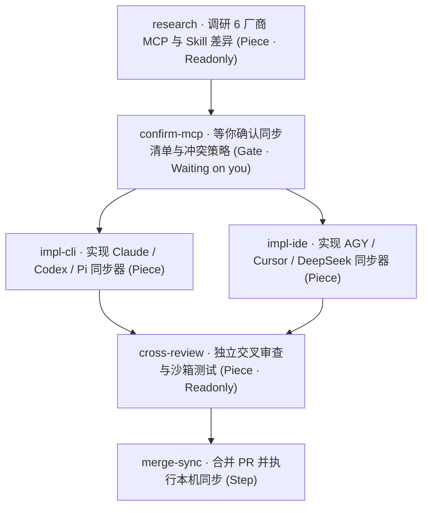
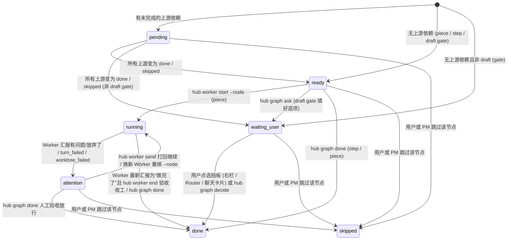
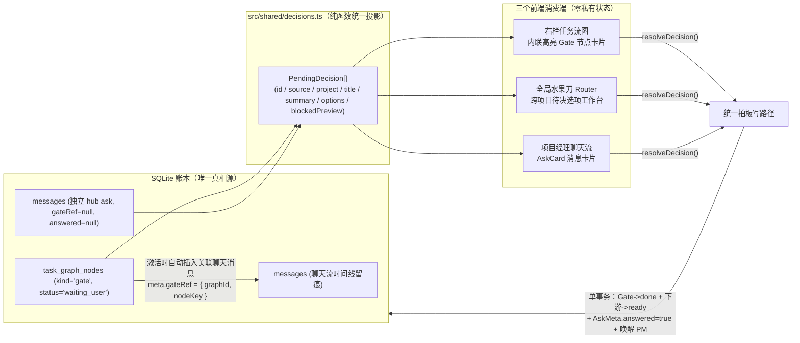

# 右栏任务流图（Task DAG）与待决门禁节点联动设计方案

状态：设计方案（2026-11-11，Worker #397）。与全局水果刀 Router 方案（`docs/router-design.md`）配套：本方案负责单项目账本级有向无环任务图（Task DAG）、右栏流图可视化，以及“`gate` 门禁节点 ↔ `hub ask` ↔ 水果刀 Router 待决选项卡片”的底层同源与双向自动联动契约。

---

## 0. 背景、痛点根源与核心结论

### 0.1 用户痛点与代码根源

当前右栏（`src/web/components/RightRail.tsx`）只把 `Needs You`（未答复的 `hub ask`）、`Pieces`（进行中 Worker）和 `Completed`（已收工 Worker）渲染成扁平列表，存在三个结构性问题：

1. **看不见全貌与后续步骤，会话换代或插队后容易漏步**
   - 用户原话：*“右侧可以做成图的形式，你上来的时候就得规划好一个任务用到哪些worker，写方案，写完之后的下一步不就是去做吗，这样就可以直接看到了我一看就知道这个任务做到哪里了，最后审查，中间有问题可以低成本的修改，这样这个图建好了，之后要做什么也不会忘记”*。
   - 根源：多步任务的规划目前只存在于项目经理当轮回复的自由文本里，账本（SQLite）没有任务拓扑表。一旦中间插聊别的需求，或项目经理到 `AUTO_RENEW_CONTEXT_TOKENS`（200K）触发后台换会话（`src/daemon/ledger/handover.ts`），后续步骤只能靠交接摘要回忆，用户也无法在右栏一眼看到“写方案 → 等拍板 → 并行实现 → 审查 → 合并”推进到了哪一环。
2. **看不出“哪个节点正在等我拍板才能解锁后续步骤”**
   - 用户原话：*“然后我可以看到任务里面有哪个节点是在等我才能继续的”*。
   - 根源：现有 `WorkerRecord` 与 `AskMeta` 完全解耦，右栏既没有上下游依赖边，也没有把“卡在等你决定的门禁”和“被它挡住的后续实现/审查步骤”画在同一条链路上。
3. **跨话题聊天会把待确认事项静默冲掉，不翻聊天记录根本不知道在等自己**
   - 用户原话：*“比如现在如果我不去翻我就不知道mcp同步的需要我确定”*。
   - **代码级根源**（`src/daemon/ledger/messages.ts` 第 170–185 行 `answerAsks`）：当前用户在项目经理对话里只要发**任意一条消息**（哪怕是插队聊另一件毫不相干的事），`answerAsks()` 就会把该会话此前所有 `needsUser: true` 的 `hub ask` 全部硬标为 `meta.answered = true`。结果“MCP 同步待确认”瞬间从右栏 `Needs You` 和左栏绿点里消失，沉入历史消息流。

### 0.2 核心架构结论

| 维度 | 结论 |
|---|---|
| **账本持久化** | 新增 `migrations/0022_task_graphs.sql`（`task_graphs`、`task_graph_nodes`、`task_graph_edges` 三张 `STRICT` 表）。多步任务开工前先用 `hub graph create` 建图；项目经理满 200K 自动换会话时，`sessionPreambleText` 直接从账本注入未完结任务图实时快照，绝不靠记忆硬背。 |
| **门禁同源契约** | 显式建模 `gate`（等你决定）节点；`gate` 激活态与独立 `hub ask` 统一收敛为同一个只读投影 `PendingDecision`（零重复建表），同时供给**右栏任务图**、**聊天流 `AskCard`** 与**全局水果刀 Router 面板**。修复 `answerAsks()`：挂在任务图上的 `gate` 绝不被普通插队闲聊自动消掉，必须显式点选拍板（或由 `hub graph decide/skip/cancel` 结算）。任意一处点选，单事务解锁下游节点并唤醒项目经理继续跑下一步。 |
| **低成本增量改图** | 提供 `hub graph patch`（原子增删改节点与依赖边 + Kahn 环检测）及 `hub worker start --node <nodeKey>`（绑定与 100K/失败换人重绑），无需推翻重建整张图。 |
| **前端布局与渲染** | 选用 **`@dagrejs/dagre`（本机实测打包后 47.5 KB min / 16.6 KB gzip，10 节点布局 P50 1.36 ms）+ 受控 React 卡片 + 轻量 SVG 三次贝塞尔连线**。拒绝 `@xyflow/react`（重画布感、滚轮劫持、`zustand@4` 版本冲突且仍不含自动布局）与 `elkjs`（440.2 KB gzip）。右栏 `w-80` 用纵向分层（`TB`），点击展开 `Dialog` 用横向流水线（`LR`）。单步零散 Piece 不强行建 1 节点假图，继续走轻量 `Pieces` 列表。 |
| **1 个月性能水位** | `/api/state` 首屏只带 `active` 任务图（每项目上限 5 张，单图上限 32 节点，月度增量 < 16 KB，严守 `SNAPSHOT_MONTH_MAX_BYTES = 384 KB`）；`completed / cancelled` 历史图折叠计数，展开时通过 `@tanstack/react-query` 按游标分页拉取；Dagre 坐标按“拓扑指纹 + 尺寸档位”走 `lru-cache`，Worker 跳 token 或流式日志绝不重算布局。 |

---

## 1. 领域模型、SQLite 表结构与全生命周期状态机

### 1.1 核心实体与节点类型

一张任务图（`TaskGraph`）归属于单个项目（`project_id`）及其项目经理（`pm_id`），由节点（`TaskNode`）和有向无环依赖边（`TaskEdge`：`from_key -> to_key`，语义为“上游完成后下游才解锁”）组成。

节点分且仅分 3 种类型（`TASK_NODE_KINDS`）：

1. **`piece`（Worker 执行节点，默认）**：需要派独立 Worker 干的活（只读调研写方案、功能块实现、独立交叉审查、跑全量验证等）。通过 `hub worker start --node <nodeKey>` 与 Worker 绑定；支持失败或超 100K 收工后换新 Worker 重绑同一节点，保留历史 `workerIds`。
2. **`gate`（等你决定 / 拍板门禁节点）**：卡在关键分水岭上等用户拍板的显式检查点（如“确认全厂商 MCP 同步清单与冲突策略”）。包含：
   - `title`：门禁短标题（中文，如 `确认 MCP 同步范围`）；
   - `summary`：简明结论与影响说明（支持精简 Markdown，上限 `MAX_GATE_SUMMARY_CHARS`）；
   - `options`：2～10 个推荐选项（第 1 项固定带推荐说明，复用现有 `ASK_MIN_OPTIONS` / `ASK_MAX_OPTIONS` 约束）；也允许空数组表示纯确认（默认渲染 `Approve` / `Changes needed` 或补充意见）；
   - `draft`：布尔值。若建图时尚未调研出具体冲突项（需等上游调研 `piece` 跑完才能填具体选项），建图时标 `draft: true`；上游完成后提醒项目经理用 `hub graph ask <nodeKey>` 填入具体结论与选项并正式激活门禁。若建图时选项已明确（`draft: false`），上游全部完成的那一刻**自动激活为 `waiting_user`**。
3. **`step`（项目经理收尾/轻操作节点）**：耗时短、花 token 少、由项目经理按 `AGENTS.md` `rule a` 亲自完成的轻量收尾步（如合并 PR、执行本地同步命令、更新 `HANDOVER.md`），由 `hub graph done <nodeKey>` 完成，不必为此空跑一个 Worker。

### 1.2 典型拓扑示例：一键同步全厂商连接器、MCP 与 Skill

项目经理收到需求后，第一步先跑 `hub graph create` 建出完整五阶段 DAG：



生命周期演进一目了然：
1. **建图即见全貌**：`research` 无上游依赖，初始即 `ready`；其余 5 个节点初始为 `pending`（界面显示 `Blocked`），用户第一时间在右栏看到完整五步蓝图。
2. **调研完成 → 门禁点亮**：`research` Worker 跑完收工，项目经理把调研出的 2 个冲突 MCP 写入 `confirm-mcp`（`hub graph ask confirm-mcp`），`confirm-mcp` 立即高亮为 **`Waiting on you`**，同时自动出现在全局水果刀 Router 的待决区；下游 `impl-cli`、`impl-ide`、`cross-review`、`merge-sync` 清晰显示被该门禁阻断。
3. **跨天/插队不丢**：哪怕用户先去聊了三天别的任务、项目经理自动换了两次会话，这张 `active` 图和 `Waiting on you` 的 `confirm-mcp` 始终挂在右栏顶部与 Router 待决卡片里。
4. **一键拍板 → 并行解锁**：用户在右栏或 Router 里点选“全量同步并自动备份冲突配置”，`confirm-mcp` 变 `done`，`impl-cli` 与 `impl-ide` 同时变为 `ready`，系统自动唤醒项目经理并行派出两个实现 Worker。

### 1.3 状态机与单事务自动传播规则

#### 图状态（`TaskGraphStatus`）
- `active`：存在至少一个节点未处于终态（`done` / `skipped`）。
- `completed`：图中所有节点均已到达 `done` 或 `skipped`（且至少一个 `done`），由账本在同一写事务内自动置为 `completed` 并记录 `completed_at`。
- `cancelled`：用户或项目经理主动取消整张图（未结束的绑定 Worker 不强制强杀，提醒项目经理按需 `worker end`，但未决 `gate` 同步关闭并推状态增量）。

#### 节点状态（`TaskNodeStatus`）



**关键防误判边界（对接 100K 换人规矩 `src/daemon/prompt.ts` 第 176 行）**：
- 项目经理常因 Worker 上下文超过 `WORKER_SEND_MAX_TOKENS`（100K）或跑偏而调用 `hub worker end <id>` 结束旧 Worker，再派新 Worker 接手同一节点。
- 因此 **`hub worker end <id>` 不会无脑把绑定节点标成 `done`**：
  - 仅当该 Worker 最后一轮汇报的解析状态为 `做完了`（`WorkerLineStatus === "done"`，且未传 `--incomplete`）时，`worker end` 才自动将绑定的 `piece` 节点推进到 `done` 并触发下游解锁；
  - 若 Worker 被中途打断、报错（`turn_failed` / `worktree_failed`）、汇报 `有问题` / `放弃了`，或传了 `hub worker end <id> --incomplete`，绑定节点置为 `attention`（等待项目经理 `hub worker start --node <key>` 派继任 Worker 接力，或显式 `hub graph done/skip`）。

### 1.4 SQLite 表结构（`migrations/0022_task_graphs.sql`）

遵循现有 `migrations/0004_workers.sql` 与 `0020_conversation_purges.sql` 的 `STRICT` 表规范：

```sql
-- 任务图主表：挂在 project 与 pm 下；PM 彻底删除（Cascade）时随外键级联清理
CREATE TABLE task_graphs (
  id INTEGER PRIMARY KEY AUTOINCREMENT,
  project_id INTEGER NOT NULL REFERENCES projects(id) ON DELETE CASCADE,
  pm_id INTEGER NOT NULL REFERENCES pms(id) ON DELETE CASCADE,
  pm_conversation_id INTEGER NOT NULL REFERENCES conversations(id) ON DELETE CASCADE,
  title TEXT NOT NULL,
  status TEXT NOT NULL DEFAULT 'active' CHECK (status IN ('active', 'completed', 'cancelled')),
  revision INTEGER NOT NULL DEFAULT 1,
  created_at INTEGER NOT NULL,
  updated_at INTEGER NOT NULL,
  completed_at INTEGER
) STRICT;

-- 节点表：node_key 在单张图内唯一（如 'research'、'confirm-mcp'），供 CLI 与边稳定引用
CREATE TABLE task_graph_nodes (
  id INTEGER PRIMARY KEY AUTOINCREMENT,
  graph_id INTEGER NOT NULL REFERENCES task_graphs(id) ON DELETE CASCADE,
  node_key TEXT NOT NULL,
  kind TEXT NOT NULL CHECK (kind IN ('piece', 'gate', 'step')),
  title TEXT NOT NULL,
  summary TEXT NOT NULL DEFAULT '',
  status TEXT NOT NULL CHECK (status IN ('pending', 'ready', 'running', 'waiting_user', 'attention', 'done', 'skipped')),
  position INTEGER NOT NULL DEFAULT 0, -- 同层兄弟节点的稳定声明序
  -- piece 绑定字段：active_worker_id 为当前主责 Worker，worker_ids_json 保留换人历史（如 [397, 402]）
  active_worker_id INTEGER REFERENCES workers(id) ON DELETE SET NULL,
  worker_ids_json TEXT NOT NULL DEFAULT '[]',
  -- gate 专属字段
  gate_draft INTEGER NOT NULL DEFAULT 0 CHECK (gate_draft IN (0, 1)),
  gate_options_json TEXT NOT NULL DEFAULT '[]',
  gate_ask_message_id INTEGER REFERENCES messages(id) ON DELETE SET NULL,
  decision_choice TEXT,
  decision_note TEXT,
  decided_by TEXT CHECK (decided_by IS NULL OR decided_by IN ('user_ui', 'pm_cli')),
  activated_at INTEGER,
  completed_at INTEGER,
  updated_at INTEGER NOT NULL,
  UNIQUE (graph_id, node_key)
) STRICT;

-- 有向边表：from_node_key 完成后才解锁 to_node_key
CREATE TABLE task_graph_edges (
  graph_id INTEGER NOT NULL REFERENCES task_graphs(id) ON DELETE CASCADE,
  from_key TEXT NOT NULL,
  to_key TEXT NOT NULL,
  PRIMARY KEY (graph_id, from_key, to_key),
  FOREIGN KEY (graph_id, from_key) REFERENCES task_graph_nodes(graph_id, node_key) ON DELETE CASCADE,
  FOREIGN KEY (graph_id, to_key) REFERENCES task_graph_nodes(graph_id, node_key) ON DELETE CASCADE,
  CHECK (from_key <> to_key)
) STRICT;

CREATE INDEX idx_task_graphs_project_status_id
  ON task_graphs(project_id, status, id DESC);

CREATE INDEX idx_task_graphs_pm_active
  ON task_graphs(pm_id, id DESC) WHERE status = 'active';

CREATE INDEX idx_task_graph_nodes_active_worker
  ON task_graph_nodes(active_worker_id) WHERE active_worker_id IS NOT NULL;

CREATE INDEX idx_task_graph_nodes_waiting_gate
  ON task_graph_nodes(graph_id, activated_at) WHERE status = 'waiting_user';
```

### 1.5 跨会话换代（200K 自动交接）绝不遗忘机制

在 `src/daemon/ledger/handover.ts` 的 `sessionPreambleText()` 中新增实时账本段 `## 未完结的任务图（账本实时状态）`（放在 `## 交接之后到的 Worker 汇报` 旁）：
- 直接从 SQLite 读取当前 `pm_id` 所有 `status = 'active'` 的任务图（上限 `MAX_ACTIVE_GRAPHS_PER_PROJECT = 5`），拼成紧凑结构化摘要（每张图 5～12 行：图 `#id` 标题、已完成节点、正在跑的 Worker 绑定、卡在 `waiting_user` 的门禁、当前 `ready` 待推进节点）。
- 即使交接文本（`handoverRequestText`）写于切点之前、或者模型摘要漏写了某一步，新会话第一轮收到的开场说明里永远带着账本里的最新 DAG 真相；同时 `hub status` 对项目经理也一并输出当前活跃任务图的单行摘要。

---

## 2. “等你决定”门禁（Gate）与水果刀 Router / `hub ask` 同源双向联动契约

### 2.1 三端同源模型：零重复造轮子

现有 `hub ask`、右栏任务图 `gate` 节点与全局水果刀 Router（`docs/router-design.md`）的待决选项卡片，在读写两条链路上彻底收敛为同一套底层契约：



#### 统一只读结构 `PendingDecision`（放进 `src/shared/decisions.ts`，供右栏与水果刀 Router 直接共用）

```ts
export type DecisionSource =
  | {
      kind: "gate";
      graphId: TaskGraphId;
      graphTitle: string;
      nodeKey: string;
      /** 被该门禁直接或传递阻断的后续节点数（如 4），供 Router 和右栏直观展示“点完解锁后面 4 步” */
      blockedNodeCount: number;
      /** 紧邻下游节点标题预览（最多 3 个，如 ["实现 CLI 同步", "实现 IDE 同步"]） */
      nextNodeTitles: string[];
    }
  | {
      kind: "ask";
      messageId: MessageId;
    };

export interface PendingDecision {
  /** 稳定全局键：`gate:${deviceId}:${graphId}:${nodeKey}` 或 `ask:${deviceId}:${messageId}` */
  id: string;
  deviceId: string;
  pmId: PmId;
  pmName: string;
  projectId: ProjectId | null;
  projectName: string | null;
  conversationId: ConversationId;
  source: DecisionSource;
  /** 门禁节点标题，或独立 hub ask 提取的首行摘要 */
  title: string;
  /** 简明背景与推荐理由 */
  summary: string;
  /** 可一键点选的选项列表（0 或 2..10 项；第 1 项为推荐项） */
  options: string[];
  /** 是否允许附带一句补充文字或自定义输入（默认恒为 true） */
  allowNote: boolean;
  createdAt: number;
}
```

### 2.2 彻底修复“插队聊天把待确认事项冲没”的根因

对 `src/daemon/ledger/messages.ts` 做两处精确收敛，既保留简单单轮问答的顺手体验，又保证任务门禁绝不丢失：

1. **`gate` 激活时自动留痕聊天流，并带 `gateRef` 强关联**：
   - 当 `gate` 节点进入 `waiting_user` 时，账本在项目经理对话里同步写入一条 `AskMeta` 消息：`meta = { needsUser: true, options, gateRef: { graphId, nodeKey } }`。这样用户在聊天上下文里也能看到前因后果和可点卡片。
2. **`answerAsks()` 只自动消除无 `gateRef` 的纯口头提问**：
   - 修改 `messages.ts` 第 174 行的 SQL 条件，增加 `AND json_extract(meta, '$.gateRef') IS NULL`。
   - **效果**：用户在项目经理对话里插队发“顺便帮我查个日志”或聊另一个需求时，挂在任务图上的 `gate`（如“确认 MCP 同步范围”）**纹丝不动**，继续高亮停留在右栏任务图与全局水果刀 Router 待决区里！
   - 如果用户确实是在聊天框里用纯文字口头回答了这个门禁（如直接打字说“MCP 同步就按方案 A 来”），项目经理收到消息后调用 `hub graph decide confirm-mcp --choice "方案 A"`，由账本正式把该门禁置为 `done` 并同步把关联消息标为 `answered: true`。

### 2.3 双向一键拍板与自动唤醒契约

无论用户在 **右栏任务流图的 `gate` 卡片**、**全局水果刀 Router 的待决选项卡片**，还是 **聊天流的 `AskCard`** 点击某个选项（可选填一行补充说明 `note`）：

1. **统一接口**：
   - `source.kind === "gate"`：调用 `POST /api/task-graphs/:graphId/nodes/:nodeKey/decide`
     - 请求体：`{ choice: string; note?: string; clientId: string }`（`zod` 校验：`choice` 非空且不超过 `MAX_DECISION_CHOICE_CHARS = 200`，`note` 不超过 `MAX_DECISION_NOTE_CHARS = 2_000`）。
   - `source.kind === "ask"`：沿用现有 `POST /api/conversations/:id/messages` 发送选项文本。
2. **账本单事务原子执行（`decideGateIn`）**：
   - **幂等并发保护**：先查节点当前状态；若已被另一台设备或另一个标签页点过（`status === 'done'`），按 `clientId` 幂等返回当前图快照（不重复发唤醒消息，不报错闪红）。若图已取消或节点不在 `waiting_user`，回 `409 Conflict`（结构化错误码 `gate_not_waiting`）。
   - **更新节点与解锁下游**：将 `gate` 置为 `status = 'done'`，写入 `decision_choice`、`decision_note`、`decided_by = 'user_ui'`、`completed_at = now()`，递增 `task_graphs.revision`；重算直接下游节点入度，入度全满足的 `piece / step` 自动从 `pending` 翻为 `ready`（若紧邻下游仍是已填好选项的 `gate`，则翻为 `waiting_user`）。
   - **同步消掉关联聊天 `AskCard`**：把 `gate_ask_message_id` 对应消息的 `meta` 更新为 `{ ...meta, answered: true, chosenOption: choice }`，推 `message.updated`。
   - **自动唤醒项目经理执行下一步**：在项目经理对话插入一条用户拍板消息并入队 `session.send`，正文自带图上下文与已解锁节点清单：
     > `【已拍板 · 任务图 #12「一键同步全厂商连接器、MCP 与 Skill」· confirm-mcp】`
     > `选择：全量同步 6 家并自动备份冲突项`
     > `补充说明：Cursor 的实验性 MCP 先保持关闭`
     > `（系统提示：下游节点 impl-cli、impl-ide 已解锁为 ready，请按任务图继续推进。）`
   - **实时广播**：推 `task_graph.updated`（携带最新完整 `TaskGraph`），右栏流图、水果刀 Router 待决列表、左栏绿点提醒（`ReminderTracker`）与手机 Web Push 提醒在同一帧同步刷新。

### 2.4 与独立 `hub ask` 的边界划分（不重复造轮子）

| 场景 | 用哪个 | 界面表现 |
|---|---|---|
| **多步任务中的方案确认、破坏性操作审批、分叉路线选择**（有明确的“点完之后要接着跑哪些步骤”） | 任务图里的 **`gate` 节点**（建图时声明，或由 `hub graph ask <nodeKey>` 激活） | 右栏流图高亮阻断节点 + 水果刀 Router 待决卡片（显示“解锁后续 N 步”）+ 聊天流关联卡片；插队闲聊**冲不掉** |
| **无多步任务图的简单澄清一嘴**（如用户说“帮我查下端口”，项目经理问“查开发环境还是测试环境？”） | 现有的 **`hub ask`** | 右栏顶部 `Needs You` 单条卡片 + 水果刀 Router 待决卡片 + 聊天流卡片；用户在对话里直接回话即答复 |

---

## 3. `hub graph` 命令集与低成本增量改图

### 3.1 CLI 子命令设计（仅对 `pm` 角色开放，`src/shared/hub.ts`）

遵循现有 `hub` 命令风格（不接环境变量、正文统一走 `--stdin <<'EOF'`、短横线参数、结构化校验报错说人话）：

```bash
# 1. 开工建图（--stdin 传入简洁 JSON 定义；单命令建好节点与依赖边）
hub graph create --title "一键同步全厂商连接器、MCP 与 Skill" --stdin <<'EOF'
{
  "nodes": [
    { "key": "research", "kind": "piece", "title": "调研 6 厂商配置与冲突项" },
    { "key": "confirm-mcp", "kind": "gate", "title": "确认 MCP 同步清单", "draft": true, "deps": ["research"] },
    { "key": "impl-cli", "kind": "piece", "title": "实现 CLI 三家同步器", "deps": ["confirm-mcp"] },
    { "key": "impl-ide", "kind": "piece", "title": "实现 IDE 三家同步器", "deps": ["confirm-mcp"] },
    { "key": "cross-review", "kind": "piece", "title": "独立交叉审查与沙箱测试", "deps": ["impl-cli", "impl-ide"] },
    { "key": "merge-sync", "kind": "step", "title": "合并 PR 并执行同步", "deps": ["cross-review"] }
  ]
}
EOF

# 2. 查看当前项目的活跃任务图（传编号可看任意历史图详情）
hub graph show [graphId]
hub graph list [--status active|completed|cancelled]

# 3. 派 Worker 时直接绑到对应 piece 节点（若当前项目只有 1 张 active 图，--graph 可省）
hub worker start --node research --readonly --title "调研 6 厂商配置与冲突项" --stdin <<'EOF'
...任务说明...
EOF

# 4. 上游调研完成后，给 draft 门禁填上具体结论与推荐选项并激活（立刻点亮右栏与 Router）
hub graph ask confirm-mcp \
  --option "全量同步 6 家并自动备份冲突配置（推荐）" \
  --option "仅同步无冲突项，跳过 2 个冲突 MCP" \
  --stdin <<'EOF'
调研发现 Claude 与 Cursor 有 2 个同名 MCP 端口配置不同，其余 14 项连接器与 Skill 完全兼容。
EOF

# 5. 低成本增量改图（写完方案发现要拆成 3 个并行块、审查打回后插入修复节点、砍掉某分支）
hub graph patch [graphId] --stdin <<'EOF'
{
  "addNodes": [
    { "key": "fix-sandbox", "kind": "piece", "title": "修复 Linux 沙箱路径白名单", "deps": ["cross-review"] }
  ],
  "updateNodes": [
    { "key": "merge-sync", "deps": ["fix-sandbox"] }
  ],
  "skipNodes": ["impl-ide"]
}
EOF

# 6. 标记 step 节点完成、记录用户在纯文本里的口头拍板、跳过节点或取消整张图
hub graph done <nodeKey> [--graph <graphId>]
hub graph decide <nodeKey> --choice "<用户定的方案>" [--note "<补充>"] [--graph <graphId>]
hub graph skip <nodeKey> [--reason "<原因>"] [--graph <graphId>]
hub graph cancel [graphId] [--reason "<原因>"]
```

### 3.2 低成本增量改图的不变量与环路校验

`hub graph patch` 在单次 SQLite 写事务内支持 `addNodes`、`updateNodes`（改标题、摘要、选项、`deps` 依赖边）、`removeNodes`（仅限尚未绑定过 Worker 且未完成的节点；跑过的节点用 `skipNodes` 留痕）与 `skipNodes`，并强制执行 4 条校验：

1. **Kahn 拓扑排序无环检测（$O(V + E)$）**：合并变更后的完整节点集与边集跑一遍入度消去，若剩余未消节点数 `> 0`，直接提取最小环路返回可读报错（如 `任务图存在循环依赖：cross-review -> fix-sandbox -> cross-review`），事务整体回滚。
2. **保护进行中与已落账事实**：
   - 已 `done` 的节点不允许被 `removeNodes` 删除（保证审计轨迹完整）；若需返工，直接在它后面 `addNodes` 插一个修复节点（如 `fix-review-1`）并把后续收尾步的 `deps` 改指到新节点，语义清晰且历史 Worker 关联不丢。
   - 正在 `running` 的节点改上游 `deps` 被拒（已经在跑的活不能倒补未完成前置）。
3. **重算全图派生状态**：`patch` 改完边或跳过某节点后，账本从拓扑序重新扫一遍所有 `pending / ready / waiting_user` 节点——被跳过节点的下游若其余依赖均已完成，立即自动解锁为 `ready` 或 `waiting_user`；整张图若所有节点均已 `done / skipped`，自动归档为 `completed`。
4. **换人重绑不断链**：当某 `piece` 节点处于 `ready` 或 `attention`（例如前任 Worker #397 到 100K 收工，或做坏了被 `worker end 397 --incomplete`）时，项目经理再次执行 `hub worker start --node impl-cli ...`：
   - `active_worker_id` 指向新 Worker `#402`，`worker_ids_json` 追加为 `[397, 402]`，节点恢复 `running`，图结构一字不改。

### 3.3 用户在网页端的轻量控制能力

用户不需要敲命令，直接在右栏流图或展开大图里即可低成本干预：
- **对 `waiting_user` 门禁节点**：一键点选推荐选项按钮，或点 `Add note` 展开单行补充说明输入框后提交（支持纯填自定义意见）。
- **对 `piece` 节点**：点击卡片主体直接跳进对应 Worker 会话（沿用现有 `WorkerRow` 跳转逻辑），查看实时步骤或直接在 Worker 输入框对它说话；若有历史换人（`workerIds.length > 1`），展开态显示历任 `#编号` 胶囊链接。
- **对 `pending / ready / attention` 节点**：卡片右上角轻量更多菜单（桌面与触屏均可见，非仅悬停出现）提供 `Skip step`（跳过该节点并自动重算下游）。
- **对整张活跃任务图**：图头部提供 `Cancel`（带二次确认，取消未完结任务图并关闭挂起门禁）。

---

## 4. 右栏流图 UI 与成熟库定量选型（严格遵守 `AGENTS.md` 与 `docs/ui-standard.md`）

### 4.1 成熟布局与图组件定量实测对比

为避免凭印象选型，我们在本机环境（macOS Node `v24.21.0`，`esbuild` ESM 生产构建 `minify: true` + `gzip -9`，外部化已有的 `react` / `react-dom`）对 4 个行业主流方案进行了实测，分别测量 **10 节点典型任务图**（含门禁分叉与并行合流）和 **32 节点单图上限（8 层 × 4 路并行）** 的布局耗时（预热后 100 轮统计 P50 / P95）：

| 候选库（实测版本） | 打包体积（Minified） | 打包体积（Gzip -9） | 10 节点布局 P50 / P95 | 32 节点布局 P50 / P95 | 异高卡片原生支持 | 依赖与视觉克制度评估 |
|---|---:|---:|---:|---:|---|---|
| **`@dagrejs/dagre`（`3.1.3`）** ✅ **选用** | **47.5 KB** | **16.6 KB** | **1.36 ms** / 1.91 ms | **5.64 ms** / 7.30 ms | **原生支持**（每节点独立传 `{ width, height }`，完美适配展开了选项按钮的高 `gate` 卡片） | 仅含 `@dagrejs/graphlib`（零外部杂依赖），纯同步确定性 Sugiyama 分层算法，只输出节点中心坐标与边折点，UI 100% 用我们自己的受控卡片与 SVG 渲染 |
| `d3-dag`（`1.3.0`，`sugiyama`） | 90.0 KB | 29.6 KB | 0.43 ms / 0.95 ms | 1.39 ms / 1.92 ms | 偏弱（默认面向网格/统一 `nodeSize`，异高节点需自写复杂自定义算子） | 内置全套整数线性规划（Simplex）求解器导致 gzip 体积是 Dagre 的 **1.78 倍**；API 偏学术化，边折点与变高卡片贴合度不如 Dagre 直接 |
| `elkjs`（`0.12.1`） | 1,458.7 KB | 440.2 KB | 5.49 ms / 6.61 ms | 11.73 ms / 12.46 ms | 支持 | GWT（Java 转 JS）巨型产物，gzip 高达 **440 KB**（Dagre 的 **26.5 倍**）；且为异步 Promise 接口，侧边栏首帧挂载易闪动 |
| `@xyflow/react`（`12.12.1`） | 181.5 KB + 18.2 KB CSS（**尚不含自动布局库**） | 60.4 KB + 3.0 KB CSS（加 Dagre 后共 **80.0 KB**） | 无内置布局（官方仍需额外装 Dagre / ELK） | 无内置布局 | 需 `ResizeObserver` 二次测量回填重排 | 1. 拉入 `d3-zoom` / `d3-drag` 并锁死依赖 **`zustand@^4.5.0`**，与本仓 **`zustand@^5.0.12`** 产生双份状态库冗余；<br>2. 默认带无限平移画布、滚轮缩放劫持（严重破坏 320px 右栏纵向滚动）、连接桩圆点（Handle）、点阵底纹与悬浮缩放条，违背 `docs/ui-standard.md` 克制原则 |

**选型结论**：直接安装 **`@dagrejs/dagre`**（同时检查是否需要 `@types/dagre` 或内置类型封装，仅 **16.6 KB gzip**），采用 **GitHub Actions Job Graph / Linear** 同款架构：**Dagre 负责纯数学分层排布（确定性坐标 + 交叉最小化） → 外层相对定位容器承载标准 React 节点卡片 → 底层单张 `<svg aria-hidden="true">` 绘制平滑三次贝塞尔有向连线**。无网格底纹、无缩放工具条、无拖拽手柄、不拦截原生滚动。

### 4.2 双视口布局策略：紧凑右栏（`TB`）+ 展开大图弹窗（`LR`）

右栏宽度固定为 `w-80`（320px，扣掉左右 `px-5` 后内容净宽约 `280px`）。如果生搬横向流水线（`LR`），5 个串行阶段每个只剩 40 多像素，中文标题全部碎裂。因此采用**同源数据、双方向自适应布局**：

1. **右栏内嵌态（`RightRail` / 移动端 `PiecesDrawer` / `< 720px` 窄屏顶栏）——纵向分层 `rankdir: "TB"`**
   - **单节点层（串行阶段，占 80% 场景）**：卡片直接占满右栏内容宽度，完整展示中文标题、英文状态词和模型/Worker 编号，阅读体验与列表一样清爽，层间由短促干净的纵向 SVG 连线串联。
   - **多节点并行层（同层 `k = 2` 个并行节点）**：利用 Dagre 同层横排输出，在右栏内并排渲染双列紧凑胶囊卡（每列约一半净宽，标题两行截断 `line-clamp-2`）；若单层并行超过 2 个（`k >= 3`），右栏紧凑态自动折叠为“2 张卡片 + `+N parallel` 展开触发器”，点击一键打开大图弹窗看全貌，绝不在 320px 右栏里出现横向滚动条或乱麻飞线！
   - **`waiting_user` 门禁节点内联展开**：处于激活态的 `gate` 节点在右栏流图里直接撑开为带选项按钮的操作卡（Dagre 按该节点实际高度排开后续层），用户**不用跳走、不用开弹窗**，直接在图里看到“上一步已完成 → 卡在这里等你选 → 后面两步待解锁”，顺手一点即过。
2. **大图弹窗态（点击图头右上角 `Maximize2` 图标按钮）——横向流水线 `rankdir: "LR"`**
   - 完全复用 `docs/ui-standard.md` 第 15 节（图表放大弹窗）规格：`Dialog` 尺寸 `w-[min(96vw,1400px)] h-[90dvh]`，`overflow-auto` 原生平滑双向滚动（触摸板双指自然滚，无需笨重缩放条）。
   - 横向展开为标准 GitHub Actions 风格流水线：每张节点卡片展示完整标题、阶段类型、绑定 Worker 编号与厂商模型、PR 链接、耗时/状态摘要及门禁拍板记录（例如 `Approved: 全量同步 6 家`）。

### 4.3 零散单步任务与历史已完成图的融合呈现

右栏（`RightRail.tsx`）分区从现有的 `Needs You / Pieces / Completed` 升级为自然兼容“有图”与“无图”的四段式结构（空分区不渲染，分区间保持 `divide-y divide-line`）：

1. **`Needs You`（仅渲染未绑定任务图的独立 `hub ask`）**：
   - 任务图里的 `gate` 门禁已经直接高亮长在下面的 `Task Graph` 对应位置里，**不在 `Needs You` 里重复渲染第二遍**，避免一件事占右栏两块地方；但如果当前项目有活跃 `gate`，收起态顶栏按钮 `RightRailToggle` 照常亮绿色圆点（`bg-status-active`）提示“右栏有事等你决定”。
2. **`Task Graph`（活跃任务图，`status === 'active'`）**：
   - 标题行：左侧 `GroupTitle`（`Task Graph`，若有多张活跃图显示计数），右侧放展开大图按钮（`Button variant="ghost" size="icon-sm"`，`Maximize2`）与更多操作。
   - 若项目同时有 >1 张活跃任务图（如一张卡在等用户确认 MCP 同步，另一张在跑修 Bug）：含 `waiting_user` 或 `attention` 的图自动排在最上方展开，其余活跃图支持单行折叠头切换。
3. **`Pieces`（未绑定任何任务图节点的独立进行中 Worker，`activeNodeId === null`）**：
   - 用户随口问一句“派个只读 Worker 帮我搜一下某接口在哪调用”，项目经理直接 `hub worker start --readonly`（不传 `--node`），它照常作为轻量单行出现在 `Pieces` 里，**绝不强迫单步小查询建一张累赘的 1 节点图**。
   - 已经绑定进活跃 `Task Graph` 节点的 Worker，其状态已在图节点卡片上实时展示（含 `.status-shimmer`），**不再在 `Pieces` 列表重复列一遍**。
4. **`Completed`（默认折叠，合并收纳历史已完成任务图 + 独立已收工 Worker）**：
   - 折叠头文案保持 `Completed (<总数>)`。
   - 展开后：已完结任务图显示为紧凑单行摘要卡（图标题 + `Completed` / `Cancelled` + 节点完成数，点击可在大图 `Dialog` 中回看完整历史拓扑与当时的拍板结论），独立已收工 Worker 保持现有 `WorkerRow`。

### 4.4 严格对齐 `docs/ui-standard.md` 与静态守卫测试

所有视觉细节逐条对齐 `docs/ui-standard.md` 及 `src/web/ui-scale.test.tsx`、`src/web/web-guard.test.ts`：

- **字号与单位硬约束**：
  - 只用 4 档字号类：图标题与门禁标题用 `text-minor font-semibold`，卡片正文与选项按钮用 `text-minor`（13.5px），英文状态词、分组头与辅助信息用 `text-xs`（12px），展开弹窗主标题用 `text-title font-semibold`。禁用 `text-sm`、`text-label` 及任何 `text-[...px]`、`w-[...px]` 任意像素类（节点卡片尺寸常量在 JS 布局计算时按当前 `html` 根字号 `getComputedStyle(document.documentElement).fontSize` 换算 `rem -> px` 传给 Dagre，确保 `xs / sm / md / lg / xl` 五档界面字号缩放下卡片与 SVG 连线严丝合缝！）。
- **圆角、边框与果冻色系**：
  - 普通 `piece / step` 节点卡片：`rounded-xl border border-line bg-card px-3 py-2.5`，可点击态 `hover:bg-jelly-hover transition-colors`。
  - **激活态 `gate`（`Waiting on you`）节点卡片**（全场视觉焦点，但不刺眼、不用渐变或阴影）：`rounded-2xl border border-primary bg-jelly px-3.5 py-3`，左上角配 `size-2 rounded-full bg-status-active` 圆点与 `text-xs font-medium text-primary` 的英文状态词 `Waiting on you`；推荐主选项按钮用 `rounded-xl bg-primary text-primary-foreground`，其余选项用 `rounded-xl border border-border bg-card hover:bg-jelly-hover`。
  - **被门禁阻断的下游节点（`pending`）**：`rounded-xl border border-dashed border-line bg-transparent px-3 py-2 opacity-65`，英文状态词 `Blocked`，视觉上一眼看出“半透明虚线框 = 正被上面的实心果冻门禁卡挡住”。
  - **运行中节点（`running`）**：卡片内节点标题复用现有 `.status-shimmer` 扫光动画，英文状态词 `Working`。
  - **异常待处理节点（`attention`）**：左侧状态圆点 `bg-caution`（汇报有问题）或 `bg-danger`（执行失败），英文状态词 `Needs attention`。
  - **已完成节点（`done`）**：左侧勾选图标 `text-success`，卡片轻度弱化，把视觉重心让给当前卡点。
- **SVG 有向连线克制规范**：
  - 线条粗细 `1.5px`，无笨重三角大箭头（终点用 `3px` 小圆角折角箭头或圆点衔接）；
  - 已走通的边（上游 `done`）用 `stroke: var(--border-strong)` 实线；被阻断未解锁的边（上游未 `done`）用 `stroke: var(--line)` 加 `stroke-dasharray="4 3"` 细虚线，让“流到哪停住了”一望即知。
- **语言与禁拼接符规矩**：
  - 外壳与状态词全英文句首大写：`Task Graph`、`Waiting on you`、`Working`、`Ready`、`Blocked`、`Needs attention`、`Done`、`Skipped`、`Add note`、`Skip step`、`Cancel graph`；任务标题、节点名、门禁摘要与选项保持中文。
  - **严禁用 `·`、`|`、`/` 拼状态与编号**：卡片头部左放中文节点标题、右放 `#397` 胶囊或英文状态词（`flex items-center justify-between gap-2`）。
- **触屏 44px 最小热区（第 19 节）**：
  - 门禁选项按钮、展开大图按钮、节点操作菜单按钮一律满足 `pointer-coarse:min-h-11`（或 `.touch-target`），无任何悬停才显示的隐藏按钮。

### 4.5 实施前需同步补入 `docs/ui-standard.md` 的条款

按 `AGENTS.md`（“标准没覆盖的先补进标准再改界面”），在实现前端 PR 时先向 `docs/ui-standard.md` 补入两小段：
1. **第 3 节英文界面词表**：新增 `Task Graph`、`Waiting on you`、`Ready`、`Blocked`、`Needs attention`、`Skipped`。
2. **第 12 节右栏（`RightRail`）新增 12.1 任务流图卡片与连线规范**：写明右栏 `TB` 纵向分层、弹窗 `LR` 横向展开、激活门禁 `rounded-2xl border-primary bg-jelly`、未解锁节点 `border-dashed border-line opacity-65` 及 SVG 实虚线规则。

---

## 5. 性能（缓存 4 条军规专项核算）

按跑满 **1 个月** 的重度单项目水位核算：**100 张历史任务图**（平均每张 8 个节点、9 条边 ≈ 800 个节点、900 条边）、**300 个已收工 Worker**、**3 万条消息**、**5 万步日志**。逐条落实 `AGENTS.md` 缓存与状态快照 4 条军规：

### 5.1 军规一：失效（感知底层变化、退出清理、失败不长缓存）

1. **账本到前端的精确增量失效**：
   - `CHANGE_TYPES`（`src/shared/api.ts`）新增 `"task_graph.updated"` 与 `"task_graph.removed"`。任何建图、改图、Worker 启停/汇报引起节点变迁、用户拍板或取消图，都在同一个 SQLite 事务的 `Pending.changes` 里推出最新 `TaskGraph` 快照。
   - **当一张图从 `active` 变为 `completed` 或 `cancelled` 时**：前端 `applyDelta` 立即将它从内存 `state.activeTaskGraphs` 移除，递增该项目 `completedGraphCount`，并调用 `queryClient.invalidateQueries({ queryKey: ["task-graphs", deviceId, projectId, "history"] })`，确保内存常驻集合绝不只增不减。
2. **删除与断连清理**：
   - 项目经理归档删除或项目清理时，SQLite `ON DELETE CASCADE` 自动清掉下属 `task_graphs / nodes / edges`，同时推 `pm.removed` 清空前端对应缓存与 `ReminderTracker` 记录；远端设备离线或解绑时，随 `device-hub.ts` 设备实例一并释放。
3. **历史图分页查询失败处理**：
   - `@tanstack/react-query` 拉取历史已完成任务图若网络报错或超时，遵循 `retry: 1`、错误态不写入成功缓存，下次展开立即重试，绝不把空数组当正常结果缓存几分钟。

### 5.2 军规二：上限与快照瘦身（常数集中写入 `src/shared/limits.ts`）

所有配额硬上限统一收口到 `src/shared/limits.ts`：

```ts
/** 单个项目同时处于 active 状态的任务图上限（防无限堆积未完结旧图；超出时提示先完成或 cancel 旧图）。 */
export const MAX_ACTIVE_GRAPHS_PER_PROJECT = 5;
/** 单张任务图节点数上限（32 节点足够表达复杂多阶段并行流水线，同时保证 Dagre 布局 < 8ms）。 */
export const MAX_GRAPH_NODES = 32;
/** 单张任务图有向边上限。 */
export const MAX_GRAPH_EDGES = 64;
/** 任务图标题、节点标题、门禁摘要与拍板备注长度上限。 */
export const MAX_GRAPH_TITLE_CHARS = 120;
export const MAX_NODE_TITLE_CHARS = 80;
export const MAX_NODE_KEY_CHARS = 48;
export const MAX_GATE_SUMMARY_CHARS = 2_000;
export const MAX_DECISION_NOTE_CHARS = 2_000;
/** 历史已完成任务图按需分页每页条数与 hub graph list 默认返回上限。 */
export const GRAPH_HISTORY_PAGE_SIZE = 20;
export const HUB_GRAPH_LIST_LIMIT = 20;
/** 前端 Dagre 布局结果 LRU 缓存最大条目数（覆盖多项目切换 + 展开弹窗双视口）。 */
export const GRAPH_LAYOUT_CACHE_MAX = 64;
/** 已完结（completed / cancelled）历史任务图保留天数，与 db-retention 对齐定期清理超期冷图。 */
export const COMPLETED_GRAPH_RETENTION_DAYS = 90;
```

**首屏 `/api/state` 体积精算（严守 `SNAPSHOT_MONTH_MAX_BYTES = 384 KB`）**：
- **严禁把 100 张历史已完成任务图塞进 `/api/state`！**
- `StateSnapshot` 只新增两个轻量字段：
  - `activeTaskGraphs: TaskGraph[]`（只含 `status === 'active'` 的图）；
  - `completedGraphCounts: Record<ProjectId, number>`（每个项目的历史已完结图总数，供右栏 `Completed (N)` 折叠头展示）。
- **字节数核算**：单节点 JSON 约 `220 B`（含门禁选项平均 `320 B`），单张 8 节点活跃图约 `2.4 KB`。就算一个项目跑满上限 5 张活跃图，也仅占 **`~12 KB`**（开启 `@fastify/compress` gzip 后仅 **`~3 KB`**），跑满 1 个月 100 张历史图在 `/api/state` 里的体积增量恒定为 **0 字节**，轻松通过 `src/daemon/ledger/snapshot-size.test.ts` 的 `< 384 KB` 守卫测试！
- **历史图按需拉取**：用户主动点开右栏 `Completed` 时，前端用 `@tanstack/react-query` 请求 `GET /api/projects/:id/task-graphs?status=history&before=<id>&limit=20` 游标分页加载。
- **SQLite 预处理语句缓存安全**：所有图查询固定使用 `?` 占位符（单图边/节点查询按 `WHERE graph_id = ?`；多活跃图批量加载用 `json_each(?)` 传 JSON 数组，不拼动态长 `IN (?, ?, ...)`），确保 `src/daemon/store/db-cache.test.ts` 的 `MAX_CACHED_STATEMENTS = 1_000` 绝不膨胀。

### 5.3 军规三：前端引用稳定（`WeakMap` Selector + 拓扑指纹布局缓存）

1. **`selectors.ts` 全套 `WeakMap` 引用稳定**：
   - 新增 `activeGraphsOf(state, projectId)`、`unboundWorkersOf(state, projectId)`、`pendingDecisionsOf(state, conversationId)` 与跨项目 `allPendingDecisions(fleet)`，全部照 `src/web/selectors.ts` 现有模式用 `WeakMap<StateSnapshot, Map<...>>` 缓存。
   - 只要 `state` 引用没变（例如输入框打字、切换折叠面板、别的设备发来无关消息），所有 selector 100% 返回**同一个数组/对象引用**，包裹 `React.memo` 的 `TaskGraphView` 与节点卡片零重渲染。
2. **布局计算与状态高频刷新彻底解耦（Dagre `LRU` 缓存）**：
   - Worker 运行期间，`session.usage`（token 用量跳动）、`worker.activity` 每秒都可能推送，但**图的拓扑结构和节点卡片高度并没有变**！
   - 前端将 Dagre 布局封装为 `computeGraphLayout(graph, viewportMode, rootFontSizePx)`，用 `lru-cache`（仓库已装，容量 `GRAPH_LAYOUT_CACHE_MAX = 64`）按 **`layoutKey = "${graph.id}:${graph.revision}:${viewportMode}:${rootFontSizePx}:${expandedGateKeys}"`** 缓存 `{ width, height, nodeBoxes, edgePaths }`。
   - `task_graphs.revision` 只在增删节点、改依赖边、或 `gate` 进出 `waiting_user`（改变卡片高度档位）时递增；普通的 Worker 状态流转、token 增加**完全命中 O(1) 缓存，0 次 Dagre 调用**。

### 5.4 军规四：验证（`pstack` 性能基准清单，写进实施 PR）

后续代码实施 PR 合并前，必须按 `AGENTS.md` 执行 `.agents/skills/` 下的 `perf-issue`、`benchmark-checklist` 与 `blast-radius` 技能并在 PR 描述贴出改前/改后实测表：
1. **后端月度快照体积与耗时**（扩展 `src/daemon/ledger/snapshot-size.test.ts`）：注入 100 张已完结图（800 节点）+ 5 张活跃图 + 300 个已收工 Worker + 3 万条消息，断言 `Buffer.byteLength(JSON.stringify(ledger.getSnapshot())) < 384 * 1024`，且 `getSnapshot()` P50 `< 15 ms`。
2. **前端 Selector 稳定性与月度耗时**（扩展 `src/web/selectors-cache.test.ts`）：断言输入不变时 `===` 严格引用相等；1 个月规模快照首次冷算 `activeGraphsOf + pendingDecisionsOf + unboundWorkersOf` 中位数 `< 2 ms`（远严于现有的 `< 10 ms` 预算）。
3. **前端 Dagre 布局基准测试**（新增 `src/web/task-graph-layout.test.ts`）：10 节点图冷算 `< 3 ms`、32 节点上限图冷算 `< 10 ms`，缓存命中 `< 0.05 ms`。

---

## 6. 统一（全厂商接入 + 跨设备联机一致体验）

### 6.1 6 家已接入厂商 100% 共用，前端零硬编码

当前 `src/vendors/registry.ts` 注册的全部 6 家厂商（`claude`、`agy`、`codex`、`pi`、`deepseek`、`cursor`）：
1. **同一套 `hub` 协议与沙箱门禁**：任务图与门禁全部通过守护进程的本地 Unix Socket / Named Pipe `hub` CLI（`HUB_COMMAND_ROLES` 仅放行 `pm`）落账，不依赖任何一家厂商私有的 Todo / Subagent / Plan 插件能力；任何一家厂商当项目经理，建图、绑节点、发门禁的行为逐字节一致。
2. **统一项目经理提示词规矩（`src/daemon/prompt.ts`）**：
   - 在 `buildPmModePrompt` 与 `buildHubUsagePrompt` 中集中加入**任务图与门禁铁律**（不写死任何厂商名）：
     - **何时建图**：凡是包含 **≥ 2 个阶段**（如“先调研/写方案 → 等用户拍板 → 实现 → 审查/合并”）或需要 **并行派多个 Worker** 的任务，开工第一步必须先调 `hub graph create` 建出完整任务图，派 Worker 时一律带 `--node <nodeKey>`；单步简单查询或直接回答的小事不用建图，免得累赘。
     - **严禁纯文本口头问拍板**：凡是需要用户确认方案、选路线、批风险才能往下推进的卡点，**严禁只在回复正文里口头问一句“你看可以吗？”就结束本轮**——在任务图里必须挂 `gate` 节点并用 `hub graph ask` 激活（无图的简单单问必须调 `hub ask`），确保右栏与水果刀 Router 一定亮起待决卡片，绝不漏进聊天记录。
     - **中途改计划同步改图**：拆细实现块、审查打回加修复步或砍分支时，随手调 `hub graph patch` 更新图，保持右栏图与实际动作一致。
3. **前端零厂商分支**：节点卡片上展示绑定 Worker 的模型名统一走 `src/shared/vendors.ts` 抽象，严守 `src/web/web-guard.test.ts`（`src/web` 下禁出现任何厂商字面量）。

### 6.2 本机与跨设备远端项目（`peers/`）完全一致

检查 `src/daemon/peers/proxy.ts` 现有转发架构：
- 所有 `/d/<deviceId>/api/*` HTTP 请求（除 `ENTRY_ONLY_API_PREFIXES` 里的 `/api/peers` 等本机入口路由外）和 `/d/<deviceId>/api/ws` WebSocket 增量帧均已被 `peers/proxy.ts` 透明双向代理，且挂有 `@fastify/compress`。
- 因此新增的 `/api/projects/:id/task-graphs` 与 `/api/task-graphs/:graphId/...` **不放进 `ENTRY_ONLY_API_PREFIXES`**，天然获得跨设备读写透传：
  1. 用户在主机网页点开远端 Linux / Windows 开发机上的项目，右栏照常实时渲染该远端项目的 `Task Graph`，点击展开大图、点选 `gate` 拍板、跳过节点全部走 `deviceApiUrl(deviceId, ...)` 直达远端账本。
  2. 远端项目激活 `gate` 门禁时，`task_graph.updated` 经 WebSocket 实时推回主机 `device-hub.ts`（`useFleetSnapshot`）：主机左栏远端项目亮绿点，**全局水果刀 Router 待决区同时汇总本机与所有在线远端设备的 `PendingDecision`**，真正做到跨机器全局一眼掌控、一处点选即刻解锁。

---

## 7. 测试计划（TDD）与可独立交付的 PR 拆分路线图

### 7.1 与水果刀 Router（Worker #395 `docs/router-design.md`）的无缝接口边界

为保证两边并行开发互不阻塞、合入即自动打通，约定唯一共享契约层为 **`src/shared/decisions.ts`** + **统一拍板动作**：
- **数据层**：`pendingDecisionsOf(snapshot, deviceId)` 从 `snapshot.activeTaskGraphs`（取 `status === 'waiting_user'` 的 `gate` 节点）与 `snapshot.messages`（取无 `gateRef` 且未答复的 `hub ask`）纯函数派生 `PendingDecision[]`。
  - 若 PR 1 先于 Router 合入：Router 直接 import `allPendingDecisions(fleet)` 渲染跨项目待决卡片；
  - 若 Router 先于 PR 1 合入：Router 先消费 `allPendingAsks`，待 PR 1 合入后把数据源一行切到 `allPendingDecisions(fleet)`，UI 组件无需重写。
- **动作层**：提取共用前端动作 `submitDecision(decision, { choice, note })`（内部按 `decision.source.kind` 自动路由到 `POST /api/task-graphs/:graphId/nodes/:nodeKey/decide` 或会话发消息接口），右栏 `GateNodeCard` 与水果刀 Router 选项卡片调同一个函数。

### 7.2 拆分为 3 个独立可验证的小步 PR

按 `AGENTS.md` 工作流（先划边界 → TDD 先写测试 → 实现 → 本机 `pnpm typecheck` 与相关测试 → 提 PR → 交叉审查），拆成 3 个职责单一、每步可独立合并的 PR：

| 阶段 | PR 范围 | 核心改动文件 | 必跑 TDD 与守卫测试 |
|---|---|---|---|
| **PR 1：账本 DAG 状态机、`hub graph` 命令与统一门禁 API** | 数据库迁移、DAG 增删改与环检测、Worker 绑定与状态自动推进、`gate` ↔ `hub ask` 同源收敛与 `answerAsks` 修复、200K 交接开场实时注入、HTTP/WS 增量与性能守卫 | `migrations/0022_task_graphs.sql`<br>`src/shared/{limits,domain,api,hub,decisions}.ts`<br>`src/hub/cli.ts`<br>`src/daemon/ledger/{task-graphs,hub-commands,workers,messages,handover}.ts`<br>`src/daemon/ui-server/routes.ts` | - `task-graphs.test.ts`（建图、Kahn 环拦截、增量 `patch`、100K 换人重绑不误解锁、幂等拍板唤醒 PM、插队发消息不冲掉 `gate`）<br>- `handover.test.ts`（换代后开场含活跃任务图）<br>- `snapshot-size.test.ts` & `db-cache.test.ts` |
| **PR 2：右栏任务流图 UI、展开大图与内联门禁拍板** | 安装 `@dagrejs/dagre`（同步更新 `AGENTS.md` 组件清单与 `docs/ui-standard.md`）、Dagre 拓扑缓存布局引擎、右栏 `TB` 流图 + 内联 `Gate` 拍板卡、弹窗 `LR` 大图、独立 `Pieces` 与按需拉取 `Completed` 历史图 | `package.json`、`AGENTS.md`、`docs/ui-standard.md`<br>`src/web/selectors.ts`<br>`src/web/task-graph-layout.ts`<br>`src/web/components/{RightRail,TaskGraphView,TaskGraphDialog}.tsx` | - `task-graph-layout.test.ts`（10/32 节点耗时、字号缩放换算、LRU 命中）<br>- `RightRail.test.tsx`（内联点选拍板、阻断态展示、单步独立 Piece 共存、展开大图）<br>- `selectors-cache.test.ts`、`ui-scale.test.tsx`、`web-guard.test.ts` |
| **PR 3：全厂商 PM 提示词规矩与水果刀 Router 全局门禁打通** | 更新项目经理提示词（何时建图、禁纯文本口头问拍板）、将 `allPendingDecisions` 接入左栏提醒（`reminders.ts`）与水果刀 Router 待决工作台、端到端多设备联调与 `pstack` 性能复核报告 | `src/daemon/prompt.ts`<br>`src/shared/reminders.ts`<br>`src/web/components/Router*.tsx`（对接 #395）<br>`HANDOVER.md`（由项目经理同步） | - `prompt.test.ts`（6 家厂商提示词快照与规矩核对）<br>- `reminders.test.ts`（本机 + 远端 `gate` 绿点与通知防抖）<br>- Router ↔ 右栏双向同步点选集成测试 |
