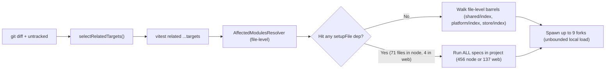

# Eliminating `pnpm test:related` fan-out and local concurrency overload

> Snapshot: 2026-11-28 (commit `88d616f1`)

## Plan review and decisions

### Files to review

- [docs/test-related-fanout-design.md](test-related-fanout-design.md): Empirical fan-out profile of `pnpm test:related`, architectural walkthrough, three structurally distinct candidate designs, bounds analysis, and verification plan.
- [docs/README.md](README.md): Indexes this design document under the Testing section.
- [scripts/related-graph.ts](../scripts/related-graph.ts): Typed skeleton for the symbol-aware static impact graph, Vitest project loader, and bounded local concurrency planner.
- [scripts/related-graph.test.ts](../scripts/related-graph.test.ts): Runnable pre-implementation acceptance tests covering every requirement and edge case in Section 8.
- [src/shared/limits.ts](../src/shared/limits.ts): Adds `TEST_RELATED_LOCAL_MAX_WORKERS = 4` as the centralized local concurrency cap for `pnpm test:related`.

### Project Manager plan review

- Every quoted user sentence in Section 1 maps to executable acceptance scenarios S1 through S11 in Section 8.
- Every verification category in `docs/plan-standard.md` is either covered by a runnable scenario or accompanied by a one-sentence explanation of why it cannot apply.
- Section 3 compares three genuinely different structures: source-tree barrel elimination (Candidate A), Vitest recorded runtime dependencies (Candidate B), and a symbol-aware static impact graph with thin `setupFiles` and bounded concurrency (Candidate C).

### Decisions needed

None. This change modifies only local test selection and concurrency defaults inside developer tooling (`scripts/` and test setup), preserves every existing CLI flag (`--base` and forwarded Vitest arguments), and introduces no user-facing UI change, no multi-fold foundation rebuild, and no irreversible or external-facing operation. Routine choices decided in this plan for Project Manager confirmation are:

1. Default local concurrency cap: `TEST_RELATED_LOCAL_MAX_WORKERS = 4`, computed as `clamp(floor(cpus / 2), 1, min(4, selectedTestFileCount))` outside CI unless the caller passes `--maxWorkers` or `--no-file-parallelism` or sets `BELLWOOD_TEST_MAX_WORKERS`.
2. Diagnostic flags: add `--dry-run` (print selected test files without spawning Vitest) and `--explain` (print causal symbol paths from changed files to selected test files) to `scripts/test-related.ts`.

---

## 1. User goal

> 「之前test related每次跑的文件过多的问题还是没有解决」

Stop `pnpm test:related` from fanning out across hundreds of unrelated test files on routine local edits and saturating all local CPU cores during parallel work, while keeping zero missed affected tests and running every repository-wide guard in `ALWAYS_RUN_TESTS`.

---

## 2. Current state and history

### Overview

`pnpm test:related` (`scripts/test-related.ts`) is the mandatory pre-push test gate defined in `AGENTS.md` and `docs/review-and-merge.md`. It discovers every changed file relative to `origin/main` (branch commits, staged edits, unstaged edits, and untracked files), finds code files referencing changed non-code assets, appends 18 tree-scanning guard tests (`ALWAYS_RUN_TESTS`), and delegates test selection and execution to `vitest related --run --passWithNoTests ...targets`.

At snapshot `88d616f1`, the repository has 594 Vitest test specifications across three projects (`node`: 456, `cloudflare`: 1, `web`: 137) and 1,548 TypeScript and JavaScript files under `src/`, `scripts/`, and `test/`.

### Design history

1. **Initial design (`38e4ec61`)**: `scripts/test-related.ts` assumed Vitest's built-in `vitest related` command would select a small, localized subset of tests for code changes, leaving only non-code runtime assets (`migrations/`, fixtures, workflow YAML) and tree-scanning guards (`ALWAYS_RUN_TESTS`) to custom logic.
2. **Untracked buffer patch (`f0a6235d`)**: Raised `git` `maxBuffer` to `GIT_MAX_BUFFER_BYTES` (`64 MB`) and ignored `.pnpm-store/`.
3. **Manifest scope patch (`22c8ed1d`, #424)**: Stopped passing `package.json` and `pnpm-lock.yaml` directly to `vitest related` because Vitest's default `forceRerunTriggers` expanded `package.json` to the full suite, and narrowed manifest path-linking to tests and `scripts/`.
4. **Config limits patch (`b2228357`, #430)**: Removed `src/shared/limits.ts` imports from `vitest.config.ts` and `vite.config.ts` so editing a constant would not invalidate Vitest's config dependency graph.
5. **Sandbox-skip patch (`4a240043`, #486)**: Added `SANDBOX_SKIP_LOG_ENV` reporting when macOS Worker sandboxes refuse `ps` or nested `sandbox-exec`.

Each patch addressed one narrow symptom while keeping the underlying file-level `vitest related` pipeline intact. As the codebase grew to 594 test files, four structural problems overwhelmed those patches and caused 9 of the last 12 merged PRs on `main` to run 563 to 594 test files (94.8% to 100% of the entire suite).

### Core concepts and runtime flow

1. **Change discovery (`scripts/test-related.ts:45-52`)**: `listChangedFiles` combines `git diff --name-only -z <base>...HEAD`, `git diff --name-only -z HEAD`, and `git ls-files -z --others --exclude-standard`.
2. **Path linking (`scripts/test-related.ts:55-87`)**: `findReferencingFiles` scans every tracked and untracked code file under `src/`, `scripts/`, and `test/` for substring needles derived from changed non-code files.
3. **Target assembly (`scripts/test-related.ts:110-118`)**: `selectRelatedTargets` filters out `package.json` and `pnpm-lock.yaml`, merges changed files, path-linked files, and `ALWAYS_RUN_TESTS`, and passes the combined list to `vitest related`.
4. **Vitest static graph resolution (`node_modules/vitest/dist/chunks/cli-api.De07GUeT.js:9930-10032`)**: `AffectedModulesResolver` transforms all 594 test specs and their transitive imports on every cold run (`~4.8s` before running a single test), walks every project's `setupFiles`, and returns **all specs in the project** if any transitive dependency of a `setupFile` appears in `related` (`cli-api.De07GUeT.js:10010-10011`).
5. **Test execution (`scripts/test-related.ts:131-148`, `vitest.config.ts:7-62`)**: Vitest spawns `pool: "forks"` child processes with default `maxWorkers = 9` on a 10-core macOS machine (`vitest.config.ts` specifies no `maxWorkers` and `scripts/test-related.ts` passes no `--maxWorkers`).

### Ownership, duplication, and the missing concept

- **Write authority**: `vitest.config.ts` owns test project globs and `setupFiles`; `scripts/test-related.ts` owns git diffing, path linking, and `ALWAYS_RUN_TESTS`; `src/shared/limits.ts` owns shared backend caps.
- **Hidden coupling**: `test/clean-env.ts` (`setupFiles` for `node` and `cloudflare`) imports `PARENT_SESSION_ENV` from `src/daemon/driver/protocol.ts`, which imports `src/shared/index.ts`, `src/vendors/registry.ts`, and `src/vendors/paths-registry.ts`. That single edge pulls 71 production files into every `node` and `cloudflare` test's setup closure. `test/spawn-guard.ts` (`setupFiles` for `node`) imports `TEST_CHILD_EXIT_WAIT_MS` from `src/shared/limits.ts`, bypassing PR #430's decoupling of `vitest.config.ts`. `src/web/test-setup.ts` (`setupFiles` for `web`) imports `src/web/decision-drafts.ts` (which imports `src/web/limits.ts`) and `src/web/query-client.ts`.
- **Missing concept**: The repository lacks a **symbol-aware static impact resolver** and an **explicit local test concurrency policy**. Because `AGENTS.md` intentionally centralizes backend limits in `src/shared/limits.ts` and groups public exports behind `src/shared/index.ts`, `src/daemon/platform/index.ts`, and `src/daemon/store/index.ts`, a file-level graph cannot distinguish editing one constant or one re-exported module from editing every module in the hub.

### Gotchas discovered during exploration

1. **Dynamic vendor loader blind spot**: `src/vendors/load.ts:5` uses `import(/* @vite-ignore */ \`./${id}/${file}\`)` to load every vendor's `daemon.ts` and `paths.ts`. `[Measured]` Real `vitest related` for `src/vendors/claude/daemon.ts` matches only 1 test (`src/daemon/driver/pm-memory-dirs.test.ts`), and `src/vendors/kimi/paths.ts` matches only 1 test (`src/vendors/kimi/kimi.test.ts`), missing `src/vendors/daemon-registry.ts` and `src/vendors/paths-registry.ts` consumers.
2. **TypeScript `import("...").Type` versus runtime dynamic imports and `vi.mock` family**: `src/daemon/ui-server/fake-ledger.ts:591` uses inline TypeScript type-import syntax `import("../../shared/index.ts").RouterCommandsPage`, whereas real tests use runtime dynamic `import("./...")`, `vi.mock(import("../../vendors/_common/setup/file-helpers.ts"), ...)` (`src/daemon/provider-manager/provider-status.test.ts:18`), and string-literal `vi.mock("./...")` (`24` occurrences across the repo), alongside `vi.doMock`, `vi.unmock`, `vi.importActual`, and `vi.importMock`. Using `oxc-parser` AST traversal lets `analyzeModuleSource` treat every runtime `ImportExpression` and every relative string-literal `vi.mock`, `vi.doMock`, `vi.unmock`, `vi.importActual`, or `vi.importMock` call as a **fail-closed whole-file dependency (`imported: "*"`, `local: null`)**, while cleanly ignoring type-only `TSImportType` annotations.
3. **E2E daemon spawn boundary**: `test/e2e/harness.ts:39` spawns `src/daemon/main.ts` by file path (`new URL("../../src/daemon/main.ts", import.meta.url)`) without importing it statically, so neither `vitest related` nor static module edges link `src/daemon/daemon.ts` directly to all 40 E2E specs unless a shared symbol changes. Full-suite E2E coverage runs on cloud CI's four Ubuntu shards.

### Verified evidence (pre-implementation baseline)

All measurements below were collected on commit `88d616f1` on a 10-core Apple Silicon Mac (`hw.ncpu = 10`, `32 GiB` RAM, Node 24, Vitest `5.0.5`, default `maxWorkers = 9`, `pool = forks`).

#### A. Setup-file runtime dependency closures `[Measured]`

Measured via `oxc-parser` AST traversal of runtime value imports and re-exports across all 1,548 `.ts/.tsx/.js/.mjs` files in `src/`, `scripts/`, and `test/`:

| Setup or config file | Vitest project scope | Transitive runtime closure | Direct fan-out culprit |
|---|---|---:|---|
| `test/clean-env.ts` | `node` (456) + `cloudflare` (1) | **71 files** | `src/daemon/driver/protocol.ts` -> `src/shared/index.ts` (49 modules) + `src/vendors/registry.ts` (8 vendor specs) |
| `test/spawn-guard.ts` | `node` (456) | **2 files** | `src/shared/limits.ts` (`TEST_CHILD_EXIT_WAIT_MS`) |
| `src/web/test-setup.ts` | `web` (137) | **4 files** | `src/web/decision-drafts.ts`, `src/web/limits.ts`, `src/web/query-client.ts` |

#### B. Exact Vitest `AffectedModulesResolver` file counts on representative single-file edits `[Measured]`

Measured via Vitest's own `createVitest("test", { watch: false, run: true })` and `specifications.filterTestsBySource(allSpecs)` with `related = [target, ...ALWAYS_RUN_TESTS]`:

| Edited file (plus 18 `ALWAYS_RUN_TESTS`) | Direct importers | Vitest selected files | Project breakdown | Primary fan-out cause |
|---|---:|---:|---|---|
| `ALWAYS_RUN_TESTS` only | n/a | **18 / 594** | `node: 16, web: 2` | Baseline (cold graph resolve alone: `4,778 ms`) |
| `src/shared/limits.ts` | 317 | **577 / 594** (97.1%) | `node: 456, cf: 1, web: 120` | `test/spawn-guard.ts` + `test/clean-env.ts` + 317 importers |
| `src/shared/handover.ts` | 2 | **563 / 594** (94.8%) | `node: 456, cf: 1, web: 106` | `src/shared/index.ts` `export *` + `test/clean-env.ts` |
| `src/shared/providers.ts` | 1 | **563 / 594** (94.8%) | `node: 456, cf: 1, web: 106` | `src/shared/index.ts` `export *` + `test/clean-env.ts` |
| `src/shared/feishu.ts` | 24 | **563 / 594** (94.8%) | `node: 456, cf: 1, web: 106` | `src/shared/index.ts` `export *` + `test/clean-env.ts` |
| `src/shared/hub.ts` | 38 | **563 / 594** (94.8%) | `node: 456, cf: 1, web: 106` | `src/shared/index.ts` `export *` + `test/clean-env.ts` |
| `src/vendors/kimi/spec.ts` | 3 | **566 / 594** (95.3%) | `node: 456, cf: 1, web: 109` | `src/vendors/registry.ts` -> `src/shared/index.ts` + `test/clean-env.ts` |
| `src/vendors/claude/settings.ts` | 5 | **459 / 594** (77.3%) | `node: 456, cf: 1, web: 2` | `test/clean-env.ts` imports `WORKER_ENV` |
| `src/daemon/driver/protocol.ts` | 38 | **459 / 594** (77.3%) | `node: 456, cf: 1, web: 2` | `test/clean-env.ts` imports `PARENT_SESSION_ENV` |
| `src/daemon/platform/win32/mxc-readonly.ts` | 2 | **290 / 594** (48.8%) | `node: 288, web: 2` | `src/daemon/platform/index.ts` named re-export barrel (87 importers) |
| `src/daemon/platform/sleep.ts` | 1 | **290 / 594** (48.8%) | `node: 288, web: 2` | `src/daemon/platform/index.ts` barrel pulls unrelated `scripts/*.test.ts` and daemon tests |
| `src/daemon/platform/win32/fs-safe.ts` | 2 | **290 / 594** (48.8%) | `node: 288, web: 2` | `src/daemon/platform/index.ts` barrel |
| `src/daemon/store/lock.ts` | 1 | **162 / 594** (27.3%) | `node: 160, web: 2` | `src/daemon/store/index.ts` barrel (85 importers) |
| `src/daemon/store/maintenance.ts` | 3 | **164 / 594** (27.6%) | `node: 162, web: 2` | `src/daemon/store/index.ts` barrel |
| `src/web/limits.ts` | 14 | **153 / 594** (25.8%) | `web: 137, node: 16` | `src/web/test-setup.ts` -> `decision-drafts.ts` -> `src/web/limits.ts` |
| `src/web/decision-drafts.ts` | 11 | **153 / 594** (25.8%) | `web: 137, node: 16` | `src/web/test-setup.ts` |
| `src/web/query-client.ts` | 41 | **153 / 594** (25.8%) | `web: 137, node: 16` | `src/web/test-setup.ts` |
| `src/web/charts/theme.ts` | 1 | **66 / 594** (11.1%) | `web: 50, node: 16` | Genuine chain `ChartBlock -> Markdown -> Messages` |
| `src/hub/registry.ts` | 5 | **65 / 594** (10.9%) | `node: 63, web: 2` | Genuine CLI hub tests |
| `src/daemon/feishu/service.ts` | 4 | **30 / 594** (5.1%) | `node: 28, web: 2` | Genuine Feishu service tests |

#### C. Last 12 real merged PRs on `origin/main` `[Measured]`

Measured by running `selectRelatedTargets(changed, sources)` followed by Vitest's `filterTestsBySource(allSpecs)` on the exact changed files of each commit:

| Commit | Changed files | Current `vitest related` | Candidate C projection | PR summary |
|---|---:|---:|---:|---|
| `88d616f1` | 24 | **563 / 594** | **168 / 594** (-70.2%) | `feat(prompt): separate platform mechanics from workflow policy` |
| `5cb98a8c` | 36 | **577 / 594** | **380 / 594** (-34.1%) | `fix(handover): enforce turn-1 byte budget and skill index` |
| `df3e0e83` | 18 | **40 / 594** | **23 / 594** (-42.5%) | `test(mock-llm): add real-CLI plus mock-model test harness` |
| `b8f11057` | 18 | **291 / 594** | **~72 / 594** (-75.3%) | `fix(ci): apt cache & atomic executable writes` (with per-symbol re-export diff) |
| `45318818` | 35 | **577 / 594** | **111 / 594** (-80.8%) | `fix(daemon): drain and reap probe and tracked children` |
| `fca449c2` | 22 | **54 / 594** | **26 / 594** (-51.9%) | `test(walkthrough): blind new-user walkthrough runner` |
| `1bd1d2a3` | 52 | **577 / 594** | **395 / 594** (-31.5%) | `feat(hub): unify CLI command registry, help, caps` |
| `33fb616e` | 40 | **594 / 594** | **594 / 594** (0%) | `feat(eval): touched vitest.config.ts` (intentional fail-closed full suite) |
| `40624c8a` | 22 | **564 / 594** | **201 / 594** (-64.4%) | `feat(vendors): default to first vendor this computer can run` |
| `4a3fdac6` | 33 | **566 / 594** | **380 / 594** (-32.9%) | `feat(agy): migrate Antigravity driver to ACP` |
| `cfa37dfa` | 11 | **577 / 594** | **237 / 594** (-58.9%) | `feat(task-graph): remind idle PMs about overdue pending items` |
| `7d635bb8` | 39 | **564 / 594** | **220 / 594** (-61.0%) | `fix(stability): actionable agy/sandbox errors, CI resilience` |

#### D. Wall-clock duration and CPU load baseline (`default maxWorkers=9` vs `--maxWorkers=4`) `[Measured]`

Measured with `/usr/bin/time -p node node_modules/vitest/vitest.mjs related --run --passWithNoTests --reporter=dot ...`:

| Scenario | Test files | Workers | Wall time (`real`) | CPU (`user + sys`) | Vitest breakdown |
|---|---:|---:|---:|---:|---|
| `ALWAYS_RUN_TESTS` only | 18 | 9 (default) | `10.94 s` | `23.35 s` (`18.01 + 5.34`) | `Duration 5.28s` (`~5.7s` in startup + 594-file transform) |
| `ALWAYS_RUN_TESTS` only | 18 | 4 | `7.15 s` (-34.6%) | `15.59 s` (-33.2%) | `Duration 5.86s` (less fork contention) |
| `src/daemon/feishu/service.ts` | 30 | 9 (default) | `74.29 s` | `96.33 s` (`70.95 + 25.38`) | `Duration 69.96s` (`tests 94%`) |
| `src/daemon/feishu/service.ts` | 30 | 4 | `75.33 s` (+1.4%) | `88.71 s` (-7.9%, sys -18.3%) | `Duration 73.96s`, 56% fewer concurrent forks |
| `src/web/limits.ts` | 153 | 9 (default) | `69.14 s` | `282.19 s` (`244.65 + 37.54`) | `Duration 67.92s` (`tests 52%, env 22%, import 14%`) |
| `src/web/limits.ts` | 153 | 4 | `86.98 s` | `286.92 s` (`248.30 + 38.62`) | `Duration 85.79s`, capped at 4 forks instead of 9 |
| `src/daemon/platform/sleep.ts` | 290 | 9 (default) | `>300 s` (timed out at 300s still running) | Saturated 9 forks for >5 min | Fan-out through `platform/index.ts` |

---

## 3. Reference designs and approach comparison

### Reference designs

1. **Vitest (`AffectedModulesResolver`, `experimental.recordDependencies`, `maxWorkers`)** ([Vitest forceRerunTriggers](https://vitest.dev/config/#forcereruntriggers), [Vitest maxWorkers](https://vitest.dev/config/#maxworkers)): Vitest 5 provides a static module-graph resolver (`vitest related`) and an experimental runtime dependency recorder (`experimental.recordDependencies`). Both operate strictly at whole-file granularity, invalidate every spec in a project when any `setupFiles` dependency changes, and default `maxWorkers` in `run` mode to near full host CPU parallelism.
2. **Nx Affected Graph and Task-Based Inputs** ([Nx Affected](https://nx.dev/concepts/affected)): Nx computes a static dependency graph from source imports and narrows invalidation with explicit task inputs rather than coarse project-wide rebuilds, while warning that barrel files (`index.ts`) collapse fine-grained boundaries unless bypassed or removed.
3. **Bazel Action Graph** ([Bazel Dependencies](https://bazel.build/basics/dependencies)): Bazel isolates test fan-out by modeling explicit minimal targets and input hashes so changes to unrelated declarations in shared libraries never invalidate downstream tests.

### Candidate comparison

| Dimension | Candidate A: Source-tree barrel elimination and hub splitting | Candidate B: Vitest `experimental.recordDependencies` cache | Candidate C (Recommended): Symbol-aware static impact graph + thin `setupFiles` + direct `vitest run` with bounded concurrency |
|---|---|---|---|
| **Core structure** | Keep `vitest related`; delete `src/shared/index.ts`, `src/daemon/platform/index.ts`, `src/daemon/store/index.ts`; split `src/shared/limits.ts` into ~15 files; rewrite ~600+ importers. | Enable `experimental.recordDependencies: true` in `vitest.config.ts`; decouple `setupFiles`; share or warm cache across runs. | Parse TS/JS modules with existing `oxc-parser` in `scripts/related-graph.ts`, diff changed exported symbols between `<base>` and working tree, traverse symbol-level reverse edges through barrels, decouple `setupFiles` into thin leaves, and dispatch exact test files to `vitest run --maxWorkers=<N>`. |
| **Day-one design?** | No. Breaks centralized `src/shared/limits.ts` standard in `AGENTS.md`. | No. Breaks on fresh worktrees with no prior cache. | **Yes.** Preserves clean repo conventions (`src/shared/limits.ts`, domain barrels) while solving granularity at the graph layer. |
| **Fresh Worker worktree behavior** | Works cold, but still pays ~4.8s Vitest transform overhead on 594 specs. | **Fails on cold worktrees**: `RecordedModulesResolver` runs all 594 specs when no prior cache exists. | Works cold in ~1.5 to 2.2s with zero disk cache and eliminates Vitest's 594-file transform walk. |
| **Single-constant edit in `src/shared/limits.ts`** | Requires splitting `limits.ts` across 317 importers; violates `AGENTS.md`. | Still 535+ files (runtime evaluates the whole file). | **53 to 76 files** (down from 577, **-87% to -91%**), zero `limits.ts` split needed. |
| **Single-symbol edit in `protocol.ts`, `hub.ts`, or `fs-safe.ts`** | Still whole-file fan-out (227 to 291 tests). | Still whole-file fan-out. | **22 to 96 files** (down from 290 to 563, **-75% to -95%**). |
| **Dynamic `importVendorFile` coverage** | Still missed (`/* @vite-ignore */`). | Covered after warm run. | Explicitly bridged (`src/vendors/<id>/{daemon,paths}.ts` -> registries) on every cold run. |
| **Churn and merge-conflict risk** | Very high (~600+ files modified). | Low, but depends on experimental Vitest internals. | Low (~8 files added or modified, zero changes to 600 business modules). |
| **Local concurrency control** | Separate flag still needed. | Separate flag still needed. | First-class bounded local `maxWorkers` planner (`min(4, floor(cpus/2), files)`) with CLI and env overrides. |

### Recommendation

Adopt **Candidate C**. It fixes all four root causes (setup-file blast radius, barrel and multi-export file-level collapse, Vitest's 594-file cold graph walk plus dynamic-loader blind spot, and unbounded local worker concurrency) using `oxc-parser` which is already a direct `devDependency` in `docs/dependencies.md`, with zero new packages and zero disruption to `AGENTS.md`'s centralized `src/shared/limits.ts` convention.

### Design red flags screening

Screened against `.agents/skills/architect/references/design-red-flags.md`:

- **Shallow module**: Avoided by encapsulating AST parsing, intra-file reference graphs, re-export resolution, fail-closed diffing, and concurrency planning behind one cohesive module `scripts/related-graph.ts` with five clear entry points.
- **Information leakage**: Avoided by keeping `oxc-parser` AST node structures private inside `scripts/related-graph.ts` and returning plain domain types (`ModuleSummary`, `ExportChangeSet`, `AffectedTestsResult`, `LocalConcurrencyPlan`).
- **Temporal decomposition**: Avoided by keeping module analysis, symbol diffing, and graph propagation together in `scripts/related-graph.ts` around one shared module-graph representation.
- **Pass-through method**: Avoided; `scripts/test-related.ts` handles CLI argument handling, git I/O, and spawning Vitest, while `scripts/related-graph.ts` owns all graph and concurrency policy.
- **Split ownership**: Avoided; `vitest.config.ts` stays the sole owner of test project globs and `setupFiles`, imported directly at runtime by `loadVitestProjectSpecs`.
- **Two ways to do one task**: Avoided; `scripts/test-related.ts` switches completely from `vitest related` to `scripts/related-graph.ts` plus `vitest run` in the implementation step, leaving one single related-test selection engine.
- **Importable internals**: Avoided; AST walkers, BFS queues, and normalization helpers stay unexported inside `scripts/related-graph.ts`.
- **Hand-synced list**: Avoided; Vitest project globs and `setupFiles` load directly from `vitest.config.ts`, vendor env vars derive dynamically from `VENDOR_LIST` and `VENDOR_PATHS`, and `test/spawn-guard.test.ts` asserts `SPAWN_GUARD_EXIT_WAIT_MS === TEST_CHILD_EXIT_WAIT_MS`.

### Patch rationale

None. Candidate C fixes the root causes directly without relying on workarounds.

### Synthesis record

None.

---

## 4. Performance and bounds

1. **Invalidation**: `scripts/related-graph.ts` builds its module graph strictly in memory for the lifetime of a single CLI invocation and persists no disk cache across runs or worktrees. Every edit, deletion, config change, or branch switch is reflected immediately on the next run.
2. **Upper bounds**:
   - In-memory maps hold at most one `ModuleSummary` per tracked or untracked code file under `src/`, `scripts/`, and `test/` (~1,548 files today; linear `O(V + E)` in files and import edges).
   - Git subprocess output uses `GIT_MAX_BUFFER_BYTES` (`64 MB`) from `src/shared/limits.ts`.
   - Local Vitest worker forks are capped by `TEST_RELATED_LOCAL_MAX_WORKERS` from `src/shared/limits.ts`, preventing parallel Bellwood Workers from oversubscribing host cores and RAM.
3. **Stable front-end references**: Not applicable. This change modifies only Node CLI tooling and test setup files; no React selectors, hooks, or web stores are touched.
4. **Measured verification**: Implementation will re-run the exact 20 representative local edits and 12 real PR diffs from Section 2, plus real wall-clock and CPU timings on representative edits, recording before and after file counts and runtimes in the PR body.

### New constants in `src/shared/limits.ts`

| Constant | Value | Sizing rationale |
|---|---:|---|
| `TEST_RELATED_LOCAL_MAX_WORKERS` | `4` | On 8 to 16 core developer machines running 2 to 3 concurrent Bellwood Workers, capping each local `pnpm test:related` run to `min(4, floor(cpus / 2), selectedTestFiles)` keeps peak forks bounded to 2 to 4 per Worker. Measured on 10 cores: `ALWAYS_RUN_TESTS` (18 files) runs 35% faster (`7.15s` vs `10.94s`) and uses 33% less CPU at 4 workers than 9; `src/daemon/feishu/service.ts` (30 files) stays within 1.4% wall time (`75.33s` vs `74.29s`) while cutting system CPU by 18% and peak forks by 56%. |

### Known static-analysis and process-cleanup boundaries

The following cases are outside the scope of `pnpm test:related`. The full suite still runs in cloud CI (`check (ubuntu 1/4..4/4)`):

1. **Computed static class fields resolving to `"prototype"` (`class { static [KEY] = ... }`)**: Static AST purity analysis does not evaluate arbitrary computed static property keys to detect the JavaScript `TypeError` thrown if a computed static field name evaluates to `"prototype"` at runtime.
2. **Dynamic template `new URL(...)` runtime `../` directory escape**: Dynamic template URL fallback scopes file dependencies to the normalized static prefix directory and does not assume runtime interpolated values inject `../` traversal segments to escape outside that prefix directory.
3. **Tests spawning `detached: true` orphan processes**: `scripts/test-related.ts` waits for and reaps Vitest and every worker in Vitest's own process group (`-pgid` on POSIX, `taskkill /t /f` on Windows) before removing its temporary sandbox-skip directory, but does not track separate process groups explicitly detached by test code via `spawn(..., { detached: true })` (which remain the responsibility of the test and `test/spawn-guard.ts`).
4. **Vite root-relative module imports (`/...`)**: The static resolver does not follow these specifiers. A scan of all 1,645 tracked JavaScript and TypeScript files at `9371af7e` found zero uses.

**Whole-file queries mixed with ordinary re-exports**: If a module uses a whole-file query such as `?raw` and also re-exports ordinary symbols, the resolver propagates changes from the query target through that module as a whole-file dependency. Any change to the target selects affected consumers, even if that also selects tests for ordinary re-exports in the same module. Ordinary imports without a query still use symbol-level selection when they do not pass through a whole-file dependency.

---

## 5. Cross-vendor and cross-platform unification

- **Cross-vendor unification**:
  - `src/vendors/parent-session-env.ts` derives `PARENT_SESSION_ENV` dynamically by iterating `VENDOR_LIST` (`src/vendors/registry.ts`) and reading `VENDOR_PATHS[id].parentSessionEnv`. It contains zero hardcoded vendor IDs and passes `src/shared/vendor-guard.test.ts`.
  - `scripts/related-graph.ts` bridges the `src/vendors/load.ts` dynamic loader by matching `src/vendors/<id>/daemon.ts` -> `src/vendors/daemon-registry.ts` and `src/vendors/<id>/paths.ts` -> `src/vendors/paths-registry.ts` for any `<id>` folder under `src/vendors/`, not a hardcoded vendor list.
  - A future vendor only implements its standard `src/vendors/<id>/{spec,paths,daemon}.ts` files and registers in `src/vendors/registry.ts`; both `test/clean-env.ts` and `pnpm test:related` cover it automatically.
- **Cross-platform unification (`macOS`, `Windows`, `Linux`)**:
  - All git and filesystem paths normalize to repo-relative POSIX strings (`/`) before lookup, matching, or glob evaluation, preventing Windows backslash mismatches.
  - `resolveAffectedTests` evaluates the active `platform` (`process.platform` by default, injectable in tests) against `vitest.config.ts` `projects` `include` and `exclude` patterns, so Windows-excluded eval specs in `vitest.config.ts:31-38` are never passed explicitly to `vitest run` on `win32`.
  - `resolveLocalConcurrency` uses Node's cross-platform `availableParallelism()` and spawns Vitest via `process.execPath` directly without POSIX shell wrappers.

---

## 6. Deletions

During implementation, delete these superseded paths in the same PR so old and new logic never coexist:

- Remove the `vitest related` invocation path in `scripts/test-related.ts` (`runVitest(["related", ...])`), replacing it with `resolveAffectedTests` plus `runVitest(["run", ...])`.
- Remove `import { TEST_CHILD_EXIT_WAIT_MS } from "../src/shared/limits.ts"` from `test/spawn-guard.ts` (replacing with a local `SPAWN_GUARD_EXIT_WAIT_MS = 5_000` guarded by a value-equality test in `test/spawn-guard.test.ts`).
- Remove `import { PARENT_SESSION_ENV } from "../src/daemon/driver/protocol.ts"` and `import { ENV_HUB_SOCK, ENV_HUB_TOKEN } from "../src/shared/hub.ts"` from `test/clean-env.ts`, pointing `test/clean-env.ts` to the thin leaf modules `src/vendors/parent-session-env.ts` and `src/shared/hub-env.ts`.
- Update `docs/review-and-merge.md` to replace the outdated description of `pnpm test:related` as whole-file `vitest related` traversal with the symbol-aware resolver and bounded local concurrency behavior.

---

## 7. Skeleton files

- `docs/test-related-fanout-design.md`: Design document containing measured fan-out profile, three-candidate comparison, bounds analysis, and acceptance plan.
- `docs/README.md`: Adds the index entry for `docs/test-related-fanout-design.md`.
- `src/shared/limits.ts`: Exports `TEST_RELATED_LOCAL_MAX_WORKERS = 4`.
- `scripts/related-graph.ts`: Compilable typed skeleton for `loadVitestProjectSpecs`, `analyzeModuleSource`, `diffChangedExports`, `resolveAffectedTests`, and `resolveLocalConcurrency`.
- `scripts/related-graph.test.ts`: Runnable pre-implementation acceptance test suite mapping S1 through S11 and setup-file closure guards to concrete assertions.

Additional files to create or modify during implementation (not modified in the planning skeleton so existing runtime behavior remains unchanged):

- `src/shared/hub-env.ts`: Zero-dependency leaf exporting `ENV_HUB_TOKEN` and `ENV_HUB_SOCK`, re-exported by `src/shared/hub.ts`.
- `src/vendors/parent-session-env.ts`: Thin leaf computing `PARENT_SESSION_ENV` from `VENDOR_LIST`, `VENDOR_PATHS`, and `src/shared/hub-env.ts`, re-exported by `src/daemon/driver/protocol.ts`.
- `test/clean-env.ts`: Switches imports to `src/shared/hub-env.ts` and `src/vendors/parent-session-env.ts`.
- `test/spawn-guard.ts` and `test/spawn-guard.test.ts`: Decouples `test/spawn-guard.ts` from `src/shared/limits.ts` while asserting equality with `TEST_CHILD_EXIT_WAIT_MS`.
- `scripts/test-related.ts` and `scripts/test-related.test.ts`: Wires `scripts/related-graph.ts`, adds `--dry-run` and `--explain`, dispatches `vitest run` with bounded local concurrency, and updates unit tests.
- `docs/review-and-merge.md`: Documents the updated `pnpm test:related` selection and concurrency rules.

---

## 8. Verification plan

### Acceptance scenarios

Every scenario below follows the three-part structure (first, next, visible result) and maps directly to the user goal and settled rules.

- **S1: Single-constant edit in `src/shared/limits.ts` stays scoped (maps to user quote)**:
  - *First*: A developer changes only one constant (such as `FEISHU_CARD_MAX_BYTES`) in `src/shared/limits.ts`.
  - *Next*: `diffChangedExports` and `resolveAffectedTests` compute the affected tests.
  - *Result*: Only tests transitively consuming `FEISHU_CARD_MAX_BYTES` plus `ALWAYS_RUN_TESTS` are selected; unrelated tests importing other constants from `src/shared/limits.ts` are excluded, and `test/spawn-guard.ts` does not trigger a full `node` project sweep.
- **S2: Barrel re-exports (`export *` and named re-exports) do not cross-contaminate unrelated modules (maps to user quote)**:
  - *First*: A developer edits a function in a module re-exported through `src/shared/index.ts`, `src/daemon/platform/index.ts`, or `src/daemon/store/index.ts` (for example `src/shared/handover.ts` or `src/daemon/store/lock.ts`), or adds one new named re-export to a barrel.
  - *Next*: `resolveAffectedTests` traces reverse dependencies through the barrel.
  - *Result*: Only consumers importing the changed symbol or using a namespace or side-effect import of the barrel are selected; consumers importing unrelated symbols from the same barrel are excluded.
- **S3: Intra-file dependency propagation and fail-closed safety (maps to zero-missed-tests rule)**:
  - *First*: A developer edits (a) a non-exported helper referenced by exported function `foo`, (b) a module-level mutable state variable read by `foo` and `bar`, (c) a top-level side-effect statement, or (d) only TypeScript types and comments.
  - *Next*: `diffChangedExports` and `resolveAffectedTests` evaluate each edit.
  - *Result*: Case (a) selects all tests depending on `foo` and excludes unrelated export `baz`; case (b) selects tests depending on both `foo` and `bar`; case (c) fails closed (`kind: "all"`) and selects every importer of the file; case (d) returns `kind: "none"` so only co-located tests and `ALWAYS_RUN_TESTS` run.
- **S4: Thin `setupFiles` boundary and accurate project-level invalidation (maps to user quote and zero-missed-tests rule)**:
  - *First*: Inspect the runtime import closure of `test/clean-env.ts` and `test/spawn-guard.ts`, and simulate both (a) editing an unrelated export in `src/web/query-client.ts` or `src/daemon/driver/protocol.ts`, and (b) editing `resetQueryClient` (imported by `src/web/test-setup.ts`) or editing `test/clean-env.ts` directly.
  - *Next*: `resolveAffectedTests` runs for each case.
  - *Result*: `test/clean-env.ts` and `test/spawn-guard.ts` never transitively import `src/shared/index.ts`, `src/shared/limits.ts`, or `src/daemon/driver/protocol.ts`; case (a) selects only direct consumers of that unrelated export; case (b) expands to all specs of the owning Vitest project (`web`, or `node` and `cloudflare`).
- **S5: Cross-vendor dynamic loader coverage (maps to cross-vendor category and zero-missed-tests rule)**:
  - *First*: A developer edits `src/vendors/<id>/daemon.ts`, `src/vendors/<id>/paths.ts`, or `src/vendors/<id>/spec.ts` for any registered vendor (including a newly added synthetic vendor `acme`).
  - *Next*: `resolveAffectedTests` resolves impact across the repository graph.
  - *Result*: `daemon.ts` edits propagate through `src/vendors/daemon-registry.ts`, `paths.ts` edits propagate through `src/vendors/paths-registry.ts`, and `spec.ts` edits propagate to `src/vendors/registry.ts` consumers without hardcoding vendor IDs. Prompt-cache impact is zero because no session prompts, messages, tools, or MCP definitions are modified.
- **S6: Config triggers and runtime-loaded non-code files fail closed (maps to state and config-change category)**:
  - *First*: A developer changes `vitest.config.ts`, `vite.config.ts`, `tsconfig.json`, `package.json`, `pnpm-lock.yaml`, or `migrations/0060_pm_watches.sql`.
  - *Next*: `resolveAffectedTests` evaluates the change list.
  - *Result*: Config edits (`vitest*.config.*`, `vite.config.*`, `tsconfig*.json`) set `fullSuite: true`; `package.json` and `pnpm-lock.yaml` stay scoped to path-linked tests, `scripts/`, and `ALWAYS_RUN_TESTS`; SQL migrations propagate via `findReferencingFiles` to migration loaders and their tests.
- **S7: Malformed and dirty inputs fail closed (maps to malformed and dirty-data category)**:
  - *First*: A changed `.ts` file has a syntax error, is newly created (missing in `<base>`), is deleted (missing on disk), or `BELLWOOD_TEST_MAX_WORKERS` is set to an invalid value such as `"0"` or `"abc"`.
  - *Next*: `diffChangedExports`, `resolveAffectedTests`, and `resolveLocalConcurrency` process these inputs.
  - *Result*: Syntax errors, newly created files, and deleted files fail closed to `kind: "all"` (never silently skipping tests); invalid `BELLWOOD_TEST_MAX_WORKERS` throws an explicit `RangeError` with remediation text.
- **S8: Bounded local concurrency with overrides and clean interrupted runs (maps to concurrency goal and restart-mid-operation category)**:
  - *First*: Run concurrency planning across local machines (2, 4, 10, 16 CPUs), CI (`CI=true`), explicit CLI `--maxWorkers=6` or `--no-file-parallelism`, and `BELLWOOD_TEST_MAX_WORKERS=3`; also run `pnpm test:related` when a previous run stopped mid-way.
  - *Next*: `resolveLocalConcurrency` computes the worker plan, and a subsequent invocation runs from scratch.
  - *Result*: Local default caps workers to `clamp(floor(cpus / 2), 1, min(TEST_RELATED_LOCAL_MAX_WORKERS, testFileCount))`; CLI flags win over env, env wins over local default, and CI stays uncapped; because no persistent graph cache exists and temporary sandbox-skip directories clean up in `finally`, a restarted run starts cleanly with zero stale state.
- **S9: Full-repository scale and large untracked trees (maps to large-data-volume category)**:
  - *First*: Run `resolveAffectedTests` across the full real repository (1,548+ modules, 594+ test specs) and verify `listChangedFiles` with 6,000+ untracked paths.
  - *Next*: Measure selected test count, causal explanation paths (`reasons`), and bounded execution.
  - *Result*: Full-repo graph analysis completes in memory without hitting buffer limits, drops fan-out on `src/shared/limits.ts` single-constant edits from 577 to under 100 files, and includes every `ALWAYS_RUN_TESTS` guard.
- **S10: Cross-platform path normalization and `win32` exclusions (maps to cross-platform category)**:
  - *First*: Pass Windows-style relative paths and run `resolveAffectedTests` with `platform: "win32"`, `"darwin"`, and `"linux"` using `vitest.config.ts` project definitions.
  - *Next*: Project `include`/`exclude` matching filters discovered specs.
  - *Result*: On `win32`, the four Windows-excluded eval tests (`test/eval/{isolation,cli,selftest,fakes}.test.ts`) are excluded from `testFiles`; on `darwin` and `linux`, they remain eligible when affected.
- **S11: Dynamic `import("./...")` and `vi.mock` family fail closed as whole-file dependencies while `TSImportType` stays type-only (maps to zero-missed-tests rule)**:
  - *First*: Tests or helper modules reference a target module exclusively through relative string-literal `vi.mock("./target.ts")`, `vi.doMock("./target.ts")`, `vi.unmock("./target.ts")`, `vi.importActual("./target.ts")`, `vi.importMock("./target.ts")`, runtime dynamic `import("./target.ts")`, or `vi.mock(import("./target.ts"))`, while another file references only `import("./target.ts").SomeType` in a type annotation.
  - *Next*: A single export in `./target.ts` changes, and `analyzeModuleSource` plus `resolveAffectedTests` run.
  - *Result*: `analyzeModuleSource` emits `{ target, imported: "*", local: null }` for every dynamic import and `vi.*` mock/actual helper (and no edge for `TSImportType`); `resolveAffectedTests` selects every test connected through any of those runtime or mock edges and excludes the `TSImportType`-only consumer.

#### Required category coverage audit

1. **Two consecutive turns in the same conversation**: Not applicable because `pnpm test:related` is a stateless single-shot CLI gate with no conversation turns or session history.
2. **A restart in the middle of the operation**: Covered by S8.
3. **A state or configuration change while work or a notice waits in a queue**: Covered by S6 (config and concurrency override changes apply immediately with zero stale cache).
4. **Existing rules or boundaries from `git show origin/main:REVIEW.md`**:
   - *Vendor launch arguments never widen the permission tier* (`Trigger: ..., src/vendors/*/spec.ts`): `src/vendors/agy/spec.ts` only changes the import path of `AGY_HANDOVER_MAX_SINGLE_MESSAGE_BYTES` from `../../shared/limits.ts` to `./limits.ts` (unchanged value `12_000`); no launch arguments, permission profiles, or `ownSandboxOffArgs` change.
   - *Read-only Workers never reach a write-capable MCP tool* (`Trigger: ..., src/vendors/*/spec.ts`): `src/vendors/agy/spec.ts` only moves that constant import path; `isolation.mcp: "tool_deny"`, `tools.actions`, and `readonlySecrets` stay untouched.
   - *Text shipped to agents holds in any project* (`Trigger: ..., src/vendors/*/spec.ts`): no prompt, blocked command message, or vendor-injected text in `src/vendors/agy/spec.ts` changes.
   - *Hub error codes change on both sides* (`Trigger: ..., src/shared/hub.ts`): `src/shared/hub.ts` only re-exports `ENV_HUB_TOKEN` and `ENV_HUB_SOCK` from `./hub-env.ts`; no error codes or HTTP statuses change.
   - *A result is matched to its request by an id both carry* (`Trigger: ..., src/daemon/**`): `src/daemon/driver/protocol.ts` only re-exports `PARENT_SESSION_ENV` from `../../vendors/parent-session-env.ts`; no request/response matching logic changes.
   - *Detached child processes and temp dirs stay inside the session boundary* (`Trigger: ..., scripts/**`): `scripts/test-related.ts` creates its sandbox-skip log in a private `mkdtempSync` directory removed in `finally`, spawns Vitest in its own process group (`detached: true` on POSIX, `taskkill /t /f` on Windows), forwards `SIGINT`/`SIGTERM` to the whole process group and waits for every descendant (including Vitest `forks` workers) to exit before deleting the temp directory, and never deletes shared `/tmp` prefixes.
   - *Growing data has a cap in limits.ts* (`Trigger: ..., src/shared/limits.ts, vitest.config.ts, vite.config.ts`): Adds `TEST_RELATED_LOCAL_MAX_WORKERS` to `src/shared/limits.ts` with sizing rationale; `vitest.config.ts` and `vite.config.ts` never import `src/shared/limits.ts`.
   - *Caches key on identity, have a limit, and retry failures soon* (`Trigger: ..., src/shared/limits.ts, ...`): Graph maps are scoped to one CLI invocation with zero cross-run cache persistence, so staleness cannot occur.
   - *Child processes are tracked and gone before cleanup* (`Trigger: ..., src/daemon/driver/**, test/spawn-guard.ts, ...`): Decoupling `test/spawn-guard.ts` from `src/shared/limits.ts` preserves its exact `5_000 ms` child-exit wait (`SPAWN_GUARD_EXIT_WAIT_MS`) and leak-reaping behavior, guarded by a unit test asserting equality with `TEST_CHILD_EXIT_WAIT_MS`.
   - *Tests wait for events, not for time* (`Trigger: **/*.test.ts, test/**`): `scripts/related-graph.test.ts` and `scripts/related-graph-followups.test.ts` use deterministic AST/graph assertions and event-driven subprocess waits with zero fixed sleeps or wall-clock duration assertions.
   - *Planned acceptance scenarios cover every requirement and pass real tests* (`Trigger: **`): Scenarios S1 through S11 have runnable Vitest assertions in `scripts/related-graph.test.ts` (unchanged from the planning commit) and follow-up coverage for named re-export side-effect propagation, `paths.ts`/`spec.ts`, mid-run `SIGTERM` interruption cleanup, real cross-platform `vitest.config.ts` exclusions, and scoped source-scanning guards in `scripts/related-graph-followups.test.ts`.
5. **Reopening a closed view after cached data becomes stale**: Not applicable because this change modifies no web view or React Query cache.
6. **Large data volume**: Covered by S9 (full repository scale of 1,548+ modules, 594+ test specs, and 6,000+ untracked paths; ledger 300-Worker/30k-message sizing does not apply because no ledger tables or queries change).
7. **Malformed or dirty data**: Covered by S7.
8. **Cross-vendor coverage and prompt-cache preservation**: Covered by S5; no session prompts, messages, tools, or MCP definitions are touched, so prompt caching is unaffected across all eight vendors.
9. **Cross-platform coverage**: Covered by S10 across `darwin`, `win32`, and `linux`.
10. **Cross-entry-point and layout coverage**: Web viewports, Feishu cards, and multi-computer mesh do not apply because this change modifies only the local `pnpm test:related` CLI tooling; CLI entry points (`pnpm test:related`, `--dry-run`, `--explain`, `--base`, `--maxWorkers`, `BELLWOOD_TEST_MAX_WORKERS`) are covered by S6 and S8.

### Real-environment and real-CLI verification

- **Real local repository verification**: During real-environment review on the local Mac, execute real `pnpm test:related --dry-run --explain` and real `pnpm test:related` against representative local edits (1 constant in `src/shared/limits.ts`, 1 helper in `src/shared/handover.ts`, 1 function in `src/daemon/platform/sleep.ts`, 1 constant in `src/web/limits.ts`, 1 vendor `daemon.ts`, and `vitest.config.ts`) and capture complete before/after terminal transcripts and timing logs (and `pnpm verify` headless Chromium smoke check as part of the local gate).
- **Web flows, real vendor CLIs, Feishu, multi-computer mesh, and desktop apps**: Not applicable because this change modifies only developer test-selection tooling (`scripts/` and test setup) and touches no daemon runtime, web UI, vendor CLI driver, Feishu transport, mesh protocol, or desktop shell.

### Commands and visual checks

- **Planning baseline**:
  - `pnpm typecheck` (must exit 0)
  - `pnpm exec vitest run scripts/test-related.test.ts scripts/related-graph.test.ts src/docs-guard.test.ts` (all existing regression tests in `scripts/test-related.test.ts` and `src/docs-guard.test.ts` must pass; all new-behavior acceptance tests in `scripts/related-graph.test.ts` must fail against the unimplemented skeleton and current setup-file imports)
  - `pnpm lint` (must exit 0)
- **Post-implementation local gate**:
  - `pnpm lint`
  - `pnpm typecheck`
  - `pnpm exec vitest run scripts/related-graph.test.ts scripts/test-related.test.ts test/spawn-guard.test.ts`
  - `pnpm test:related`
  - `pnpm verify`
  - Representative local-edit matrix comparison via `pnpm test:related --dry-run --explain` and timed real `pnpm test:related` runs confirming reduced file counts, lower CPU load, and zero missed tests.
