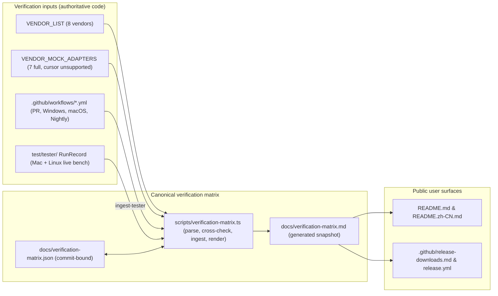

# Packaged Feishu quick start and commit-bound verification matrix

> Snapshot: 2026-11-28 (commit `6f6eed41`)

Bellwood's public quick start currently instructs desktop installer users to run `node src/feishu/main.ts connect`, which fails without a source checkout and system Node, while the repository and GitHub Releases lack a commit-bound public `8 vendors x 3 platforms` verification matrix that separates real vendor service runs from mock-LLM, fake-CLI, and unverified coverage. This design records the verified state of packaged Feishu onboarding and existing CI/bench verification, compares candidate architectures, defines decisions for review, and commits a compiling TypeScript skeleton plus failing pre-implementation acceptance tests.

## Plan review and decisions

### Files to review

- [Design document](verification-matrix-and-quickstart-design.md): `/how` architectural walkthrough of packaged Feishu onboarding and Bellwood's verification stack, candidate comparisons, decisions, bounds, unification rules, and nine-category verification plan.
- [Documentation index](README.md): Indexes this design document under `Testing` so `src/docs-guard.test.ts` stays green.
- [Verification matrix and quick-start guard module](../scripts/verification-matrix.ts): Compiling TypeScript skeleton defining the `8 vendors x 3 platforms` verification matrix schema, strict truthfulness validator, `test/tester/` `RunRecord` ingester, deterministic Markdown renderer, and packaged Feishu quick-start path contract.
- [Acceptance and regression tests](../scripts/verification-matrix.test.ts): Executable acceptance tests (`A1` through `A5`, failing before implementation) and unchanged-rule regression checks (`R1` through `R3`, passing before implementation).

### Project Manager plan review

- **User sentences to scenarios.** Every quoted user sentence in Section 1 maps to executable scenarios in Section 8: the public verification evidence gap (`Q1`) maps to `S1`, `S2`, `S3`, and `S5`; the packaged desktop Feishu quick-start defect (`Q2`) maps to `S4`; and the end-to-end resolution standard (`Q3`) maps to all five scenarios plus automated CI and release checks.
- **Verification categories.** Section 8 covers every applicable category from `docs/plan-standard.md` and every matching `Trigger:` rule from `origin/main:REVIEW.md`, with a one-sentence explanation for each runtime-only category that cannot apply.
- **Structurally distinct designs.** Section 3 compares three structurally distinct designs for packaged Feishu onboarding (packaged-runtime CLI quick start with honest disclosure, in-app `Settings -> Feishu` UI wired to existing `/api/feishu/*`, and native desktop tray/CLI wrapper shims) and three structurally distinct designs for the public verification matrix (commit-bound canonical JSON with generated Markdown and repo-truth cross-checks, hand-edited Markdown table in README/docs, and an external CI dashboard or badge service).

### Decisions needed

#### D1. Packaged desktop Feishu onboarding scope (requires Project Manager decision, escalate to user if choosing Option 2)

Our code inspection verified (`[Measured]`) that Bellwood's web workbench (`src/web/`) and native desktop shells (`apps/macos/`, `apps/windows/`) have **no in-app Feishu onboarding screen today**. The backend HTTP endpoints (`/api/feishu/*` in `src/daemon/ui-server/routes-integrations.ts:27-84`) and SVG QR renderer (`src/web/components/QrCode.tsx`) already exist, and both installers already bundle Node 24 LTS plus `daemon/src/feishu/main.ts` (`scripts/stage-runtime-common.ts:55,393-395`).

| Option | What desktop installer users see | Scope and trade-off |
| --- | --- | --- |
| **1. Candidate F-A (Recommended for Task Graph #204): Packaged-runtime CLI quick start with honest disclosure and path-synced guard** | Quick Start Step 4 states plainly that Feishu bot setup currently uses the CLI rather than an in-app screen (while **Settings -> Computers -> Hub order** shows which paired computer hosts the bot), and gives copy-pasteable commands using the bundled Node and bundled `daemon/src/feishu/main.ts` on macOS (`/Applications/Bellwood.app/Contents/Resources/runtime/...`) and Windows (`$env:LOCALAPPDATA\Bellwood\...`), keeping `node src/feishu/main.ts connect` scoped to Linux and source checkouts. | Zero unrequested UI changes, ships inside Task Graph #204 cleanly, eliminates the broken repo-only command immediately, and guarantees documented paths match the staged installers via automated tests. Leaves full GUI onboarding for a dedicated UI task. |
| **2. Candidate F-B (Day-one UX foundation): Build an in-app `Settings -> Feishu` screen on desktop and mobile** | Users open **Settings -> Feishu**, click **Connect Feishu**, scan the rendered SVG QR code (or paste App ID and App Secret), inspect bound project groups, change guest tiers, resync, or disconnect without touching a terminal. Quick Start Step 4 points directly to **Settings -> Feishu**. | Fixes the root UX gap using existing `/api/feishu/*` routes and `QrCode.tsx`, but introduces a new user-visible Settings category across desktop (`SettingsDialog.tsx`), mobile (`MobileSettings.tsx`), routing (`route.ts`, `workbench-nav.ts`), `docs/ui-standard.md`, React Query generation guards, and wide/narrow browser polish. Requires explicit user approval per `docs/plan-standard.md` and expands Task Graph #204 into a UI feature PR. |

#### D2. Release-gate coupling for the verification matrix (routine Project Manager decision)

| Option | Behavior at release time |
| --- | --- |
| **1. Enforce matrix schema, repo-truth checks, and `releaseVersion` match in `scripts/release-assets.ts check` and link from `.github/release-downloads.md` (Recommended)** | Every `release.yml` run verifies that `docs/verification-matrix.json` is valid, agrees with `package.json`/`Cargo.toml` version and CI workflow configs, and matches `docs/verification-matrix.md` byte-for-byte. Every GitHub Release links to the exact commit-bound verification matrix alongside the installers and provenance checks. |
| **2. Keep verification matrix checks only in `pnpm test:related` and README links** | Prevents drift in PRs, but `release.yml` can still publish a version bump whose verification matrix carries an older `releaseVersion` or lacks a release-notes link. |

## For Workers and reviewers

### 1. User goal

Original user request:

> Q1: 「公开真实验证证据不足：README 宣称 8 个 CLI，但 PR 冒烟用假 CLI、夜间 CI 仅覆盖 4 个真 CLI 且模型端走模拟服务——快照里缺少随版本公布的「逐厂商 × 逐平台」真实服务验收矩阵」
>
> Q2: 「安装入门与内部维护成本：……README.md 安装版快速入门第 4 步连接飞书时，直接给了依赖源码目录与 node 的 node src/feishu/main.ts connect，没说明装包用户从应用内如何进入」
>
> Q3: 「这几个问题解决就行……以及后面说的bug都开始解决，解决完成就ok了」

Intended outcome: fix the packaged desktop Feishu quick start across `README.md` and `README.zh-CN.md` so installer users never hit a source-only command, and introduce a commit-bound, machine-validated `8 vendors x 3 platforms` public verification matrix (`docs/verification-matrix.json` plus generated `docs/verification-matrix.md`) integrated into README, GitHub Releases, and CI checks so every vendor and platform clearly distinguishes real vendor service verification from real-CLI mock-LLM, fake-CLI offline, and unverified coverage.

### 2. Current state and history

#### Subsystem architecture walkthrough (`/how`)

We traced four slices of the codebase directly: (1) packaged desktop runtimes and Feishu setup endpoints across `src/web/`, `src/daemon/ui-server/`, `src/daemon/admin/`, `src/feishu/`, `apps/macos/`, `apps/windows/`, and `scripts/stage-*.ts`; (2) existing user-documentation guards in `src/docs-guard.test.ts`, `src/user-docs-consistency.test.ts`, and `src/user-docs-followups.test.ts`; (3) CI and release workflows in `.github/workflows/*.yml`, `scripts/release-assets.ts`, `scripts/release-plan.ts`, and `.github/release-downloads.md`; and (4) the resident real-service bench (`test/tester/`) and real-CLI mock-LLM harness (`test/mock-llm/`).

##### Overview

Bellwood splits its Feishu onboarding controls across two daemon transports: the local loopback HTTP API (`/api/feishu/*`) for web clients and the local admin Unix socket or Windows named pipe (`/feishu/*`) for the terminal CLI (`src/feishu/main.ts`). While both backend transports and both packaged desktop runtimes already include the Feishu setup code, the web frontend never wired a Settings page to `/api/feishu/*`. Separately, Bellwood's verification runs across four disconnected systems (PR `check.yml`, platform CI `windows.yml`/`macos.yml`, nightly `real-cli-mock-llm`, and the local resident bench `test/tester/`) that never combine into a commit-bound, release-attached public matrix.

##### Key concepts

- **`FeishuSetupService`** (`src/daemon/feishu/setup.ts:23-33`, `src/daemon/feishu/setup-service.ts:203-221`): Authoritative daemon state machine for Feishu QR registration, manual credentials, owner bind codes, chat policies, resync, and disconnect. Exposed on both `/api/feishu/*` (`src/daemon/ui-server/routes-integrations.ts:27-84`) and `/feishu/*` on the admin socket (`src/daemon/admin/socket.ts:72-91`).
- **`stageDaemonTree` and bundled runtimes** (`scripts/stage-runtime-common.ts:55,384-415`, `scripts/stage-mac-runtime.ts:152-171`, `scripts/stage-win-runtime.ts:196-260`): Packs Node 24 LTS (`BUNDLED_NODE_VERSION`), `src/feishu/`, `src/admin/`, `src/shared/`, and pruned production `node_modules` (including `qrcode-generator`) into `Bellwood.app/Contents/Resources/runtime/` on macOS and the Tauri NSIS current-user install directory (`%LOCALAPPDATA%\Bellwood\`) on Windows.
- **`AGENT_VENDORS` and `VENDOR_LIST`** (`src/vendors/registry.ts:11`, `src/shared/vendors.ts:10`): Single registry of all eight supported vendors (`claude`, `agy`, `codex`, `pi`, `deepseek`, `cursor`, `opencode`, `kimi`).
- **`VENDOR_MOCK_ADAPTERS`** (`test/mock-llm/vendors.ts:208-273`): Declares per-vendor mock-LLM capability (`full` for 7 vendors, `unsupported_protocol` for `cursor` because `cursor-agent` uses closed `/aiserver.v1.*` Protobuf RPCs).
- **`VENDOR_BENCH` and `RunRecord`** (`test/tester/vendors.ts:68-89`, `test/tester/types.ts:134-143`): Resident test bench policy and run output recording commit SHAs, per-vendor readiness probes, and real-service turn verdicts on local macOS and remote Tokyo Linux instances.
- **`release-assets.ts` and `.github/release-downloads.md`** (`scripts/release-assets.ts:134-216`, `.github/release-downloads.md`): Composes GitHub Release notes from `CHANGELOG.md` plus `.github/release-downloads.md` and enforces pre-tag checks in `release.yml`.

##### How it works

1. **Feishu onboarding flow today:** When a user runs the packaged desktop app, the native supervisor starts the bundled Node 24 daemon on `127.0.0.1:4317` and opens the admin socket at `~/.agent-hub/run/admin.sock` (POSIX) or `\\.\pipe\...` (Windows) protected by `state/ui-token`. `src/feishu/main.ts` reads `resolveHubPaths(process.env, homedir())`, authenticates to the admin socket via `createAdminClient`, calls `POST /feishu/registration`, prints an ASCII QR code via `qrcode-generator`, and polls `GET /feishu/status` until connected. No code in `src/web/` calls `/api/feishu/*`.
2. **Verification flow today:** On every PR, `check.yml` runs Ubuntu unit/e2e tests and `pnpm verify` with `test/fake-claude/fake-claude.ts`. Path-filtered `windows.yml` runs `test/mock-llm/real-cli-e2e.test.ts` with `BELLWOOD_REQUIRE_REAL_CLI=codex,pi` against the loopback mock LLM server. Nightly `nightly.yml` runs Ubuntu `check.yml`, `windows.yml`, `macos.yml` (offline), and `real-cli-mock-llm` with `BELLWOOD_REQUIRE_REAL_CLI=claude,codex,pi,deepseek` against the loopback mock LLM server. Real upstream vendor turns happen only on the owner's resident bench (`pnpm tester`) for 3 vendors on macOS (`claude`, `agy`, `codex`) and 1 on Linux (`claude`), writing local reports under `~/.bellwood-tester/runs/` that never enter the repository or release notes.

##### Where things live

- `README.md`, `README.zh-CN.md`, `docs/linux.md`, `docs/README.md`: User-facing onboarding and docs index.
- `src/feishu/main.ts`, `src/feishu/cli.ts`, `src/admin/client.ts`: Terminal Feishu onboarding CLI and admin socket client (staged into packaged installers).
- `src/daemon/ui-server/routes-integrations.ts`, `src/daemon/feishu/setup-service.ts`: HTTP `/api/feishu/*` setup routes and daemon state machine.
- `src/web/components/SettingsDialog.tsx`, `src/web/components/AccountSettings.tsx`, `src/web/mobile/settings/MobileSettings.tsx`, `src/web/components/QrCode.tsx`: Current Settings pages (6 tabs, no Feishu setup page; `AccountSettings` only shows `Hosting the Feishu bot now` in `Hub order`).
- `scripts/stage-runtime-common.ts`, `scripts/stage-mac-runtime.ts`, `scripts/stage-win-runtime.ts`, `apps/windows/crates/fusa-desktop/tauri.conf.json`, `tauri.bundle.conf.json`: Packaged runtime layouts for macOS DMG and Windows NSIS installers.
- `scripts/release-assets.ts`, `scripts/release-plan.ts`, `.github/release-downloads.md`, `.github/workflows/release.yml`, `docs/release-flow-design.md`: Release gating and GitHub Release note composition.
- `test/tester/vendors.ts`, `test/tester/types.ts`, `test/tester/report.ts`, `test/mock-llm/vendors.ts`: Resident bench and real-CLI mock-LLM vendor coverage definitions.

##### Gotchas

1. **`src/docs-guard.test.ts` snapshot enforcement:** Any new top-level Markdown file under `docs/` not in `LIVING_NON_DESIGN_DOCS` must have `> Snapshot: YYYY-MM-DD (commit \`<sha>\`)` directly under `# Title` and must be indexed in `docs/README.md` (`src/docs-guard.test.ts:9-10,63-96`). Generating that exact snapshot header in `docs/verification-matrix.md` makes `src/docs-guard.test.ts` validate the matrix's commit SHA automatically when full git history is available.
2. **Windows PowerShell quoting for bundled Node paths:** `%LOCALAPPDATA%` expands in `cmd.exe` but not in PowerShell; PowerShell requires `& "$env:LOCALAPPDATA\Bellwood\node\node.exe" "$env:LOCALAPPDATA\Bellwood\daemon\src\feishu\main.ts" connect`. Both Windows PowerShell and macOS POSIX shell commands must work out of the box when the user's username contains spaces.
3. **Secret leakage from tester records:** `test/tester/types.ts` `RunRecord` entries can include stderr or error strings from live runs. Any ingestion into a committed `docs/verification-matrix.json` must pass every free-text field through secret redaction (matching `SECRET_PATTERNS` in `test/tester/report.ts:20`) and reject strings that still match token shapes.
4. **Release workflow `pull_request.paths` guard:** `scripts/ci-workflows.test.ts:360-371` asserts that every test file invoked by `release.yml`'s `plan` job (and its matching `.ts` module) appears in `release.yml`'s `on.pull_request.paths`. Adding `scripts/verification-matrix.ts` checks to `release-assets.ts` requires keeping `release.yml` path filters synced.

#### Design history

1. **Feishu setup endpoints and CLI (`3e21e492`, `59e6fea0`) `[Measured]`:** Built both `/api/feishu/*` HTTP routes and `src/feishu/main.ts` against `FeishuSetupService`, planning to surface QR onboarding in the browser later while shipping the CLI immediately.
2. **Desktop packaging (`scripts/build-mac-app.sh --dist`, `scripts/stage-win-runtime.ts`, `60fc1413`) `[Measured]`:** Bundled Node 24 LTS and `daemon/src/feishu/` inside both installers, but never added a desktop menu item or web Settings page for Feishu setup.
3. **README rewrite (`ddbd00d8`, PR #515) `[Measured]`:** Reordered `README.md` and `README.zh-CN.md` to lead with desktop installer downloads in Quick Start Steps 1 through 3, then carried over the source-repo `node src/feishu/main.ts connect` command into Step 4 unchanged.
4. **Layered test infrastructure (`80be62d0` PR #418, `59358e6e` PR #505) `[Measured]`:** Built the resident bench (`test/tester/`) and real-CLI mock-LLM harness (`test/mock-llm/`) independently. Neither layer published a version-tied, commit-bound summary into the repository or GitHub Releases.

#### Core concepts

| State / Fact | Write authority today | Duplicated in | Missing concept |
| --- | --- | --- | --- |
| Packaged desktop Feishu CLI paths | `scripts/stage-runtime-common.ts`, `stage-mac-runtime.ts`, `stage-win-runtime.ts`, `tauri.conf.json`, `tauri.bundle.conf.json` | Missing from `README.md` and `README.zh-CN.md` (which only cite source-repo `node src/feishu/main.ts`) | Shared `packagedFeishuCommands` contract validated against packaging config and README |
| 8-vendor registry & mock-LLM capability | `src/vendors/registry.ts`, `test/mock-llm/vendors.ts` | Prose claims in `README.md`, `README.zh-CN.md` | Machine-checked `8 x 3` verification matrix (`docs/verification-matrix.json`) |
| CI real-CLI coverage per platform | `.github/workflows/windows.yml`, `nightly.yml`, `check.yml`, `macos.yml` | Prose descriptions in design docs | Automated YAML parser cross-checking matrix cells against actual CI `BELLWOOD_REQUIRE_REAL_CLI` |
| Resident bench live-service coverage | `test/tester/vendors.ts` (`VENDOR_BENCH`) and local `~/.bellwood-tester/runs/` | Only local `summary.md` on the bench host | Deterministic `ingestTesterRunRecord` + generated public `docs/verification-matrix.md` linked from README and releases |

#### Verified evidence

- `[Measured]` `README.md:90-92` and `README.zh-CN.md:90-92` instruct installer quick-start users to run `node src/feishu/main.ts connect` and `node src/feishu/main.ts status`; `README.md:246` and `README.zh-CN.md:246` repeat `node src/feishu/main.ts connect` with no packaged-app guidance.
- `[Measured]` `git grep -n -i "feishu" -- src/web/ apps/` returned matches only in `src/web/components/AccountSettings.tsx:115,120,235` (`Hosting the Feishu bot now` in `Hub order`) and test files (`AccountSettings.test.tsx`, `devices.test.tsx`). `src/web/client.ts` contains zero calls to `/api/feishu/*`. `src/web/components/SettingsDialog.tsx:45-52` and `src/web/mobile/settings/MobileSettings.tsx:69-90` expose exactly six categories (`General`, `Providers`, `Capabilities`, `Resources`, `Computers`, `Security & Access`).
- `[Measured]` `src/daemon/ui-server/routes-integrations.ts:27-84` and `src/daemon/ui-server/feishu.test.ts` implement and test all eight `/api/feishu/*` endpoints. `src/web/components/QrCode.tsx:30-39` already renders SVG QR codes with `qrcode-generator`.
- `[Measured]` `scripts/stage-runtime-common.ts:55,122-162,393-395` copies `src/feishu` into `<runtime>/daemon/src/feishu/` and includes `qrcode-generator` in the staged `package.json`. `scripts/stage-mac-runtime.ts:152-171` places Node at `Bellwood.app/Contents/Resources/runtime/node/bin/node` and daemon at `Bellwood.app/Contents/Resources/runtime/daemon/`. `apps/windows/crates/fusa-desktop/tauri.conf.json:3,35` and `tauri.bundle.conf.json:3-8` install per-user (`installMode: "currentUser"`, `productName: "Bellwood"`) placing `node\node.exe` and `daemon\src\feishu\main.ts` under `%LOCALAPPDATA%\Bellwood\`.
- `[Measured]` `.github/workflows/check.yml:82,181` runs Ubuntu tests and `pnpm verify` with `test/fake-claude/fake-claude.ts`.
- `[Measured]` `.github/workflows/windows.yml:190` sets `BELLWOOD_REQUIRE_REAL_CLI: codex,pi` against the local mock LLM server (`test/mock-llm/real-cli-e2e.test.ts`).
- `[Measured]` `.github/workflows/macos.yml:33` runs `pnpm test:ci` on `macos-15` with no real vendor CLIs installed.
- `[Measured]` `.github/workflows/nightly.yml:48-52,67` installs 4 npm CLIs (`claude`, `codex`, `pi`, `deepseek`) on `ubuntu-latest` with `BELLWOOD_REQUIRE_REAL_CLI: claude,codex,pi,deepseek` against the local mock LLM server.
- `[Measured]` `test/tester/vendors.ts:68-89` configures real-service nightly turns for 3 vendors on macOS (`claude`, `agy`, `codex`) and 1 on Linux (`claude`), marking the remaining 12 bench pairs as `accepted_gap` (with no resident Windows bench host).
- `[Measured]` `.github/release-downloads.md:1-13` and `scripts/release-assets.ts:134-190` attach only the installer download/checksum table to GitHub Releases with no link to any verification matrix.

### 3. Reference designs and approach comparison

#### Mature open-source reference designs

1. **[Rust Platform Support Tier Policy](https://doc.rust-lang.org/nightly/rustc/platform-support.html):** Separates every target into explicit, non-overlapping support tiers (Tier 1 guaranteed to build and pass full tests in CI, Tier 2 guaranteed to build, Tier 3 unverified in CI) with clear tier definitions so users never mistake build-only coverage for live test coverage.
2. **[Playwright Supported Platforms and Release Matrix](https://playwright.dev/docs/intro#system-requirements) and [Node.js Release and Building Support Matrix](https://github.com/nodejs/node/blob/main/BUILDING.md#platform-list):** Publishes a version-tracked platform table directly linked from the root README and release notes, clearly naming which environments run in automated CI versus best-effort/community environments.
3. **[Tailscale CLI in macOS App Bundles](https://tailscale.com/kb/1080/cli#using-the-cli):** When a desktop app bundles a CLI inside `/Applications/<App>.app/Contents/MacOS/...`, documentation states the exact bundle path (plus shell alias option) rather than assuming a source checkout or Homebrew install.

#### Candidate architectures for Part A (Packaged desktop Feishu quick start)

| Dimension | **Candidate F-A (Recommended for Task Graph #204): Packaged-runtime CLI quick start + honest disclosure + path guard** | **Candidate F-B (Day-one UX foundation): Add in-app `Settings -> Feishu` UI wired to `/api/feishu/*` + `QrCode.tsx`** | **Candidate F-C: Add native tray menu items or installer PATH shims (`bellwood-feishu`) in Swift and Rust** |
| --- | --- | --- | --- |
| Core structure | Keep existing bundled Node + `daemon/src/feishu/main.ts`; compute canonical packaged commands from packaging configs; update README Quick Start Step 4 and Feishu section with macOS, Windows, and Linux/source commands and explicit CLI-only note; guard paths in CI. | Add `FeishuSettings.tsx`, `feishu-model.ts`, `/api/feishu/*` methods in `src/web/client.ts`, 7th Settings category in desktop `SettingsDialog.tsx` and `MobileSettings.tsx`, and point README Quick Start Step 4 to **Settings -> Feishu**. | Modify `apps/macos/StatusBarController.swift` and `apps/windows/crates/fusa-desktop/` to launch a terminal or install a shell shim onto user PATH during DMG/NSIS install. |
| User-visible UI change | None (docs and static verification only). | High (new Settings tab on desktop and mobile; requires user decision and UI polish). | Medium (native shell and NSIS installer changes; requires macOS and Windows desktop CI rebuilds). |
| Solves broken repo-only Quick Start? | Yes, immediately and accurately with zero external Node or git clone. | Yes, with the cleanest end-user UX. | Partial (macOS DMG drag-install cannot safely mutate PATH without an installer script). |
| Risk of drifting from reality | Eliminated by `validateFeishuQuickStartDocs` + `stage-runtime-common.ts` / `tauri.bundle.conf.json` cross-checks. | Low once UI tests pass, but large test and visual polish footprint. | High (two native codebases plus terminal emulator quirks on macOS and Windows). |

**Recommendation for Part A:** Adopt **Candidate F-A** in Task Graph #204 so the broken quick start is fixed honestly and verified without blocking on a full Settings UI redesign, while explicitly surfacing **Candidate F-B** in `Decisions needed` (D1) so the Project Manager or user can either green-light F-A now and schedule F-B as a follow-up UI task or opt to expand scope to F-B before Step 2 starts.

#### Candidate architectures for Part B (Commit-bound public verification matrix)

| Dimension | **Candidate M-A (Recommended, day-one design): Canonical `docs/verification-matrix.json` + typed validator/ingester/renderer (`scripts/verification-matrix.ts`) + generated `docs/verification-matrix.md`** | **Candidate M-B: Hand-maintained Markdown table in `README.md` or `docs/verification-matrix.md`** | **Candidate M-C: External GitHub Pages dashboard / third-party badge server updated by CI cron** |
| --- | --- | --- | --- |
| Single source of truth | `docs/verification-matrix.json` validated against `VENDOR_LIST`, `VENDOR_MOCK_ADAPTERS`, `.github/workflows/*.yml`, and git commit history; `docs/verification-matrix.md` generated deterministically and checked byte-for-byte. | Hand-edited prose table with no structured schema or CI cross-check. | External hosted state detached from git commits and release tags. |
| Separates real service vs mock LLM vs fake CLI vs gap | Enforced by discriminated union `VerificationTier` (`live_service`, `real_cli_mock_llm`, `fake_cli_offline`, `unverified`, `not_applicable`). | Relies on human discipline; easy to blur mock LLM into live service. | Depends on external uploader scripts and CI secrets. |
| Bound to commit and version | Every record binds `commit`, `releaseVersion`, and `recordedAt`; `src/docs-guard.test.ts` checks the commit SHA; `release-assets.ts check` gates release versions. | Easy to forget updating commit SHA or release version. | Live badges reflect latest main, not the specific released commit. |
| Reproducible ingestion from real bench | `ingestTesterRunRecord` merges real `test/tester/` `RunRecord` JSON with secret redaction. | Manual copy-paste from `~/.bellwood-tester/runs/latest/summary.md`. | Requires publishing private bench logs from a home Mac to a public endpoint. |
| New dependencies | Zero (`zod` and `yaml` are already direct dependencies). | Zero. | Hosting, tokens, and external workflow secrets. |

**Recommendation for Part B:** Adopt **Candidate M-A** (the day-one design).

#### Screening against design red flags

Screened against `.agents/skills/architect/references/design-red-flags.md`:

- **Shallow module:** Avoided. `scripts/verification-matrix.ts` encapsulates schema validation, live CI workflow cross-checks, `RunRecord` ingestion with secret redaction, deterministic Markdown rendering, and packaged Feishu quick-start verification behind one cohesive module.
- **Information leakage:** Avoided. Raw YAML workflow layouts and `RunRecord` internals stay behind `readWorkflowRealCliVendors` and `ingestTesterRunRecord`; consumers work with typed `VerificationMatrix` and `MatrixValidationProblem` values.
- **Temporal decomposition:** Avoided. Parsing, cross-checking, ingestion, and rendering stay grouped around the `VerificationMatrix` domain invariants instead of scattering copies of those invariants across separate loader/validator/printer files.
- **Pass-through method:** Avoided. Every exported function owns distinct policy or transformation logic.
- **Split ownership:** Avoided. `docs/verification-matrix.json` is the sole canonical data artifact; `docs/verification-matrix.md` is generated from it and asserted identical in tests.
- **Two ways to do one task:** Avoided. One CLI (`node scripts/verification-matrix.ts check | render | ingest-tester`) handles validation, rendering, and bench ingestion, and `scripts/release-assets.ts check` calls the same validator directly.
- **Importable internals:** Avoided. Private regexes, row formatters, and YAML helpers remain unexported.
- **Hand-synced list:** Avoided. Vendors come from `AGENT_VENDORS` (`src/shared/vendors.ts`), mock capabilities from `VENDOR_MOCK_ADAPTERS` (`test/mock-llm/vendors.ts`), CI real-CLI sets from `.github/workflows/*.yml`, and packaged Feishu paths from `scripts/stage-runtime-common.ts` and `tauri.bundle.conf.json`.

### 4. Performance and bounds

No production daemon caches, SQLite tables, or web stores change. Bounds for `scripts/verification-matrix.ts` (a repo/CI tooling module that does not ship in the daemon bundle, mirroring `test/tester/limits.ts` and `test/mock-llm/limits.ts`) are defined as explicit exported constants in `scripts/verification-matrix.ts`:

| Constant (`scripts/verification-matrix.ts`) | Value | Sizing rationale |
| --- | --- | --- |
| `VERIFICATION_MATRIX_MAX_BYTES` | `256 * 1024` (256 KiB) | Bounds `docs/verification-matrix.json` and rendered Markdown reads. An `8 x 3` matrix with surface summaries is ~6 KiB; even scaling to 30 vendors x 5 platforms stays under 40 KiB, well within 256 KiB. |
| `VERIFICATION_FIELD_MAX_CHARS` | `400` | Caps per-cell text fields (`gapReason`, `evidenceRef`, `command`, `workflow`, `model`, `cliVersion`) so malformed or noisy bench logs cannot bloat the committed matrix. |
| `VERIFICATION_MAX_FALLBACK_TESTS` | `16` | Bounds `fallbackTests` list per cell. |
| `VERIFICATION_MAX_SURFACES` | `16` | Bounds `surfaces` entries (currently 4: PR check, Windows CI, Nightly real-CLI mock-LLM, Resident live bench). |

- **Invalidation:** Pure functions read inputs on demand with zero persistent in-memory caches.
- **Front-end references:** Not applicable (no web UI state changes under Candidate F-A).
- **Measured verification:** `scripts/verification-matrix.test.ts` runs synchronously in under 200 ms with zero network or subprocess dependencies (except the read-only `git cat-file` check already used by `src/docs-guard.test.ts`).

### 5. Cross-vendor and cross-platform unification

- **Cross-vendor unification:** `validateVerificationMatrix` iterates `AGENT_VENDORS` from `src/shared/vendors.ts:10` and `VENDOR_MOCK_ADAPTERS` from `test/mock-llm/vendors.ts:208` directly. Every vendor in `VENDOR_LIST` (`claude`, `agy`, `codex`, `pi`, `deepseek`, `cursor`, `opencode`, `kimi`) must have an explicit entry for every platform. When a future 9th vendor is registered in `src/vendors/registry.ts` (and adds its entry in `test/mock-llm/vendors.ts` and `test/tester/vendors.ts`), `scripts/verification-matrix.test.ts` fails immediately until `docs/verification-matrix.json` and `docs/verification-matrix.md` record that vendor's coverage across all three platforms.
- **Cross-platform unification:** `VERIFICATION_PLATFORMS = ["macos", "windows", "linux"] as const` mirrors Bellwood's three supported platforms (`src/daemon/platform/index.ts`). Every vendor has explicit rows/columns for `macos`, `windows`, and `linux`, and `packagedFeishuCommands` covers macOS (`Bellwood.app`), Windows (`%LOCALAPPDATA%\Bellwood\`), and Linux/source checkouts from one typed layout descriptor.

### 6. Deletions

Remove or replace in Step 2 so old and new claims never coexist:

- The source-only Feishu Quick Start sentence in `README.md:92` and `README.zh-CN.md:92` that instructs installer users to run bare `node src/feishu/main.ts connect` and `node src/feishu/main.ts status` without packaged-app instructions.
- The unqualified `Run node src/feishu/main.ts connect` phrase in `README.md:246` and `README.zh-CN.md:246` (replaced by a link to Quick Start Step 4 or scoped packaged/source wording).

### 7. Skeleton files

Delivered in Step 1 (this planning commit):

- `docs/verification-matrix-and-quickstart-design.md`: This design document.
- `docs/README.md`: Indexes `verification-matrix-and-quickstart-design.md` under `Testing`.
- `scripts/verification-matrix.ts`: Compiling TypeScript skeleton exporting the verification matrix types, bounds constants, `parseVerificationMatrix`, `readWorkflowRealCliVendors`, `validateVerificationMatrix`, `ingestTesterRunRecord`, `renderVerificationMatrixMarkdown`, `packagedFeishuCommands`, `validateFeishuQuickStartDocs`, and `runVerificationMatrixCli` with `throw new Error("Not implemented");` bodies.
- `scripts/verification-matrix.test.ts`: Runnable acceptance tests (`A1` through `A5`, failing before implementation) and unchanged-rule regression tests (`R1` through `R3`, passing before implementation).

Target files for Step 2 (implementation, after Project Manager plan approval):

- `scripts/verification-matrix.ts`: Fill in all function bodies and CLI entrypoint (`check`, `render`, `ingest-tester`).
- `docs/verification-matrix.json`: Canonical commit-bound `8 vendors x 3 platforms` matrix reflecting verified repo/CI/bench facts accurately (never inflating mock-LLM or fake-CLI runs into `live_service`).
- `docs/verification-matrix.md`: Deterministically generated from `docs/verification-matrix.json` via `node scripts/verification-matrix.ts render`, carrying `> Snapshot: YYYY-MM-DD (commit \`<sha>\`)`.
- `docs/README.md`: Index `docs/verification-matrix.md` under `User guides and references` (or `Testing` with cross-link from `User guides and references`).
- `README.md` and `README.zh-CN.md`: Fix Quick Start Step 4 and Feishu bot creation bullet with honest CLI-only disclosure plus working macOS packaged, Windows packaged, and Linux/source commands; link `docs/verification-matrix.md` next to the 8-CLI / 3-platform claims.
- `.github/release-downloads.md`, `scripts/release-assets.ts`, `.github/workflows/release.yml`, and `docs/release-flow-design.md`: Link the verification matrix in release notes, run verification matrix validation inside `scripts/release-assets.ts check`, add `scripts/verification-matrix.ts` / `docs/verification-matrix.*` to `release.yml` `pull_request.paths` and `plan` unit tests, and document matrix refresh in `docs/release-flow-design.md#releasing`.
- `scripts/test-related.ts`: Add `"scripts/verification-matrix.test.ts"` to `ALWAYS_RUN_TESTS`.

### 8. Verification plan

#### Acceptance scenarios

1. **S1 (Maps to Q1, Q3, A1, A3): Public verification matrix separates real-service, mock-LLM, fake-CLI, and unverified cells across all 8 vendors and 3 platforms.**
   - *What happens first:* A developer opens `docs/verification-matrix.md` from `README.md`, `README.zh-CN.md`, or a GitHub Release page, or runs `node scripts/verification-matrix.ts check`.
   - *What happens next:* They inspect the snapshot header, verification tier legend, surface summary, and the `8 vendors x 3 platforms` table.
   - *What the user sees:* An explicit commit SHA and release version, clear separation between `live_service` (real CLI + real vendor model), `real_cli_mock_llm` (real CLI + loopback mock model, explicitly labeled non-live), `fake_cli_offline` (fake CLI or offline tests), and `unverified` gaps with exact reasons and fallback test files. PR smoke (`check.yml`) is explicitly labeled fake-CLI, Ubuntu nightly is explicitly labeled 4 real CLIs + mock LLM, Windows CI is explicitly labeled 2 real CLIs (`codex`, `pi`) + mock LLM, and resident bench live coverage matches `VENDOR_BENCH` with zero inflated claims.
2. **S2 (Maps to Q1, Q3, A1): Automated truthfulness validator rejects drift, incomplete matrices, fabricated live claims, and leaked secrets.**
   - *What happens first:* Someone edits `docs/verification-matrix.json` to drop a vendor or platform, mark `cursor` as `real_cli_mock_llm`, claim `windows.yml` tests `claude`, claim `live_service` without `cliVersion`/`model`/`evidenceRef`/`verifiedAt`, paste an API token or reference product name, or edit `docs/verification-matrix.md` by hand without re-rendering.
   - *What happens next:* CI runs `pnpm test:related` (which always runs `scripts/verification-matrix.test.ts`) or `node scripts/verification-matrix.ts check`.
   - *What the user sees:* Validation fails with specific field-path diagnostics naming the offending vendor, platform, or workflow mismatch.
3. **S3 (Maps to Q1, Q3, A2): Reproducible ingestion merges a real `test/tester/` `RunRecord` into the verification matrix safely.**
   - *What happens first:* After a resident bench run on macOS and Linux, the maintainer runs `node scripts/verification-matrix.ts ingest-tester --run <record.json> --write` (or calls `ingestTesterRunRecord`).
   - *What happens next:* The ingester checks commit alignment, maps `model.turn.<vendor>@local` (macOS) and `@remote` (Linux) verdicts, redacts any token-shaped strings, updates `docs/verification-matrix.json`, and re-renders `docs/verification-matrix.md`.
   - *What the user sees:* Vendors that passed live turns update to `live_service` with exact `cliVersion`, `model`, `evidenceRef`, and `verifiedAt`; `not_ready`, `quota`, `env_unavailable`, and `accepted_gap` entries never get falsely promoted to `live_service`; and secrets never appear in committed files.
4. **S4 (Maps to Q2, Q3, D1, A4, A5): Desktop installer users get working Feishu connect and status commands without a source repository or system Node.**
   - *What happens first:* A macOS (`Bellwood.app`) or Windows (`Bellwood-windows-x64-setup.exe`) desktop installer user reads Quick Start Step 4 or the Feishu section in `README.md` or `README.zh-CN.md`.
   - *What happens next:* They follow the platform-specific instructions while the desktop app is running.
   - *What the user sees:* An honest note that Feishu onboarding currently uses the bundled CLI (while **Settings -> Computers -> Hub order** shows the active bot host), copy-pasteable commands pointing directly at `/Applications/Bellwood.app/Contents/Resources/runtime/node/bin/node` + `.../daemon/src/feishu/main.ts` on macOS and `& "$env:LOCALAPPDATA\Bellwood\node\node.exe" "$env:LOCALAPPDATA\Bellwood\daemon\src\feishu\main.ts"` on Windows PowerShell, and `node src/feishu/main.ts connect` / `status` clearly scoped to Linux and source checkouts. Automated tests confirm those paths match `scripts/stage-runtime-common.ts`, `stage-mac-runtime.ts`, `stage-win-runtime.ts`, and `tauri.bundle.conf.json`.
5. **S5 (Maps to Q1, Q3, D2, A5): Release notes and release checks tie every version to its verified commit-bound matrix.**
   - *What happens first:* A maintainer prepares a release candidate or formal release (`node scripts/release-assets.ts check` and `release.yml`).
   - *What happens next:* The release check validates `docs/verification-matrix.json` and `docs/verification-matrix.md` against `readDesktopAppVersion()`, and `.github/release-downloads.md` links the verification matrix next to the installers and `gh attestation verify`.
   - *What the user sees:* Every GitHub Release links directly to the commit-bound verification matrix, and `release.yml` fails before publishing if the matrix version drifts or fails validation.

#### Nine-category coverage check (`docs/plan-standard.md` and `origin/main:REVIEW.md`)

1. **Two consecutive turns in the same conversation:** Not applicable because Candidate F-A and M-A touch only documentation, release scripts, and static verification tooling with zero runtime conversation or session code.
2. **A restart in the middle of the operation:** Not applicable to static matrix validation; atomic file writes (`writeFileAtomic.sync` when `--write` writes JSON/Markdown in Step 2) ensure an interrupted `render` or `ingest-tester` command never leaves a half-written `docs/verification-matrix.json` or `docs/verification-matrix.md`.
3. **A state or configuration change while work or a notice waits in a queue:** Not applicable because no daemon queue, scheduler, action lane, or notice delivery path changes.
4. **Existing rules or boundaries touched (every matching `Trigger:` in `origin/main:REVIEW.md`):**
   - `scripts/**` ("Detached child processes and temp dirs stay inside the session boundary"): `scripts/verification-matrix.ts` spawns no background workers or detached grandchildren and creates no shared `/tmp` prefix deletions; any read-only git lookup uses synchronous `execFileSync("git", ["cat-file", "-e", ...])` matching `src/docs-guard.test.ts`.
   - `scripts/release*.ts` and `.github/**` ("Paths that require a review stamp"): Step 2 edits `scripts/release-assets.ts`, `.github/release-downloads.md`, and `.github/workflows/release.yml`, so the PR requires a `bellwood/review` `success` stamp after independent review passes and keeps `scripts/ci-workflows.test.ts` green (including `release.yml` `pull_request.paths` parity).
   - `**/*.test.ts` ("Tests wait for events, not for time"): `scripts/verification-matrix.test.ts` uses pure synchronous assertions with zero sleeps, zero timers, and zero wall-clock assertions (`src/wall-clock-guard.test.ts` stays green).
   - `**` ("Planned acceptance scenarios cover every requirement and pass real tests"): Every quoted user sentence (`Q1`–`Q3`), decision (`D1`–`D2`), and applicable category maps to executable Vitest assertions (`A1`–`A5`, `R1`–`R3`) with zero `it.todo` placeholders and a recorded pre-implementation baseline.
5. **Reopening a closed view after cached data becomes stale:** Not applicable under Candidate F-A because no frontend React Query cache or view code changes.
6. **Large data volume (300 finished Workers, 30,000 messages, 50,000 step logs):** Covered by explicit input size and field bounds (`VERIFICATION_MATRIX_MAX_BYTES`, `VERIFICATION_FIELD_MAX_CHARS`, `VERIFICATION_MAX_FALLBACK_TESTS`, `VERIFICATION_MAX_SURFACES`) tested in `A1` and `A2` against oversized matrix payloads and large tester `RunRecord` inputs.
7. **Malformed or dirty data:** Covered by `A1` and `A2`: `parseVerificationMatrix`, `validateVerificationMatrix`, and `ingestTesterRunRecord` reject invalid JSON shapes, unknown tiers/vendors/platforms, malformed commit SHAs, invalid ISO dates (such as `2026-02-30`), mismatched run commits, secret tokens, and missing required fields cleanly with structured diagnostics.
8. **Cross-vendor coverage across all 8 registered vendors and prompt-cache preservation:** Covered by `A1`, `A3`, `A5`, and `R3`, which assert exhaustive coverage of all 8 vendors in `AGENT_VENDORS` (`claude`, `agy`, `codex`, `pi`, `deepseek`, `cursor`, `opencode`, `kimi`) and verify `cursor` cannot claim `real_cli_mock_llm`. Prompt-cache preservation: this change makes zero edits to session prompts, messages, tools, or MCP definitions, so `TokenUsage.cacheRead` across all 8 vendors is unchanged.
9. **Cross-platform coverage (macOS, Windows, Linux):** Covered by `A1`, `A3`, `A4`, `A5`, `R2`, and `R3`, covering all 3 platforms in the matrix (`macos`, `windows`, `linux`) plus packaged macOS DMG (`Bellwood.app`), Windows NSIS (`%LOCALAPPDATA%\Bellwood\`), and Linux source-checkout Feishu commands.
10. **Cross-entry-point and layout coverage (wide/narrow web screens, Feishu, `hub` CLI, multiple computers):** Covered by `A4`, `A5`, `R1`, and `R2`: verifies README Quick Start Step 4 and Feishu section across English and Chinese docs, verifies `Settings -> Computers -> Hub order` wording matches `AccountSettings.tsx`, and confirms existing web/CLI contracts remain intact.

#### Real-environment and real-CLI verification

- Under Candidate F-A + M-A, Step 2 modifies documentation, release/verification scripts, and workflows (`scripts/verification-matrix.ts`, `scripts/release-assets.ts`, `.github/workflows/release.yml`, `.github/release-downloads.md`, `README.md`, `README.zh-CN.md`, `docs/verification-matrix.{json,md}`).
- Real-environment verification in Step 2 / review executes:
  1. `node scripts/verification-matrix.ts check` and `node scripts/release-assets.ts check` against the real repository and git history.
  2. Real packaged-layout verification: stage a real daemon tree in a temp directory (`stageDaemonTree` with `skipNodeModulesInstall: true` or real staged check) and run `node <staged>/src/feishu/main.ts --help` / `status` (against an isolated real Bellwood daemon started in a temp `AGENT_HUB_HOME`) to prove the documented bundled-CLI command executes cleanly outside the source repo with zero repo-root dependency.
  3. `pnpm verify` (real isolated daemon + headless Chromium render) capturing the start-to-finish verification output and rendered workbench screenshot.
  4. Any real-service live vendor turns on the resident bench (`pnpm tester`) that are unavailable inside the local Worker sandbox (because the Worker OS sandbox blocks access to `~/.agent-hub` and bench credentials) are recorded transparently in `docs/verification-matrix.json` and the review report as `not verified` on the sandbox run with the exact reason, while never falsely claiming `live_service` in the committed matrix unless backed by a real recorded run ID and commit SHA.
- If Candidate F-B is chosen instead in D1, Step 2 expands to include local Playwright recordings on wide and narrow (`390px`) viewports covering the full `Settings -> Feishu` flow against an isolated local Bellwood daemon.

#### Commands and visual checks

- Planning baseline (Step 1):
  - `pnpm typecheck` (must exit 0).
  - `pnpm exec vitest run scripts/verification-matrix.test.ts` (must fail every `A1`–`A5` new-behavior test and pass every `R1`–`R3` unchanged-rule regression test).
  - `pnpm lint` and `pnpm exec vitest run src/docs-guard.test.ts src/code-hygiene.test.ts src/user-docs-consistency.test.ts src/user-docs-followups.test.ts scripts/ci-workflows.test.ts` (must exit 0).
- Post-implementation gate (Step 2):
  - `node scripts/verification-matrix.ts check`
  - `node scripts/release-assets.ts check`
  - `pnpm lint`, `pnpm typecheck`, `pnpm test:related`, `pnpm verify`
  - Isolated real-daemon test running bundled `daemon/src/feishu/main.ts status` from a staged temporary runtime directory outside the git checkout.
