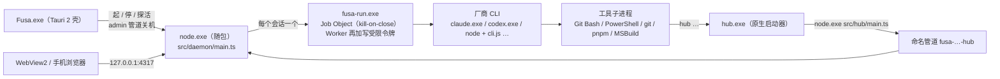

# Windows 原生版架构设计（项目留在本机磁盘，Agent 直接跑在 Windows 上）

状态：方案，待用户拍板第 9 节三项。2026-11-13。核对基线 `5248143`。
对标源码（浅克隆实读）：stablyai/orca `6854ab5a`（2026-11-12）、pingdotgg/t3code `95cb068c`（2026-11-12）、openai/codex `553c764`（2026-11-13，`codex-rs/windows-sandbox-rs`）、libuv `src/win/process.c` / `src/win/pipe.c`（main）。官方资料查阅于 2026-11-13。
本文是内部设计文档，按要求逐条标出借鉴的具体源码；面向用户的 README 不出现这些产品名。本次只新增本文，不改代码。

## 0. 结论

用户原话：「windwos 用户想要用的话，它的 agent 都必须运行在虚拟环境吗」「但是用户原本的项目就在磁盘上不是很麻烦吗，如果要做一个 windows 的正常版本，改动大吗」「可以借鉴开源软件，orca，t3code」。

**推荐：Windows 首发且只做原生版。** Node 后台、6 家 Agent CLI、git worktree 都直接跑在 Windows 本机；项目就是用户原来 `C:\`、`D:\` 上的目录，能直接调 Visual Studio、Rust MSVC、Unity 等本机工具链。外壳继续用已有的 Tauri 2 壳，只把"监管 WSL 里的后台"换成"监管本机 `node.exe`"。

五个关键做法：

1. **进程树**：每个会话经一个小 Rust 辅助程序 `fusa-run.exe` 启动——先**挂起创建**厂商进程、放进 **kill-on-close 的 Job Object**、再恢复运行。停一轮、收工、后台崩溃，Job 句柄一关整棵树都死，不再靠 `ps`、负 PID、`taskkill /T` 猜后代。（借鉴 orca 给 node-pty 打的 Job 补丁、codex 的挂起后放行；Node 自带的 libuv 全局 Job 带 `SILENT_BREAKAWAY_OK`，管不到孙进程，不能直接依赖。）
2. **本机 IPC**：`hub.sock` 换成 Node 原生支持的命名管道 `\\.\pipe\fusa-…`；`hub` 命令做成原生 `hub.exe` 小启动器（不用 `.cmd`：cmd.exe 会二次解析 `%*`、截断换行），cmd、PowerShell、Git Bash、各家 Agent 的工具调用都直接认 `.exe`。
3. **启动厂商 CLI 不用 `shell: true`**：`.exe` 直接起；npm/pnpm 的 `.cmd` 垫片按官方垫片格式精确解析成"`node.exe` + 入口 `.js`"或真正的 `.exe` 直接起；认不出的才经 cmd.exe 严格转义并拒绝换行。（移植 orca `process-host` 的 MIT 代码，t3code 同思路。）
4. **Worker 写范围沙箱**：普通 Worker 用 Windows 原生**写受限令牌（WRITE_RESTRICTED）+ 文件 ACL 拒写**，语义与 macOS `sandbox-exec`、Linux `bwrap` 完全一致——数据目录里只能写自己的 worktree，数据目录外原样不管；不要管理员，Win10/11 都能用。（机制照 codex `windows-sandbox-rs` 的 unelevated 实现，把它的"白名单可写"改成"黑名单拒写"以符合 2026-11-06 的硬规则。）只读 Worker：codex 用它自带的 Windows 只读沙箱；其余 5 家在 Windows 11 24H2+ 上用微软官方 MXC（`@microsoft/mxc-sdk`），不满足就拒绝并说明。
5. **跨盘**：项目在 `D:\`、数据目录在 `C:\` 时，worktree 放到**项目同一卷**的 `D:\.fusa-wt\…`，保住 pnpm 硬链接、Dev Drive 加速和 C 盘空间；该目录与数据目录一起纳入写保护。

改动面：后台约 40 个文件有 POSIX 假设（附录 A 逐项列出），新增实现集中到 `src/daemon/platform/win32/` 一处；新增一个 Rust crate；`fusa-wsl` 退役。拆成 **2 大步**（第 7 节）：①后台原生跑通（含普通 Worker 沙箱与 Windows CI）；②桌面壳原生化 + 打包 + 只读 Worker 的 MXC 后端 + WSL 路线退役。

需要用户拍板 3 件事（第 9 节）：Worker 沙箱方案、跨盘 worktree 位置、WSL 路线去留与 Node 随包。

## 1. 为什么从 WSL 方案改走原生

`docs/windows-desktop-design.md`（2026-11-11 拍板的 A 路线）把后台和 Agent 关在专用 WSL2 发行版 `Fusa` 里，并关掉了 C/D 盘自动挂载与 `.exe` 互操作。它换来"直接复用 bwrap 沙箱"，代价是：项目必须"导入到 Linux"、用户原目录不能直接用；调不了本机 VS / MSBuild / Unity / Windows SDK；首次要装 WSL（管理员、可能重启），VM 内存常驻。

当时判原生路线（B）"后台额外 27–45 人日"，主因是"找不到可直接替换 bwrap 的成熟 Windows 沙箱"。重新核查后情况变了：

- codex 开源了一套可工作的 Windows 原生沙箱（受限令牌 + ACL），证明不要管理员也能做"进程树级写限制"；
- 微软 2026-10 发布 MXC 1.0（npm `@microsoft/mxc-sdk`、crate `mxc-sdk`、NuGet `Microsoft.Mxc.Sdk`），codex 已把它列为 Windows 首选沙箱；
- orca、t3code 两个跨三端多 Agent 编排器已在 Windows 原生跑通 claude/codex/cursor/pi/gemini 等 CLI + git worktree，踩坑代码可直接借鉴（均为 MIT）。

| | WSL 方案（现状） | 原生方案（本文） |
|---|---|---|
| 项目位置 | 需导入 WSL ext4 | 用户原目录：`C:\`、`D:\`、Dev Drive |
| 本机工具链 | 不可用（interop 已关） | 直接用 |
| 首次安装 | 装 WSL（管理员、可能重启）+ 下载 Ubuntu 镜像 | 普通用户装一个 NSIS 包 |
| Worker 写沙箱 | bwrap（已有） | 写受限令牌 + ACL（新做，4.4） |
| 只读 Worker 读保护 | bwrap 遮挡 | codex 自带；其余 5 家 MXC（Win11 24H2+） |
| 常驻内存 | WSL VM 目标 ≤ 1.5 GiB | 只有 `node.exe`（待测基线） |

## 2. 借鉴了什么（逐条到源码）

| 问题 | 对标做法与源码位置 | 我们的取舍 |
|---|---|---|
| npm `.cmd` 垫片怎么起 | orca `src/packages/process-host/src/windows-cmd-shim-resolution.ts`：只认 npm 新格式（`%_prog%`）、npm/pnpm 旧的双分支格式、npm/pnpm 原生 exe 垫片共四种**精确正则**，解析出 `node.exe + 脚本` 或目标 `.exe`；路径含 `% ^ & \| < > " :` 或换行一律不认（防 `D:evil.js` 盘符相对、`a.js:zone` 备用流）；按（路径, mtime, size）缓存，最多 256 条，只读前 64 KiB。`spawn-resolution.ts`：一律 `shell:false`、`windowsHide:true`。t3code `packages/shared/src/shell.ts` 的 `npmShimExecutable` 同思路，注释点明"直接起 exe 才能留在 libuv 的 kill-on-close Job 里"；`apps/server/src/provider/Drivers/ClaudeExecutable.ts`：claude npm 包新版带 `bin\claude.exe`，旧版要 `node cli.js` | 移植 orca 这两个文件（MIT，保留版权头与来源提交）。不用 `cross-spawn`：它遇到 `.cmd` 仍经 cmd.exe，只能转义，挡不住换行截断与 `%` 展开 |
| 只能经 cmd.exe 时的转义 | orca `windows-command-line.ts`：按 `CommandLineToArgvW` 规则加引号；`%` 拆成 `"^%"` 打断变量展开；参数含 CR/LF 直接抛 `WindowsCmdLineBreakError`；配合 `windowsVerbatimArguments:true` | 照搬。Agent 可控的文本（提示词、JSON 设置）都不走这条路：提示词走 stdin，设置走文件或直接传给 `.exe` |
| 自家 CLI 垫片 | orca `native/windows-cli-launcher/src/main.rs` 头注释：`cmd.exe` 会重新解析 `%*`、执行或截断嵌入的换行，编排消息体过不去，所以做原生 exe 启动器；不用 .NET 小程序是因为"用户可写目录里新编译的小 MSIL 程序改环境变量再代理子进程"被多家杀软启发式误报 | `hub` 做成原生 Rust `hub.exe`（4.2.2） |
| 进程树回收 | orca `config/patches/node-pty@1.1.0.patch`：每个 PTY 一个 Job（不带 KILL_ON_JOB_CLOSE，用来显式精确收尾 `TerminateJobObject`），宿主进程自己再进一个带 `JOB_OBJECT_LIMIT_KILL_ON_JOB_CLOSE` 的 Job 兜底崩溃；外层 Job 拒绝嵌套时降级而不崩。`src/packages/process-host/src/windows-tree-kill.ts`：`taskkill` 用 `%SystemRoot%\System32\taskkill.exe` 绝对路径 `/t /f`，只有退出码 0 才算"整树已死"，根进程退出后最多再等 2 s（PID 可能被复用）。t3code `apps/server/src/provider/AntigravityInstallation.ts` 注释：启动器退出后 `taskkill` 就够不到还占着 DLL 的子进程。libuv `src/win/process.c` `uv__init_global_job_handle`：非 detached 子进程进全局 Job，带 `KILL_ON_JOB_CLOSE \| SILENT_BREAKAWAY_OK`——只管直接子进程，孙进程不在里面；detached 则 `DETACHED_PROCESS \| CREATE_NEW_PROCESS_GROUP` 且不进 Job | 每个会话一个 `fusa-run.exe`：挂起创建 → 入 Job（KILL_ON_JOB_CLOSE、禁止脱离）→ 恢复（4.3）。`taskkill` 只做缺辅助程序时的降级 |
| 删目录遇锁 | orca `src/shared/windows-transient-lock-removal.ts`：异步 `fs.rm` **不要**传 `maxRetries`（它逐项重试，一个被占文件在每层目录都放大），改成整遍重删，间隔 250/500/1000/2000 ms，只对 `EBUSY/ENOTEMPTY/EPERM` 重试；`src/main/filesystem/host-tree-removal.ts` 用 `\\?\` 长路径删、把 EBUSY 翻译成"某文件被别的程序打开"。t3code 删临时目录在 Windows 上重试 10×100 ms（"taskkill 返回后 DLL 句柄还会留一会儿"） | 4.3.4 照做 |
| 原子替换遇锁 | orca `src/main/skills/filesystem/skill-windows-rename-retry.ts`：`rename` 遇 `EPERM/EACCES/EBUSY` 按 50/100/150/200/250 ms 重试 | 包在 `write-file-atomic` 调用处（4.5.4） |
| 目录链接 | orca 全仓 Windows 下 `symlinkSync(…, 'junction')`，`bundled-skill-home.ts` 注释"junction 不需要开发者模式"；pnpm 官方 FAQ 同样在没有开发者模式时用 junction | Skill 同步、claude 插件目录改用 junction（4.5.3） |
| 路径比较 | orca `src/shared/cross-platform-path.ts` `normalizeRuntimePathForComparison`：先 NFC，再只对"带盘符或 UNC 的路径"统一分隔符、转小写，POSIX/WSL 路径保持大小写；明确"只用作比较键，不当真实路径" | 4.5.1 照做 |
| 长路径 | t3code `apps/server/src/vcs/GitVcsDriverCore.ts`：Windows 上 git 一律带 `core.longpaths=true`，注释"系统 LongPathsEnabled 单独不够"；orca 删除前 `path.win32.toNamespacedPath` | 4.5.2 照做 |
| 命名管道 | orca `src/main/runtime/rpc/server/runtime-rpc-socket-metadata.ts`：`\\.\pipe\orca-<pid>-<后缀>`，注释"管道没有 chmod，用每次运行的后缀避免可猜"；`src/main/daemon/launch/daemon-spawner.ts`：协议版本 + 目录哈希命名，排除不兼容的老进程。libuv `src/win/pipe.c`：首个实例带 `FILE_FLAG_FIRST_PIPE_INSTANCE`（名字已被占 → `EADDRINUSE`），安全描述符传 `NULL` 用系统默认 | 4.2.1 |
| 0600/0700 的等价物 | orca `src/shared/secure-storage/secure-path-windows-acl.ts`：受保护 DACL（只给本人 + SYSTEM），"先查再改：目录传播在大树上要几秒" | `state\`、`run\` 用受保护 DACL（4.5.5） |
| 写沙箱 | codex `codex-rs/windows-sandbox-rs/src/token.rs`：`CreateRestrictedToken(DISABLE_MAX_PRIVILEGE \| LUA_TOKEN \| WRITE_RESTRICTED)`，限制 SID 列表 = 能力 SID… + 登录 SID + Everyone；`set_default_dacl` 给新令牌默认 DACL 加 `OWNER RIGHTS (S-1-3-4): READ_CONTROL`，压掉所有者隐含的 `WRITE_DAC`。`cap.rs`：每个工作区一个随机合成 SID `S-1-5-21-…`，持久化。`proc_thread_attr.rs`：`PROCESS_CREATION_DESKTOP_APP_BREAKAWAY_DISABLE_PROCESS_TREE`。OpenAI 工程博客《Building a safe, effective sandbox to enable Codex on Windows》：unelevated 的代价是 ACL 设置慢、真改了用户的 ACL、网络隔离弱；elevated 加了专用本地用户、防火墙规则、`codex-command-runner.exe`，但需要管理员一次。官方文档（developers.openai.com/codex/windows/windows-sandbox）：首选 MXC（Win11 24H2 26100.9278+ / 25H2 26200.9278+），其次 elevated、unelevated；unelevated "doesn't support denied read paths" | 普通 Worker：照 unelevated 的令牌 + ACL 机制，改为黑名单（4.4.2）。只读 Worker：MXC（4.4.3）。不采用 elevated（要管理员、建本地用户、改防火墙，违背"先简单、少限制"） |
| worktree 根 | t3code `apps/server/src/worktreesDirectory.ts`：worktree 根可配置，并保留历史根列表供识别与清理；orca `workspaceDir` + `workspaceDirHistory` 同理 | 6.2：按卷选根，所有根登记在册 |
| Git for Windows | t3code `preferGitForWindowsBinary`：绕过 `cmd\git.exe` 启动器，直接用 `mingw64\bin\git.exe`（少一层进程与句柄） | 第 1 步顺手做（可选） |

## 3. 总体架构

代码组织：

- `src/daemon/platform/`（`platform/index.ts` 头注释已约定"系统差异只放这里"）新增 `win32/`：`spawn-resolution.ts`、`command-line.ts`、`process-tree.ts`、`ipc-endpoint.ts`、`fs-safe.ts`（`openNoFollow`、整遍重删、rename 重试、junction）、`path-key.ts`、`acl.ts`（调辅助程序）。POSIX 现有实现原地不动，由 `platform/index.ts` 按平台选后端，调用方不自己判断 `process.platform`。
- `src/shared/write-scope.ts`：路径规整改为平台感知；`WriteScope.dataDir` 扩成 `protectedRoots: string[]`（4.4.5、6.2）。
- 新 crate `apps/windows/crates/fusa-win-helper`：产出 `fusa-run.exe`、`hub.exe` 两个二进制，只依赖微软官方 `windows-sys`。
- `apps/windows/crates/fusa-supervisor`：新增 `NativeDaemonRuntime` 实现现有 `DaemonRuntime` trait（`supervisor.rs:162`），删 WSL 实现；`fusa-wsl` crate 退役。

## 4. 逐项根治 POSIX 假设

### 4.1 桌面壳与守护进程（`apps/windows/`）

现状：`fusa-desktop` 启动后由 `DesktopController` 跑 WSL 引导；`fusa-supervisor::WslDaemonRuntime`（`supervisor.rs:219`）经 `wsl.exe -d Fusa -u fusa --exec wsl-daemon-ctl.sh run …` 起后台，崩溃判断还要进 Linux 查 `query_owned_status`（`wsl.exe` 只是代理）；`windows-desktop.yml` 打的是 Linux 后台 tar 包。监管约定在 `apps/desktop/contract.json`。

1. **复用监管内核，只换运行时。** `DaemonSupervisor` 的崩溃退避、熔断、40 s 停机预算、"外部后台只复用不接管"、身份探活全部保留，新增 `NativeDaemonRuntime`：

   | trait 方法 | 原生实现 |
   |---|---|
   | `verify_distro_ownership` | 核对随包 `node.exe` 与后台目录的版本清单 + SHA-256（沿用 `sha2`） |
   | `is_distro_cold` | 恒为 false（没有 WSL 冷启动） |
   | `prepare_runtime_assets` | 安装即就位，只检查 `resources\daemon` 存在 |
   | `probe_guest_status` | 与宿主探活同一个 `127.0.0.1:<port>`（不再有"WSL 内外双探活"） |
   | `spawn_owned_daemon` | `Command::new(node.exe).arg(main.ts)`，`CREATE_NO_WINDOW`，环境见第 4 条 |
   | `query_owned_status` | 直接看自己持有的进程句柄（不再有代理进程歧义） |
   | `signal_owned_daemon(TERM)` | 经 admin 管道发关机请求（带界面令牌）。Windows 没有外部可送达的 SIGTERM，Node 的 `SIGINT/SIGBREAK` 只来自同一控制台的 Ctrl+C/Ctrl+Break |
   | `signal_owned_daemon(KILL)` | `TerminateProcess` |
   | `read_ui_token` | 直接读 `%USERPROFILE%\.agent-hub\state\ui-token`（受保护 DACL，只本人可读） |

   `on_owned_proxy_exited` 里"代理退出不等于 Linux 进程退出"的复核整段删掉：退出码就是 node 的退出码。
2. **退出码 75 空闲热重启照旧。** `self-reload.ts` 正常关机后以 `reloadExitCode`=75 退出，`allow_immediate_reload` 立即拉起，60 s 窗口内超过 5 次走退避熔断。逻辑不改，只是退出码来自真进程。
3. **Node 随包内置（决策 3 推荐）。** 打包时下载官方 `node-v24.x-win-x64.zip`，按 nodejs.org `SHASUMS256.txt` 校验，只取 `node.exe` 放 `resources\node\`；后台依赖在 CI 用 `pnpm install --prod --frozen-lockfile --config.node-linker=hoisted` 装成平铺 `node_modules`（NSIS 不保留 junction/软链；当前生产依赖均为纯 JS）。不用 Node SEA：要先把全部 TS 打成单文件，收益小。用户自己装的 Node 只服务他的 npm 类 CLI，后台不依赖。版本：仓库 `engines` ≥ 24.12；第 2 步启用 MXC 时 `@microsoft/mxc-sdk` 要求 Node ≥ 24.21，随包版本一并抬到 ≥ 24.21。
4. **环境变量。** GUI 进程继承的是登录时的环境，用户之后装的 CLI 不在 PATH 里（与 macOS GUI 应用 PATH 问题同源）。壳起后台前用已有依赖 `winreg` 读 `HKCU\Environment` 与 `HKLM\SYSTEM\CurrentControlSet\Control\Session Manager\Environment` 的 `Path`（展开 `REG_EXPAND_SZ`）重建 PATH；另加 `AGENT_HUB_SUPERVISED=1`、`AGENT_HUB_WIN_HELPERS=<resources\bin>`（`fusa-run.exe`、`hub.exe` 所在）。
5. **单实例与端口。** 壳用 Tauri 官方 `tauri-plugin-single-instance`，再次双击只聚焦已有窗口。后台单实例：现在 `store/lock.ts` 靠 `ps -o lstart=` 认进程启动时间，Windows 没有 `ps`；改由 admin 管道用**固定名**（`\\.\pipe\fusa-<数据目录哈希>-admin`）监听，libuv 首实例带 `FILE_FLAG_FIRST_PIPE_INSTANCE`，同一数据目录的第二个后台必然 `EADDRINUSE`——这就是系统给的互斥；锁文件保留作诊断，启动时间改由 `fusa-run.exe inspect --pid`（`GetProcessTimes`）提供。端口 4317 冲突、身份不符，照现有约定报错、不接管。
6. **约定增量（`apps/desktop/contract.json`）。** WSL 退役后删 `wslColdStartBudgetMs`；新增关机方式 `shutdownTransport: "admin-endpoint"` 与入口路径。Mac 壳可选择改用同一关机入口。
7. **`fusa-wsl` 去留（决策 3 推荐退役）。** 删 `crates/fusa-wsl`、`scripts/wsl-*.sh`、引导页的 WSL 步骤与 Lxss 注册表读取（`winreg` 留给第 4 条）；`docs/windows-desktop-design.md` 改标"已被本文取代"。需要 Linux 工具链的用户按 `docs/linux.md` 在自己的 WSL 里跑 Linux 版后台、用浏览器访问——这条路本来就通，不需要壳特殊支持。同时保留两套运行时，意味着两套监管、两套沙箱、两套 CI 长期一起维护。

### 4.2 本机 IPC 与 `hub` 命令垫片

现状：`src/daemon/run-socket.ts` 统一准备 `hub.sock / ui.sock / public.sock / peer.sock / admin.sock`：建 `run/`（0700）、realpath、`assertSocketPathFits`（macOS 103 字节）、`lstat().isSocket()` 认残留、`unlink`、`chmod 0600`。`src/hub/cli.ts:1233` 用 `http.request({ socketPath })`。`agent-api/shim.ts` 写 `#!/bin/sh` + `exec '<node>' '<main.ts>' "$@"`。`launch.ts:139`、`router/sandbox.ts:131` 用 `:` 拼 PATH。

#### 4.2.1 命名管道

- 端点统一由 `platform/ipc-endpoint.ts` 生成。POSIX 原样返回 `run/*.sock`；Windows：
  - hub：`\\.\pipe\fusa-<数据目录哈希12>-<本次启动随机16>-hub`。随机后缀照 orca，避免可猜；经 `HUB_SOCK` 传给 Agent，**变量名与语义不变**（"端点字符串"）。
  - admin：`\\.\pipe\fusa-<数据目录哈希12>-admin`，固定名，兼做单实例互斥；壳与隧道命令靠它找后台。
  - ui / public / peer：Windows 首发不开（它们只服务 Tailscale serve/Funnel 与 ssh 转发 Unix socket，见 4.6）。
- Node 原生支持：`server.listen(pipeName)`、`http.request({ socketPath: pipeName })`；Fastify `listen({ path })` 直接透传。不需要新依赖。
- `listenOnRunSocket` 拆分：Windows 分支跳过 realpath / chmod / 长度检查 / unlink / `isSocket`——管道不在文件系统里，名字上限 256 字符，`assertSocketPathFits` 只在 POSIX 用；也没有"残留 socket"问题（进程死了管道就消失）。
- 权限：libuv 用系统默认安全描述符——SYSTEM、Administrators、创建者完全控制，Everyone 与匿名只读（`pipe.c` 的 `CreateNamedPipeW(…, NULL)`）。只读身份打不开双工请求；真正的授权仍是每个会话的 `HUB_TOKEN`（`TOKEN_CHARS` 校验不变）。远程 SMB 访问需对方以本机管理员或本人身份认证，可接受。若以后要收紧到"只给本人 SID + `PIPE_REJECT_REMOTE_CLIENTS`"，由 `fusa-run.exe` 代建管道，首发不做。
- Worker 能否连上：管道 DACL 的"创建者 = 本人 SID"在 Worker 受限令牌的限制 SID 列表里（4.4.2），可读写。MXC 容器能否连本机管道要真机核实（第 10 节）；不行就只读 Worker 的 hub 改走回环 TCP + 同一会话令牌。

#### 4.2.2 `hub.exe` 原生启动器

- 为什么不用 `.cmd`：cmd 对 `%*` 二次解析——`%VAR%` 被展开、`^` 被吃、开了延迟展开时 `!` 变形、参数里的换行直接截断命令；PowerShell 调 `.cmd` 还要再经 cmd 一遍。为什么不用 `.ps1`：执行策略默认受限，且 cmd、Git Bash 不认。orca 踩过同一个坑后改成原生启动器（第 2 节）。
- 做法：`installHubShim` 在 Windows 上把随包 `hub.exe` 复制到 `run\bin\hub.exe`，同目录写 `hub.json`（`{ node, main }` 两个绝对路径）。`hub.exe` 读旁边的 `hub.json`，`Command::new(node).arg(main).args(env::args_os().skip(1))`——Rust 标准库按 `CommandLineToArgvW` 规则逐个加引号，参数原样到达 `process.argv`；继承标准输入输出与控制台（Ctrl+C 自然传递）；退出码原样返回。
- 各入口：cmd、PowerShell 按 `PATHEXT` 找到 `hub.exe`；Git Bash（claude、pi 在 Windows 上默认用它跑 Bash 工具）查命令时自动补 `.exe`；codex（PowerShell）、agy、cursor、dsh 的工具调用同理。`run\bin` 里**只放 `hub.exe`**，不放无扩展名 sh 脚本，免得 Git Bash 先命中脚本。
- 注入与截断：参数传递全程没有 shell 参与，`&`、`|`、`%PATH%`、引号、中文、emoji 原样到达；多行正文继续走已有的 `--stdin`。Git Bash 的 MSYS 路径转换会把以 `/` 开头的参数改写成 `C:/Program Files/Git/…`（例如 `/model`）：`hub` 解析参数时若 `MSYSTEM` 存在且参数以 Git 安装根开头，报可读错误，提示改用 `--stdin` 或写成 `//model`，不静默接受。
- PATH：拼接改用 `path.delimiter`；Windows 环境变量名不分大小写，先找已有的 `Path`/`PATH` 键（照 orca `firstEnvKey`），删掉其余大小写变体再写一个，避免子进程拿到两份 PATH。
- 开发者从源码跑：`cargo build --release --manifest-path apps/windows/Cargo.toml -p fusa-win-helper`，或下载 CI 产物。后台启动找不到辅助程序就报错并给出命令（与 Linux 缺 bwrap 时给 `sudo scripts/linux-sandbox-setup.sh` 同一做法）。

### 4.3 进程树干净回收与文件锁释放

现状：`driver/process.ts` 全套 POSIX——`detached` 起进程组、`process.kill(-pgid)`、`SIGSTOP` 冻结后用 `ps -A -o pid=,ppid=,pgid=` 多轮找后代再 `SIGKILL`、读 `/proc` 穿透 bwrap 找内层 CLI；`process-ledger.ts`、`store/lock.ts` 用 `ps -o lstart=` 防 PID 复用；`setup.ts:215`、`base-driver.ts:982`、各家 `catalog.ts`/`connectors.ts` 探针都 `detached: true`。Windows 上：没有进程组信号、没有 `SIGSTOP`/`ps`；`detached:true` 意味着 `DETACHED_PROCESS | CREATE_NEW_PROCESS_GROUP`（没有控制台、不进 libuv 的 Job）；`child.kill('SIGINT'|'SIGTERM')` 一律是 `TerminateProcess`，只杀那一个进程。

#### 4.3.1 方案对比

| 方案 | 停一轮 | 后台崩溃 | 根进程已退、孙进程还在 | PID 复用 | 判断 |
|---|---|---|---|---|---|
| `taskkill /pid N /T /F` | 能（按父 PID 链找） | 没人执行 | **找不到**（父链断了，t3code 原注释） | 有风险（orca 只敢多等 2 s） | 只作降级 |
| 只靠 libuv 全局 Job | 不管 | 只杀直接子进程 | 不管（`SILENT_BREAKAWAY_OK`） | 无 | 不够 |
| **每会话 Job Object（挂起创建后入 Job，KILL_ON_JOB_CLOSE，禁止脱离）** | `TerminateJobObject` 或关句柄，一次全清 | 链式：node 死 → libuv Job 杀 `fusa-run` → 其 Job 句柄关闭 → 整树死 | 都在 Job 里，与父子关系无关 | 按句柄不按 PID | **推荐** |

#### 4.3.2 `fusa-run.exe` 的职责（Rust，`windows-sys`）

1. `CreateJobObjectW` + `JOBOBJECT_EXTENDED_LIMIT_INFORMATION`：`KILL_ON_JOB_CLOSE | DIE_ON_UNHANDLED_EXCEPTION`，**不**设 `BREAKAWAY_OK`/`SILENT_BREAKAWAY_OK`；进程属性加 `PROCESS_CREATION_DESKTOP_APP_BREAKAWAY_DISABLE_PROCESS_TREE`（codex `proc_thread_attr.rs` 同用），防打包应用脱离。
2. `CreateProcessW`（Worker 用 `CreateProcessAsUserW` + 受限令牌，4.4.2；"调用者自身主令牌的受限版本"不需要 `SE_ASSIGNPRIMARYTOKEN_NAME`）带 `CREATE_SUSPENDED`，`AssignProcessToJobObject` 成功后才 `ResumeThread`。libuv 是"先起后入 Job"，中间有窗口；挂起创建没有。
3. 标准输入输出句柄直接继承给厂商进程，`fusa-run` 不转发数据。起子进程用 `PROC_THREAD_ATTRIBUTE_HANDLE_LIST` 只继承指定句柄（orca `isolated-spawn` 的教训：别的可继承句柄被子进程带走，管道永不关闭、目录删不掉）。
4. 厂商主进程退出后 `TerminateJobObject` 清掉留在后台的进程（对应现在 `termGroupAfterExit` 的"退出后补一刀"），以厂商退出码退出。
5. 打断：`fusa-run` 启动时 `FreeConsole` + `AllocConsole` 拿一个**私有**隐藏控制台（不能与后台共用，否则 Ctrl+C 会把后台一起关掉）；启动参数带一条随机名控制管道，收到 `interrupt` 时在私有控制台上发 `CTRL_C_EVENT`，自己用处理函数吞掉；厂商进程**不**带 `CREATE_NEW_PROCESS_GROUP`（带了就收不到 Ctrl+C）。Node 系 CLI 把它映射成 `SIGINT`。这就是 Windows 上 `signalChild(child, "SIGINT")` 的等价物。
6. 子命令：`inspect --pid N`（`GetProcessTimes` + 镜像路径，给锁文件与进程台账防 PID 复用）、`who-locks <path>`（Restart Manager `RmGetList`，只用于报错时说清"谁占着文件"）、`keep-awake --parent <pid>`（4.6）、`acl …`（4.4.2、4.5.5）、`probe`（4.4.2）。
7. 外层 Job 拒绝嵌套（部分 EDR、容器）时照 orca 降级：不崩、记日志、走 `taskkill` 路径；Worker 仍要求沙箱，不受影响。

#### 4.3.3 Node 侧改动（集中在 `platform/win32/process-tree.ts`）

- 所有 `spawn(…, { detached: true })` 改为调 `platform.spawnOwned()`：POSIX 仍 `detached:true`；Windows 走 `fusa-run.exe -- <解析后的程序> <参数>`，**不** detached（让 `fusa-run` 进 libuv 全局 Job，后台崩了它必死），`windowsHide:true`，`shell:false`。涉及 `base-driver.ts`、`setup.ts`、`agy/handover.ts`、各家探针（附录 A）。
- `forceKill` / `forceKillTree` / `killFreshGroup` / `termGroupAfterExit`：Windows 后端统一为"杀 `fusa-run`"（句柄一关整树死）；缺辅助程序的降级路径照 orca `windows-tree-kill.ts` 语义调 `taskkill`。
- `signalChild(SIGINT)`：Windows 走控制管道；`signalTarget` 的 `/proc` bwrap 穿透只在 Linux。
- 优雅打断仍以协议为主：claude `interrupt` 控制消息、codex `turn/interrupt`、ACP `session/cancel`（dsh、cursor）、pi `abort` 都与平台无关；只有 agy 没有流式打断、依赖 SIGINT——它在 Windows 收到 `CTRL_C_EVENT` 后能否存好会话要真机验证（第 10 节）。
- `process-ledger.ts`：Windows 记 `fusa-run` 的 PID + `inspect` 给的创建时间；下次启动若还活着且时间一致才杀（正常情况 libuv Job 早已杀掉，这只是双保险）。

#### 4.3.4 收工删 worktree 的 EBUSY/EPERM

Windows 删不掉目录的三类原因：①还有进程的**当前目录**在里面，或开着里面的文件（Windows 不允许删）；②Defender、搜索索引器、杀软短暂占用；③只读属性、长路径。

1. 先确认会话 Job 已关（整树已死）再删——解决绝大部分①。
2. `worktree-cleanup.ts:146` 现在是 `rm(…, { maxRetries: 3, retryDelay: 200 })`：异步 `rm` 的 `maxRetries` 逐项重试，大树会层层放大。改为 orca 的整遍重删：只对 `EBUSY/EPERM/ENOTEMPTY` 重试，间隔 250/500/1000/2000 ms，可中止；仍失败就停在本轮，日志用 `who-locks` 写出"哪个程序占着哪个文件"（Restart Manager 是系统官方接口），下一轮清理再试，不无限循环。
3. 删除前转 `\\?\` 命名空间（`path.win32.toNamespacedPath`）；git 侧统一 `-c core.longpaths=true`。
4. 先 `git worktree remove --force` / `prune` 让 git 元数据一致，再删残余目录（与现有流程一致）。

### 4.4 写范围隔离与只读沙箱

现状（`docs/write-scope.md`）：硬规则——数据目录（`~/.agent-hub`）里 Worker 只能写自己的 worktree，别处一律不能新建、改动；数据目录外原样不管；项目经理不受限。`driver/write-scope.ts` 的 `OS_SANDBOX_BACKENDS` 只有 `darwin`（`sandbox-exec`）和 `linux`（`bwrap`）；沙箱不可用时一律拒绝启动 Worker。

#### 4.4.1 候选方案

| 方案 | 能否与 Mac/Linux 同语义 | 管理员 | 系统要求 | 本机工具链兼容 | 安全等级 | 判断 |
|---|---|---|---|---|---|---|
| A 只靠各家 CLI 自带沙箱 | 否：claude 原生 Windows **不支持**沙箱（官方 setup 文档"Native Windows：Sandboxing Not supported"）；pi、dsh、cursor 没有 Windows 沙箱 | — | — | — | 不统一 | 否 |
| B 工具层拦截（审批回调、字面规则） | 否：只看命令字面，变量、脚本、子进程全漏 | 否 | 任意 | 好 | 低 | 只作补充（codex 审批已有） |
| C **写受限令牌 + ACL 拒写（黑名单）** | **是**：等价 `(allow default)(deny file-write* 数据目录)(allow file-write* 本 worktree)` | 否 | Win10 1809+ / Win11 | 好：读不受限，数据目录外写不受限 | 防误写与普通越权，与 macOS seatbelt 同级 | **普通 Worker 推荐** |
| D codex 式白名单令牌（unelevated） | 否：只放行 cwd 与配置的根，pnpm store、`%TEMP%`、`~\.nuget`、VS/Unity 缓存都要逐个列 | 否 | Win10+ | 差 | 中 | 否 |
| E codex 式 elevated（专用本地用户 + 防火墙） | 可做 | **要**（建用户、改防火墙、授登录权） | Win10+ | 需额外给专用用户授读 | 高 | 否：门槛高，企业机常被策略挡（codex 文档的 1385 错误） |
| F 微软 MXC ProcessContainer | 白名单模型：默认拒读拒写，`readonlyPaths / readwritePaths / deniedPaths` | 一般不要；部分机器的 AppContainer 降级层要管理员跑一次 `wxc-host-prep.exe` | Win11 24H2 26100.9278+ / 25H2 26200.9278+ | 整个 CLI 要读的路径都得列出 | 高 | **只读 Worker 推荐**（只读本就是白名单）；普通 Worker 不用 |

#### 4.4.2 普通 Worker：写受限令牌 + ACL 拒写（`win32` 后端）

原理（Windows 访问检查，codex 博客有同样说明）：受限令牌做两遍检查，必须"本人身份检查"与"限制 SID 列表检查"都通过；`WRITE_RESTRICTED` 令牌只对**写**做第二遍，读完全不受影响。

1. **两个合成 SID**（随机 `S-1-5-21-…`，持久化在 `state\`，照 codex `cap.rs`）：`FusaWorker`（所有 Worker 共用）和 `FusaWorker-<worker 编号>`（每个 Worker 一个）。
2. **一次性 ACL**（安装/升级时在后台做，带进度）：在每个受保护根（数据目录 + 各卷 worktree 根，6.2）加可继承的 `DENY FusaWorker` 写类权限（`FILE_WRITE_DATA | FILE_APPEND_DATA | FILE_WRITE_EA | FILE_WRITE_ATTRIBUTES | FILE_DELETE_CHILD | DELETE | WRITE_DAC | WRITE_OWNER`）；再加可继承的 `OWNER RIGHTS (S-1-3-4): READ_CONTROL`，压掉"所有者隐含的 WRITE_DAC"——否则 Worker 能以文件所有者身份改 ACL、删掉拒写项再写（codex `token.rs` 的 `set_default_dacl` 用的正是这一手）。先读 DACL，已正确就跳过（orca：目录传播在大树上要几秒到几分钟）。
3. **每个 worktree 建时**：先建空目录，加显式、可继承的 `ALLOW FusaWorker-<编号> 修改`，再 `git worktree add <这个已存在的空目录>`（git 允许加到已存在的空目录）。之后 checkout、`pnpm install` 产生的文件自动继承，**没有任何 ACL 传播开销**。Windows 的规范顺序里"近祖先继承的 ACE"排在"远祖先继承的 ACE"之前，所以本 worktree 里 `ALLOW 本 Worker` 先于数据目录继承下来的 `DENY FusaWorker` 生效；别的 Worker 只命中 `DENY`。
4. **起 Worker**：`fusa-run.exe` 调 `CreateRestrictedToken(当前令牌, DISABLE_MAX_PRIVILEGE | LUA_TOKEN | WRITE_RESTRICTED, …, 限制 SID 列表)`，列表 = **当前令牌的用户 SID + 全部已启用组 SID**（`GetTokenInformation(TokenGroups)` 照抄：Authenticated Users、Users、INTERACTIVE、登录 SID、Everyone……）+ `FusaWorker` + `FusaWorker-<编号>`；`CreateProcessAsUserW` 挂起创建、入 Job、恢复。照 codex 给新令牌设默认 DACL（登录 SID 全权 + OWNER RIGHTS 只读），防同账户其他进程改它的进程对象。
   - 为什么要抄全部组：Windows 新建的数据卷（`D:\`）默认给 **Authenticated Users 修改**，并不直接列本人 SID；若限制列表只有用户 SID（或像 codex unelevated 只有 Everyone + 登录 SID + 能力 SID），Worker 在 `D:\项目` 里就写不了。抄全组后第二遍检查与第一遍等价，唯一差别就是两个合成 SID 的拒写——正好是要的黑名单。
5. **效果**：写 `state\`、`run\`、`launch\`、别的 Worker 的 worktree，`icacls` 改权限，`takeown`，全部拒绝；写本 worktree、`%TEMP%`、`D:\项目`、pnpm/cargo/NuGet 缓存、厂商自己的配置目录照常；读不受影响；项目经理和后台本身不带合成 SID，完全不受影响；hub 管道（所有者 = 本人 SID，在限制列表里）可连。
6. **关掉厂商自带沙箱**照现有表：claude `--settings` 写 `sandbox.enabled:false`（原生 Windows 本就不支持）；codex `sandboxPolicy: externalSandbox`；agy `--settings {"enableTerminalSandbox":false}`（经 5.2 解析后直接传给 `agy.exe`，不过 cmd）；cursor `--sandbox disabled`；dsh `--profile acp --patch`。
7. **已知边界**（写进 `docs/write-scope.md`）：受限令牌拦的是"这棵进程树直接写文件"。Worker 若借**另一个不受限的进程**代写——任务计划程序（`schtasks`）、WMI `Win32_Process.Create`、进程外 COM、资源管理器 `ShellExecute`——就绕过了。这与 macOS `(allow default)` 下经 `launchctl`/AppleEvents 绕过同类（Linux 版用 `--tmpfs /run/user/<uid>` 封了 systemd/D-Bus 这一路，Windows 没有等价的单点）。首发接受这个边界（目标是防误写、防普通越权，不是防恶意逃逸），并在 Job 上加 `JOB_OBJECT_UILIMIT_HANDLES | UILIMIT_DESKTOP | UILIMIT_GLOBALATOMS` 收窄 UI 句柄这一路；更强隔离等 MXC 成熟后再评估。
8. **探测与拒绝**：`osSandboxAvailable("win32")` = `fusa-run.exe probe`（建令牌，在临时受保护目录试写必须失败、在放行目录试写必须成功），只缓存 true（与 Linux 一致）。失败一律拒绝启动 Worker，并给出原因（例如组策略禁止改 ACL、文件系统不是 NTFS/ReFS——FAT/exFAT U 盘没有 ACL）。

#### 4.4.3 只读 Worker

只读要求"除私有临时目录、运行时与缓存目录外全盘只读，凭据与敏感文件禁读"。写受限令牌只管写、不管读，codex 官方也写明 unelevated 不支持拒读路径，所以只读不能套 4.4.2。

- **codex**：照现有设计"不包外层，用 codex 自己的 readOnly 沙箱"——codex 在 Windows 上自选 MXC / elevated / unelevated。要真机核实"用户从没配过 `[windows] sandbox` 时，app-server 的 readOnly 是否真的生效"，不生效就拒绝。
- **其余 5 家（claude、agy、pi、dsh、cursor）**：第 2 步新增 `win32` 的 `wrapReadonly`，用微软官方 `@microsoft/mxc-sdk`（V1 API）。`getPlatformSupport()` 报告有 `processcontainer` 才可用；策略：`readonlyPaths` = 各本机固定盘根，`deniedPaths` = `readonly-policy.ts` 的凭据路径 + 启动时 `scanSecretGlobs` 扫出的 `.env` 等，`readwritePaths` = 私有临时目录 + 该厂商运行时目录（沿用 spec 的 `readonlySecrets`、`writableFileGlobs`，不新造名单），网络放行（Agent 要连模型 API）。MXC 文档提醒"重叠规则（只读里套拒读、只读里套可写）要在所选后端实测"——列入验证清单。
- **不满足时**（Windows 10、未更新的 Win11、组策略禁用 MXC）：这 5 家的只读 Worker 拒绝启动，提示"本机不支持只读隔离，可改用 codex 做只读审查"——符合"沙箱不可用一律拒绝"的硬规则。
- agy 的凭据存在 Windows 凭据管理器（官方文档），文件级拒读管不到；MXC 容器能否访问凭据管理器要实测，能访问就在文档写明"只读 agy 不隐藏凭据管理器里的令牌"。

#### 4.4.4 `state\` 与其他 PM 的记忆目录

`state\pm-memory\<pmId>` 和整个 `state\` 都在受保护根里，Worker 一律拒写（4.4.2）。项目经理会话不受限（与现状一致）；PM 之间互不改记忆目录，目前靠驱动只挂自己的目录（`pm-memory-dirs.ts`），Windows 不变。

#### 4.4.5 代码落点

`driver/write-scope.ts` 的 `OS_SANDBOX_BACKENDS` 加 `win32: { available, wrap, wrapReadonly }`：`wrap` 返回 `{ command: fusa-run.exe, args: ["--sandbox", "worker", "--worker", id, "--", 原命令…] }`；`wrapReadonly` 第 2 步接 MXC。`WRITE_SCOPE_ENFORCERS`、`spawnInWriteScope`、各家驱动接口不变——新增平台只改后端表，这正是现有设计的本意。`WriteScope.dataDir` 扩成 `protectedRoots: string[]`（POSIX 只有数据目录一个），`seatbeltProfile`/`bwrapArgs` 对每个根生成同样规则，让 6.2 的同卷 worktree 根在三个平台语义一致。

### 4.5 路径、软链与文件系统边界

#### 4.5.1 盘符、大小写、UNC、短文件名

现状：`shared/write-scope.ts` 用 `startsWith("/")` 判断绝对路径，只展开 `~`/`$HOME`，全部 `toLowerCase`（注释"APFS 默认不分"）；`shared/paths.ts` `findExecutable` 用 `cmd.includes("/")` 判断显式路径，`existsSync(join(dir, cmd))` 只找无扩展名文件。

- 新增 `platform/path-key.ts`（照 orca `normalizeRuntimePathForComparison`），**只用作比较键**：先 NFC；对带盘符或 `\\` 开头的路径统一成 `\`，去掉 `\\?\`、`\\?\UNC\` 前缀，转小写；POSIX 路径不折叠大小写。真实路径一律 `fs.realpathSync.native`——Windows 上走 `GetFinalPathNameByHandleW`，解开 junction/软链，并**把 8.3 短名 `C:\Users\YUXIN~1.ZHA` 还原成长名**（`%TEMP%` 常是短名，不还原就会把同一目录判成两个）。
- `write-scope.ts` 的绝对路径判断改用 `path.win32.isAbsolute` 与"盘符或 UNC"判断（`C:\`、`C:/`、`\\server\share`），展开 `%USERPROFILE%`、`$env:USERPROFILE`、`~`；拒绝盘符相对路径 `C:foo` 与备用数据流 `a.txt:stream`（同 orca `UNSAFE_SHIM_PATH`）。它只是 codex 审批等字面兜底，Windows 上真正的边界是 4.4。
- NTFS 支持按目录开大小写敏感（`fsutil file setCaseSensitiveInfo`，WSL 建的目录常带）：比较键按不敏感处理只会"多拦"，不会"少拦"；真实 IO 用原样路径。
- `findExecutable` 在 Windows 上按 `PATHEXT` 顺序（`.COM;.EXE;.BAT;.CMD`）找；显式路径用 `path.win32.isAbsolute` 或"含 `\`/`/`"判断；找到 `.cmd` 交给 5.2 的垫片解析。

#### 4.5.2 长路径

`C:\Users\<名字>\.agent-hub\worktrees\12\345\node_modules\.pnpm\@scope+pkg@1.2.3_…\node_modules\…` 很容易超过 260 字符。Node/libuv 内部自动用 `\\?\`，`fs` 本身没问题；风险在外部工具：git（统一 `-c core.longpaths=true`，照 t3code）、cmd.exe、PowerShell 5.1、老版本 MSBuild。缓解：worktree 根尽量短（6.2 用 `X:\.fusa-wt\<项目>\<worker>`）；启动时读 `HKLM\SYSTEM\CurrentControlSet\Control\FileSystem\LongPathsEnabled`，未开在设置页提示（开启要管理员，不强制）。

#### 4.5.3 Skill 同步与软链

现状：`vendor-sync/backup.ts:191/216` `symlinkSync(target, link, "dir")`；`claude/skills.ts:42` `symlinkSync(target, link)`（目标是目录时自动当 `dir`）。Windows 普通账号未开开发者模式时，建目录软链需要 `SeCreateSymbolicLinkPrivilege`，直接 `EPERM`。

- **目录一律用 junction**（`symlinkSync(target, link, "junction")`）：不要管理员、不要开发者模式，pnpm、orca 都这么做。限制与处理：目标必须是绝对路径（Node 会自动转；`claude/skills.ts` 的相对 `../skills` 只在 POSIX 用，Windows 用绝对，启动目录本来不会挪）；只能指向本机卷、**不能指向网络共享**——基准 `.agents\skills` 在 UNC 或映射网络盘上时改为"受控复制"：复制目录并写 `.fusa-managed`（来源路径 + 内容哈希），对账只更新带这个标记的副本，用户自己的目录照旧不碰（`inspectSkillTargetEntry` 增加 `managed_copy` 状态）。
- Node 对 junction 的 `lstat().isSymbolicLink()` 为 true，`readlink` 返回绝对目标；现有 `isManagedAgentsSkillSymlink` 的"字面 + 真实路径"双重判断语义不变，只把字符串相等换成 4.5.1 的比较键。
- agy 的 `linkAgySkills`（`rules.ts:101`）用文件硬链接 + 复制兜底：NTFS 同卷硬链接不要特权，可照用；`statSync().ino` 在 Windows 是 64 位文件号，改用 `{ bigint: true }` 比较，避免精度丢失。
- 已知坑：仓库里提交的软链（如本仓 `.claude/skills -> ../.agents/skills`）在 Git for Windows 默认 `core.symlinks=false` 下会被检出成**一个内容是路径的文本文件**。`isWholeDirLinkedToCanonical` 要能认出这种"软链文本文件"（`git ls-files -s` 模式 120000），按"整目录指向基准"处理，否则会误判成用户私有冲突。

#### 4.5.4 `O_NOFOLLOW` 与 `write-file-atomic`

- `pm-memory.ts:157`、`sent-files.ts:224` 用 `O_RDONLY | O_NOFOLLOW (| O_NONBLOCK)`。Node 文档：Windows 上 `fs.constants` 只有 `O_APPEND/O_CREAT/O_EXCL/O_RDONLY/O_RDWR/O_TRUNC/O_WRONLY/UV_FS_O_FILEMAP`——`O_NOFOLLOW` 是 undefined，按位或后**静默变成 0**，保护悄悄失效。新增 `platform/fs-safe.ts` 的 `openNoFollow(path)`：POSIX 照旧；Windows 先 `lstat`（junction 与软链都 `isSymbolicLink()`，拒绝），`open` 后 `fstat`，要求 `dev`（卷序列号）与 `ino`（bigint 文件号）和 `lstat` 一致，否则关掉报错——比的是"已打开句柄的身份"，没有 TOCTOU。再拒绝 `\\.\`、`\\?\GLOBALROOT` 这类设备命名空间路径（Windows 上"拿管道冒充文件"的对应物，代替 `O_NONBLOCK` 防卡死）。
- `write-file-atomic`（8.0.0）在 Windows：同目录临时文件 + `fs.rename`（`MoveFileExW(REPLACE_EXISTING)`）；目标被别的进程无 `FILE_SHARE_DELETE` 打开时（厂商 CLI 正在读配置、杀软在扫）报 `EPERM/EBUSY`，库本身不重试；`chown` 在没有 `getuid` 的 Windows 上自动跳过；`mode` 只影响只读位；替换后的文件 ACL 来自临时文件（继承父目录），原文件的显式 ACL 不保留。做法：不改库，在调用处（`vendor-sync/backup.ts`、`task-graph-skill.ts`、`claude/skills.ts`）包一层 orca 同款有界重试（50/100/150/200/250 ms，只对 `EPERM/EACCES/EBUSY`）；我们自己的敏感文件靠目录级受保护 DACL（4.5.5），替换后自动继承，不依赖原文件 ACL。

#### 4.5.5 0600 / 0700 的 Windows 等价物

`chmodSync(…, 0o600/0o700)`（`device.ts`、`peers/store.ts`、`push/subscriptions.ts`、`run-socket.ts` 等）在 Windows 只改只读位，没有隔离作用。做法：数据目录首次创建时给 `state\`、`run\`、`backups\` 设**受保护 DACL**（SDDL `D:P(A;OICI;FA;;;<本人 SID>)(A;OICI;FA;;;SY)`，照 orca `hardenedDaclSddl`），子项继承；`chmod` 调用保留（POSIX 生效，Windows 无害）。实现放 `fusa-run.exe acl harden <dir>`，与 4.4.2 的 ACL 工作在同一处，Node 不引原生插件。

#### 4.5.6 worktree 根与受保护根

见 6.2。代码上把 `paths.worktreesDir`（一个目录）改成按卷取根的 `worktreeRootFor(projectFolder)`；`projectWorktreesDir`、`isUnderWorktreesDir`、PM 会话的 `addDirs`、清理候选、受保护根列表都改为遍历"所有已登记的根"（t3code `managedWorktreesDirectories` 同思路：配置变了，老根也要继续识别和清理）。

### 4.6 其他平台差异（一并收进 `src/daemon/platform/`）

| 位置 | 现状 | Windows 做法 |
|---|---|---|
| `setup/setup.ts:41,215` 准备命令 | `$SHELL \|\| /bin/sh` 加 `-c`，`detached` | 依次选：项目设置里显式指定的 shell → Git Bash（`%ProgramFiles%\Git\bin\bash.exe`，与 claude/pi 的 Bash 工具一致，现有 POSIX 写法的准备命令直接能跑）→ `pwsh -NoProfile -NonInteractive -Command` → `cmd.exe /d /s /c`；日志段头写明用了哪个；经 `fusa-run` 起（整树可杀） |
| `pick-folder.ts` | `osascript` | 桌面壳里用 Tauri 官方 `tauri-plugin-dialog`（经窄桥接回传路径）；纯浏览器访问时隐藏"选择…"（`server-info.ts` 的 `folderPicker` 按"是否经壳"给） |
| `open-file.ts`、`ui-server/server.ts:185` | `open` | `%SystemRoot%\explorer.exe /select,<路径>`（定位）与 `explorer.exe <路径>`（默认程序打开），绝对路径、`shell:false`；不用 `cmd /c start`（会经 cmd 解析） |
| `platform/sleep.ts` | `caffeinate` / `systemd-inhibit` | `fusa-run.exe keep-awake --parent <pid>`（`SetThreadExecutionState(ES_CONTINUOUS \| ES_SYSTEM_REQUIRED)`），父进程死它就退 |
| `platform/tailscale.ts` | macOS App 路径、Linux Unix socket | `%ProgramFiles%\Tailscale\tailscale.exe`；serve 走 TCP（现有非 Linux 分支） |
| `server-info.ts:23` | 只有 darwin 给"选择文件夹 / 在 Finder 显示" | win32 经壳时也给，按钮文案"在资源管理器中显示" |
| 联机隧道（`tunnel/`、`peers/`：ssh `-R/-L` 转发 Unix socket，`id -u`） | `peer.sock`、`run/tunnel/hub.sock` | Windows 首发不做"连入方 / 中心"角色，界面显示不可用；以后改 TCP 回环端口 + 设备令牌（中心本就用 TCP） |
| `store/lock.ts`、`process-ledger.ts` | `ps -o lstart=` | `fusa-run.exe inspect`；单实例以 admin 管道独占为准（4.1） |
| `_common/acp/driver.ts:594` | 只读的 secret 扫描只在 Linux | 4.4.3 的 MXC 后端同样扫描 |
| `HOME` | `main.ts` 已用 `homedir()`；`shared/paths.ts:156`、`write-scope.ts` 仍读 `env.HOME` | 统一 `os.homedir()`（Windows 取 `USERPROFILE`） |
| 数据目录 | `~/.agent-hub` | 不变：`%USERPROFILE%\.agent-hub`（默认不漫游）；企业漫游配置文件时提示用 `AGENT_HUB_HOME` 指到 `%LOCALAPPDATA%\Fusa` |

## 5. 统一：6 家厂商在原生 Windows 上

原则：各家差异只写在 `src/vendors/<id>/paths.ts`（`fallbackPaths` 加 `platform === "win32"` 分支、`installCommand` 按平台给）与 spec；启动解析、沙箱、技能挂载、同步全走公共层，不在 Windows 壳或公共代码里写某一家的分支。

### 5.1 逐家对照

| 厂商（命令） | 官方 Windows 安装形态 | 兜底查找（PATH + PATHEXT 之外） | 解析后实际起的 | 配置 / 凭据 | 关自带沙箱 / 只读 | 会话级 `fusa-task-graph` 挂载 |
|---|---|---|---|---|---|---|
| claude（`claude`） | `irm https://claude.ai/install.ps1 \| iex` → `%USERPROFILE%\.local\bin\claude.exe`；WinGet `Anthropic.ClaudeCode`；npm `@anthropic-ai/claude-code`（新版带 `bin\claude.exe`，旧版 `cli.js`）。有 Git for Windows 时 Bash 工具用 Git Bash，否则用 PowerShell 工具 | `~\.local\bin\claude.exe`、`%APPDATA%\npm\claude.cmd` | `.exe` 直接起；npm `.cmd` → 包内 `claude.exe` 或 `node cli.js`（t3code `ClaudeExecutable.ts` 同法） | `~\.claude\`、`~\.claude.json`、`~\.claude\.credentials.json` | `sandbox.enabled:false`；只读走 MXC | `--plugin-dir`，插件里的 `skills` 用 junction |
| agy（`agy`） | `irm https://antigravity.google/cli/install.ps1 \| iex` → `%LOCALAPPDATA%\agy\bin\agy.exe`；另有 `install.cmd` | `%LOCALAPPDATA%\agy\bin\agy.exe` | `.exe` 直接起 | `~\.gemini\antigravity-cli\`；**凭据在 Windows 凭据管理器** | `--settings {"enableTerminalSandbox":false}`；只读走 MXC | 工作区 `.agents\skills\` 硬链接（同卷）/ 复制 |
| codex（`codex`） | `install.ps1`、`winget install OpenAI.Codex`、npm `@openai/codex`（`.cmd` 垫片 → 原生 `codex.exe`） | 安装脚本落盘目录（实测）、`%APPDATA%\npm\codex.cmd` | npm 原生垫片 → `codex.exe` 直接起 | `%USERPROFILE%\.codex`（`CODEX_HOME` 可改），`.sandbox\`、`.sandbox-secrets\` 是它自己的沙箱状态 | `externalSandbox`；只读用 codex 自带 Windows 沙箱 | app-server `skills/extraRoots/set`（传 Windows 路径） |
| pi（`pi`） | `irm https://pi.dev/install.ps1 \| iex`；npm `@earendil-works/pi-coding-agent`。Bash 工具默认 Git Bash，可配 PowerShell 工具 | 安装脚本目录（实测）、`%APPDATA%\npm\pi.cmd` | npm `.cmd` → `node <入口.js>` | `~\.pi\agent\`（`auth.json`、`settings.json`） | 无自带沙箱；只读走 MXC | `--skill <目录>` |
| deepseek（`dsh`） | npm `@deepseek-ai/dsh`（`dsh.cmd` → Node）；Desktop 版自带 `resources\runtime\cli\bin\dsh.cmd`（Electron 当 Node 跑） | `%APPDATA%\npm\dsh.cmd`、Desktop 安装目录 | npm `.cmd` → `node <入口.js>`；Desktop 垫片不是标准 npm 格式时走 5.2 的严格 cmd 转义（参数不含换行，可行） | `~\.dsh\`（`DSH_HOME` 可改）：`.env`、`.credentials.yaml`、`mcp.json` | `--profile acp --patch` 设完全访问；只读走 MXC | `--patch` 文件里 `customSkillDirs` |
| cursor（`cursor-agent`） | `irm 'https://cursor.com/install?win32=true' \| iex`（官方文档命令名是 `agent`，仓库找 `cursor-agent`，两个都要认） | 安装脚本目录（实测） | 视安装形态：`.exe` 直接起 / `.cmd` 解析 / `.ps1` **不直接起**（需真机确认官方装出来的是哪种） | `~\.cursor\`（`mcp.json`）、`auth.json` 的 Windows 位置（实测） | `--sandbox disabled`；只读走 MXC | `read_file`（提示词里给 Windows 绝对路径） |

标"实测"的格子是本文无法在 Mac 上核实、必须在第 1 步 Windows CI / 真机确认的，确认后写回各家 `paths.ts` 注释（沿用现有"2026-11 核过"写法）。

### 5.2 公共启动链（所有家同一条）

`resolveExecutable(cmd, PATH, PATHEXT, fallbackPaths)` → 若是 `.cmd/.bat`：`resolveWindowsCmdShim()`（orca 精确垫片解析，带 mtime/size 缓存）→ 得到 `{ program, prefixArgs, env? }` → `spawnInWriteScope`（Worker 包 `fusa-run --sandbox`，PM 包 `fusa-run` 只做 Job）→ `spawn(program, [...prefixArgs, ...args], { shell: false, windowsHide: true })`。

- 认不出的 `.cmd`：参数含 CR/LF 直接报错（`WindowsCmdLineBreakError`），否则按 orca `buildWindowsCmdShimCommandLine` 转义，经 `%ComSpec% /d /s /c` + `windowsVerbatimArguments`。
- `.ps1`：一律不直接起，提示改用官方 `.exe` 或 npm 安装——`powershell -File` 的参数解析与执行策略都不可控。
- 任何地方都不出现 `shell: true`：加一条守卫测试（`rg "shell:\s*true" src` 为空），放进现有守卫测试。
- 为什么解析垫片而不是一律经 cmd：①参数里的 JSON（agy `--settings`）、路径里的 `%` 和 `&` 经 cmd 都会出事；②经 cmd 起，真正干活的 node 是 cmd 的子进程，多一跳（Job 能兜住，但 PID、退出码多一层）；③orca 注释提到 EDR 会把"cmd 带混淆参数"当可疑行为。

### 5.3 一键并集同步（vendor-sync）

6 家配置都在主目录下的相对位置（`.claude.json`、`.codex\config.toml`、`.gemini\…`、`.pi\agent\…`、`.dsh\mcp.json`、`.cursor\mcp.json`），各家 `resolveXxxConfigPath(ctx)` 用 `join(userHome, …)`，本就平台无关。Windows 只需：写入用 4.5.4 的重试；`mode: "symlink"` 的 Skill 目标用 junction（4.5.3）；回滚按 junction 恢复。MCP 服务器条目里的 `command`（如 `npx`）原样同步、不改写——原生 Windows 上部分客户端要写 `cmd /c npx` 才能起 stdio 服务器，这是各家客户端的规则，同步只做并集，设置页对"Windows 上 command 为 `npx`/`.cmd`"的条目给出提示。

## 6. 性能：缓存、句柄与 NTFS 开销

### 6.1 NTFS + Defender 下建 worktree 与 `pnpm install`

- 开销来源：`git worktree add` 要逐个创建工作区文件（NTFS 小文件创建本就慢于 APFS/ext4），Defender 实时防护对每个新文件同步扫描；`pnpm install` 同卷时是硬链接（不复制内容，但每个链接仍是一次元数据操作和一次扫描），**跨卷则退化成整份复制**（pnpm 官方 FAQ）。
- 不要管理员就能做的：
  1. worktree 与 pnpm store 同卷（6.2）——这是最大的一项：跨卷时 `node_modules` 全量复制，磁盘占用乘以 worktree 数，耗时成倍。
  2. 后台关键路径上不做 ACL 传播：新 worktree 先建空目录设 ACL 再 checkout（4.4.2），传播成本为 0。
  3. git 统一 `-c core.longpaths=true`；Git for Windows 安装器默认开启的 `core.fscache` 不关。
  4. 准备命令（`pnpm install`）照旧在 Worker 首轮前跑，有日志与超时；不额外并发，避免 Defender 扫描峰值叠加。
- 要用户或管理员的（只提示、不强制）：**Dev Drive**（Win11，ReFS，标为受信任时 Defender 走性能模式；微软建议把项目代码与包缓存放上去；创建要管理员）。项目在 Dev Drive 上时，6.2 的规则让 worktree 自动跟着落到 Dev Drive。
- 不做：替用户加 Defender 排除项（要管理员，且降低防护）。

### 6.2 跨盘：项目在 `D:\`、数据目录在 `C:\` 时 worktree 放哪（关键）

事实：

- `git worktree add` 只写工作区文件，对象库仍在主仓库 `.git`；**跨卷完全可用**，跨卷本身不影响 git。
- 受影响的是 worktree 里产生的东西：pnpm 硬链接**只能同卷**——官方："store 不在同一盘就复制而不是链接；没指定 store 时每个盘各建一个 `X:\.pnpm-store`"；cargo `target\`、Unity `Library\`、VS `obj\`/`bin\` 体积大且不能共享。
- 一律放 `C:\Users\…\.agent-hub\worktrees`：C 盘（常是小容量系统盘）被 N 个 worktree 的依赖和构建产物撑满；项目在 Dev Drive 的用户失去加速；C 盘 store 和 D 盘主项目 store 各存一份。
- 跟项目同卷：worktree 里的 pnpm 用 `D:\.pnpm-store`（与主项目同一个，硬链接共享）；构建产物落在用户本来放项目的大盘；Dev Drive 加速自动生效。

推荐（决策 2）：**worktree 跟项目同卷**。

- 规则：项目文件夹与数据目录同卷 → 仍用 `<数据目录>\worktrees\<项目>\<worker>`（与 Mac/Linux 完全一致）；不同卷 → `<项目所在卷根>\.fusa-wt\<数据目录指纹8>\<项目>\<worker>`。名字短（缓解 260 路径），带数据目录指纹（同机多个数据目录互不干扰）。非系统 NTFS 卷根普通用户默认能建目录（新卷默认 Authenticated Users 修改）；建不了（权限、FAT/exFAT 无 ACL、网络盘）就回退到数据目录下，并在项目设置里显示"worktree 跨卷，硬链接与磁盘占用受影响"。
- 同卷判断用 `fs.statSync().dev`（Windows 上是卷序列号）；`subst` 虚拟盘与映射盘先 `realpath.native` 还原再判断。规则本身平台无关，Mac/Linux 用户绝大多数是单卷，实际行为不变。
- 新根要做三件事：①登记进账本的"已知 worktree 根"（配置变化后老根继续识别和清理，照 t3code / orca 的 history）；②纳入受保护根，加 4.4.2 的拒写 ACE（只在建根时加一次，根是空的，零传播）；③PM 会话 `addDirs` 改为"本项目在各根下的目录"。
- 项目文件夹在网络共享（UNC / 映射网络盘）：git worktree 可用，但 ACL 与 junction 不可靠，首发拒绝把网络路径当项目文件夹（提示复制到本机盘）。

### 6.3 缓存、上限与句柄（按 AGENTS.md 的 4 项检查）

| 缓存 / 资源 | 失效 | 上限（写进 `src/shared/limits.ts`） | 说明 |
|---|---|---|---|
| 可执行文件解析（PATH + PATHEXT） | 命中后只 `stat` 那一个文件，不在就重找；没找到不缓存（沿用 `paths.ts` `locatedExecutables` 规则）；键含 PATH、PATHEXT | `WIN_EXEC_RESOLVE_CACHE_MAX = 256`，满了清空（照 orca） | 避免每次 spawn 同步遍历 PATH（网络盘上 `stat` 会卡） |
| `.cmd` 垫片解析 | 键 = 路径，值带 mtime + size，变了重解析（CLI 升级后自动失效） | `WIN_CMD_SHIM_CACHE_MAX = 256`；单文件只读 `WIN_CMD_SHIM_MAX_BYTES = 64 KiB` | 认不出的结果同样按 mtime/size 缓存，免得每次重读 |
| 合成 SID、受保护根 ACL 状态 | 存 `state\`；起 Worker 前不重查，只在探测失败或新增根时复核 | 根数 = 已用卷数（个位数） | 先读 DACL 再改，已正确不重写 |
| `fusa-run` 进程 | 随会话退出 | 每会话 1 个；常驻内存与句柄数在第 1 步实测写进 PR（预期 Job 1 + 进程/线程 2 + 控制管道 1） | 并发会话数沿用现有上限 |
| hub 管道连接 | 每条 `hub` 命令一次短连接 | 沿用 `HUB_CLI_TIMEOUT_MS`、`HUB_MAX_BODY_BYTES` | `PIPE_UNLIMITED_INSTANCES`，不另设 |
| 删除重试 | 每轮清理一次性预算 | 4 遍（250 → 2000 ms），总等待 < 4 s | 失败留到下一轮，不阻塞后台 |
| rename 重试 | — | 5 次，总等待 < 1 s | — |

### 6.4 预算与测量（第 1 步 PR 必须附数字）

沿用 `docs/windows-desktop-design.md` 第 6 节的方法（每项 20 次，报中位数与 P95），用 pstack 的 `benchmark-checklist` 记录：

| 指标 | 目标 |
|---|---|
| 后台冷启动到 `/api/auth/status` 就绪 | P95 ≤ 3 s |
| 同卷 `git worktree add` + `pnpm install`（本仓库规模，热 store） | 记录耗时与 Defender `MsMpEng` CPU；作为以后回归的基线 |
| 跨卷落数据目录 vs 同卷落 `X:\.fusa-wt` | 报两者耗时与新增磁盘占用，用 `nlink > 1` 的文件占比证明硬链接生效 |
| 停一轮到整树退出 | P95 ≤ 1 s |
| 收工到 worktree 删除成功 | 无占用时一次成功；有占用时报出占用进程 |
| 空闲后台内存 | 记录 `node.exe` 私有工作集基线，后续回归不超过 +10% |

## 7. 实施拆分：两大步

### 第 1 步：后台原生跑通（Node 后台 + 辅助程序 + 普通 Worker 沙箱 + Windows CI）

- `src/daemon/platform/win32/` 全部新模块；`platform/index.ts` 统一出口。
- 改附录 A 全部调用点：`run-socket.ts`、`hub/cli.ts`、`agent-api/shim.ts`、`launch.ts`、`router/sandbox.ts`、`driver/process.ts`、`process-ledger.ts`、`store/lock.ts`、`setup/setup.ts`、`base-driver.ts`、各家探针、`worktree-cleanup.ts`、`git/git.ts`（longpaths、先建空目录再 add）、`shared/paths.ts`、`shared/write-scope.ts`（平台感知 + `protectedRoots`）、`driver/write-scope.ts`（`win32` 后端）、`vendor-sync/backup.ts`、`claude/skills.ts`、`agy/rules.ts`、`pm-memory.ts`、`sent-files.ts`、`open-file.ts`、`pick-folder.ts`（浏览器下隐藏）、`platform/sleep.ts`、`server-info.ts`、6 家 `paths.ts`。
- 新 crate `apps/windows/crates/fusa-win-helper`（`fusa-run.exe` 含 Job、受限令牌、ACL、`inspect`、`who-locks`、`keep-awake`、`probe`；`hub.exe`）。
- 6.2 的按卷 worktree 根（三平台同一套 `protectedRoots` 语义）。
- CI：新增 `windows` 工作流（第 8 节）。

验收：Windows CI 全绿（真 git worktree、管道、进程树强杀、受限令牌拒写与放行、跨卷、长路径）；Mac 本机 `pnpm typecheck`、受影响测试、`src/shared/write-scope.test.ts` 通过（POSIX 行为不变）；Ubuntu CI 不回退。用户在 Windows 真机用 `pnpm start`（从源码）跑通一整轮："PM 派 Worker → Worker 在 `D:\项目` 的同卷 worktree 改代码、`pnpm install`、提 PR → 收工删 worktree"，6 家能装几家测几家，至少 claude + codex。只读 Worker：codex 可用，其余 5 家显示"本机不支持只读隔离"（第 2 步补）。规模约 15–22 人日（设计估算，按一名熟悉项目的工程师）。

第 1 步内部高度耦合（启动链、沙箱、路径都穿过同一条 spawn 链），建议一个 Worker 一个 PR 做完，不拆中间态。

### 第 2 步：桌面壳原生化与发布（Tauri 壳 + Node 随包 + MXC 只读后端 + WSL 退役）

- `fusa-supervisor`：`NativeDaemonRuntime`（4.1 表），删 `WslDaemonRuntime`。`fusa-desktop`：去掉 WSL 引导，改为"检测 Git for Windows 与各家 CLI 安装、登录"的轻引导（数据来自厂商注册表，不写某家分支）；单实例、`tauri-plugin-dialog` / `tauri-plugin-opener`、PATH 刷新、admin 管道关机。
- 打包：`windows-desktop.yml` 改为把 `node.exe`（校验）+ 后台源码 + 平铺 `node_modules` + `dist/web` + `fusa-run.exe` / `hub.exe` 打进 NSIS；安装包体积以 CI 实测为准，预算 ≤ 60 MiB。
- `driver/write-scope.ts` 的 `win32.wrapReadonly` 接 `@microsoft/mxc-sdk`；随包 Node ≥ 24.21。
- 删 `crates/fusa-wsl`、`scripts/wsl-*.sh` 及其测试；`docs/windows-desktop-design.md` 标为被取代；`README.md` 补 Windows 安装段（不写竞品名）；同步 `docs/write-scope.md`、`docs/linux.md`。

验收：CI 产出未签名内测安装包；`fusa-desktop.exe --self-test`（无窗口：起后台、探活、换 Cookie、admin 关机、退出）在 Windows runner 通过；用户真机：双击安装（无管理员）→ 打开 → 登录各家 → 派 Worker → 托盘隐藏 / 彻底退出无残留 → `hub self-reload` 热重启 → 睡眠唤醒。规模约 8–12 人日。

第 2 步里"壳与打包"和"MXC 只读后端"改不同目录，可派两个 Worker 并行各提一个 PR。

与正在进行的编排简化工作的交集只有 `src/vendors/*`、`launch.ts` 的启动参数一处，第 1 步开工前 rebase 即可（项目经理 2026-11-13 已判断可并行）。

## 8. 没有 Windows 真机时的 CI 验证计划

AGENTS.md 现规定云端 CI 只跑 Ubuntu 4 分片，加 Windows 任务需项目经理批准。建议：PR 改到 `src/daemon/platform/**`、`src/daemon/driver/**`、`src/shared/{paths,write-scope}.ts`、`src/vendors/*/paths.ts`、`apps/windows/**` 时自动跑，其余手动触发。

新增 `.github/workflows/windows.yml`，`runs-on: windows-latest`：

1. **环境**：Node 24（`actions/setup-node`）、pnpm（`pnpm/action-setup`）、Rust MSVC（`dtolnay/rust-toolchain`）+ `Swatinem/rust-cache`；`git config --global core.longpaths true`。托管 Windows runner 自带 Git for Windows（Git Bash）、PowerShell 7、cmd；仓库检出在 `D:\a\…`、用户目录在 `C:\Users\runneradmin`——**天然就是"项目在 D 盘、数据目录在 C 盘"**。若以后镜像变了只剩一个卷，用 runner 的管理员权限经 `diskpart create vdisk` 挂一个 NTFS 虚拟盘造出第二个卷（`subst` 不是独立卷，不能用）。
2. `cargo test -p fusa-win-helper` + `cargo build --release`，产物路径经 `AGENT_HUB_WIN_HELPERS` 交给 vitest。
3. `vitest run`：Windows 跑 node 项目全量（web 项目与平台无关，留给 Ubuntu）。纯 POSIX 用例（bwrap、seatbelt、`/proc`、`ps`）用 `describe.skipIf(process.platform === "win32")`，并要求同一能力有对应的 `*.win32.test.ts`，避免"跳过即通过"。测试用的假 CLI（`test/fake-claude`、`fake-acp-agent.ts`、`fake-pi.ts`）在 Windows 上以 npm 标准 `.cmd` 垫片形式生成，顺带覆盖垫片解析。按耗时分 2 片。
4. **专项集成测试**（新增 `test/windows/*.test.ts`，只在 win32 跑）：
   - **真 git worktree**：在 `D:` 的临时仓库上建 / 删 worktree，同卷 `D:\.fusa-wt` 与回退到 `C:` 两种都测；worktree 里 `pnpm install` 后检查 `nlink > 1`，证明硬链接生效；路径深度超过 260 的文件可建可删。
   - **命名管道 + `hub.exe`**：起 `test/e2e/loopback-daemon.ts`，分别从 `cmd.exe /d /c`、`pwsh -NoProfile -Command`、Git Bash `bash.exe -c` 调 `hub status` 与带参数命令；参数集：`a&b`、`a|b`、`%PATH%`、`!x!`、`^`、`"q"`、中文、emoji、以 `/` 开头的参数（Git Bash 下应报可读错误）；断言后台收到的参数逐字节一致。同一数据目录起第二个后台应报"已有守护进程"。
   - **进程树强杀**：假 CLI 起孙进程、`start /b` 后台进程、`cmd /c ping -t localhost` 长驻进程，并把孙进程当前目录设在 worktree 里。①停一轮 → 1 s 内全部 PID 消失、worktree 可删；②直接 `TerminateProcess` 后台 → 全部 PID 消失（libuv Job → `fusa-run` Job 的链条）；③根进程先退、孙进程仍在 → `fusa-run` 退出时被清。
   - **Worker 写沙箱**：用 `fusa-run --sandbox` 起 cmd / pwsh 脚本，断言写 `state\x`、别的 worktree、`icacls … /remove:d`、`takeown`、`Set-Acl` 全失败；写本 worktree、`%TEMP%`（含 8.3 短名写法）、`D:\项目`、`D:\.pnpm-store` 成功；连 hub 管道成功；项目经理会话（无沙箱）写 `state\` 成功。
   - **路径**：盘符大小写、`C:/` 与 `C:\`、`\\?\C:\…`、`\\localhost\D$\…`（runner 是管理员，用本机管理共享模拟 UNC：junction 应拒绝并走受控复制）、`subst` 盘、8.3 短名；`write-scope` 判定与 `realpath.native` 一致。
   - **原子写与删除重试**：子进程不带 `FILE_SHARE_DELETE` 打开目标 1 s，包了重试的 `write-file-atomic` 成功；打开 worktree 里的文件时删除先失败、关闭后下一遍成功，`who-locks` 报出持有进程。
   - **MXC 只读**（第 2 步）：先 `getPlatformSupport()`；托管 runner 是 Windows Server 镜像，不一定有 ProcessContainer——不支持时用例显式标"未覆盖"（`it.skip` 并在汇总里列出），不能当通过，留给真机 / 自托管 Win11 24H2 补测。
5. **`fusa-desktop`**：沿用现有 NSIS 构建步骤，资源改为原生包；`cargo test --workspace`；`fusa-desktop.exe --self-test` 无窗口自检。托管 runner 不保证可交互桌面，窗口与 WebView2 行为留给真机（与旧方案第 7 节结论一致）。
6. 失败时上传后台日志、`fusa-run` 日志、`who-locks` 输出、`icacls` 结果，便于在 Mac 上分析。

CI 覆盖不了、必须真机的：WebView2 窗口与托盘、真实 6 家 CLI 登录与一轮对话、Defender 实时扫描下的真实耗时、Dev Drive、企业组策略、MXC 在 Win11 24H2+ 的行为、agy 收到 Ctrl+C 的行为。

## 9. 需要用户拍板的 3 件事

1. **Windows 上 Worker 的沙箱**
   - **推荐**：普通 Worker 用 Windows 自带的"写受限令牌 + 文件权限拒写"——不用管理员，Win10、Win11 都能用，规则与 Mac/Linux 完全一样（数据目录里只能写自己的 worktree，其余照常）。只读 Worker：codex 用它自带的 Windows 只读沙箱；其余 5 家要求 Windows 11 24H2 及以上（用微软官方 MXC），不满足就拒绝并提示改用 codex 做只读审查。
   - 备选 B：全部用微软 MXC——隔离更强，但只支持较新的 Win11，且要逐项列出每个工具链（VS、Unity、各种缓存）能读写的目录，容易拦住用户自己的编译链。
   - 备选 C：像 codex 的 elevated 那样建专用 Windows 用户 + 防火墙——要管理员，企业电脑常被策略挡住。
2. **项目在 D 盘、数据目录在 C 盘时 worktree 放哪**
   - **推荐**：跟项目放同一个盘（`D:\.fusa-wt\…`），保住 pnpm 硬链接与 Dev Drive 加速，不挤 C 盘。
   - 备选：一律放数据目录（C 盘）——实现最简单，但每个 worktree 的依赖整份复制、构建产物堆在 C 盘。
3. **WSL 路线去留与 Node 运行时**
   - **推荐**：Windows 只做原生版，已写的 WSL 引导代码（`fusa-wsl`）退役；需要 Linux 工具链的用户照 Linux 版说明在自己的 WSL 里跑后台、用浏览器访问。后台用的 Node 随安装包内置（固定版本、校验过），不依赖用户电脑上的 Node。
   - 备选：保留 WSL 作为可选模式——两套运行时、两套沙箱、两套 CI 长期一起维护。

## 10. 风险与必须真机核实的事

1. agy 在 Windows 收到 `CTRL_C_EVENT` 能否存好会话并退出（它没有协议级打断）。不行就"打断 = 结束本轮进程、下一轮 `--conversation` 续上"，并在界面标注。
2. codex app-server 在用户从没配置过 Windows 沙箱时，只读 Worker 的 `readOnly` 是否真的执行。
3. cursor 在 Windows 的官方安装形态（`.exe` / `.cmd` / `.ps1`）、命令名（`agent` 还是 `cursor-agent`）、凭据文件位置；pi、codex 安装脚本的落盘目录——确认后写回各家 `paths.ts`。
4. MXC：重叠规则（只读里拒读、只读里可写）、容器内能否连本机命名管道、能否访问凭据管理器、`wxc-host-prep.exe` 降级层在哪些机器需要管理员。
5. 受限令牌下各家 CLI 的自更新（claude 原生安装会在后台更新 `~\.local\bin`）、claude 的 Git Bash 工具、MSBuild / Unity 能否正常跑——预期可以（读不受限、数据目录外写不受限），要真机过一遍。
6. 一次性 ACL 传播：老用户升级时数据目录下已有大 worktree，传播可能要几分钟——放后台带进度，期间不派 Worker（不降级到无沙箱）。
7. EDR / 企业策略可能禁止 Job 嵌套或修改 ACL——探测失败时 Worker 拒绝启动并给出具体原因，PM 不受影响。
8. 绕过路径（任务计划程序、WMI、进程外 COM）：首发接受并写进文档（4.4.2 第 7 条）；用户若要求"防恶意逃逸"级别，再评估全量 MXC 或 elevated。

## 附录 A：POSIX 假设点清单（基线 `5248143`）

| 文件 | 假设 | 处理 |
|---|---|---|
| `src/daemon/run-socket.ts` | Unix socket：`run/` 0700、realpath、103 字节、`isSocket`、`unlink`、`chmod 0600` | 4.2.1 |
| `src/shared/paths.ts:42-70,359-372` | `*.sock` 路径、`MAX_UNIX_SOCKET_PATH_BYTES` | 4.2.1 |
| `src/shared/paths.ts:156,166-200` | `env.HOME`；`cmd.includes("/")`；不认 PATHEXT | 4.5.1、4.6 |
| `src/hub/cli.ts:1233-1311` | `socketPath` 取自 `HUB_SOCK` | 不改（管道同样可用），4.2.1 |
| `src/daemon/agent-api/shim.ts` | `#!/bin/sh` 外壳、`chmod 0700` | 4.2.2 |
| `src/daemon/launch.ts:139`、`src/daemon/router/sandbox.ts:131` | `:` 拼 PATH | 4.2.2 |
| `src/daemon/driver/process.ts` | 负 PID、`SIGSTOP`、`ps`、`/proc`、`SIGINT` | 4.3 |
| `src/daemon/process-ledger.ts`、`src/daemon/store/lock.ts` | `ps -o lstart=` | 4.1、4.3.3 |
| `src/daemon/driver/base-driver.ts:982`、`src/daemon/setup/setup.ts:215`、`src/vendors/{agy,claude,cursor,pi}/catalog.ts`、`src/vendors/agy/{connectors,handover}.ts` | `detached: true` 进程组 | 4.3.3 |
| `src/daemon/setup/setup.ts:41` | `$SHELL \|\| /bin/sh` | 4.6 |
| `src/daemon/driver/write-scope.ts` | 只有 darwin/linux 后端；`env.PATH.split(":")`（WSL 专用清理） | 4.4.5 |
| `src/shared/write-scope.ts` | `/` 开头才算绝对路径、`~`/`$HOME`、全小写 | 4.5.1 |
| `src/daemon/worktree-cleanup.ts:146` | 异步 `rm` + `maxRetries` | 4.3.4 |
| `src/daemon/git/git.ts:191` | worktree 目标目录不存在；没有 longpaths | 4.4.2、4.5.2 |
| `src/daemon/vendor-sync/backup.ts:191,216`、`src/vendors/claude/skills.ts:42` | `symlinkSync(…, "dir")` | 4.5.3 |
| `src/vendors/_common/sync/skills.ts` | 软链判断用字符串相等 | 4.5.3 |
| `src/vendors/agy/rules.ts:101` | `ino` 按 number 比较 | 4.5.3 |
| `src/daemon/pm-memory.ts:157`、`src/daemon/sent-files.ts:224` | `O_NOFOLLOW` / `O_NONBLOCK` | 4.5.4 |
| `src/daemon/{device,pm-memory,sent-files,process-ledger}.ts`、`peers/store.ts`、`push/subscriptions.ts`、`tunnel/*.ts` | `chmod 0600/0700` | 4.5.5 |
| `src/daemon/open-file.ts`、`src/daemon/ui-server/server.ts:185` | `open` | 4.6 |
| `src/daemon/pick-folder.ts` | `osascript` | 4.6 |
| `src/daemon/platform/sleep.ts` | `caffeinate` / `systemd-inhibit` | 4.6 |
| `src/daemon/platform/tailscale.ts` | macOS / Linux 路径 | 4.6 |
| `src/shared/server-info.ts:23` | 只认 darwin 桌面 | 4.6 |
| `src/daemon/tunnel/*`、`src/daemon/peers/*`、`src/tunnel/*` | ssh 转发 Unix socket、`id -u` | 4.6（首发不做） |
| `src/vendors/_common/acp/driver.ts:594` | secret 扫描只在 Linux | 4.4.3 |
| `src/vendors/*/paths.ts`（6 家） | 只有 darwin/linux 兜底路径、`curl \| bash` 安装命令 | 5.1 |
| `src/daemon/entry.ts:176-177` | 进程外 SIGTERM 关机 | 4.1（admin 关机入口） |
| `apps/windows/crates/fusa-wsl/**`、`fusa-supervisor/src/supervisor.rs:197-560`、`fusa-desktop/src/bootstrap.rs` | WSL 运行时 | 4.1 |
| `apps/desktop/contract.json` | `wslColdStartBudgetMs`、SIGTERM 语义 | 4.1 |
| `.github/workflows/windows-desktop.yml` | 打 WSL tar 包 | 第 7、8 节 |
| `scripts/wsl-daemon-ctl.sh`、`scripts/wsl-provision-guest.sh` | WSL 专用 | 第 2 步退役 |
| 35 个测试文件 | shebang 假程序、`/bin/true`、`chmod` | 第 8 节第 3 条 |

## 附录 B：新增与退役的依赖

| 包 | 维护方 / 状态 | 用途 | 步 |
|---|---|---|---|
| `windows-sys`（crate） | 微软官方 windows-rs 项目，活跃 | `fusa-run.exe` / `hub.exe` 调 Job、令牌、ACL、Restart Manager、执行状态 API | 1 |
| 移植 orca `windows-cmd-shim-resolution.ts`、`windows-command-line.ts` | MIT，保留版权头，注明来源提交 `6854ab5a` | `.cmd` 垫片解析与 cmd 转义 | 1 |
| `tauri-plugin-single-instance`、`tauri-plugin-dialog`、`tauri-plugin-opener`（crate） | Tauri 官方插件，活跃 | 单实例、选文件夹、打开 / 定位文件 | 2 |
| `@microsoft/mxc-sdk`（npm） | 微软官方，1.0（2026-10），要求 Node ≥ 24.21 | 只读 Worker 的 MXC 后端 | 2 |

退役：`fusa-wsl` crate（`sha2` 留给版本清单校验，`winreg` 留给 PATH 刷新）。
刻意不引入：`cross-spawn`（遇 `.cmd` 仍经 cmd.exe）、`tree-kill`（就是 `taskkill /T`）、`@vscode/windows-process-tree`（有 Job 后不需要枚举进程树）、`koffi` 等 FFI（原生调用统一放 Rust 辅助程序，Node 不加原生插件）。新增或删除依赖时同步更新 `CLAUDE.md`"我们用的组件"一节。
